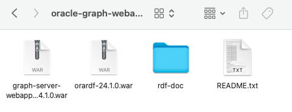

## 14.1 Installing RDF Graph Query UI

In order to get started on Oracle RDF Graph Query UI, you must download and install the application.

You can download RDF Graph Query UI using one of the following options:

- Download Oracle Property Graph and Oracle RDF Graph Webapps from [Oracle Graph Server and Client Downloads](https://www.oracle.com/database/technologies/spatialandgraph/property-graph-features/graph-server-and-client/graph-server-and-client-downloads.html) page on Oracle Technology Network.
- Download the Oracle Graph Webapps component in Oracle Graph Server and Client deployment from [Oracle Software Delivery Cloud](https://edelivery.oracle.com/osdc/faces/Home.jspx).

The downloaded `oracle-graph-webapps-<version>.zip` deployment contains the files as shown in the following figure:

Figure 14-1 Oracle Graph Webapps deployment

[Description of "Figure 14-1 Oracle Graph Webapps deployment"](img_text/downloads.md)

The deployment of the RDF `.war` file provides the Oracle RDF Graph Query UI console.

**Note:**

Starting from Release 24.1.0, the RDF Graph Query UI web application is based on JDK 11. Therefore, ensure that the application servers (WebLogic or Tomcat) support JDK 11. In the case of the WebLogic server, use version 14.1.1.0.

The `rdf-doc` folder contains the User Guide documentation.

This deployment also includes the REST API running on the application server to handle communication between users and backend RDF data stores.

**Parent topic:** [Oracle RDF Graph Query UI](oracle-rdf-graph-query-ui.md)
