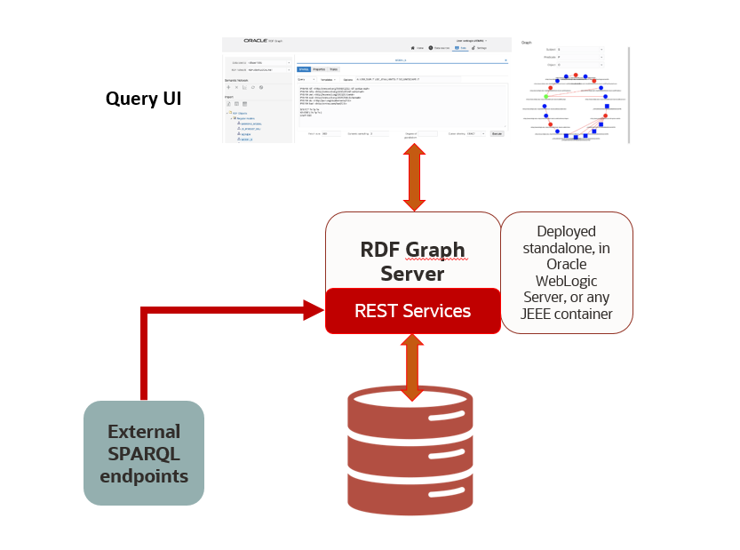

## 12 Introduction to RDF Graph Server and Query UI

The RDF Graph Server and Query UI allows you to run SPARQL queries and perform advanced RDF graph data management operations using a REST API and an Oracle JET based query UI.

The RDF Graph Server and Query UI consists of RDF RESTful services and a Java EE client application called RDF Graph Query UI. This client serves as an administrative console for Oracle RDF and can be deployed to a Java EE container.

The RDF Graph Server and RDF RESTful services can be used to create a SPARQL endpoint for RDF graphs in Oracle Database.

The following figure shows the RDF Graph Server and Query UI architecture:

Figure 12-1 RDF Graph Server and Query UI

[Description of "Figure 12-1 RDF Graph Server and Query UI"](img_text/architecture.md)

The salient features of the RDF Graph Query UI are as follows:

- Uses RDF RESTful services to communicate with RDF data stores, which can be an Oracle RDF data source or an external RDF data source.

- Allows you to perform CRUD operations on various RDF objects such as private networks, models, rule bases, entailments, network indexes and data types for Oracle data sources.

- Allows you to execute SPARQL queries and update RDF data.

- Provides a graph view of SPARQL query results.

- Uses Oracle JET for user application web pages.

**Parent topic:** [RDF Graph Server and Query UI](rdf-graph-server-and-query-ui.md)
