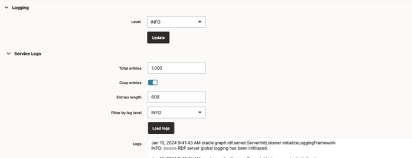

## 14.3.3.4 Logging JSON Configuration File

The Logging JSON configuration file contains the logging settings. You can specify the logging level.

For Administrators and RDF users, it is also possible to load the logs for further analysis.

Figure 14-76 Logging JSON Configuration File

[Description of "Figure 14-76 Logging JSON Configuration File"](img_text/logging_json_file.md)

**Parent topic:** [Configuration Files for RDF Server and Client](configuration-files-rdf-server-and-client.md)
