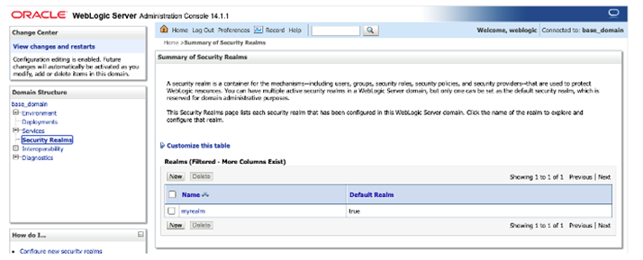

## 14.2.1 Managing Groups and Users in WebLogic Server

The security realms in WebLogic Server ensures that the user information entered as a part of installation is added by default to the Administrators group. Any user assigned to this group will have full access to the RDF Graph Query UI application.

To open the WebLogic Server Administration Console, enter `http://localhost:7101/console` in your browser and logon using your administrative credentials. Click on Security Realms as shown in the following figure:

Figure 14-3 WebLogic Server Administration Console

[Description of "Figure 14-3 WebLogic Server Administration Console"](img_text/user_admin_web_logic.md)

- [Creating User Groups in WebLogic Server](creating-users-and-groups-weblogic-server.md)
- [Creating RDF and Guest Users in WebLogic Server](create-rdf-and-guest-users-weblogic-server.md)

**Parent topic:** [Managing User Roles for RDF Graph Query UI](managing-user-roles-rdf-graph-query-ui.md)
