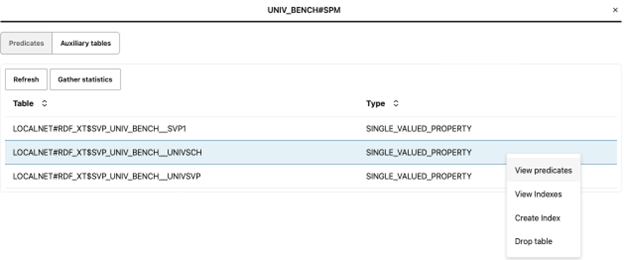
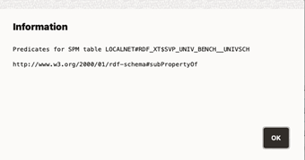
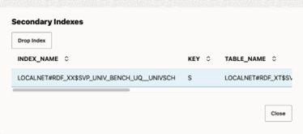
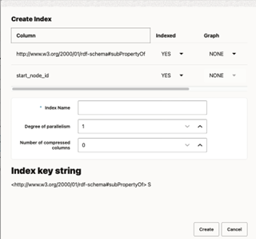
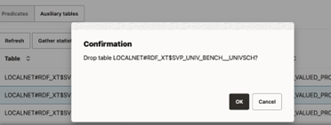

## 14.3.2.10.2 Managing Auxiliary Tables

You can view the list of existing auxiliary tables for an RDF model in the Auxiliary tables section.

- You can access the table information related to the predicates and manage the secondary indexes as shown:
  Figure 14-48 List of Auxiliary Tables

  
  [Description of "Figure 14-48 List of Auxiliary Tables"](img_text/manage_auxiliary_tables.md)
  You can perform the following actions:

  - Click View predicates to view the predicates that are associated with an SPM table.
    Figure 14-49 Viewing the Predicate Information for an SPM table

    
    [Description of "Figure 14-49 Viewing the Predicate Information for an SPM table"](img_text/view_predicates.md)

  - Click View Indexes to view the secondary indexes that are associated with an SPM table.

    Figure 14-50 Viewing the Secondary Indexes

    
    [Description of "Figure 14-50 Viewing the Secondary Indexes"](img_text/view_indexes.md)
    Optionally, you can also drop selected indexes.

  - Click Create Index to create a secondary index on an SPM table.

    Figure 14-51 Creating a Secondary Index

    
    [Description of "Figure 14-51 Creating a Secondary Index"](img_text/create_index.md)
    This dialog aims to build the index key string value which is used for creating a unique index on an SPM table. This index key string value is built as per your configurations in the preceding figure and is displayed as a read only value. For instance:
    - The order of the columns defines the index order during creation.
    - The number of compressed columns is determined by the row order in the table. If the value is one, then the column in the first row will be compressed. Similarly, if the value is two, then two columns in the first two rows will be compressed, and so on. A zero value indicates that there are no columns for compression.

    See [Creating Secondary Indexes on SPM Auxiliary Tables](rdf-semantic-graph-overview.md) for more information on this key column.

  - Click Drop table and confirm to drop an SPM table.
    Figure 14-52 Dropping an SPM Table

    
    [Description of "Figure 14-52 Dropping an SPM Table"](img_text/drop_table.md)

**Parent topic:** [Support for Auxiliary Tables](support-result-tables.md)
