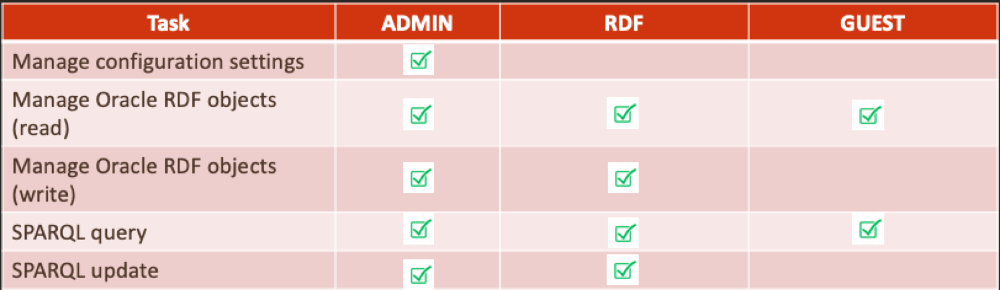

## 14.2 Managing User Roles for RDF Graph Query UI

Users will have access to the application resources based on their role level. In order to access the Query UI application, you need to enable a role for the user.

The following describes the different user roles and their privileges:

- Administrator: An administrator has full access to the Query UI application and can update configuration files, manage RDF objects and can execute SPARQL queries and SPARQL updates.

- RDF: A RDF user can read or write Oracle RDF objects and can execute SPARQL queries and SPARQL updates. But, cannot modify configuration files.

- Guest: A guest user can only read Oracle RDF objects and can only execute SPARQL queries.

Figure 14-2 User Roles for RDF Graph Query

[Description of "Figure 14-2 User Roles for RDF Graph Query"](img_text/user_roles.md)

Application servers, such as WebLogic Server, Tomcat, and others, allow you to define and assign users to user groups. Administrators are set up at the time of the RDF Graph server installation, but the RDF and guest users must be created to access the application console.

- [Managing Groups and Users in WebLogic Server](managing-groups-and-users-weblogic-server.md)
- [Managing Users and Roles in Tomcat Server](managing-users-tomcat-server.md)

**Parent topic:** [Oracle RDF Graph Query UI](oracle-rdf-graph-query-ui.md)
