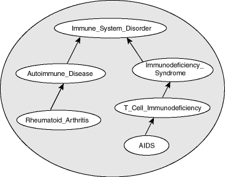

## 3  OWL Concepts

You should understand key concepts related to the support for a subset of the Web Ontology Language (OWL).

This chapter builds on the information in [RDF Semantic Graph Overview](rdf-semantic-graph-overview.md), and it assumes that you are familiar with the major concepts associated with OWL, such as ontologies, properties, and relationships. For detailed information about OWL, see the OWL Web Ontology Language Reference at [`http://www.w3.org/TR/owl-ref/`](http://www.w3.org/TR/owl-ref/).

- Ontologies
  An ontology is a shared conceptualization of knowledge in a particular domain.
- Using OWL Inferencing
  You can use entailment rules to perform native OWL inferencing.
- Using Semantic Operators to Query Relational Data
  You can use semantic operators to query relational data in an ontology-assisted manner, based on the semantic relationship between the data in a table column and terms in an ontology.

**Parent topic:** [Conceptual and Usage Information](part-concept-usage.md)

### 3.1 Ontologies

An ontology is a shared conceptualization of knowledge in a particular domain.

It consists of a collection of classes, properties, and optionally instances. Classes are typically related by class hierarchy (subclass/ superclass relationship). Similarly, the properties can be related by property hierarchy (subproperty/ superproperty relationship). Properties can be symmetric or transitive, or both. Properties can also have domain, ranges, and cardinality constraints specified for them.

RDFS-based ontologies only allow specification of class hierarchies, property hierarchies, `instanceOf` relationships, and a domain and a range for properties.

OWL ontologies build on RDFS-based ontologies by additionally allowing specification of property characteristics. OWL ontologies can be further classified as OWL-Lite, OWL-DL, and OWL Full. OWL-Lite restricts the cardinality minimum and maximum values to 0 or 1. OWL-DL relaxes this restriction by allowing minimum and maximum values. OWL Full allows instances to be also defined as a class, which is not allowed in OWL-DL and OWL-Lite ontologies.

Supported OWL Subsets describes OWL capabilities that are supported and not supported with semantic data.

- Example: Disease Ontology
- Supported OWL Subsets

**Parent topic:** OWL Concepts

#### 3.1.1 Example: Disease Ontology

Figure 3-1 shows part of a disease ontology, which describes the classes and properties related to certain diseases. One requirement is to have a PATIENTS data table with a column named DIAGNOSIS, which must contain a value from the `Diseases_and_Disorders` class hierarchy.

Figure 3-1 Disease Ontology Example

[Description of "Figure 3-1 Disease Ontology Example"](img_text/cancer_ontology.md)

In the disease ontology shown in Figure 3-1, the diagnosis `Immune_System_Disorder` includes two subclasses, `Autoimmune_Disease` and `Immunodeficiency_Syndrome`. The `Autoimmune_Disease` diagnosis includes the subclass `Rheumatoid_Arthritis`; and the `Immunodeficiency_Syndrome` diagnosis includes the subclass `T_Cell_Immunodeficiency`, which includes the subclass `AIDS`.

The data in the PATIENTS table might include the PATIENT_ID and DIAGNOSIS column values shown in Table 3-1.

Table 3-1 PATIENTS Table Example Data

| PATIENT_ID | DIAGNOSIS                 |
|:-----------|:--------------------------|
| 1234       | Rheumatoid_Arthritis      |
| 2345       | Immunodeficiency_Syndrome |
| 3456       | AIDS                      |

To query ontologies, you can use the SEM_MATCH table function or the SEM_RELATED operator and its ancillary operators.

**Related Topics**

- [Using the SEM_MATCH Table Function to Query Semantic Data](rdf-semantic-graph-overview.md)
- Using Semantic Operators to Query Relational Data

**Parent topic:** Ontologies

#### 3.1.2 Supported OWL Subsets

This section describes OWL vocabulary subsets that are supported.

Oracle Database supports the RDFS++, OWLSIF, and OWLPrime vocabularies, which have increasing expressivity, as well as OWL 2 RL. Each supported vocabulary has a corresponding rulebase; however, these rulebases do not need to be populated because the underlying entailment rules of these three vocabularies are internally implemented. The supported vocabularies are as follows:

- RDFS++: A minimal extension to RDFS; which is RDFS plus `owl:sameAs` and `owl:InverseFunctionalProperty`.

- OWLSIF: OWL with IF Semantic, with the vocabulary and semantics proposed for pD\* semantics in Completeness, decidability and complexity of entailment for RDF Schema and a semantic extension involving the OWL vocabulary, by H.J. Horst, Journal of Web Semantics 3, 2 (2005), 79–115.

- OWLPrime: The following OWL capabilities:

  - Basics: class, subclass, property, subproperty, domain, range, type

  - Property characteristics: transitive, symmetric, functional, inverse functional, inverse

  - Class comparisons: equivalence, disjointness

  - Property comparisons: equivalence

  - Individual comparisons: same, different

  - Class expressions: complement

  - Property restrictions: `hasValue`, `someValuesFrom`, `allValuesFrom`

    As with pD\*, the supported semantics for these value restrictions are only intensional (IF semantics).

- OWL 2 RL: Described in the "OWL 2 RL" section of the W3C OWL 2 Web Ontology Language Profiles recommendation ([`http://www.w3.org/TR/owl2-profiles/#OWL_2_RL`](http://www.w3.org/TR/owl2-profiles/#OWL_2_RL)) as: "The OWL 2 RL profile is aimed at applications that require scalable reasoning without sacrificing too much expressive power. It is designed to accommodate both OWL 2 applications that can trade the full expressivity of the language for efficiency, and RDF(S) applications that need some added expressivity from OWL 2."

  The system-defined rulebase `OWL2RL` supports all the standard production rules defined for OWL 2 RL. As with `OWLPRIME`, users will not see any rules in this OWL2RL rulebase. The rulebase `OWL2RL` will be created automatically if it does not already exist.

  The following code excerpt uses the OWL2RL rulebase:

      CREATE TABLE m1_tpl (triple SDO_RDF_TRIPLE_S) COMPRESS;
      EXECUTE sem_apis.create_sem_model('m1','m1_tpl','triple',network_owner=>'RDFUSER',network_name=>'NET1');
      -- Insert data into model M1. Details omitted
      ...
      -- Now run inference using the OWL2RL rulebase
      EXECUTE sem_apis.create_entailment('m1_inf',sem_models('m1'),sem_rulebases('owl2rl'),network_owner=>'RDFUSER',network_name=>'NET1');

  Note that inference-related optimizations, such as parallel inference and RAW8, are all applicable when the `OWL2RL` rulebase is used.

- OWL 2 EL: Described in the "OWL 2 EL" section of the W3C OWL 2 Web Ontology Language Profiles recommendation ([`http://www.w3.org/TR/owl2-profiles/#OWL_2_EL`](http://www.w3.org/TR/owl2-profiles/#OWL_2_EL)) as: "The OWL 2 EL profile is designed as a subset of OWL 2 that

  - is particularly suitable for applications employing ontologies that define very large numbers of classes and/or properties,

  - captures the expressive power used by many such ontologies, and

  - for which ontology consistency, class expression subsumption, and instance checking can be decided in polynomial time."

  A prime example of OWL 2 EL ontology is the biomedical ontology SNOMED Clinical Terms (SNOMED CT). For information about SNOMED CT, see: [`http://www.ihtsdo.org/snomed-ct/`](http://www.ihtsdo.org/snomed-ct/)

  The system-defined rulebase `OWL2EL` supports the EL syntax.

  As with `OWLPRIME` and `OWL2RL`, users will not see any rules in this `OWL2EL` rulebase, and the `OWL2EL` rulebase will be created automatically if it does not already exist.

  The following code excerpt uses the `OWL2EL` rulebase against the well known SNOMED ontology:

      CREATE TABLE snomed_tpl (triple SDO_RDF_TRIPLE_S) COMPRESS;
      EXECUTE sem_apis.create_sem_model('snomed','snomed_tpl','triple',network_owner=>'RDFUSER',network_name=>'NET1') compress;
      -- Insert data into model SNOMED. Details omitted
      ...
      -- Now run inference using the OWL2EL rulebase
      EXECUTE sem_apis.create_entailment('snomed_inf',sem_models('snomed'),sem_rulebases('owl2el'),network_owner=>'RDFUSER',network_name=>'NET1');

  Note that the `OWL2EL` rulebase support does not include reflexive object properties (`ReflexiveObjectProperty`) simply because a reflexive object property will link every individual with itself, which would probably cause an unnecessary and costly expansion of the inference graph.

Table 3-2 lists the RDFS/OWL vocabulary constructs included in each supported rulebase.

Table 3-2 RDFS/OWL Vocabulary Constructs Included in Each Supported Rulebase

| Rulebase Name | RDFS/OWL Constructs Included                                                                                                                                                                                                                                                                                                                                                             |
|:--------------|:-----------------------------------------------------------------------------------------------------------------------------------------------------------------------------------------------------------------------------------------------------------------------------------------------------------------------------------------------------------------------------------------|
| RDFS++        | all RDFS vocabulary constructs owl:InverseFunctionalProperty owl:sameAs                                                                                                                                                                                                                                                                                                            |
| OWLSIF        | all RDFS vocabulary constructs owl:FunctionalProperty owl:InverseFunctionalProperty owl:SymmetricProperty owl:TransitiveProperty owl:sameAs owl:inverseOf owl:equivalentClass owl:equivalentProperty owl:hasValue owl:someValuesFrom owl:allValuesFrom                                                                                                  |
| OWLPrime      | rdfs:subClassOf rdfs:subPropertyOf rdfs:domain rdfs:range owl:FunctionalProperty owl:InverseFunctionalProperty owl:SymmetricProperty owl:TransitiveProperty owl:sameAs owl:inverseOf owl:equivalentClass owl:equivalentProperty owl:hasValue owl:someValuesFrom owl:allValuesFrom owl:differentFrom owl:disjointWith owl:complementOf |
| OWL2RL        | (As described in [`http://www.w3.org/TR/owl2-profiles/#OWL_2_RL`](http://www.w3.org/TR/owl2-profiles/#OWL_2_RL))                                                                                                                                                                                                                                                                         |
| OWL2EL        | (As described in [`http://www.w3.org/TR/owl2-profiles/#OWL_2_EL`](http://www.w3.org/TR/owl2-profiles/#OWL_2_EL))                                                                                                                                                                                                                                                                         |

**Parent topic:** Ontologies

### 3.2 Using OWL Inferencing

You can use entailment rules to perform native OWL inferencing.

This section creates a simple ontology, performs native inferencing, and illustrates some more advanced features.

- Creating a Simple OWL Ontology
- Performing Native OWL inferencing
- Performing OWL and User-Defined Rules Inferencing
- Generating OWL inferencing Proofs
- Validating OWL Models and Entailments
- Using SEM_APIS.CREATE_ENTAILMENT for RDFS Inference
- Enhancing Inference Performance
- Optimizing owl:sameAs Inference
- Performing Incremental Inference
- Using Parallel Inference
- Using Named Graph Based Inferencing (Global and Local)
- Performing Selective Inferencing (Advanced Information)

**Parent topic:** OWL Concepts

#### 3.2.1 Creating a Simple OWL Ontology

Example 3-1 creates a simple OWL ontology, inserts one statement that two URIs refer to the same entity, and performs a query using the SEM_MATCH table function.

Example 3-1 Creating a Simple OWL Ontology

    SQL> CREATE TABLE owltst(id number, triple sdo_rdf_triple_s);
    Table created.

    SQL> EXECUTE sem_apis.create_sem_model('owltst','owltst','triple',network_owner=>'RDFUSER',network_name=>'NET1');
    PL/SQL procedure successfully completed.

    SQL> INSERT INTO owltst VALUES (1, sdo_rdf_triple_s('owltst',
           'http://example.com/name/John', 'http://www.w3.org/2002/07/owl#sameAs',
           'http://example.com/name/JohnQ','RDFUSER','NET1'));
    1 row created.

    SQL> commit;

    SQL> -- Use SEM_MATCH to perform a simple query.
    SQL> select s$rdfterm,p$rdfterm,o$rdfterm from table(SEM_MATCH('SELECT * WHERE {?s ?p  ?o}', SEM_Models('OWLTST'),
               null,  null, null, null, 'PLUS_RDFT=VC', null, null, 'RDFUSER', 'NET1'));

**Parent topic:** Using OWL Inferencing

#### 3.2.2 Performing Native OWL inferencing

Example 3-2 calls the [SEM_APIS.CREATE_ENTAILMENT](SEM_APIS-reference.md) procedure. You do not need to create the rulebase and add rules to it, because the OWL rules are already built into the RDF Semantic Graph inferencing engine.

Example 3-2 Performing Native OWL Inferencing

    SQL> -- Invoke the following command to run native OWL inferencing that
    SQL> -- understands the vocabulary defined in the preceding section.
    SQL>
    SQL>  EXECUTE sem_apis.create_entailment('owltst_idx', sem_models('owltst'), sem_rulebases('OWLPRIME'), network_owner=>'RDFUSER', network_name=>'NET1');
    PL/SQL procedure successfully completed.

    SQL> -- The following view is generated to represent the entailed graph (rules index).
    SQL> desc mdsys.semi_owltst_idx;

    SQL> -- Run the preceding query with an additional rulebase parameter to list
    SQL> -- the original graph plus the inferred triples.
    SQL> SELECT s$rdfterm,p$rdfterm,o$rdfterm FROM table(SEM_MATCH('SELECT * WHERE {?s ?p  ?o}', SEM_MODELS('OWLTST'),
               SEM_RULEBASES('OWLPRIME'),  null, null, null, null, 'PLUS_RDFT=VC', null, null, 'RDFUSER', 'NET1'));

**Parent topic:** Using OWL Inferencing

#### 3.2.3 Performing OWL and User-Defined Rules Inferencing

Example 3-3 creates a user-defined rulebase, inserts a simplified `uncleOf` rule (stating that the brother of one's father is one's uncle), and calls the [SEM_APIS.CREATE_ENTAILMENT](SEM_APIS-reference.md) procedure.

Example 3-3 Performing OWL and User-Defined Rules Inferencing

    SQL> -- First, insert the following assertions.

    SQL> INSERT INTO owltst VALUES (1, sdo_rdf_triple_s('owltst',
           'http://example.com/name/John', 'http://example.com/rel/fatherOf',
           'http://example.com/name/Mary', 'RDFUSER', 'NET1'));

    SQL> INSERT INTO owltst VALUES (1, sdo_rdf_triple_s('owltst',
           'http://example.com/name/Jack', 'http://example.com/rel/brotherOf',
           'http://example.com/name/John', 'RDFUSER', 'NET1'));

    SQL> -- Create a user-defined rulebase.

    SQL> EXECUTE sem_apis.create_rulebase('user_rulebase', network_owner=>'RDFUSER', network_name=>'NET1');

    SQL> -- Insert a simple "uncle" rule.

    SQL> INSERT INTO RDFUSER.NET1#SEMR_USER_RULEBASE VALUES ('uncle_rule',
    '(?x <http://example.com/rel/brotherOf> ?y)(?y <http://example.com/rel/fatherOf> ?z)',
    NULL, '(?x <http://example.com/rel/uncleOf> ?z)', null);

    SQL>  -- In the following statement, 'USER_RULES=T' is required, to
    SQL> --  include the original graph plus the inferred triples.
    SQL> EXECUTE sem_apis.create_entailment('owltst2_idx', sem_models('owltst'),
              sem_rulebases('OWLPRIME','USER_RULEBASE'),
              SEM_APIS.REACH_CLOSURE, null, 'USER_RULES=T', network_owner=>'RDFUSER', network_name=>'NET1');

    SQL> -- In the result of the following query, :Jack :uncleOf :Mary is inferred.
    SQL> SELECT s$rdfterm,p$rdfterm,o$rdfterm FROM table(SEM_MATCH('SELECT * WHERE {?s ?p  ?o}',
               SEM_MODELS('OWLTST'),
               SEM_RULEBASES('OWLPRIME','USER_RULEBASE'),  null, null, null, null, 'PLUS_RDFT=VC', null, null, 'RDFUSER', 'NET1'));

For performance, the inference engine by default executes each user rule without checking the syntax legality of inferred triples (for example, literal value as a subject, blank node as a predicate) until after the last round of entailment. After completing the last entailment round, the inference engine removes all syntactically illegal triples without throwing any errors for these triples. However, because triples with illegal syntax may exist during multiple rounds of inference, rules can use these triples as part of their antecedents. For example, consider the following user-defined rules:

- Rule 1:

      (?s :account ?y)
      (?s :country :Spain) --> (?y rdf:type :SpanishAccount)

- Rule 2:

      (?s :account ?y)
      (?y rdf:type :SpanishAccount) --> (?s :language "es_ES")

Rule 1 finds all Spanish users and designates their accounts as Spanish accounts. Rule 2 sets the language for all users with Spanish accounts to `es_ES` (Spanish). Consider the following data, displayed in Turtle format:

    :Juan      :account "123ABC4Z"
               :country :Spain

    :Alejandro :account "5678DEF9Y"
               :country :Spain

Applying Rule 1 and Rule 2 produces the following inferred triples:

    (:Juan      :language "es_ES")
    (:Alejandro :language "es_ES")

Note there are no triples specifying which accounts are of type `:SpanishAccount`. The user-defined rules infer those triples during creation of the entailment, but the inference engine removes them after the last round of inference because they contain illegal syntax. The accounts are the literal values, which cannot be used as subjects in an RDF triple.

To force the checking of syntax legality of inferred triples, add the `/*+ ENABLE_SYNTAX_CHECKING */` optimizer hint to the beginning of the rule's FILTER expression. Forcing syntax checking for a rule can result in a performance penalty and will throw an exception for any syntactically illegal triples. The following example, similar to Rule 1, forces syntax checking. (In addition, merely to illustrate the use of a filter expression, the example restricts accounts to those that do not end with the letter '`Z`'.)

    INSERT INTO RDFUSER.NET1#SEMR_USER_RULEBASE VALUES (
      'spanish_account_rule',
      '(?s <http://example.com/account> ?y)(?y <http://example.com/account> <http://example.com/Spain>)',
      '/*+ ENABLE_SYNTAX_CHECKING */ y not like ''%Z'' ',
      '(?y <http://www.w3.org/1999/02/22-rdf-syntax-ns#type> <http://example.com/SpanishAccount>)',
      NULL
    );

**Parent topic:** Using OWL Inferencing

#### 3.2.4 Generating OWL inferencing Proofs

OWL inference can be complex, depending on the size of the ontology, the actual vocabulary (set of language constructs) used, and the interactions among those language constructs. To enable you to find out how a triple is derived, you can use proof generation during inference. (Proof generation does require additional CPU time and disk resources.)

To generate the information required for proof, specify `PROOF=T` in the call to the [SEM_APIS.CREATE_ENTAILMENT](SEM_APIS-reference.md) procedure, as shown in the following example:

    EXECUTE sem_apis.create_entailment('owltst_idx', sem_models('owltst'), -
      sem_rulebases('owlprime'), SEM_APIS.REACH_CLOSURE, 'SAM', 'PROOF=T', network_owner=>'RDFUSER', network_name=>'NET1');

Specifying `PROOF=T` causes a view to be created containing proof for each inferred triple. The view name is the entailment name prefixed by `MDSYS.SEMI_`. Two relevant columns in this view are LINK_ID and EXPLAIN (the proof). The following example displays the LINK_ID value and proof of each generated triple (with LINK_ID values shortened for simplicity):

    SELECT link_id || ' generated by ' || explain as
              triple_and_its_proof FROM RDFUSER.NET1#SEMI_OWLST_IDX;

    TRIPLE_AND_ITS_PROOF
    --------------------------------------------------------------------
    8_5_5_4 generated by 4_D_5_5 : SYMM_SAMH_SYMM
    8_4_5_4 generated by 8_5_5_4 4_D_5_5 : SAM_SAMH
    . . .

A proof consists of one or more triple (link) ID values and the name of the rule that is applied on those triples:

`link-id1` \[`link-id2` ... l`ink-idn`\] : `rule-name`

Example 3-4 Displaying Proof Information

To get the full subject, predicate, and object URIs for proofs, you can query the model view and the entailment (rules index) view. Example 3-4 displays the LINK_ID value and associated triple contents using the model view SEMM_OWLTST and the entailment view SEMI_OWLTST_IDX.

    SELECT to_char(x.triple.rdf_m_id, 'FMXXXXXXXXXXXXXXXX') ||'_'||
           to_char(x.triple.rdf_s_id, 'FMXXXXXXXXXXXXXXXX') ||'_'||
           to_char(x.triple.rdf_p_id, 'FMXXXXXXXXXXXXXXXX') ||'_'||
           to_char(x.triple.rdf_c_id, 'FMXXXXXXXXXXXXXXXX'),
           x.triple.get_triple()
      FROM (
       SELECT sdo_rdf_triple_s(
               t.canon_end_node_id,
               t.model_id,
               t.start_node_id,
               t.p_value_id,
               t.end_node_id) triple
         FROM (select * from rdfuser.net1#semm_owltst union all
               select * from rdfuser.net1#semi_owltst_idx
              ) t
        WHERE t.link_id IN ('4_D_5_5','8_5_5_4')
      ) x;

       LINK_ID  X.TRIPLE.GET_TRIPLE()(SUBJECT, PROPERTY, OBJECT)
    ----------  --------------------------------------------------------------
    4_D_5_5 SDO_RDF_TRIPLE('<http://example.com/name/John>', '<http://www.w3.org/2002/07/owl#sameAs>', '<http://example.com/name/JohnQ>')
    8_5_5_4 SDO_RDF_TRIPLE('<http://example.com/name/JohnQ>', '<http://www.w3.org/2002/07/owl#sameAs>', '<http://example.com/name/John>')

In Example 3-4, for the proof entry 8_5_5_4 generated by 4_D_5_5 : SYMM_SAMH_SYMM for the triple with LINK_ID = 8_5_5_4, it is inferred from the triple with 4_D_5_5 using the symmetricity of `owl:sameAs`.

If the entailment status is INCOMPLETE and if the last entailment was generated without proof information, you cannot invoke [SEM_APIS.CREATE_ENTAILMENT](SEM_APIS-reference.md) with `PROOF=T`. In this case, you must first drop the entailment and create it again specifying `PROOF=T`.

**Parent topic:** Using OWL Inferencing

#### 3.2.5 Validating OWL Models and Entailments

An OWL ontology may contain errors, such as unsatisfiable classes, instances belonging to unsatisfiable classes, and two individuals asserted to be same and different at the same time. You can use the [SEM_APIS.VALIDATE_MODEL](SEM_APIS-reference.md) and [SEM_APIS.VALIDATE_ENTAILMENT](SEM_APIS-reference.md) functions to detect inconsistencies in the original data model and in the entailment, respectively.

Example 3-5 Validating an Entailment

Example 3-5 shows uses the [SEM_APIS.VALIDATE_ENTAILMENT](SEM_APIS-reference.md) function, which returns a null value if no errors are detected or a VARRAY of strings if any errors are detected.

    SQL>  -- Insert an offending triple.
    SQL>  insert into owltst values (1, sdo_rdf_triple_s('owltst',
                 'urn:C1', 'http://www.w3.org/2000/01/rdf-schema#subClassOf', 'http://www.w3.org/2002/07/owl#Nothing', 'RDFUSER', 'NET1'));

    SQL> -- Drop entailment first.
    SQL>  exec sem_apis.drop_entailment('owltst_idx', network_owner=>'RDFUSER', network_name=>'NET1');
    PL/SQL procedure successfully completed.

    SQL> -- Perform OWL inferencing.
    SQL> exec sem_apis.create_entailment('owltst_idx', sem_models('OWLTST'), sem_rulebases('OWLPRIME') , network_owner=>'RDFUSER', network_name=>'NET1');
    PL/SQL procedure successfully completed.

    SQL > set serveroutput on;
    SQL > -- Now invoke validation API: sem_apis.validate_entailment
    SQL >
    declare
      lva mdsys.rdf_longVarcharArray;
      idx int;
    begin
      lva := sem_apis.validate_entailment(sem_models('OWLTST'), sem_rulebases('OWLPRIME'), network_owner=>'RDFUSER', network_name=>'NET1') ;

      if (lva is null) then
       dbms_output.put_line('No errors found.');
      else
        for idx in 1..lva.count loop
          dbms_output.put_line('Offending entry := ' || lva(idx)) ;
        end loop ;
      end if;
    end ;
    /

    SQL> -- NOTE: The LINK_ID value and the numbers in the following
    SQL> -- line are shortened for simplicity in this example. --

              Offending entry  := 1 10001 (4_2_4_8 2 4 8) Unsatisfiable class.

Each item in the validation report array includes the following information:

- Number of triples that cause this error (`1` in Example 3-5)

- Error code (`10001` Example 3-5)

- One or more triples (shown in parentheses in the output; `(4_2_4_8 2 4 8)` in Example 3-5).

  These numbers are the LINK_ID value and the ID values of the subject, predicate, and object.

- Descriptive error message (`Unsatisfiable class.` in Example 3-5)

The output in Example 3-5 indicates that the error is caused by one triple that asserts that a class is a subclass of an empty class `owl:Nothing`.

**Parent topic:** Using OWL Inferencing

#### 3.2.6 Using SEM_APIS.CREATE_ENTAILMENT for RDFS Inference

In addition to accepting OWL vocabularies, the [SEM_APIS.CREATE_ENTAILMENT](SEM_APIS-reference.md) procedure accepts RDFS rulebases. The following example shows RDFS inference (all standard RDFS rules are defined in `http://www.w3.org/TR/rdf-mt/`):

    EXECUTE sem_apis.create_entailment('rdfstst_idx', sem_models('my_model'), sem_rulebases('RDFS'), network_owner=>'RDFUSER', network_name=>'NET1');

Because rules RDFS4A, RDFS4B, RDFS6, RDFS8, RDFS10, RDFS13 may not generate meaningful inference for your applications, you can deselect those components for faster inference. The following example deselects these rules.

    EXECUTE sem_apis.create_entailment('rdfstst_idx', sem_models('my_model'), sem_rulebases('RDFS'), SEM_APIS.REACH_CLOSURE, -
     'RDFS4A-, RDFS4B-, RDFS6-, RDFS8-, RDFS10-, RDFS13-'), network_owner=>'RDFUSER', network_name=>'NET1');

**Parent topic:** Using OWL Inferencing

#### 3.2.7 Enhancing Inference Performance

This section describes suggestions for improving the performance of inference operations.

- Collect statistics before inferencing. After you load a large RDF/OWL data model, you should execute the [SEM_PERF.GATHER_STATS](SEM_PERF-reference.md) procedure. See the Usage Notes for that procedure (in [SEM_PERF Package Subprograms](SEM_PERF-reference.md)) for important usage information.

- Allocate sufficient temporary tablespace for inference operations. OWL inference support in Oracle relies heavily on table joins, and therefore uses significant temporary tablespace.

- Use the appropriate implementations of the SVFH and AVFH inference components.

  The default implementations of the SVFH and AVFH inference components work best when the number of restriction classes defined by `owl:someValuesFrom` and/or `owl:allValuesFrom` is low (as in the LUBM data sets). However, when the number of such classes is high (as in the Gene Ontology [`http://www.geneontology.org/`](http://www.geneontology.org/)), using non-procedural implementations of SVFH and AVFH may significantly improve performance.

  To disable the procedural implementations and to select the non-procedural implementations of SVFH and AVFH, include `'PROCSVFH=F'` and/or `'PROCAVFH=F'` in the options to [SEM_APIS.CREATE_ENTAILMENT](SEM_APIS-reference.md). Using the appropriate implementation for an ontology can provide significant performance benefits. For example, selecting the non-procedural implementation of SVFH for the NCI Thesaurus ontology (see [`http://www.cancer.gov/research/resources/terminology`](http://www.cancer.gov/research/resources/terminology)) produced a 960% performance improvement for the SVFH inference component (tested on a dual-core, 8GB RAM desktop system with 3 SATA disks tied together with Oracle ASM).

See also Optimizing owl:sameAs Inference.

**Related Topics**

- Optimizing owl:sameAs Inference

**Parent topic:** Using OWL Inferencing

#### 3.2.8 Optimizing owl:sameAs Inference

You can optimize inference performance for large `owl:sameAs` cliques by specifying `'OPT_SAMEAS=T'` in the `options` parameter when performing OWLPrime entailment. (A clique is a graph in which every node of it is connected to, bidirectionally, every other node in the same graph.)

According to OWL semantics, the `owl:sameAs` construct is treated as an equivalence relation, so it is reflexive, symmetric, and transitive. As a result, during inference a full materialization of `owl:sameAs`-related entailments could significantly increase the size of the inferred graph. Consider the following example triple set:

    :John  owl:sameAs  :John1 .
    :John  owl:sameAs  :John2 .
    :John2 :hasAge     "32" .

Applying OWLPrime inference (with the `SAM` component specified) to this set would generate the following new triples:

    :John1  owl:sameAs  :John .
    :John2  owl:sameAs  :John .
    :John1  owl:sameAs  :John2 .
    :John2  owl:sameAs  :John1 .
    :John   owl:sameAs  :John .
    :John1  owl:sameAs  :John1 .
    :John2  owl:sameAs  :John2 .
    :John   :hasAge     "32" .
    :John1  :hasAge     "32" .

In the preceding example, `:John`, `:John1` and `:John2` are connected to each other with the `owl:sameAs` relationship; that is, they are members of an `owl:sameAs` clique. To provide optimized inference for large `owl:sameAs` cliques, you can consolidate `owl:sameAs` triples without sacrificing correctness by specifying `'OPT_SAMEAS=T'` in the `options` parameter when performing OWLPrime entailment. For example:

    EXECUTE sem_apis.create_entailment('M_IDX',sem_models('M'),
       sem_rulebases('OWLPRIME'),null,null,'OPT_SAMEAS=T', network_owner=>'RDFUSER', network_name=>'NET1');

When you specify this option, for each `owl:sameAs` clique, one resource from the clique is chosen as a canonical representative and all of the inferences for that clique are consolidated around that resource. Using the preceding example, if `:John1` is the clique representative, after consolidation the inferred graph would contain only the following triples:

    :John1 owl:sameAs :John1 .
    :John1 :hasAge    "32" .

Some overhead is incurred with `owl:sameAs` consolidation. During inference, all asserted models are copied into the inference partition, where they are consolidated together with the inferred triples. Additionally, for very large asserted graphs, consolidating and removing duplicate triples incurs a large runtime overhead, so the `OPT_SAMEAS=T` option is recommended only for ontologies that have a large number of `owl:sameAs` relationships and large clique sizes.

After the OPT_SAMEAS=T option has been used for an entailment, all subsequent uses of [SEM_APIS.CREATE_ENTAILMENT](SEM_APIS-reference.md) for that entailment must also use `OPT_SAMEAS=T`, or an error will be reported. To disable optimized `sameAs` handling, you must first drop the entailment.

Clique membership information is stored in a view named SEMC\_entailment-name, where entailment-name is the name of the entailment (rules index). Each SEMC\_entailment-name view has the columns shown in Table 3-3.

Table 3-3 SEMC_entailment_name View Columns

| Column Name | Data Type | Description                                                                                 |
|:------------|:----------|:--------------------------------------------------------------------------------------------|
| MODEL_ID    | NUMBER    | ID number of the inferred model                                                             |
| VALUE_ID    | NUMBER)   | ID number of a resource that is a member of the `owl:sameAs` clique identified by CLIQUE_ID |
| CLIQUE_ID   | NUMBER    | ID number of the clique representative for the VALUE_ID resource                            |

To save space, the SEMC\_entailment-name view does not contain reflexive rows like (CLIQUE_ID, CLIQUE_ID).

- Querying owl:sameAs Consolidated Inference Graphs

**Parent topic:** Using OWL Inferencing

##### 3.2.8.1 Querying owl:sameAs Consolidated Inference Graphs

At query time, if the entailment queried was created using the `OPT_SAMEAS=T` option, the results are returned from an `owl:sameAs`-consolidated inference partition. The query results are not expanded to include the full `owl:sameAs` closure.

In the following example query, the only result returned would be `:John1`, which is the canonical clique representative.

    SELECT A FROM TABLE (
      SEM_MATCH ('SELECT ?A WHERE {?A :hasAge "32"}',SEM_MODELS('M'),
        SEM_RULEBASES('OWLPRIME'),null, null, null, null, 'PLUS_RDFT=VC', null, null, 'RDFUSER', 'NET1'));

With the preceding example, even though `:John2 :hasAge "32"` occurs in the model, it has been replaced during the inference consolidation phase where redundant triples are removed. However, you can expand the query results by performing a join with the MDSYS.SEMC\_rules-index-name view that contains the consolidated `owl:sameAs` information. For example, to get expanded result set for the preceding SEM_MATCH query, you can use the following expanded query:

    SELECT V.VALUE_NAME A_VAL FROM TABLE (
      SEM_MATCH ('SELECT ?A WHERE {?A :hasAge "32"}',SEM_MODELS('M'),
        SEM_RULEBASES('OWLPRIME'), null, null, null, null, 'PLUS_RDFT=VC', null, null, 'RDFUSER', 'NET1')) Q,
        RDFUSER.NET1#RDF_VALUE$ V, RDFUSER.NET1#SEMC_M_IDX C
      WHERE V.VALUE_ID  = C.VALUE_ID
         AND C.CLIQUE_ID = Q.A$RDFVID
      UNION ALL
        SELECT A A_VAL FROM TABLE (
          SEM_MATCH ('SELECT ?A WHERE {?A :hasAge "32"}',SEM_MODELS('M'),
            SEM_RULEBASES('OWLPRIME'), null, null, null, null, 'PLUS_RDFT=VC', null, null, 'RDFUSER', 'NET1'));

Or, you could rewrite the preceding expanded query using a left outer join, as follows:

    SELECT V.VALUE_NAME A_VAL FROM TABLE (
      SEM_MATCH ('(?A <http://hasAge> "33")',SEM_MODELS('M'),
       SEM_RULEBASES('OWLPRIME'), null, null, null, null, 'PLUS_RDFT=VC', null, null, 'RDFUSER', 'NET1')) Q,
      RDFUSER.NET1#RDF_VALUE$ V,
       (SELECT value_id, clique_id FROM RDFUSER.NET1#SEMC_M_IDX
      UNION ALL
        SELECT DISTINCT clique_id, clique_id
          FROM RDFUSER.NET1#SEMC_M_IDX) C
     WHERE Q.A$RDFVID  = c.clique_id  (+)
       AND V.VALUE_ID  = nvl(C.VALUE_ID, Q.A$RDFVID);

**Parent topic:** Optimizing owl:sameAs Inference

#### 3.2.9 Performing Incremental Inference

Incremental inference can be used to update entailments (rules indexes) efficiently after triple additions. There are two ways to enable incremental inference for an entailment:

- Specify the `options` parameter value `INC=T` when creating the entailment. For example:

      EXECUTE sem_apis.create_entailment ('M_IDX',sem_models('M'),
        sem_rulebases('OWLPRIME'),null,null, 'INC=T', network_owner=>'RDFUSER', network_name=>'NET1');

- Use the [SEM_APIS.ENABLE_INC_INFERENCE](SEM_APIS-reference.md) procedure.

  If you use this procedure, the entailment must have a VALID status. Before calling the procedure, if you do not own the models involved in the entailment, you must ensure that the respective model owners have used the [SEM_APIS.ENABLE_CHANGE_TRACKING](SEM_APIS-reference.md) procedure to enable change tracking for those models.

When incremental inference is enabled for an entailment, the parameter `INC=T` must be specified when invoking the [SEM_APIS.CREATE_ENTAILMENT](SEM_APIS-reference.md) procedure for that entailment.

Incremental inference for an entailment depends on triggers for the application tables of the models involved in creating the entailment. This means that incremental inference works only when triples are inserted in the application tables underlying the entailment using conventional path loads, unless you specify the triples by using the `delta_in` parameter in the call to the [SEM_APIS.CREATE_ENTAILMENT](SEM_APIS-reference.md) procedure, as in the following example, in which the triples from model `M_NEW` will be added to model `M`, and entailment `M_IDX` will be updated with the new inferences:

    EXECUTE sem_apis.create_entailment('M_IDX', sem_models('M'),
      sem_rulebases('OWLPRIME''), SEM_APIS.REACH_CLOSURE, null, null,
      sem_models('M_NEW'), network_owner=>'RDFUSER', network_name=>'NET1');

If multiple models are involved in the incremental inference call, then to specify the destination model to which the `delta_in` model or models are to be added, specify `DEST_MODEL=``<model_name>` in the `options` parameter. For example, the following causes the semantic data in model `M_NEW` to be added to model `M2`:

    EXECUTE sem_apis.create_entailment('M_IDX', sem_models('M1','M2','M3'),
    sem_rulebases('OWLPRIME''), SEM_APIS.REACH_CLOSURE, null, 'DEST_MODEL=M2', sem_models('M_NEW')), network_owner=>'RDFUSER', network_name=>'NET1');

Another way to bypass the conventional path loading requirement when using incremental inference is to set the UNDO_RETENTION parameter to cover the intervals between entailments when you perform bulk loading. For example, if the last entailment was created 6 hours ago, the UNDO_RETENTION value should be set to greater than 6 hours; if it is less than that, then (given a heavy workload and limited undo space) it is not guaranteed that all relevant undo information will be preserved for incremental inference to apply. In such cases, the [SEM_APIS.CREATE_ENTAILMENT](SEM_APIS-reference.md) procedure falls back to regular (non-incremental) inference.

To check if change tracking is enabled on a model, use the [SEM_APIS.GET_CHANGE_TRACKING_INFO](SEM_APIS-reference.md) procedure. To get additional information about incremental inference for an entailment, use the [SEM_APIS.GET_INC_INF_INFO](SEM_APIS-reference.md) procedure.

The following restrictions apply to incremental inference:

- It does not work with optimized `owl:sameAs` handling (`OPT_SAMEAS`), user-defined rules, VPD-enabled models, or version-enabled models.

- It supports only the addition of triples. With updates or deletions, the entailment will be completely rebuilt.

- It depends on triggers on application tables.

- Column types (RAW8 or NUMBER) used in incremental inference must be consistent. For instance, if `RAW8=T` is used to build the entailment initially, then for every subsequent [SEM_APIS.CREATE_ENTAILMENT](SEM_APIS-reference.md) call the same option must be used. To change the column type to NUMBER, you must drop and rebuild the entailment.

**Parent topic:** Using OWL Inferencing

#### 3.2.10 Using Parallel Inference

Parallel inference can improve inference performance by taking advantage of the capabilities of a multi-core or multi-CPU architectures. To use parallel inference, specify the `DOP` (degree of parallelism) keyword and an appropriate value when using the [SEM_APIS.CREATE_ENTAILMENT](SEM_APIS-reference.md) procedure. For example:

    EXECUTE sem_apis.create_entailment('M_IDX',sem_models('M'),
          sem_rulebases('OWLPRIME'), sem_apis.REACH_CLOSURE, null, 'DOP=4',
          network_owner=>'RDFUSER', network_name=>'NET1');

Specifying the DOP keyword causes parallel execution to be enabled for an Oracle-chosen set of inference components

The success of parallel inference depends heavily on a good hardware configuration of the system on which the database is running. The key is to have a "balanced" system that implements the best practices for database performance tuning and Oracle SQL parallel execution. For example, do not use a single 1 TB disk for an 800 GB database, because executing SQL statements in parallel on a single physical disk can even be slower than executing SQL statements in serial mode. Parallel inference requires ample memory; for each CPU core, you should have at least 4 GB of memory.

Parallel inference is best suited for large ontologies; however, inference performance can also improve for small ontologies.

There is some transient storage overhead associated with using parallel inference. Parallel inference builds a source table that includes all triples based on all the source RDF/OWL models and existing inferred graph. This table might use an additional 10 to 30 percent of storage compared to the space required for storing data and index of the source models.

**Parent topic:** Using OWL Inferencing

#### 3.2.11 Using Named Graph Based Inferencing (Global and Local)

The default inferencing in Oracle Database takes all asserted triples from all the source model or models provided and applies semantic rules on top of all the asserted triples until an inference closure is reached. Even if the given source models contain one or more multiple named graphs, it makes no difference because all assertions, whether part of a named graph or not, are treated the same as if they come from a single graph. (For an introduction to named graph support in RDF Semantic Graph, see [Named Graphs](rdf-semantic-graph-overview.md).)

This default inferencing can be thought of as completely "global" in that it does not consider named graphs at all.

However, if you use named graphs, you can override the default inferencing and have named graphs be considered by using either of the following features:

- Named graph based global inference (NGGI), which treats all specified named graphs as a unified graph. NGGI lets you narrow the scope of triples to be considered, while enabling great flexibility; it is explained in Named Graph Based Global Inference (NGGI).

- Named graph based local inference (NGLI), which treats each specified named graph as a separate entity. NGLI is explained in Named Graph Based Local Inference (NGLI).

For using NGGI and NGLI together, see a recommended usage flow in Using NGGI and NGLI Together.

You specify NGGI or NGLI through certain parameters and options to the [SEM_APIS.CREATE_ENTAILMENT](SEM_APIS-reference.md) procedure when you create an entailment (rules index).

- Named Graph Based Global Inference (NGGI)
- Named Graph Based Local Inference (NGLI)
- Using NGGI and NGLI Together

**Parent topic:** Using OWL Inferencing

##### 3.2.11.1 Named Graph Based Global Inference (NGGI)

Named graph based global inference (NGGI) enables you to narrow the scope of triples used for inferencing at the named graph level (as opposed to the model level). It also enables great flexibility in selecting the scope; for example, you can include triples from zero or more named graphs and/or from the default graph, and you can include all triples with a null graph name from specified models.

For example, in a hospital application you may only want to apply the inference rules on all the information contained in a set of named graphs describing patients of a particular hospital. If the patient-related named graphs contains only instance-related assertions (ABox), you can specify one or multiple additional schema related-models (TBox), as in Example 3-6.

Example 3-6 Named Graph Based Global Inference

    EXECUTE sem_apis.create_entailment(
      'patients_inf',
      models_in         => sem_models('patients','hospital_ontology'),
      rulebases_in      => sem_rulebases('owl2rl'),
      passes            => SEM_APIS.REACH_CLOSURE,
      inf_components_in => null,
      options           => 'DOP=4,RAW8=T',
      include_default_g => sem_models('hospital_ontology'),
      include_named_g   => sem_graphs('<urn:hospital1_patient1>','<urn:hospital1_patient2>'),
      inf_ng_name       => '<urn:inf_graph_for_hospital1>',
      network_owner     =>'RDFUSER',
      network_name      =>'NET1'
      );

In Example 3-6:

- Two models are involved: `patients` contains a set of named graphs where each named graph holds triples relevant to a particular patient, and `hospital_ontology` contains schema information describing concepts and relationships that are defined for hospitals. These two models together are the source models, and they set up an overall scope for the inference.

- The `include_default_g` parameter causes all triples with a NULL graph name in the specified models to participate in NGGI. In this example, all triples with a NULL graph name in model `hospital_ontology` will be included in NGGI.

- The `include_named_g` parameter causes all triples from the specified named graphs (across all source models) to participate in NGGI. In this example, triples from named graphs `<urn:hospital1_patient1>` and `<urn:hospital1_patient2>` will be included in NGGI.

- The `inf_ng_name` parameter assigns graph name `<urn:inf_graph_for_hospital1>` to all the new triples inferred by NGGI.

**Parent topic:** Using Named Graph Based Inferencing (Global and Local)

##### 3.2.11.2 Named Graph Based Local Inference (NGLI)

Named graph based local inference (NGLI) treats each named graph as a separate entity instead of viewing the graphs as a single unified graph. Inference logic is performed within the boundary of each entity. You can specify schema-related assertions (TBox) in a default graph, and that default graph will participate the inference of each named graph. For example, inferred triples based on a graph with name `G1` will be assigned the same graph name `G1` in the inferred data partition.

Assertions from any two separate named graphs will never jointly produce any new assertions.

For example, assume the following:

- Graph `G1` includes the following assertion:

      :John  :hasBirthMother  :Mary .

- Graph `G2` includes the following assertion:

      :John  :hasBirthMother  :Bella .

- The default graph includes the assertion that `:hasBirthMother `is an `owl:FunctionalProperty`. (This assertion has a null graph name.)

In this example, named graph based local inference (NGLI) will not infer that `:Mary` is `owl:sameAs :Bella` because the two assertions are from two distinct graphs, `G1` and `G2`. By contrast, a named graph based global inference (NGGI) that includes `G1`, `G2`, and the functional property definition would be able to infer that `:Mary` is `owl:sameAs :Bella`.

NGLI currently does not work together with proof generation, user-defined rules, optimized `owl:sameAs` handling, or incremental inference.

Example 3-7 Named Graph Based Local Inference

Example 3-7 shows NGLI.

    EXECUTE sem_apis.create_entailment(
      'patients_inf',
      models_in         => sem_models('patients','hospital_ontology'),
      rulebases_in      => sem_rulebases('owl2rl'),
      passes            => SEM_APIS.REACH_CLOSURE,
      inf_components_in => null,
      options           => 'LOCAL_NG_INF=T',
      network_owner=>'RDFUSER',
      network_name=>'NET1'
    );

In Example 3-7:

- The two models patients and hospital_ontology together are the source models, and they set up an overall scope for the inference, similar to the case of global inference in Example 3-6. All triples with a null graph name are treated as part of the common schema (TBox). Inference is performed within the boundary of every single named graph combined with the common schema.

- Then `options` parameter keyword-value pair `LOCAL_NG_INF=T` specifies that named graph based local inference (NGLI) is to be performed.

Note that, by design, NGLI does not apply to the default graph itself. However, you can easily apply named graph based global inference (NGGI) on the default graph and set the `inf_ng_name` parameter to null. In this way, the TBox inference is precomputed, improving the overall performance and storage consumption.

NGLI does not allow the following:

- Inferring new relationships based on a mix of triples from multiple named graphs

- Inferring new relationships using only triples from the default graph.

To get the inference that you would normally expect, you should keep schema assertions and instance assertions separate. Schema assertions (for example, `:A rdfs:subClassOf :B` and `:p1 rdfs:subPropertyOf :p2`) should be stored in the default graph as unnamed triples (with null graph names). By contrast, instance assertions (for example, `:X :friendOf :Y`) should be stored in one of the named graphs.

For a discussion and example of using NGLI to perform document-centric inference with semantically indexed documents, see [Performing Document-Centric Inference](semantic-indexing-documents.md).

**Parent topic:** Using Named Graph Based Inferencing (Global and Local)

##### 3.2.11.3 Using NGGI and NGLI Together

The following is a recommended usage flow for using NGGI and NGLI together. It assumes that TBox and ABox are stored in two separate models, that TBox contains schema definitions and all triples in the TBox have a null graph name, but that ABox consists of a set of named graphs describing instance-related data.

1.  Invoke NGGI on the TBox by itself. For example:
        EXECUTE sem_apis.create_entailment(
            'TEST_INF',
            sem_models('abox','tbox'),
            sem_rulebases('owl2rl'),
            SEM_APIS.REACH_CLOSURE,
            include_default_g=>sem_models('tbox'),
            network_owner=>'RDFUSER',
            network_name=>'NET1'
        );
2.  Invoke NGLI for all named graphs. For example:
        EXECUTE sem_apis.create_entailment(
            'TEST_INF',
            sem_models('abox','tbox'),
            sem_rulebases('owl2rl'),
            SEM_APIS.REACH_CLOSURE,
            options => 'LOCAL_NG_INF=T,ENTAIL_ANYWAY=T',
                   network_owner=>'RDFUSER',
                   network_name=>'NET1'
        );

    `ENTAIL_ANYWAY=T` is specified because the NGGI call in step 1will set the status of inferred graph to `VALID`, and the [SEM_APIS.CREATE_ENTAILMENT](SEM_APIS-reference.md) procedure call in step 2 will quit immediately unless `ENTAIL_ANYWAY=T` is specified.

**Parent topic:** Using Named Graph Based Inferencing (Global and Local)

#### 3.2.12 Performing Selective Inferencing (Advanced Information)

Selective inferencing is component-based inferencing, in which you limit the inferencing to specific OWL components that you are interested in. To perform selective inferencing, use the `inf_components_in` parameter to the [SEM_APIS.CREATE_ENTAILMENT](SEM_APIS-reference.md) procedure to specify a comma-delimited list of components. The final inferencing is determined by the union of rulebases specified and the components specified.

Example 3-8 Performing Selective Inferencing

Example 3-8 limits the inferencing to the class hierarchy from subclass (SCOH) relationship and the property hierarchy from subproperty (SPOH) relationship. This example creates an empty rulebase and then specifies the two components (`'SCOH,SPOH'`) in the call to the [SEM_APIS.CREATE_ENTAILMENT](SEM_APIS-reference.md) procedure.

    EXECUTE sem_apis.create_rulebase('my_rulebase', network_owner=>'RDFUSER', network_name=>'NET1');

    EXECUTE sem_apis.create_entailment('owltst_idx', sem_models('owltst'), sem_rulebases('my_rulebase'), SEM_APIS.REACH_CLOSURE, 'SCOH,SPOH', network_owner=>'RDFUSER', network_name=>'NET1');

The following component codes are available: `SCOH`, `COMPH`, `DISJH`, `SYMMH`, `INVH`, `SPIH`, `MBRH`, `SPOH`, `DOMH`, `RANH`, `EQCH`, `EQPH`, `FPH`, `IFPH`, `DOM`, `RAN`, `SCO`, `DISJ`, `COMP`, `INV`, `SPO`, `FP`, `IFP`, `SYMM`, `TRANS`, `DIF`, `SAM`, `CHAIN`, `HASKEY`, `ONEOF`, `INTERSECT`, `INTERSECTSCOH`, `MBRLST`, `PROPDISJH`, `SKOSAXIOMS`, `SNOMED`, `SVFH`, `THINGH`, `THINGSAM`, `UNION`, `RDFP1`, `RDFP2`, `RDFP3`, `RDFP4`, `RDFP6`, `RDFP7`, `RDFP8AX`, `RDFP8BX`, `RDFP9`, `RDFP10`, `RDFP11`, `RDFP12A`, `RDFP12B`, `RDFP12C`, `RDFP13A`, `RDFP13B`, `RDFP13C`, `RDFP14A`, `RDFP14BX`, `RDFP15`, `RDFP16`, `RDFS2`, `RDFS3`, `RDFS4a`, `RDFS4b`, `RDFS5`, `RDFS6`, `RDFS7`, `RDFS8`, `RDFS9`, `RDFS10`, `RDFS11`, `RDFS12`, `RDFS13`

The rules corresponding to components with a prefix of RDFP can be found in Completeness, decidability and complexity of entailment for RDF Schema and a semantic extension involving the OWL vocabulary, by H.J. Horst.

The syntax for deselecting a component is component_name followed by a minus (-) sign. For example, the following statement performs OWLPrime inference without calculating the `subClassOf` hierarchy:

    EXECUTE sem_apis.create_entailment('owltst_idx', sem_models('owltst'), sem_rulebases('OWLPRIME'), SEM_APIS.REACH_CLOSURE, 'SCOH-', network_owner=>'RDFUSER', network_name=>'NET1');

By default, the OWLPrime rulebase implements the transitive semantics of owl:sameAs. OWLPrime does not include the following rules (semantics):

    U   owl:sameAs   V  .
    U     p    X  .        ==>   V  p   X   .

    U   owl:sameAs   V  .
    X     p    U  .        ==>   X   p   V   .

The reason for not including these rules is that they tend to generate many assertions. If you need to include these assertions, you can include the `SAM` component code in the call to the [SEM_APIS.CREATE_ENTAILMENT](SEM_APIS-reference.md) procedure.

**Parent topic:** Using OWL Inferencing

### 3.3 Using Semantic Operators to Query Relational Data

You can use semantic operators to query relational data in an ontology-assisted manner, based on the semantic relationship between the data in a table column and terms in an ontology.

The SEM_RELATED semantic operator retrieves rows based on semantic relatedness. The SEM_DISTANCE semantic operator returns distance measures for the semantic relatedness, so that rows returned by the SEM_RELATED operator can be ordered or restricted using the distance measure. The index type MDSYS.SEM_INDEXTYPE allows efficient execution of such queries, enabling scalable performance over large data sets.

**Note:**

SEM_RELATED and SEM_DISTANCE are not supported on schema-private semantic networks.

- Using the SEM_RELATED Operator
- Using the SEM_DISTANCE Ancillary Operator
- Creating a Semantic Index of Type MDSYS.SEM_INDEXTYPE
- Using SEM_RELATED and SEM_DISTANCE When the Indexed Column Is Not the First Parameter
- Using URIPREFIX When Values Are Not Stored as URIs

**Parent topic:** OWL Concepts

#### 3.3.1 Using the SEM_RELATED Operator

Referring to the ontology example in Example: Disease Ontology, consider the following query that requires semantic matching: Find all patients whose diagnosis is of the type 'Immune_System_Disorder'. A typical database query of the PATIENTS table (described in Example: Disease Ontology) involving syntactic match will not return any rows, because no rows have a DIAGNOSIS column containing the exact value `Immune_System_Disorder`. For example the following query will not return any rows:

    SELECT diagnosis FROM patients WHERE diagnosis = 'Immune_System_Disorder';

Example 3-9 SEM_RELATED Operator

However, many rows in the patient data table are relevant, because their diagnoses fall under this class. Example 3-9 uses the SEM_RELATED operator (instead of lexical equality) to retrieve all the relevant rows from the patient data table. (In this example, the term `Immune_System_Disorder` is prefixed with a namespace, and the default assumption is that the values in the table column also have a namespace prefix. However, that might not always be the case, as explained in Using URIPREFIX When Values Are Not Stored as URIs.)

    SELECT diagnosis FROM patients
      WHERE SEM_RELATED (diagnosis,
        '<http://www.w3.org/2000/01/rdf-schema#subClassOf>',
        '<http://www.example.org/medical_terms/Immune_System_Disorder>',
        sem_models('medical_ontology'), sem_rulebases('owlprime')) = 1;

The SEM_RELATED operator has the following attributes:

    SEM_RELATED(
      sub  VARCHAR2,
      predExpr  VARCHAR2,
      obj  VARCHAR2,
      ontologyName  SEM_MODELS,
      ruleBases  SEM_RULEBASES,
      index_status  VARCHAR2,
      lower_bound INTEGER,
      upper_bound INTEGER
     ) RETURN INTEGER;

The `sub` attribute is the name of table column that is being searched. The terms in the table column are typically the subject in a \<subject, predicate, object\> triple pattern.

The `predExpr` attribute represents the predicate that can appear as a label of the edge on the path from the subject node to the object node.

The `obj` attribute represents the term in the ontology for which related terms (related by the `predExpr` attribute) have to be found in the table (in the column specified by the `sub` attribute). This term is typically the object in a \<subject, predicate, object\> triple pattern. (In a query with the equality operator, this would be the query term.)

The `ontologyName` attribute is the name of the ontology that contains the relationships between terms.

The `rulebases` attribute identifies one or more rulebases whose rules have been applied to the ontology to infer new relationships. The query will be answered based both on relationships from the ontology and the inferred new relationships when this attribute is specified.

The `index_status` optional attribute lets you query the data even when the relevant entailment (created when the specified rulebase was applied to the ontology) does not have a valid status. If this attribute is null, the query returns an error if the entailment does not have a valid status. If this attribute is not null, it must be the string `VALID`, `INCOMPLETE`, or `INVALID`, to specify the minimum status of the entailment for the query to succeed. Because OWL does not guarantee monotonicity, the value `INCOMPLETE` should not be used when an OWL Rulebase is specified.

The `lower_bound` and `upper_bound` optional attributes let you specify a bound on the distance measure of the relationship between terms that are related. See Using the SEM_DISTANCE Ancillary Operator for the description of the distance measure.

The SEM_RELATED operator returns 1 if the two input terms are related with respect to the specified `predExpr` relationship within the ontology, and it returns 0 if the two input terms are not related. If the lower and upper bounds are specified, it returns 1 if the two input terms are related with a distance measure that is greater than or equal to `lower_bound` and less than or equal to `upper_bound`.

**Parent topic:** Using Semantic Operators to Query Relational Data

#### 3.3.2 Using the SEM_DISTANCE Ancillary Operator

The SEM_DISTANCE ancillary operator computes the distance measure for the rows filtered using the SEM_RELATED operator. The SEM_DISTANCE operator has the following format:

    SEM_DISTANCE (number) RETURN NUMBER;

The `number` attribute can be any number, as long as it matches the number that is the last attribute specified in the call to the SEM_RELATED operator (see Example 3-10). The number is used to match the invocation of the ancillary operator SEM_DISTANCE with a specific SEM_RELATED (primary operator) invocation, because a query can have multiple invocations of primary and ancillary operators.

Example 3-10 SEM_DISTANCE Ancillary Operator

Example 3-10 expands Example 3-9 to show several statements that include the SEM_DISTANCE ancillary operator, which gives a measure of how closely the two terms (here, a patient's diagnosis and the term `Immune_System_Disorder`) are related by measuring the distance between the terms. Using the ontology described in Example: Disease Ontology, the distance between `AIDS` and `Immune_System_Disorder` is 3.

    SELECT diagnosis, SEM_DISTANCE(123) FROM patients
      WHERE SEM_RELATED (diagnosis,
        '<http://www.w3.org/2000/01/rdf-schema#subClassOf>',
        '<http://www.example.org/medical_terms/Immune_System_Disorder>',
        sem_models('medical_ontology'), sem_rulebases('owlprime'), 123) = 1;

    SELECT diagnosis FROM patients
      WHERE SEM_RELATED (diagnosis,
        '<http://www.w3.org/2000/01/rdf-schema#subClassOf>',
        '<http://www.example.org/medical_terms/Immune_System_Disorder>',
        sem_models('medical_ontology'), sem_rulebases('owlprime'), 123) = 1
      ORDER BY SEM_DISTANCE(123);

    SELECT diagnosis, SEM_DISTANCE(123) FROM patients
      WHERE SEM_RELATED (diagnosis,
        '<http://www.w3.org/2000/01/rdf-schema#subClassOf>',
        '<http://www.example.org/medical_terms/Immune_System_Disorder>',
        sem_models('medical_ontology'), sem_rulebases('owlprime'), 123) = 1
      AND SEM_DISTANCE(123) <= 3;

Example 3-11 Using SEM_DISTANCE to Restrict the Number of Rows Returned

Example 3-11 uses distance information to restrict the number of rows returned by the primary operator. All rows with a term related to the object attribute specified in the SEM_RELATED invocation, but with a distance of greater than or equal to 2 and less than or equal to 4, are retrieved.

    SELECT diagnosis FROM patients
      WHERE SEM_RELATED (diagnosis,
        '<http://www.w3.org/2000/01/rdf-schema#subClassOf>',
        '<http://www.example.org/medical_terms/Immune_System_Disorder>',
        sem_models('medical_ontology'), sem_rulebases('owlprime'), 2, 4) = 1;

In Example 3-11, the lower and upper bounds are specified using the `lower_bound` and `upper_bound` parameters in the SEM_RELATED operator instead of using the SEM_DISTANCE operator. The SEM_DISTANCE operator can be also be used for restricting the rows returned, as shown in the last SELECT statement in Example 3-10.

- Computation of Distance Information

**Parent topic:** Using Semantic Operators to Query Relational Data

##### 3.3.2.1 Computation of Distance Information

Distances are generated for the following properties during inference (entailment): OWL properties defined as transitive properties, and RDFS `subClassOf` and RDFS `subPropertyOf` properties. The distance between two terms linked through these properties is computed as the shortest distance between them in a hierarchical class structure. Distances of two terms linked through other properties are undefined and therefore set to null.

Each transitive property link in the original model (viewed as a hierarchical class structure) has a distance of 1, and the distance of an inferred triple is generated according to the number of links between the two terms. Consider the following hypothetical sample scenarios:

- If the original graph contains `C1 rdfs:subClassOf C2` and `C2 rdfs:subClassOf C3`, then `C1 rdfs:subClassof of C3` will be derived. In this case:

  - `C1 rdfs:subClassOf C2`: distance = 1, because it exists in the model.

  - `C2 rdfs:subClassOf C3`: distance = 1, because it exists in the model.

  - `C1 rdfs:subClassOf C3`: distance = 2, because it is generated during inference.

- If the original graph contains `P1 rdfs:subPropertyOf P2` and `P2 rdfs:subPropertyOf P3`, then P1 rdfs:subPropertyOf P3 will be derived. In this case:

  - `P1 rdfs:subPropertyOf P2`: distance = 1, because it exists in the model.

  - `P2 rdfs:subPropertyOf P3`: distance = 1, because it exists in the model.

  - `P1 rdfs:subPropertyOf P3`: distance = 2, because it is generated during inference.

- If the original graph contains `C1 owl:equivalentClass C2` and `C2 owl:equivalentClass C3`, then `C1 owl:equivalentClass C3` will be derived. In this case:

  - `C1 owl:equivalentClass C2`: distance = 1, because it exists in the model.

  - `C2 owl:equivalentClass C3`: distance = 1, because it exists in the model.

  - `C1 owl:equivalentClass C3`: distance = 2, because it is generated during inference.

The SEM_RELATED operator works with user-defined rulebases. However, using the SEM_DISTANCE operator with a user-defined rulebase is not yet supported, and will raise an error.

**Parent topic:** Using the SEM_DISTANCE Ancillary Operator

#### 3.3.3 Creating a Semantic Index of Type MDSYS.SEM_INDEXTYPE

When using the SEM_RELATED operator, you can create a semantic index of type MDSYS.SEM_INDEXTYPE on the column that contains the ontology terms. Creating such an index will result in more efficient execution of the queries. The CREATE INDEX statement must contain the `INDEXTYPE IS MDSYS.SEM_INDEXTYPE` clause, to specify the type of index being created.

Example 3-12 Creating a Semantic Index

Example 3-12 creates a semantic index named DIAGNOSIS_SEM_IDX on the DIAGNOSIS column of the PATIENTS table using the ontology in Example: Disease Ontology.

    CREATE INDEX diagnosis_sem_idx
      ON patients (diagnosis)
      INDEXTYPE IS MDSYS.SEM_INDEXTYPE;

The column on which the index is built (DIAGNOSIS in Example 3-12) must be the first parameter to the SEM_RELATED operator, in order for the index to be used. If it not the first parameter, the index is not used during the execution of the query.

Example 3-13 Creating a Semantic Index Specifying a Model and Rulebase

To improve the performance of certain semantic queries, you can cause statistical information to be generated for the semantic index by specifying one or more models and rulebases when you create the index. Example 3-13 creates an index that will also generate statistics information for the specified model and rulebase. The index can be used with other models and rulebases during query, but the statistical information will be used only if the model and rulebase specified during the creation of the index are the same model and rulebase specified in the query.

    CREATE INDEX diagnosis_sem_idx
      ON patients (diagnosis)
      INDEXTYPE IS MDSYS.SEM_INDEXTYPE('ONTOLOGY_MODEL(medical_ontology),
        RULEBASE(OWLPrime)');

Example 3-14 Query Benefitting from Generation of Statistical Information

The statistical information is useful for queries that return top-k results sorted by semantic distance. Example 3-14 shows such a query.

    SELECT /*+ FIRST_ROWS */ diagnosis FROM patients
      WHERE SEM_RELATED (diagnosis,
        '<http://www.w3.org/2000/01/rdf-schema#subClassOf>',
        '<http://www.example.org/medical_terms/Immune_System_Disorder>',
        sem_models('medical_ontology'), sem_rulebases('owlprime'), 123) = 1
      ORDER BY SEM_DISTANCE(123);

**Parent topic:** Using Semantic Operators to Query Relational Data

#### 3.3.4 Using SEM_RELATED and SEM_DISTANCE When the Indexed Column Is Not the First Parameter

If an index of type MDSYS.SEM_INDEXTYPE has been created on a table column that is the first parameter to the SEM_RELATED operator, the index will be used. For example, the following query retrieves all rows that have a value in the DIAGNOSIS column that is a subclass of (`rdfs:subClassOf`) `Immune_System_Disorder`.

    SELECT diagnosis FROM patients
      WHERE SEM_RELATED (diagnosis,
        '<http://www.w3.org/2000/01/rdf-schema#subClassOf>',
        '<http://www.example.org/medical_terms/Immune_System_Disorder>',
        sem_models('medical_ontology'), sem_rulebases('owlprime')) = 1;

Assume, however, that this query instead needs to retrieve all rows that have a value in the DIAGNOSIS column for which `Immune_System_Disorder` is a subclass. You could rewrite the query as follows:

    SELECT diagnosis FROM patients
      WHERE SEM_RELATED
        ('<http://www.example.org/medical_terms/Immune_System_Disorder>',
        '<http://www.w3.org/2000/01/rdf-schema#subClassOf>',
        diagnosis,
        sem_models('medical_ontology'), sem_rulebases('owlprime')) = 1;

However, in this case a semantic index on the DIAGNOSIS column will not be used, because it is not the first parameter to the SEM_RELATED operator. To cause the index to be used, you can change the preceding query to use the `inverseOf` keyword, as follows:

    SELECT diagnosis FROM patients
      WHERE SEM_RELATED (diagnosis,
        'inverseOf(http://www.w3.org/2000/01/rdf-schema#subClassOf)',
        '<http://www.example.org/medical_terms/Immune_System_Disorder>',
        sem_models('medical_ontology'), sem_rulebases('owlprime')) = 1;

This form causes the table column (on which the index is built) to be the first parameter to the SEM_RELATED operator, and it retrieves all rows that have a value in the DIAGNOSIS column for which `Immune_System_Disorder` is a subclass.

**Parent topic:** Using Semantic Operators to Query Relational Data

#### 3.3.5 Using URIPREFIX When Values Are Not Stored as URIs

By default, the semantic operator support assumes that the values stored in the table are URIs. These URIs can be from different namespaces. However, if the values in the table do not have URIs, you can use the URIPREFIX keyword to specify a URI when you create the semantic index. In this case, the specified URI is prefixed to the value in the table and stored in the index structure. (One implication is that multiple URIs cannot be used).

Example 3-15 creates a semantic index that uses a URI prefix.

Example 3-15 Specifying a URI Prefix During Semantic Index Creation

    CREATE INDEX diagnosis_sem_idx
      ON patients (diagnosis)
      INDEXTYPE IS MDSYS.SEM_INDEXTYPE
      PARAMETERS('URIPREFIX(<http://www.example.org/medical/>)');

The slash (/) character at the end of the URI is important, because the URI is prefixed to the table value (in the index structure) without any parsing.

**Parent topic:** Using Semantic Operators to Query Relational Data
