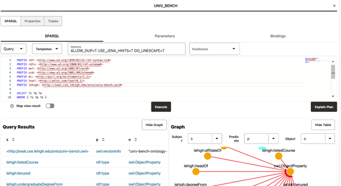
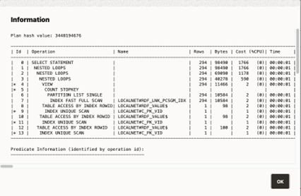
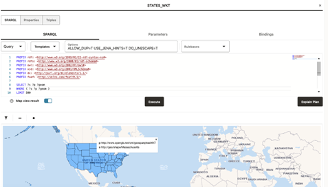

## 14.3.2.7 Performing SPARQL Query and SPARQL Update Operations

To execute SPARQL queries and updates, open the selected RDF object in the RDF objects navigator. For Oracle RDF objects, SPARQL queries are available for regular models, virtual models, and view models.

You can define the following parameters for SPARQL queries:

- SPARQL: The query string.

- RDF options: Oracle RDF options to be used when processing a query (See [Additional Query Options](rdf-support-for-apache-jena.md) for more information.).

- Runtime parameters: Fetch size, query timeout and others (this is applied to Oracle RDF data sources).

- Rulebases: Rulebase names associated with RDF model in an entailment. If none, then the selection box will be empty.

- Binding parameters: The expression `?ora__bind` is used as a binding parameter in a SPARQL string. Each binding parameter is defined by a type (uri or literal) and a value. For example:

      SELECT ?s ?p ?o WHERE { ?s ?p ?ora__bind } LIMIT 500

  An example of JSON representation of a binding parameter that can be passed to a REST query service is: `{ "type" : "literal", "value" : "abcdef" }`

The following figure shows the SPARQL tab, containing the graph view.

Figure 14-34 SPARQL Tab

[Description of "Figure 14-34 SPARQL Tab"](img_text/sparql_query_update.md)

The number of results on the SPARQL query is determined by the limit parameter in SPARQL string, or by the maximum number of rows that can be fetched from server. As an administrator you can set the maximum number of rows to be fetched in the settings page.

A graph view can be displayed for the query results. On the graph view, you must map the columns for the triple values (subject, predicate, and object). In a table view, the columns that represent URI values have hyperlinks.

Besides the Execute button to run the SPARQL query, there is also the Explain Plan button to retrieve the SQL query plan for the SPARQL. This basically displays a dialog with the EXPLAIN PLAN results and the SPARQL translation.

Figure 14-35 SQL EXPLAIN PLAN for SPARQL Translation

[Description of "Figure 14-35 SQL EXPLAIN PLAN for SPARQL Translation"](img_text/explain_plan.md)

For Oracle data sources, if the SPARQL query selects an RDF object value that represents a GeoSPARQL data type (such as `WKT`, `GML`, `KML`, or `GeoJSON`), a map visualization can be displayed by switching on Map view result. In this case, the SPARQL query must select the geometry attribute which is an RDF literal of a GeoSPARQL data type. On execution, this query will produce a GeoJSON result which is then passed to the map component for visualization. For example:

Figure 14-36 Map Visualization for GeoSPARQL Data Types in a SPARQL Query

[Description of "Figure 14-36 Map Visualization for GeoSPARQL Data Types in a SPARQL Query"](img_text/map_viz_geo_json.md)

**Parent topic:** [RDF Data Page](rdf-data-page.md)
