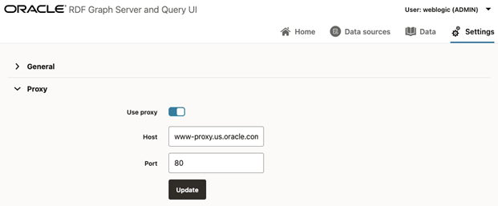

## 14.3.3.3 Proxy JSON Configuration File

The Proxy JSON configuration file contains proxy information for your enterprise network.

Figure 14-75 Proxy JSON Configuration File

[Description of "Figure 14-75 Proxy JSON Configuration File"](img_text/proxy_json_config_file.md)

The file includes the following parameters:

- Use proxy: flag to define if proxy parameters should be used.
- Host: proxy host value.
- Port: proxy port value.

**Parent topic:** [Configuration Files for RDF Server and Client](configuration-files-rdf-server-and-client.md)
