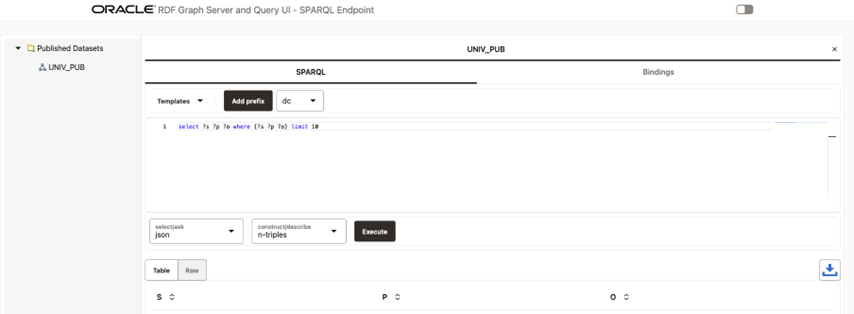
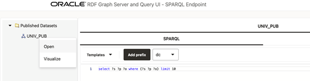

## 14.3.2.9 Published Dataset Playground

You can explore the published RDF datasets from a public web page.

You can access the page using the following URL format:

`{protocol}://{host}:{port}/{app_name}/public.html`

For example:

`http://localhost:7101/orardf/public.html`

The public web page is displayed as shown:

Figure 14-42 Public Web Page

[Description of "Figure 14-42 Public Web Page"](img_text/public_web_page_main.md)

The main components of this public page are:

- Published Datasets: contains the names of the published RDF datasets for public RDF data source. To open the RDF dataset double click it or right click the tree dataset and execute the Open menu item as shown:
  Figure 14-43 Opening a Published Dataset on the Public Page

  
  [Description of "Figure 14-43 Opening a Published Dataset on the Public Page "](img_text/public_published_rdf_ds.md)

- The tab panel on the right allows you to execute SPARQL queries against the published RDF dataset. SPARQL query results are displayed in tabular as well as graph view formats. However, if the Accessibility switch on the top right corner of the page is switched `ON`, then the results are only displayed in tabular format.

  The following options are supported in the tab panel:

  - Templates: SPARQL template queries to use.
  - Add prefix: click to add the selected prefix in the combo box to a SPARQL query.
  - SPARQL: enter the SPARQL to be executed in the text area.
  - select/ask: select the output format for SPARQL `SELECT` and SPARQL `ASK` queries.
  - construct/describe: select the output format for SPARQL `CONSTRUCT` and SPARQL `DESCRIBE` queries.
  - Execute: click this button to execute the SPARQL query against the RDF public endpoint.
  - Table: shows the result in a tabular format.
  - Raw: shows the raw SPARQL result on specified format returned from server.
  - Download: click  to download the raw response.

**Parent topic:** [RDF Data Page](rdf-data-page.md)
