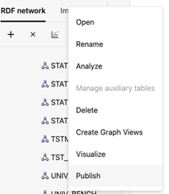
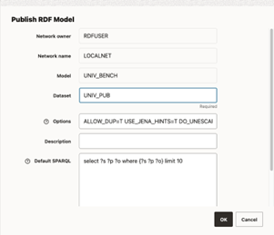
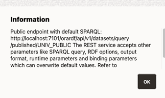
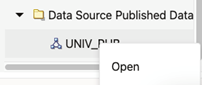
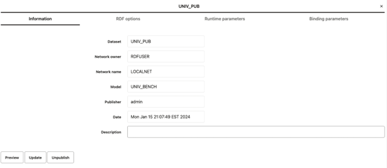

## 14.3.2.8 Publishing Oracle RDF Models

Oracle RDF models can be published as datasets. These are then available through a public REST endpoint for SPARQL queries. Administrator users can define a public RDF data source for publishing data by configuring the application general parameters (see [General JSON configuration file](general-json-configuration-file.md)).

**Note:**

It is important to be aware that by enabling RDF data publishing and defining a public RDF data source, your public URL endpoints for RDF datasets are exposed. This endpoint URL can be used directly in applications without entering credentials.

However, public endpoints have some security constraints related to execution of SPARQL queries. SPARQL updates, SPARQL SERVICE, and SPARQL user-defined functions are not allowed.

To publish an Oracle RDF model as a dataset:

1.  Right-click on the RDF model and select Publish from the menu as shown:
    Figure 14-37 Publish Menu

    
    [Description of "Figure 14-37 Publish Menu"](img_text/publish_menu.md)

2.  Enter the Dataset name (mandatory), Description, and Default SPARQL. This default SPARQL can be overwritten on the REST request.
    Figure 14-38 Publish RDF Model

    
    [Description of "Figure 14-38 Publish RDF Model"](img_text/publish_dataset.md)

3.  Click OK.

    The public endpoint GET URL for the dataset is displayed. Note that the POST request can also be used to access the endpoint.

    Figure 14-39 GET URL Endpoint

    
    [Description of "Figure 14-39 GET URL Endpoint"](img_text/url_pattern.md)
    This URL uses the default values defined for the dataset and follows the pattern shown:

    `http://${hostname}:${port_number}/orardf/api/v1/datasets/query/published/${dataset_name}`

    You can override the default parameters stored in the dataset by modifying the URL to include one or more of the following parameters:
    - query: SPARQL query
    - format: Output format (`JSON`, `XML`, `CSV`, `TSV`, `GeoJSON`, `N-Triples`, `Turtle`)
    - options: String with Oracle RDF options
    - rulebases: Rulebase names associated with dataset RDF model in an entailment
    - params: JSON string with runtime parameters (`timeout`, `fetchSize`, and others)
    - bindings: JSON string with binding parameters (URI or literal values)

    The following shows the general pattern of the REST request to query published datasets (assuming the context root as `orardf`):

    `http://${hostname}:${port_number}/orardf/api/v1/datasets/query/published/${dataset_name}?datasource=${datasource_name}&query=${sparql}&format=${format}&options=${rdf_options}&params=${runtime_params}&bindings=${binding_params}`

    In order to modify the default parameters, you must open the RDF dataset definition by selecting Open from the menu options shown in the following figure or by double clicking the published dataset:
    Figure 14-40 Open an RDF Dataset Definition

    
    [Description of "Figure 14-40 Open an RDF Dataset Definition"](img_text/rdf_published_ds_open.md)
    The RDF dataset definition for the selected published dataset opens as shown:
    Figure 14-41 RDF Dataset Definition

    
    [Description of "Figure 14-41 RDF Dataset Definition"](img_text/rdf_open_ds.md)
    You can update the default parameters and preview the results.

    **Note:**

    - RDF user with administrator privileges can update and unpublish any dataset.
    - RDF user with read and write privileges can only manage the datasets that the user created.
    - RDF user with read privileges can only query the dataset.

**Parent topic:** [RDF Data Page](rdf-data-page.md)
