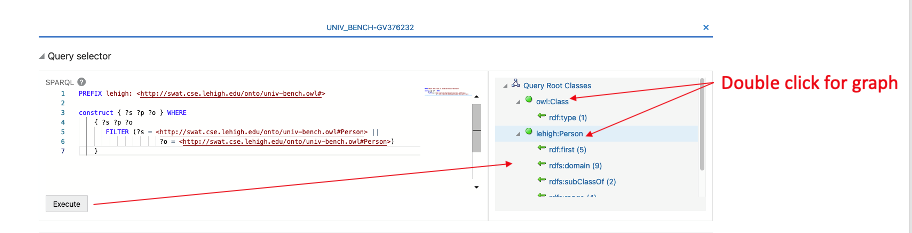
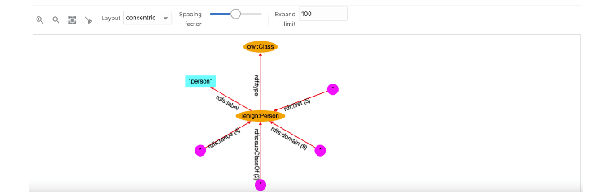

## 14.3.2.11.1 Query Selector Panel

To start using the advanced graph view feature, you must first execute a SPARQL `CONSTRUCT` or SPARQL `DESCRIBE` query. The resulting query output is organized as summaries (counts for incoming and outgoing predicates) for the root classes (in general URI or blank node values).

The following figure shows a SPARQL `CONSTRUCT` query that produces two root classes, `owl``:Class` and `lehigh:Person`:

Figure 14-55 Query Selector

[Description of "Figure 14-55 Query Selector"](img_text/adv_graph_view_query_selector.md)

Each root class has its own summary of incoming and outgoing predicates. You can double click on a root class to view the graph representation in the graph view panel.

It is highly recommended to define `PREFIX` expressions on the query to shorten the result labels in the graph nodes. It also helps to consume less space for the graphic representation of the nodes. Some well known RDF SPARQL prefixes (such as rdf, rdfs, owl, and others) are automatically recognized and can be avoided in the query expression.

As seen in the preceding figure, you can double click the tree node to open the element as a graph in the graph view. You can then interact directly with the graph in the graph view without using the root tree nodes in the Query selector panel. This panel can be collapsed to provide more space on the page for the graph view.

The following figure shows the `owl``:Class` and `lehigh:Person` elements displayed in the graph view.

Figure 14-56 Advanced Graph View

[Description of "Figure 14-56 Advanced Graph View"](img_text/adv_graph_view_output.md)

Note that in some cases the SPARQL query execution may generate several root classes. However, it is not necessary to add all the root classes to a graph. This also helps to maintain a clean and readable graph area.

**Parent topic:** [Advanced Graph View](advanced-graph-view.md)
