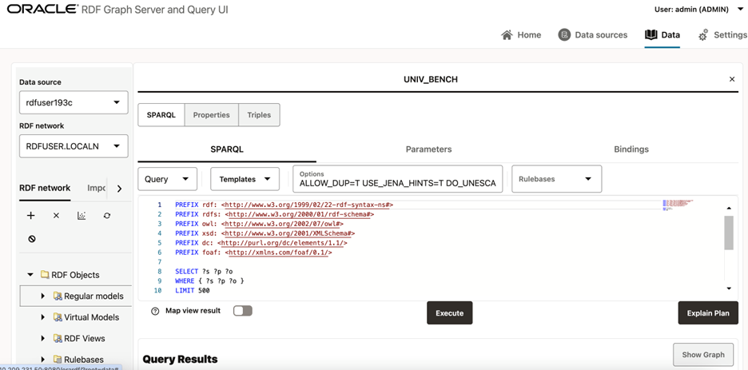

## 14.3.2 RDF Data Page

You can manage and query RDF objects in the RDF Data page.

Figure 14-23 RDF Data Page

[Description of "Figure 14-23 RDF Data Page"](img_text/rdf_data_page.md)

The left panel contains information on the available RDF data in the data source. The right panel is used for opening properties of a RDF object. Depending on the property type, SPARQL queries and SPARQL updates can be executed.

- [Data Source Selection](data-source-selection.md)
- [RDF Network Actions](rdf-network-actions.md)
- [Importing Data](importing-data.md)
- [SPARQL Query Cache Manager](sparql-query-cache-manager.md)
- [RDF Objects Navigator](rdf-objects-navigator.md)
- [Data Source Published Datasets Navigator](data-source-published-datasets-navigator.md)
- [Performing SPARQL Query and SPARQL Update Operations](performing-sparql-query-and-sparql-update-operations.md)
- [Publishing Oracle RDF Models](publishing-oracle-rdf-models.md)
- [Published Dataset Playground](published-dataset-playground.md)
- [Support for Auxiliary Tables](support-result-tables.md)
- [Advanced Graph View](advanced-graph-view.md)
- [Database Views from RDF Models](database-views-rdf-models.md)

**Parent topic:** [Getting Started with RDF Graph Query UI](gettting-started-rdf-graph-query-ui.md)
