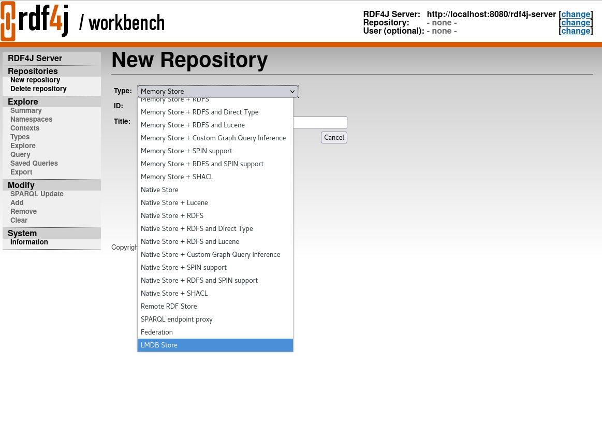
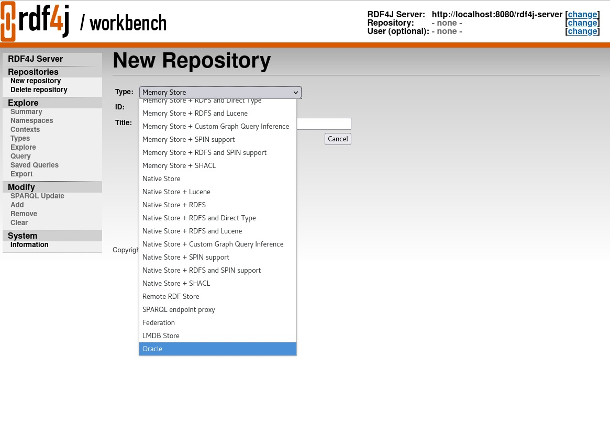
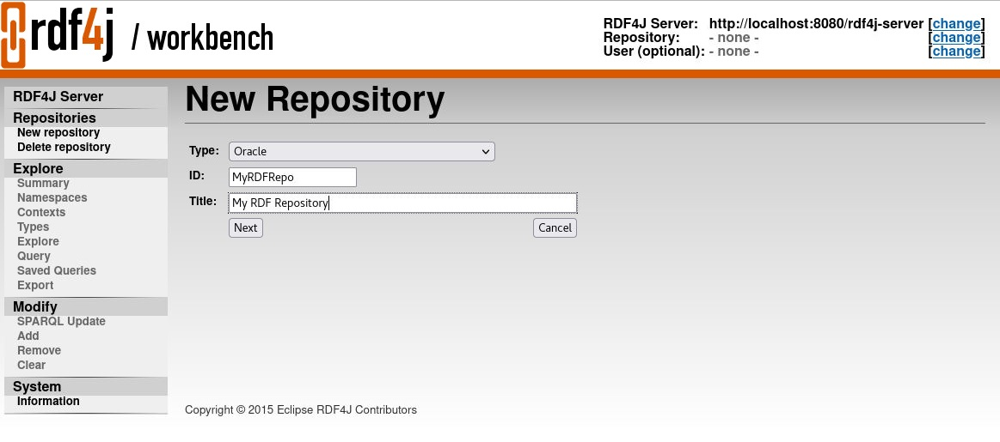
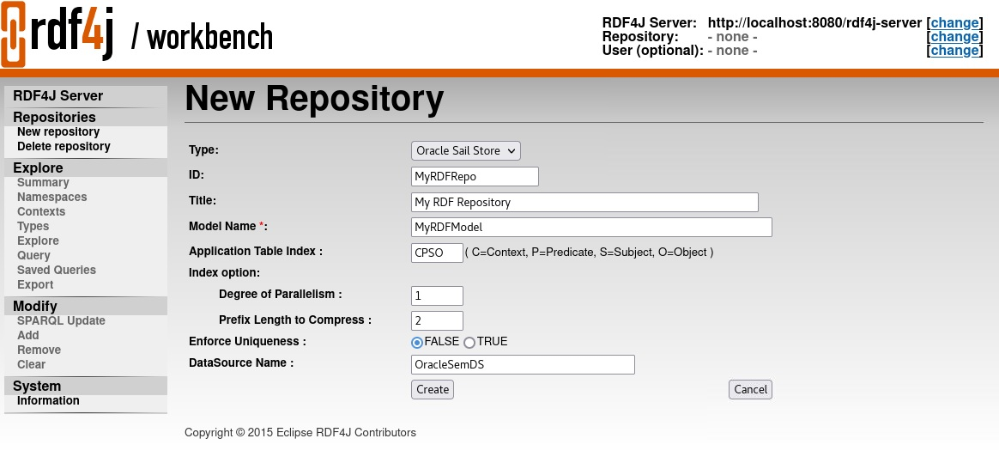
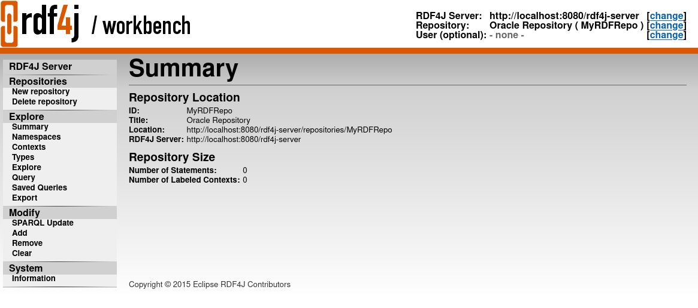
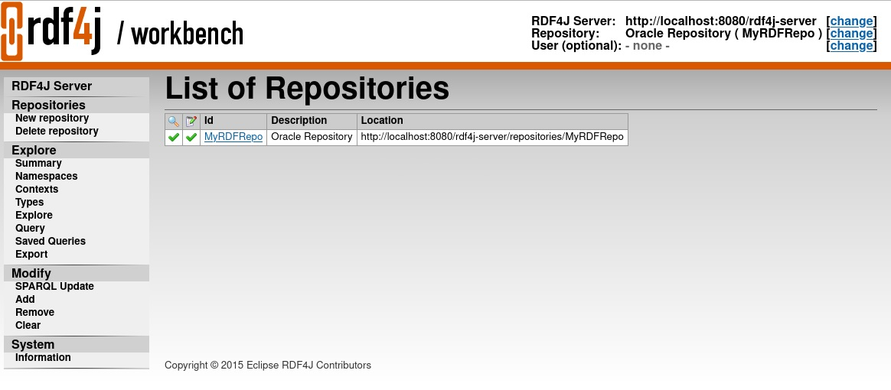

## 8 RDF Semantic Graph Support for Eclipse RDF4J

Oracle RDF Graph Adapter for Eclipse RDF4J utilizes the popular Eclipse RDF4J framework to provide Java developers support to use the RDF semantic graph feature of Oracle Database.

**Note:**

- This feature was previously referred to as the Sesame Adapter for Oracle Database and the Sesame Adapter.
- If you are using an Autonomous Database instance in a shared deployment, then RDF semantic graph support for Eclipse RDF4J requires Oracle JVM to be enabled. See [Use Oracle Java](https://docs.oracle.com/pls/topic/lookup?ctx=en/cloud/paas/autonomous-database&id=GUID-2516EE33-B38D-4270-BE52-30A4F9014E8B) in Using Oracle Autonomous Database Serverless to enable Oracle JVM on your Autonomous Database instance.

The Eclipse RDF4J is a powerful Java framework for processing and handling RDF data. This includes creating, parsing, scalable storage, reasoning and querying with RDF and Linked Data. See [https://rdf4j.org](https://rdf4j.org/) for more information.

This chapter assumes that you are familiar with major concepts explained in [RDF Semantic Graph Overview](rdf-semantic-graph-overview.md) and [OWL Concepts](owl-concepts.md) . It also assumes that you are familiar with the overall capabilities and use of the Eclipse RDF4J Java framework. See [https://rdf4j.org](https://rdf4j.org/) for more information.

The Oracle RDF Graph Adapter for Eclipse RDF4J extends the semantic data management capabilities of Oracle Database RDF/OWL by providing a popular standards based API for Java developers.

- Oracle RDF Graph Support for Eclipse RDF4J Overview
  The Oracle RDF Graph Adapter for Eclipse RDF4J API provides a Java-based interface to Oracle semantic data through an API framework and tools that adhere to the Eclipse RDF4J SAIL API.
- Prerequisites for Using Oracle RDF Graph Adapter for Eclipse RDF4J
  Before you start using the Oracle RDF Graph Adapter for Eclipse RDF4J, you must ensure that your system environment meets certain prerequisites.
- Setup and Configuration for Using Oracle RDF Graph Adapter for Eclipse RDF4J
  To use the Oracle RDF Graph Adapter for Eclipse RDF4J, you must first setup and configure the system environment.
- Using Oracle RDF Graph Adapter for Eclipse RDF4J with Oracle Autonomous Database
  To use Oracle RDF Graph Adapter for Eclipse RDF4J with Autonomous Database, you can use a JDBC connection to connect to your Autonomous Database instance.
- Database Connection Management
  The Oracle RDF Graph Adapter for Eclipse RDF4J provides support for Oracle Database Connection Pooling.
- SPARQL Query Execution Model
  SPARQL queries executed through the Oracle RDF Graph Adapter for Eclipse RDF4J API run as SQL queries against Oracle’s relational schema for storing RDF data.
- SPARQL Update Execution Model
  This section explains the SPARQL Update Execution Model for Oracle RDF Graph Adapter for Eclipse RDF4J.
- Efficiently Loading RDF Data
  The Oracle RDF Graph Adapter for Eclipse RDF4J provides additional or improved Java methods for efficiently loading a large amount of RDF data from files or collections.
- Best Practices for Oracle RDF Graph Adapter for Eclipse RDF4J
  This section explains the performance best practices for Oracle RDF Graph Adapter for Eclipse RDF4J.
- Blank Nodes Support in Oracle RDF Graph Adapter for Eclipse RDF4J
- Unsupported Features in Oracle RDF Graph Adapter for Eclipse RDF4J
  The unsupported features in the current version of Oracle RDF Graph Adapter for Eclipse RDF4J are discussed in this section.
- Example Queries Using Oracle RDF Graph Adapter for Eclipse RDF4J

**Parent topic:** [Conceptual and Usage Information](part-concept-usage.md)

### 8.1 Oracle RDF Graph Support for Eclipse RDF4J Overview

The Oracle RDF Graph Adapter for Eclipse RDF4J API provides a Java-based interface to Oracle semantic data through an API framework and tools that adhere to the Eclipse RDF4J SAIL API.

The RDF Semantic Graph support for Eclipse RDF4J is similar to the RDF Semantic Graph support for Apache Jena as described in [RDF Semantic Graph Support for Apache Jena](rdf-support-for-apache-jena.md) .

The adapter for Eclipse RDF4J provides a Java API for interacting with semantic data stored in Oracle Database. It also provides integration with the following Eclipse RDF4J tools:

- Eclipse RDF4J Server, which provides an HTTP SPARQL endpoint.
- Eclipse RDF4J Workbench, which is a web-based client UI for managing databases and executing queries.

The features provided by the adapter for Eclispe RDF4J include:

- Loading (bulk and incremental), exporting, and removing statements, with and without context
- Querying data, with and without context
- Updating data, with and without context

Oracle RDF Graph Adapter for Eclipse RDF4J implements various interfaces of the Eclipse RDF4J Storage and Inference Layer (SAIL) API.

For example, the class `OracleSailConnection` is an Oracle implementation of the Eclipse RDF4J `SailConnection` interface, and the class `OracleSailStore` extends `AbstractSail` which is an Oracle implementation of the Eclipse RDF4J `Sail` interface.

The following example demonstrates a typical usage flow for the RDF Semantic Graph support for Eclipse RDF4J.

Example 8-1 Sample Usage flow for RDF Semantic Graph Support for Eclipse RDF4J Using a Schema-Private Semantic Network

    String networkOwner = "SCOTT";
    String networkName = "NET1";
    String modelName = "UsageFlow";
    OraclePool oraclePool = new OraclePool(jdbcurl, user, password);
    SailRepository sr = new SailRepository(new OracleSailStore(oraclePool, modelName, networkOwner, networkName));
    SailRepositoryConnection conn = sr.getConnection();

    //A ValueFactory factory for creating IRIs, blank nodes, literals and statements
    ValueFactory vf = conn.getValueFactory();
    IRI alice = vf.createIRI("http://example.org/Alice");
    IRI friendOf = vf.createIRI("http://example.org/friendOf");
    IRI bob = vf.createIRI("http://example.org/Bob");
    Resource context1 = vf.createIRI("http://example.org/");

    // Data loading can happen here.
    conn.add(alice, friendOf, bob, context1);
    String query =
      " PREFIX foaf: <http://xmlns.com/foaf/0.1/> " +
      " PREFIX dc: <http://purl.org/dc/elements/1.1/> " +
      " select ?s ?p ?o ?name WHERE {?s ?p ?o . OPTIONAL {?o foaf:name ?name .} } ";
    TupleQuery tq = conn.prepareTupleQuery(QueryLanguage.SPARQL, query);
    TupleQueryResult tqr = tq.evaluate();
    while (tqr.hasNext()) {
        System.out.println((tqr.next().toString()));
    }
    tqr.close();
    conn.close();
    sr.shutDown();

**Parent topic:** RDF Semantic Graph Support for Eclipse RDF4J

### 8.2 Prerequisites for Using Oracle RDF Graph Adapter for Eclipse RDF4J

Before you start using the Oracle RDF Graph Adapter for Eclipse RDF4J, you must ensure that your system environment meets certain prerequisites.

The following are the prerequistes required for using the adapter for Eclipse RDF4J:

- Oracle Database Standard Edition 2 (SE2) or Enterprise Edition (EE) for version 18c or later (user managed database in the cloud or on-premise)
- Eclipse RDF4J version 4.2.1
- JDK 11

In addition, the following database patch is recommended for bugfixes and performance improvements.

- Patch 32562595: TRACKING BUG FOR RDF GRAPH PATCH KIT Q2 2021

  Currently available on My Oracle Support for release 19.11.

  Note that Oracle Database Releases 19.15 and later already contain these changes and do not require additional patches.

**Parent topic:** RDF Semantic Graph Support for Eclipse RDF4J

### 8.3 Setup and Configuration for Using Oracle RDF Graph Adapter for Eclipse RDF4J

To use the Oracle RDF Graph Adapter for Eclipse RDF4J, you must first setup and configure the system environment.

The adapter can be used in the following three environments:

- Programmatically through Java code
- Accessed over HTTP as a SPARQL Service
- Used within the Eclipse RDF4J workbench environment

The following sections describe the actions for using the adapter for Eclipse RDF4J in the above mentioned environments:

- Setting up Oracle RDF Graph Adapter for Eclipse RDF4J for Use with Java
- Setting Up Oracle RDF Graph Adapter for Eclipse RDF4J for Use in RDF4J Server and Workbench
- Setting Up Oracle RDF Graph Adapter for Eclipse RDF4J for Use As SPARQL Service

**Parent topic:** RDF Semantic Graph Support for Eclipse RDF4J

#### 8.3.1 Setting up Oracle RDF Graph Adapter for Eclipse RDF4J for Use with Java

To use the Oracle RDF Graph Adapter for Eclipse RDF4J programatically through Java code, you must first ensure that the system environment meets all the prerequisites as explained in Prerequisites for Using Oracle RDF Graph Adapter for Eclipse RDF4J.

Before you can start using the adapter to store, manage, and query RDF graphs in the Oracle database, you need to create a semantic network. A semantic network acts like a folder that can hold multiple RDF graphs, referred to as “semantic (or RDF) models”, created by database users. Semantic networks can be created in the MDSYS system schema (referred to as the MDSYS network) or, starting with version 19c, in a user schema (referred to as a schema-private network).

A network can be created by invoking the following command:

- MDSYS semantic network

  `sem_apis.create_sem_network(<tablespace_name>)`

- Schema-private semantic network

  `sem_apis.create_sem_network(<tablespace_name>, network_owner=><network_owner>, network_name=><network_name>)`

See [Semantic Networks](rdf-semantic-graph-overview.md) for more information.

**See Also:**

[Setting up Oracle RDF Graph Adapter for Eclipse RDF4J for Use with Java](https://docs.oracle.com/pls/topic/lookup?ctx=en/database/oracle/oracle-database/18&id=GUID-FFFB137D-8ED0-44A0-A220-28B5A6B7BBD0) for Oracle Database 18c.

**Note:**

RDF4J Server, Workbench and SPARQL Service only supports the MDSYS-owned semantic network in the current version of Oracle RDF Graph Adapter for Eclipse RDF4J.

##### Creating an MDSYS-owned Semantic Network

You can create an MDSYS-owned semantic network by performing the following actions from a SQL based interface such as SQL Developer, SQLPLUS, or from a Java program using JDBC:

1.  Connect to Oracle Database as a `SYSTEM` user with a DBA privilege.

        CONNECT system/<password-for-system-user>

2.  Create a tablespace for storing the RDF graphs. Use a suitable operating system folder and filename.

        CREATE TABLESPACE rdftbs
          DATAFILE 'rdftbs.dat'
          SIZE 128M REUSE
          AUTOEXTEND ON NEXT 64M
          MAXSIZE UNLIMITED
          SEGMENT SPACE MANAGEMENT AUTO;

3.  Grant quota on `rdftbs` to MDSYS.

        ALTER USER MDSYS QUOTA UNLIMITED ON rdftbs;

4.  Create a tablespace for storing the user data. Use a suitable operating system folder and filename.

        CREATE TABLESPACE usertbs
          DATAFILE 'usertbs.dat'
          SIZE 128M REUSE
          AUTOEXTEND ON NEXT 64M
          MAXSIZE UNLIMITED
          SEGMENT SPACE MANAGEMENT AUTO;

5.  Create a database user to create or use RDF graphs or do both using the adapter.

        CREATE USER rdfuser
               IDENTIFIED BY <password-for-rdfuser>
               DEFAULT TABLESPACE usertbs
               QUOTA 5G ON usertbs;

6.  Grant quota on `rdftbs` to RDFUSER.

        ALTER USER RDFUSER QUOTA 5G ON rdftbs;

7.  Grant the necessary privileges to the new database user.

        GRANT CONNECT, RESOURCE TO rdfuser;

8.  Create an MDSYS-owned semantic network.

        EXECUTE SEM_APIS.CREATE_SEM_NETWORK(tablespace_name =>'rdftbs');

9.  Verify that MDSYS-owned semantic network has been created successfully.

        SELECT table_name
          FROM sys.all_tables
          WHERE table_name = 'RDF_VALUE$' AND owner='MDSYS';

    Presence of `RDF_VALUE$` table in the MDSYS schema shows that the MDSYS-owned semantic network has been created successfully.

        TABLE_NAME
        -----------
        RDF_VALUE$

##### Creating a Schema-Private Semantic Network

You can create a schema-private semantic network by performing the following actions from a SQL based interface such as SQL Developer, SQLPLUS, or from a Java program using JDBC:

1.  Connect to Oracle Database as a `SYSTEM` user with a DBA privilege.

        CONNECT system/<password-for-system-user>

2.  Create a tablespace for storing the user data. Use a suitable operating system folder and filename.

        CREATE TABLESPACE usertbs
          DATAFILE 'usertbs.dat'
          SIZE 128M REUSE
          AUTOEXTEND ON NEXT 64M
          MAXSIZE UNLIMITED
          SEGMENT SPACE MANAGEMENT AUTO;

3.  Create a database user to create and own the semantic network. This user can create or use RDF graphs or do both within this schema-private network using the adapter.

        CREATE USER rdfuser
               IDENTIFIED BY <password-for-rdfuser>
               DEFAULT TABLESPACE usertbs
               QUOTA 5G ON usertbs;

4.  Grant the necessary privileges to the new database user.

        GRANT CONNECT, RESOURCE, CREATE VIEW TO rdfuser;

5.  Connect to Oracle Database as `rdfuser`.

        CONNECT rdfuser/<password-for-rdf-user>

6.  Create a schema-private semantic network named `NET1`.

        EXECUTE SEM_APIS.CREATE_SEM_NETWORK(tablespace_name =>'usertbs', network_owner=>'RDFUSER', network_name=>'NET1');

7.  Verify that schema-private semantic network has been created successfully.

        SELECT table_name
          FROM sys.all_tables
          WHERE table_name = 'NET1#RDF_VALUE$' AND owner='RDFUSER';

    Presence of `<NETWORK_NAME>#RDF_VALUE$` table in the network owner’s schema shows that the schema-private semantic network has been created successfully.

        TABLE_NAME
        -----------
        NET1#RDF_VALUE$

You can now set up the Oracle RDF Graph Adapter for Eclipse RDF4J for use with Java code by performing the following actions:

1.  Download and configure Eclipse RDF4J Release 4.2.1 from [RDF4J Downloads](https://www.eclipse.org/downloads/download.php?file=/rdf4j/eclipse-rdf4j-4.2.1-sdk.zip) page.

2.  Download the adapter for Eclipse RDF4J, (Oracle Adapter for Eclipse RDF4J) from [Oracle Software Delivery Cloud](https://edelivery.oracle.com/osdc/faces/Home.jspx;jsessionid=o7SOt_nhVgyg7wPozwTIoO0wvr28wPQU1z05mcWxvjl2mVAwMM40!-762490782).

3.  Unzip the downloaded kit (V1033016-01.zip) into a temporary directory, such as `/tmp/oracle_adapter`, on a Linux system. If this temporary directory does not already exist, create it before the unzip operation.

4.  Include the following three supporting libraries in your `CLASSPATH`, in order to run your Java code via your IDE:
    - `eclipse-rdf4j-4.2.1-onejar.jar`: Download this Eclipse RDF4J jar library from [RDF4J Downloads](https://www.eclipse.org/downloads/download.php?file=/rdf4j/eclipse-rdf4j-4.2.1-onejar.jar) page.
    - `ojdbc8.jar`: Download this JDBC thin driver for your database version from [JDBC Downloads](https://www.oracle.com/database/technologies/appdev/jdbc-downloads.html) page.
    - `ucp.jar`: Download this Universal Connection Pool jar file for your database version from [JDBC Downloads](https://www.oracle.com/database/technologies/appdev/jdbc-downloads.html) page.
    - `log4j-api-2.17.2.jar`, `log4j-core-2.17.2.jar`, `log4j-slf4j-impl-2.17.2.jar`, `slf4j-api-1.7.36.jar`, and `commons-io-2.11.0.jar`: Download from Apache Software Foundation.

5.  Install JDK 11 if it is not already installed.

6.  Set the `JAVA_HOME` environment variable to refer to the JDK 11 installation. Define and verify the setting by executing the following command:

        echo $JAVA_HOME

**Parent topic:** Setup and Configuration for Using Oracle RDF Graph Adapter for Eclipse RDF4J

#### 8.3.2 Setting Up Oracle RDF Graph Adapter for Eclipse RDF4J for Use in RDF4J Server and Workbench

This section describes the installation and configuration of the Oracle RDF Graph Adapter for Eclipse RDF4J in RDF4J Server and RDF4J Workbench.

The RDF4J Server is a database management application that provides HTTP access to RDF4J repositories, exposing them as SPARQL endpoints. RDF4J Workbench provides a web interface for creating, querying, updating and exploring the repositories of an RDF4J Server.

**Note:**

RDF4J Server, Workbench and SPARQL Service only supports the MDSYS-owned semantic network in the current version of Oracle RDF Graph Adapter for Eclipse RDF4J.

Prerequisites

Ensure the following prerequisites are configured to use the adapter for Eclipse RDF4J in RDF4J Server and Workbench:

1.  Java 11 runtime environment.

2.  Download the supporting libraries as explained in Include Supporting Libraries.

3.  A Java Servlet Container that supports Java Servlet API 3.1 and Java Server Pages (JSP) 2.2, or newer.
    **Note:**

    All examples in this chapter are executed on a recent, stable version of Apache Tomcat (9.0.78).

4.  Standard Installation of the RDF4J Server, RDF4J Workbench, and RDF4J Console . See [RDF4J Server and Workbench Installation](https://rdf4j.org/documentation/tools/server-workbench) and [RDF4J Console installation](https://rdf4j.org/documentation/tools/console/) for more information.

5.  Verify that Oracle is not listed as a default repository in the drop-down in the following Figure 8-1.

    Figure 8-1 Data Source Repository in RDF4J Workbench

    
    [Description of "Figure 8-1 Data Source Repository in RDF4J Workbench"](img_text/rdf4j_wb_no_oracle.md)
    **Note:**

    If the Oracle data source repository is already set up in the RDF4J Workbench repository, then it will appear in the preceding drop-down list.

Adding the Oracle Data Source Repository in RDF4J Workbench

To add the Oracle data source repository in RDF4J Workbench, you must execute the following steps:

1.  Add the Data Source to `context.xml` in Tomcat main `$CATALINA_HOME/conf/context.xml` directory, by updating the following highlighted fields.

        - Using JDBC driver
            <Resource name="jdbc/OracleSemDS" auth="Container"
               driverClassName="oracle.jdbc.OracleDriver"
               factory="oracle.jdbc.pool.OracleDataSourceFactory"
               scope="Shareable"
               type="oracle.jdbc.pool.OracleDataSource"
               user="<<username>>"
               password="<<pwd>>"
               url="jdbc:oracle:thin:@<< host:port:sid >>"
               maxActive="100"
               minIdle="15"
               maxIdel="15"
               initialSize="15"
               removeAbandonedTimeout="30"
               validationQuery="select 1 from dual"
            />

        - Using UCP
           <Resource name="jdbc/OracleSemDS" auth="Container"
               factory="oracle.ucp.jdbc.PoolDataSourceImpl"
               type="oracle.ucp.jdbc.PoolDataSource"
               connectionFactoryClassName="oracle.jdbc.pool.OracleDataSource"
               minPoolSize="15"
               maxPoolSize="100"
               inactiveConnectionTimeout="60"
               abandonedConnectionTimeout="30"
               initialPoolSize="15"
               user="<<username>>"
               password="<<pwd>>"
               url="jdbc:oracle:thin:@<< host:port:sid >>"
            />

2.  Copy Oracle jdbc and ucp driver to Tomcat `lib` folder.

        cp -f ojdbc8.jar $CATALINA_HOME/lib
        cp -f ucp.jar $CATALINA_HOME/lib

3.  Copy the oracle-rdf4j-adapter-4.2.1.jar to RDF4J Server `lib` folder.

        cp -f oracle-rdf4j-adapter-4.2.1.jar $CATALINA_HOME/webapps/rdf4j-server/WEB-INF/lib

4.  Copy the oracle-rdf4j-adapter-4.2.1.jar to RDF4J Workbench `lib` folder.

        cp -f oracle-rdf4j-adapter-4.2.1.jar $CATALINA_HOME/webapps/rdf4j-workbench/WEB-INF/lib

5.  Create the configuration file `create-oracle.xsl` within the Tomcat `$CATALINA_HOME/webapps/rdf4j-workbench/transformations` folder.

        <?xml version="1.0" encoding="UTF-8"?>
        <!DOCTYPE xsl:stylesheet [
           <!ENTITY xsd  "http://www.w3.org/2001/XMLSchema#" >
         ]>
        <xsl:stylesheet version="1.0"
          xmlns:xsl="http://www.w3.org/1999/XSL/Transform" xmlns:sparql="http://www.w3.org/2005/sparql-results#"
          xmlns="http://www.w3.org/1999/xhtml">

          <xsl:include href="../locale/messages.xsl" />
          <xsl:variable name="title">
          <xsl:value-of select="$repository-create.title" />
          </xsl:variable>
          <xsl:include href="template.xsl" />
          <xsl:template match="sparql:sparql">
          <form action="create">
            <table class="dataentry">
              <tbody>
                <tr>
                  <th>
                    <xsl:value-of select="$repository-type.label" />
                  </th>
                  <td>
                    <select id="type" name="type">
                      <option value="memory">
                        Memory Store
                      </option>
                      <option value="memory-lucene">
                        Memory Store + Lucene
                      </option>
                      <option value="memory-rdfs">
                        Memory Store + RDFS
                      </option>
                      <option value="memory-rdfs-dt">
                        Memory Store + RDFS and Direct Type
                      </option>
                      <option value="memory-rdfs-lucene">
                        Memory Store + RDFS and Lucene
                      </option>
                      <option value="memory-customrule">
                        Memory Store + Custom Graph Query Inference
                      </option>
                      <option value="memory-spin">
                        Memory Store + SPIN support
                      </option>
                      <option value="memory-spin-rdfs">
                        Memory Store + RDFS and SPIN support
                      </option>
                      <option value="memory-shacl">
                        Memory Store + SHACL
                      </option>
                      <!-- disabled pending GH-1304  option value="memory-spin-rdfs-lucene">
                        In Memory Store with RDFS+SPIN+Lucene support
                      </option -->
                      <option value="native">
                        Native Store
                      </option>
                      <option value="native-lucene">
                        Native Store + Lucene
                      </option>
                      <option value="native-rdfs">
                        Native Store + RDFS
                      </option>
                      <option value="native-rdfs-dt">
                        Native Store + RDFS and Direct Type
                      </option>
                      <option value="memory-rdfs-lucene">
                        Native Store + RDFS and Lucene
                      </option>
                      <option value="native-customrule">
                        Native Store + Custom Graph Query Inference
                      </option>
                      <option value="native-spin">
                        Native Store + SPIN support
                      </option>
                      <option value="native-spin-rdfs">
                        Native Store + RDFS and SPIN support
                      </option>
                      <option value="native-shacl">
                        Native Store + SHACL
                      </option>
                      <!-- disabled pending GH-1304  option value="native-spin-rdfs-lucene">
                        Native Java Store with RDFS+SPIN+Lucene support
                      </option -->
                      <option value="remote">
                        Remote RDF Store
                      </option>
                      <option value="sparql">
                        SPARQL endpoint proxy
                      </option>
                      <option value="federate">Federation</option>
                      <option value="lmdb">LMDB Store</option>
                      <option value="oracle">Oracle</option>
                    </select>
                  </td>
                  <td></td>
                </tr>
                <tr>
                  <th>
                    <xsl:value-of select="$repository-id.label" />
                  </th>
                  <td>
                    <input type="text" id="id" name="id" size="16" />
                  </td>
                  <td></td>
                </tr>
                <tr>
                  <th>
                    <xsl:value-of select="$repository-title.label" />
                  </th>
                  <td>
                    <input type="text" id="title" name="title" size="48" />
                  </td>
                  <td></td>
                </tr>
                <tr>
                  <td></td>
                  <td>
                    <input type="button" value="{$cancel.label}" style="float:right"
                       data-href="repositories"
                       onclick="document.location.href=this.getAttribute('data-href')" />
                    <input type="submit" name="next" value="{$next.label}" />
                  </td>
                </tr>
              </tbody>
            </table>
          </form>
          </xsl:template>
        </xsl:stylesheet>

6.  Create the configuration file `create.xsl` within the Tomcat `$CATALINA_HOME/webapps/rdf4j-workbench/transformations` transformation folder.

        <?xml version="1.0" encoding="UTF-8"?>
        <!DOCTYPE xsl:stylesheet [
           <!ENTITY xsd  "http://www.w3.org/2001/XMLSchema#" >
         ]>
        <xsl:stylesheet version="1.0"
          xmlns:xsl="http://www.w3.org/1999/XSL/Transform" xmlns:sparql="http://www.w3.org/2005/sparql-results#"
          xmlns="http://www.w3.org/1999/xhtml">

          <xsl:include href="../locale/messages.xsl" />
          <xsl:variable name="title">
          <xsl:value-of select="$repository-create.title" />
          </xsl:variable>
          <xsl:include href="template.xsl" />
          <xsl:template match="sparql:sparql">
          <form action="create">
            <table class="dataentry">
              <tbody>
                <tr>
                  <th>
                    <xsl:value-of select="$repository-type.label" />
                  </th>
                  <td>
                    <select id="type" name="type">
                      <option value="memory">
                        Memory Store
                      </option>
                      <option value="memory-lucene">
                        Memory Store + Lucene
                      </option>
                      <option value="memory-rdfs">
                        Memory Store + RDFS
                      </option>
                      <option value="memory-rdfs-dt">
                        Memory Store + RDFS and Direct Type
                      </option>
                      <option value="memory-rdfs-lucene">
                        Memory Store + RDFS and Lucene
                      </option>
                      <option value="memory-customrule">
                        Memory Store + Custom Graph Query Inference
                      </option>
                      <option value="memory-spin">
                        Memory Store + SPIN support
                      </option>
                      <option value="memory-spin-rdfs">
                        Memory Store + RDFS and SPIN support
                      </option>
                      <option value="memory-shacl">
                        Memory Store + SHACL
                      </option>
                      <!-- disabled pending GH-1304  option value="memory-spin-rdfs-lucene">
                        In Memory Store with RDFS+SPIN+Lucene support
                      </option -->
                      <option value="native">
                        Native Store
                      </option>
                      <option value="native-lucene">
                        Native Store + Lucene
                      </option>
                      <option value="native-rdfs">
                        Native Store + RDFS
                      </option>
                      <option value="native-rdfs-dt">
                        Native Store + RDFS and Direct Type
                      </option>
                      <option value="memory-rdfs-lucene">
                        Native Store + RDFS and Lucene
                      </option>
                      <option value="native-customrule">
                        Native Store + Custom Graph Query Inference
                      </option>
                      <option value="native-spin">
                        Native Store + SPIN support
                      </option>
                      <option value="native-spin-rdfs">
                        Native Store + RDFS and SPIN support
                      </option>
                      <option value="native-shacl">
                        Native Store + SHACL
                      </option>
                      <!-- disabled pending GH-1304  option value="native-spin-rdfs-lucene">
                        Native Java Store with RDFS+SPIN+Lucene support
                      </option -->
                      <option value="remote">
                        Remote RDF Store
                      </option>
                      <option value="sparql">
                        SPARQL endpoint proxy
                      </option>
                      <option value="federate">Federation</option>
                      <option value="lmdb">LMDB Store</option>
                      <option value="oracle">Oracle</option>
                    </select>
                  </td>
                  <td></td>
                </tr>
                <tr>
                  <th>
                    <xsl:value-of select="$repository-id.label" />
                  </th>
                  <td>
                    <input type="text" id="id" name="id" size="16" />
                  </td>
                  <td></td>
                </tr>
                <tr>
                  <th>
                    <xsl:value-of select="$repository-title.label" />
                  </th>
                  <td>
                    <input type="text" id="title" name="title" size="48" />
                  </td>
                  <td></td>
                </tr>
                <tr>
                  <td></td>
                  <td>
                    <input type="button" value="{$cancel.label}" style="float:right"
                        data-href="repositories"
                        onclick="document.location.href=this.getAttribute('data-href')" />
                    <input type="submit" name="next" value="{$next.label}" />
                  </td>
                </tr>
              </tbody>
            </table>
          </form>
          </xsl:template>
        </xsl:stylesheet>

7.  Restart Tomcat and navigate to `https://localhost:8080/rdf4j-workbench`.

**Note:**

The configuration files, `create-oracle.xsl` and `create.xsl` contain the word "Oracle", which you can see in the drop-down in Figure 8-2

"Oracle" appears as an option in the drop-down list in RDF4J Workbench.

Figure 8-2 RDF4J Workbench Repository

[Description of "Figure 8-2 RDF4J Workbench Repository"](img_text/rdf4j_wb_with_oracle.md)

- Using the Adapter for Eclipse RFD4J Through RDF4J Workbench
  You can use RDF4J Workbench for creating and querying repositories.

**Parent topic:** Setup and Configuration for Using Oracle RDF Graph Adapter for Eclipse RDF4J

##### 8.3.2.1 Using the Adapter for Eclipse RFD4J Through RDF4J Workbench

You can use RDF4J Workbench for creating and querying repositories.

RDF4J Workbench provides a web interface for creating, querying, updating and exploring repositories in RDF4J Server.

Creating a New Repository using RDF4J Workbench

1.  Start RDF4J Workbench by entering the url `https://localhost:8080/rdf4j-workbench` in your browser.

2.  Click New Repository in the sidebar menu and select the new repository Type as "Oracle".

3.  Enter the new repository ID and Title as shown in the following figure and click Next.
    Figure 8-3 RDF4J Workbench New Repository

    
    [Description of "Figure 8-3 RDF4J Workbench New Repository"](img_text/rdf4j_wb_title_id.md)

4.  Enter your Model details and click Create to create the new repository.

    Figure 8-4 Create New Repository in RDF4J Workbench

    
    [Description of "Figure 8-4 Create New Repository in RDF4J Workbench"](img_text/rdf4j_wb_model_details.md)

    The newly created repository summary is display as shown:
    Figure 8-5 Summary of New Repository in RDF4J Workbench

    
    [Description of "Figure 8-5 Summary of New Repository in RDF4J Workbench"](img_text/rdf4j_wb_repo.md)

    You can also view the newly created repository in the List of Repositories page in RDF4J Workbench.

    
    [Description of the illustration rdf4j_wb_repo_list.png](img_text/rdf4j_wb_repo_list.md)

**Parent topic:** Setting Up Oracle RDF Graph Adapter for Eclipse RDF4J for Use in RDF4J Server and Workbench

#### 8.3.3 Setting Up Oracle RDF Graph Adapter for Eclipse RDF4J for Use As SPARQL Service

In order to use the SPARQL service via the RDF4J Workbench, ensure that the Eclipse RDF4J server is installed and the Oracle Data Source repository is configured as explained in Setting Up Oracle RDF Graph Adapter for Eclipse RDF4J for Use in RDF4J Server and Workbench

The Eclipse RDF4J server installation provides a REST API that uses the HTTP Protocol and covers a fully compliant implementation of the SPARQL 1.1 Protocol W3C Recommendation. This ensures that RDF4J server functions as a fully standards-compliant SPARQL endpoint. See [The RDF4J REST API](https://rdf4j.org/documentation/reference/rest-api/) for more information on this feature.

**Note:**

RDF4J Server, Workbench and SPARQL Service only supports the MDSYS-owned semantic network in the current version of Oracle RDF Graph Adapter for Eclipse RDF4J.

The following section presents the examples of usage:

- Using the Adapter Over SPARQL Endpoint in Eclipse RDF4J Workbench

**Parent topic:** Setup and Configuration for Using Oracle RDF Graph Adapter for Eclipse RDF4J

##### 8.3.3.1 Using the Adapter Over SPARQL Endpoint in Eclipse RDF4J Workbench

This section provides a few examples of using the adapter for Eclipse RDF4J through a SPARQL Endpoint served by the Eclipse RDF4J Workbench.

Example 8-2 Request to Perform a SPARQL Update

The following example inserts some simple triples using HTTP POST. Assume that the content of the file `sparql_update.rq` is as follows:

    PREFIX ex: <http://example.oracle.com/>
    INSERT DATA {
      ex:a ex:value "A" .
      ex:b ex:value "B" .
    }

You can then run the preceding SPARQL update using the `curl` command line tool as shown:

    curl -X POST --data-binary "@sparql_update.rq" \
    -H "Content-Type: application/sparql-update" \
    "http://localhost:8080/rdf4j-server/repositories/MyRDFRepo/statements"

Example 8-3 Request to Execute a SPARQL Query Using HTTP GET

This `curl` example executes a SPARQL query using HTTP GET.

    curl -X GET -H "Accept: application/sparql-results+json" \
    "http://localhost:8080/rdf4j-server/repositories/MyRDFRepo?query=SELECT%20%3Fs%20%3Fp%20%3Fo%0AWHERE%20%7B%20%3Fs%20%3Fp%20%3Fo%20%7D%0ALIMIT%2010"

Assuming that the previous SPARQL update example was executed on an empty repository, this REST request should return the following response.

    {
      "head" : {
        "vars" : [
          "s",
          "p",
          "o"
        ]
      },
      "results" : {
        "bindings" : [
          {
            "p" : {
              "type" : "uri",
              "value" : "http://example.oracle.com/value"
            },
            "s" : {
              "type" : "uri",
              "value" : "http://example.oracle.com/b"
            },
            "o" : {
              "type" : "literal",
              "value" : "B"
            }
          },
          {
            "p" : {
              "type" : "uri",
              "value" : "http://example.oracle.com/value"
            },
            "s" : {
              "type" : "uri",
              "value" : "http://example.oracle.com/a"
            },
            "o" : {
              "type" : "literal",
              "value" : "A"
            }
          }
        ]
      }
    }

**Parent topic:** Setting Up Oracle RDF Graph Adapter for Eclipse RDF4J for Use As SPARQL Service

### 8.4 Using Oracle RDF Graph Adapter for Eclipse RDF4J with Oracle Autonomous Database

To use Oracle RDF Graph Adapter for Eclipse RDF4J with Autonomous Database, you can use a JDBC connection to connect to your Autonomous Database instance.

Refer to [Connect with JDBC Thin Driver](https://docs.oracle.com/pls/topic/lookup?ctx=en/cloud/paas/autonomous-database/serverless&id=GUID-5ED3C08C-1A84-4E5A-B07A-A5114951AA9E) in Using Oracle Autonomous Database Serverless for more information on how to obtain the JDBC URL to connect to the Autonomous Database.

**Parent topic:** RDF Semantic Graph Support for Eclipse RDF4J

### 8.5 Database Connection Management

The Oracle RDF Graph Adapter for Eclipse RDF4J provides support for Oracle Database Connection Pooling.

Instances of `OracleSailStore` use a connection pool to manage connections to an Oracle database. Oracle Database Connection Pooling is provided through the `OraclePool` class. Usually, `OraclePool` is initialized with a `DataSource`, using the `OraclePool (DataSource ods)` constructor. In this case, `OraclePool` acts as an extended wrapper for the `DataSource`, while using the connection pooling capabilities of the data source. When you create an `OracleSailStore` object, it is sufficient to specify the `OraclePool` object in the store constructor, the database connections will then be managed automatically by the adapter for Eclipse RDF4J. Several other constructors are also provided for `OraclePool`, which, for example, allow you to create an `OraclePool` instance using a `JDBC URL` and database `username` and `password`. See the Javadoc included in the Oracle RDF Graph Adapter for Eclipse RDF4J download for more details.

If you need to retrieve Oracle connection objects (which are essentially database connection wrappers) explicitly, you can invoke the `OraclePool.getOracle` method. After finishing with the connection, you can invoke the `OraclePool.returnOracleDBtoPool` method to return the object to the connection pool.

When you get an `OracleSailConnection` from `OracleSailStore` or an `OracleSailRepositoryConnection` from an `OracleRepository`, a new `OracleDB` object is obtained from the `OraclePool` and used to create the RDF4J connection object. `READ_COMMITTED` transaction isolation is maintained between different RDF4J connection objects.

The one exception to this behavior occurs when you obtain an `OracleSailRepositoryConnection` by calling the `asRepositoryConnection` method on an existing instance of `OracleSailConnection`. In this case, the original `OracleSailConnection` and the newly obtained `OracleSailRepositoryConnection` will use the same OracleDB object. When you finish using an `OracleSailConnection` or `OracleSailRepositoryConnection` object, you should call its `close` method to return the `OracleDB` object to the `OraclePool`. Failing to do so will result in connection leaks in your application.

**Parent topic:** RDF Semantic Graph Support for Eclipse RDF4J

### 8.6 SPARQL Query Execution Model

SPARQL queries executed through the Oracle RDF Graph Adapter for Eclipse RDF4J API run as SQL queries against Oracle’s relational schema for storing RDF data.

Utilizing Oracle’s SQL engine allows SPARQL query execution to take advantage of many performance features such as parallel query execution, in-memory columnar representation, and Exadata smart scan.

There are two ways to execute a SPARQL query:

- You can obtain an implementation of `Query` or one of its subinterfaces from the `prepareQuery` functions of a `RepositoryConnection` that has an underlying `OracleSailConnection`.

- You can obtain an Oracle-specific implementation of `TupleExpr` from `OracleSPARQLParser` and call the `evaluate` method of `OracleSailConnection`.

The following code snippet illustrates the first approach.

    //run a query against the repository
    String queryString =
      "PREFIX ex: <http://example.org/ontology/>\n" +
      "SELECT * WHERE {?x ex:name ?y} LIMIT 1 ";
    TupleQuery tupleQuery = conn.prepareTupleQuery(QueryLanguage.SPARQL, queryString);

    try (TupleQueryResult result = tupleQuery.evaluate()) {
      while (result.hasNext()) {
        BindingSet bindingSet = result.next();
        psOut.println("value of x: " + bindingSet.getValue("x"));
        psOut.println("value of y: " + bindingSet.getValue("y"));
      }
    }

When an `OracleSailConnection` evaluates a query, it calls the `SEM_APIS.SPARQL_TO_SQL` stored procedure on the database server with the SPARQL query string and obtains an equivalent SQL query, which is then executed on the database server. The results of the SQL query are processed and returned through one of the standard RDF4J query result interfaces.

- Using BIND Values
- Using JDBC BIND Values
- Additions to the SPARQL Query Syntax to Support Other Features
- Special Considerations for SPARQL Query Support

**Parent topic:** RDF Semantic Graph Support for Eclipse RDF4J

#### 8.6.1 Using BIND Values

Oracle RDF Graph Adapter for Eclipse RDF4J supports bind values through the standard RDF4J bind value APIs, such as the `setBinding` procedures defined on the Query interface. Oracle implements bind values by adding` SPARQL BIND` clauses to the original SPARQL query string.

For example, consider the following SPARQL query:

    SELECT * WHERE { ?s <urn:fname> ?fname }

In the above query, you can set the value `<urn:john>` for the query variable `?s`. The tansformed query in that case would be:

    SELECT * WHERE { BIND (<urn:john> AS ?s) ?s <urn:fname> ?fname }

**Note:**

This approach is subject to the standard variable scoping rules of SPARQL. So query variables that are not visible in the outermost graph pattern, such as variables that are not projected out of a subquery, cannot be replaced with bind values.

**Parent topic:** SPARQL Query Execution Model

#### 8.6.2 Using JDBC BIND Values

Oracle RDF Graph Adapter for Eclipse RDF4J allows the use of JDBC bind values in the underlying SQL statement that is executed for a SPARQL query. The JDBC bind value implementation is much more performant than the standard RDF4J bind value support described in the previous section.

JDBC bind value support uses the standard RDF4J `setBinding` API, but bind variables must be declared in a specific way, and a special query option must be passed in with the `ORACLE_SEM_SM_NS` namespace prefix. To enable JDBC bind variables for a query, you must include `USE_BIND_VAR=JDBC` in the `ORACLE_SEM_SM_NS` namespace prefix (for example, `PREFIX ORACLE_SEM_SM_NS: <http://oracle.com/semtech#USE_BIND_VAR=JDBC>`). When a SPARQL query includes this query option, all query variables that appear in a simple SPARQL BIND clause will be treated as JDBC bind values in the corresponding SQL query. A simple SPARQL BIND clause is one with the form `BIND (<constant> as ?var)`, for example `BIND("dummy" AS ?bindVar1`).

The following code snippet illustrates how to use JDBC bind values.

Example 8-4 Using JDBC Bind Values

    // query that uses USE_BIND_VAR=JDBC option and declares ?name as a JDBC bind variable
    String queryStr =
      "PREFIX ex: <http://example.org/>\n"+
      "PREFIX foaf: <http://xmlns.com/foaf/0.1/>\n"+
      "PREFIX ORACLE_SEM_SM_NS: <http://oracle.com/semtech#USE_BIND_VAR=JDBC>\n"+
      "SELECT ?friend\n" +
      "WHERE {\n" +
      "  BIND(\"\" AS ?name)\n" +
      "  ?x foaf:name ?name\n" +
      "  ?x foaf:knows ?y\n" +
      "  ?y foaf:name ?friend\n" +
      "}";

    // prepare the TupleQuery with JDBC bind var option
    TupleQuery tupleQuery = conn.prepareTupleQuery(QueryLanguage.SPARQL, queryStr);

    // find friends for Jack
    tupleQuery.setBinding("name", vf.createLiteral("Jack");

    try (TupleQueryResult result = tupleQuery.evaluate()) {
      while (result.hasNext()) {
        BindingSet bindingSet = result.next();
        System.out.println(bindingSet.getValue("friend").stringValue());
      }
    }

    // find friends for Jill
    tupleQuery.setBinding("name", vf.createLiteral("Jill");

    try (TupleQueryResult result = tupleQuery.evaluate()) {
      while (result.hasNext()) {
        BindingSet bindingSet = result.next();
        System.out.println(bindingSet.getValue("friend").stringValue());
      }
    }

**Note:**

The JDBC bind value capability of Oracle RDF Graph Adapter for Eclipse RDF4J utilizes the bind variables feature of [SEM_APIS.SPARQL_TO_SQL](SEM_APIS-reference.md) described in [Using Bind Variables with SEM_APIS.SPARQL_TO_SQL](rdf-semantic-graph-overview.md).

- Limitations for JDBC Bind Value Support

**Parent topic:** SPARQL Query Execution Model

##### 8.6.2.1 Limitations for JDBC Bind Value Support

Only SPARQL SELECT and ASK queries support JDBC bind values.

The following are the limitations for JDBC bind value support:

- JDBC bind values are not supported in:
  - SPARQL CONSTRUCT queries
  - DESCRIBE queries
  - SPARQL Update statements
- Long RDF literal values of more than 4000 characters in length cannot be used as JDBC bind values.
- Blank nodes cannot be used as JDBC bind values.

**Parent topic:** Using JDBC BIND Values

#### 8.6.3 Additions to the SPARQL Query Syntax to Support Other Features

The Oracle RDF Graph Adapter for Eclipse RDF4J allows you to pass in options for query generation and execution. It implements these capabilities by overloading the SPARQL namespace prefix syntax by using Oracle-specific namespaces that contain query options. The namespaces are in the form `PREFIX ORACLE_SEM_xx_NS`, where `xx` indicates the type of feature (such as `SM - SEM_MATCH`).

- Query Execution Options
- SPARQL_TO_SQL (SEM_MATCH) Options

**Parent topic:** SPARQL Query Execution Model

##### 8.6.3.1 Query Execution Options

You can pass query execution options to the database server by including a SPARQL `PREFIX` of the following form:

    PREFIX ORACLE_SEM_FS_NS: <http://oracle.com/semtech#option>

The `option` in the above SPARQL `PREFIX` reflects a query option (or multiple options separated by commas) to be used during query execution.

The following options are supported:

- DOP=n: specifies the degree of parallelism (n) to use during query execution.
- ODS=n: specifies the level of optimizer dynamic sampling to use when generating an execution plan.

The following example query uses the `ORACLE_SEM_FS_NS` prefix to specify that a degree of parallelism of 4 should be used for query execution.

    PREFIX ORACLE_SEM_FS_NS: <http://oracle.com/semtech#dop=4>
    PREFIX ex: <http://www.example.com/>
    SELECT *
    WHERE {?s ex:fname ?fname ;
              ex:lname ?lname ;
              ex:dob ?dob}

**Parent topic:** Additions to the SPARQL Query Syntax to Support Other Features

##### 8.6.3.2 SPARQL_TO_SQL (SEM_MATCH) Options

You can pass `SPARQL_TO_SQL` options to the database server to influence the SQL generated for a SPARQL query by including a SPARQL `PREFIX` of the following form:

    PREFIX ORACLE_SEM_SM_NS: <http://oracle.com/semtech#option>

The `option` in the above `PREFIX` reflects a `SPARQL_TO_SQL` option (or multiple options separated by commas) to be used during query execution.

The available options are detailed in [Using the SEM_MATCH Table Function to Query Semantic Data](rdf-semantic-graph-overview.md). Any valid keywords or keyword – value pairs listed as valid for the options argument of `SEM_MATCH` or `SEM_APIS.SPARQL_TO_SQL` can be used with this prefix.

The following example query uses the `ORACLE_SEM_``SM``_NS` prefix to specify that HASH join should be used to join all triple patterns in the query.

    PREFIX ORACLE_SEM_SM_NS: <http://oracle.com/semtech#all_link_hash>
    PREFIX ex: <http://www.example.org/>
    SELECT *
    WHERE {?s ex:fname ?fname ;
              ex:lname ?lname ;
              ex:dob ?dob}

**Parent topic:** Additions to the SPARQL Query Syntax to Support Other Features

#### 8.6.4 Special Considerations for SPARQL Query Support

This section explains the special considerations for SPARQL Query Support.

Unbounded Property Path Queries

By default Oracle RDF Graph Adapter for Eclipse RDF4J limits the evaluation of the unbounded SPARQL property path operators `+` and `*` to at most 10 repetitions. This can be controlled with the `all_max_pp_depth(n)` `SPARQL_TO_SQL` option, where `n` is the maximum allowed number of repetitions when matching `+` or `*`. Specifying a value of zero results in unlimited maximum repetitions.

The following example uses `all_max_pp_depth(0)` for a fully unbounded search.

    PREFIX ORACLE_SEM_SM_NS: <http://oracle.com/semtech#all_max_pp_depth(0)>
    PREFIX ex: <http://www.example.org/>
    SELECT (COUNT(*) AS ?cnt)
    WHERE {ex:a ex:p1* ?y}

SPARQL Dataset Specification

The adapter for Eclipse RDF4J does not allow dataset specification outside of the SPARQL query string. Dataset specification through the `setDataset()` method of `Operation` and its subinterfaces is not supported, and passing a Dataset object into the `evaluate` method of `SailConnection` is also not supported. Instead, use the `FROM` and `FROM NAMED` SPARQL clauses to specify the query dataset in the SPARQL query string itself.

Query Timeout

Query timeout through the `setMaxExecutionTime` method on `Operation` and its subinterfaces is not supported.

Long RDF Literals

Large RDF literal values greater than 4000 bytes in length are not supported by some SPARQL query functions. See [Special Considerations When Using SEM_MATCH](rdf-semantic-graph-overview.md) for more information.

**Parent topic:** SPARQL Query Execution Model

### 8.7 SPARQL Update Execution Model

This section explains the SPARQL Update Execution Model for Oracle RDF Graph Adapter for Eclipse RDF4J.

The adapter for Eclipse RDF4J implements SPARQL update operations by executing the `SEM_APIS.UPDATE_MODEL` stored procedure on the database server. You can execute a SPARQL update operation by getting an `Update` object from the `prepareUpdate` function of an instance of `OracleSailRepositoryConnection`.

**Note:**

You must have an `OracleSailRepositoryConnection` instance. A plain `SailRepository` instance created from an `OracleSailStore` will not run the update properly.

The following example illustrates how to update an Oracle RDF model through the RDF4J API:

    String updString =
       "PREFIX people: <http://www.example.org/people/>\n"+
       "PREFIX    ont: <http://www.example.org/ontology/>\n"+
       "INSERT DATA { GRAPH <urn:g1> { \n"+
       "                people:Sue a ont:Person; \n"+
       "                             ont:name \"Sue\" . } }";
       Update upd = conn.prepareUpdate(QueryLanguage.SPARQL, updString);
       upd.execute();

- Transaction Management for SPARQL Update
- Additions to the SPARQL Syntax to Support Other Features
- Special Considerations for SPARQL Update Support

**Parent topic:** RDF Semantic Graph Support for Eclipse RDF4J

#### 8.7.1 Transaction Management for SPARQL Update

SPARQL update operations executed through the RDF4J API follow standard RDF4J transaction management conventions. SPARQL updates are committed automatically by default. However, if an explicit transaction is started on the `SailRepositoryConnection` with `begin`, then subsequent SPARQL update operations will not be committed until the active transaction is explicitly committed with `commit`. Any uncommitted update operations can be rolled back with `rollback`.

**Parent topic:** SPARQL Update Execution Model

#### 8.7.2 Additions to the SPARQL Syntax to Support Other Features

Just as it does with SPARQL queries, Oracle RDF Graph Adapter for Eclipse RDF4J allows you to pass in options for SPARQL update execution. It implements these capabilities by overloading the SPARQL namespace prefix syntax by using Oracle-specific namespaces that contain `SEM_APIS.UPDATE_MODEL` options.

- UPDATE_MODEL Options
- UPDATE_MODEL Match Options

**Parent topic:** SPARQL Update Execution Model

##### 8.7.2.1 UPDATE_MODEL Options

You can pass options to `SEM_APIS.UPDATE_MODEL` by including a `PREFIX` declaration with the following form:

    PREFIX ORACLE_SEM_UM_NS: <http://oracle.com/semtech#option>

The `option` in the above `PREFIX` reflects an `UPDATE_MODEL` option (or multiple options separated by commas) to be used during update execution.

See [SEM_APIS.UPDATE_MODEL](SEM_APIS-reference.md) for more information on available options. Any valid keywords or keyword – value pairs listed as valid for the options argument of `UPDATE_MODEL` can be used with this `PREFIX`.

The following example query uses the `ORACLE_SEM_UM_NS` prefix to specify a degree of parallelism of 2 for the update.

    PREFIX ORACLE_SEM_UM_NS: <http://oracle.com/semtech#parallel(2)>
    PREFIX ex: <http://www.example.org/>
    INSERT {GRAPH ex:g1 {ex:a ex:reachable ?y}}
    WHERE {ex:a ex:p1* ?y}

**Parent topic:** Additions to the SPARQL Syntax to Support Other Features

##### 8.7.2.2 UPDATE_MODEL Match Options

You can pass match options to `SEM_APIS.UPDATE_MODEL` by including a `PREFIX` declaration with the following form:

    PREFIX ORACLE_SEM_SM_NS: <http://oracle.com/semtech#option>

The `option` reflects an `UPDATE_MODEL` match option (or multiple match options separated by commas) to be used during SPARQL update execution.

The available options are detailed in [SEM_APIS.UPDATE_MODEL](SEM_APIS-reference.md). Any valid keywords or keyword – value pairs listed as valid for the ` match_options` argument of `UPDATE_MODEL` can be used with this `PREFIX`.

The following example uses the `ORACLE_SEM_SM_NS` prefix to specify a maximum unbounded property path depth of 5.

    PREFIX ORACLE_SEM_SM_NS: <http://oracle.com/semtech#all_max_pp_depth(5)>
    PREFIX ex: <http://www.example.org/>
    INSERT {GRAPH ex:g1 {ex:a ex:reachable ?y}}
    WHERE {ex:a ex:p1* ?y}

**Parent topic:** Additions to the SPARQL Syntax to Support Other Features

#### 8.7.3 Special Considerations for SPARQL Update Support

Unbounded Property Paths in Update Operations

As mentioned in the previous section, Oracle RDF Graph Adapter for Eclipse RDF4J limits the evaluation of the unbounded SPARQL property path operators `+` and `*` to at most 10 repetitions. This default setting will affect SPARQL update operations that use property paths in the `WHERE` clause. The max repetition setting can be controlled with the `all_max_pp_depth(n)` option, where `n` is the maximum allowed number of repetitions when matching `+` or `*`. Specifying a value of zero results in unlimited maximum repetitions.

The following example uses `all_max_pp_depth(0)` as a match option for `SEM_APIS.UPDATE_MODEL` for a fully unbounded search.

    PREFIX ORACLE_SEM_SM_NS: <http://oracle.com/semtech#all_max_pp_depth(0)>
    PREFIX ex: <http://www.example.org/>
    INSERT { GRAPH ex:g1 { ex:a ex:reachable ?y}}
    WHERE { ex:a ex:p1* ?y}

SPARQL Dataset Specification

Oracle RDF Graph Adapter for Eclipse RDF4J does not allow dataset specification outside of the SPARQL update string. Dataset specification through the `setDataset` method of `Operation` and its subinterfaces is not supported. Instead, use the `WITH`, `USING` and `USING NAMED SPARQL` clauses to specify the dataset in the SPARQL update string itself.

Bind Values

Bind values are not supported for SPARQL update operations.

Long RDF Literals

As noted in the previous section, large RDF literal values greater than 4000 bytes in length are not supported by some SPARQL query functions. This limitation will affect SPARQL update operations using any of these functions on long literal data. See [Special Considerations When Using SEM_MATCH](rdf-semantic-graph-overview.md) for more information.

Update Timeout

Update timeout through the `setMaxExecutionTime` method on `Operation` and its subinterfaces is not supported.

**Parent topic:** SPARQL Update Execution Model

### 8.8 Efficiently Loading RDF Data

The Oracle RDF Graph Adapter for Eclipse RDF4J provides additional or improved Java methods for efficiently loading a large amount of RDF data from files or collections.

Bulk Loading of RDF Data

The bulk loading capability of the adapter involves the following two steps:

1.  Loading RDF data from a file or collection of statements to a staging table.
2.  Loading RDF data from the staging table to the RDF storage tables.

The `OracleBulkUpdateHandler` class in the adapter provides methods that allow two different pathways for implementing a bulk load:

1.  `addInBulk`: These methods allow performing both the steps mentioned in Bulk Loading of RDF Data with a single invocation. This pathway is better when you have only a single file or collection to load from.

2.  `prepareBulk` and `completeBulk`: You can use one or more invocations of `prepareBulk`. Each call implements the step 1 of Bulk Loading of RDF Data.

    Later, a single invocation of `completeBulk` can be used to perform step 2 of Bulk Loading of RDF Data to load staging table data obtained from those multiple `prepareBulk` calls. This pathway works better when there are multiple files to load from.

In addition, the` OracleSailRepositoryConnection` class in the adapter provides bulk loading implementation for the following method in `SailRepositoryConnection` class: .

    public void add(InputStream in,
                         String baseURI,
                         RDFFormat dataFormat,
                         Resource... contexts)

Bulk loading from compressed file is supported as well, but currently limited to gzip files only.

**Parent topic:** RDF Semantic Graph Support for Eclipse RDF4J

### 8.9 Best Practices for Oracle RDF Graph Adapter for Eclipse RDF4J

This section explains the performance best practices for Oracle RDF Graph Adapter for Eclipse RDF4J.

#### Closing Resources

Application programmers should take care to avoid resource leaks. For Oracle RDF Graph Adapter for Eclipse RDF4J, the two most important types of resource leaks to prevent are JDBC connection leaks and database cursor leaks.

#### Preventing JDBC Connection Leaks

A new JDBC connection is obtained from the OraclePool every time you call `getConnection` on an `OracleRepository` or `OracleSailStore` to create an `OracleSailConnection` or `OracleSailRepositoryConnection` object. You must ensure that these JDBC connections are returned to the OraclePool by explicitly calling the `close` method on the `OracleSailConnection` or `OracleSailRepositoryConnection` objects that you create.

#### Preventing Database Cursor Leaks

Several RDF4J API calls return an Iterator. When using the adapter for Eclipse RDF4J, many of these iterators have underlying JDBC ResultSets that are opened when the iterator is created and therefore must be closed to prevent database cursor leaks.

Oracle’s iterators can be closed in two ways:

1.  By creating them in `try-with-resources` statements and relying on Java `Autoclosable` to close the iterator.

        String queryString =
           "PREFIX ex: <http://example.org/ontology/>\n"+
           "SELECT * WHERE {?x ex:name ?y}\n" +
           "ORDER BY ASC(STR(?y)) LIMIT 1 ";

        TupleQuery tupleQuery = conn.prepareTupleQuery(QueryLanguage.SPARQL, queryString);

        try (TupleQueryResult result = tupleQuery.evaluate()) {
          while (result.hasNext()) {
            BindingSet bindingSet = result.next();
            System.out.println("value of x: " + bindingSet.getValue("x"));
            System.out..println("value of y: " + bindingSet.getValue("y"))
          }
        }

2.  By explicitly calling the `close` method on the iterator.

        String queryString =
          "PREFIX ex: <http://example.org/ontology/>\n"+
          "SELECT * WHERE {?x ex:name ?y}\n" +
          "ORDER BY ASC(STR(?y)) LIMIT 1 ";
        TupleQuery tupleQuery = conn.prepareTupleQuery(QueryLanguage.SPARQL, queryString);
        TupleQueryResult result = tupleQuery.evaluate();
        try {
          while (result.hasNext()) {
            BindingSet bindingSet = result.next();
            System.out.println("value of x: " + bindingSet.getValue("x"));
            System.out..println("value of y: " + bindingSet.getValue("y"))
          }
        }
        finally {
          result.close();
        }

#### Gathering Statistics

It is strongly recommended that you analyze the application table, semantic model, and inferred graph in case it exists before performing inference and after loading a significant amount of semantic data into the database. Performing the analysis operations causes statistics to be gathered, which will help the Oracle optimizer select efficient execution plans when answering queries.

To gather relevant statistics, you can use the following methods in the `OracleSailConnection`:

- `OracleSailConnection.analyze`
- `OracleSailConnection.analyzeApplicationTable`

For information about these methods, including their parameters, see the RDF Semantic Graph Support for Eclipse RDF4J [Javadoc](https://rdf4j.org/javadoc/latest/).

#### JDBC Bind Values

It is strongly recommended that you use JDBC bind values whenever you execute a series of SPARQL queries that differ only in constant values. Using bind values saves significant query compilation overhead and can lead to much higher throughput for your query workload.

For more information about JDBC bind values, see Using JDBC BIND Values and Example 13: Using JDBC Bind Values.

**Parent topic:** RDF Semantic Graph Support for Eclipse RDF4J

### 8.10 Blank Nodes Support in Oracle RDF Graph Adapter for Eclipse RDF4J

In a SPARQL query, a blank node that is not wrapped inside `< `and` >` is treated as a variable when the query is executed through the support for the adapter for Eclipse RDF4J. This matches the SPARQL standard semantics.

However, a blank node that is wrapped inside `<` and `>` is treated as a constant when the query is executed, and the support for Eclipse RDF4J adds a proper prefix to the blank node label as required by the underlying data modeling. Do not use blank nodes for the `CONTEXT` column in the application table, because blank nodes in named graphs from two different semantic models will be treated as the same resource if they have the same label. This is not the case for blank nodes in triples, where they are stored separately if coming from different models.

The blank node when stored in Oracle database is embedded with a prefix based on the model `ID` and graph name. Therefore, a conversion is needed between blank nodes used in RDF4J API’s and Oracle Database. This can be done using the following methods:

- `OracleUtils.addOracleBNodePrefix`
- `OracleUtils.removeOracleBNodePrefix`

**Parent topic:** RDF Semantic Graph Support for Eclipse RDF4J

### 8.11 Unsupported Features in Oracle RDF Graph Adapter for Eclipse RDF4J

The unsupported features in the current version of Oracle RDF Graph Adapter for Eclipse RDF4J are discussed in this section.

The following features of Oracle RDF Graph are not supported in this version of the adapter for Eclipse RDF4J:

- RDF View Models
- Native Unicode Storage (available in Oracle Database version 21c and later)
- Managing RDF Graphs in Oracle Autonomous Database

The following features of the Eclipse RDF4J API are not supported in this version of the adapter for Eclipse RDF4J:

- SPARQL Dataset specification using the `setDataset` method of `Operation` and its subinterfaces is not supported. The dataset should be specified in the SPARQL query or update string itself.
- Specifying Query and Update timeout through the `setMaxExecutionTime` method on `Operation` and its subinterfaces is not supported.
- A `TupleExpr` that does not implement `OracleTuple` cannot be passed to the `evaluate` method in `OracleSailConnection`.
- An Update object created from a `RepositoryConnection` implementation other than `OracleSailRepositoryConnection` cannot be executed against Oracle RDF

**Parent topic:** RDF Semantic Graph Support for Eclipse RDF4J

### 8.12 Example Queries Using Oracle RDF Graph Adapter for Eclipse RDF4J

This section includes the example queries for using Oracle RDF Graph Adapter for Eclipse RDF4J.

To run these examples, ensure that all the supporting libraries mentioned in Supporting libraries for using adapter with Java code are included in the `CLASSPATH` definition.

To run a query, you must execute the following actions:

1.  Include the example code in a Java source file.

2.  Define a `CLASSPATH` environment variable named `CP` to include the relevant jar files. For example, it may be defined as follows:

        setenv CP .:ojdbc8.jar:ucp.jar:oracle-rdf4j-adapter-4.2.1.jar:log4j-api-2.17.2.jar:log4j-core-2.17.2.jar:log4j-slf4j-impl-2.17.2.jar:slf4j-api-1.7.36.jar:eclipse-rdf4j-4.2.1-onejar.jar:commons-io-2.11.0.jar

    **Note:**

    The preceding `setenv` command assumes that the jar files are located in the current directory. You may need to alter the command to indicate the location of these jar files in your environment.

3.  Compile the Java source file. For example, to compile the source file `Test.java`, run the following command:

        javac -classpath $CP Test.java

4.  Run the compiled file by passing the command line arguments required by the specific Java program.
    - You can run the compiled file for the examples in this section for an existing MDSYS network. For example, to run the compiled file on an RDF graph (model) named `TestModel` in an existing MDSYS network, execute the following command:

          java -classpath $CP Test jdbc:oracle:thin:@localhost:1521:orcl scott <password-for-scott> TestModel

    - The examples also allow optional use of schema-private network. Therefore, you can run the compiled file for the examples in this section for an existing schema-private network. For example, to run the compiled file on an RDF graph (model) named `TestModel` in an existing schema-private network whose owner is SCOTT and name is NET1, execute the following command:

          java -classpath $CP Test jdbc:oracle:thin:@localhost:1521:orcl scott  <password-for-scott> TestModel scott net1

- Example 1: Basic Operations
- Example 2: Add a Data File in TRIG Format
- Example 3: Simple Query
- Example 4: Simple Bulk Load
- Example 5: Bulk Load RDF/XML
- Example 6: SPARQL Ask Query
- Example 7: SPARQL CONSTRUCT Query
- Example 8: Named Graph Query
- Example 9: Get COUNT of Matches
- Example 10: Specify Bind Variable for Constant in Query Pattern
- Example 11: SPARQL Update
- Example 12: Oracle Hint
- Example 13: Using JDBC Bind Values
- Example 14: Simple Inference
- Example 15: Simple Virtual Model

**Parent topic:** RDF Semantic Graph Support for Eclipse RDF4J

#### 8.12.1 Example 1: Basic Operations

Example 8-5 shows the `BasicOper.java` file, which performs some basic operations such as add and remove statements.

Example 8-5 Basic Operations

    import java.io.IOException;
    import java.io.PrintStream;
    import java.sql.SQLException;
    import oracle.rdf4j.adapter.OraclePool;
    import oracle.rdf4j.adapter.OracleRepository;
    import oracle.rdf4j.adapter.OracleSailConnection;
    import oracle.rdf4j.adapter.OracleSailStore;
    import oracle.rdf4j.adapter.exception.ConnectionSetupException;
    import oracle.rdf4j.adapter.utils.OracleUtils;
    import org.eclipse.rdf4j.common.iteration.CloseableIteration;
    import org.eclipse.rdf4j.model.IRI;
    import org.eclipse.rdf4j.model.Statement;
    import org.eclipse.rdf4j.model.ValueFactory;
    import org.eclipse.rdf4j.repository.Repository;
    import org.eclipse.rdf4j.sail.SailException;

    public class BasicOper {
      public static void main(String[] args) throws ConnectionSetupException, SQLException, IOException {
        PrintStream psOut = System.out;
        String jdbcUrl = args[0];
        String user = args[1];
        String password = args[2];
        String model = args[3];
        String networkOwner = (args.length > 5) ? args[4] : null;
        String networkName = (args.length > 5) ? args[5] : null;
        OraclePool op = null;
        OracleSailStore store = null;
        Repository sr = null;
        OracleSailConnection conn = null;

        try {
          op = new OraclePool(jdbcUrl, user, password);
          store = new OracleSailStore(op, model, networkOwner, networkName);
          sr = new OracleRepository(store);

          ValueFactory f = sr.getValueFactory();
          conn = store.getConnection();

          // create some resources and literals to make statements out of
          IRI p = f.createIRI("http://p");
          IRI domain = f.createIRI("http://www.w3.org/2000/01/rdf-schema#domain");
          IRI cls = f.createIRI("http://cls");
          IRI a = f.createIRI("http://a");
          IRI b = f.createIRI("http://b");
          IRI ng1 = f.createIRI("http://ng1");

          conn.addStatement(p, domain, cls);
          conn.addStatement(p, domain, cls, ng1);
          conn.addStatement(a, p, b, ng1);
          psOut.println("size for given contexts " + ng1 + ": " + conn.size(ng1));

          // returns OracleStatements
          CloseableIteration < ?extends Statement, SailException > it;
          int cnt;

          // retrieves all statements that appear in the repository(regardless of context)
          cnt = 0;
          it = conn.getStatements(null, null, null, false);
          while (it.hasNext()) {
            Statement stmt = it.next();
            psOut.println("getStatements: stmt#" + (++cnt) + ":" + stmt.toString());
          }
          it.close();
          conn.removeStatements(null, null, null, ng1);
          psOut.println("size of context " + ng1 + ":" + conn.size(ng1));
          conn.removeAll();
          psOut.println("size of store: " + conn.size());
        }

        finally {
          if (conn != null && conn.isOpen()) {
            conn.close();
          }
          if (op != null && op.getOracleDB() != null)

          OracleUtils.dropSemanticModelAndTables(op.getOracleDB(), model, null, null, networkOwner, networkName);
          if (sr != null) sr.shutDown();
          if (store != null) store.shutDown();
          if (op != null) op.close();
        }
      }
    }

To compile this example, execute the following command:

    javac -classpath $CP BasicOper.java

To run this example for an existing MDSYS network, execute the following command:

    java -classpath $CP BasicOper jdbc:oracle:thin:@localhost:1521:ORCL scott <password-for-scott> TestModel

To run this example for an existing schema-private network whose owner is SCOTT and name is NET1, execute the following command:

    java -classpath $CP BasicOper jdbc:oracle:thin:@localhost:1521:ORCL scott <password-for-scott> TestModel scott net1

The expected output of the `java` command might appear as follows:

    size for given contexts http://ng1: 2
    getStatements: stmt#1: (http://a, http://p, http://b) [http://ng1]
    getStatements: stmt#2: (http://p, http://www.w3.org/2000/01/rdf-schema#domain, http://cls) [http://ng1]
    getStatements: stmt#3: (http://p, http://www.w3.org/2000/01/rdf-schema#domain, http://cls) [null]
    size of context http://ng1:0
    size of store: 0

**Parent topic:** Example Queries Using Oracle RDF Graph Adapter for Eclipse RDF4J

#### 8.12.2 Example 2: Add a Data File in TRIG Format

Example 8-6 shows the `LoadFile.java` file, which demonstrates how to load a file in TRIG format.

Example 8-6 Add a Data File in TRIG Format

    import java.io. * ;
    import java.sql.SQLException;
    import org.eclipse.rdf4j.repository.Repository;
    import org.eclipse.rdf4j.repository.RepositoryConnection;
    import org.eclipse.rdf4j.repository.RepositoryException;
    import org.eclipse.rdf4j.rio.RDFParseException;
    import org.eclipse.rdf4j.sail.SailException;
    import org.eclipse.rdf4j.rio.RDFFormat;
    import oracle.rdf4j.adapter.OraclePool;
    import oracle.rdf4j.adapter.OracleRepository;
    import oracle.rdf4j.adapter.OracleSailConnection;
    import oracle.rdf4j.adapter.OracleSailStore;
    import oracle.rdf4j.adapter.exception.ConnectionSetupException;
    import oracle.rdf4j.adapter.utils.OracleUtils;

    public class LoadFile {
      public static void main(String[] args) throws ConnectionSetupException,
        SQLException, SailException, RDFParseException, RepositoryException,
        IOException {

          PrintStream psOut = System.out;
          String jdbcUrl = args[0];
          String user = args[1];
          String password = args[2];
          String model = args[3];
          String trigFile = args[4];
          String networkOwner = (args.length > 6) ? args[5] : null;
          String networkName = (args.length > 6) ? args[6] : null;

          OraclePool op = null;
          OracleSailStore store = null;
          Repository sr = null;
          RepositoryConnection repConn = null;

          try {
            op = new OraclePool(jdbcUrl, user, password);
            store = new OracleSailStore(op, model, networkOwner, networkName);
            sr = new OracleRepository(store);
            repConn = sr.getConnection();
            psOut.println("testBulkLoad: start: before-load Size=" + repConn.size());
            repConn.add(new File(trigFile), "http://my.com/", RDFFormat.TRIG);
            repConn.commit();
            psOut.println("size " + Long.toString(repConn.size()));
          }
          finally {
            if (repConn != null) {
              repConn.close();
            }
            if (op != null) OracleUtils.dropSemanticModelAndTables(op.getOracleDB(), model, null, null, networkOwner, networkName);
            if (sr != null) sr.shutDown();
            if (store != null) store.shutDown();
            if (op != null) op.close();
          }
      }
    }

For running this example, assume that a sample TRIG data file named `test.trig` was created as:

    @prefix rdf: <http://www.w3.org/1999/02/22-rdf-syntax-ns#>.
    @prefix xsd: <http://www.w3.org/2001/XMLSchema#>.
    @prefix swp: <http://www.w3.org/2004/03/trix/swp-1/>.
    @prefix dc: <http://purl.org/dc/elements/1.1/>.
    @prefix foaf: <http://xmlns.com/foaf/0.1/>.
    @prefix ex: <http://example.org/>.
    @prefix : <http://example.org/>.
    # default graph
    {
      <http://example.org/bob>   dc:publisher "Bob Hacker".
      <http://example.org/alice> dc:publisher "Alice Hacker".
    }
    :bob{
        _:a foaf:mbox <mailto:bob@oldcorp.example.org>.
        }
    :alice{
          _:a foaf:name "Alice".
          _:a foaf:mbox <mailto:alice@work.example.org>.
          }
    :jack {
          _:a foaf:name "Jack".
          _:a foaf:mbox <mailto:jack@oracle.example.org>.
          }

To compile this example, execute the following command:

    javac -classpath $CP LoadFile.java

To run this example for an existing MDSYS network, execute the following command:

    java -classpath $CP LoadFile jdbc:oracle:thin:@localhost:1521:ORCL scott <password>  TestModel ./test.trig

To run this example for an existing schema-private network whose owner is SCOTT and name is NET1, execute the following command:

    java -classpath $CP LoadFile jdbc:oracle:thin:@localhost:1521:ORCL scott <password>  TestModel ./test.trig scott net1

The expected output of the `java` command might appear as follows:

    testBulkLoad: start: before-load Size=0
    size 7

**Parent topic:** Example Queries Using Oracle RDF Graph Adapter for Eclipse RDF4J

#### 8.12.3 Example 3: Simple Query

Example 3: Simple Query shows the `SimpleQuery.java` file, which demonstrates how to perform a simple query.

Example 8-7 Simple Query

    import java.io.IOException;
    import java.io.PrintStream;
    import java.sql.SQLException;
    import oracle.rdf4j.adapter.OraclePool;
    import oracle.rdf4j.adapter.OracleRepository;
    import oracle.rdf4j.adapter.OracleSailStore;
    import oracle.rdf4j.adapter.exception.ConnectionSetupException;
    import oracle.rdf4j.adapter.utils.OracleUtils;
    import org.eclipse.rdf4j.model.IRI;
    import org.eclipse.rdf4j.model.Literal;
    import org.eclipse.rdf4j.model.ValueFactory;
    import org.eclipse.rdf4j.model.vocabulary.RDF;
    import org.eclipse.rdf4j.query.BindingSet;
    import org.eclipse.rdf4j.query.QueryLanguage;
    import org.eclipse.rdf4j.query.TupleQuery;
    import org.eclipse.rdf4j.query.TupleQueryResult;
    import org.eclipse.rdf4j.repository.Repository;
    import org.eclipse.rdf4j.repository.RepositoryConnection;

    public class SimpleQuery {
      public static void main(String[] args) throws ConnectionSetupException, SQLException, IOException {
        PrintStream psOut = System.out;
        String jdbcUrl = args[0];
        String user = args[1];
        String password = args[2];
        String model = args[3];
        String networkOwner = (args.length > 5) ? args[4] : null;
        String networkName = (args.length > 5) ? args[5] : null;

        OraclePool op = null;
        OracleSailStore store = null;
        Repository sr = null;
        RepositoryConnection conn = null;

        try {
          op = new OraclePool(jdbcUrl, user, password);
          store = new OracleSailStore(op, model, networkOwner, networkName);
          sr = new OracleRepository(store);

          ValueFactory f = sr.getValueFactory();
          conn = sr.getConnection();

          // create some resources and literals to make statements out of
          IRI alice = f.createIRI("http://example.org/people/alice");
          IRI name = f.createIRI("http://example.org/ontology/name");
          IRI person = f.createIRI("http://example.org/ontology/Person");
          Literal alicesName = f.createLiteral("Alice");

          conn.clear(); // to start from scratch
          conn.add(alice, RDF.TYPE, person);
          conn.add(alice, name, alicesName);
          conn.commit();

          //run a query against the repository
          String queryString =
            "PREFIX ex: <http://example.org/ontology/>\n" +
            "SELECT * WHERE {?x ex:name ?y}\n" +
            "ORDER BY ASC(STR(?y)) LIMIT 1 ";
          TupleQuery tupleQuery = conn.prepareTupleQuery(QueryLanguage.SPARQL, queryString);

          try (TupleQueryResult result = tupleQuery.evaluate()) {
            while (result.hasNext()) {
              BindingSet bindingSet = result.next();
              psOut.println("value of x: " + bindingSet.getValue("x"));
              psOut.println("value of y: " + bindingSet.getValue("y"));
            }
          }
        }
        finally {
          if (conn != null && conn.isOpen()) {
            conn.clear();
            conn.close();
          }
          OracleUtils.dropSemanticModelAndTables(op.getOracleDB(), model, null, null, networkOwner, networkName);
          sr.shutDown();
          store.shutDown();
          op.close();
        }
      }
    }

To compile this example, execute the following command:

    javac -classpath $CP SimpleQuery.java

To run this example for an existing MDSYS network, execute the following command:

    java -classpath $CP SimpleQuery jdbc:oracle:thin:@localhost:1521:ORCL scott <password-for-scott> TestModel

To run this example for an existing schema-private network whose owner is SCOTT and name is NET1, execute the following command:

    java -classpath $CP SimpleQuery jdbc:oracle:thin:@localhost:1521:ORCL scott <password-for-scott> TestModel scott net1

The expected output of the `java` command might appear as follows:

    value of x: http://example.org/people/alice
    value of y: "Alice"

**Parent topic:** Example Queries Using Oracle RDF Graph Adapter for Eclipse RDF4J

#### 8.12.4 Example 4: Simple Bulk Load

Example 8-8 shows the `SimpleBulkLoad.java` file, which demonstrates how to do a bulk load from NTriples data.

Example 8-8 Simple Bulk Load

    import java.io. * ;
    import java.sql.SQLException;
    import org.eclipse.rdf4j.model.IRI;
    import org.eclipse.rdf4j.model.ValueFactory;
    import org.eclipse.rdf4j.model.Resource;
    import org.eclipse.rdf4j.repository.RepositoryException;
    import org.eclipse.rdf4j.rio.RDFParseException;
    import org.eclipse.rdf4j.sail.SailException;
    import org.eclipse.rdf4j.rio.RDFFormat;
    import org.eclipse.rdf4j.repository.Repository;
    import oracle.rdf4j.adapter.OraclePool;
    import oracle.rdf4j.adapter.OracleRepository;
    import oracle.rdf4j.adapter.OracleSailConnection;
    import oracle.rdf4j.adapter.OracleSailStore;
    import oracle.rdf4j.adapter.exception.ConnectionSetupException;
    import oracle.rdf4j.adapter.utils.OracleUtils;

    public class SimpleBulkLoad {
      public static void main(String[] args) throws ConnectionSetupException, SQLException,
        SailException, RDFParseException, RepositoryException, IOException {
          PrintStream psOut = System.out;
          String jdbcUrl = args[0];
          String user = args[1];
          String password = args[2];
          String model = args[3];
          String filename = args[4]; // N-TRIPLES file
          String networkOwner = (args.length > 6) ? args[5] : null;
          String networkName = (args.length > 6) ? args[6] : null;

          OraclePool op = new OraclePool(jdbcUrl, user, password);
          OracleSailStore store = new OracleSailStore(op, model, networkOwner, networkName);
          OracleSailConnection osc = store.getConnection();
          Repository sr = new OracleRepository(store);
          ValueFactory f = sr.getValueFactory();

          try {
            psOut.println("testBulkLoad: start");

            FileInputStream fis = new
            FileInputStream(filename);

            long loadBegin = System.currentTimeMillis();
            IRI ng1 = f.createIRI("http://QuadFromTriple");
            osc.getBulkUpdateHandler().addInBulk(
            fis, "http://abc",  // baseURI
            RDFFormat.NTRIPLES, // dataFormat
            null,               // tablespaceName
            50,                 // batchSize
            null,               // flags
            ng1                 // Resource... for contexts
            );

            long loadEnd = System.currentTimeMillis();
            long size_no_contexts = osc.size((Resource) null);
            long size_all_contexts = osc.size();

            psOut.println("testBulkLoad: " + (loadEnd - loadBegin) +
             "ms. Size:" + " NO_CONTEXTS=" + size_no_contexts + " ALL_CONTEXTS=" + size_all_contexts);
            // cleanup
            osc.removeAll();
            psOut.println("size of store: " + osc.size());

          }
          finally {
            if (osc != null && osc.isOpen()) osc.close();
            if (op != null) OracleUtils.dropSemanticModelAndTables(op.getOracleDB(), model, null, null, networkOwner, networkName);
            if (sr != null) sr.shutDown();
            if (store != null) store.shutDown();
            if (op != null) op.close();
          }
      }
    }

For running this example, assume that a sample ntriples data file named `test.ntriples` was created as:

    <urn:JohnFrench> <urn:name> "John".
    <urn:JohnFrench> <urn:speaks> "French".
    <urn:JohnFrench> <urn:height> <urn:InchValue>.
    <urn:InchValue> <urn:value> "63".
    <urn:InchValue> <urn:unit> "inch".
    <http://data.linkedmdb.org/movie/onto/genreNameChainElem1> <http://www.w3.org/1999/02/22-rdf-syntax-ns#first> <http://data.linkedmdb.org/movie/genre>.

To compile this example, execute the following command:

    javac -classpath $CP SimpleBulkLoad.java

To run this example for an existing MDSYS network, execute the following command:

    java -classpath $CP SimpleBulkLoad jdbc:oracle:thin:@localhost:1521:ORCL scott <password> TestModel ./test.ntriples

To run this example for an existing schema-private network whose owner is SCOTT and name is NET1, execute the following command:

    java -classpath $CP SimpleBulkLoad jdbc:oracle:thin:@localhost:1521:ORCL scott <password> TestModel ./test.ntriples scott net1

The expected output of the `java` command might appear as follows:

    testBulkLoad: start
    testBulkLoad: 8222ms.
    Size: NO_CONTEXTS=0 ALL_CONTEXTS=6
    size of store: 0

**Parent topic:** Example Queries Using Oracle RDF Graph Adapter for Eclipse RDF4J

#### 8.12.5 Example 5: Bulk Load RDF/XML

Example 5: Bulk Load RDF/XML shows the `BulkLoadRDFXML.java` file, which demonstrates how to do a bulk load from RDF/XML file.

Example 8-9 Bulk Load RDF/XML

    import java.io. * ;
    import java.sql.SQLException;
    import org.eclipse.rdf4j.model.Resource;
    import org.eclipse.rdf4j.repository.Repository;
    import org.eclipse.rdf4j.repository.RepositoryConnection;
    import org.eclipse.rdf4j.repository.RepositoryException;
    import org.eclipse.rdf4j.rio.RDFParseException;
    import org.eclipse.rdf4j.sail.SailException;
    import org.eclipse.rdf4j.rio.RDFFormat;
    import oracle.rdf4j.adapter.OraclePool;
    import oracle.rdf4j.adapter.OracleRepository;
    import oracle.rdf4j.adapter.OracleSailConnection;
    import oracle.rdf4j.adapter.OracleSailStore;
    import oracle.rdf4j.adapter.exception.ConnectionSetupException;
    import oracle.rdf4j.adapter.utils.OracleUtils;

    public class BulkLoadRDFXML {
      public static void main(String[] args) throws
        ConnectionSetupException, SQLException, SailException,
        RDFParseException, RepositoryException, IOException {
          PrintStream psOut = System.out;
          String jdbcUrl = args[0];
          String user = args[1];
          String password = args[2];
          String model = args[3];
          String rdfxmlFile = args[4]; // RDF/XML-format data file
          String networkOwner = (args.length > 6) ? args[5] : null;
          String networkName = (args.length > 6) ? args[6] : null;

          OraclePool op = null;
          OracleSailStore store = null;
          Repository sr = null;
          OracleSailConnection conn = null;

          try {
            op = new OraclePool(jdbcUrl, user, password);
            store = new OracleSailStore(op, model, networkOwner, networkName);
            sr = new OracleRepository(store);
            conn = store.getConnection();

            FileInputStream fis = new FileInputStream(rdfxmlFile);
            psOut.println("testBulkLoad: start: before-load Size=" + conn.size());
            long loadBegin = System.currentTimeMillis();
            conn.getBulkUpdateHandler().addInBulk(
              fis,
              "http://abc",      // baseURI
              RDFFormat.RDFXML,  // dataFormat
              null,              // tablespaceName
              null,              // flags
              null,             //  StatusListener
              (Resource[]) null //  Resource...for contexts
            );

            long loadEnd = System.currentTimeMillis();
            psOut.println("testBulkLoad: " + (loadEnd - loadBegin) + "ms. Size=" + conn.size() + "\n");
          }
          finally {
            if (conn != null && conn.isOpen()) {
              conn.close();
            }
            if (op != null) OracleUtils.dropSemanticModelAndTables(op.getOracleDB(), model, null, null, networkOwner, networkName);
            if (sr != null) sr.shutDown();
            if (store != null) store.shutDown();
            if (op != null) op.close();
          }
      }
    }

For running this example, assume that a sample file named `RdfXmlData.rdfxml` was created as:

    <?xml version="1.0"?>
    <!DOCTYPE owl [
      <!ENTITY owl  "http://www.w3.org/2002/07/owl#" >
      <!ENTITY xsd  "http://www.w3.org/2001/XMLSchema#" >
    ]>
    <rdf:RDF
      xmlns     = "http://a/b#" xml:base  = "http://a/b#" xmlns:my  = "http://a/b#"
      xmlns:owl = "http://www.w3.org/2002/07/owl#"
      xmlns:rdf = "http://www.w3.org/1999/02/22-rdf-syntax-ns#"
      xmlns:rdfs= "http://www.w3.org/2000/01/rdf-schema#"
      xmlns:xsd = "http://www.w3.org/2001/XMLSchema#">
      <owl:Class rdf:ID="Color">
        <owl:oneOf rdf:parseType="Collection">
          <owl:Thing rdf:ID="Red"/>
          <owl:Thing rdf:ID="Blue"/>
        </owl:oneOf>
      </owl:Class>
    </rdf:RDF>

To compile this example, execute the following command:

    javac -classpath $CP BulkLoadRDFXML.java

To run this example for an existing MDSYS network, execute the following command:

    java -classpath $CP BulkLoadRDFXML jdbc:oracle:thin:@localhost:1521:ORCL scott <password>  TestModel ./RdfXmlData.rdfxml

To run this example for an existing schema-private network whose owner is SCOTT and name is NET1, execute the following command:

    java -classpath $CP BulkLoadRDFXML jdbc:oracle:thin:@localhost:1521:ORCL scott <password>  TestModel ./RdfXmlData.rdfxml scott net1

The expected output of the `java` command might appear as follows:

    testBulkLoad: start: before-load Size=0
    testBulkLoad: 6732ms. Size=8

**Parent topic:** Example Queries Using Oracle RDF Graph Adapter for Eclipse RDF4J

#### 8.12.6 Example 6: SPARQL Ask Query

Example 6: SPARQL Ask Query shows the `SparqlASK.java` file, which demonstrates how to perform a SPARQL ASK query.

Example 8-10 SPARQL Ask Query

    import java.io.PrintStream;
    import java.sql.SQLException;
    import oracle.rdf4j.adapter.OraclePool;
    import oracle.rdf4j.adapter.OracleRepository;
    import oracle.rdf4j.adapter.OracleSailConnection;
    import oracle.rdf4j.adapter.OracleSailRepositoryConnection;
    import oracle.rdf4j.adapter.OracleSailStore;
    import oracle.rdf4j.adapter.exception.ConnectionSetupException;
    import oracle.rdf4j.adapter.utils.OracleUtils;
    import org.eclipse.rdf4j.model.IRI;
    import org.eclipse.rdf4j.model.ValueFactory;
    import org.eclipse.rdf4j.model.vocabulary.RDFS;
    import org.eclipse.rdf4j.query.BooleanQuery;
    import org.eclipse.rdf4j.query.QueryLanguage;
    import org.eclipse.rdf4j.repository.Repository;
    import org.eclipse.rdf4j.repository.RepositoryConnection;

    public class SparqlASK {
      public static void main(String[] args) throws ConnectionSetupException, SQLException {
        PrintStream psOut = System.out;
        String jdbcUrl = args[0];
        String user = args[1];
        String password = args[2];
        String model = args[3];
        String networkOwner = (args.length > 5) ? args[4] : null;
        String networkName = (args.length > 5) ? args[5] : null;

        OraclePool op = null;
        OracleSailStore store = null;
        Repository sr = null;
        RepositoryConnection conn = null;

        try {
          op = new OraclePool(jdbcUrl, user, password);
          store = new OracleSailStore(op, model, networkOwner, networkName);
          sr = new OracleRepository(store);
          conn = sr.getConnection();
          OracleSailConnection osc =
            (OracleSailConnection)((OracleSailRepositoryConnection) conn).getSailConnection();

          ValueFactory vf = sr.getValueFactory();
          IRI p = vf.createIRI("http://p");
          IRI cls = vf.createIRI("http://cls");

          conn.clear();
          conn.add(p, RDFS.DOMAIN, cls);
          conn.commit();

          osc.analyze();                 // analyze the semantic model
          osc.analyzeApplicationTable(); // and then the application table
          BooleanQuery tq = null;
          tq = conn.prepareBooleanQuery(QueryLanguage.SPARQL, "ASK { ?x ?p <http://cls> }");
          boolean b = tq.evaluate();
          psOut.println("\nAnswer is " + Boolean.toString(b));
        }
        finally {
          if (conn != null && conn.isOpen()) {
            conn.clear();
            conn.close();
          }
          OracleUtils.dropSemanticModelAndTables(op.getOracleDB(), model, null, null, networkOwner, networkName);
          sr.shutDown();
          store.shutDown();
          op.close();
        }
      }
    }

To compile this example, execute the following command:

    javac -classpath $CP SparqlASK.java

To run this example for an existing MDSYS network, execute the following command:

    java -classpath $CP SparqlASK jdbc:oracle:thin:@localhost:1521:ORCL scott <password> TestModel

To run this example for an existing schema-private network whose owner is SCOTT and name is NET1, execute the following command:

    java -classpath $CP SparqlASK jdbc:oracle:thin:@localhost:1521:ORCL scott <password> TestModel scott net1

The expected output of the `java` command might appear as follows:

    Answer is true

**Parent topic:** Example Queries Using Oracle RDF Graph Adapter for Eclipse RDF4J

#### 8.12.7 Example 7: SPARQL CONSTRUCT Query

Example 8-11 shows the `SparqlConstruct.java` file, which demonstrates how to perform a SPARQL CONSTRUCT query.

Example 8-11 SPARQL CONSTRUCT Query

    import java.io.PrintStream;
    import java.sql.SQLException;
    import oracle.rdf4j.adapter.OraclePool;
    import oracle.rdf4j.adapter.OracleRepository;
    import oracle.rdf4j.adapter.OracleSailConnection;
    import oracle.rdf4j.adapter.OracleSailRepositoryConnection;
    import oracle.rdf4j.adapter.OracleSailStore;
    import oracle.rdf4j.adapter.exception.ConnectionSetupException;
    import oracle.rdf4j.adapter.utils.OracleUtils;
    import org.eclipse.rdf4j.model.IRI;
    import org.eclipse.rdf4j.model.Statement;
    import org.eclipse.rdf4j.model.ValueFactory;
    import org.eclipse.rdf4j.model.vocabulary.RDFS;
    import org.eclipse.rdf4j.query.GraphQuery;
    import org.eclipse.rdf4j.query.GraphQueryResult;
    import org.eclipse.rdf4j.query.QueryLanguage;
    import org.eclipse.rdf4j.repository.Repository;
    import org.eclipse.rdf4j.repository.RepositoryConnection;

    public class SparqlConstruct {
      public static void main(String[] args) throws ConnectionSetupException, SQLException {
        PrintStream psOut = System.out;
        String jdbcUrl = args[0];
        String user = args[1];
        String password = args[2];
        String model = args[3];
        String networkOwner = (args.length > 5) ? args[4] : null;
        String networkName = (args.length > 5) ? args[5] : null;

        OraclePool op = null;
        OracleSailStore store = null;
        Repository sr = null;
        RepositoryConnection conn = null;

        try {
          op = new OraclePool(jdbcUrl, user, password);
          store = new OracleSailStore(op, model, networkOwner, networkName);
          sr = new OracleRepository(store);
          conn = sr.getConnection();

          ValueFactory vf = sr.getValueFactory();
          IRI p = vf.createIRI("http://p");
          IRI cls = vf.createIRI("http://cls");

          conn.clear();
          conn.add(p, RDFS.DOMAIN, cls);
          conn.commit();
          OracleSailConnection osc =
            (OracleSailConnection)((OracleSailRepositoryConnection) conn).getSailConnection();
          osc.analyze();                 // analyze the semantic model
          osc.analyzeApplicationTable(); // and then the application table

          GraphQuery tq = null;          // Construct Query
          tq = conn.prepareGraphQuery(QueryLanguage.SPARQL,
            "CONSTRUCT {?x <http://new_eq_p> ?o } WHERE { ?x ?p ?o }");
          psOut.println("Start construct query");

          try (GraphQueryResult result = tq.evaluate()) {
            while (result.hasNext()) {
              Statement stmt = (Statement) result.next();
              psOut.println(stmt.toString());
            }
          }
        }
        finally {
          if (conn != null && conn.isOpen()) {
            conn.clear();
            conn.close();
          }
          OracleUtils.dropSemanticModelAndTables(op.getOracleDB(), model, null, null, networkOwner, networkName);
          sr.shutDown();
          store.shutDown();
          op.close();
        }
      }
    }

To compile this example, execute the following command:

    javac -classpath $CP SparqlConstruct.java

To run this example for an existing MDSYS network, execute the following command:

    java -classpath $CP SparqlConstruct jdbc:oracle:thin:@localhost:1521:ORCL scott <password> TestModel

To run this example for an existing schema-private network whose owner is SCOTT and name is NET1, execute the following command:

    java -classpath $CP SparqlConstruct jdbc:oracle:thin:@localhost:1521:ORCL scott <password> TestModel scott net1

The expected output of the `java` command might appear as follows:

    Start construct query
    (http://p, http://new_eq_p, http://cls)

**Parent topic:** Example Queries Using Oracle RDF Graph Adapter for Eclipse RDF4J

#### 8.12.8 Example 8: Named Graph Query

Example 8-12 shows the `NamedGraph.java` file, which demonstrates how to perform a Named Graph query.

Example 8-12 Named Graph Query

    import java.io.File;
    import java.io.IOException;
    import java.io.PrintStream;
    import java.sql.SQLException;
    import oracle.rdf4j.adapter.OraclePool;
    import oracle.rdf4j.adapter.OracleRepository;
    import oracle.rdf4j.adapter.OracleSailConnection;
    import oracle.rdf4j.adapter.OracleSailRepositoryConnection;
    import oracle.rdf4j.adapter.OracleSailStore;
    import oracle.rdf4j.adapter.exception.ConnectionSetupException;
    import oracle.rdf4j.adapter.utils.OracleUtils;
    import org.eclipse.rdf4j.query.BindingSet;
    import org.eclipse.rdf4j.query.QueryLanguage;
    import org.eclipse.rdf4j.query.TupleQuery;
    import org.eclipse.rdf4j.query.TupleQueryResult;
    import org.eclipse.rdf4j.repository.Repository;
    import org.eclipse.rdf4j.repository.RepositoryConnection;
    import org.eclipse.rdf4j.rio.RDFFormat;

    public class NamedGraph {
      public static void main(String[] args) throws ConnectionSetupException, SQLException, IOException {
        PrintStream psOut = System.out;
        String jdbcUrl = args[0];
        String user = args[1];
        String password = args[2];
        String model = args[3];
        String trigFile = args[4]; // TRIG-format data file
        String networkOwner = (args.length > 6) ? args[5] : null;
        String networkName = (args.length > 6) ? args[6] : null;

        OraclePool op = null;
        OracleSailStore store = null;
        Repository sr = null;
        RepositoryConnection conn = null;

        try {
          op = new OraclePool(jdbcUrl, user, password);
          store = new OracleSailStore(op, model, networkOwner, networkName);
          sr = new OracleRepository(store);
          conn = sr.getConnection();

          conn.begin();
          conn.clear();

          // load the data incrementally since it is very small file
          conn.add(new File(trigFile), "http://my.com/", RDFFormat.TRIG);
          conn.commit();

          OracleSailConnection osc = (OracleSailConnection)((OracleSailRepositoryConnection) conn).getSailConnection();

          osc.analyze(); // analyze the semantic model
          osc.analyzeApplicationTable(); // and then the application table
          TupleQuery tq = null;
          tq = conn.prepareTupleQuery(QueryLanguage.SPARQL,
                 "PREFIX : <http://purl.org/dc/elements/1.1/>\n" +
                 "SELECT ?g ?s ?p ?o\n" +
                 "WHERE {?g :publisher ?o1 . GRAPH ?g {?s ?p ?o}}\n" +
                 "ORDER BY ?g ?s ?p ?o");
          try (TupleQueryResult result = tq.evaluate()) {
            int idx = 0;
            while (result.hasNext()) {
              idx++;
              BindingSet bindingSet = result.next();
              psOut.print("\nsolution " + bindingSet.toString());
            }
            psOut.println("\ntotal # of solution " + Integer.toString(idx));
          }
        }
        finally {
          if (conn != null && conn.isOpen()) {
            conn.clear();
            conn.close();
          }
          OracleUtils.dropSemanticModelAndTables(op.getOracleDB(), model, null, null,  networkOwner, networkName);
          sr.shutDown();
          store.shutDown();
          op.close();
        }
      }
    }

For running this example, assume that the `test.trig` file in `TRIG` format has been created as follows:

    @prefix rdf: <http://www.w3.org/1999/02/22-rdf-syntax-ns#>.
    @prefix xsd: <http://www.w3.org/2001/XMLSchema#>.
    @prefix swp: <http://www.w3.org/2004/03/trix/swp-1/>.
    @prefix dc: <http://purl.org/dc/elements/1.1/>.
    @prefix foaf: <http://xmlns.com/foaf/0.1/>.
    @prefix : <http://example.org/>.
    # default graph
    {
      :bobGraph    dc:publisher  "Bob Hacker" .
      :aliceGraph  dc:publisher  "Alice Hacker" .
    }

    :bobGraph {
      :bob foaf:mbox <mailto:bob@oldcorp.example.org> .
    }

    :aliceGraph {
      :alice foaf:name "Alice" .
      :alice foaf:mbox <mailto:alice@work.example.org> .
    }

    :jackGraph {
      :jack foaf:name "Jack" .
      :jack foaf:mbox <mailto:jack@oracle.example.org> .
    }

To compile this example, execute the following command:

    javac -classpath $CP NamedGraph.java

To run this example for an existing MDSYS network, execute the following command:

    java -classpath $CP NamedGraph jdbc:oracle:thin:@localhost:1521:ORCL scott <password> TestModel ./test.trig

To run this example for an existing schema-private network whose owner is SCOTT and name is NET1, execute the following command:

    java -classpath $CP NamedGraph jdbc:oracle:thin:@localhost:1521:ORCL scott <password> TestModel ./test.trig scott net1

The expected output of the `java` command might appear as follows:

    solution
    [p=http://xmlns.com/foaf/0.1/mbox;s=http://example.org/alice;g=http://example.org/aliceGraph;o=mailto:alice@work.example.org]
    solution
    [p=http://xmlns.com/foaf/0.1/name;s=http://example.org/alice;g=http://example.org/aliceGraph;o="Alice"]
    solution
    [p=http://xmlns.com/foaf/0.1/mbox;s=http://example.org/bob;g=http://example.org/bobGraph;o=mailto:bob@oldcorp.example.org]
    total # of solution 3

**Parent topic:** Example Queries Using Oracle RDF Graph Adapter for Eclipse RDF4J

#### 8.12.9 Example 9: Get COUNT of Matches

Example 8-13 shows the `CountQuery.java` file, which demonstrates how to perform a query that returns the total number (COUNT) of matches.

Example 8-13 Get COUNT of Matches

    import java.io.PrintStream;
    import java.sql.SQLException;
    import oracle.rdf4j.adapter.OraclePool;
    import oracle.rdf4j.adapter.OracleRepository;
    import oracle.rdf4j.adapter.OracleSailConnection;
    import oracle.rdf4j.adapter.OracleSailRepositoryConnection;
    import oracle.rdf4j.adapter.OracleSailStore;
    import oracle.rdf4j.adapter.exception.ConnectionSetupException;
    import oracle.rdf4j.adapter.utils.OracleUtils;
    import org.eclipse.rdf4j.model.IRI;
    import org.eclipse.rdf4j.model.Literal;
    import org.eclipse.rdf4j.model.ValueFactory;
    import org.eclipse.rdf4j.model.vocabulary.RDF;
    import org.eclipse.rdf4j.query.BindingSet;
    import org.eclipse.rdf4j.query.QueryLanguage;
    import org.eclipse.rdf4j.query.TupleQuery;
    import org.eclipse.rdf4j.query.TupleQueryResult;
    import org.eclipse.rdf4j.repository.Repository;
    import org.eclipse.rdf4j.repository.RepositoryConnection;

    public class CountQuery {
      public static void main(String[] args) throws
        ConnectionSetupException, SQLException
      {
        PrintStream psOut = System.out;
        String jdbcUrl = args[0];
        String user = args[1];
        String password = args[2];
        String model = args[3];
        String networkOwner = (args.length > 5) ? args[4] : null;
        String networkName = (args.length > 5) ? args[5] : null;

        OraclePool op = null;
        OracleSailStore store = null;
        Repository sr = null;
        RepositoryConnection conn = null;

        try {
          op = new OraclePool(jdbcUrl, user, password);
          store = new OracleSailStore(op, model, networkOwner, networkName);
          sr = new OracleRepository(store);
          conn = sr.getConnection();

          ValueFactory f = conn.getValueFactory();

          // create some resources and literals to make statements out of
          IRI alice = f.createIRI("http://example.org/people/alice");
          IRI name = f.createIRI("http://example.org/ontology/name");
          IRI person = f.createIRI("http://example.org/ontology/Person");
          Literal alicesName = f.createLiteral("Alice");

          conn.begin();
          // clear model to start fresh
          conn.clear();
          conn.add(alice, RDF.TYPE, person);
          conn.add(alice, name, alicesName);
          conn.commit();

          OracleSailConnection osc =
            (OracleSailConnection)((OracleSailRepositoryConnection) conn).getSailConnection();
          osc.analyze();
          osc.analyzeApplicationTable();

          // Run a query and only return the number of matches (the count ! )
          String queryString = " SELECT (COUNT(*) AS ?totalCount) WHERE {?s ?p ?y} ";

          TupleQuery tupleQuery = conn.prepareTupleQuery(
          QueryLanguage.SPARQL, queryString);

          try (TupleQueryResult result = tupleQuery.evaluate()) {
            if (result.hasNext()) {
              BindingSet bindingSet = result.next();
              String totalCount = bindingSet.getValue("totalCount").stringValue();
              psOut.println("number of matches: " + totalCount);
            }
          }
        }
        finally {
          if (conn != null && conn.isOpen()) {
            conn.clear();
            conn.close();
          }
          OracleUtils.dropSemanticModelAndTables(op.getOracleDB(), model, null, null, networkOwner, networkName);
          sr.shutDown();
          store.shutDown();
          op.close();
        }
      }
    }

To compile this example, execute the following command:

    javac -classpath $CP CountQuery.java

To run this example for an existing MDSYS network, execute the following command:

    java -classpath $CP CountQuery jdbc:oracle:thin:@localhost:1521:ORCL scott <password> TestModel

To run this example for an existing schema-private network whose owner is SCOTT and name is NET1, execute the following command:

    java -classpath $CP CountQuery jdbc:oracle:thin:@localhost:1521:ORCL scott <password> TestModel scott net1

The expected output of the `java` command might appear as follows:

    number of matches: 2

**Parent topic:** Example Queries Using Oracle RDF Graph Adapter for Eclipse RDF4J

#### 8.12.10 Example 10: Specify Bind Variable for Constant in Query Pattern

Example 8-13 shows the `BindVar.java` file, which demonstrates how to perform a query that specifies a bind variable for a constant in the SPARQL query pattern.

Example 8-14 Specify Bind Variable for Constant in Query Pattern

    import java.io.PrintStream;
    import java.sql.SQLException;
    import oracle.rdf4j.adapter.OraclePool;
    import oracle.rdf4j.adapter.OracleRepository;
    import oracle.rdf4j.adapter.OracleSailStore;
    import oracle.rdf4j.adapter.exception.ConnectionSetupException;
    import oracle.rdf4j.adapter.utils.OracleUtils;
    import org.eclipse.rdf4j.model.IRI;
    import org.eclipse.rdf4j.model.Literal;
    import org.eclipse.rdf4j.model.ValueFactory;
    import org.eclipse.rdf4j.model.vocabulary.RDF;
    import org.eclipse.rdf4j.query.BindingSet;
    import org.eclipse.rdf4j.query.QueryLanguage;
    import org.eclipse.rdf4j.query.TupleQuery;
    import org.eclipse.rdf4j.query.TupleQueryResult;
    import org.eclipse.rdf4j.repository.Repository;
    import org.eclipse.rdf4j.repository.RepositoryConnection;

    public class BindVar {
      public static void main(String[] args) throws ConnectionSetupException, SQLException {
        PrintStream psOut = System.out;
        String jdbcUrl = args[0];
        String user = args[1];
        String password = args[2];
        String model = args[3];
        String networkOwner = (args.length > 5) ? args[4] : null;
        String networkName = (args.length > 5) ? args[5] : null;

        OraclePool op = null;
        OracleSailStore store = null;
        Repository sr = null;
        RepositoryConnection conn = null;

        try {
          op = new OraclePool(jdbcUrl, user, password);
          store = new OracleSailStore(op, model, networkOwner, networkName);
          sr = new OracleRepository(store);
          conn = sr.getConnection();
          ValueFactory f = conn.getValueFactory();

          conn.begin();
          conn.clear();

          // create some resources and literals to make statements out of

          // Alice
          IRI alice = f.createIRI("http://example.org/people/alice");
          IRI name = f.createIRI("http://example.org/ontology/name");
          IRI person = f.createIRI("http://example.org/ontology/Person");
          Literal alicesName = f.createLiteral("Alice");
          conn.add(alice, RDF.TYPE, person);
          conn.add(alice, name, alicesName);

          //Bob
          IRI bob = f.createIRI("http://example.org/people/bob");
          Literal bobsName = f.createLiteral("Bob");
          conn.add(bob, RDF.TYPE, person);
          conn.add(bob, name, bobsName);

          conn.commit();

          String queryString =
            " PREFIX ex: <http://example.org/ontology/> " +
            " Select ?name \n" + " WHERE \n" + " { SELECT * WHERE { ?person ex:name ?name} }\n" +
            " ORDER BY ?name";

          TupleQuery tupleQuery = conn.prepareTupleQuery(
          QueryLanguage.SPARQL, queryString);

          // set binding for ?person = Alice
          tupleQuery.setBinding("person", alice);
          try (TupleQueryResult result = tupleQuery.evaluate()) {
            if (result.hasNext()) {
              BindingSet bindingSet = result.next();
              psOut.println("solution " + bindingSet.toString());
            }
          }

          // re-run with ?person = Bob
          tupleQuery.setBinding("person", bob);
          try (TupleQueryResult result = tupleQuery.evaluate()) {
            if (result.hasNext()) {
              BindingSet bindingSet = result.next();
              psOut.println("solution " + bindingSet.toString());
            }
          }
        }
        finally {
          if (conn != null && conn.isOpen()) {
            conn.clear();
            conn.close();
          }
          OracleUtils.dropSemanticModelAndTables(op.getOracleDB(), model, null, null, networkOwner, networkName);
          sr.shutDown();
          store.shutDown();
          op.close();
        }
      }
    }

To compile this example, execute the following command:

    javac -classpath $CP BindVar.java

To run this example for an existing MDSYS network, execute the following command:

    java -classpath $CP BindVar jdbc:oracle:thin:@localhost:1521:ORCL scott  <password> TestModel

To run this example for an existing schema-private network whose owner is SCOTT and name is NET1, execute the following command:

    java -classpath $CP BindVar jdbc:oracle:thin:@localhost:1521:ORCL scott  <password> TestModel scott net1

The expected output of the `java` command might appear as follows:

    solution [name="Alice";person=http://example.org/people/alice]
    solution [name="Bob";person=http://example.org/people/bob]

**Parent topic:** Example Queries Using Oracle RDF Graph Adapter for Eclipse RDF4J

#### 8.12.11 Example 11: SPARQL Update

Example 8-15 shows the `SparqlUpdate.java` file, which demonstrates how to perform SPARQL Update statements.

Example 8-15 SPARQL Update

    import java.io.PrintStream;
    import java.sql.SQLException;
    import oracle.rdf4j.adapter.OraclePool;
    import oracle.rdf4j.adapter.OracleRepository;
    import oracle.rdf4j.adapter.OracleSailStore;
    import oracle.rdf4j.adapter.exception.ConnectionSetupException;
    import oracle.rdf4j.adapter.utils.OracleUtils;
    import org.eclipse.rdf4j.query.BindingSet;
    import org.eclipse.rdf4j.query.QueryLanguage;
    import org.eclipse.rdf4j.query.TupleQuery;
    import org.eclipse.rdf4j.query.TupleQueryResult;
    import org.eclipse.rdf4j.query.Update;
    import org.eclipse.rdf4j.repository.Repository;
    import org.eclipse.rdf4j.repository.RepositoryConnection;

    public class SparqlUpdate {
      private static final String DATA_1 =
        "[p=http://example.org/ontology/name;g=urn:g1;x=http://example.org/people/Sue;y=\"Sue\"]" +
        "[p=http://www.w3.org/1999/02/22-rdf-syntax-ns#type;g=urn:g1;x=http://example.org/people/Sue;y=http://example.org/ontology/Person]";

      private static final String DATA_2 =
        "[p=http://example.org/ontology/name;g=urn:g1;x=http://example.org/people/Sue;y=\"Susan\"]" +
        "[p=http://www.w3.org/1999/02/22-rdf-syntax-ns#type;g=urn:g1;x=http://example.org/people/Sue;y=http://example.org/ontology/Person]";

      private static final String DATA_3 =
        "[p=http://example.org/ontology/name;g=urn:g1;x=http://example.org/people/Sue;y=\"Susan\"]" +
        "[p=http://www.w3.org/1999/02/22-rdf-syntax-ns#type;g=urn:g1;x=http://example.org/people/Sue;y=http://example.org/ontology/Person]" +
        "[p=http://example.org/ontology/name;g=urn:g2;x=http://example.org/people/Sue;y=\"Susan\"]" +
        "[p=http://www.w3.org/1999/02/22-rdf-syntax-ns#type;g=urn:g2;x=http://example.org/people/Sue;y=http://example.org/ontology/Person]";

      private static final String DATA_4 =
        "[p=http://www.w3.org/1999/02/22-rdf-syntax-ns#type;g=urn:g1;x=http://example.org/people/Sue;y=http://example.org/ontology/Person]" +
        "[p=http://example.org/ontology/name;g=urn:g2;x=http://example.org/people/Sue;y=\"Susan\"]" +
        "[p=http://www.w3.org/1999/02/22-rdf-syntax-ns#type;g=urn:g2;x=http://example.org/people/Sue;y=http://example.org/ontology/Person]";

      private static final String DATA_5 =
        "[p=http://example.org/ontology/name;g=urn:g1;x=http://example.org/people/Sue;y=\"Susan\"]" +
        "[p=http://www.w3.org/1999/02/22-rdf-syntax-ns#type;g=urn:g1;x=http://example.org/people/Sue;y=http://example.org/ontology/Person]" +
        "[p=http://example.org/ontology/name;g=urn:g2;x=http://example.org/people/Sue;y=\"Susan\"]" +
        "[p=http://www.w3.org/1999/02/22-rdf-syntax-ns#type;g=urn:g2;x=http://example.org/people/Sue;y=http://example.org/ontology/Person]";

      private static String getRepositoryData(RepositoryConnection conn, PrintStream out)
      {
        String dataStr = "";
        String queryString = "SELECT * WHERE { GRAPH ?g { ?x ?p ?y } } ORDER BY ?g ?x ?p ?y";
        TupleQuery tupleQuery = conn.prepareTupleQuery(QueryLanguage.SPARQL, queryString);
        try (TupleQueryResult result = tupleQuery.evaluate()) {
          while (result.hasNext()) {
            BindingSet bindingSet = result.next();
            out.println(bindingSet.toString());
            dataStr += bindingSet.toString();
          }
        }
        return dataStr;
      }
      public static void main(String[] args) throws
        ConnectionSetupException, SQLException
      {
        PrintStream out = new PrintStream(System.out);
        String jdbcUrl = args[0];
        String user = args[1];
        String password = args[2];
        String model = args[3];
        String networkOwner = (args.length > 5) ? args[4] : null;
        String networkName = (args.length > 5) ? args[5] : null;

        OraclePool op = null;
        OracleSailStore store = null;
        Repository sr = null;
        RepositoryConnection conn = null;
        try {
          op = new OraclePool(jdbcUrl, user, password);
          store = new OracleSailStore(op, model, networkOwner, networkName);
          sr = new OracleRepository(store);
          conn = sr.getConnection();

          conn.clear(); // to start from scratch

          // Insert some initial data
          String updString = "PREFIX people: <http://example.org/people/>\n" +
                             "PREFIX    ont: <http://example.org/ontology/>\n" +
                             "INSERT DATA { GRAPH <urn:g1> { \n" +
                             "              people:Sue a ont:Person; \n" +
                             "                ont:name \"Sue\" . } }";
          Update upd = conn.prepareUpdate(QueryLanguage.SPARQL, updString);
          upd.execute();
          conn.commit();
          String repositoryData = getRepositoryData(conn, out);
          if (! (DATA_1.equals(repositoryData)) ) out.println("DATA_1 mismatch");
          // Change Sue's name to Susan
          updString = "PREFIX people: <http://example.org/people/>\n" +
                      "PREFIX    ont: <http://example.org/ontology/>\n" +
                      "DELETE { GRAPH ?g { ?s ont:name ?n } }\n" +
                      "INSERT { GRAPH ?g { ?s ont:name \"Susan\" } }\n" +
                      "WHERE  { GRAPH ?g { ?s ont:name ?n FILTER (?n = \"Sue\") }}";
          upd = conn.prepareUpdate(QueryLanguage.SPARQL, updString);
          upd.execute();
          conn.commit();
          repositoryData = getRepositoryData(conn, out);
          if (! (DATA_2.equals(repositoryData)) ) out.println("DATA_2 mismatch");

          // Copy to contents of g1 to a new graph g2
          updString = "PREFIX people: <http://example.org/people/>\n" +
                      "PREFIX ont: <http://example.org/ontology/>\n" +
                      "COPY <urn:g1> TO <urn:g2>";
          upd = conn.prepareUpdate(QueryLanguage.SPARQL, updString);
          upd.execute();
          conn.commit();

          repositoryData = getRepositoryData(conn, out);
          if (! (DATA_3.equals(repositoryData)) ) out.println("DATA_3 mismatch");

          // Delete ont:name triple from graph g1
          updString = "PREFIX people: <http://example.org/people/>\n" +
                      "PREFIX  ont: <http://example.org/ontology/>\n" +
                      "DELETE DATA { GRAPH <urn:g1> { people:Sue ont:name \"Susan\" } }";
          upd = conn.prepareUpdate(QueryLanguage.SPARQL, updString);
          upd.execute();
          conn.commit();
          repositoryData = getRepositoryData(conn, out);
          if (! (DATA_4.equals(repositoryData)) ) out.println("DATA_4 mismatch");

          // Add contents of g2 to g1
          updString = "PREFIX people: <http://example.org/people/>\n" +
                      "PREFIX    ont: <http://example.org/ontology/>\n" +
                      "ADD <urn:g2> TO <urn:g1>";
          upd = conn.prepareUpdate(QueryLanguage.SPARQL, updString);
          upd.execute();
          conn.commit();
          repositoryData = getRepositoryData(conn, out);
          if (! (DATA_5.equals(repositoryData)) ) out.println("DATA_5 mismatch");
        }
        finally {
          if (conn != null && conn.isOpen()) {
            conn.clear();
            conn.close();
          }
          OracleUtils.dropSemanticModelAndTables(op.getOracleDB(), model, null, null, networkOwner, networkName);
          sr.shutDown();
          store.shutDown();
          op.close();
        }
      }
    }

To compile this example, execute the following command:

    javac -classpath $CP SparqlUpdate.java

To run this example for an existing MDSYS network, execute the following command:

    java -classpath $CP SparqlUpdate jdbc:oracle:thin:@localhost:1521:ORCL scott <password> TestModel

To run this example for an existing schema-private network whose owner is SCOTT and name is NET1, execute the following command:

    java -classpath $CP SparqlUpdate jdbc:oracle:thin:@localhost:1521:ORCL scott <password> TestModel scott net1

The expected output of the `java` command might appear as follows:

    [p=http://example.org/ontology/name;g=urn:g1;x=http://example.org/people/Sue;y="Sue"]
    [p=http://www.w3.org/1999/02/22-rdf-syntax-ns#type;g=urn:g1;x=http://example.org/people/Sue;y=http://example.org/ontology/Person]
    [p=http://example.org/ontology/name;g=urn:g1;x=http://example.org/people/Sue;y="Susan"]
    [p=http://www.w3.org/1999/02/22-rdf-syntax-ns#type;g=urn:g1;x=http://example.org/people/Sue;y=http://example.org/ontology/Person]
    [p=http://example.org/ontology/name;g=urn:g1;x=http://example.org/people/Sue;y="Susan"]
    [p=http://www.w3.org/1999/02/22-rdf-syntax-ns#type;g=urn:g1;x=http://example.org/people/Sue;y=http://example.org/ontology/Person]
    [p=http://example.org/ontology/name;g=urn:g2;x=http://example.org/people/Sue;y="Susan"]
    [p=http://www.w3.org/1999/02/22-rdf-syntax-ns#type;g=urn:g2;x=http://example.org/people/Sue;y=http://example.org/ontology/Person]
    [p=http://www.w3.org/1999/02/22-rdf-syntax-ns#type;g=urn:g1;x=http://example.org/people/Sue;y=http://example.org/ontology/Person]
    [p=http://example.org/ontology/name;g=urn:g2;x=http://example.org/people/Sue;y="Susan"]
    [p=http://www.w3.org/1999/02/22-rdf-syntax-ns#type;g=urn:g2;x=http://example.org/people/Sue;y=http://example.org/ontology/Person]
    [p=http://example.org/ontology/name;g=urn:g1;x=http://example.org/people/Sue;y="Susan"]
    [p=http://www.w3.org/1999/02/22-rdf-syntax-ns#type;g=urn:g1;x=http://example.org/people/Sue;y=http://example.org/ontology/Person]
    [p=http://example.org/ontology/name;g=urn:g2;x=http://example.org/people/Sue;y="Susan"]
    [p=http://www.w3.org/1999/02/22-rdf-syntax-ns#type;g=urn:g2;x=http://example.org/people/Sue;y=http://example.org/ontology/Person]

**Parent topic:** Example Queries Using Oracle RDF Graph Adapter for Eclipse RDF4J

#### 8.12.12 Example 12: Oracle Hint

Example 8-16 shows the `OracleHint.java` file, which demonstrates how to use Oracle hint in a SPARQL query or a SPARQL update.

Example 8-16 Oracle Hint

    import java.sql.SQLException;
    import oracle.rdf4j.adapter.OracleDB;
    import oracle.rdf4j.adapter.OraclePool;
    import oracle.rdf4j.adapter.OracleRepository;
    import oracle.rdf4j.adapter.OracleSailStore;
    import oracle.rdf4j.adapter.exception.ConnectionSetupException;
    import oracle.rdf4j.adapter.utils.OracleUtils;
    import org.eclipse.rdf4j.query.BindingSet;
    import org.eclipse.rdf4j.query.QueryLanguage;
    import org.eclipse.rdf4j.query.TupleQuery;
    import org.eclipse.rdf4j.query.TupleQueryResult;
    import org.eclipse.rdf4j.query.Update;
    import org.eclipse.rdf4j.repository.Repository;
    import org.eclipse.rdf4j.repository.RepositoryConnection;

    public class OracleHint {
      public static void main(String[] args) throws ConnectionSetupException, SQLException {
        String jdbcUrl = args[0];
        String user = args[1];
        String password = args[2];
        String model = args[3];
        String networkOwner = (args.length > 5) ? args[4] : null;
        String networkName = (args.length > 5) ? args[5] : null;

        OraclePool op = null;
        OracleSailStore store = null;
        Repository sr = null;
        RepositoryConnection conn = null;

        try {
          op = new OraclePool(jdbcUrl, user, password);
          store = new OracleSailStore(op, model, networkOwner, networkName);
          sr = new OracleRepository(store);
          conn = sr.getConnection();

          conn.clear(); // to start from scratch

          // Insert some initial data
          String updString =
            "PREFIX ex: <http://example.org/>\n" +
            "INSERT DATA {  " +
            "  ex:a ex:p1 ex:b . " +
            "  ex:b ex:p1 ex:c . " +
            "  ex:c ex:p1 ex:d . " +
            "  ex:d ex:p1 ex:e . " +
            "  ex:e ex:p1 ex:f . " +
            "  ex:f ex:p1 ex:g . " +
            "  ex:g ex:p1 ex:h . " +
            "  ex:h ex:p1 ex:i . " +
            "  ex:i ex:p1 ex:j . " +
            "  ex:j ex:p1 ex:k . " +
            "}";
          Update upd = conn.prepareUpdate(QueryLanguage.SPARQL, updString);
          upd.execute();
          conn.commit();

          // default behavior for property path is 10 hop max, so we get 11 results
          String sparql =
            "PREFIX ex: <http://example.org/>\n" +
            "SELECT (COUNT(*) AS ?cnt)\n" +
            "WHERE { ex:a ex:p1* ?y }";

          TupleQuery tupleQuery = conn.prepareTupleQuery(QueryLanguage.SPARQL, sparql);

          try (TupleQueryResult result = tupleQuery.evaluate()) {
            while (result.hasNext()) {
              BindingSet bindingSet = result.next();
              if (11 != Integer.parseInt(bindingSet.getValue("cnt").stringValue())) System.out.println("cnt mismatch: expecting 11");
            }
          }

          // ORACLE_SEM_FS_NS prefix hint to use parallel(2) and dynamic_sampling(6)
          // ORACLE_SEM_SM_NS prefix hint to use a 5 hop max and to use CONNECT BY instead of simple join
          sparql =
            "PREFIX ORACLE_SEM_FS_NS: <http://oracle.com/semtech#dop=2,ods=6>\n" +
            "PREFIX ORACLE_SEM_SM_NS: <http://oracle.com/semtech#all_max_pp_depth(5),all_disable_pp_sj>\n" +
            "PREFIX ex: <http://example.org/>\n" +
            "SELECT (COUNT(*) AS ?cnt)\n" +
            "WHERE { ex:a ex:p1* ?y }";

          tupleQuery = conn.prepareTupleQuery(QueryLanguage.SPARQL, sparql, "http://example.org/");

          try (TupleQueryResult result = tupleQuery.evaluate()) {
            while (result.hasNext()) {
              BindingSet bindingSet = result.next();
              if (6 != Integer.parseInt(bindingSet.getValue("cnt").stringValue())) System.out.println("cnt mismatch: expecting 6");
            }
          }

          // query options for SPARQL Update
          sparql =
            "PREFIX ORACLE_SEM_UM_NS: <http://oracle.com/semtech#parallel(2)>\n" +
            "PREFIX ORACLE_SEM_SM_NS: <http://oracle.com/semtech#all_max_pp_depth(5),all_disable_pp_sj>\n" +
            "PREFIX ex: <http://example.org/>\n" +
            "INSERT { GRAPH ex:g1 { ex:a ex:reachable ?y } }\n" +
            "WHERE { ex:a ex:p1* ?y }";

          Update u = conn.prepareUpdate(sparql);
          u.execute();

          // graph ex:g1 should have 6 results because of all_max_pp_depth(5)
          sparql =
            "PREFIX ex: <http://example.org/>\n" +
            "SELECT (COUNT(*) AS ?cnt)\n" +
            "WHERE { GRAPH ex:g1 { ?s ?p ?o } }";

          tupleQuery = conn.prepareTupleQuery(QueryLanguage.SPARQL, sparql, "http://example.org/");

          try (TupleQueryResult result = tupleQuery.evaluate()) {
            while (result.hasNext()) {
              BindingSet bindingSet = result.next();
              if (6 != Integer.parseInt(bindingSet.getValue("cnt").stringValue())) System.out.println("cnt mismatch: expecting 6");
            }
          }
        }
        finally {
          if (conn != null && conn.isOpen()) {
            conn.clear();
            conn.close();
          }
          OracleUtils.dropSemanticModelAndTables(op.getOracleDB(), model, null, null, networkOwner, networkName);
          sr.shutDown();
          store.shutDown();
          op.close();
        }
      }
    }

To compile this example, execute the following command:

    javac -classpath $CP OracleHint.java

To run this example for an existing MDSYS network, execute the following command:

    java -classpath $CP OracleHint jdbc:oracle:thin:@localhost:1521:ORCL scott <password> TestModel

To run this example for an existing schema-private network whose owner is SCOTT and name is NET1, execute the following command:

    java -classpath $CP OracleHint jdbc:oracle:thin:@localhost:1521:ORCL scott <password> TestModel scott net1

**Parent topic:** Example Queries Using Oracle RDF Graph Adapter for Eclipse RDF4J

#### 8.12.13 Example 13: Using JDBC Bind Values

Example 8-17 shows the `JDBCBindVar.java` file, which demonstrates how to use JDBC bind values.

Example 8-17 Using JDBC Bind Values

    import java.io.PrintStream;
    import java.sql.SQLException;
    import oracle.rdf4j.adapter.OracleDB;
    import oracle.rdf4j.adapter.OraclePool;
    import oracle.rdf4j.adapter.OracleRepository;
    import oracle.rdf4j.adapter.OracleSailStore;
    import oracle.rdf4j.adapter.exception.ConnectionSetupException;
    import oracle.rdf4j.adapter.utils.OracleUtils;
    import org.eclipse.rdf4j.model.IRI;
    import org.eclipse.rdf4j.model.Literal;
    import org.eclipse.rdf4j.model.ValueFactory;
    import org.eclipse.rdf4j.model.vocabulary.RDF;
    import org.eclipse.rdf4j.query.BindingSet;
    import org.eclipse.rdf4j.query.QueryLanguage;
    import org.eclipse.rdf4j.query.TupleQuery;
    import org.eclipse.rdf4j.query.TupleQueryResult;
    import org.eclipse.rdf4j.repository.Repository;
    import org.eclipse.rdf4j.repository.RepositoryConnection;

    public class JDBCBindVar {

      public static void main(String[] args) throws ConnectionSetupException, SQLException {
        PrintStream psOut = System.out;

        String jdbcUrl = args[0];
        String user = args[1];
        String password = args[2];
        String model = args[3];
        String networkOwner = (args.length > 5) ? args[4] : null;
        String networkName = (args.length > 5) ? args[5] : null;
        OraclePool op = null;
        OracleSailStore store = null;
        Repository sr = null;
        RepositoryConnection conn = null;

        try {
          op = new OraclePool(jdbcUrl, user, password);
          store = (networkName == null) ? new OracleSailStore(op, model) : new OracleSailStore(op, model, networkOwner, networkName);
          sr = new OracleRepository(store);
          conn = sr.getConnection();

          ValueFactory f = conn.getValueFactory();

          conn.begin();
          conn.clear();

          // create some resources and literals to make statements out of
          // Alice
          IRI alice = f.createIRI("http://example.org/people/alice");
          IRI name = f.createIRI("http://example.org/ontology/name");
          IRI person = f.createIRI("http://example.org/ontology/Person");
          Literal alicesName = f.createLiteral("Alice");
          conn.add(alice, RDF.TYPE, person);
          conn.add(alice, name, alicesName);

          //Bob
          IRI bob = f.createIRI("http://example.org/people/bob");
          Literal bobsName = f.createLiteral("Bob");
          conn.add(bob, RDF.TYPE, person);
          conn.add(bob, name, bobsName);

          conn.commit();

          // Query using USE_BIND_VAR=JDBC option for JDBC bind values
          // Simple BIND clause for ?person marks ?person as a bind variable
          String queryString =
            " PREFIX ORACLE_SEM_SM_NS: <http://oracle.com/semtech#USE_BIND_VAR=JDBC>\n" +
            " PREFIX ex: <http://example.org/ontology/>\n" +
            " Select ?name \n" +
            " WHERE \n" +
            " { SELECT * WHERE { \n" +
            "     BIND (\"\" AS ?person) \n" +
            "     ?person ex:name ?name } \n" +
            " }\n" +
            " ORDER BY ?name";
          TupleQuery tupleQuery = conn.prepareTupleQuery(
              QueryLanguage.SPARQL, queryString);

          // set binding for ?person = Alice
          tupleQuery.setBinding("person", alice);
          try (TupleQueryResult result = tupleQuery.evaluate()) {
            if (result.hasNext()) {
              BindingSet bindingSet = result.next();
              psOut.println("solution " + bindingSet.toString());
            }
          }

          // re-run with ?person = Bob
          tupleQuery.setBinding("person", bob);
          try (TupleQueryResult result = tupleQuery.evaluate()) {
            if (result.hasNext()) {
              BindingSet bindingSet = result.next();
              psOut.println("solution " + bindingSet.toString());
            }
          }
        }
        finally {
          if (conn != null && conn.isOpen()) {
            conn.clear();
            conn.close();
          }
          if (op != null) {
            OracleDB oracleDB = op.getOracleDB();
            if (networkName == null)
              OracleUtils.dropSemanticModelAndTables(oracleDB, model);
            else
              OracleUtils.dropSemanticModelAndTables(oracleDB, model, null, null, networkOwner, networkName);
            op.returnOracleDBtoPool(oracleDB);
          }
          sr.shutDown();
          store.shutDown();
          op.close();
          }
      }
    }

To compile this example, execute the following command:

    javac -classpath $CP JDBCBindVar.java

To run this example for an existing MDSYS network, execute the following command:

    java -classpath $CP JDBCBindVar jdbc:oracle:thin:@localhost:1521:ORCL scott <password-for-scott> TestModel

To run this example for an existing schema-private network whose owner is SCOTT and name is NET1, execute the following command:

    java -classpath $CP JDBCBindVar jdbc:oracle:thin:@localhost:1521:ORCL scott <password-for-scott> TestModel scott net1

The expected output of the Java command might appear as follows:

    solution [name="Alice";person=http://example.org/people/alice]
    solution [name="Bob";person=http://example.org/people/bob]

**Parent topic:** Example Queries Using Oracle RDF Graph Adapter for Eclipse RDF4J

#### 8.12.14 Example 14: Simple Inference

Example 8-18 shows the `SimpleInference.java` file, which shows inference for a single RDF graph (model) using the OWL2RL rule base.

Example 8-18 Simple Inference

    import java.io.IOException;
    import java.io.PrintStream;
    import java.sql.SQLException;
    import oracle.rdf4j.adapter.OraclePool;
    import oracle.rdf4j.adapter.OracleRepository;
    import oracle.rdf4j.adapter.OracleSailStore;
    import oracle.rdf4j.adapter.OracleSailConnection;
    import oracle.rdf4j.adapter.exception.ConnectionSetupException;
    import oracle.rdf4j.adapter.utils.OracleUtils;
    import org.eclipse.rdf4j.model.IRI;
    import org.eclipse.rdf4j.model.Literal;
    import org.eclipse.rdf4j.model.ValueFactory;
    import org.eclipse.rdf4j.model.vocabulary.RDF;
    import org.eclipse.rdf4j.model.vocabulary.RDFS;
    import org.eclipse.rdf4j.query.BindingSet;
    import org.eclipse.rdf4j.query.QueryLanguage;
    import org.eclipse.rdf4j.query.TupleQuery;
    import org.eclipse.rdf4j.query.TupleQueryResult;
    import org.eclipse.rdf4j.repository.Repository;
    import org.eclipse.rdf4j.repository.RepositoryConnection;
    import oracle.rdf4j.adapter.Attachment;
    import oracle.rdf4j.adapter.OracleSailConnection;
    import oracle.rdf4j.adapter.OracleSailRepositoryConnection;

    public class SimpleInference {
      public static void main(String[] args) throws ConnectionSetupException, SQLException, IOException {
        PrintStream psOut = System.out;
        String jdbcUrl = args[0];
        String user = args[1];
        String password = args[2];
        String model = args[3];
        String networkOwner = (args.length > 5) ? args[4] : null;
        String networkName = (args.length > 5) ? args[5] : null;

        OraclePool op = null;
        OracleSailStore store = null;
        Repository sr = null;
        RepositoryConnection conn = null;

        try {
          op = new OraclePool(jdbcUrl, user, password);

          // create a single-model, single-rulebase OracleSailStore object
          Attachment attachment = Attachment.createInstance(Attachment.NO_ADDITIONAL_MODELS, new String[] {"OWL2RL"});
          store = new OracleSailStore(op, model, attachment, networkOwner, networkName);
          sr = new OracleRepository(store);

          ValueFactory f = sr.getValueFactory();
          conn = sr.getConnection();

          // create some resources and literals to make statements out of
          IRI alice = f.createIRI("http://example.org/people/alice");
          IRI bob = f.createIRI("http://example.org/people/bob");
          IRI friendOf = f.createIRI("http://example.org/ontology/friendOf");
          IRI Person = f.createIRI("http://example.org/ontology/Person");
          IRI Engineer = f.createIRI("http://example.org/ontology/Engineer");
          IRI Doctor = f.createIRI("http://example.org/ontology/Doctor");

          conn.clear(); // to start from scratch

          // add some statements to the RDF graph
          conn.add(alice, RDF.TYPE, Engineer);
          conn.add(bob, RDF.TYPE, Doctor);
          conn.add(alice, friendOf, bob);
          conn.commit();

          OracleSailConnection osc = (OracleSailConnection)((OracleSailRepositoryConnection)conn).getSailConnection();

          // perform inference (this will not generate any inferred triples)
          osc.performInference();

          // prepare a query to run against the repository
          String queryString =
            "PREFIX ex: <http://example.org/ontology/>\n" +
            "SELECT * WHERE {?x ex:friendOf ?y . ?x a ex:Person . ?y a ex:Person}\n" ;
          TupleQuery tupleQuery = conn.prepareTupleQuery(QueryLanguage.SPARQL, queryString);

          // run the query: no results will be returned because nobody is a Person
          try (TupleQueryResult result = tupleQuery.evaluate()) {
            int resultCount = 0;
            while (result.hasNext()) {
              resultCount++;
              BindingSet bindingSet = result.next();
              psOut.println("value of x: " + bindingSet.getValue("x"));
              psOut.println("value of y: " + bindingSet.getValue("y"));
            }
            psOut.println("number of results: " + resultCount);
          }

          // add class hierarchy
          conn.add(Doctor, RDFS.SUBCLASSOF, Person);
          conn.add(Engineer, RDFS.SUBCLASSOF, Person);
          conn.commit();

          // perform inference again
          osc.performInference();

          // run the same query again: returns some results because alice and bob now belong to superclass Person
          try (TupleQueryResult result = tupleQuery.evaluate()) {
            while (result.hasNext()) {
              BindingSet bindingSet = result.next();
              psOut.println("value of x: " + bindingSet.getValue("x"));
              psOut.println("value of y: " + bindingSet.getValue("y"));
            }
          }
        }
        finally {
          if (conn != null && conn.isOpen()) {
            conn.clear();
            conn.close();
          }
          OracleUtils.dropSemanticModelAndTables(op.getOracleDB(), model, null, null, networkOwner, networkName);
          sr.shutDown();
          store.shutDown();
          op.close();
        }
      }
    }

To compile this example, execute the following command:

    javac -classpath $CP SimpleInference.java

To run this example for an existing MDSYS network, execute the following command:

    java -classpath $CP SimpleInference jdbc:oracle:thin:@localhost:1521:ORCL scott <password-for-scott> TestModel

To run this example for an existing schema-private network whose owner is SCOTT and name is NET1, execute the following command:

    java -classpath $CP SimpleInference jdbc:oracle:thin:@localhost:1521:ORCL scott <password-for-scott> TestModel scott net1

The expected output of the Java command might appear as follows:

    number of results: 0
    value of x: http://example.org/people/alice
    value of y: http://example.org/people/bob

**Parent topic:** Example Queries Using Oracle RDF Graph Adapter for Eclipse RDF4J

#### 8.12.15 Example 15: Simple Virtual Model

Example 8-19 shows the `SimpleVirtualModel.java` file, which shows the creation and use of a virtual model consisting of two RDF graphs (models).

Example 8-19 Simple Virtual Model

    import java.io.IOException;
    import java.io.PrintStream;
    import java.sql.SQLException;
    import oracle.rdf4j.adapter.OraclePool;
    import oracle.rdf4j.adapter.OracleRepository;
    import oracle.rdf4j.adapter.OracleSailStore;
    import oracle.rdf4j.adapter.exception.ConnectionSetupException;
    import oracle.rdf4j.adapter.utils.OracleUtils;
    import org.eclipse.rdf4j.model.IRI;
    import org.eclipse.rdf4j.model.ValueFactory;
    import org.eclipse.rdf4j.model.vocabulary.RDF;
    import org.eclipse.rdf4j.model.vocabulary.RDFS;
    import org.eclipse.rdf4j.query.BindingSet;
    import org.eclipse.rdf4j.query.QueryLanguage;
    import org.eclipse.rdf4j.query.TupleQuery;
    import org.eclipse.rdf4j.query.TupleQueryResult;
    import org.eclipse.rdf4j.repository.Repository;
    import org.eclipse.rdf4j.repository.RepositoryConnection;
    import oracle.rdf4j.adapter.Attachment;

    public class SimpleVirtualModel {
      public static void main(String[] args) throws ConnectionSetupException, SQLException, IOException {
        PrintStream psOut = System.out;
        String jdbcUrl = args[0];
        String user = args[1];
        String password = args[2];
        String model = args[3];
        String model2 = args[4];
        String virtualModelName = args[5];
        String networkOwner = (args.length > 7) ? args[6] : null;
        String networkName = (args.length > 7) ? args[7] : null;

        OraclePool op = null;

        OracleSailStore store = null;
        Repository sr = null;
        RepositoryConnection conn = null;

        OracleSailStore store2 = null;
        Repository sr2 = null;
        RepositoryConnection conn2 = null;

        OracleSailStore vmStore = null;
        Repository vmSr = null;
        RepositoryConnection vmConn = null;

        try {
          op = new OraclePool(jdbcUrl, user, password);

          // create two models and then a virtual model that uses those two models

          // create the first model
          store = new OracleSailStore(op, model, networkOwner, networkName);
          sr = new OracleRepository(store);
          ValueFactory f = sr.getValueFactory();
          conn = sr.getConnection();

          // create the second model (this one will be used as an additional model in the attachment object)
          store2 = new OracleSailStore(op, model2, networkOwner, networkName);
          sr2 = new OracleRepository(store2);
          conn2 = sr2.getConnection();

          // create a two-model virtual model OracleSailStore object
          Attachment attachment = Attachment.createInstance(model2);
          vmStore = new OracleSailStore(op, model, /*ignored*/true, /*useVirtualModel*/true, virtualModelName, attachment, networkOwner, networkName);
          vmSr = new OracleRepository(vmStore);
          vmConn = vmSr.getConnection();

          // create some resources and literals to make statements out of
          IRI alice = f.createIRI("http://example.org/people/alice");
          IRI bob = f.createIRI("http://example.org/people/bob");
          IRI friendOf = f.createIRI("http://example.org/ontology/friendOf");
          IRI Person = f.createIRI("http://example.org/ontology/Person");
          IRI Engineer = f.createIRI("http://example.org/ontology/Engineer");
          IRI Doctor = f.createIRI("http://example.org/ontology/Doctor");

          // clear any data (in case any of the two non-virtual models were already present)
          conn.clear();
          conn2.clear();

          // add some statements to the first RDF model
          conn.add(alice, RDF.TYPE, Engineer);
          conn.add(bob, RDF.TYPE, Doctor);
          conn.add(alice, friendOf, bob);
          conn.commit();

          // prepare a query to run against the virtual model repository
          String queryString =
            "PREFIX ex: <http://example.org/ontology/>\n" +
            "SELECT * WHERE {" +
            "?x ex:friendOf ?y . ?x rdf:type/rdfs:subClassOf* ?xC . ?y rdf:type/rdfs:subClassOf* ?yC" +
            "} ORDER BY ?x ?xC ?y ?yC\n" ;
            ;
          TupleQuery tupleQuery = vmConn.prepareTupleQuery(QueryLanguage.SPARQL, queryString);

          // run the query: no results will be returned because nobody is a Person
          try (TupleQueryResult result = tupleQuery.evaluate()) {
            int resultCount = 0;
            while (result.hasNext()) {
              resultCount++;
              BindingSet bindingSet = result.next();
              psOut.println("values of x | xC | y | yC: " +
                      bindingSet.getValue("x") + " | " + bindingSet.getValue("xC") + " | " +
                      bindingSet.getValue("y") + " | " + bindingSet.getValue("yC"));
            }
            psOut.println("number of results: " + resultCount);
          }

          // add class hierarchy info to the second model
          conn2.add(Doctor, RDFS.SUBCLASSOF, Person);
          conn2.add(Engineer, RDFS.SUBCLASSOF, Person);
          conn2.commit();

          // run the same query again: returns some additional info in the results
          try (TupleQueryResult result = tupleQuery.evaluate()) {
            int resultCount = 0;
            while (result.hasNext()) {
              resultCount++;
              BindingSet bindingSet = result.next();
              psOut.println("values of x | xC | y | yC: " +
                      bindingSet.getValue("x") + " | " + bindingSet.getValue("xC") + " | " +
                      bindingSet.getValue("y") + " | " + bindingSet.getValue("yC"));
            }
            psOut.println("number of results: " + resultCount);
          }
        }
        finally {
          if (conn != null && conn.isOpen()) {
            conn.clear();
            conn.close();
          }
          OracleUtils.dropSemanticModelAndTables(op.getOracleDB(), model, null, null, networkOwner, networkName);
          sr.shutDown();
          store.shutDown();

          if (conn2 != null && conn2.isOpen()) {
              conn2.clear();
              conn2.close();
          }
          OracleUtils.dropSemanticModelAndTables(op.getOracleDB(), model2, null, null, networkOwner, networkName);
          sr2.shutDown();
          store2.shutDown();

          vmSr.shutDown();
          vmStore.shutDown();

          op.close();
        }
      }
    }

To compile this example, execute the following command:

    javac -classpath $CP SimpleVirtualModel.java

To run this example for an existing MDSYS network, execute the following command:

    java -classpath $CP SimpleVirtualModel jdbc:oracle:thin:@localhost:1521:ORCL scott <password-for-scott> TestModel TestOntology TestVM

To run this example for an existing schema-private network whose owner is SCOTT and name is NET1, execute the following command:

    java -classpath $CP SimpleVirtualModel jdbc:oracle:thin:@localhost:1521:ORCL scott <password-for-scott> TestModel TestOntology TestVM scott net1

The expected output of the Java command might appear as follows:

    values of x | xC | y | yC: http://example.org/people/alice | http://example.org/ontology/Engineer | http://example.org/people/bob | http://example.org/ontology/Doctor
    number of results: 1
    values of x | xC | y | yC: http://example.org/people/alice | http://example.org/ontology/Person   | http://example.org/people/bob | http://example.org/ontology/Doctor
    values of x | xC | y | yC: http://example.org/people/alice | http://example.org/ontology/Person   | http://example.org/people/bob | http://example.org/ontology/Person
    values of x | xC | y | yC: http://example.org/people/alice | http://example.org/ontology/Engineer | http://example.org/people/bob | http://example.org/ontology/Doctor
    values of x | xC | y | yC: http://example.org/people/alice | http://example.org/ontology/Engineer | http://example.org/people/bob | http://example.org/ontology/Person
    number of results: 4

**Parent topic:** Example Queries Using Oracle RDF Graph Adapter for Eclipse RDF4J
