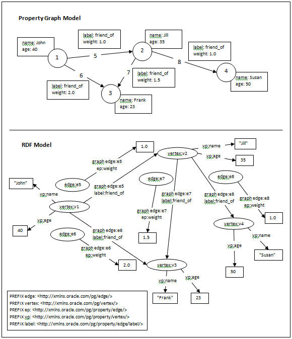

## 11  RDF Integration with Property Graph Data Stored in Oracle Database

The property graph data model is supported in Oracle Spatial and Graph. Oracle Spatial and Graph provides built-in support for RDF views of property graph data stored in Oracle Database.

- About RDF Integration with Property Graph Data
  The property graph data model is simpler than the RDF data model in that it has no concept of global resource identification (that is, no URIs) or formal semantics and entailment.
- R2RML Mapping for the Property Graph Relational Schema
  You can use the built-in R2RML mapping to construct an RDF view from the property graph relational schema.
- PL/SQL API for Creating and Maintaining Property Graph RDF Views
  Subprograms in the SEM_APIS package simplify the creation and maintenance of property graph RDF views.
- Sample RDF Workflow with Property Graph Data
  This topic presents a sample RDF workflow with property graph data.
- Special Considerations When Using Property Graph RDF Views
  The following special considerations apply when using property graph RDF views.

**Parent topic:** [Conceptual and Usage Information](part-concept-usage.md)

### 11.1 About RDF Integration with Property Graph Data

The property graph data model is simpler than the RDF data model in that it has no concept of global resource identification (that is, no URIs) or formal semantics and entailment. In addition, property graphs allow direct association of properties (key-value pairs) with edges. RDF, by contrast, needs reification or a quad data model to associate properties with edges (RDF triples).

Oracle Spatial and Graph provides built-in support for RDF views of property graph data stored in Oracle Database. These RDF views serve as an integration point between property graph data and RDF data. RDF views of property graph data behave the same way as other RDF views; you can run SPARQL queries against them and materialize them as native RDF models. Support for RDF views of property graphs is provided through the following components:

- A built-in R2RML mapping for the relational schema used to store property graph data \[ref to schema\].

- A PL/SQL API for creating and maintaining RDF views using the built-in R2RML mapping for property graph data.

There are two main considerations when representing property graph data in RDF:

- How to generate syntactically valid RDF terms (URIs, literals, and so on) from property graph identifiers and values

- How to represent edge properties (key-value pairs for edges)

Oracle Spatial and Graph uses specific prefixes to generate URIs from property graph identifiers, and uses XML Schema typed literals for property values. Named graphs are used to model edge properties.

The example shown in the following figure illustrates a property graph to RDF mapping. Note that edges in the property graph model become an RDF quad, where the predicate is the edge label and the named graph is a URI constructed from the edge identifier. Edge properties are then modeled as RDF quads within the named graph for the edge. As an illustration, the Trig serialization for RDF graph in the following figure is as follows:

    @PREFIX edge: <http://xmlns.oracle.com/pg/edge/> .
    @PREFIX vertex: <http://xmlns.oracle.com/pg/vertex/> .
    @PREFIX ep: <http://xmlns.oracle.com/pg/property/edge/> .
    @PREFIX vp: <http://xmlns.oracle.com/pg/property/vertex/> .
    @PREFIX label: <http://xmlns.oracle.com/pg/property/edge/label/> .

    vertex:v1 vp:name "John";
              vp:age 40 .
    vertex:v2 vp:name "Jill"
              vp:age 35 .
    vertex:v3 vp:name "Frank";
              vp:age 23 .
    vertex:v4 vp:name "Susan";
              vp:age 50 .
    edge:e5 { vertex:v1 label:friend_of vertex:v2 .
              edge:e5   ep:weight 1.0 . }
    edge:e6 { vertex:v1 label:friend_of vertex:v3 .
              edge:e6   ep:weight 2.0 . }
    edge:e7 { vertex:v2 label:friend_of vertex:v3 .
              edge:e7   ep:weight 1.5 . }
    edge:e8 { vertex:v2 label:friend_of vertex:v4 .
              edge:e8   ep:weight 1.0 . }

Figure 11-1 Equivalent Property Graph and RDF Representations of the Same Graph

[Description of "Figure 11-1 Equivalent Property Graph and RDF Representations of the Same Graph"](img_text/pg_rdf_equivalent_representations1.md)

In the preceding figure, the property graph model at the top is simpler than the RDF model at the bottom. Both models show four vertices (nodes) representing four people (John, Jill, Frank, Susan), but the property graph model shows simple boxes for name and label information. The property graph model shows many edges with properties represented using the following prefixes:

- PREFIX edge: \<http://xminx,oracle.com/pg/edge/\>

- PREFIX vertex: \<http://xminx,oracle.com/pg/vertex/\>

- PREFIX ep: \<http://xminx,oracle.com/pg/property/edge/\>

- PREFIX vp http://xminx,oracle.com/pg/property/vertex/\>

- PREFIX label: \<http://xminx,oracle.com/pg/property/edge/label/\>

**Parent topic:** RDF Integration with Property Graph Data Stored in Oracle Database

### 11.2 R2RML Mapping for the Property Graph Relational Schema

You can use the built-in R2RML mapping to construct an RDF view from the property graph relational schema.

Several helper views are created to simplify the R2RML mapping and to convert values from NVARCHAR to VARCHAR. These views are shown in the following output (assuming RDF view model name `M1`, property graph name `G1`, and user name `USER`). Note that substring length for edge label and property name can be customized, and the M1\$GT view will select directly from the G1GT\$ table if you indicate that this table is populated (with `options=>'GT_TABLE=T'`).

    -- 5 VT$ views --
    -- Varchar --
    create or replace view "USER"."M1$V1" as
    select
      "VID",
      to_char(substr("K",1,200)) KC,
      "T",
      to_char("V") VC,
      "SL",
      "VTS",
      "VTE",
      "FE"
    from  "USER"."G1VT$"
    where T=1;

    -- Number --
    create or replace view "USER"."M1$V2" as
    select
      "VID",
      to_char(substr("K",1,200)) KC,
      "T",
      "VN",
      "SL",
      "VTS",
      "VTE",
      "FE"
    from  "USER"."G1VT$"
    where T IN (2,3,4);

    -- DateTime --
    create or replace view "USER"."M1$V3" as
    select
      "VID",
      to_char(substr("K",1,200)) KC,
      "T",
      "VT",
      "SL",
      "VTS",
      "VTE",
      "FE"
    from  "USER"."G1VT$"
    where T=5;

    -- Boolean --
    create or replace view "USER"."M1$V4" as
    select
      "VID",
      to_char(substr("K",1,200)) KC,
      "T",
      DECODE("V",'y',to_char('true'),
                 'Y',to_char('true'),
                 'n',to_char('false'),
                 'N',to_char('false')) VB,
      "SL",
      "VTS",
      "VTE",
      "FE"
    from  "USER"."G1VT$"
    where T=6;

    -- ID View –
    create or replace view "USER"."M1$VT" as
    select DISTINCT
      "VID"
    from "USER"."G1VT$";

    -- 4 GE$ Views --
    -- Varchar --
    create or replace view "USER"."M1$G1" as
    select
      "EID",
      "SVID",
      "DVID",
      "EL",
      to_char(substr("K",1,200)) KC,
      "T",
      to_char("V") VC,
      "SL",
      "VTS",
      "VTE",
      "FE"
    from "USER"."G1GE$"
    where T=1;

    -- Number --
    create or replace view "USER"."M1$G2" as
    select
      "EID",
      "SVID",
      "DVID",
      "EL",
      to_char(substr("K",1,200)) KC,
      "T",
      "VN",
      "SL",
      "VTS",
      "VTE",
      "FE"
    from "USER"."G1GE$"
    where T IN (2,3,4);

    -- DateTime --
    create or replace view "USER"."M1$G3" as
    select
      "EID",
      "SVID",
      "DVID",
      "EL",
      to_char(substr("K",1,200)) KC,
      "T",
      "VT",
      "SL",
      "VTS",
      "VTE",
      "FE"
    from "USER"."G1GE$"
    where T=5;

    -- Boolean --
    create or replace view "USER"."M1$G4" as
    select
      "EID",
      "SVID",
      "DVID",
      "EL",
      to_char(substr("K",1,200)) KC,
      "T",
      DECODE("V",'y',to_char('true'),
                 'Y',to_char('true'),
                 'n',to_char('false'),
                 'N',to_char('false')) VB,
      "SL",
      "VTS",
      "VTE",
      "FE"
    from "USER"."G1GE$"
    where T=6;

    -- GT$ View –
    create or replace view "USER"."M1$GT" as
    select DISTINCT
      "EID",
      "SVID",
      "DVID",
      to_char(substr("EL",1,200)) LC
    from "USER"."G1GE$";

The built-in R2RML mapping that uses these views is shown in the following output in turtle format.

    @prefix rdf:   <http://www.w3.org/1999/02/22-rdf-syntax-ns#>.
    @prefix rr:    <http://www.w3.org/ns/r2rml#>.
    @prefix xsd:   <http://www.w3.org/2001/XMLSchema#>.
    @prefix pg:    <http://xmlns.oracle.com/pg/>.
    @prefix pgvtpr: <http://xmlns.oracle.com/pg/property/vertex/>.
    @prefix pgedpr: <http://xmlns.oracle.com/pg/property/edge/>.
    # Vertex Property views ===============================================
    pg:TMap_VERTEXPR_VC_TAB
      rr:logicalTable [ rr:tableName "\"USER\".\"M1$V1\"" ] ;
      rr:subjectMap [
        rr:template "http://xmlns.oracle.com/pg/vertex/v{VID}" ;
        rr:class pg:VERTEX ] ;
      rr:predicateObjectMap [
        rr:predicateMap [
          rr:template "http://xmlns.oracle.com/pg/property/vertex/{KC}" ] ;
        rr:objectMap [ rr:column "VC" ]
    ]
    .
    pg:TMap_VERTEXPR_VN_TAB
      rr:logicalTable [ rr:tableName "\"USER\".\"M1$V2\"" ] ;
      rr:subjectMap [
        rr:template "http://xmlns.oracle.com/pg/vertex/v{VID}" ;
        rr:class pg:VERTEX ] ;
      rr:predicateObjectMap [
        rr:predicateMap [
          rr:template "http://xmlns.oracle.com/pg/property/vertex/{KC}" ] ;
        rr:objectMap [
          rr:column "VN" ;
          rr:datatype xsd:decimal ]
    ]
    .
    pg:TMap_VERTEXPR_VT_TAB
      rr:logicalTable [
        rr:tableName "\"USER\".\"M1$V3\"" ] ;
      rr:subjectMap [
        rr:template "http://xmlns.oracle.com/pg/vertex/v{VID}" ;
        rr:class pg:VERTEX ] ;
      rr:predicateObjectMap [
        rr:predicateMap [
          rr:template "http://xmlns.oracle.com/pg/property/vertex/{KC}" ] ;
        rr:objectMap [
          rr:column "VT" ;
          rr:datatype xsd:dateTime ]
    ]
    .
    pg:TMap_VERTEXPR_VB_TAB
      rr:logicalTable [
        rr:tableName "\"USER\".\"M1$V4\"" ] ;
      rr:subjectMap [
        rr:template "http://xmlns.oracle.com/pg/vertex/v{VID}" ;
        rr:class pg:VERTEX ] ;
      rr:predicateObjectMap [
        rr:predicateMap [
          rr:template "http://xmlns.oracle.com/pg/property/vertex/{KC}" ] ;
        rr:objectMap [
          rr:column "VB" ;
          rr:datatype xsd:boolean ]
    ]
    .
    # VERTEX ID view ==============================================
    pg:TMap_VERTEXID_TAB
      rr:logicalTable [
        rr:tableName "\"USER\".\"M1$VT\"" ] ;
      rr:subjectMap [
        rr:template "http://xmlns.oracle.com/pg/vertex/v{VID}" ;
        rr:class pg:VERTEX ] ;
      rr:predicateObjectMap [
        rr:predicate pgvtpr:id ;
        rr:objectMap [
          rr:column "VID" ]
      ]
    .
    # Edge Property views ===============================================
    pg:TMap_EDGEPR_VC_TAB
      rr:logicalTable [
        rr:tableName "\"USER\".\"M1$G1\"" ] ;
      rr:subjectMap [
        rr:template "http://xmlns.oracle.com/pg/edge/e{EID}" ;
        rr:graphMap [
          rr:template "http://xmlns.oracle.com/pg/edge/e{EID}" ] ] ;
      rr:predicateObjectMap [
        rr:predicateMap [
          rr:template "http://xmlns.oracle.com/pg/property/edge/{KC}" ] ;
        rr:objectMap [
          rr:column "VC" ]
      ]
    .
    pg:TMap_EDGEPR_VN_TAB
      rr:logicalTable [
        rr:tableName "\"USER\".\"M1$G2\"" ] ;
      rr:subjectMap [
        rr:template "http://xmlns.oracle.com/pg/edge/e{EID}" ;
        rr:graphMap [
          rr:template "http://xmlns.oracle.com/pg/edge/e{EID}" ] ] ;
      rr:predicateObjectMap [
        rr:predicateMap [
          rr:template "http://xmlns.oracle.com/pg/property/edge/{KC}" ] ;
        rr:objectMap [
          rr:column "VN" ;
          rr:datatype xsd:decimal ]
      ]
    .
    pg:TMap_EDGEPR_VT_TAB
      rr:logicalTable [
        rr:tableName "\"USER\".\"M1$G3\"" ] ;
      rr:subjectMap [
        rr:template "http://xmlns.oracle.com/pg/edge/e{EID}" ;
        rr:graphMap [
          rr:template "http://xmlns.oracle.com/pg/edge/e{EID}" ] ] ;
      rr:predicateObjectMap [
        rr:predicateMap [
          rr:template "http://xmlns.oracle.com/pg/property/edge/{KC}" ] ;
        rr:objectMap [
          rr:column "VT" ;
          rr:datatype xsd:dateTime ]
      ]
    .
    pg:TMap_EDGEPR_VB_TAB
      rr:logicalTable [
        rr:tableName "\"USER\".\"M1$G4\"" ] ;
      rr:subjectMap [
        rr:template "http://xmlns.oracle.com/pg/edge/e{EID}" ;
        rr:graphMap [
          rr:template "http://xmlns.oracle.com/pg/edge/e{EID}" ] ] ;
      rr:predicateObjectMap [
        rr:predicateMap [
          rr:template "http://xmlns.oracle.com/pg/property/edge/{KC}" ] ;
        rr:objectMap [
          rr:column "VB" ;
          rr:datatype xsd:boolean ]
      ]
    .
    # Edge IDLABEL views ==========================================
    pg:TMap_EDGEIDLABEL_TAB
      rr:logicalTable [
        rr:tableName "\"USER\".\"M1$GT\"" ] ;
      rr:subjectMap [
        rr:template "http://xmlns.oracle.com/pg/edge/e{EID}" ;
        rr:class pg:EDGE ;
        rr:graphMap [
          rr:template "http://xmlns.oracle.com/pg/edge/e{EID}" ] ] ;
      rr:predicateObjectMap [
        rr:predicate pgedpr:id ;
        rr:objectMap [
          rr:column "EID" ]
      ] ;
      rr:predicateObjectMap [
        rr:predicate pgedpr:label ;
        rr:objectMap [
          rr:column "LC" ]
      ]
    .
    # Edge views ===================================================
    pg:TMap_EDGE_TAB
      rr:logicalTable [
        rr:tableName "\"USER\".\"M1$GT\"" ] ;
      rr:subjectMap [
        rr:template "http://xmlns.oracle.com/pg/vertex/v{SVID}" ;
        rr:graphMap [
          rr:template "http://xmlns.oracle.com/pg/edge/e{EID}" ] ] ;
      rr:predicateObjectMap [
        rr:predicateMap [
          rr:template "http://xmlns.oracle.com/pg/label/{LC}" ] ;
        rr:objectMap [
          rr:template "http://xmlns.oracle.com/pg/vertex/v{DVID}" ;
          rr:termType rr:IRI ]
      ]
    .

**Parent topic:** RDF Integration with Property Graph Data Stored in Oracle Database

### 11.3 PL/SQL API for Creating and Maintaining Property Graph RDF Views

Subprograms in the SEM_APIS package simplify the creation and maintenance of property graph RDF views.

Reference and usage information for these subprograms is included in the [SEM_APIS Package Subprograms](SEM_APIS-reference.md) chapter.

To create an property graph view from an existing model, use the [SEM_APIS.CREATE_PG_RDFVIEW](SEM_APIS-reference.md) procedure.

To drop a property graph RDF view, use the [SEM_APIS.DROP_PG_RDFVIEW](SEM_APIS-reference.md).

Indexes should be created on the property graph tables for improved performance of RDF view queries. You can create any number of index schemes on these tables, but the [SEM_APIS.BUILD_PG_RDFVIEW_INDEXES](SEM_APIS-reference.md)procedure is provided for convenience. (To drop all indexes created by that procedure, you can use the [SEM_APIS.DROP_PG_RDFVIEW_INDEXES](SEM_APIS-reference.md) procedure.)

To return the VALUE_ID value for the canonical version of an RDF term (or NULL if the term does not exist), you can use the [SEM_APIS.RES2VID](SEM_APIS-reference.md) function.

**Parent topic:** RDF Integration with Property Graph Data Stored in Oracle Database

### 11.4 Sample RDF Workflow with Property Graph Data

This topic presents a sample RDF workflow with property graph data.

The first example creates an RDF view named M1 from a property graph named G1 stored in Oracle Database, and creates indexes on that view. The other examples run SPARQL queries using the SEM_MATCH table function.

Example 11-1 Creating the RDF View and Indexes

    -- Create a property graph RDF view
    EXECUTE sem_apis.create_pg_rdfview('M1','G1');
    -- Create indexes
    EXECUTE sem_apis.build_pg_rdfview_indexes('G1');

Example 11-2 Find the Names and Ages of All of John’s Friends

    SELECT name$rdfterm, age$rdfterm
    FROM TABLE(SEM_MATCH(
     'PREFIX edge: <http://xmlns.oracle.com/pg/edge/>
      PREFIX vertex: <http://xmlns.oracle.com/pg/vertex/>
      PREFIX ep: <http://xmlns.oracle.com/pg/property/edge/>
      PREFIX vp: <http://xmlns.oracle.com/pg/property/vertex/>
      PREFIX label: <http://xmlns.oracle.com/pg/property/edge/label/>
      SELECT ?name ?age
      WHERE {
        ?v1 vp:name "John" .
        ?v1 label:friend_of ?v2 .
        ?v2 vp:name ?name .
        ?v2 vp:age ?age . }'
    , sem_models('M1')
    , null, null, null, null
    , ' PLUS_RDFT=VC '));

Example 11-3 Find the Names and Ages of All of John’s Good Friends (Weight \> 1.5)

    SELECT name$rdfterm, age$rdfterm
    FROM TABLE(SEM_MATCH(
     'PREFIX edge: <http://xmlns.oracle.com/pg/edge/>
      PREFIX vertex: <http://xmlns.oracle.com/pg/vertex/>
      PREFIX ep: <http://xmlns.oracle.com/pg/property/edge/>
      PREFIX vp: <http://xmlns.oracle.com/pg/property/vertex/>
      PREFIX label: <http://xmlns.oracle.com/pg/property/edge/label/>
      SELECT ?name ?age
      WHERE {
        ?v1 vp:name "John" .
        GRAPH ?e {
          ?v1 label:friend_of ?v2 .
          ?e ep:weight ?w .
          FILTER (?w > 1.5)
        }
        ?v2 vp:name ?name .
        ?v2 vp:age ?age . }'
    , sem_models('M1')
    , null, null, null, null
    , ' PLUS_RDFT=VC '));

Example 11-4 Find John’s Best Friend (Highest Edge Weight)

    SELECT name$rdfterm
    FROM TABLE(SEM_MATCH(
     'PREFIX edge: <http://xmlns.oracle.com/pg/edge/>
      PREFIX vertex: <http://xmlns.oracle.com/pg/vertex/>
      PREFIX ep: <http://xmlns.oracle.com/pg/property/edge/>
      PREFIX vp: <http://xmlns.oracle.com/pg/property/vertex/>
      PREFIX label: <http://xmlns.oracle.com/pg/property/edge/label/>
      SELECT ?name
      WHERE {
        ?v1 vp:name "John" .
        GRAPH ?e {
          ?v1 label:friend_of ?v2 .
          ?e ep:weight ?w .
        }
        ?v2 vp:name ?name . }
      ORDER BY DESC(?w)
      LIMIT 1'
    , sem_models('M1')
    , null, null, null, null
    , ' PLUS_RDFT=VC '));

**Parent topic:** RDF Integration with Property Graph Data Stored in Oracle Database

### 11.5 Special Considerations When Using Property Graph RDF Views

The following special considerations apply when using property graph RDF views.

- Vertex and edge property values greater than 4000 bytes in length are not supported.

- Edge label values will be replaced with the IRI-safe form (as described in the W3C R2RML specification) when generating edge label URIs.

- Vertex and edge property names will be replaced with the IRI-safe form (as described in the W3C R2RML specification) when generating vertex and edge property name URIs.

- Special characters and non-ASCII characters in string-valued vertex and edge property values will be escaped (as described in the W3C N-Triples specification).

**Parent topic:** RDF Integration with Property Graph Data Stored in Oracle Database
