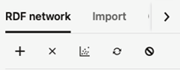

## 14.3.2.2 RDF Network Actions

You can execute the following semantic network actions:

Figure 14-25 RDF Network Actions

[Description of "Figure 14-25 RDF Network Actions"](img_text/rdf_semantic_nw.md)

- Create an RDF network.
- Delete an RDF network.
- Gather statistics for a network.
- Refresh network indexes.
- Purge values not in use.

**Parent topic:** [RDF Data Page](rdf-data-page.md)
