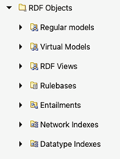
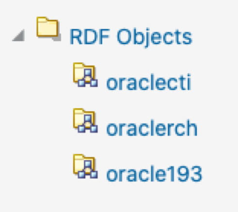
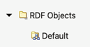
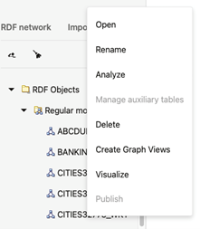

## 14.3.2.5 RDF Objects Navigator

The navigator tree shows the available RDF objects for the selected data source.

- For Oracle data sources, it will contain the different concept types like models, virtual models, view models, RDF view models, rule bases, entailments, network indexes, and datatype indexes.

  Figure 14-29 RDF Objects for Oracle Data Source

  
  [Description of "Figure 14-29 RDF Objects for Oracle Data Source"](img_text/rdf_obj_oracle.md)

- For endpoint RDF data sources, the RDF navigator will have a list of names representing the available RDF datasets in the RDF store.

  Figure 14-30 RDF Objects from capabilities

  
  [Description of "Figure 14-30 RDF Objects from capabilities"](img_text/rdf_obj_capabilities.md)

- If an external RDF data source does not have a capabilities URL, then just a default dataset is shown.
  Figure 14-31 Default RDF Object

  
  [Description of "Figure 14-31 Default RDF Object"](img_text/rdf_obj_endpoint.md)

To execute SPARQL queries and SPARQL updates, open the selected RDF object in the RDF objects navigator. For Oracle RDF objects, SPARQL queries are available for models (regular models, virtual models, and view models).

Different actions can be performed on the navigator tree nodes. Right-clicking on a node under RDF objects will bring the context menu options (such as Open, Rename, Analyze, Manage auxiliary tables, Delete, Create Graph Views, Visualize, and Publish) for that specific node.

It is important to note the following:

- Manage auxiliary tables menu item will be enabled only if the database version is 19.15 or newer.
- Publish menu item will be enabled only if the selected RDF data source is public.
- Guest users cannot perform actions that require a write privilege.

Figure 14-32 RDF Navigator - Context Menu

[Description of "Figure 14-32 RDF Navigator - Context Menu"](img_text/rdf_obj_nav_ctx_menu.md)

**Parent topic:** [RDF Data Page](rdf-data-page.md)
