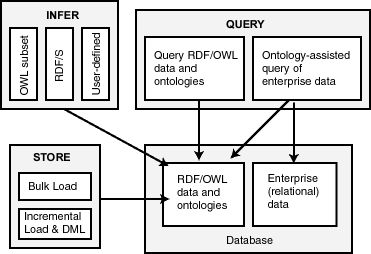
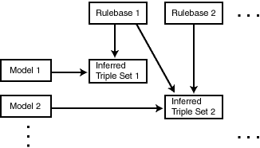
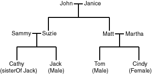

## 1  RDF Knowledge Graph Overview

Oracle Spatial and Graph support for semantic technologies consists mainly of Resource Description Framework (RDF) and a subset of the Web Ontology Language (OWL). These capabilities are referred to as the RDF Knowledge Graph feature of Oracle Spatial and Graph.

The RDF Knowledge Graph feature enables you to create one or more semantic networks in an Oracle database. Each network contains semantic data (also referred to as RDF data).

This chapter assumes that you are familiar with the major concepts associated with RDF and OWL, such as {subject, predicate, object} triples, {subject, predicate, object, graph} quads, URIs, blank nodes, plain and typed literals, and ontologies. It does not explain these concepts in detail, but focuses instead on how the concepts are implemented in Oracle.

- For an excellent explanation of RDF concepts, see the World Wide Web Consortium (W3C) RDF Primer at [`http://www.w3.org/TR/rdf-primer/`](http://www.w3.org/TR/rdf-primer/).

- For information about OWL, see the OWL Web Ontology Language Reference at [`http://www.w3.org/TR/owl-ref/`](http://www.w3.org/TR/owl-ref/).

The PL/SQL subprograms for working with semantic data are in the SEM_APIS package, which is documented in [SEM_APIS Package Subprograms](SEM_APIS-reference.md).

The RDF and OWL support are features of Oracle Spatial and Graph, which must be installed for these features to be used. However, the use of RDF and OWL is not restricted to spatial data.

**Note:**

If you have any semantic data created using an Oracle Database release before 12.2, see Required Migration of Pre-12.2 Semantic Data.

For information about OWL concepts and the Oracle Database support for OWL capabilities, see [OWL Concepts](owl-concepts.md) .

**Note:**

Before performing any operations described in this guide, you must enable RDF Semantic Graph support in the database and meet other prerequisites, as explained in [Enabling RDF Semantic Graph Support](enabling-downgrading-or-removing-rdf-graph-support.md).

- Introduction to Oracle Semantic Technologies Support
  Oracle Database enables you to store semantic data and ontologies, to query semantic data and to perform ontology-assisted query of enterprise relational data, and to use supplied or user-defined inferencing to expand the power of querying on semantic data.
- Semantic Data Modeling
  In addition to its formal semantics, semantic data has a simple data structure that is effectively modeled using a directed graph.
- Semantic Data in the Database
  Semantic data in Oracle Database is stored in one or more semantic networks.
- Semantic Metadata Tables and Views
  Oracle Database maintains several tables and views in the network owner’s schema to hold metadata related to semantic data.
- Semantic Data Types, Constructors, and Methods
  The SDO_RDF_TRIPLE_S object type is used for representing the edges (that is, triples and quads) of RDF graphs.
- Using the SEM_MATCH Table Function to Query Semantic Data
  To query semantic data, use the SEM_MATCH table function.
- Using the SEM_APIS.SPARQL_TO_SQL Function to Query Semantic Data
  You can use the SEM_APIS.SPARQL_TO_SQL function as an alternative to the SEM_MATCH table function to query semantic data.
- Loading and Exporting Semantic Data
  You can load semantic data into a model in the database and export that data from the database into a staging table.
- Using Semantic Network Indexes
  Semantic network indexes are nonunique B-tree indexes that you can add, alter, and drop for use with models and entailments in a semantic network.
- Using Data Type Indexes
  Data type indexes are indexes on the values of typed literals stored in a semantic network.
- Managing Statistics for Semantic Models and the Semantic Network
  Statistics are critical to the performance of SPARQL queries and OWL inference against semantic data stored in an Oracle database.
- Support for SPARQL Update Operations on a Semantic Model
  Effective with Oracle Database Release 12.2, you can perform SPARQL Update operations on a semantic model.
- RDF Support for Oracle Database In-Memory
  RDF can use the in-memory Oracle Database In-Memory suite of features, including in-memory column store, to improve performance for real-time analytics and mixed workloads.
- RDF Support in Oracle SQL Developer
  You can use Oracle SQL Developer to perform operations related to the RDF Knowledge Graph feature of Oracle Spatial and Graph.
- Enhanced RDF ORDER BY Query Processing
  Effective with Oracle Database Release 12.2, queries on RDF data that use SPARQL ORDER BY semantics are processed more efficiently than in previous releases.
- Semantic Data Examples (PL/SQL and Java)
  PL/SQL examples are provided in this topic.
- Software Naming Changes Since Release 11.1
  Because the support for semantic data has been expanded beyond the original focus on RDF, the names of many software objects (PL/SQL packages, functions and procedures, system tables and views, and so on) have been changed as of Oracle Database Release 11.1.
- For More Information About RDF Semantic Graph
  More information is available about RDF Semantic Graph support and related topics.
- Required Migration of Pre-12.2 Semantic Data
  If you have any semantic data created using Oracle Database 11.1. 11.2, or 12.1, then before you use it in an Oracle Database 12.2 environment, you must migrate this data.
- Oracle RDF Graph Features that Support Accessibility
  This section describes the accessibility support provided by Oracle RDF Graph features.

**Parent topic:** [Conceptual and Usage Information](part-concept-usage.md)

### 1.1 Introduction to Oracle Semantic Technologies Support

Oracle Database enables you to store semantic data and ontologies, to query semantic data and to perform ontology-assisted query of enterprise relational data, and to use supplied or user-defined inferencing to expand the power of querying on semantic data.

Figure 1-1 shows how these capabilities interact.

Figure 1-1 Oracle Semantic Capabilities

[Description of "Figure 1-1 Oracle Semantic Capabilities"](img_text/sem_overview.md)

As shown in Figure 1-1, the database contains semantic data and ontologies (RDF/OWL models), as well as traditional relational data. To load semantic data, bulk loading is the most efficient approach, although you can load data incrementally using transactional INSERT statements.

**Note:**

If you want to use existing semantic data from a release before Oracle Database 11.1, the data must be upgraded as described in [Enabling RDF Semantic Graph Support](enabling-downgrading-or-removing-rdf-graph-support.md).

You can query semantic data and ontologies, and you can also perform ontology-assisted queries of semantic and traditional relational data to find semantic relationships. To perform ontology-assisted queries, use the SEM_RELATED operator, which is described in [Using Semantic Operators to Query Relational Data](owl-concepts.md).

You can expand the power of queries on semantic data by using inferencing, which uses rules in rulebases. Inferencing enables you to make logical deductions based on the data and the rules. For information about using rules and rulebases for inferencing, see Inferencing: Rules and Rulebases.

**Parent topic:** RDF Knowledge Graph Overview

### 1.2 Semantic Data Modeling

In addition to its formal semantics, semantic data has a simple data structure that is effectively modeled using a directed graph.

The metadata statements are represented as triples: nodes are used to represent two parts of the triple, and the third part is represented by a directed link that describes the relationship between the nodes. The triples are stored in a semantic data network. In addition, information is maintained about specific semantic data models created by database users. A user-created model has a model name, and refers to triples stored in a specified table column.

Statements are expressed in triples: {subject or resource, predicate or property, object or value}. In this manual, {subject, property, object} is used to describe a triple, and the terms statement and triple may sometimes be used interchangeably. Each triple is a complete and unique fact about a specific domain, and can be represented by a link in a directed graph.

**Parent topic:** RDF Knowledge Graph Overview

### 1.3 Semantic Data in the Database

Semantic data in Oracle Database is stored in one or more semantic networks.

All triples are parsed and stored in the system as entries in tables is a semantic network, and each semantic network is under a database schema (either a regular database user schema or the Oracle-supplied MDSYS schema). A triple {subject, property, object} is treated as one database object. As a result, a single document containing multiple triples results in multiple database objects.

All the subjects and objects of triples are mapped to nodes in a semantic data network, and properties are mapped to network links that have their start node and end node as subject and object, respectively. The possible node types are blank nodes, URIs, plain literals, and typed literals.

The following requirements apply to the specifications of URIs and the storage of semantic data in the database:

- A subject must be a URI or a blank node.

- A property must be a URI.

- An object can be any type, such as a URI, a blank node, or a literal. (However, null values and null strings are not supported.)

<!-- -->

- Semantic Networks
- Metadata for Models
- Statements
- Subjects and Objects
- Blank Nodes
- Properties
- Inferencing: Rules and Rulebases
- Entailments (Rules Indexes)
- Virtual Models
- Named Graphs
- Semantic Data Security Considerations
- RDF Privilege Considerations

**Parent topic:** RDF Knowledge Graph Overview

#### 1.3.1 Semantic Networks

A semantic network is a set of tables and views that holds RDF data (that is, semantic data). A semantic network is not created during installation. A database user must explicitly call [SEM_APIS.CREATE_SEM_NETWORK](SEM_APIS-reference.md) to create a semantic network before any RDF data can be stored in the database.

A semantic network contains, among other things, an RDF_LINK\$ table for storing RDF triples or quads. By default, the RDF_LINK\$ table is list-partitioned into a set of models. A model is a user-created container for storing RDF triples or quads.

The RDF_LINK\$ table can optionally use list-hash composite partitioning where each model partition is subpartitioned by a hash of the predicate. Composite partitioning can improve SPARQL query performance on larger data sets through better parallelization and improved query optimizer statistics. For more information about how to enable composite partitioning, see:

- The `options` parameter descriptions for [SEM_APIS.CREATE_SEM_MODEL](SEM_APIS-reference.md) and [SEM_APIS.CREATE_SEM_NETWORK](SEM_APIS-reference.md)

- The usage notes for the `options` parameter for [SEM_APIS.CREATE_ENTAILMENT](SEM_APIS-reference.md), specifically for the `MODEL_PARTITIONS=n` option.

A semantic network can be created in and owned by either the MDSYS schema or a regular database user schema:

- If a network is created in the MDSYS schema, it is an unnamed semantic network available to the entire database.

  Having a single unnamed network was the only scenario available before Oracle Database Release 19c. That usage is still supported, but discouraged, for networks created starting with Release 19c.

- Regardless of the presence or absence of a network in the MDSYS schema in a database, you can create or one more semantic networks in one or more regular database user schemas. Each such network is called a schema-private semantic network.

  The use of schema-private networks is encouraged.

You can have both an MDSYS-owned network and one or more schema-private networks in a single database or pluggable database.

An existing MDSYS-owned semantic network can be migrated to a shared schema-private semantic network by using the [SEM_APIS.MOVE_SEM_NETWORK_DATA](SEM_APIS-reference.md) and [SEM_APIS.APPEND_SEM_NETWORK_DATA](SEM_APIS-reference.md) procedures. See Moving, Restoring, and Appending a Semantic Network for details.

- Schema-Private Semantic Networks
- Types of Semantic Network Users
- Naming Conventions for Semantic Network Objects
- RDF_PARAMETER Table in Semantic Networks
- Migrating from MDSYS to Schema-Private Semantic Networks
- Sharing Schema-Private Semantic Networks

**Parent topic:** Semantic Data in the Database

##### 1.3.1.1 Schema-Private Semantic Networks

In a schema-private semantic network, the associated database objects are created in the network owner’s schema, and the network owner has exclusive privileges to those objects. (DBA users also have such privileges, and the network owner or a DBA can grant and revoke the privileges for other users.)

Schema-private semantic networks have several benefits:

- They provide better security and isolation because multiple users do not share tables and indexes.

  The network owner’s schema contains all semantic network database objects, and the network owner has exclusive privileges to those objects by default.

  Schema-private semantic networks provide better isolation because database objects are not shared among multiple database users by default. However, after granting appropriate privileges, a network owner may share their schema-private semantic network with other users.

- Regular users can perform administration operations on their own networks, for example, index creation or network-wide statistics gathering.

  The network owner can perform administration operations on the network without needing DBA privileges. (By contrast, with an MDSYS-owned network, DBA privileges are required to perform administration operations.)

  Several schema-private semantic networks can coexist in a single database, PDB, or even schema, which allows custom data type indexing schemes for different sets of RDF data. For example, NETWORK1 can have only a spatial data type index while NETWORK2 has only a text data type index.

Most SEM_APIS package subprograms now have `network_owner` and `network_name` parameters to support schema-private semantic networks. Schema-private semantic networks are identified by the two-element combination of network owner and network name, which is specified in the last two parameters of the [SEM_APIS.CREATE_SEM_NETWORK](SEM_APIS-reference.md) call that created the network.

The following table describes the usage of the `network_owner` and `network_name` parameters in subprograms that include them.

Table 1-1 network_owner and network_name Parameters

| Parameter Name  | Description                                                                                                                                                                                                                                                                                                                                                                                |
|:----------------|:-------------------------------------------------------------------------------------------------------------------------------------------------------------------------------------------------------------------------------------------------------------------------------------------------------------------------------------------------------------------------------------------|
| `network_owner` | Name of the schema that owns the network. The default is NULL. • For a schema-private network, must not be null, and must specify a regular database user (that is, not MDSYS or another predefined Oracle-supplied user). • For an MDSYS-owned network, must be null.                                                                                                               |
| `network_name`  | Name of the network. The default is NULL. • For a schema-private network, must not be null, and must specify the name of the network. • The name must be unique within the schema of the network owner. For example, schema SCOTT cannot have two networks named NET1; but schemas SCOTT and ANNA can each have a network named NET1. • For an MDSYS-owned network, must be null. |

**Parent topic:** Semantic Networks

##### 1.3.1.2 Types of Semantic Network Users

Schema-private an MDSYS-owned semantic networks can be differentiated based on three key types of users: network creator, network owner, and network user.

- The network creator is the user that invokes [SEM_APIS.CREATE_SEM_NETWORK](SEM_APIS-reference.md). The network creator is either a database user with DBA privileges or it is the same as the network owner.

- The network owner is the user whose schema will hold the tables, triggers and views that make up the semantic network.

- A network user is a database user that performs operations on the semantic network.

  In many examples in this book, the name `RDFUSER` is given as a sample network user name. There is nothing special about that name string; it could be the name of any database user such as `SCOTT`, `ANNA`, or `MARKETING`.

  For a schema-private network, the network owner is initially the only network user. (However, other database users can be granted privileges on the network, thus making them additional potential network users.)

**Parent topic:** Semantic Networks

##### 1.3.1.3 Naming Conventions for Semantic Network Objects

Semantic network database objects follow specific naming conventions.

All semantic network database objects in a schema-private network are prefixed with NETWORK_NAME\#, for example, USER3.MYNET#SEM_MODEL\$ instead of MDSYS.SEM_MODEL\$. This book uses the portion of the database object name after the prefix to refer to the object. That is, SEM_MODEL\$ refers to MDSYS.SEM_MODEL\$ in the case of an MDSYS-owned network, and to NETWORK_OWNER.NETWORK_NAME\#SEM_MODEL\$ in the case of a schema-private semantic network.

**Parent topic:** Semantic Networks

##### 1.3.1.4 RDF_PARAMETER Table in Semantic Networks

The MDSYS.RDF_PARAMETER table holds database-wide RDF Semantic Graph installation information such as the installed version, and it holds network-specific information for the MDSYS semantic network.

The MDSYS.RDF_PARAMETER table is created during installation and always exists. It is not dependent on the existence of the MDSYS semantic network.

In schema-private semantic networks, a NETWORK_NAME\#RDF_PARAMETER table holds network-specific information such as network compression settings and any RDFCTX or RDFOLS policies used in the schema-private network.

A schema-private NETWORK_NAME\#RDF_PARAMETER table is dependent on the existence of the NETWORK_NAME semantic network. This table is created during schema-private network creation and is dropped when the schema-private network is dropped.

**Parent topic:** Semantic Networks

##### 1.3.1.5 Migrating from MDSYS to Schema-Private Semantic Networks

An existing MDSYS-owned semantic network can be migrated to a shared schema-private semantic network by using the [SEM_APIS.MOVE_SEM_NETWORK_DATA](SEM_APIS-reference.md) and [SEM_APIS.APPEND_SEM_NETWORK_DATA](SEM_APIS-reference.md) procedures. See Moving, Restoring, and Appending a Semantic Network for details.

**Parent topic:** Semantic Networks

##### 1.3.1.6 Sharing Schema-Private Semantic Networks

After a schema-private network is created, it can optionally be shared, that is, made available for use by other database users besides the network owner. Other users can be allowed to have either of the following access capabilities:

- Read-only access to RDF data, which provides the ability to query the semantic data in the network.

  Granting read-only or query-only access to an RDF network can be done by:
  1.  The network owner by using the single command [`SEM_APIS.GRANT_NETWORK_ACCESS_PRIVS`](SEM_APIS-reference.md) with `QUERY_ONLY=T` included in the `OPTIONS` parameter.
  2.  The network owner or the model owner by using [`SEM_APIS.GRANT_MODEL_ACCESS_PRIVS`](SEM_APIS-reference.md) with appropriate privileges such as `QUERY` or `SELECT` for the individual models in the network.

  See Example 1-1 for more details.

- Read/write access to RDF objects and data in the network, such as the ability to create, alter, or drop semantic models and entailments, and to read, insert, modify, or delete RDF data.

  The logical sequence of steps for granting both read and write access is as follows:

  1.  A DBA must grant network sharing privileges to the network owner. This needs to be done only once for a given network owner.

  2.  The network owner must enable the specific network for sharing. This needs to be done only once for a given network.

  3.  The network owner must grant network access privileges to the user(s) that will be allowed to access the network.

      Each of these grants can subsequently be revoked, if necessary.

  See Example 1-2 for more details.

**Note:**

Having the above access capabilities for a network allows a user to access only the dictionary and metadata tables for the network. Models and entailments not owned by the user are not accessible unless the network owner or the owner of the individual models use the [`SEM_APIS.GRANT_MODEL_ACCESS_PRIV`](SEM_APIS-reference.md) or` `[`SEM_APIS.GRANT_MODEL_ACCESS_PRIVS`](SEM_APIS-reference.md) subprogram to grant appropriate privilege(s) for individual models or entailments in the network to the user.

Example 1-1 Sharing a Network and Granting Query Only Privilege to Another User

The following example shares a network named NET1, owned by user RDFUSER. RDFUSER grants query-only access on NET1 with user RDFQ.

    -- As RDFUSER, create a schema-private network owned by RDFUSER named NET1
    CONNECT rdfuser/<password>;
    EXECUTE SEM_APIS.CREATE_SEM_NETWORK('RDFTBS',network_owner=>'RDFUSER',network_name=>'NET1');

    -- As RDFUSER, grant query only network access privilege for NET1 to RDFQ
    EXECUTE SEM_APIS.GRANT_NETWORK_ACCESS_PRIVS(network_owner=>'RDFUSER',network_name=>'NET1',network_user=>'RDFQ', options=>' QUERY_ONLY=T ');

    -- As RDFUSER, create a semantic model M1 in network NET1
    EXECUTE SEM_APIS.CREATE_SEM_MODEL('M1',null,null,network_owner=>'RDFUSER',network_name=>'NET1');

    -- Check metadata
    SELECT *
    FROM rdfuser.net1#sem_model$;

    -- Insert some data
    INSERT INTO rdfuser.net1#rdft_m1(triple)
    VALUES (SDO_RDF_TRIPLE_S('M1','<urn:person1>','<urn:name>','"Peter"','RDFUSER','NET1'));
    COMMIT;

    -- Allow RDFQ to select and query a model that RDFUSER owns
    EXECUTE SEM_APIS.GRANT_MODEL_ACCESS_PRIVS('M1','RDFQ',sys.odcivarchar2list('SELECT','QUERY'),network_owner=>'RDFUSER',network_name=>'NET1');

    -- As RDFQ, verify that model M1 is visible for querying
    CONNECT rdfq/<password>;
    SELECT *
    FROM rdfuser.net1#rdf_model$
    WHERE model_name='M1';

    -- Query with SEM_MATCH
    SELECT s$rdfterm, p$rdfterm, o$rdfterm
    FROM TABLE(SEM_MATCH(
    'SELECT ?s ?p ?o
     WHERE { ?s ?p ?o }'
    ,SEM_MODELS('M1')
    ,null,null,null,null
    ,' PLUS_RDFT=VC '
    ,null,null
    ,'RDFUSER','NET1'));

Example 1-2 Sharing a Network and Granting Read and Write Privileges to Another User

The following example shares a network named NET1, owned by user RDFUSER, with user RDFUSER2. Also RDFUSER grants query-only access on NET1 with user RDFUSER3.

    -- As RDFUSER, create a schema-private network owned by RDFUSER named NET1
    CONNECT rdfuser/<password>;
    EXECUTE SEM_APIS.CREATE_SEM_NETWORK('RDFTBS',network_owner=>'RDFUSER',network_name=>'NET1');

    -- As a DBA, grant required privileges for network sharing to RDFUSER
    CONNECT system/<password>;
    EXECUTE SEM_APIS.GRANT_NETWORK_SHARING_PRIVS(network_owner=>'RDFUSER');

    -- As RDFUSER, enable sharing for NET1
    CONNECT rdfuser/<password>;
    EXECUTE SEM_APIS.ENABLE_NETWORK_SHARING(network_owner=>'RDFUSER',network_name=>'NET1');

    -- As RDFUSER, grant network access privileges for NET1 to RDFUSER2
    EXECUTE SEM_APIS.GRANT_NETWORK_ACCESS_PRIVS(network_owner=>'RDFUSER',network_name=>'NET1',network_user=>'RDFUSER2');

    -- As RDFUSER2, create a semantic model M2 in network NET1
    CONNECT rdfuser2/<password>;
    EXECUTE SEM_APIS.CREATE_SEM_MODEL('M2',null,null,network_owner=>'RDFUSER',network_name=>'NET1');

    -- Check metadata
    SELECT *
    FROM rdfuser.net1#sem_model$;

    -- Insert some data
    INSERT INTO rdfuser.net1#rdft_m2(triple)
    VALUES (SDO_RDF_TRIPLE_S('M2','<urn:person1>','<urn:name>','"John"','RDFUSER','NET1'));
    COMMIT;

    -- Query with SEM_MATCH
    SELECT s$rdfterm, p$rdfterm, o$rdfterm
    FROM TABLE(SEM_MATCH(
    'SELECT ?s ?p ?o
     WHERE { ?s ?p ?o }'
    ,SEM_MODELS('M2')
    ,null,null,null,null
    ,' PLUS_RDFT=VC '
    ,null,null
    ,'RDFUSER','NET1'));

    -- As RDFUSER, grant query only network access privileges for NET1 to RDFUSER3
    CONNECT rdfuser/<password>
    EXECUTE SEM_APIS.GRANT_NETWORK_ACCESS_PRIVS(network_owner=>'RDFUSER',network_name=>'NET1',network_user=>'RDFUSER3', options=>' QUERY_ONLY=T ');

    -- As RDFUSER2, allow RDFUSER3 to select and query a model that RDFUSER2 owns
    CONNECT rdfuser2/<password>
    EXECUTE SEM_APIS.GRANT_MODEL_ACCESS_PRIVS('M2','RDFUSER3',sys.odcivarchar2list('SELECT','QUERY'),network_owner=>'RDFUSER',network_name=>'NET1');

    -- As RDFUSER3, verify that model M2 is visible for querying
    CONNECT rdfuser3/<password>
    SELECT *
    FROM rdfuser.net1#rdf_model$
    WHERE model_name='M2';

    -- Query with SEM_MATCH
    SELECT s$rdfterm, p$rdfterm, o$rdfterm
    FROM TABLE(SEM_MATCH(
    'SELECT ?s ?p ?o
     WHERE { ?s ?p ?o }'
    ,SEM_MODELS('M2')
    ,null,null,null,null
    ,' PLUS_RDFT=VC '
    ,null,null
    ,'RDFUSER','NET1'));

**Parent topic:** Semantic Networks

#### 1.3.2 Metadata for Models

The SEM_MODEL\$ view contains information about all models defined in a semantic network. When you create a model using the [SEM_APIS.CREATE_SEM_MODEL](SEM_APIS-reference.md) procedure, you specify a name for the model, as well as a table and column to hold references to the semantic data, and the system automatically generates a model ID.

Oracle maintains the SEM_MODEL\$ view automatically when you create and drop models. Users should never modify this view directly. For example, do not use SQL INSERT, UPDATE, or DELETE statements with this view.

The SEM_MODEL\$ view contains the columns shown in Table 1-2.

Table 1-2 SEM_MODEL\$ View Columns

| Column Name           | Data Type    | Description                                                                                                                                                                                             |
|:----------------------|:-------------|:--------------------------------------------------------------------------------------------------------------------------------------------------------------------------------------------------------|
| OWNER                 | VARCHAR2(30) | Schema of the owner of the model.                                                                                                                                                                       |
| MODEL_ID              | NUMBER       | Unique model ID number, automatically generated.                                                                                                                                                        |
| MODEL_NAME            | VARCHAR2(25) | Name of the model.                                                                                                                                                                                      |
| TABLE_NAME            | VARCHAR2(30) | Name of the table to hold references to semantic data for the model.                                                                                                                                    |
| COLUMN_NAME           | VARCHAR2(30) | Name of the column of type SDO_RDF_TRIPLE_S in the table to hold references to semantic data for the model.                                                                                             |
| MODEL_TABLESPACE_NAME | VARCHAR2(30) | Name of the tablespace to be used for storing the triples for this model.                                                                                                                               |
| MODEL_TYPE            | VARCHAR2(40) | A value indicating the type of RDF model: `M` for regular model; `V` for virtual model; `X` for model created to store the contents of the semantic index; or `D` for model created on relational data. |
| INMEMORY              | VARCHAR2(1)  | String value indicating if the virtual model is an Oracle Database In-Memory virtual model: `T` for in-memory, or `F` for not in-memory.                                                                |

When you create a model, a view for the triples associated with the model is also created under the network owner’s schema. This view has a name in the format SEMM\_model-name, and it is visible only to the owner of the model and to users with suitable privileges. Each SEMM\_model-name view contains a row for each triple (stored as a link in a network), and it has the columns shown in Table 1-3.

Table 1-3 SEMM_model-name View Columns

| Column Name       | Data Type      | Description                                                                                                             |
|:------------------|:---------------|:------------------------------------------------------------------------------------------------------------------------|
| P_VALUE_ID        | NUMBER         | The VALUE_ID for the text value of the predicate of the triple. Part of the primary key.                                |
| START_NODE_ID     | NUMBER         | The VALUE_ID for the text value of the subject of the triple. Also part of the primary key.                             |
| CANON_END_NODE_ID | NUMBER         | The VALUE_ID for the text value of the canonical form of the object of the triple. Also part of the primary key.        |
| END_NODE_ID       | NUMBER         | The VALUE_ID for the text value of the object of the triple                                                             |
| MODEL_ID          | NUMBER         | The ID for the RDF model to which the triple belongs.                                                                   |
| COST              | NUMBER         | (Reserved for future use)                                                                                               |
| CTXT1             | NUMBER         | (Reserved column; can be used for fine-grained access control)                                                          |
| CTXT2             | VARCHAR2(4000) | (Reserved for future use)                                                                                               |
| DISTANCE          | NUMBER         | (Reserved for future use)                                                                                               |
| EXPLAIN           | VARCHAR2(4000) | (Reserved for future use)                                                                                               |
| PATH              | VARCHAR2(4000) | (Reserved for future use)                                                                                               |
| G_ID              | NUMBER         | The VALUE_ID for the text value of the graph name for the triple. Null indicates the default graph (see Named Graphs).  |
| LINK_ID           | VARCHAR2(71)   | Unique triple identifier value. (It is currently a computed column, and its definition may change in a future release.) |

**Note:**

In Table 1-3, for columns P_VALUE_ID, START_NODE_ID, END_NODE_ID, CANON_END_NODE_ID, and G_ID, the actual ID values are computed from the corresponding lexical values. However, a lexical value may not always map to the same ID value.

**Parent topic:** Semantic Data in the Database

#### 1.3.3 Statements

The RDF_VALUE\$ table contains information about the subjects, properties, and objects used to represent RDF statements. It uniquely stores the text values (URIs or literals) for these three pieces of information, using a separate row for each part of each triple.

Oracle maintains the RDF_VALUE\$ table automatically. Users should never modify this view directly. For example, do not use SQL INSERT, UPDATE, or DELETE statements with this view.

The RDF_VALUE\$ table contains the columns shown in Table 1-4.

Table 1-4 RDF_VALUE\$ Table Columns

| Column Name         | Data Type                | Description                                                                                                                                                                                                                                                                                                                                                                                                                 |
|:--------------------|:-------------------------|:----------------------------------------------------------------------------------------------------------------------------------------------------------------------------------------------------------------------------------------------------------------------------------------------------------------------------------------------------------------------------------------------------------------------------|
| VALUE_ID            | NUMBER                   | Unique value ID number, automatically generated.                                                                                                                                                                                                                                                                                                                                                                            |
| VALUE_TYPE          | VARCHAR2(10)             | The type of text information stored in the VALUE_NAME column. Possible values: `UR` for URI, `BN` for blank node, `PL` for plain literal, `PL@` for plain literal with a language tag, `PLL` for plain long literal, `PLL@` for plain long literal with a language tag, `TL` for typed literal, or `TLL` for typed long literal. A long literal is a literal with more than 4000 bytes.                                     |
| VNAME_PREFIX        | VARCHAR2(4000)           | If the length of the lexical value is 4000 bytes or less, this column stores a prefix of a portion of the lexical value. The [SEM_APIS.VALUE_NAME_PREFIX](SEM_APIS-reference.md) function can be used for prefix computation. For example, the prefix for the portion of the lexical value `<http://www.w3.org/1999/02/22-rdf-syntax-ns#type>` without the angle brackets is `http://www.w3.org/1999/02/22-rdf-syntax-ns#`. |
| VNAME_SUFFIX        | VARCHAR2(512)            | If the length of the lexical value is 4000 bytes or less, this column stores a suffix of a portion of the lexical value. The [SEM_APIS.VALUE_NAME_SUFFIX](SEM_APIS-reference.md) function can be used for suffix computation. For the lexical value mentioned in the description of the VNAME_PREFIX column, the suffix is `type`.                                                                                          |
| LITERAL_TYPE        | VARCHAR2(4000)           | For typed literals, the type information; otherwise, null. For example, for a row representing a creation date of 1999-08-16, the VALUE_TYPE column can contain `TL`, and the LITERAL_TYPE column can contain `http://www.w3.org/2001/XMLSchema#date`.                                                                                                                                                                      |
| LANGUAGE_TYPE       | VARCHAR2(80)             | Language tag (for example, `fr` for French) for a literal with a language tag (that is, if VALUE_TYPE is `PL@` or `PLL@`). Otherwise, this column has a null value.                                                                                                                                                                                                                                                         |
| CANON_ID            | NUMBER                   | The ID for the canonical lexical value for the current lexical value. (The use of this column may change in a future release.)                                                                                                                                                                                                                                                                                              |
| COLLISION_EXT       | VARCHAR2(64)             | Used for collision handling for the lexical value. (The use of this column may change in a future release.)                                                                                                                                                                                                                                                                                                                 |
| CANON_COLLISION_EXT | VARCHAR2(64)             | Used for collision handling for the canonical lexical value. (The use of this column may change in a future release.)                                                                                                                                                                                                                                                                                                       |
| ORDER_TYPE          | NUMBER                   | Represents order based on data type. Used to improve performance on ORDER BY queries.                                                                                                                                                                                                                                                                                                                                       |
| ORDER_NUM           | NUMBER                   | Represents order for number type. Used to improve performance on ORDER BY queries.                                                                                                                                                                                                                                                                                                                                          |
| ORDER_DATE          | TIMESTAMP WITH TIME ZONE | Represents order based on date type Used to improve performance on ORDER BY queries.                                                                                                                                                                                                                                                                                                                                        |
| LONG_VALUE          | CLOB                     | The character string if the length of the lexical value is greater than 4000 bytes. Otherwise, this column has a null value.                                                                                                                                                                                                                                                                                                |
| GEOM                | SDO_GEOMETRY             | A geometry value when a spatial index is defined.                                                                                                                                                                                                                                                                                                                                                                           |
| VALUE_NAME          | VARCHAR2(4000)           | This is a computed column. If length of the lexical value is 4000 bytes or less, the value of this column is the concatenation of the values of VNAME_PREFIX column and the VNAME_SUFFIX column.                                                                                                                                                                                                                            |

- Triple Uniqueness and Data Types for Literals

**Parent topic:** Semantic Data in the Database

##### 1.3.3.1 Triple Uniqueness and Data Types for Literals

Duplicate triples are not stored in a semantic network. To check if a triple is a duplicate of an existing triple, the subject, property, and object of the incoming triple are checked against triple values in the specified model. If the incoming subject, property, and object are all URIs, an exact match of their values determines a duplicate. However, if the object of incoming triple is a literal, an exact match of the subject and property, and a value (canonical) match of the object, determine a duplicate. For example, the following two triples are duplicates:

    <eg:a> <eg:b> <"123"^^http://www.w3.org/2001/XMLSchema#int>
    <eg:a> <eg:b> <"123"^^http://www.w3.org/2001/XMLSchema#unsignedByte>

The second triple is treated as a duplicate of the first, because `"123"^^<http://www.w3.org/2001/XMLSchema#int>` has an equivalent value (is canonically equivalent) to `"123"^^<http://www.w3.org/2001/XMLSchema#unsignedByte>`. Two entities are canonically equivalent if they can be reduced to the same value.

To use a non-RDF example, `A*(B-C)`, `A*B-C*A`, `(B-C)*A`, and `-A*C+A*B` all convert into the same canonical form.

**Note:**

Although duplicate triples and quads are not stored in the underlying table partition for the RDFM\_\<model\> view, it is possible to have duplicate rows in an application table. For example, if a triple is inserted multiple times into an application table, it will appear once in the RDFM\_\<model\> view, but will occupy multiple rows in the application table.

Value-based matching of lexical forms is supported for the following data types:

- STRING: plain literal, xsd:string and some of its XML Schema subtypes

- NUMERIC: xsd:decimal and its XML Schema subtypes, xsd:float, and xsd:double. (Support is not provided for float/double INF, -INF, and NaN values.)

- DATETIME: xsd:datetime, with support for time zone. (Without time zone there are still multiple representations for a single value, for example, `"2004-02-18T15:12:54"` and `"2004-02-18T15:12:54.0000"`.)

- DATE: xsd:date, with or without time zone

- OTHER: Everything else. (No attempt is made to match different representations).

Canonicalization is performed when the time zone is present for literals of type xsd:time and xsd:dateTime.

The following namespace definition is used: `xmlns:xsd="http://www.w3.org/2001/XMLSchema"`

The first occurrence of a long literal in the RDF_VALUE\$ table is taken as the canonical form and given the VALUE_TYPE value of `CPLL`, `CPLL@`, or `CTLL` as appropriate; that is, a `C` for canonical is prefixed to the actual value type. If a long literal with the same canonical form (but a different lexical representation) as a previously inserted long literal is inserted into the RDF_VALUE\$ table, the VALUE_TYPE value assigned to the new insertion is `PLL`, `PLL@`, or `TLL` as appropriate.

Canonically equivalent text values having different lexical representations are thus stored in the RDF_VALUE\$ table; however, canonically equivalent triples are not stored in the database.

**Parent topic:** Statements

#### 1.3.4 Subjects and Objects

RDF subjects and objects are mapped to nodes in a semantic data network. Subject nodes are the start nodes of links, and object nodes are the end nodes of links. Non-literal nodes (that is, URIs and blank nodes) can be used as both subject and object nodes. Literals can be used only as object nodes.

**Parent topic:** Semantic Data in the Database

#### 1.3.5 Blank Nodes

Blank nodes can be used as subject and object nodes in the semantic network. Blank node identifiers are different from URIs in that they are scoped within a semantic model. Thus, although multiple occurrences of the same blank node identifier within a single semantic model necessarily refer to the same resource, occurrences of the same blank node identifier in two different semantic models do not refer to the same resource.

In an Oracle semantic network, this behavior is modeled by requiring that blank nodes are always reused (that is, are used to represent the same resource if the same blank node identifier is used) within a semantic model, and never reused between two different models. Thus, when inserting triples involving blank nodes into a model, you must use the SDO_RDF_TRIPLE_S constructor that supports reuse of blank nodes.

**Parent topic:** Semantic Data in the Database

#### 1.3.6 Properties

Properties are mapped to links that have their start node and end node as subjects and objects, respectively. Therefore, a link represents a complete triple.

When a triple is inserted into a model, the subject, property, and object text values are checked to see if they already exist in the database. If they already exist (due to previous statements in other models), no new entries are made; if they do not exist, three new rows are inserted into the RDF_VALUE\$ table (described in Statements).

**Parent topic:** Semantic Data in the Database

#### 1.3.7 Inferencing: Rules and Rulebases

Inferencing is the ability to make logical deductions based on rules. Inferencing enables you to construct queries that perform semantic matching based on meaningful relationships among pieces of data, as opposed to just syntactic matching based on string or other values. Inferencing involves the use of rules, either supplied by Oracle or user-defined, placed in rulebases.

Figure 1-2 shows triple sets being inferred from model data and the application of rules in one or more rulebases. In this illustration, the database can have any number of semantic models, rulebases, and inferred triple sets, and an inferred triple set can be derived using rules in one or more rulebases.

Figure 1-2 Inferencing

[Description of "Figure 1-2 Inferencing"](img_text/inferencing.md)

A rule is an object that can be applied to draw inferences from semantic data. A rule is identified by a name and consists of:

- An IF side pattern for the antecedents

- A THEN side pattern for the consequents

For example, the rule that a chairperson of a conference is also a reviewer of the conference could be represented as follows:

    ('chairpersonRule', -- rule name
     '(?r :ChairPersonOf ?c)', -- IF side pattern
     NULL,  -- filter condition
     '(?r :ReviewerOf ?c)', -- THEN side pattern
     SEM_ALIASES (SEM_ALIAS('', 'http://some.org/test/'))
    )

For best performance, use a single-triple pattern on the THEN side of the rule. If a rule has multiple triple patterns on the THEN side, you can easily break it into multiple rules, each with a single-triple pattern, on the THEN side.

A rulebase is an object that contains rules. The following Oracle-supplied rulebases are provided:

- RDFS

- RDF (a subset of RDFS)

- OWLSIF (empty)

- RDFS++ (empty)

- OWL2EL (empty)

- OWL2RL (empty)

- OWLPrime (empty)

- SKOSCORE (empty)

The RDFS and RDF rulebases are created when you call the [SEM_APIS.CREATE_SEM_NETWORK](SEM_APIS-reference.md) procedure to add RDF support to the database. The RDFS rulebase implements the RDFS entailment rules, as described in the World Wide Web Consortium (W3C) RDF Semantics document at [`http://www.w3.org/TR/rdf-mt/`](http://www.w3.org/TR/rdf-mt/). The RDF rulebase represents the RDF entailment rules, which are a subset of the RDFS entailment rules. You can see the contents of these rulebases by examining the SEMR_RDFS and SEMR_RDF views.

You can also create user-defined rulebases using the [SEM_APIS.CREATE_RULEBASE](SEM_APIS-reference.md) procedure. User-defined rulebases enable you to provide additional specialized inferencing capabilities.

For each rulebase, a table is created to hold rules in the rulebase, along with a view with a name in the format SEMR\_rulebase-name (for example, SEMR_FAMILY_RB for a rulebase named `FAMILY_RB`). You must use this view to insert, delete, and modify rules in the rulebase. Each SEMR\_rulebase-name view has the columns shown in Table 1-5.

Table 1-5 SEMR_rulebase-name View Columns

| Column Name | Data Type      | Description                                                                                                                               |
|:------------|:---------------|:------------------------------------------------------------------------------------------------------------------------------------------|
| RULE_NAME   | VARCHAR2(30)   | Name of the rule                                                                                                                          |
| ANTECEDENTS | VARCHAR2(4000) | IF side pattern for the antecedents                                                                                                       |
| FILTER      | VARCHAR2(4000) | (Not supported.)                                                                                                                          |
| CONSEQUENTS | VARCHAR2(4000) | THEN side pattern for the consequents                                                                                                     |
| ALIASES     | SEM_ALIASES    | One or more namespaces to be used. (The SEM_ALIASES data type is described in Using the SEM_MATCH Table Function to Query Semantic Data.) |

Information about all rulebases is maintained in the SEM_RULEBASE_INFO view, which has the columns shown in Table 1-6 and one row for each rulebase.

Table 1-6 SEM_RULEBASE_INFO View Columns

| Column Name        | Data Type    | Description                                                                                                                                                             |
|:-------------------|:-------------|:------------------------------------------------------------------------------------------------------------------------------------------------------------------------|
| OWNER              | VARCHAR2(30) | Owner of the rulebase                                                                                                                                                   |
| RULEBASE_NAME      | VARCHAR2(25) | Name of the rulebase                                                                                                                                                    |
| RULEBASE_VIEW_NAME | VARCHAR2(30) | Name of the view that you must use for any SQL statements that insert, delete, or modify rules in the rulebase                                                          |
| STATUS             | VARCHAR2(30) | Contains `VALID` if the rulebase is valid, `INPROGRESS` if the rulebase is being created, or `FAILED` if a system failure occurred during the creation of the rulebase. |

Example 1-3 Inserting a Rule into a Rulebase

Example 1-3 creates a rulebase named `family_rb`, and then inserts a rule named `grandparent_rule` into the `family_rb` rulebase. This rule says that if a person is the parent of a child who is the parent of a child, that person is a grandparent of (that is, has the `grandParentOf` relationship with respect to) their child's child. It also specifies a namespace to be used. (This example is an excerpt from Example 1-122 in Example: Family Information.)

    EXECUTE SEM_APIS.CREATE_RULEBASE('family_rb', network_owner=>'RDFUSER', network_name=>'NET1');

    INSERT INTO rdfuser.net1#semr_family_rb VALUES(
      'grandparent_rule',
      '(?x :parentOf ?y) (?y :parentOf ?z)',
      NULL,
      '(?x :grandParentOf ?z)',
      SEM_ALIASES(SEM_ALIAS('','http://www.example.org/family/')));

Note that the kind of grandparent rule shown in Example 1-3 can be implemented using the OWL 2 property chain construct. For information about property chain handling, see [Property Chain Handling](simple-knowledge-organizaiton-system-skos.md).

Example 1-4 Using Rulebases for Inferencing

You can specify one or more rulebases when calling the SEM_MATCH table function (described in Using the SEM_MATCH Table Function to Query Semantic Data), to control the behavior of queries against semantic data. Example 1-4 refers to the `family_rb` rulebase and to the `grandParentOf` relationship created in Example 1-3, to find all grandfathers (grandparents who are male) and their grandchildren. (This example is an excerpt from Example 1-122 in Example: Family Information.)

    -- Select all grandfathers and their grandchildren from the family model.
    -- Use inferencing from both the RDFS and family_rb rulebases.
    SELECT x$rdfterm grandfather, y$rdfterm grandchild
      FROM TABLE(SEM_MATCH(
        'PREFIX  rdf: <http://www.w3.org/1999/02/22-rdf-syntax-ns#>
         PREFIX rdfs: <http://www.w3.org/2000/01/rdf-schema#>
         PREFIX     : <http://www.example.org/family/>
         SELECT ?x ?y
         WHERE {?x :grandParentOf ?y . ?x rdf:type :Male}',
        SEM_Models('family'),
        SEM_Rulebases('RDFS','family_rb'),
        null,  null, null,
        ' PLUS_RDFT=VC ',
        null, null,
        'RDFUSER', 'NET1'));

For information about support for native OWL inferencing, see [Using OWL Inferencing](owl-concepts.md).

**Parent topic:** Semantic Data in the Database

#### 1.3.8 Entailments (Rules Indexes)

An entailment (rules index) is an object containing precomputed triples that can be inferred from applying a specified set of rulebases to a specified set of models. If a SEM_MATCH query refers to any rulebases, an entailment must exist for each rulebase-model combination in the query.

To create an entailment, use the [SEM_APIS.CREATE_ENTAILMENT](SEM_APIS-reference.md) procedure. To drop (delete) an entailment, use the [SEM_APIS.DROP_ENTAILMENT](SEM_APIS-reference.md) procedure.

When you create an entailment, a view for the triples associated with the entailment is also created under the network owner’s schema. This view has a name in the format SEMI\_entailment-name, and it is visible only to the owner of the entailment and to users with suitable privileges. Each SEMI\_entailment-name view contains a row for each triple (stored as a link in a network), and it has the same columns as the SEMM\_model-name view, which is described in Table 1-3 in Metadata for Models.

Information about all entailments is maintained in the SEM_RULES_INDEX_INFO view, which has the columns shown in Table 1-7 and one row for each entailment.

Table 1-7 SEM_RULES_INDEX_INFO View Columns

| Column Name     | Data Type    | Description                                                                                                                                                                                                                                                                                                                       |
|:----------------|:-------------|:----------------------------------------------------------------------------------------------------------------------------------------------------------------------------------------------------------------------------------------------------------------------------------------------------------------------------------|
| OWNER           | VARCHAR2(30) | Owner of the entailment                                                                                                                                                                                                                                                                                                           |
| INDEX_NAME      | VARCHAR2(25) | Name of the entailment                                                                                                                                                                                                                                                                                                            |
| INDEX_VIEW_NAME | VARCHAR2(30) | Name of the view that you must use for any SQL statements that insert, delete, or modify rules in the entailment                                                                                                                                                                                                                  |
| STATUS          | VARCHAR2(30) | Contains `VALID` if the entailment is valid, `INVALID` if the entailment is not valid, `INCOMPLETE` if the entailment is incomplete (similar to `INVALID` but requiring less time to re-create), `INPROGRESS` if the entailment is being created, or `FAILED` if a system failure occurred during the creation of the entailment. |
| MODEL_COUNT     | NUMBER       | Number of models included in the entailment                                                                                                                                                                                                                                                                                       |
| RULEBASE_COUNT  | NUMBER       | Number of rulebases included in the entailment                                                                                                                                                                                                                                                                                    |

Information about all database objects, such as models and rulebases, related to entailments is maintained in the SEM_RULES_INDEX_DATASETS view. This view has the columns shown in Table 1-8 and one row for each unique combination of values of all the columns.

Table 1-8 SEM_RULES_INDEX_DATASETS View Columns

| Column Name | Data Type    | Description                                                               |
|:------------|:-------------|:--------------------------------------------------------------------------|
| INDEX_NAME  | VARCHAR2(25) | Name of the entailment                                                    |
| DATA_TYPE   | VARCHAR2(8)  | Type of data included in the entailment. Examples: `MODEL` and `RULEBASE` |
| DATA_NAME   | VARCHAR2(25) | Name of the object of the type in the DATA_TYPE column                    |

Example 1-5 creates an entailment named `family_rb_rix_family`, using the `family` model and the `RDFS` and `family_rb` rulebases. (This example is an excerpt from Example 1-122 in Example: Family Information.)

Example 1-5 Creating an Entailment

    BEGIN
      SEM_APIS.CREATE_ENTAILMENT(
        'rdfs_rix_family',
        SEM_Models('family'),
        SEM_Rulebases('RDFS','family_rb'),
        network_owner=>'RDFUSER', network_name=>'NET1');
    END;
    /

**Parent topic:** Semantic Data in the Database

#### 1.3.9 Virtual Models

A virtual model is a logical graph that can be used in a SEM_MATCH query. A virtual model is the result of a UNION or UNION ALL operation on one or more models and/or entailments.

Using a virtual model can provide several benefits:

- It can simplify management of access privileges for semantic data. For example, assume that you have created three semantic models and one entailment based on the three models and the OWLPrime rulebase. Without a virtual model, you must individually grant and revoke access privileges for each model and the entailment. However, if you create a virtual model that contains the three models and the entailment, you will only need to grant and revoke access privileges for the single virtual model.

- It can facilitate rapid updates to semantic models. For example, assume that virtual model VM1 contains model M1 and entailment R1 (that is, VM1 = M1 UNION ALL R1), and assume that semantic model M1_UPD is a copy of M1 that has been updated with additional triples and that R1_UPD is an entailment created for M1_UPD. Now, to have user queries over VM1 go to the updated model and entailment, you can redefine virtual model VM1 (that is, VM1 = M1_UPD UNION ALL R1_UPD).

- It can simplify query specification because querying a virtual model is equivalent to querying multiple models in a SEM_MATCH query. For example, assume that models m1, m2, and m3 already exist, and that an entailment has been created for m1, m2 ,and m3 using the OWLPrime rulebase. You could create a virtual model vm1 as follows:

      EXECUTE sem_apis.create_virtual_model('vm1', sem_models('m1', 'm2', 'm3'),
                                            sem_rulebases('OWLPRIME'),
                                            network_owner=>'RDFUSER',
                                            network_name=>'NET1');

  To query the virtual model, use the virtual model name as if it were a model in a SEM_MATCH query. For example, the following query on the virtual model:

      SELECT * FROM TABLE (sem_match('{…}', sem_models('vm1'), null, …));

  is equivalent to the following query on all the individual models:

      SELECT * FROM TABLE (sem_match('{…}', sem_models('m1', 'm2', 'm3'),
                                            sem_rulebases('OWLPRIME'), …));

  A SEM_MATCH query over a virtual model will query either the SEMV or SEMU view (SEMU by default and SEMV if the 'ALLOW_DUP=T' option is specified) rather than querying the UNION or UNION ALL of each model and entailment. For information about these views and options, see the reference section for the [SEM_APIS.CREATE_VIRTUAL_MODEL](SEM_APIS-reference.md) procedure.

Virtual models use views (described later in this section) and add some metadata entries, but do not significantly increase system storage requirements.

To create a virtual model, use the [SEM_APIS.CREATE_VIRTUAL_MODEL](SEM_APIS-reference.md) procedure. To drop (delete) a virtual model, use the [SEM_APIS.DROP_VIRTUAL_MODEL](SEM_APIS-reference.md) procedure. A virtual model is dropped automatically if any of its component models, rulebases, or entailment are dropped. To replace a virtual model without dropping it, use the [SEM_APIS.CREATE_VIRTUAL_MODEL](SEM_APIS-reference.md) procedure with the `REPLACE=T` option. Replacing a virtual model allows you to redefine it while maintaining any access privileges.

To query a virtual model, specify the virtual model name in the `models` parameter of the SEM_MATCH table function, as shown in Example 1-6.

For information about the SEM_MATCH table function, see Using the SEM_MATCH Table Function to Query Semantic Data, which includes information using certain attributes when querying a virtual model.

When you create a virtual model, an entry is created for it in the SEM_MODEL\$ view, which is described in Table 1-2 in Metadata for Models. However, the values in several of the columns are different for virtual models as opposed to semantic models, as explained in Table 1-9.

Table 1-9 SEM_MODEL\$ View Column Explanations for Virtual Models

| Column Name           | Data Type    | Description                                                                                                           |
|:----------------------|:-------------|:----------------------------------------------------------------------------------------------------------------------|
| OWNER                 | VARCHAR2(30) | Schema of the owner of the virtual model                                                                              |
| MODEL_ID              | NUMBER       | Unique model ID number, automatically generated. Will be a negative number, to indicate that this is a virtual model. |
| MODEL_NAME            | VARCHAR2(25) | Name of the virtual model                                                                                             |
| TABLE_NAME            | VARCHAR2(30) | Null for a virtual model                                                                                              |
| COLUMN_NAME           | VARCHAR2(30) | Null for a virtual model                                                                                              |
| MODEL_TABLESPACE_NAME | VARCHAR2(30) | Null for a virtual model                                                                                              |

Information about all virtual models is maintained in the SEM_VMODEL_INFO view, which has the columns shown in Table 1-10 and one row for each virtual model.

Table 1-10 SEM_VMODEL_INFO View Columns

| Column Name         | Data Type    | Description                                                                                                                                                                                                                                                                                                                                                                                                                                                                                                                                                                                 |
|:--------------------|:-------------|:--------------------------------------------------------------------------------------------------------------------------------------------------------------------------------------------------------------------------------------------------------------------------------------------------------------------------------------------------------------------------------------------------------------------------------------------------------------------------------------------------------------------------------------------------------------------------------------------|
| OWNER               | VARCHAR2(30) | Owner of the virtual model                                                                                                                                                                                                                                                                                                                                                                                                                                                                                                                                                                  |
| VIRTUAL_MODEL_NAME  | VARCHAR2(25) | Name of the virtual model                                                                                                                                                                                                                                                                                                                                                                                                                                                                                                                                                                   |
| UNIQUE_VIEW_NAME    | VARCHAR2(30) | Name of the view that contains unique triples in the virtual model, or null if the view was not created                                                                                                                                                                                                                                                                                                                                                                                                                                                                                     |
| DUPLICATE_VIEW_NAME | VARCHAR2(30) | Name of the view that contains duplicate triples (if any) in the virtual model                                                                                                                                                                                                                                                                                                                                                                                                                                                                                                              |
| STATUS              | VARCHAR2(30) | Contains `VALID` if the associated entailment is valid, `INVALID` if the entailment is not valid, `INCOMPLETE` if the entailment is incomplete (similar to `INVALID` but requiring less time to re-create), `INPROGRESS` if the entailment is being created, `FAILED` if a system failure occurred during the creation of the entailment, or `NORIDX` if no entailment is associated with the virtual model. In the case of multiple entailments, the lowest status among all of the component entailments is used as the virtual model's status (`INVALID` \< `INCOMPLETE` \< `VALID`). |
| MODEL_COUNT         | NUMBER       | Number of models in the virtual model                                                                                                                                                                                                                                                                                                                                                                                                                                                                                                                                                       |
| RULEBASE_COUNT      | NUMBER       | Number of rulebases used for the virtual model                                                                                                                                                                                                                                                                                                                                                                                                                                                                                                                                              |
| RULES_INDEX_COUNT   | NUMBER       | Number of entailments in the virtual model                                                                                                                                                                                                                                                                                                                                                                                                                                                                                                                                                  |

Information about all objects (models, rulebases, and entailments) related to virtual models is maintained in the SEM_VMODEL_DATASETS view. This view has the columns shown in Table 1-11 and one row for each unique combination of values of all the columns.

Table 1-11 SEM_VMODEL_DATASETS View Columns

| Column Name        | Data Type    | Description                                                                                                                                     |
|:-------------------|:-------------|:------------------------------------------------------------------------------------------------------------------------------------------------|
| VIRTUAL_MODEL_NAME | VARCHAR2(25) | Name of the virtual model                                                                                                                       |
| DATA_TYPE          | VARCHAR2(8)  | Type of object included in the virtual model. Examples: `MODEL` for a semantic model, `RULEBASE` for a rulebase, or `RULEIDX` for an entailment |
| DATA_NAME          | VARCHAR2(25) | Name of the object of the type in the DATA_TYPE column                                                                                          |

Example 1-6 Querying a Virtual Model

    SELECT COUNT(protein)
      FROM TABLE (SEM_MATCH (
        'SELECT ?protein
         WHERE {
          ?protein rdf:type :Protein .
          ?protein :citation ?citation .
          ?citation :author "Bairoch A."}',
        SEM_MODELS('UNIPROT_VM'),
        NULL,
        SEM_ALIASES(SEM_ALIAS('', 'http://purl.uniprot.org/core/')),
        NULL,
        NULL,
        'ALLOW_DUP=T',
        NULL,
        NULL,
        'RDFUSER','NET1'));

**Parent topic:** Semantic Data in the Database

#### 1.3.10 Named Graphs

RDF Semantic Graph supports the use of named graphs, which are described in the "RDF Dataset" section of the W3C SPARQL Query Language for RDF recommendation ([`http://www.w3.org/TR/rdf-sparql-query/#rdfDataset`](http://www.w3.org/TR/rdf-sparql-query/#rdfDataset)).

This support is provided by extending an RDF triple consisting of the traditional subject, predicate, and object, to include an additional component to represent a graph name. The extended RDF triple, despite having four components, will continue to be referred to as an RDF triple in this document. In addition, the following terms are sometimes used:

- N-Triple is a format that does not allow extended triples. Thus, n-triples can include only triples with three components.

- N-Quad is a format that allows both "regular" triples (three components) and extended triples (four components, including the graph name). For more information, see [`http://www.w3.org/TR/2013/NOTE-n-quads-20130409/`](http://www.w3.org/TR/2013/NOTE-n-quads-20130409/).

  To load a file containing extended triples (possibly mixed with regular triples) into an Oracle database, the input file must be in N-Quad format.

The graph name component of an RDF triple must either be null or a URI. If it is null, the RDF triple is said to belong to a default graph; otherwise it is said to belong to a named graph whose name is designated by the URI.

Additionally, to support named graphs in SDO_RDF_TRIPLE_S object type (described in Semantic Data Types\_ Constructors\_ and Methods), a new syntax is provided for specifying a model-graph, that is, a combination of model and graph (if any) together, and the RDF_M_ID attribute holds the identifier for a model-graph: a combination of model ID and value ID for the graph (if any). The name of a model-graph is specified as model_name, and if a graph is present, followed by the colon (`:`) separator character and the graph name (which must be a URI and enclosed within angle brackets `< >`).

For example, in a medical data set the named graph component for each RDF triple might be a URI based on patient identifier, so there could be as many named graphs as there are unique patients, with each named graph consisting of data for a specific patient.

For information about performing specific operations with named graphs, see the following:

- Using constructors and methods: Semantic Data Types\_ Constructors\_ and Methods

- Loading: Loading N-Quad Format Data into a Staging Table Using an External Table and Loading Data into Named Graphs Using INSERT Statements

- Querying: GRAPH Keyword Support and Expressions in the SELECT Clause

- Inferencing: [Using Named Graph Based Inferencing (Global and Local)](owl-concepts.md)

<!-- -->

- Data Formats Related to Named Graph Support

**Parent topic:** Semantic Data in the Database

##### 1.3.10.1 Data Formats Related to Named Graph Support

[TriG](https://www.w3.org/TR/trig/) and [N-QUADS](http://www.w3.org/TR/n-quads/.) are two popular data formats that provide graph names (or context) to triple data. The graph names (context) can be used in a variety of different ways. Typical usage includes, but is not limited to, the grouping of triples for ease of management, localized query, localized inference, and provenance.

Example 1-7 RDF Data Encoded in TriG Format

Example 1-7 shows an RDF data set encoded in TriG format. It contains a default graph and a named graph.

    @prefix foaf: <http://xmlns.com/foaf/0.1/> .
    @prefix dc: <http://purl.org/dc/elements/1.1/> .

    # Default graph
    {
      <http://my.com/John> dc:publisher <http://publisher/Xyz> .
    }

    # A named graph
    <http://my.com/John> {
      <http://my.com/John> foaf:name "John Doe" .
    }

When loading the TriG file from Example 1-7 into a `DatasetGraphOracleSem` object (for example, using [Example 7-12](rdf-support-for-apache-jena.md) in [Bulk Loading Using RDF Semantic Graph Support for Apache Jena](rdf-support-for-apache-jena.md), but replacing the constant `"N-QUADS"` with `"TRIG"`), the triples in the default graph will be loaded into Oracle Database as triples with null graph names, and the triples in the named graphs will be loaded into Oracle Database with the designated graph names.

Example 1-8 N-QUADS Format Representation

N-QUADS format is a simple extension of the existing N-TRIPLES format by adding an optional fourth column (graph name or context). Example 1-8 shows the N-QUADS format representation of the TriG file from Example 1-7.

    <http://my.com/John> <http://purl.org/dc/elements/1.1/publisher> <http://publisher/Xyz> .
    <http://my.com/John> <http://xmlns.com/foaf/0.1/name> "John Doe" <http://my.com/John>

When loading an N-QUADS file into a `DatasetGraphOracleSem` object (see [Example 7-12](rdf-support-for-apache-jena.md)), lines without the fourth column will be loaded into Oracle Database as triples with null graph names, and lines with a fourth column will be loaded into Oracle Database with the designated graph names.

**Parent topic:** Named Graphs

#### 1.3.11 Semantic Data Security Considerations

The following database security considerations apply to the use of semantic data:

- When a model or entailment is created, the owner gets the SELECT privilege with the GRANT option on the associated view. Users that have the SELECT privilege on these views can perform SEM_MATCH queries against the associated model or entailment.

- When a rulebase is created, the owner gets the SELECT, INSERT, UPDATE, and DELETE privileges on the rulebase, with the GRANT option. Users that have the SELECT privilege on a rulebase can create an entailment that includes the rulebase. The INSERT, UPDATE, and DELETE privileges control which users can modify the rulebase and how they can modify it.

- To perform data manipulation language (DML) operations on a model, a user must have DML privileges for the corresponding base table.

- The creator of the base table corresponding to a model can grant privileges to other users.

- To perform data manipulation language (DML) operations on a rulebase, a user must have the appropriate privileges on the corresponding database view.

- The creator of a model can grant SELECT privileges on the corresponding database view to other users.

- A user can query only those models for which that user has SELECT privileges to the corresponding database views.

- Only the creator of a model or a rulebase can drop it.

**Parent topic:** Semantic Data in the Database

#### 1.3.12 RDF Privilege Considerations

The following database privilege-related considerations apply to the use of semantic networks:

- Effective with Release 12.2, administrative procedures, such as creating a semantic network, must be run as SYSTEM (or another non-SYS user that has the DBA role). These procedures cannot be run as SYS because MDSYS no longer has the INHERIT ANY PRIVILEGES privilege.

- Effective with Release 18, the MDSYS user no longer has the UNLIMITED TABLESPACE privilege, and so MDSYS must be explicitly granted quota on the tablespace used for an MDSYS-owned semantic network.

**Parent topic:** Semantic Data in the Database

### 1.4 Semantic Metadata Tables and Views

Oracle Database maintains several tables and views in the network owner’s schema to hold metadata related to semantic data.

Some of these tables and views are created by the [SEM_APIS.CREATE_SEM_NETWORK](SEM_APIS-reference.md) procedure, as explained in [Quick Start for Using Semantic Data](getting-started-semantic-data-mdsys-owned-network.md), and some are created only as needed.Table 1-12 lists the tables and views in alphabetical order. (In addition, several tables and views are created for Oracle internal use, and these are accessible only by users with DBA privileges or network owners of schema-private semantic networks.)

Table 1-12 Semantic Metadata Tables and Views

| Name                     | Contains Information About                                     | Described In                                       |
|:-------------------------|:---------------------------------------------------------------|:---------------------------------------------------|
| RDF_CRS_URI\$            | Available EPSG spatial reference system URIs                   | Spatial Support                                    |
| RDF_VALUE\$              | Subjects, properties, and objects used to represent statements | Statements                                         |
| SEM_DTYPE_INDEX_INFO     | All data type indexes in the network                           | Using Data Type Indexes                            |
| SEM_MODEL\$              | All models defined in the database                             | Metadata for Models                                |
| SEM_NETWORK_INDEX_INFO\$ | Semantic network indexes                                       | MDSYS.SEM_NETWORK_INDEX_INFO View                  |
| SEM_RULEBASE_INFO        | Rulebases                                                      | Inferencing: Rules and Rulebases                   |
| SEM_RULES_INDEX_DATASETS | Database objects used in entailments                           | Entailments (Rules Indexes)                        |
| SEM_RULES_INDEX_INFO     | Entailments (rules indexes)                                    | Entailments (Rules Indexes)                        |
| SEM_VMODEL_INFO          | Virtual models                                                 | Virtual Models                                     |
| SEM_VMODEL_DATASETS      | Database objects used in virtual models                        | Virtual Models                                     |
| SEMCL\_entailment-name   | `owl:sameAs` clique members and canonical representatives      | [Optimizing owl:sameAs Inference](owl-concepts.md) |
| SEMI\_entailment-name    | Triples in the specified entailment                            | Entailments (Rules Indexes)                        |
| SEMM\_model-name         | Triples in the specified model                                 | Metadata for Models                                |
| SEMR\_rulebase-name      | Rules in the specified rulebase                                | Inferencing: Rules and Rulebases                   |
| SEMU\_virtual-model-name | Unique triples in the virtual model                            | Virtual Models                                     |
| SEMV\_virtual-model-name | Triples in the virtual model                                   | Virtual Models                                     |

**Parent topic:** RDF Knowledge Graph Overview

### 1.5 Semantic Data Types, Constructors, and Methods

The SDO_RDF_TRIPLE_S object type is used for representing the edges (that is, triples and quads) of RDF graphs.

The SDO_RDF_TRIPLE_S object type (the \_S for storage) stores persistent semantic data in the database.

The SDO_RDF_TRIPLE_S type has references to the data, because the actual semantic data is stored only in the central RDF schema. This type has methods to retrieve the entire triple or part of the triple.

**Note:**

Blank nodes are always reused within an RDF model and cannot be reused across models

The SDO_RDF_TRIPLE_S type is used to store the triples in database tables.

The SDO_RDF_TRIPLE_S object type has the following attributes:

    SDO_RDF_TRIPLE_S (
      RDF_C_ID NUMBER, -- Canonical object value ID
      RDF_M_ID NUMBER, -- Model (or Model-Graph) ID
      RDF_S_ID NUMBER, -- Subject value ID
      RDF_P_ID NUMBER, -- Property value ID
      RDF_O_ID NUMBER) -- Object value ID

The SDO_RDF_TRIPLE_S type has the following methods that retrieve the name of the RDF model (or model-graph), or a part (subject, property, or object) of a triple:

    GET_MODEL(
     NETWORK_OWNER VARCHAR2 DEFAULT NULL,
     NETWORK_NAME  VARCHAR2 DEFAULT NULL) RETURNS VARCHAR2
    GET_SUBJECT(
     NETWORK_OWNER VARCHAR2 DEFAULT NULL,
     NETWORK_NAME  VARCHAR2 DEFAULT NULL) RETURNS VARCHAR2
    GET_PROPERTY(
     NETWORK_OWNER VARCHAR2 DEFAULT NULL,
     NETWORK_NAME  VARCHAR2 DEFAULT NULL) RETURNS VARCHAR2
    GET_OBJECT(
     NETWORK_OWNER VARCHAR2 DEFAULT NULL,
     NETWORK_NAME  VARCHAR2 DEFAULT NULL) RETURNS CLOB
    GET_OBJ_VALUE(
     NETWORK_OWNER VARCHAR2 DEFAULT NULL,
     NETWORK_NAME VARCHAR2 DEFAULT NULL) RETURNS VARCHAR2

Example 1-9 shows some of the SDO_RDF_TRIPLE_S methods.

Example 1-9 SDO_RDF_TRIPLE_S Methods

    -- Find all articles that reference Article2.
    SELECT a.triple.GET_SUBJECT('RDFUSER','NET1') AS subject
        FROM RDFUSER.NET1#RDFT_ARTICLES a
        WHERE a.triple.GET_PROPERTY('RDFUSER','NET1') = '<http://purl.org/dc/terms/references>'
        AND a.triple.GET_OBJ_VALUE('RDFUSER','NET1') = '<http://nature.example.com/Article2>';

    SUBJECT
    --------------------------------------------------------------------------------
    <http://nature.example.com/Article1>

    -- Find all triples with Article1 as subject.
    SELECT a.triple.GET_SUBJECT('RDFUSER','NET1') AS subject,
           a.triple.GET_PROPERTY('RDFUSER','NET1') AS property,
           a.triple.GET_OBJ_VALUE('RDFUSER','NET1') AS object
        FROM RDFUSER.NET1#RDFT_ARTICLES a
        WHERE a.triple.GET_SUBJECT('RDFUSER','NET1') = '<http://nature.example.com/Article1>';

    SUBJECT
    --------------------------------------------------------------------------------
    PROPERTY
    --------------------------------------------------------------------------------
    OBJECT
    --------------------------------------------------------------------------------
    <http://nature.example.com/Article1>
    <http://purl.org/dc/elements/1.1/title>
    "All about XYZ"

    <http://nature.example.com/Article1>
    <http://purl.org/dc/elements/1.1/creator>
    "Jane Smith"

    <http://nature.example.com/Article1>
    <http://purl.org/dc/terms/references>
    <http://nature.example.com/Article2>

    <http://nature.example.com/Article1>
    <http://purl.org/dc/terms/references>
    <http://nature.example.com/Article3

    -- Find all objects where the subject is Article1.
    SELECT a.triple.GET_OBJ_VALUE('RDFUSER','NET1') AS object
        FROM RDFUSER.NET1#RDFT_ARTICLES a
        WHERE a.triple.GET_SUBJECT('RDFUSER','NET1') = '<http://nature.example.com/Article1>';

    OBJECT
    --------------------------------------------------------------------------------
    "All about XYZ"
    "Jane Smith"
    <http://nature.example.com/Article2>
    <http://nature.example.com/Article3>

    -- Find all triples where Jane Smith is the object.
    SELECT a.triple.GET_SUBJECT('RDFUSER','NET1') AS subject,
           a.triple.GET_PROPERTY('RDFUSER','NET1') AS property,
           a.triple.GET_OBJ_VALUE('RDFUSER','NET1') AS object
        FROM RDFUSER.NET1#RDFT_ARTICLES a
        WHERE a.triple.GET_OBJ_VALUE('RDFUSER','NET1') = '"Jane Smith"';

    SUBJECT
    --------------------------------------------------------------------------------
    PROPERTY
    --------------------------------------------------------------------------------
    OBJECT
    --------------------------------------------------------------------------------
    <http://nature.example.com/Article1>
    <http://purl.org/dc/elements/1.1/creator>
    "Jane Smith"

- Constructors for Inserting Triples

**Parent topic:** RDF Knowledge Graph Overview

#### 1.5.1 Constructors for Inserting Triples

The following constructor formats are available for inserting triples into a model table. The only difference is that in the second format the data type for the object is CLOB, to accommodate very long literals.

    SDO_RDF_TRIPLE_S (
      model_name    VARCHAR2, -- Model name
      subject       VARCHAR2, -- Subject
      property      VARCHAR2, -- Property
      object        VARCHAR2, -- Object
      network_owner VARCHAR2 DEFAULT NULL,
      network_name  VARCHAR2 DEFAULT NULL)
      RETURN     SELF;

    SDO_RDF_TRIPLE_S (
      model_name    VARCHAR2, -- Model name
      subject       VARCHAR2, -- Subject
      property      VARCHAR2, -- Property
      object        CLOB,     -- Object
      network_owner VARCHAR2 DEFAULT NULL,
      network_name  VARCHAR2 DEFAULT NULL)
      RETURN SELF;

Example 1-10 uses the first constructor format to insert several triples.

Example 1-10 SDO_RDF_TRIPLE_S Constructor to Insert Triples

    INSERT INTO RDFUSER.NET1#RDFT_ARTICLES VALUES (
      SDO_RDF_TRIPLE_S ('articles','<http://nature.example.com/Article1>',
        '<http://purl.org/dc/elements/1.1/creator>',
        '"Jane Smith"',
        'RDFUSER',
        'NET1'));

    INSERT INTO RDFUSER.NET1#RDFT_ARTICLES VALUES (
      SDO_RDF_TRIPLE_S ('articles:<http://examples.com/ns#Graph1>',
        '<http://nature.example.com/Article102>',
        '<http://purl.org/dc/elements/1.1/creator>',
        '_:b1',
        'RDFUSER',
        'NET1'));

    INSERT INTO RDFUSER.NET1#RDFT_ARTICLES VALUES (
      SDO_RDF_TRIPLE_S ('articles:<http://examples.com/ns#Graph1>',
        '_:b2',
        '<http://purl.org/dc/elements/1.1/creator>',
        '_:b1',
        'RDFUSER',
        'NET1'));

**Parent topic:** Semantic Data Types, Constructors, and Methods

### 1.6 Using the SEM_MATCH Table Function to Query Semantic Data

To query semantic data, use the SEM_MATCH table function.

**Note:**

If you are using an Autonomous Database instance in a shared deployment, then the SEM_MATCH table function requires Oracle JVM to be enabled. See [Use Oracle Java](https://docs.oracle.com/pls/topic/lookup?ctx=en/cloud/paas/autonomous-database&id=GUID-2516EE33-B38D-4270-BE52-30A4F9014E8B) in Using Oracle Autonomous Database Serverless to enable Oracle JVM on your Autonomous Database instance.

This function has the following attributes:

    SEM_MATCH(
      query         VARCHAR2,
      models        SEM_MODELS,
      rulebases     SEM_RULEBASES,
      aliases       SEM_ALIASES,
      filter        VARCHAR2,
      index_status  VARCHAR2    DEFAULT NULL,
      options       VARCHAR2    DEFAULT NULL,
      graphs        SEM_GRAPHS  DEFAULT NULL,
      named_graphs  SEM_GRAPHS  DEFAULT NULL,
      network_owner VARCHAR2    DEFAULT NULL,
      network_name  VARCHAR2    DEFAULT NULL
     ) RETURN ANYDATASET;

The `query` and `models` attributes are required. The other attributes are optional (that is, each can be a null value).

The `query` attribute is a string literal (or concatenation of string literals) with one or more triple patterns, usually containing variables. (The `query` attribute cannot be a bind variable or an expression involving a bind variable.) A triple pattern is a triple of atoms followed by a period. Each atom can be a variable (for example, `?x`), a qualified name (for example, `rdf:type`) that is expanded based on the default namespaces and the value of the aliases attribute, or a full URI (for example, `<http://www.example.org/family/Male>`). In addition, the third atom can be a numeric literal (for example, `3.14`), a plain literal (for example, `"Herman"`), a language-tagged plain literal (for example, `"Herman"@en`), or a typed literal (for example, `"123"^^xsd:int`).

For example, the following `query` attribute specifies three triple patterns to find grandfathers (that is, grandparents who are also male) and the height of each of their grandchildren:

    'SELECT * WHERE { ?x :grandParentOf ?y . ?x rdf:type :Male . ?y :height ?h }'

The `models` attribute identifies the model or models to use. Its data type is SEM_MODELS, which has the following definition: `TABLE OF VARCHAR2(25)`. If you are querying a virtual model, specify only the name of the virtual model and no other models. (Virtual models are explained in Virtual Models.)

The `rulebases` attribute identifies one or more rulebases whose rules are to be applied to the query. Its data type is SDO_RDF_RULEBASES, which has the following definition: `TABLE OF VARCHAR2(25)`. If you are querying a virtual model, this attribute must be null.

The `aliases` attribute identifies one or more namespaces, in addition to the default namespaces, to be used for expansion of qualified names in the query pattern. Its data type is SEM_ALIASES, which has the following definition: `TABLE OF SEM_ALIAS`, where each SEM_ALIAS element identifies a namespace ID and namespace value. The SEM_ALIAS data type has the following definition: `(namespace_id VARCHAR2(30), namespace_val VARCHAR2(4000))`

The following default namespaces (`namespace_id` and `namespace_val` attributes) are used by the SEM_MATCH table function and the SEM_CONTAINS and SEM_RELATED operators:

    ('ogc', 'http://www.opengis.net/ont/geosparql#')
    ('ogcf', 'http://www.opengis.net/def/function/geosparql/')
    ('ogcgml', 'http://www.opengis.net/ont/gml#')
    ('ogcsf', 'http://www.opengis.net/ont/sf#')
    ('orardf', 'http://xmlns.oracle.com/rdf/')
    ('orageo', 'http://xmlns.oracle.com/rdf/geo/')
    ('owl',    'http://www.w3.org/2002/07/owl#')
    ('rdf',    'http://www.w3.org/1999/02/22-rdf-syntax-ns#')
    ('rdfs',   'http://www.w3.org/2000/01/rdf-schema#')
    ('xsd',    'http://www.w3.org/2001/XMLSchema#')

You can override any of these defaults by specifying the `namespace_id` value and a different `namespace_val` value in the `aliases` attribute.

The `filter` attribute identifies any additional selection criteria. If this attribute is not null, it should be a string in the form of a `WHERE` clause without the `WHERE` keyword. For example: `'(h >= ''6'')'` to limit the result to cases where the height of the grandfather's grandchild is 6 or greater (using the example of triple patterns earlier in this section).

**Note:**

Instead of using the `filter` attribute, you are encouraged to use the FILTER keyword inside your query pattern whenever possible (as explained in Graph Patterns: Support for Curly Brace Syntax\_ and OPTIONAL\_ FILTER\_ UNION\_ and GRAPH Keywords). Using the FILTER keyword is likely to give better performance because of internal optimizations. The `filter` argument, however, can be useful if you require SQL constructs that cannot be expressed with the FILTER keyword.

The `index_status` attribute lets you query semantic data even when the relevant entailment does not have a valid status. (If you are querying a virtual model, this attribute refers to the entailment associated with the virtual model.) If this attribute is null, the query returns an error if the entailment does not have a valid status. If this attribute is not null, it must be the string `INCOMPLETE` or `INVALID`. For an explanation of query behavior with different `index_status` values, see Performing Queries with Incomplete or Invalid Entailments.

The `options` attribute identifies options that can affect the results of queries. Options are expressed as keyword-value pairs. The following options are supported:

- `ALL_AJ_HASH`, `ALL_AJ_MERGE`, and `ALL_BGP_NL` are global query optimizer hints that specify that all anti joins for NOT EXISTS and MINUS operations should use the specified join type.

- `ALL_BGP_HASH` and `ALL_BGP_NL` are global query optimizer hints that specify that all inter-BGP joins (for example. the join between the root BGP and an OPTIONAL BGP) should use the specified join type. (BGP stands for basic graph pattern. From the W3C SPARQL Query Language for RDF Recommendation: "SPARQL graph pattern matching is defined in terms of combining the results from matching basic graph patterns. A sequence of triple patterns interrupted by a filter comprises a single basic graph pattern. Any graph pattern terminates a basic graph pattern."

  The `BGP_JOIN(USE_NL)` and `BGP_JOIN(USE_HASH)` HINT0 query optimizer hints can be used to control the join type with finer granularity.

  Example 1-17 shows the ALL_BGP_HASH option used in a SEM_MATCH query.

- `ALL_LINK_HASH` and `ALL_LINK_NL` are global query optimizer hints that specify the join type for all RDF_LINK\$ joins (that is, all joins between triple patterns within a BGP). `ALL_LINK_HASH` and `ALL_LINK_NL` can also be used within a HINT0 query optimizer hint for finer granularity.

- `ALL_MAX_PP_DEPTH(n)` is a global query optimizer hint that sets the maximum depth to use when evaluating \* and + property path operators. The default value is 10. The `MAX_PP_DEPTH(n)` HINT0 hint can be used to specify maximum depth with finer granularity.

- `ALL_ORDERED` is a global query optimizer hint that specifies that the triple patterns in each BGP in the query should be evaluated in order.

  Example 1-17 shows the ALL_ORDERED option used in a SEM_MATCH query.

- `ALL_USE_PP_HASH` and `ALL_USE_PP_NL` are global query optimizer hints that specify the join type to use when evaluating property path expressions. The `USE_PP_HASH` and `USE_PP_NL` HINT0 hints can be used for specifying join type with finer granularity.

- `ALLOW_DUP=T` generates an underlying SQL statement that performs a "union all" instead of a union of the semantic models and inferred data (if applicable). This option may introduce more rows (duplicate triples) in the result set, and you may need to adjust the application logic accordingly. If you do not specify this option, duplicate triples are automatically removed across all the models and inferred data to maintain the set semantics of merged RDF graphs; however, removing duplicate triples increases query processing time. In general, specifying `'ALLOW_DUP=T'` improves performance significantly when multiple semantic models are involved in a SEM_MATCH query.

  If you are querying a virtual model, specifying `ALLOW_DUP=T` causes the SEMV\_vm_name view to be queried; otherwise, the SEMU\_vm_name view is queried.

- `ALLOW_PP_DUP=T` allows duplicate results for + and \* property path queries. Allowing duplicate results may return the first result rows faster.

- `AS_OF [SCN, <SCN_VALUE>]` , where \<SCN_VALUE\> is a valid system change number, indicates that Flashback Query should be used to query the state of the semantic network as of the specified SCN.

- `AS_OF [TIMESTAMP, <TIMESTAMP_VALUE>]` , where \<TIMESTAMP_VALUE\> is a valid timestamp string with format 'YYYY/MM/DD HH24:MI:SS.FF', indicates that Flashback Query should be used to query the state of the semantic network as of the specified timestamp.

- `CLOB_AGG_SUPPORT=T` enables support for CLOB values for the following aggregates: MIN, MAX, GROUP_CONCAT, SAMPLE. Note that enabling CLOB support incurs a significant performance penalty.

- `CLOB_EXP_SUPPORT=T` enables support for CLOB values for some built-in SPARQL functions. Note that enabling CLOB support incurs a significant performance penalty.

- `CONSTRUCT_STRICT=T` eliminates invalid RDF triples from the result of SPARQL CONSTRUCT or SPARQL DESCRIBE syntax queries. RDF triples with literals in the subject position or literals or blank nodes in the predicate position are considered invalid.

- `CONSTRUCT_UNIQUE=T` eliminates duplicate RDF triples from the result of SPARQL CONSTRUCT or SPARQL DESCRIBE syntax queries.

- `DISABLE_IM_VIRTUAL_COL` specifies that the query compiler should not use in-memory virtual columns.

- `DISABLE_NULL_EXPR_JOIN` specifies that the query compiler should assume that all SELECT expressions produce non-null output.

- `DISABLE_SAMEAS_BLOOM` specifies that the query compiler should not use a Bloom filter when `owl:sameAs` triples are joined. (For detailed information, see the explanation of Bloom filters in [Oracle Database SQL Tuning Guide](../tgsql/joins.md).)

- `DO_UNESCAPE=T` causes characters in the following return columns to be unescaped according to the W3C N-Triples specification ([`http://www.w3.org/TR/rdf-testcases/#ntriples`](http://www.w3.org/TR/rdf-testcases/#ntriples)): var, var\$\_PREFIX, var\$\_SUFFIX, var\$RDFCLOB, var\$RDFLTYP, var\$RDFLANG, and var\$RDFTERM.

  See also the reference information for [SEM_APIS.ESCAPE_CLOB_TERM](SEM_APIS-reference.md), [SEM_APIS.ESCAPE_CLOB_VALUE](SEM_APIS-reference.md), [SEM_APIS.ESCAPE_RDF_TERM](SEM_APIS-reference.md), [SEM_APIS.ESCAPE_RDF_VALUE](SEM_APIS-reference.md), [SEM_APIS.UNESCAPE_CLOB_TERM](SEM_APIS-reference.md), [SEM_APIS.UNESCAPE_CLOB_VALUE](SEM_APIS-reference.md), [SEM_APIS.UNESCAPE_RDF_TERM](SEM_APIS-reference.md), and [SEM_APIS.UNESCAPE_RDF_VALUE](SEM_APIS-reference.md).

- `FINAL_VALUE_HASH` and `FINAL_VALUE_NL` are global query optimizer hints that specify the join method that should be used to obtain the lexical values for any query variables that are not used in a FILTER clause.

- `GRAPH_MATCH_UNNAMED=T` allows unnamed triples (null `G_ID`) to be matched inside GRAPH clauses. That is, two triples will satisfy the graph join condition if their graphs are equal or if one or both of the graphs are null. This option may be useful when your dataset includes unnamed TBOX triples or unnamed entailed triples.

- `HINT0={<hint-string>}` (pronounced and written "hint" and the number zero) specifies one or more keywords with hints to influence the execution plan and results of queries. Conceptually, a graph pattern with n triple patterns and referring to m distinct variables results in an (n+m)-way join: n-way self-join of the target RDF model or models and optionally the corresponding entailment, and then m joins with RDF_VALUE\$ for looking up the values for the m variables. A hint specification affects the join order and join type used for the query execution.

  The hint specification, \<hint-string\>, uses keywords, some of which have parameters consisting of a sequence or set of aliases, or references, for individual triple patterns and variables used in the query. Aliases for triple patterns are of the form ti where i refers to the 0-based ordinal numbers of triple patterns in the query. For example, the alias for the first triple pattern in a query is `t0`, the alias for the second one is `t1`, and so on. Aliases for the variables used in a query are simply the names of those variables. Thus, `?x` will be used in the hint specification as the alias for a variable `?x` used in the graph pattern.

  Hints used for influencing query execution plans include LEADING(\<sequence of aliases\>), USE_NL(\<set of aliases\>), USE_HASH(\<set of aliases\>), and INDEX(\<alias\> \<index_name\>). These hints have the same format and basic meaning as hints in SQL statements, which are explained in [Oracle Database SQL Language Reference](../sqlrf/Basic-Elements-of-Oracle-SQL.md).

  Example 1-12 shows the HINT0 option used in a SEM_MATCH query.

- `HTTP_METHOD=POST_PAR` indicates that the HTTP POST method with URL-encoded parameters pass should be used for the SERVICE request. The default option for requests is the HTTP GET method. For more information about SPARQL protocol, see [`http://www.w3.org/TR/2013/REC-sparql11-protocol-20130321/#protocol`](http://www.w3.org/TR/2013/REC-sparql11-protocol-20130321/#protocol).

- `INF_ONLY=T` queries only the entailed graph for the specified models and rulebases.

- `OVERLOADED_NL=T` specifies that a procedural nested loop execution should be used to join with an overloaded SERVICE clause.

- `PLUS_RDFT=T` can be used with SPARQL SELECT syntax (see Expressions in the SELECT Clause) to additionally return a var\$RDFTERM CLOB column for each projected query variable. The value for this column is equivalent to the result of [SEM_APIS.COMPOSE_RDF_TERM](SEM_APIS-reference.md)(var, var\$RDFVTYP, var\$RDFLTYP, var\$RDFLANG, var\$RDFCLOB). When using this option, the return columns for each variable var will be var, var\$RDFVID, var\$\_PREFIX, var\$\_SUFFIX, var\$RDFVTYP, var\$RDFCLOB, var\$RDFLTYP, var\$RDFLANG, and var\$RDFTERM.

- `PLUS_RDFT=VC` can be used with SPARQL SELECT syntax (see Expressions in the SELECT Clause) to additionally return a var\$RDFTERM VARCHAR2(4000) column for each projected query variable. The value for this column is equivalent to the result of [SEM_APIS.COMPOSE_RDF_TERM](SEM_APIS-reference.md)(var, var\$RDFVTYP, var\$RDFLTYP, var\$RDFLANG). When using this option, the return columns for each variable var will be var, var\$RDFVID, var\$\_PREFIX, var\$\_SUFFIX, var\$RDFVTYP, var\$RDFCLOB, var\$RDFLTYP, var\$RDFLANG, and var\$RDFTERM.

- `PROJ_EXACT_VALUES=T` disables canonicalization of values returned from functions and of constant values used in value assignment statements. Such values are canonicalized by default.

- `SERVICE_CLOB=F` sets the column values of var\$RDFCLOB to null instead of saving values when calling the service. If CLOB data is not needed in your application, performance can be improved by using this option to skip CLOB processing.

- `SERVICE_ESCAPE=F` disables character escaping for RDF literal values returned by SPARQL SERVICE calls. RDF literal values are escaped by default. If character escaping is not relevant for your application, performance can be improved by disabling character escaping.

- `SERVICE_JPDWN=T` is a query optimizer hint for using nested loop join in SPARQL SERVICE. Example 1-73 shows the `SERVICE_JPDWN=T` option used in a SEM_MATCH query.

- `SERVICE_PROXY=``<proxy-string>` sets a proxy address to be used when performing http connections. The given proxy-string will be used in SERVICE queries. Example 1-76 shows a SEM_MATCH query including a proxy address.

- `STRICT_AGG_CARD=T` uses SPARQL semantics (one null row) instead of SQL semantics (zero rows) for aggregate queries with graph patterns that fail to match. This option incurs a slight performance penalty.

- `STRICT_DEFAULT=T` restricts the default graph to unnamed triples when no dataset information is specified.

The `graphs` attribute specifies the set of named graphs from which to construct the default graph for a SEM_MACH query. Its data type is SEM_GRAPHS, which has the following definition: `TABLE OF VARCHAR2(4000)`. The default value for this attribute is `NULL`. When `graphs` is `NULL`, the "union all" of all graphs in the set of query models is used as the default graph.

The `named_graphs` attribute specifies the set of named graphs that can be matched by a GRAPH clause. Its data type is SEM_GRAPHS, which has the following definition: `TABLE OF VARCHAR2(4000)`. The default value for this attribute is `NULL`. When named_graphs is `NULL`, all named graphs in the set of query models can be matched by a GRAPH clause.

The `network_owner` attribute specifies the schema that owns the semantic network that contains the RDF model or virtual model specified in the models attribute. This attribute should be non-null to query a schema-private semantic network. A `NULL` value for `network_owner` implies the MDSYS-owned semantic network

The `network_name` attribute specifies the name of the semantic network that contains the RDF model or virtual model specified in the models attribute. This attribute should be non-null to query a schema-private semantic network. A `NULL` value for `network_name` implies the unnamed MDSYS-owned semantic network.

The SEM_MATCH table function returns an object of type ANYDATASET, with elements that depend on the input variables. In the following explanations, var represents the name of a variable used in the query. For each variable var, the result elements have the following attributes: var, var\$RDFVID, var\$\_PREFIX, var\$\_SUFFIX, var\$RDFVTYP, var\$RDFCLOB, var\$RDFLTYP, and var\$RDFLANG.

In such cases, var has the lexical value bound to the variable, var\$RDFVID has the VALUE_ID of the value bound to the variable, var\$\_PREFIX and var\$\_SUFFIX are the prefix and suffix of the value bound to the variable, var\$RDFVTYP indicates the type of value bound to the variable (`URI`, `LIT` \[literal\], or `BLN` \[blank node\]), var\$RDFCLOB has the lexical value bound to the variable if the value is a long literal, var\$RDFLTYP indicates the type of literal bound if a literal is bound, and var\$RDFLANG has the language tag of the bound literal if a literal with language tag is bound. var\$RDFCLOB is of type CLOB, while all other attributes are of type VARCHAR2.

For a literal value or a blank node, its prefix is the value itself and its suffix is null. For a URI value, its prefix is the left portion of the value up to and including the rightmost occurrence of any of the three characters / (slash), \# (pound), or : (colon), and its suffix is the remaining portion of the value to the right. For example, the prefix and suffix for the URI value `http://www.example.org/family/grandParentOf` are `http://www.example.org/family/` and `grandParentOf`, respectively.

Along with columns for variable values, a SEM_MATCH query that uses SPARQL SELECT syntax returns one additional NUMBER column, SEM\$ROWNUM, which can be used to ensure the correct result ordering for queries that involve a SPARQL ORDER BY clause.

A SEM_MATCH query that uses SPARQL ASK syntax returns the columns ASK, ASK\$RDFVID, ASK\$\_PREFIX, ASK\$\_SUFFIX, ASK\$RDFVTYP, ASK\$RDFCLOB, ASK\$RDFLTYP, ASK\$RDFLANG, and SEM\$ROWNUM. This is equivalent to a SPARQL SELECT syntax query that projects a single `?ask` variable.

A SEM_MATCH query that uses SPARQL CONSTRUCT or SPARQL DESCRIBE syntax returns columns that contain RDF triple data rather than query result bindings. Such queries return values for subject, predicate and object components. See Graph Patterns: Support for SPARQL CONSTRUCT Syntaxfor details.

To use the SEM_RELATED operator to query an OWL ontology, see [Using Semantic Operators to Query Relational Data](owl-concepts.md).

When you are querying multiple models or querying one or more models and the corresponding entailment, consider using virtual models (explained in Virtual Models) because of the potential performance benefits.

Example 1-11 SEM_MATCH Table Function

Example 1-11 selects all grandfathers (grandparents who are male) and their grandchildren from the `family` model, using inferencing from both the `RDFS` and `family_rb` rulebases. (This example is an excerpt from Example 1-122 in Example: Family Information.)

    SELECT x$rdfterm grandfather, y$rdfterm grandchild
      FROM TABLE(SEM_MATCH(
        'PREFIX  rdf: <http://www.w3.org/1999/02/22-rdf-syntax-ns#>
         PREFIX rdfs: <http://www.w3.org/2000/01/rdf-schema#>
         PREFIX     : <http://www.example.org/family/>
         SELECT ?x ?y
         WHERE {?x :grandParentOf ?y . ?x rdf:type :Male}',
        SEM_Models('family'),
        SEM_Rulebases('RDFS','family_rb'),
        null,  null, null,
        ' PLUS_RDFT=VC ',
        null, null,
        'RDFUSER', 'NET1'));

Example 1-12 HINT0 Option with SEM_MATCH Table Function

Example 1-12 is functionally the same as Example 1-11, but it adds the `HINT0` option.

    SELECT x$rdfterm grandfather, y$rdfterm grandchild
      FROM TABLE(SEM_MATCH(
        'PREFIX  rdf: <http://www.w3.org/1999/02/22-rdf-syntax-ns#>
         PREFIX rdfs: <http://www.w3.org/2000/01/rdf-schema#>
         PREFIX     : <http://www.example.org/family/>
         SELECT ?x ?y
         WHERE {?x :grandParentOf ?y . ?x rdf:type :Male}',
        SEM_Models('family'),
        SEM_Rulebases('RDFS','family_rb'),
        null,  null, null,
        ' PLUS_RDFT=VC HINT0={LEADING(t0 t1) USE_NL(?x ?y)}',
        null, null,
        'RDFUSER', 'NET1'));

Example 1-13 DISABLE_SAMEAS_BLOOM Option with SEM_MATCH Table Function

Example 1-12 specifies that the query compiler should not use a Bloom filter when `owl:sameAs` triples are joined.

    SELECT select s, o
    FROM table(sem_match('{ # HINT0={LEADING(t1 t0) USE_HASH(t0 t1)}
     ?s owl:sameAs ?o. ?o owl:sameAs ?s}', sem_models('M1'), null,null,null,null,
      ' DISABLE_SAMEAS_BLOOM ')) order by 1,2;

Example 1-14 SEM_MATCH Table Function

Example 1-14 uses the Pathway/Genome `BioPax` ontology to get all chemical compound types that belong to both `Proteins` and `Complexes`:

    SELECT t.r
      FROM TABLE (SEM_MATCH (
          'PREFIX : <http://www.biopax.org/release1/biopax-release1.owl>
           SELECT ?r
           WHERE {
            ?r rdfs:subClassOf :Proteins .
            ?r rdfs:subClassOf :Complexes}',
          SEM_Models ('BioPax'),
          SEM_Rulebases ('rdfs'),
          NULL, NULL, NULL, '', NULL, NULL,
          'RDFUER','NET1')) t;

As shown in Example 1-14, the search pattern for the SEM_MATCH table function is specified using SPARQL syntax where the variable starts with the question-mark character (`?`). In this example, the variable `?r` must match to the same term, and thus it must be a subclass of both `Proteins` and `Complexes`.

- Performing Queries with Incomplete or Invalid Entailments
- Graph Patterns: Support for Curly Brace Syntax, and OPTIONAL, FILTER, UNION, and GRAPH Keywords
- Graph Patterns: Support for SPARQL ASK Syntax
- Graph Patterns: Support for SPARQL CONSTRUCT Syntax
- Graph Patterns: Support for SPARQL DESCRIBE Syntax
- Graph Patterns: Support for SPARQL SELECT Syntax
- Graph Patterns: Support for SPARQL 1.1 Constructs
- Graph Patterns: Support for SPARQL 1.1 Federated Query
- Inline Query Optimizer Hints
- Full-Text Search
- Spatial Support
- Flashback Query Support
- Speeding up Query Execution with SPM Auxiliary Tables
- Best Practices for Query Performance
- Special Considerations When Using SEM_MATCH

**Parent topic:** RDF Knowledge Graph Overview

#### 1.6.1 Performing Queries with Incomplete or Invalid Entailments

You can query semantic data even when the relevant entailment does not have a valid status if you specify the string value `INCOMPLETE` or `INVALID` for the `index_status` attribute of the SEM_MATCH table function. (The entailment status is stored in the STATUS column of the SEM_RULES_INDEX_INFO view, which is described in Entailments (Rules Indexes). The SEM_MATCH table function is described in Using the SEM_MATCH Table Function to Query Semantic Data.)

The index_status attribute value affects the query behavior as follows:

- If the entailment has a valid status, the query behavior is not affected by the value of the `index_status` attribute.

- If you provide no value or specify a null value for `index_status`, the query returns an error if the entailment does not have a valid status.

- If you specify the string `INCOMPLETE` for the `index_status` attribute, the query is performed if the status of the entailment is incomplete or valid.

- If you specify the string `INVALID` for the `index_status` attribute, the query is performed regardless of the actual status of the entailment (invalid, incomplete, or valid).

However, the following considerations apply if the status of the entailment is incomplete or invalid:

- If the status is incomplete, the content of an entailment may be approximate, because some triples that are inferable (due to the recent insertions into the underlying models) may not actually be present in the entailment, and therefore results returned by the query may be inaccurate.

- If the status is invalid, the content of the entailment may be approximate, because some triples that are no longer inferable (due to recent modifications to the underlying models or rulebases, or both) may still be present in the entailment, and this may affect the accuracy of the result returned by the query. In addition to possible presence of triples that are no longer inferable, some inferable rows may not actually be present in the entailment.

**Parent topic:** Using the SEM_MATCH Table Function to Query Semantic Data

#### 1.6.2 Graph Patterns: Support for Curly Brace Syntax, and OPTIONAL, FILTER, UNION, and GRAPH Keywords

The SEM_MATCH table function accepts the syntax for the graph pattern in which a sequence of triple patterns is enclosed within curly braces. The period is usually required as a separator unless followed by the OPTIONAL, FILTER, UNION, or GRAPH keyword. With this syntax, you can do any combination of the following:

- Use the OPTIONAL construct to retrieve results even in the case of a partial match

- Use the FILTER construct to specify a filter expression in the graph pattern to restrict the solutions to a query

- Use the UNION construct to match one of multiple alternative graph patterns

- Use the GRAPH construct (explained in GRAPH Keyword Support) to scope graph pattern matching to a set of named graphs

In addition to arithmetic operators (+, -, \*, /), Boolean operators and logical connectives (\|\|, &&, !), and comparison operators (\<, \>, \<=, \>=, =, !=), several built-in functions are available for use in FILTER clauses. Table 1-13 lists built-in functions that you can use in the FILTER clause. In the Description column of Table 1-13, x, y, and z are arguments of the appropriate types.

Table 1-13 Built-in Functions Available for FILTER Clause

| Function                                     | Description                                                                                                                                                                                                                                                                                                                                                                                                                                                                                                                                                                                                                                                   |
|:---------------------------------------------|:--------------------------------------------------------------------------------------------------------------------------------------------------------------------------------------------------------------------------------------------------------------------------------------------------------------------------------------------------------------------------------------------------------------------------------------------------------------------------------------------------------------------------------------------------------------------------------------------------------------------------------------------------------------|
| ABS(RDF term)                                | Returns the absolute value of `term`. If `term` is a non-numerical value, returns null.                                                                                                                                                                                                                                                                                                                                                                                                                                                                                                                                                                       |
| BNODE(literal) or BNODE()                    | Constructs a blank node that is distinct from all blank nodes in the dataset of the query, and those created by this function in other queries. The form with no arguments results in a distinct blank node in every call. The form with a simple literal results in distinct blank nodes for different simple literals, and the same blank node for calls with the same simple literal.                                                                                                                                                                                                                                                                      |
| BOUND(variable)                              | BOUND(x) returns `true` if `x` is bound (that is, non-null) in the result, `false` otherwise.                                                                                                                                                                                                                                                                                                                                                                                                                                                                                                                                                                 |
| CEIL(RDF term)                               | Returns the closest number with no fractional part which is not less than term. If term is a non-numerical value, returns null.                                                                                                                                                                                                                                                                                                                                                                                                                                                                                                                               |
| COALESCE(term list)                          | Returns the first element on the argument list that is evaluated without raising an error. Unbound variables raise an error if evaluated. Returns null if there are no valid elements in the term list.                                                                                                                                                                                                                                                                                                                                                                                                                                                       |
| CONCAT(term list)                            | Returns an `xsd:String` value resulting of the concatenation of the string values in the term list.                                                                                                                                                                                                                                                                                                                                                                                                                                                                                                                                                           |
| CONTAINS(literal, match)                     | Returns `true` if the string `match` is found anywhere in `literal`. It returns `false` otherwise.                                                                                                                                                                                                                                                                                                                                                                                                                                                                                                                                                            |
| DATATYPE(literal)                            | DATATYPE(x) returns a URI representing the datatype of `x`.                                                                                                                                                                                                                                                                                                                                                                                                                                                                                                                                                                                                   |
| DAY(argument)                                | Returns an integer corresponding to the day part of argument. If the argument is not a `dateTime` or `date` data type, it returns a null value.                                                                                                                                                                                                                                                                                                                                                                                                                                                                                                               |
| ENCODE_FOR_URI(literal)                      | Returns a string where the reserved characters in `literal` are escaped and converted to its percent-encode form.                                                                                                                                                                                                                                                                                                                                                                                                                                                                                                                                             |
| EXISTS(pattern)                              | Returns `true` if the pattern matches the query data set, using the current bindings in the containing group graph pattern and the current active graph. If there are no matches, it returns `false`.                                                                                                                                                                                                                                                                                                                                                                                                                                                         |
| FLOOR(RDF term)                              | Returns the closest number with no fractional part which is less than `term`. If `term` is a non-numerical value, returns null.                                                                                                                                                                                                                                                                                                                                                                                                                                                                                                                               |
| HOURS(argument)                              | Returns an integer corresponding to the hours part of `argument`. If the argument is not a `dateTime` or `date` data type, it returns a null value.                                                                                                                                                                                                                                                                                                                                                                                                                                                                                                           |
| IF(condition , expression1, expression2)     | Evaluates the condition and obtains the effective Boolean value. If true, the first expression is evaluated and its value returned. If false, the second expression is used. If the condition raises an error, the error is passed as the result of the IF statement.                                                                                                                                                                                                                                                                                                                                                                                         |
| IRI(RDF term)                                | Returns an IRI resolving the string representation of argument `term`. If there is a base IRI defined in the query, the IR is resolve against it, and the result must result in an absolute IRI.                                                                                                                                                                                                                                                                                                                                                                                                                                                              |
| isBLANK(RDF term)                            | isBLANK(x) returns `true` if `x` is a blank node, `false` otherwise.                                                                                                                                                                                                                                                                                                                                                                                                                                                                                                                                                                                          |
| isIRI(RDF term)                              | isIRI(x) returns `true` if `x` is an IRI, `false` otherwise.                                                                                                                                                                                                                                                                                                                                                                                                                                                                                                                                                                                                  |
| isLITERAL(RDF term)                          | isLiteral(x) returns `true` if `x` is a literal, `false` otherwise.                                                                                                                                                                                                                                                                                                                                                                                                                                                                                                                                                                                           |
| IsNUMERIC(RDF term)                          | Returns `true` if `term` is a numeric value, `false` otherwise.                                                                                                                                                                                                                                                                                                                                                                                                                                                                                                                                                                                               |
| isURI(RDF term)                              | isURI(x) returns `true` if `x` is a URI, `false` otherwise.                                                                                                                                                                                                                                                                                                                                                                                                                                                                                                                                                                                                   |
| LANG(literal)                                | LANG(x) returns a plain literal serializing the language tag of `x`.                                                                                                                                                                                                                                                                                                                                                                                                                                                                                                                                                                                          |
| LANGMATCHES(literal, literal)                | LANGMATCHES(x, y) returns `true` if language tag `x` matches language range `y`, `false` otherwise.                                                                                                                                                                                                                                                                                                                                                                                                                                                                                                                                                           |
| LCASE(literal)                               | Returns a string where each character in literal is converted to its lowercase correspondent.                                                                                                                                                                                                                                                                                                                                                                                                                                                                                                                                                                 |
| MD5(literal)                                 | Returns the checksum for `literal`, corresponding to the MD5 hash function.                                                                                                                                                                                                                                                                                                                                                                                                                                                                                                                                                                                   |
| MINUTES(argument)                            | Returns an integer corresponding to the minutes part of `argument`. If the argument is not a `dateTime` or `date` data type, it returns a null value.                                                                                                                                                                                                                                                                                                                                                                                                                                                                                                         |
| MONTH(argument)                              | Returns an integer corresponding to the month part of `argument`. If the argument is not a `dateTime` or `date` data type, it returns a null value.                                                                                                                                                                                                                                                                                                                                                                                                                                                                                                           |
| NOT_EXISTS(pattern)                          | Returns `true` if the pattern does not match the query data set, using the current bindings in the containing group graph pattern and the current active graph. It returns `false` otherwise.                                                                                                                                                                                                                                                                                                                                                                                                                                                                 |
| NOW()                                        | Returns an `xsd:dateTime` value corresponding to the current time at the moment of the query execution.                                                                                                                                                                                                                                                                                                                                                                                                                                                                                                                                                       |
| RAND()                                       | Generates a numeric value in the range of \[0,1).                                                                                                                                                                                                                                                                                                                                                                                                                                                                                                                                                                                                             |
| REGEX(string, pattern)                       | REGEX(x,y) returns `true` if `x` matches the regular expression `y`, `false` otherwise. For more information about the regular expressions supported, see the Oracle Regular Expression Support appendix in [Oracle Database SQL Language Reference](../sqlrf/Oracle-Regular-Expression-Support.md).                                                                                                                                                                                                                                                                                                                                                          |
| REGEX(string, pattern, flags)                | REGEX(x,y,z) returns `true` if `x` matches the regular expression `y` using the options given in `z`, `false` otherwise. Available options: `'s'` – dot all mode (`'.'` matches any character including the newline character); `'m'` – multiline mode (`'^'` matches the beginning of any line and `'$'` matches the end of any line); `'i'` – case insensitive mode; `'x'` – remove whitespace characters from the regular expression before matching.                                                                                                                                                                                                      |
| REPLACE(string, pattern, replacement)        | Returns a string where each match of the regular expression `pattern` in `string` is replaced by `replacement`. For more information about the regular expressions supported, see the Oracle Regular Expression Support appendix in [Oracle Database SQL Language Reference](../sqlrf/Oracle-Regular-Expression-Support.md).                                                                                                                                                                                                                                                                                                                                  |
| REPLACE(string, pattern, replacement, flags) | Returns a string where each match of the regular expression `pattern` in string is replaced by `replacement`. Available options: `'s'` – dot all mode (`'.'` matches any character including the newline character); `'m'` – multiline mode (`'^'` matches the beginning of any line and `'$'` matches the end of any line); `'i'` – case insensitive mode; `'x'` – remove whitespace characters from the regular expression before matching. For more information about the regular expressions supported, see the Oracle Regular Expression Support appendix in [Oracle Database SQL Language Reference](../sqlrf/Oracle-Regular-Expression-Support.md). |
| ROUND(RDF term)                              | Returns the closest number with no fractional part to `term`. If two values exist, the value closer to positive infinite is returned. If term is a non-numerical value, returns null.                                                                                                                                                                                                                                                                                                                                                                                                                                                                         |
| sameTerm(RDF term, RDF term)                 | sameTerm(x, y) returns `true` if `x` and `y` are the same RDF term, `false` otherwise.                                                                                                                                                                                                                                                                                                                                                                                                                                                                                                                                                                        |
| SECONDS(argument)                            | Returns an integer corresponding to the seconds part of `argument`. If the argument is not a `dateTime` or `date` data type, it returns a null value.                                                                                                                                                                                                                                                                                                                                                                                                                                                                                                         |
| SHA1(literal)                                | Returns the checksum for `literal`, corresponding to the SHA1 hash function.                                                                                                                                                                                                                                                                                                                                                                                                                                                                                                                                                                                  |
| SHA256(literal)                              | Returns the checksum for `literal`, corresponding to the SHA256 hash function.                                                                                                                                                                                                                                                                                                                                                                                                                                                                                                                                                                                |
| SHA384(literal)                              | Returns the checksum for `literal`, corresponding to the SHA384 hash function.                                                                                                                                                                                                                                                                                                                                                                                                                                                                                                                                                                                |
| SHA512(literal)                              | Returns the checksum for `literal`, corresponding to the SHA512 hash function.                                                                                                                                                                                                                                                                                                                                                                                                                                                                                                                                                                                |
| STR(RDF term)                                | STR(x) returns a plain literal of the string representation of `x` (that is, what would be stored in the VALUE_NAME column of MDSYS.RDF_VALUE\$ enclosed within double quotes).                                                                                                                                                                                                                                                                                                                                                                                                                                                                               |
| STRAFTER(literal, literal)                   | StrAfter (x,y) returns the portion of the string corresponding to substring that precedes in `x` the first match of `y`, and the end of `x`. If `y` cannot be matched inside `x`, the empty string is returned.                                                                                                                                                                                                                                                                                                                                                                                                                                               |
| STRBEFORE(literal, literal)                  | StrBefore (x,y) returns the portion of the string corresponding to the start of `x` and the first match of `y`. If `y` cannot be matched inside `x`, the empty string is returned.                                                                                                                                                                                                                                                                                                                                                                                                                                                                            |
| STRDT(string, datatype)                      | Construct a literal term composed by the `string` lexical form and the `datatype` passed as arguments. `datatype` must be a URI; otherwise, the function returns a null value.                                                                                                                                                                                                                                                                                                                                                                                                                                                                                |
| STRENDS(literal, match)                      | Returns `true` if the string `literal` ends with the string `match`. It returns `false` otherwise.                                                                                                                                                                                                                                                                                                                                                                                                                                                                                                                                                            |
| STRLANG (string, languageTag)                | Constructs a string composed by the `string` lexical form and language tag passed as arguments.                                                                                                                                                                                                                                                                                                                                                                                                                                                                                                                                                               |
| STRLEN(literal)                              | Returns the length of the lexical form of the `literal`.                                                                                                                                                                                                                                                                                                                                                                                                                                                                                                                                                                                                      |
| STRSTARTS(literal, match)                    | Returns `true` if the string `literal` starts with the string `match`. It returns `false` otherwise.                                                                                                                                                                                                                                                                                                                                                                                                                                                                                                                                                          |
| STRUUID()                                    | Returns a string containing the scheme section of a new UUID.                                                                                                                                                                                                                                                                                                                                                                                                                                                                                                                                                                                                 |
| SUBSTR(term, startPos)                       | Returns the string corresponding to the portion of `term` that starts at `startPos` and continues until term ends. The index of the first character is 1.                                                                                                                                                                                                                                                                                                                                                                                                                                                                                                     |
| SUBSTR(term, startPos, length)               | Returns the string corresponding to the portion of term that starts at `startPos` and continues for `length` characters. The index of the first character is 1.                                                                                                                                                                                                                                                                                                                                                                                                                                                                                               |
| term IN (term list)                          | The expression x IN(term list) returns `true` if `x` can be found in any of the values in `termlist`. Returns `false` if not found. Zero-length lists are legal. An error is raised if any of the values in `termlist` raises an error and `x` is not found.                                                                                                                                                                                                                                                                                                                                                                                                  |
| term NOT IN (term list)                      | The expression x NOT IN(term list) returns `false` if `x` can be found in any of the values in term list. Returns `true` if not found. Zero-length lists are legal. An error is raised if any of the values in term list raises an error and `x` is not found.                                                                                                                                                                                                                                                                                                                                                                                                |
| TIMEZONE(argument)                           | Returns the time zones section of `argument` as an `xsd:dayTimeDuration` value. If the argument is not a `dateTime` or `date` data type, it returns a null value.                                                                                                                                                                                                                                                                                                                                                                                                                                                                                             |
| TZ(argument)                                 | Returns an integer corresponding to the time zone part of `argument`. If the argument is not a `dateTime` or `date` data type, it returns a null value.                                                                                                                                                                                                                                                                                                                                                                                                                                                                                                       |
| UCASE(literal)                               | Returns a string where each character in `literal` is converted to its uppercase correspondent.                                                                                                                                                                                                                                                                                                                                                                                                                                                                                                                                                               |
| URI(RDF term)                                | (Synonym for IRI(RDF term)                                                                                                                                                                                                                                                                                                                                                                                                                                                                                                                                                                                                                                    |
| UUID()                                       | Returns a URI with a new Universal Unique Identifier. The value and the version correspond to the PL/SQL function `sys_guid ()`.                                                                                                                                                                                                                                                                                                                                                                                                                                                                                                                              |
| YEAR(argument)                               | Returns an integer corresponding to the year part of `argument`.                                                                                                                                                                                                                                                                                                                                                                                                                                                                                                                                                                                              |

See also the descriptions of the built-in functions defined in the SPARQL query language specification ([`http://www.w3.org/TR/sparql11-query/`](http://www.w3.org/TR/sparql11-query/)), to better understand the built-in functions available in SEM_MATCH.

In addition, Oracle provides some proprietary query functions that take advantage of Oracle Database features and help improve query performance. The following table lists these Oracle-specific query functions. Note that the built-in namespace prefix `orardf` expands to `<http://xmlns.oracle.com/rdf/>`.

Table 1-14 Oracle-Specific Query Functions

| Function                                 | Description                                                                                                                                                                             |
|:-----------------------------------------|:----------------------------------------------------------------------------------------------------------------------------------------------------------------------------------------|
| orardf:like(RDF term, pattern)           | Returns `true` if the given term matches with the given like pattern, `false` otherwise. See Full-Text Search for more information.                                                     |
| orardf:sameCanonTerm(RDF term, RDF term) | Returns `true` if two terms represent the same canonical RDF term, `false` otherwise. Allows a VALUE_ID-based comparison, which is more efficient than `sameTerm(?x, ?y) or (?x = ?y)`. |
| orardf:textContains(RDF term, pattern)   | Returns `true` if the given term matches with the given Oracle Text search pattern, `false` otherwise. See Full-Text Search for more information.                                       |
| orardf:textScore(invocation id)          | Returns the score of an orardf:textContains match. See Full-Text Search for more information.                                                                                           |
| (Spatial built-in functions)             | (See Spatial Support.)                                                                                                                                                                  |

The following XML Schema casting functions are available for use in FILTER clauses. These functions take an RDF term as input and return a new RDF term of the desired type or raise an error if the term cannot be cast to the desired type. Details of type casting can be found in Section 17.1 of the XPath query specification: [`http://www.w3.org/TR/xpath-functions/#casting-from-primitive-to-primitive`](http://www.w3.org/TR/xpath-functions/#casting-from-primitive-to-primitive). These functions use the XML Namespace `xsd : http://www.w3.org/2001/XMLSchema#`.

- xsd:string (RDF term)

- xsd:dateTime (RDF term)

- xsd:boolean (RDF term)

- xsd:integer (RDF term)

- xsd:float (RDF term)

- xsd:double (RDF term)

- xsd:decimal (RDF term)

If you use the syntax with curly braces to express a graph pattern:

- The query always returns canonical lexical forms for the matching values for the variables.

- Any hints specified in the `options` argument using HINT0={\<hint-string\>} (explained in Using the SEM_MATCH Table Function to Query Semantic Data), should be constructed only on the basis of the portion of the graph pattern inside the root BGP. For example, the only valid aliases for use in a hint specification for the query in Example 1-16 are `t0`, `t1`, `?x`, and `?y`. Inline query optimizer hints can be used to influence other parts of the graph pattern (see Inline Query Optimizer Hints).

- The FILTER construct is not supported for variables bound to long literals.

Example 1-15 Curly Brace Syntax

Example 1-15 uses the syntax with curly braces and a period to express a graph pattern in the SEM_MATCH table function.

    SELECT x, y
      FROM TABLE(SEM_MATCH(
        '{?x :grandParentOf ?y . ?x rdf:type :Male}',
        SEM_Models('family'),
        SEM_Rulebases('RDFS','family_rb'),
        SEM_ALIASES(SEM_ALIAS('','http://www.example.org/family/')),
        null, null, '', null, null,
        'RDFUSER', 'NET1'));

Example 1-16 Curly Brace Syntax and OPTIONAL Construct

Example 1-16 uses the OPTIONAL construct to modify Example 1-15, so that it also returns, for each grandfather, the names of the games played or null if no games were played.

    SELECT x, y, game
      FROM TABLE(SEM_MATCH(
        '{?x :grandParentOf ?y . ?x rdf:type :Male .
          OPTIONAL{?x :plays ?game}
         }',
        SEM_Models('family'),
        SEM_Rulebases('RDFS','family_rb'),
        SEM_ALIASES(SEM_ALIAS('','http://www.example.org/family/')),
        null,
        null,
        'HINT0={LEADING(t0 t1) USE_NL(?x ?y)}',
        null,
        null,
        'RDFUSER', 'NET1'));

Example 1-17 Curly Brace Syntax and Multi-Pattern OPTIONAL Construct

When multiple triple patterns are present in an OPTIONAL graph pattern, values for optional variables are returned only if a match is found for each triple pattern in the OPTIONAL graph pattern. Example 1-17 modifies Example 1-16 so that it returns, for each grandfather, the names of the games played with the grandchildren, or null if they have no such games in common. It also uses global query optimizer hints to specify that triple patterns should be evaluated in order within each BGP and that a hash join should be used to join the root BGP with the OPTIONAL BGP.

    SELECT x, y, game
      FROM TABLE(SEM_MATCH(
        '{?x :grandParentOf ?y . ?x rdf:type :Male .
          OPTIONAL{?x :plays ?game . ?y :plays ?game}
         }',
        SEM_Models('family'),
        SEM_Rulebases('RDFS','family_rb'),
        SEM_ALIASES(SEM_ALIAS('','http://www.example.org/family/')),
        null, null,
        'ALL_ORDERED ALL_BGP_HASH',
        null, null,
        'RDFUSER', 'NET1'));

Example 1-18 Curly Brace Syntax and Nested OPTIONAL Construct

A single query can contain multiple OPTIONAL graph patterns, which can be nested or parallel. Example 1-18 modifies Example 1-17 with a nested OPTIONAL graph pattern. This example returns (1) the games played by each grandfather, or null if no games were played and (2) if the grandfather plays games, then the ages of the grandchildren that play the same game, or null if no games were in common with the grandchildren. Note that in Example 1-18 a value is returned for `?game` even if the nested OPTIONAL graph pattern `?y :plays ?game . ?y :age ?age` is not matched.

    SELECT x, y, game, age
      FROM TABLE(SEM_MATCH(
        '{?x :grandParentOf ?y . ?x rdf:type :Male .
          OPTIONAL{?x :plays ?game
                              OPTIONAL {?y :plays ?game . ?y :age ?age} }
         }',
        SEM_Models('family'),
        SEM_Rulebases('RDFS','family_rb'),
        SEM_ALIASES(SEM_ALIAS('','http://www.example.org/family/')),
        null, null, ' ', null, null,
        'RDFUSER', 'NET1'));

Example 1-19 Curly Brace Syntax and Parallel OPTIONAL Construct

Example 1-19 modifies Example 1-17 with a parallel OPTIONAL graph pattern. This example returns (1) the games played by each grandfather or null if no games were played and (2) the email address of each grandfather or null if they have no email address. Note that, unlike nested OPTIONAL graph patterns, parallel OPTIONAL graph patterns are treated independently. That is, if an email address is found, it will be returned regardless of whether or not a game was found; and if a game was found, it will be returned regardless of whether an email address was found.

    SELECT x, y, game, email
      FROM TABLE(SEM_MATCH(
        '{?x :grandParentOf ?y . ?x rdf:type :Male .
          OPTIONAL{?x :plays ?game}
          OPTIONAL{?x :email ?email}
         }',
        SEM_Models('family'),
        SEM_Rulebases('RDFS','family_rb'),
        SEM_ALIASES(SEM_ALIAS('','http://www.example.org/family/')),
        null, null, ' ', null, null,
        'RDFUSER', 'NET1'));

Example 1-20 Curly Brace Syntax and FILTER Construct

Example 1-20 uses the FILTER construct to modify Example 1-15, so that it returns grandchildren information for only those grandfathers who are residents of either NY or CA.

    SELECT x, y
      FROM TABLE(SEM_MATCH(
        '{?x :grandParentOf ?y . ?x rdf:type :Male . ?x :residentOf ?z
           FILTER (?z = "NY"  || ?z = "CA")}',
        SEM_Models('family'),
        SEM_Rulebases('RDFS','family_rb'),
        SEM_ALIASES(SEM_ALIAS('','http://www.example.org/family/')),
        null, null, ' ', null, null,
        'RDFUSER', 'NET1'));

Example 1-21 Curly Brace Syntax and FILTER with REGEX and STR Built-In Constructs

Example 1-21 uses the REGEX built-in function to select all grandfathers who have an Oracle email address. Note that backslash (`\`) characters in the regular expression pattern must be escaped in the query string; for example, `\\.` produces the following pattern: `\.`

    SELECT x, y, z
      FROM TABLE(SEM_MATCH(
        '{?x :grandParentOf ?y . ?x rdf:type :Male . ?x :email ?z
           FILTER (REGEX(STR(?z), "@oracle\\.com$"))}',
        SEM_Models('family'),
        SEM_Rulebases('RDFS','family_rb'),
        SEM_ALIASES(SEM_ALIAS('','http://www.example.org/family/')),
        null, null, ' ', null, null,
        'RDFUSER', 'NET1'));

Example 1-22 Curly Brace Syntax and UNION and FILTER Constructs

Example 1-22 uses the UNION construct to modify Example 1-20, so that grandfathers are returned only if they are residents of NY or CA or own property in NY or CA, or if both conditions are true (they reside in and own property in NY or CA).

    SELECT x, y
      FROM TABLE(SEM_MATCH(
        '{?x :grandParentOf ?y . ?x rdf:type :Male
           {{?x :residentOf ?z} UNION {?x :ownsPropertyIn ?z}}
           FILTER (?z = "NY"  || ?z = "CA")}',
        SEM_Models('family'),
        SEM_Rulebases('RDFS','family_rb'),
        SEM_ALIASES(SEM_ALIAS('','http://www.example.org/family/')),
        null, null, ' ', null, null,
        'RDFUSER', 'NET1'));

- GRAPH Keyword Support

**Parent topic:** Using the SEM_MATCH Table Function to Query Semantic Data

##### 1.6.2.1 GRAPH Keyword Support

A SEM_MATCH query is executed against an RDF Dataset. An RDF Dataset is a collection of graphs that includes one unnamed graph, known as the default graph, and one or more named graphs, which are identified by a URI. Graph patterns that appear inside a GRAPH clause are matched against the set of named graphs, and graph patterns that do not appear inside a graph clause are matched against the default graph. The `graphs` and `named_graphs` SEM_MATCH parameters are used to construct the default graph and set of named graphs for a given SEM_MATCH query. A summary of possible dataset configurations is shown in Table 1-15.

Table 1-15 SEM_MATCH graphs and named_graphs Values, and Resulting Dataset Configurations

| Parameter Values                                   | Default Graph                                                                                                                                                                       | Set of Named Graphs |
|:---------------------------------------------------|:------------------------------------------------------------------------------------------------------------------------------------------------------------------------------------|:--------------------|
| `graphs`: NULL `named_graphs`: NULL             | Union All of all unnamed triples and all named graph triples. (But if the `options` parameter contains `STRICT_DEFAULT=T`, only unnamed triples are included in the default graph.) | All named graphs    |
| `graphs`: NULL `named_graphs`: {g1,…, gn}       | Empty set                                                                                                                                                                           | {g1,…, gn}          |
| `graphs`: {g1,…, gm} `named_graphs`: NULL       | Union All of {g1,…, gm}                                                                                                                                                             | Empty set           |
| `graphs`: {g1,…, gm} `named_graphs`: {gn,…, gz} | Union All of {g1,…, gm}                                                                                                                                                             | {gn,…, gz}          |

See also the W3C SPARQL specification for more information on RDF data sets and the GRAPH construct, specifically: [`http://www.w3.org/TR/rdf-sparql-query/#rdfDataset`](http://www.w3.org/TR/rdf-sparql-query/#rdfDataset)

Example 1-23 Named Graph Construct

Example 1-23 uses the GRAPH construct to scope graph pattern matching to a specific named graph. This example finds the names and email addresses of all people in the `<http://www.example.org/family/Smith>` named graph.

    SELECT name, email
      FROM TABLE(SEM_MATCH(
        '{GRAPH :Smith {
           ?x :name ?name . ?x :email ?email } }',
        SEM_Models('family'),
        SEM_Rulebases('RDFS','family_rb'),
        SEM_ALIASES(SEM_ALIAS('','http://www.example.org/family/')),
        null, null, ' ', null, null,
        'RDFUSER', 'NET1'));

Example 1-24 Using the named_graphs Parameter

In addition to URIs, variables can appear after the GRAPH keyword. Example 1-24 uses a variable, `?g`, with the GRAPH keyword, and uses the `named_graphs` parameter to restrict the possible values of `?g` to the `<http://www.example.org/family/Smith>` and `<http://www.example.org/family/Jones>` named graphs. Aliases specified in SEM_ALIASES argument can be used in the `graphs` and `named_graphs` parameters.

    SELECT name, email
      FROM TABLE(SEM_MATCH(
        '{GRAPH ?g {
           ?x :name ?name . ?x :email ?email } }',
        SEM_Models('family'),
        SEM_Rulebases('RDFS','family_rb'),
        SEM_ALIASES(SEM_ALIAS('','http://www.example.org/family/')),
        null,null,null,null,
        SEM_GRAPHS('<http://www.example.org/family/Smith>',
                   ':Jones'),
        'RDFUSER', 'NET1'));

Example 1-25 Using the graphs Parameter

Example 1-25 uses the default graph to query the union of the `<http://www.example.org/family/Smith>` and `<http://www.example.org/family/Jones>` named graphs.

    FROM TABLE(SEM_MATCH(
        '{?x :name ?name . ?x :email ?email }',
        SEM_Models('family'),
        SEM_Rulebases('RDFS','family_rb'),
        SEM_ALIASES(SEM_ALIAS('','http://www.example.org/family/')),
        null,null,null,
        SEM_GRAPHS('<http://www.example.org/family/Smith>',
                   ':Jones'),
        null,
        'RDFUSER', 'NET1'));

**Parent topic:** Graph Patterns: Support for Curly Brace Syntax, and OPTIONAL, FILTER, UNION, and GRAPH Keywords

#### 1.6.3 Graph Patterns: Support for SPARQL ASK Syntax

SEM_MATCH allows fully-specified SPARQL ASK queries in the query parameter.

ASK queries are used to test whether or not a solution exists for a given query pattern. In contrast to other forms of SPARQL queries, ASK queries do not return any information about solutions to the query pattern. Instead, such queries return `"true"^^xsd:boolean` if a solution exists and `"false"^^xsd:boolean` if no solution exists.

All SPARQL ASK queries return the same columns: ASK, ASK\$RDFVID, ASK\$\_PREFIX, ASK\$\_SUFFIX, ASK\$RDFVTYP, ASK\$RDFCLOB, ASK\$RDFLTYP, ASK\$RDFLANG, SEM\$ROWNUM. Note that these columns are the same as a SPARQL SELECT syntax query that projects a single `?ask` variable.

SPARQL ASK queries will generally give better performance than an equivalent SPARQL SELECT syntax query because the ASK query does not have to retrieve lexical values for query variables, and query execution can stop after a single result has been found.

SPARQL ASK queries use the same syntax as SPARQL SELECT queries, but the topmost SELECT clause must be replaced with the keyword ASK.

Example 1-26 SPARQL ASK

Example 1-26 shows a SPARQL ASK query that determines whether or not any cameras are for sale with more than 10 megapixels that cost less than 50 dollars.

    SELECT ask
      FROM TABLE(SEM_MATCH(
        'PREFIX : <http://www.example.org/electronics/>
         ASK
         WHERE
          {?x :price ?p .
           ?x :megapixels ?m .
           FILTER (?p < 50 && ?m > 10)
          }',
        SEM_Models('electronics'),
        null, null, null, ' ', null, null,
        'RDFUSER', 'NET1'));

See also the W3C SPARQL specification for more information on SPARQL ASK queries, specifically: [`http://www.w3.org/TR/sparql11-query/#ask`](http://www.w3.org/TR/sparql11-query/#ask)

**Parent topic:** Using the SEM_MATCH Table Function to Query Semantic Data

#### 1.6.4 Graph Patterns: Support for SPARQL CONSTRUCT Syntax

SEM_MATCH allows fully-specified SPARQL CONSTRUCT queries in the query parameter.

CONSTRUCT queries are used to build RDF graphs from stored RDF data. In contrast to SPARQL SELECT queries, CONSTRUCT queries return a set of RDF triples rather than a set of query solutions (variable bindings).

All SPARQL CONSTRUCT queries return the same columns from SEM_MATCH. These columns correspond to the subject, predicate and object of an RDF triple, and there are 10 columns for each triple component. In addition, a SEM\$ROWNUM column is returned. More specifically, the following columns are returned:

    SUBJ
    SUBJ$RDFVID
    SUBJ$_PREFIX
    SUBJ$_SUFFIX
    SUBJ$RDFVTYP
    SUBJ$RDFCLOB
    SUBJ$RDFLTYP
    SUBJ$RDFLANG
    SUBJ$RDFTERM
    SUBJ$RDFCLBT
    PRED
    PRED$RDFVID
    PRED$_PREFIX
    PRED$_SUFFIX
    PRED$RDFVTYP
    PRED$RDFCLOB
    PRED$RDFLTYP
    PRED$RDFLANG
    PRED$RDFTERM
    PRED$RDFCLBT
    OBJ
    OBJ$RDFVID
    OBJ$_PREFIX
    OBJ$_SUFFIX
    OBJ$RDFVTYP
    OBJ$RDFCLOB
    OBJ$RDFLTYP
    OBJ$RDFLANG
    OBJ$RDFTERM
    OBJ$RDFCLBT
    SEM$ROWNUM

For each component, COMP, COMP\$RDFVID, COMP\$\_PREFIX, COMP\$\_SUFFIX, COMP\$RDFVTYP, COMP\$RDFCLOB, COMP\$RDFLTYP, and COMP\$RDFLANG correspond to the same values as those from SPARQL SELECT queries. COMP\$RDFTERM holds a VARCHAR2(4000) RDF term in N-Triple syntax, and COMP\$RDFCLBT holds a CLOB RDF term in N-Triple syntax.

SPARQL CONSTRUCT queries use the same syntax as SPARQL SELECT queries, except the topmost SELECT clause is replaced with a CONSTRUCT template. The CONSTRUCT template determines how to construct the result RDF graph using the results of the query pattern defined in the WHERE clause. A CONSTRUCT template consists of the keyword CONSTRUCT followed by sequence of SPARQL triple patterns that are enclosed within curly braces. The keywords OPTIONAL, UNION, FILTER, MINUS, BIND, VALUES, and GRAPH are not allowed within CONSTRUCT templates, and property path expressions are not allowed within CONSTRUCT templates. These keywords, however, are allowed within the query pattern inside the WHERE clause.

SPARQL CONSTRUCT queries build result RDF graphs in the following manner. For each result row returned by the WHERE clause, variable values are substituted into the CONSTRUCT template to create one or more RDF triples. Suppose the graph pattern in the WHERE clause of Example 1-27 returns the following result rows.

| E\$RDFTERM    | FNAME\$RDFTERM | LNAME\$RDFTERM |
|:--------------|:---------------|:---------------|
| ent:employee1 | "Fred"         | "Smith"        |
| ent:employee2 | "Jane"         | "Brown"        |
| ent:employee3 | "Bill"         | "Jones"        |

The overall SEM_MATCH CONSTRUCT query in Example 1-27 would then return the following rows, which correspond to six RDF triples (two for each result row of the query pattern).

| SUBJ\$RDFTERM | PRED\$RDFTERM   | OBJ\$RDFTERM |
|:--------------|:----------------|:-------------|
| ent:employee1 | foaf:givenName  | "Fred"       |
| ent:employee1 | foaf:familyName | "Smith"      |
| ent:employee2 | foaf:givenName  | "Jane"       |
| ent:employee2 | foaf:familyName | "Brown"      |
| ent:employee3 | foaf:givenName  | "Bill"       |
| ent:employee3 | foaf:familyName | "Jones"      |

There are two SEM_MATCH query options that influence the behavior of SPARQL CONSTRUCT: `CONSTRUCT_UNIQUE=T` and `CONSTRUCT_STRICT=T`. Using the `CONSTRUCT_UNIQUE=T` query option ensures that only unique RDF triples are returned from the CONSTRUCT query. Using the` CONSTRUCT_STRICT=T` query option ensures that only valid RDF triples are returned from the CONSTRUCT query. Valid RDF triples are those that have (1) a URI or blank node in the subject position, (2) a URI in the predicate position, and (3) a URI, blank node or RDF literal in the object position. Both of these query options are turned off by default for improved query performance.

Example 1-27 SPARQL CONSTRUCT

Example 1-27 shows a SPARQL CONSTRUCT query that builds an RDF graph of employee names using the foaf vocabulary.

    SELECT subj$rdfterm, pred$rdfterm, obj$rdfterm
      FROM TABLE(SEM_MATCH(
        'PREFIX  ent: <http://www.example.org/enterprise/>
         PREFIX foaf: <http://xmlns.com/foaf/0.1/>
         CONSTRUCT
          {?e foaf:givenName  ?fname .
           ?e foaf:familyName ?lname
          }
         WHERE
          {?e ent:fname ?fname .
           ?e ent:lname ?lname
          }',
        SEM_Models('enterprise'),
        SEM_Rulebases('RDFS'),
        null, null, null, ' ', null, null,
        'RDFUSER', 'NET1'));

Example 1-28 CONSTRUCT with Solution Modifiers

SPARQL SOLUTION modifiers can be used with CONSTRUCT queries. Example 1-28 shows the use of ORDER BY and LIMIT to build a graph about the top two highest-paid employees. Note that the LIMIT 2 clause applies to the query pattern not to the overall CONSTRUCT query. That is, the query pattern will return two result rows, but the overall CONSTRUCT query will return 6 RDF triples (three for each of the two employees bound to `?e`).

    SELECT subj$rdfterm, pred$rdfterm, obj$rdfterm
      FROM TABLE(SEM_MATCH(
        'PREFIX  ent: <http://www.example.org/enterprise/>
         PREFIX foaf: <http://xmlns.com/foaf/0.1/>
         CONSTRUCT
          { ?e ent:fname       ?fname .
            ?e ent:lname       ?lname .
            ?e ent:dateOfBirth ?dob }
         WHERE
          { ?e ent:fname  ?fname .
            ?e ent:lname  ?lname .
            ?e ent:salary ?sal
          }
         ORDER BY DESC(?sal)
         LIMIT 2',
        SEM_Models('enterprise'),
        SEM_Rulebases('RDFS'),
        null, null, null, ' ', null, null,
        'RDFUSER', 'NET1'));

Example 1-29 SPARQL 1.1 Features with CONSTRUCT

SPARQL 1.1 features are supported within CONSTRUCT query patterns. Example 1-29 shows the use of subqueries and SELECT expressions within a CONSTRUCT query.

    SELECT subj$rdfterm, pred$rdfterm, obj$rdfterm
      FROM TABLE(SEM_MATCH(
        'PREFIX  ent: <http://www.example.org/enterprise/>
         PREFIX foaf: <http://xmlns.com/foaf/0.1/>
         CONSTRUCT
          { ?e foaf:name  ?name }
         WHERE
          { SELECT ?e (CONCAT(?fname," ",?lname) AS ?name)
            WHERE { ?e ent:fname ?fname .
                    ?e ent:lname ?lname }
          }',
        SEM_Models('enterprise'),
        SEM_Rulebases('RDFS'),
        null, null, null, ' ', null, null,
        'RDFUSER', 'NET1'));

Example 1-30 SPARQL CONSTRUCT with Named Graphs

Named graph data cannot be returned from SPARQL CONSTRUCT queries because, in accordance with the W3C SPARQL specification, only RDF triples are returned, not RDF quads. The FROM, FROM NAMED and GRAPH keywords, however, can be used when matching the query pattern defined in the WHERE clause.

Example 1-30 constructs an RDF graph with `ent:name` triples from the UNION of named graphs `ent:g1` and `ent:g2`, `ent:dateOfBirth` triples from named graph `ent:g3`, and `ent:ssn` triples from named g`raph ent:g4`.

    SELECT subj$rdfterm, pred$rdfterm, obj$rdfterm
      FROM TABLE(SEM_MATCH(
        'PREFIX  ent: <http://www.example.org/enterprise/>
         PREFIX foaf: <http://xmlns.com/foaf/0.1/>
         CONSTRUCT
          { ?e ent:name ?name .
            ?e ent:dateOfBirth ?dob .
            ?e ent:ssn ?ssn
          }
         FROM ent:g1
         FROM ent:g2
         FROM NAMED ent:g3
         FROM NAMED ent:g4
         WHERE
          { ?e foaf:name ?name .
            GRAPH ent:g3 { ?e ent:dateOfBirth ?dob }
            GRAPH ent:g4 { ?e ent:ssn ?ssn }
          }',
        SEM_Models('enterprise'),
        SEM_Rulebases('RDFS'),
        null, null, null, ' ', null, null,
        'RDFUSER', 'NET1'));

Example 1-31 SPARQL CONSTRUCT Normal Form

    SELECT subj$rdfterm, pred$rdfterm, obj$rdfterm
      FROM TABLE(SEM_MATCH(
        'PREFIX  ent: <http://www.example.org/enterprise/>
         PREFIX foaf: <http://xmlns.com/foaf/0.1/>
         CONSTRUCT
          {?e foaf:givenName  ?fname .
           ?e foaf:familyName ?lname
          }
         WHERE
          {?e ent:fname ?fname .
           ?e ent:lname ?lname
          }',
        SEM_Models('enterprise'),
        SEM_Rulebases('RDFS'),
        null, null, null, ' ', null, null,
        'RDFUSER', 'NET1'));

Example 1-32 SPARQL CONSTRUCT Short Form

A short form of CONSTRUCT is supported when the CONSTRUCT template is exactly the same as the WHERE clause. In this case, only the keyword CONSTRUCT is needed, and the graph pattern in the WHERE clause will also be used as a CONSTRUCT template. Example 1-32 shows the short form of Example 1-31.

    SELECT subj$rdfterm, pred$rdfterm, obj$rdfterm
      FROM TABLE(SEM_MATCH(
        'PREFIX  ent: <http://www.example.org/enterprise/>
         PREFIX foaf: <http://xmlns.com/foaf/0.1/>
         CONSTRUCT
         WHERE
          {?e ent:fname ?fname .
           ?e ent:lname ?lname
          }',
        SEM_Models('enterprise'),
        SEM_Rulebases('RDFS'),
        null, null, null, ' ', null, null,
        'RDFUSER', 'NET1'));

- Typical SPARQL CONSTRUCT Workflow

**Parent topic:** Using the SEM_MATCH Table Function to Query Semantic Data

##### 1.6.4.1 Typical SPARQL CONSTRUCT Workflow

A typical workflow for SPARQL CONSTRUCT would be to execute a CONSTRUCT query to extract and/or transform RDF triple data from an existing semantic model and then load this data into an existing or new semantic model. The data loading can be accomplished through simple INSERT statements or executing the [SEM_APIS.BULK_LOAD_FROM_STAGING_TABLE](SEM_APIS-reference.md) procedure.

Example 1-33 SPARQL CONSTRUCT Workflow

Example 1-33 constructs `foaf:name` triples from existing `ent:fname` and `ent:lname` triples and then bulk loads these new triples back into the original model. Afterward, you can query the original model for `foaf:name` values.

    -- Use create table as select to build a staging table
    CREATE TABLE STAB(RDF$STC_sub, RDF$STC_pred, RDF$STC_obj) AS
    SELECT subj$rdfterm, pred$rdfterm, obj$rdfterm
    FROM TABLE(SEM_MATCH(
     'PREFIX  ent: <http://www.example.org/enterprise/>
      PREFIX foaf: <http://xmlns.com/foaf/0.1/>
      CONSTRUCT
       { ?e foaf:name  ?name }
      WHERE
       { SELECT ?e (CONCAT(?fname," ",?lname) AS ?name)
         WHERE { ?e ent:fname ?fname .
                 ?e ent:lname ?lname }
       }',
     SEM_Models('enterprise'),
     null, null, null, null, ' ', null, null,
     'RDFUSER', 'NET1'));

    -- Bulk load data back into the enterprise model
    BEGIN
      SEM_APIS.BULK_LOAD_FROM_STAGING_TABLE(
        model_name=>'enterprise',
        table_owner=>'rdfuser',
        table_name=>'stab',
        flags=>' parallel_create_index parallel=4 ',
        network_owner=>'RDFUSER',
        network_name=>'NET1');
    END;
    /

    -- Query for foaf:name data
    SELECT e$rdfterm, name$rdfterm
    FROM TABLE(SEM_MATCH(
     'PREFIX foaf: <http://xmlns.com/foaf/0.1/>
      SELECT ?e ?name
      WHERE { ?e foaf:name ?name }',
     SEM_Models('enterprise'),
     null, null, null, null, ' ', null, null,
     'RDFUSER', 'NET1'));

See also the W3C SPARQL specification for more information on SPARQL CONSTRUCT queries, specifically: [`http://www.w3.org/TR/sparql11-query/#construct`](http://www.w3.org/TR/sparql11-query/#construct)

**Parent topic:** Graph Patterns: Support for SPARQL CONSTRUCT Syntax

#### 1.6.5 Graph Patterns: Support for SPARQL DESCRIBE Syntax

SEM_MATCH allows fully-specified SPARQL DESCRIBE queries in the query parameter.

SPARQL DESCRIBE queries are useful for exploring RDF data sets. You can easily find information about a given resource or set of resources without knowing information about the exact RDF properties used in the data set. A DESCRIBE query returns a "description" of a resource `r`, where a "description" is the set of RDF triples in the query data set that contain `r` in either the subject or object position.

Like CONSTRUCT queries, DESCRIBE queries return an RDF graph instead of result bindings. Each DESCRIBE query, therefore, returns the same columns as a CONSTRUCT query (see Graph Patterns: Support for SPARQL CONSTRUCT Syntax for a listing of return columns).

SPARQL DESCRIBE queries use the same syntax as SPARQL SELECT queries, except the topmost SELECT clause is replaced with a DESCRIBE clause. A DESCRIBE clause consists of the DESCRIBE keyword followed by a sequence of URIs and/or variables separated by whitespace or the DESCRIBE keyword followed by a single \* (asterisk).

Two SEM_MATCH query options affect SPARQL DESCRIBE queries: `CONSTRUCT_UNIQUE=T` and `CONSTRUCT_STRICT=T`. `CONSTRUCT_UNIQUE=T` ensures that duplicate triples are eliminated from the result, and `CONSTRUCT_STRICT=T` ensures that invalid triples are eliminated from the result. Both of these options are turned off by default. These options are described in more detail in Graph Patterns: Support for SPARQL CONSTRUCT Syntax.

See also the W3C SPARQL specification for more information on SPARQL DESCRIBE queries, specifically: [`http://www.w3.org/TR/sparql11-query/#describe`](http://www.w3.org/TR/sparql11-query/#describe)

Example 1-34 SPARQL DESCRIBE Short Form

A short form of SPARQL DESCRIBE is provided to describe a single constant URI. In the short form, only a DESCRIBE clause is needed. Example 1-34 shows a short form SPARQL DESCRIBE query.

    SELECT subj$rdfterm, pred$rdfterm, obj$rdfterm
    FROM TABLE(SEM_MATCH(
     'DESCRIBE <http://www.example.org/enterprise/emp_1>',
     SEM_Models('enterprise'),
     null, null, null, null, ' ', null, null,
     'RDFUSER', 'NET1'));

Example 1-35 SPARQL DESCRIBE Normal Form

The normal form of SPARQL DESCRIBE specifies a DESCRIBE clause and a SPARQL query pattern, possibly including solution modifiers. Example 1-35 shows a SPARQL DESCRIBE query that describes all employees whose departments are located in New Hampshire.

    SELECT subj$rdfterm, pred$rdfterm, obj$rdfterm
    FROM TABLE(SEM_MATCH(
     'PREFIX  ent: <http://www.example.org/enterprise/>
      DESCRIBE ?e
      WHERE
       { ?e ent:department ?dept .
         ?dept ent:locatedIn "New Hampshire" }',
     SEM_Models('enterprise'),
     null, null, null, null, ' ', null, null,
     'RDFUSER', 'NET1'));

Example 1-36 DESCRIBE \*

With the normal form of DESCRIBE, as shown in Example 1-35, all resources bound to variables listed in the DESCRIBE clause are described. In Example 1-35, all employees returned from the query pattern and bound to `?e` will be described. When DESCRIBE \* is used, all visible variables in the query are described.

Example 1-36 shows a modified version of Example 1-35 that describes both employees (bound to `?e`) and departments (bound to `?dept`).

    SELECT subj$rdfterm, pred$rdfterm, obj$rdfterm
    FROM TABLE(SEM_MATCH(
     'PREFIX  ent: <http://www.example.org/enterprise/>
      DESCRIBE *
      WHERE
       { ?e ent:department ?dept .
         ?dept ent:locatedIn "New Hampshire" }',
     SEM_Models('enterprise'),
     null, null, null, null, ' ', null, null,
     'RDFUSER', 'NET1'));

**Parent topic:** Using the SEM_MATCH Table Function to Query Semantic Data

#### 1.6.6 Graph Patterns: Support for SPARQL SELECT Syntax

In addition to curly-brace graph patterns, SEM_MATCH allows fully-specified SPARQL SELECT queries in the `query` parameter. When using the SPARQL SELECT syntax option, SEM_MATCH supports the following query constructs: BASE, PREFIX, SELECT, SELECT DISTINCT, FROM, FROM NAMED, WHERE, ORDER BY, LIMIT, and OFFSET. Each SPARQL SELECT syntax query must include a SELECT clause and a graph pattern.

A key difference between curly-brace and SPARQL SELECT syntax when using SEM_MATCH is that only variables appearing in the SPARQL SELECT clause are returned from SEM_MATCH when using SPARQL SELECT syntax.

One additional column, SEM\$ROWNUM, is returned from SEM_MATCH when using SPARQL SELECT syntax. This NUMBER column can be used to order the results of a SEM_MATCH query so that the result order matches the ordering specified by a SPARQL ORDER BY clause.

The SPARQL ORDER BY clause can be used to order the results of SEM_MATCH queries. This clause specifies a sequence of comparators used to order the results of a given query. A comparator consists of an expression composed of variables, RDF terms, arithmetic operators (+, -, \*, /), Boolean operators and logical connectives (\|\|, &&, !), comparison operators (\<, \>, \<=, \>=, =, !=), and any functions available for use in FILTER expressions.

The following order of operations is used when evaluating SPARQL SELECT queries:

1.  Graph pattern matching

2.  Grouping (see Grouping and Aggregation.)

3.  Aggregates (see Grouping and Aggregation)

4.  Having (see Grouping and Aggregation)

5.  Values (see Value Assignment)

6.  Select expressions

7.  Order by

8.  Projection

9.  Distinct

10. Offset

11. Limit

See also the W3C SPARQL specification for more information on SPARQL BASE, PREFIX, SELECT, SELECT DISTINCT, FROM, FROM NAMED, WHERE, ORDER BY, LIMIT, and OFFSET constructs, specifically: [`http://www.w3.org/TR/sparql11-query/`](http://www.w3.org/TR/sparql11-query/)

Example 1-37 SPARQL PREFIX, SELECT, and WHERE Clauses

Example 1-37 uses the following SPARQL constructs:

- SPARQL PREFIX clause to specify an abbreviation for the `http://www.example.org/family/` and `http://xmlns.com/foaf/0.1/` namespaces

- SPARQL SELECT clause to specify the set of variables to project out of the query

- SPARQL WHERE clause to specify the query graph pattern

<!-- -->

    SELECT y, name
      FROM TABLE(SEM_MATCH(
        'PREFIX : <http://www.example.org/family/>
         PREFIX foaf: <http://xmlns.com/foaf/0.1/>
         SELECT ?y ?name
         WHERE
         {?x :grandParentOf ?y .
          ?x foaf:name ?name }',
        SEM_Models('family'),
        SEM_Rulebases('RDFS','family_rb'),
        null, null, null, ' ', null, null,
        'RDFUSER', 'NET1'));

Example 1-37 returns the following columns: y, y\$RDFVID, y\$\_PREFIX, y\$\_SUFFIX, y\$RDFVTYP, y\$RDFCLOB, y\$RDFLTYP, y\$RDFLANG, name, name\$RDFVID, name\$\_PREFIX, name\$\_SUFFIX, name\$RDFVTYP, name\$RDFCLOB, name\$RDFLTYP, name\$RDFLANG, and SEM\$ROWNUM.

Example 1-38 SPARQL SELECT \* (All Variables in Triple Pattern)

The SPARQL SELECT clause specifies either (A) a sequence of variables and/or expressions (see Expressions in the SELECT Clause), or (B) \* (asterisk), which projects all variables that appear in a specified triple pattern. Example 1-38 uses the SPARQL SELECT clause to select all variables that appear in a specified triple pattern.

    SELECT x, y, name
      FROM TABLE(SEM_MATCH(
        'PREFIX : <http://www.example.org/family/>
         PREFIX foaf: <http://xmlns.com/foaf/0.1/>
         SELECT *
         WHERE
         {?x :grandParentOf ?y .
          ?x foaf:name ?name }',
        SEM_Models('family'),
        SEM_Rulebases('RDFS','family_rb'),
        null, null, null, ' ', null, null,
        'RDFUSER', 'NET1'));

Example 1-39 SPARQL SELECT DISTINCT

The DISTINCT keyword can be used after SELECT to remove duplicate result rows. Example 1-39 uses SELECT DISTINCT to select only the distinct names.

    SELECT name
      FROM TABLE(SEM_MATCH(
        'PREFIX : <http://www.example.org/family/>
         PREFIX foaf: <http://xmlns.com/foaf/0.1/>
         SELECT DISTINCT ?name
         WHERE
         {?x :grandParentOf ?y .
          ?x foaf:name ?name }',
        SEM_Models('family'),
        SEM_Rulebases('RDFS','family_rb'),
        null, null, null, ' ', null, null,
        'RDFUSER', 'NET1'));

Example 1-40 RDF Dataset Specification Using FROM and FROM NAMED

SPARQL FROM and FROM NAMED are used to specify the RDF dataset for a query. FROM clauses are used to specify the set of graphs that make up the default graph, and FROM NAMED clauses are used to specify the set of graphs that make up the set of named graphs. Example 1-40 uses FROM and FROM NAMED to select email addresses and friend of relationships from the union of the `<http://www.friends.com/friends>` and `<http://www.contacts.com/contacts>` graphs and grandparent information from the `<http://www.example.org/family/Smith>` and `<http://www.example.org/family/Jones>` graphs.

    SELECT x, y, z, email
      FROM TABLE(SEM_MATCH(
        'PREFIX : <http://www.example.org/family/>
         PREFIX foaf: <http://xmlns.com/foaf/0.1/>
         PREFIX friends: <http://www.friends.com/>
         PREFIX contacts: <http://www.contacts.com/>
         SELECT *
         FROM friends:friends
         FROM contacts:contacts
         FROM NAMED :Smith
         FROM NAMED :Jones
         WHERE
         {?x foaf:frendOf ?y .
          ?x :email ?email .
          GRAPH ?g {
            ?x :grandParentOf ?z }
         }',
        SEM_Models('family'),
        SEM_Rulebases('RDFS','family_rb'),
        null, null, null, ' ', null, null,
        'RDFUSER', 'NET1'));

Example 1-41 SPARQL ORDER BY

In a SPARQL ORDER BY clause:

- Single variable ordering conditions do not require enclosing parenthesis, but parentheses are required for more complex ordering conditions.

- An optional ASC() or DESC() order modifier can be used to indicate the desired order (ascending or descending, respectively). Ascending is the default order.

- When using SPARQL ORDER BY in SEM_MATCH, the containing SQL query should be ordered by SEM\$ROWNUM to ensure that the desired ordering is maintained through any enclosing SQL blocks.

Example 1-41 uses a SPARQL ORDER BY clause to select all cameras, and it specifies ordering by descending type and ascending total price (`price * (1 - discount) * (1 + tax)`).

    SELECT *
      FROM TABLE(SEM_MATCH(
        'PREFIX : <http://www.example.org/electronics/>
         SELECT *
         WHERE
          {?x :price ?p .
           ?x :discount ?d .
           ?x :tax ?t .
           ?x :cameraType ?cType .
          }
         ORDER BY DESC(?cType) ASC(?p * (1-?d) * (1+?t))',
        SEM_Models('electronics'),
        SEM_Rulebases('RDFS'),
        null, null, null, ' ', null, null,
        'RDFUSER', 'NET1'))
    ORDER BY SEM$ROWNUM;

Example 1-42 SPARQL LIMIT

SPARQL LIMIT and SPARQL OFFSET can be used to select different subsets of the query solutions. Example 1-42 uses SPARQL LIMIT to select the five cheapest cameras, and Example 1-43 uses SPARQL LIMIT and OFFSET to select the fifth through tenth cheapest cameras.

    SELECT *
      FROM TABLE(SEM_MATCH(
        'PREFIX : <http://www.example.org/electronics/>
         SELECT ?x ?cType ?p
         WHERE
          {?x :price ?p .
           ?x :cameraType ?cType .
          }
         ORDER BY ASC(?p)
         LIMIT 5',
        SEM_Models('electronics'),
        SEM_Rulebases('RDFS'),
        null, null, null, ' ', null, null,
        'RDFUSER', 'NET1'))
    ORDER BY SEM$ROWNUM;

Example 1-43 SPARQL OFFSET

    SELECT *
      FROM TABLE(SEM_MATCH(
        'PREFIX : <http://www.example.org/electronics/>
         SELECT ?x ?cType ?p
         WHERE
          {?x :price ?p .
           ?x :cameraType ?cType .
          }
         ORDER BY ASC(?p)
         LIMIT 5
         OFFSET 5',
        SEM_Models('electronics'),
        SEM_Rulebases('RDFS'),
        null, null, null, ' ', null, null,
        'RDFUSER', 'NET1'))
    ORDER BY SEM$ROWNUM;

Example 1-44 Query Using Full URIs

The SPARQL BASE keyword is used to set a global prefix. All relative IRIs will be resolved with the BASE IRI using the basic algorithm described in Section 5.2 of the Uniform Resource Identifier (URI): Generic Syntax (RFC3986) ([`http://www.ietf.org/rfc/rfc3986.txt`](http://www.ietf.org/rfc/rfc3986.txt)). Example 1-44 is a simple query using full URIs, and Example 1-45 is an equivalent query using a base IRI.

    SELECT *
      FROM TABLE(SEM_MATCH(
        'SELECT ?employee ?position
         WHERE
          {?x <http://www.example.org/employee> ?p .
           ?p <http://www.example.org/employee/name> ?employee .
           ?p <http://www.example.org/employee/position> ?pos .
           ?pos <http://www.example.org/positions/name> ?position
          }',
        SEM_Models('enterprise'),
        null,
         null, null, null, ' ', null, null,
       'RDFUSER', 'NET1'))
    ORDER BY 1,2;

Example 1-45 Query Using a Base IRI

    SELECT *
      FROM TABLE(SEM_MATCH(
        'BASE <http://www.example.org/>
         SELECT ?employee ?position
         WHERE
          {?x <employee> ?p .
           ?p <employee/name> ?employee .
           ?p <employee/position> ?pos .
           ?pos <positions/name> ?position
          }',
        SEM_Models('enterprise'),
        null,
        null, null, null, ' ', null, null,
       'RDFUSER', 'NET1'))
    ORDER BY 1,2;

**Parent topic:** Using the SEM_MATCH Table Function to Query Semantic Data

#### 1.6.7 Graph Patterns: Support for SPARQL 1.1 Constructs

SEM_MATCH supports the following SPARQL 1.1 constructs:

- An expanded set of functions (all items in Table 1-13 in Graph Patterns: Support for Curly Brace Syntax\_ and OPTIONAL\_ FILTER\_ UNION\_ and GRAPH Keywords)

<!-- -->

- Expressions in the SELECT Clause
- Subqueries
- Grouping and Aggregation
- Negation
- Value Assignment
- Property Paths

**Parent topic:** Using the SEM_MATCH Table Function to Query Semantic Data

##### 1.6.7.1 Expressions in the SELECT Clause

Expressions can be used in the SELECT clause to project the value of an expression from a query. A SELECT expression is composed of variables, RDF terms, arithmetic operators (+, -, \*, /), Boolean operators and logical connectives (\|\|, &&, !), comparison operators (\<, \>, \<=, \>=, =, !=), and any functions available for use in FILTER expressions. The expression must be aliased to a single variable using the AS keyword, and the overall \<expression\> AS \<alias\> fragment must be enclosed in parentheses. The alias variable cannot already be defined in the query. A SELECT expression may reference the result of a previous SELECT expression (that is, an expression that appears earlier in the SELECT clause).

Example 1-46 SPARQL SELECT Expression

Example 1-46 uses a SELECT expression to project the total price for each camera.

    SELECT *
      FROM TABLE(SEM_MATCH(
        'PREFIX : <http://www.example.org/electronics/>
         SELECT ?x ((?p * (1-?d) * (1+?t)) AS ?totalPrice)
         WHERE
          {?x :price ?p .
           ?x :discount ?d .
           ?x :tax ?t .
           ?x :cameraType ?cType .
          }',
        SEM_Models('electronics'),
        SEM_Rulebases('RDFS'),
        null, null, null, ' ', null, null,
        'RDFUSER', 'NET1'));

Example 1-47 SPARQL SELECT Expressions (2)

Example 1-47 uses two SELECT expressions to project the discount price with and without sales tax.

    SELECT *
      FROM TABLE(SEM_MATCH(
        'PREFIX : <http://www.example.org/electronics/>
         SELECT ?x ((?p * (1-?d)) AS ?preTaxPrice) ((?preTaxPrice * (1+?t)) AS ?finalPrice)
         WHERE
          {?x :price ?p .
           ?x :discount ?d .
           ?x :tax ?t .
           ?x :cameraType ?cType .
          }',
        SEM_Models('electronics'),
        SEM_Rulebases('RDFS'),
        null, null, null, ' ', null, null,
        'RDFUSER', 'NET1'));

**Parent topic:** Graph Patterns: Support for SPARQL 1.1 Constructs

##### 1.6.7.2 Subqueries

Subqueries are allowed with SPARQL SELECT syntax. That is, fully-specified SPARQL SELECT queries may be embedded within other SPARQL SELECT queries. Subqueries have many uses, for example, limiting the number of results from a subcomponent of a query.

Example 1-48 SPARQL SELECT Subquery

Example 1-48 uses a subquery to find the manufacturer that makes the cheapest camera and then finds all other cameras made by this manufacturer.

    SELECT *
      FROM TABLE(SEM_MATCH(
        'PREFIX : <http://www.example.org/electronics/>
         SELECT ?c1
         WHERE {?c1 rdf:type :Camera .
                ?c1 :manufacturer ?m .
                {
                 SELECT ?m
                 WHERE {?c2 rdf:Type :Camera .
                        ?c2 :price ?p .
                        ?c2 :manufacturer ?m .
                 }
                 ORDER BY ASC(?p)
                 LIMIT 1
                }
         }',
        SEM_Models('electronics'),
        SEM_Rulebases('RDFS'),
        null, null, null, ' ', null, null,
        'RDFUSER', 'NET1'));

Subqueries are logically evaluated first, and the results are projected up to the outer query. Note that only variables projected in the subquery's SELECT clause are visible to the outer query.

**Parent topic:** Graph Patterns: Support for SPARQL 1.1 Constructs

##### 1.6.7.3 Grouping and Aggregation

The GROUP BY keyword used to perform grouping. Syntactically, the GROUP BY keyword must appear after the WHERE clause and before any solution modifiers such as ORDER BY or LIMIT.

Aggregates are used to compute values across results within a group. An aggregate operates over a collection of values and produces a single value as a result. SEM_MATCH supports the following built-in Aggregates: COUNT, SUM, MIN, MAX, AVG, GROUP_CONCAT and SAMPLE. These aggregates are described in Table 1-16.

Table 1-16 Built-in Aggregates

| Aggregate                                           | Description                                                                                                                                              |
|:----------------------------------------------------|:---------------------------------------------------------------------------------------------------------------------------------------------------------|
| AVG(expression)                                     | Returns the numeric average of expression over the values within a group.                                                                                |
| COUNT(\* \| expression)                             | Counts the number of times expression has a bound, non-error value within a group; asterisk (\*) counts the number of results within a group.            |
| GROUP_CONCAT(expression \[; SEPARATOR = "STRING"\]) | Performs string concatenation of expression over the values within a group. If provided, an optional separator string will be placed between each value. |
| MAX(expression)                                     | Returns the maximum value of expression within a group based on the ordering defined by SPARQL ORDER BY.                                                 |
| MIN(expression)                                     | Returns the minimum value of expression within a group based on the ordering defined by SPARQL ORDER BY.                                                 |
| SAMPLE(expression)                                  | Returns expression evaluated for a single arbitrary value from a group.                                                                                  |
| SUM(expression)                                     | Calculates the numeric sum of expression over the values within a group.                                                                                 |

Certain restrictions on variable references apply when using grouping and aggregation. Only group-by variables (single variables in the GROUP BY clause) and alias variables from GROUP BY value assignments can be used in non-aggregate expressions in the SELECT or HAVING clauses.

Example 1-49 Simple Grouping Query

Example 1-49 shows a query that uses the GROUP BY keyword to find all the different types of cameras.

    SELECT *
      FROM TABLE(SEM_MATCH(
        'PREFIX : <http://www.example.org/electronics/>
         SELECT ?cType
         WHERE
          {?x rdf:type :Camera .
           ?x :cameraType ?cType .
          }
         GROUP BY ?cType',
        SEM_Models('electronics'),
        SEM_Rulebases('RDFS'),
         null, null, null, ' ', null, null,
        'RDFUSER', 'NET1'));

A grouping query partitions the query results into a collection of groups based on a grouping expression (`?cType` in Example 1-49) such that each result within a group has the same values for the grouping expression. The final result of the grouping operation will include one row for each group.

Example 1-50 Complex Grouping Expression

A grouping expression consists of a sequence of one or more of the following: a variable, an expression, or a value assignment of the form (`<expression>` `as` `<alias>`). Example 1-50 shows a grouping query that uses one of each type of component in the grouping expression.

    SELECT *
      FROM TABLE(SEM_MATCH(
        'PREFIX : <http://www.example.org/electronics/>
         SELECT ?cType ?totalPrice
         WHERE
          {?x rdf:type :Camera .
           ?x :cameraType ?cType .
           ?x :manufacturer ?m .
           ?x :price ?p .
           ?x :tax ?t .
          }
         GROUP BY ?cType (STR(?m)) ((?p*(1+?t)) AS ?totalPrice)',
        SEM_Models('electronics'),
        SEM_Rulebases('RDFS'),
        null, null, null, ' ', null, null,
        'RDFUSER', 'NET1'));

Example 1-51 Aggregation

Example 1-51 uses aggregates to select the maximum, minimum, and average price for each type of camera.

    SELECT *
      FROM TABLE(SEM_MATCH(
        'PREFIX : <http://www.example.org/electronics/>
         SELECT ?cType
                (MAX(?p) AS ?maxPrice)
                (MIN(?p) AS ?minPrice)
                (AVG(?p) AS ?avgPrice)
         WHERE
          {?x rdf:type :Camera .
           ?x :cameraType ?cType .
           ?x :manufacturer ?m .
           ?x :price ?p .
          }
         GROUP BY ?cType',
        SEM_Models('electronics'),
        SEM_Rulebases('RDFS'),
        null, null, null, ' ', null, null,
        'RDFUSER', 'NET1'));

Example 1-52 Aggregation Without Grouping

If an aggregate is used without a grouping expression, then the entire result set is treated as a single group. Example 1-52 computes the total number of cameras for the whole data set.

    SELECT *
      FROM TABLE(SEM_MATCH(
        'PREFIX : <http://www.example.org/electronics/>
         SELECT (COUNT(?x) as ?cameraCnt)
         WHERE
          { ?x rdf:type :Camera
          }',
        SEM_Models('electronics'),
        SEM_Rulebases('RDFS'),
        null, null, null, ' ', null, null,
        'RDFUSER', 'NET1'));

Example 1-53 Aggregation with DISTINCT

The DISTINCT keyword can optionally be used as a modifier for each aggregate. When DISTINCT is used, duplicate values are removed from each group before computing the aggregate. Syntactically, DISTINCT must appear as the first argument to the aggregate. Example 1-53 uses DISTINCT to find the number of distinct camera manufacturers. In this case, duplicate values of `STR(?m)` are removed before counting.

    SELECT *
      FROM TABLE(SEM_MATCH(
        'PREFIX : <http://www.example.org/electronics/>
         SELECT (COUNT(DISTINCT STR(?m)) as ?mCnt)
         WHERE
          { ?x rdf:type :Camera .
            ?x :manufacturer ?m
          }',
        SEM_Models('electronics'),
        SEM_Rulebases('RDFS'),
         null, null, null, ' ', null, null,
        'RDFUSER', 'NET1'));

Example 1-54 HAVING Clause

The HAVING keyword can be used to filter groups based on constraints. HAVING expressions can be composed of variables, RDF terms, arithmetic operators (+, -, \*, /), Boolean operators and logical connectives (\|\|, &&, !), comparison operators (\<, \>, \<=, \>=, =, !=), aggregates, and any functions available for use in FILTER expressions. Syntactically, the HAVING keyword appears after the GROUP BY clause and before any other solution modifiers such as ORDER BY or LIMIT.

Example 1-54 uses a HAVING expression to find all manufacturers that sell cameras for less than \$200.

    SELECT *
      FROM TABLE(SEM_MATCH(
        'PREFIX : <http://www.example.org/electronics/>
         SELECT ?m
         WHERE
          { ?x rdf:type :Camera .
            ?x :manufacturer ?m .
            ?x :price ?p
          }
         GROUP BY ?m
         HAVING (MIN(?p) < 200)
         ORDER BY ASC(?m)',
        SEM_Models('electronics'),
        SEM_Rulebases('RDFS'),
        null, null, null, ' ', null, null,
        'RDFUSER', 'NET1'));

**Parent topic:** Graph Patterns: Support for SPARQL 1.1 Constructs

##### 1.6.7.4 Negation

SEM_MATCH supports two forms of negation in SPARQL query patterns: NOT EXISTS and MINUS. NOT EXISTS can be used to filter results based on whether or not a graph pattern matches, and MINUS can be used to remove solutions based on their relation to another graph pattern.

Example 1-55 Negation with NOT EXISTS

Example 1-55 uses a NOT EXISTS FILTER to select those cameras that do not have any user reviews.

    SELECT *
      FROM TABLE(SEM_MATCH(
        'PREFIX : <http://www.example.org/electronics/>
         SELECT ?x ?cType ?p
         WHERE
          {?x :price ?p .
           ?x :cameraType ?cType .
           FILTER( NOT EXISTS({?x :userReview ?r}) )
          }',
        SEM_Models('electronics'),
        SEM_Rulebases('RDFS'),
        null, null, null, ' ', null, null,
        'RDFUSER', 'NET1'));

Example 1-56 EXISTS

Conversely, the EXISTS operator can be used to ensure that a pattern matches. Example 1-56 uses an EXISTS FILTER to select only those cameras that have a user review.

    SELECT *
      FROM TABLE(SEM_MATCH(
        'PREFIX : <http://www.example.org/electronics/>
         SELECT ?x ?cType ?p
         WHERE
          {?x :price ?p .
           ?x :cameraType ?cType .
           FILTER( EXISTS({?x :userReview ?r}) )
          }',
        SEM_Models('electronics'),
        SEM_Rulebases('RDFS'),
        null, null, null, ' ', null, null,
        RDFUSER', 'NET1'));

Example 1-57 Negation with MINUS

Example 1-57 uses MINUS to arrive at the same result as Example 1-55. Only those solutions that are not compatible with solutions from the MINUS pattern are included in the result. That is, if a solution has the same values for all shared variables as a solution from the MINUS pattern, it is removed from the result.

    SELECT *
      FROM TABLE(SEM_MATCH(
        'PREFIX : <http://www.example.org/electronics/>
         SELECT ?x ?cType ?p
         WHERE
          {?x :price ?p .
           ?x :cameraType ?cType .
           MINUS {?x :userReview ?r}
          }',
        SEM_Models('electronics'),
        SEM_Rulebases('RDFS'),
        null, null, null, ' ', null, null,
        'RDFUSER', 'NET1'));

Example 1-58 Negation with NOT EXISTS (2)

NOT EXISTS and MINUS represent two different styles of negation and have different results in certain cases. One such case occurs when no variables are shared between the negation pattern and the rest of the query. For example, the NOT EXISTS query in Example 1-58 removes all solutions because `{?subj ?prop ?obj}` matches any triple, but the MINUS query in Example 1-59 removes no solutions because there are no shared variables.

    SELECT *
      FROM TABLE(SEM_MATCH(
        'PREFIX : <http://www.example.org/electronics/>
         SELECT ?x ?cType ?p
         WHERE
          {?x :price ?p .
           ?x :cameraType ?cType .
           FILTER( NOT EXISTS({?subj ?prop ?obj}) )
          }',
        SEM_Models('electronics'),
        SEM_Rulebases('RDFS'),
        null, null, null, ' ', null, null,
        'RDFUSER', 'NET1'));

Example 1-59 Negation with MINUS (2)

    SELECT *
      FROM TABLE(SEM_MATCH(
        'PREFIX : <http://www.example.org/electronics/>
         SELECT ?x ?cType ?p
         WHERE
          {?x :price ?p .
           ?x :cameraType ?cType .
           MINUS {?subj ?prop ?obj}
          }',
        SEM_Models('electronics'),
        SEM_Rulebases('RDFS'),
        null, null, null, ' ', null, null,
        'RDFUSER', 'NET1'));

**Parent topic:** Graph Patterns: Support for SPARQL 1.1 Constructs

##### 1.6.7.5 Value Assignment

SEM_MATCH provides a variety of ways to assign values to variables in a SPARQL query.

The value of an expression can be assigned to a new variable in three ways: (1) expressions in the SELECT clause, (2) expressions in the GROUP BY clause, and (3) the BIND keyword. In each case, the new variable must not already be defined in the query. After assignment, the new variable can be used in the query and returned in results. As discussed in Expressions in the SELECT Clause, the syntax for value assignment is (\<expression\> AS \<alias\>) where alias is the new variable, for example, `((?price * (1+?tax)) AS ?totalPrice)`.

Example 1-60 Nested SELECT Expression

Example 1-60 uses a nested SELECT expression to compute the total price of a camera and assign the value to a variable (`?totalPrice`). This variable is then used in a FILTER in the outer query to find cameras costing less than \$200.

    SELECT *
     FROM TABLE(SEM_MATCH(
       'PREFIX : <http://www.example.org/electronics/>
        SELECT ?x ?cType ?totalPrice
        WHERE
         {?x :cameraType ?cType .
           { SELECT ?x ( ((?price*(1+?tax)) AS ?totalPrice )
             WHERE { ?x :price ?price .
                     ?x :tax ?tax }
           }
          FILTER (?totalPrice < 200)
         }',
       SEM_Models('electronics'),
       SEM_Rulebases('RDFS'),
       null, null, null, ' ', null, null,
       'RDFUSER', 'NET1'));

Example 1-61 BIND

The BIND keyword can be used inside a basic graph pattern to assign a value and is syntactically more compact than an equivalent nested SELECT expression. Example 1-61 uses the BIND keyword to expresses a query that is logically equivalent to Example 1-60.

    SELECT *
      FROM TABLE(SEM_MATCH(
        'PREFIX : <http://www.example.org/electronics/>
         SELECT ?x ?cType ?totalPrice
         WHERE
          {?x :cameraType ?cType .
           ?x :price ?price .
           ?x :tax ?tax .
           BIND ( ((?price*(1+?tax)) AS ?totalPrice )
           FILTER (?totalPrice < 200)
          }',
        SEM_Models('electronics'),
        SEM_Rulebases('RDFS'),
        null, null, null, ' ', null, null,
       'RDFUSER', 'NET1'));

Example 1-62 GROUP BY Expression

Value assignments in the GROUP BY clause can subsequently be used in the SELECT clause, the HAVING clause, and the outer query (in the case of a nested grouping query). Example 1-62 uses a GROUP BY expression to find the maximum number of megapixels for cameras at each price point less than \$1000.

    SELECT *
      FROM TABLE(SEM_MATCH(
        'PREFIX : <http://www.example.org/electronics/>
         SELECT ?totalPrice (MAX(?mp) as ?maxMP)
         WHERE
          {?x rdf:type :Camera .
           ?x :price ?price .
           ?x :tax ?tax .
           GROUP BY ( ((?price*(1+?tax)) AS ?totalPrice )
           HAVING (?totalPrice < 1000)
          }',
        SEM_Models('electronics'),
        SEM_Rulebases('RDFS'),
        null, null));

Example 1-63 VALUES

In addition to the preceding three ways to assign the value of an expression to a new variable, the VALUES keyword can be used to introduce an unordered solution sequence that is combined with the query results through a join operation. A VALUES block can appear inside a query pattern or at the end of a SPARQL SELECT query block after any solution modifiers. The VALUES construct can be used in subqueries.

Example 1-63 uses the VALUES keyword to constrain the query results to DSLR cameras made by `:Company1` or any type of camera made by `:Company2`. The keyword UNDEF is used to represent an unbound variable in the solution sequence.

    SELECT *
      FROM TABLE(SEM_MATCH(
        'PREFIX : <http://www.example.org/electronics/>
         SELECT ?x ?cType ?m
         WHERE
          { ?x rdf:type :Camera .
            ?x :cameraType ?cType .
            ?x :manufacturer ?m
          }
         VALUES (?cType ?m)
         { ("DSLR" :Company1)
           (UNDEF  :Company2)
         }',
        SEM_Models('electronics'),
        SEM_Rulebases('RDFS'),
        null, null, null, ' ', null, null,
        'RDFUSER', 'NET1'));

Example 1-64 Simplified VALUES Syntax

A simplified syntax can be used for the common case of a single variable. Specifically, the parentheses around the variable and each solution can be omitted. Example 1-64 uses the simplified syntax to constrain the query results to cameras made by `:Company1` or `:Company2`.

    SELECT *
      FROM TABLE(SEM_MATCH(
        'PREFIX : <http://www.example.org/electronics/>
         SELECT ?x ?cType ?m
         WHERE
          { ?x rdf:type :Camera .
            ?x :cameraType ?cType .
            ?x :manufacturer ?m
          }
    VALUES ?m
         { :Company1
           :Company2
         }',
        SEM_Models('electronics'),
        SEM_Rulebases('RDFS'),
        null, null, null, ' ', null, null,
        'RDFUSER', 'NET1'));

Example 1-65 Inline VALUES Block

Example 1-65 also constrains the query results to any camera made by `:Company1` or `:Company2`, but specifies the VALUES block inside the query pattern.

    SELECT *
      FROM TABLE(SEM_MATCH(
        'PREFIX : <http://www.example.org/electronics/>
         SELECT ?x ?cType ?m
         WHERE
          { VALUES ?m { :Company1 :Company2 }
            ?x rdf:type :Camera .
            ?x :cameraType ?cType .
            ?x :manufacturer ?m
          }',
        SEM_Models('electronics'),
        SEM_Rulebases('RDFS'),
        null, null, null, ' ', null, null,
        'RDFUSER', 'NET1'));

**Parent topic:** Graph Patterns: Support for SPARQL 1.1 Constructs

##### 1.6.7.6 Property Paths

A SPARQL Property Path describes a possible path between two RDF resources (nodes) in an RDF graph. A property path appears in the predicate position of a triple pattern and uses a regular expression-like syntax to place constraints on the properties (edges) making up a path from the subject of the triple pattern to the object of a triple pattern. Property paths allow SPARQL queries to match arbitrary length paths in the RDF graph and also provide a more concise way to express other graph patterns.

Table 1-17 describes the syntax constructs available for constructing SPARQL Property Paths. Note that iri is either an IRI or a prefixed name, and elt is a property path element, which may itself be composed of other property path elements.

Table 1-17 Property Path Syntax Constructs

| Syntax Construct                                       | Matches                                                                                                                                                                                                                                                   |
|:-------------------------------------------------------|:----------------------------------------------------------------------------------------------------------------------------------------------------------------------------------------------------------------------------------------------------------|
| iri                                                    | An IRI or a prefixed name. A path of length 1 (one).                                                                                                                                                                                                      |
|  ^elt                                                  | Inverse path (object to subject).                                                                                                                                                                                                                         |
| !iri or !(iri1 \| … \| irin)                           | Negated property set. An IRI that is not one of irii.                                                                                                                                                                                                     |
| !^iri or !(iri1 \| … \| irij \| ^irij+1 \| … \| ^irin) | Negated property set with some inverse properties. An IRI that is not one of irii, nor one of irij+1...irin as reverse paths. !^iri is short for !(^iri). The order of properties and inverse properties is not important. They can occur in mixed order. |
| (elt)                                                  | A group path elt; brackets control precedence.                                                                                                                                                                                                            |
| elt1 / elt2                      | A sequence path of elt1, followed by elt2.                                                                                                                                                                                          |
| elt1 \| elt2                     | An alternative path of elt1, or elt2 (all possibilities are tried).                                                                                                                                                                 |
| elt\*                                                  | A path of zero or more occurrences of elt.                                                                                                                                                                                                                |
| elt+                                                   | A path of one or more occurrences of elt.                                                                                                                                                                                                                 |
| elt?                                                   | A path of zero or one occurrence of elt.                                                                                                                                                                                                                  |

The precedence of the syntax constructs is as follows (from highest to lowest):

- IRI, prefixed names

- Negated property sets

- Groups

- Unary operators \*, ?, +

- Unary ^ inverse links

- Binary operator /

- Binary operator \|

Precedence is left-to-right within groups.

##### Special Considerations for Property Path Operators + and \*

In general, truly unbounded graph traversals using the + (plus sign) and \* (asterisk) operator can be very expensive. For this reason, a depth-limited version of the + and \* operator is used by default, and the default depth limit is 10. In addition, the depth-limited implementation can be run in parallel. The `ALL_MAX_PP_DEPTH(n)` SEM_MATCH query option or the `MAX_PP_DEPTH(n)` inline HINT0 query optimizer hint can be used to change the depth-limit setting. To achieve a truly unbounded traversal, you can set a depth limit of less than 1 to fall back to a CONNECT BY-based implementation.

##### Query Hints for Property Paths

Other query hints are available to influence the performance of property path queries. The `ALLOW_PP_DUP=T` query option can be used with \* and + queries to allow duplicate results. Allowing duplicate results may return the first rows from a query faster. In addition, `ALL_USE_PP_HASH` and `ALL_USE_PP_NL` query options are available to influence the join types used when evaluating property path expressions. Analogous `USE_PP_HASH` and `USE_PP_NL` inline HINT0 query optimizer hints can also be used.

Example 1-66 SPARQL Property Path (Using rdfs:subClassOf Relations)

Example 1-66 uses a property path to find all Males based on transitivity of the `rdfs:subClassOf relationship`. A property path allows matching an arbitrary number of consecutive `rdfs:subClassOf` relations.

    SELECT x, name
      FROM TABLE(SEM_MATCH(
        '{ ?x foaf:name ?name .
           ?x rdf:type ?t .
           ?t rdfs:subClassOf* :Male }',
        SEM_Models('family'),
        null,
        SEM_ALIASES(SEM_ALIAS('','http://www.example.org/family/')
                    SEM_ALIAS('foaf',' http://xmlns.com/foaf/0.1/')),
        null, null, ' ', null, null,
        'RDFUSER', 'NET1'));

Example 1-67 SPARQL Property Path (Using foaf:friendOf or foaf:knows Relationships)

Example 1-67 uses a property path to find all of Scott's close friends (those people reachable within two hops using `foaf:friendOf` or `foaf:knows` relationships).

    SELECT name
      FROM TABLE(SEM_MATCH(
        '{ { :Scott (foaf:friendOf | foaf:knows) ?f }
           UNION
           { :Scott (foaf:friendOf | foaf:knows)/(foaf:friendOf | foaf:knows) ?f }
           ?f foaf:name ?name .
           FILTER (!sameTerm(?f, :Scott)) }',
        SEM_Models('family'),
        null,
        SEM_ALIASES(SEM_ALIAS('','http://www.example.org/family/'),
                    SEM_ALIAS('foaf',' http://xmlns.com/foaf/0.1/')),
        null, null, ' ', null, null,
        'RDFUSER', 'NET1'));

Example 1-68 Specifying Property Path Maximum Depth Value

Example 1-68 specifies a maximum depth of 12 for all property path expressions with the `ALL_MAX_PP_DEPTH(n)` query option value.

    SELECT x, name
      FROM TABLE(SEM_MATCH(
        '{ ?x foaf:name ?name .
           ?x rdf:type ?t .
           ?t rdfs:subClassOf* :Male }',
        SEM_Models('family'),
        null,
        SEM_ALIASES(SEM_ALIAS('','http://www.example.org/family/')
                    SEM_ALIAS('foaf',' http://xmlns.com/foaf/0.1/')),
        null,
        null,
        ' ALL_MAX_PP_DEPTH(12) ',
        null, null,
        'RDFUSER', 'NET1'));

Example 1-69 Specifying Property Path Join Hint

Example 1-69 shows an inline HINT0 query optimizer hint that requests a nested loop join for evaluating the property path expression.

    SELECT x, name
      FROM TABLE(SEM_MATCH(
        '{ # HINT0={ USE_PP_NL }
           ?x foaf:name ?name .
           ?x rdf:type ?t .
           ?t rdfs:subClassOf* :Male }',
        SEM_Models('family'),
        null,
        SEM_ALIASES(SEM_ALIAS('','http://www.example.org/family/')
                    SEM_ALIAS('foaf',' http://xmlns.com/foaf/0.1/')),
        null, null, ' ', null, null,
        'RDFUSER', 'NET1'));

**Parent topic:** Graph Patterns: Support for SPARQL 1.1 Constructs

#### 1.6.8 Graph Patterns: Support for SPARQL 1.1 Federated Query

SEM_MATCH supports SPARQL 1.1 Federated Query (see [`http://www.w3.org/TR/sparql11-federated-query/#SPROT`](http://www.w3.org/TR/sparql11-federated-query/#SPROT)). The SERVICE construct can be used to retrieve results from a specified SPARQL endpoint URL. With this capability, you can combine local RDF data (native RDF data or RDF views of relational data) with other, possibly remote, RDF data served by a W3C standards-compliant SPARQL endpoint.

Example 1-70 SPARQL SERVICE Clause to Retrieve All Triples

Example 1-70 shows a query that uses a SERVICE clause to retrieve all triples from the SPARQL endpoint available at `http://www.example1.org/sparql`.

    SELECT s, p, o
      FROM TABLE(SEM_MATCH(
        'SELECT ?s ?p ?o
         WHERE {
           SERVICE <http://www.example1.org/sparql>{ ?s ?p ?o }
         }',
        SEM_Models('electronics'),
        null, null, null, null, ' ',
        null, null,
        'RDFUSER', 'NET1'));

Example 1-71 SPARQL SERVICE Clause to Join Remote and Local RDF Data

Example 1-71 joins remote RDF data with local RDF data. This example joins camera types `?cType` from local model `electronics` with the camera names `?name` from the SPARQL endpoint at `http://www.example1.org/sparql`.

    SELECT cType, name
      FROM TABLE(SEM_MATCH(
        'PREFIX : <http://www.example.org/electronics/>
         SELECT ?cType ?name
         WHERE {
           ?s :cameraType ?cType
           SERVICE <http://www.example1.org/sparql>{ ?s :name ?name }
          }',
        SEM_Models('electronics'),
        null, null, null, null, ' ',
        null, null,
        'RDFUSER', 'NET1'));

- Privileges Required to Execute Federated SPARQL Queries
- SPARQL SERVICE Join Push Down
- SPARQL SERVICE SILENT
- Using a Proxy Server with SPARQL SERVICE
- Accessing SPARQL Endpoints with HTTP Basic Authentication

**Parent topic:** Using the SEM_MATCH Table Function to Query Semantic Data

##### 1.6.8.1 Privileges Required to Execute Federated SPARQL Queries

You need certain database privileges to use the SERVICE construct within SEM_MATCH queries. You should be granted EXECUTE privilege on the SPARQL_SERVICE MDSYS function by a user with DBA privileges: The following example grants this access to a user named RDFUSER:

    grant execute on mdsys.sparql_service to rdfuser;

Also, an Access Control List (ACL) should be used to grant the CONNECT privilege to the user attempting a federated query. Example 1-72 creates a new ACL to grant the user RDFUSER the CONNECT privilege and assigns the domain \* to the ACL. For more information about ACLs, see [Oracle Database PL/SQL Packages and Types Reference](../arpls/DBMS_NETWORK_ACL_ADMIN.md).

Example 1-72 Access Control List and Host Assignment

    dbms_network_acl_admin.create_acl (
      acl       => 'rdfuser.xml',
      description => 'Allow rdfuser to query SPARQL endpoints',
      principal => 'RDFUSER',
      is_grant  => true,
      privilege => 'connect'
    );

    dbms_network_acl_admin.assign_acl (
      acl  => 'rdfuser.xml',
      host => '*'
    );

After the necessary privileges are granted, you are ready to execute federated queries from SEM_MATCH

**Parent topic:** Graph Patterns: Support for SPARQL 1.1 Federated Query

##### 1.6.8.2 SPARQL SERVICE Join Push Down

The SPARQL SERVICE Join Push Down (`SERVICE_JPDWN=T`) feature can be used to improve the performance of certain SPARQL SERVICE queries. By default, the query pattern within the SERVICE clause is executed first on the remote SPARQL endpoint. The full result of this remote execution is then joined with the local portion of the query. This strategy can result in poor performance if the local portion of the query is very selective and the remote portion of the query is very unselective.

The SPARQL SERVICE Join Push Down feature cannot be used in a query that contains more than one SERVICE clause.

Example 1-73 SPARQL SERVICE Join Push Down

Example 1-73 shows the SPARQL SERVICE Join Push Down feature.

    SELECT s, prop, obj
      FROM TABLE(SEM_MATCH(
        'PREFIX : <http://www.example.org/electronics/>
         SELECT ?s ?prop ?obj
         WHERE {
           ?s rdf:type   :Camera .
           ?s :modelName "Camera 12345"
           SERVICE <http://www.example1.org/sparql> { ?s ?prop ?obj }
          }',
        SEM_Models('electronics'),
        null, null, null, null, ' SERVICE_JPDWN=T ',
        null, null,
        'RDFUSER', 'NET1'));

In Example 1-73, the local portion of the query will return a very small number of rows, but the remote portion of the query is completely unbound and will return the entire remote dataset. When the `SERVICE_JPDWN=T` option is specified, SEM_MATCH performs a nested-loop style evaluation by first executing the local portion of the query and then executing a modified version of the remote query once for each row returned by the local portion. The remote query is modified with a FILTER clause that effectively performs a substitution for the join variable `?s`. For example, if `<urn:camera1>` and `<urn:camera2>` are returned from the local portion of Example 1-73 as bindings for `?s`, then the following two queries are sent to the remote endpoint: `{ ?s ?prop ?obj FILTER (?s = <urn:camera1>) }` and `{ s ?prop ?obj FILTER (?s = <urn:camera2>) }`.

**Parent topic:** Graph Patterns: Support for SPARQL 1.1 Federated Query

##### 1.6.8.3 SPARQL SERVICE SILENT

When the SILENT keyword is used in federated queries, errors while accessing the specified remote SPARQL endpoint will be ignored. If the SERVICE SILENT request fails, a single solution with no bindings will be returned.

Example 1-74 uses SERVICE with the SILENT keyword inside an OPTIONAL clause, so that, when connection errors accessing `http://www.example1.org/sparql` appear, such errors will be ignored and all the rows retrieved from triple `?s :cameratype ?k` will be combined with a null value for `?n`.

Example 1-74 SPARQL SERVICE with SILENT Keyword

    SELECT s, n
      FROM TABLE(SEM_MATCH(
        'PREFIX : <http://www.example.org/electronics/>
         SELECT ?s ?n
         WHERE {
           ?s :cameraType ?k
           OPTIONAL { SERVICE SILENT <http://www.example1.org/sparql>{ ?k :name ?n } }
          }',
        SEM_Models('electronics'),
        null, null, null, null, ' ', null, null,
        'RDFUSER', 'NET1'));

**Parent topic:** Graph Patterns: Support for SPARQL 1.1 Federated Query

##### 1.6.8.4 Using a Proxy Server with SPARQL SERVICE

The following methods are available for sending SPARQL SERVICE requests through an HTTP proxy:

- Specifying the HTTP proxy that should be used for requests in the current session. This can be done through the SET_PROXY function of UTL_HTTP package. Example 1-75 sets the proxy `proxy.example.com` to be used for HTTP requests, excluding those to hosts in the domain `example2.com`. (For more information about the SET_PROXY procedure, see [Oracle Database PL/SQL Packages and Types Reference](../arpls/UTL_HTTP.md).)

- Using the SERVICE_PROXY SEM_MATCH option, which allows setting the proxy address for SPARQL SERVICE request. However, in this case no exceptions can be specified, and all requests are sent to the given proxy server. Example 1-76 shows a SEM_MATCH query where the proxy address `proxy.example.com` at port 80 is specified.

Example 1-75 Setting Proxy Server with UTL_HTTP.SET_PROXY

    BEGIN
      UTL_HTTP.SET_PROXY('proxy.example.com:80', 'example2.com');
    END;
    /

Example 1-76 Setting Proxy Server in SPARQL SERVICE

    SELECT *
      FROM TABLE(SEM_MATCH(
        'SELECT *
         WHERE {
           SERVICE <http://www.example1.org/sparql>{ ?s ?p ?o }
          }',
        SEM_Models('electronics'),
        null, null, null, null, ' SERVICE_PROXY=proxy.example.com:80 ',
        null, null,
        'RDFUSER', 'NET1'));

**Parent topic:** Graph Patterns: Support for SPARQL 1.1 Federated Query

##### 1.6.8.5 Accessing SPARQL Endpoints with HTTP Basic Authentication

To allow accessing of SPARQL endpoints with HTTP Basic Authentication, user credentials should be saved in Session Context SDO_SEM_HTTP_CTX. A user with DBA privileges must grant EXECUTE on this context to the user that wishes to use basic authentication. The following example grants this access to a user named RDFUSER:

    grant execute on mdsys.sdo_sem_http_ctx to rdfuser;

After the privilege is granted, the user should save the user name and password for each SPARQL Endpoint with HTTP Authentication through functions `mdsys.sdo_sem_http_ctx.set_usr` and `mdsys.sdo_sem_http_ctx.set_pwd`. The following example sets a user name and password for the SPARQL endpoint at `http://www.example1.org/sparql`:

    BEGIN
      mdsys.sdo_sem_http_ctx.set_usr('http://www.example1.org/sparql','user');
      mdsys.sdo_sem_http_ctx.set_pwd('http://www.example1.org/sparql','pwrd');
    END;
    /

**Parent topic:** Graph Patterns: Support for SPARQL 1.1 Federated Query

#### 1.6.9 Inline Query Optimizer Hints

In SEM_MATCH, the SPARQL comment construct has been overloaded to allow inline HINT0 query optimizer hints. In SPARQL, the hash (#) character indicates that the remainder of the line is a comment. To associate an inline hint with a particular BGP, place a HINT0 hint string inside a SPARQL comment and insert the comment between the opening curly bracket ({) and the first triple pattern in the BGP. Inline hints enable you to influence the execution plan for each BGP in a query.

Inline optimizer hints override any hints passed to SEM_MATCH through the options argument. For example, a global ALL_ORDERED hint applies to each BGP that does not specify an inline optimizer hint, but those BGPs with an inline hint use the inline hint instead of the ALL_ORDERED hint.

Example 1-77 Inline Query Optimizer Hints (BGP_JOIN)

The following example shows a query with inline query optimizer hints.

    SELECT x, y, hp, cp
      FROM TABLE(SEM_MATCH(
        '{ # HINT0={ LEADING(t0) USE_NL(?x ?y ?bd) }
          ?x :grandParentOf ?y . ?x rdf:type :Male . ?x :birthDate ?bd
          OPTIONAL { # HINT0={ LEADING(t0 t1) BGP_JOIN(USE_HASH) }
                     ?x :homepage ?hp . ?x :cellPhoneNum ?cp }
         }',
        SEM_Models('family'),
        SEM_Rulebases('RDFS','family_rb'),
        SEM_ALIASES(SEM_ALIAS('','http://www.example.org/family/')),
        null, null, ' ', null, null,
        'RDFUSER', 'NET1'));

The BGP_JOIN hint influences inter-BGP joins and has the following syntax: `BGP_JOIN`(`<join_type>``)`, where \<join_type\> is USE_HASH or USE_NL. Example 1-77 uses the BGP_JOIN(USE_HASH) hint to specify that a hash join should be used when joining the OPTIONAL BGP with its parent BGP.

Inline optimizer hints override any hints passed to SEM_MATCH through the `options` argument. For example, a global ALL_ORDERED hint applies to each BGP that does not specify an inline optimizer hint, but those BGPs with an inline hint use the inline hint instead of the ALL_ORDERED hint.

Example 1-78 Inline Query Optimizer Hints (ANTI_JOIN)

The ANTI_JOIN hint influences the evaluation of NOT EXISTS and MINUS clauses. This hint has the syntax `ANTI_JOIN(<join_type>)`, where \<join_type\> is HASH_AJ, NL_AJ, or MERGE_AJ. The following example uses a hint to indicate that a hash anti join should be used. Global ALL_AJ_HASH, ALL_AJ_NL, ALL_AJ_MERGE can be used in the options argument of SEM_MATCH to influence the join type of all NOT EXISTS and MINUS clauses in the entire query.

    SELECT x, y
      FROM TABLE(SEM_MATCH(
        'SELECT ?x ?y
         WHERE {
           ?x :grandParentOf ?y . ?x rdf:type :Male . ?x :birthDate ?bd
           FILTER (
             NOT EXISTS {# HINT0={ ANTI_JOIN(HASH_AJ) }
                         ?x :homepage ?hp . ?x :cellPhoneNum ?cp })
         }',
        SEM_Models('family'),
        SEM_Rulebases('RDFS','family_rb'),
        SEM_ALIASES(SEM_ALIAS('','http://www.example.org/family/')),
        null, null, ' ', null, null,
        'RDFUSER', 'NET1'));

Example 1-79 Inline Query Optimizer Hints (NON_NULL)

`HINT0={ NON_NULL}` is supported in SPARQL SELECT clauses to signify that a particular variable is always bound (that is, has a non-null value in each result row). This hint allows the query compiler to optimize joins for values produced by SELECT expressions. These optimizations cannot be applied by default because it cannot be guaranteed that expressions will produce non-null values for all possible input. If you know that a SELECT expression will not produce any null values for a particular query, using this NON_NULL hint can significantly increase performance. This hint should be specified in the comment in a line before the 'AS' keyword of a SELECT expression.

The following example shows the NON_NULL hint option used in a SEM_MATCH query, specifying that variable `?full_name` is definitely bound.

    SELECT s, t
      FROM TABLE(SEM_MATCH(
        'SELECT * WHERE {
           ?s :name ?full_name
           { SELECT (CONCAT(?fname, " ", ?lname) # HINT0={ NON_NULL }
                     AS ?full_name)
             WHERE {
               ?t :fname ?fname .
               ?t :lname ?lname }
             }
         }',
        SEM_Models('family'),
        SEM_Rulebases('RDFS','family_rb'),
        SEM_ALIASES(SEM_ALIAS('','http://www.example.org/family/')),
        null, null, ' ', null, null,
        'RDFUSER', 'NET1'));

**Parent topic:** Using the SEM_MATCH Table Function to Query Semantic Data

#### 1.6.10 Full-Text Search

The Oracle-specific `orardf:textContains` SPARQL FILTER function uses full-text indexes on the RDF_VALUE\$ table. This function has the following syntax (where `orardf` is a built-in prefix that expands to `<http://xmlns.oracle.com/rdf/>`):

    orardf:textContains(variable, pattern)

The first argument to `orardf:textContains` must be a local variable (that is, a variable present in the BGP that contains the `orardf:textContains` filter), and the second argument must be a constant plain literal.

For example, `orardf:textContains(x, y)` returns true if `x` matches the expression `y`, where `y` is a valid expression for the Oracle Text SQL operator CONTAINS. For more information about such expressions, see [Oracle Text Reference](../ccref/oracle-text-SQL-statements-and-operators.md).

Before using `orardf:textContains`, you must create an Oracle Text index for the RDF network. To create such an index, invoke the [SEM_APIS.ADD_DATATYPE_INDEX](SEM_APIS-reference.md) procedure as follows:

    EXECUTE SEM_APIS.ADD_DATATYPE_INDEX('http://xmlns.oracle.com/rdf/text', network_owner=>'RDFUSER', network_name=>'NET1');

Performance for wildcard searches like `orardf:textContains(?x, "%abc%")` can be improved by using prefix and substring indexes. You can include any of the following options to the [SEM_APIS.ADD_DATATYPE_INDEX](SEM_APIS-reference.md) procedure to control prefix and substring index settings:

- `prefix_index=true`: For adding prefix index

- `prefix_min_length=`\<`number>`: Minimum length for prefix index tokens

- `prefix_max_length=``<number>`: Maximum length for prefix index tokens

- `substring_index=true`: For adding substring index

For more information about Oracle Text indexing elements, see [Oracle Text Reference](../ccref/oracle-text-indexing-elements.md).

Overall text index performance for SPARQL queries can be improved with a Value-Subset Text (VST) index. All RDF terms in an RDF network are included in a text index by default, but a VST index restricts the indexed values to one of the following:

- Plain and `xsd:string` RDF literals
- Object values of triples with predicates that appear on an input include list

VST indexes contain fewer values, which results in a smaller, better performing text index. You can include any of the following options to the [SEM_APIS.ADD_DATATYPE_INDEX](SEM_APIS-reference.md) procedure to control VST index settings:

- `PREDLIST=(<predicate1> <predicate2> … <predicateN>)`: List of predicates for which to index object values, specified with a full IRI reference including surrounding angle brackets or with a prefixed name using a namespace prefix from `PREFIXES=()` (for example, `PREDLIST=(<http://example.com/predicate1> ex:predicate2)` ).
- `PREFIXES=(<SPARQL_prefix1> <SPARQL_prefix2> … <SPARQL_prefixN>)`: List of prefixes to use when expanding prefixed names in `PREDLIST=()`, specified using SPARQL syntax (for example, `PREFIXES=(PREFIX ex: <http://example.com/> PREFIX ex2: <http://example2.com>)` ).
- `STRING_LITERALS_ONLY=T`: When specified, only string literal RDF terms will be indexed. Note, this cannot be used if `PREDLIST` based options are also specified.

When performing large bulk loads into a semantic network with a text index, the overall load time may be faster if you drop the text index, perform the bulk load, and then re-create the text index. See Using Data Type Indexes for more information about data type indexing.

After creating a text index, you can use the `orardf:textContains` FILTER function in SEM_MATCH queries. Example 1-80 uses `orardf:textContains` to find all grandfathers whose names start with the letter A or B.

Example 1-80 Full-Text Search

    SELECT x, y, n
      FROM TABLE(SEM_MATCH(
        'PREFIX : <http://www.example.org/family/>
         SELECT *
         WHERE {
           ?x :grandParentOf ?y . ?x rdf:type :Male . ?x :name ?n
           FILTER (orardf:textContains(?n, " A% | B% ")) }',
        SEM_Models('family'),
        SEM_Rulebases('RDFS','family_rb'),
        null, null, null, ' ', null, null,
       'RDFUSER', 'NET1'));

Example 1-81 orardf:textScore

The ancillary operator `orardf:textScore` can be used in combination with `orardf:textContains` to rank results by the goodness of their text match. There are, however, limitations when using `orardf:textScore`. The `orardf:textScore` invocation must appear as a SELECT expression in the SELECT clause immediately surrounding the basic graph pattern that contains the corresponding `orardf:textContains` FILTER. The alias for this SELECT expression can then be used in other parts of the query. In addition, a `REWRITE=F'` query hint must be used in the `options` argument of SEM_MATCH.

The following example finds text matches with score greater than 0.5. Notice that an additional invocation id argument is required for `orardf:textContains`, so that it can be linked to the `orardf:textScore` invocation with the same invocation id. The invocation ID is an arbitrary integer constant used to match a primary operator with its ancillary operator.

    SELECT x, y, n, scr
      FROM TABLE(SEM_MATCH(
        'PREFIX <http://www.example.org/family/>
         SELECT *
         WHERE {
           { SELECT ?x ?y ?n (orardf:textScore(123) AS ?scr)
             WHERE {
               ?x :grandParentOf ?y . ?x rdf:type :Male . ?x :name ?n
               FILTER (orardf:textContains(?n, " A% | B% ", 123)) }
           }
           FILTER (?scr > 0.5)
         }',
        SEM_Models('family'),
        SEM_Rulebases('RDFS','family_rb'),
        null,
        null,
        null,
        ' REWRITE=F ',
        null, null,
        'RDFUSER', 'NET1'));

Example 1-82 orardf:like

For a lightweight text search, you can use the `orardf:like` function, which performs simple test for pattern matching using the Oracle SQL operator LIKE. The `orardf:like` function has the following syntax:

    orardf:like(string, pattern)

The first argument of `orardf:like` can be any variable or RDF term, as opposed to `orardf:Contains`, which requires the first argument to be a local variable. When the first argument to `orardf:like` is a URI, the match is performed against the URI suffix only. The second argument must be a pattern expression, which can contain the following special pattern-matching characters:

- The percent sign (%) can match zero or more characters.

- The underscore (\_) matches exactly one character.

The following example shows a percent sign (%) wildcard search to find all grandparents whose URIs start with `Ja`.

    SELECT x, y, n
      FROM TABLE(SEM_MATCH(
        'PREFIX : <http://www.example.org/family/>
         SELECT *
         WHERE {
            ?x :grandParentOf ?y . ?y :name ?n
            FILTER (orardf:like(?x, "Ja%")) }',
        SEM_Models('family'),
        SEM_Rulebases('RDFS','family_rb'),

        null, null, null, ' ', null, null,
        'RDFUSER', 'NET1'));

The following example shows an underscore (\_) wildcard search to find all the grandchildren whose names start with `J` followed by two characters and end with `k`..

    SELECT x, y, n
      FROM TABLE(SEM_MATCH(
        'PREFIX : <http://www.example.org/family/>
         SELECT *
         WHERE {
            ?x :grandParentOf ?y . ?y :name ?n
            FILTER (orardf:like(?n, "J__k"))
        }',
        SEM_Models('family'),
        SEM_Rulebases('RDFS','family_rb'),

        null, null, null, ' ', null, null,
        'RDFUSER', 'NET1'));

For efficient execution of `orardf:like`, you can create an index using the [SEM_APIS.ADD_DATATYPE_INDEX](SEM_APIS-reference.md) procedure with `http://xmlns.oracle.com/rdf/like` as the data type URI. This index can speed up queries when the first argument is a local variable and the leading character of the search pattern is not a wildcard. The underlying index is a simple function-based B-Tree index on a varchar function, which has lower maintenance and storage costs than a full Oracle Text index. The index for `orardf:like` is created as follows:

    EXECUTE SEM_APIS.ADD_DATATYPE_INDEX('http://xmlns.oracle.com/rdf/like');

**Parent topic:** Using the SEM_MATCH Table Function to Query Semantic Data

#### 1.6.11 Spatial Support

RDF Semantic Graph supports storage and querying of spatial geometry data through the OGC GeoSPARQL standard and through Oracle-specific SPARQL extensions. Geometry data can be stored as `orageo:WKTLiteral`, `ogc:wktLiteral`, or `ogc:gmlLiteral` typed literals, and geometry data can be queried using several query functions for spatial operations. Spatial indexing for increased performance is also supported.

`orageo` is a built-in prefix that expands to `<http://xmlns.oracle.com/rdf/geo/>`, `ogc` is a built-in prefix that expands to `<http://www.opengis.net/ont/geosparql#>`, and `ogcf` is a built-in prefix that expands to `<http://www.opengis.net/def/function/geosparql>`.

- OGC GeoSPARQL Support
- Representing Spatial Data in RDF
- Validating Geometries
- Indexing Spatial Data
- Querying Spatial Data
- Using Long Literals with GeoSPARQL Queries

**Parent topic:** Using the SEM_MATCH Table Function to Query Semantic Data

##### 1.6.11.1 OGC GeoSPARQL Support

RDF Semantic Graph supports the following conformance classes for the OGC GeoSPARQL standard ([`http://www.opengeospatial.org/standards/geosparql`](http://www.opengeospatial.org/standards/geosparql)) using well-known text (WKT) serialization and the Simple Features relation family.

- Core

- Topology Vocabulary Extension (Simple Features)

- Geometry Extension (WKT, 1.2.0)

- Geometry Topology Extension (Simple Features, WKT, 1.2.0)

- RDFS Entailment Extension (Simple Features, WKT, 1.2.0)

In addition, RDF Semantic Graph supports the following conformance classes for OGC GeoSPARQL using Geography Markup Language (GML) serialization and the Simple Features relation family.

- Core

- Topology Vocabulary Extension (Simple Features)

- Geometry Extension (GML, 3.1.1)

- Geometry Topology Extension (Simple Features, GML, 3.1.1)

- RDFS Entailment Extension (Simple Features, GML, 3.1.1)

Specifics for representing and querying spatial data using GeoSPARQL are covered in sections that follow this one.

**Parent topic:** Spatial Support

##### 1.6.11.2 Representing Spatial Data in RDF

Spatial geometries can be represented in RDF as `orageo:WKTLiteral`, `ogc:wktLiteral`, or `ogc:gmlLiteral` typed literals.

Example 1-83 Spatial Point Geometry Represented as orageo:WKTLiteral

The following example shows the `orageo:WKTLiteral` encoding for a simple point geometry.

    "Point(-83.4 34.3)"^^<http://xmlns.oracle.com/rdf/geo/WKTLiteral>

Example 1-84 Spatial Point Geometry Represented as ogc:wktLiteral

The following example shows the `ogc:wktLiteral` encoding for the same point as in the preceding example.

    "Point(-83.4 34.3)"^^<http://www.opengis.net/ont/geosparql#wktLiteral>

Both `orageo:WKTLiteral` and `ogc:wktLiteral` encodings consist of an optional spatial reference system URI, followed by a Well-Known Text (WKT) string that encodes a geometry value. The spatial reference system URI and the WKT string should be separated by a whitespace character. (In this document the term geometry literal is used to refer to both `orageo:WKTLiteral` and `ogc:wktLiteral` typed literals.)

Supported spatial reference system URIs have the following form `<http://www.opengis.net/def/crs/EPSG/0/{srid}>`, where `{srid}` is a valid spatial reference system ID defined by the European Petroleum Survey Group (EPSG). For URIs that are not in the EPSG Geodetic Parameter Dataset, the spatial reference system URIs used have the form `<http://xmlns.oracle.com/rdf/geo/srid/{srid}>`., where `{srid}` is a valid spatial reference system ID from Oracle Spatial and Graph. If a geometry literal value does not include a spatial reference system URI, then the default spatial reference system, WGS84 Longitude-Latitude (URI `<http://www.opengis.net/def/crs/OGC/1.3/CRS84>`), is used. The same default spatial reference system is used when geometry literal values are encountered in a query string.

Example 1-85 Spatial Point Geometry Represented as ogc:gmlLiteral

The following example shows the `ogc:gmlLiteral` encoding for a point geometry.

    "<gml:Point srsName=\"urn:ogc:def:crs:EPSG::8307\" xmlns:gml=\"http://www.opengis.net/gml\"><gml:posList srsDimension=\"2\">-83.4 34.3</gml:posList></gml:Point>"^^<http://www.opengis.net/ont/geosparql#gmlLiteral>

`ogc:gmlLiteral` encodings consist of a valid element from the GML schema that implements a subtype of GM_Object. In contrast to WKT literals, A GML encoding explicitly includes spatial reference system information, so a spatial reference system URI prefix is not needed.

Several geometry types can be represented as geometry literal values, including point, linestring, polygon, polyhedral surface, triangle, TIN, multipoint, multi-linestring, multipolygon, and geometry collection. Up to 500,000 vertices per geometry are supported for two-dimensional geometries.

Example 1-86 Spatial Data Encoded Using orageo:WKTLiteral Values

The following example shows some RDF spatial data (in N-triple format) encoded using `orageo:WKTLiteral` values. In this example, the first two geometries (in lot1) use the default coordinate system (SRID 8307), but the other two geometries (in lot2) specify SRID 8265.

    # spatial data for lot1 using the default WGS84 Longitude-Latitude spatial reference system
    <urn:lot1> <urn:hasExactGeometry> "Polygon((-83.6 34.1, -83.6 34.5, -83.2 34.5, -83.2 34.1, -83.6 34.1))"^^<http://xmlns.oracle.com/rdf/geo/WKTLiteral> .
    <urn:lot1> <urn:hasPointGeometry> "Point(-83.4 34.3)"^^<http://xmlns.oracle.com/rdf/geo/WKTLiteral> .
    # spatial data for lot2 using the NAD83 Longitude-Latitude spatial reference system
    <urn:lot2> <urn:hasExactGeometry> "<http://xmlns.oracle.com/rdf/geo/srid/8265> Polygon((-83.6  34.1, -83.6 34.3, -83.4 34.3, -83.4 34.1, -83.6 34.1))"^^<http://xmlns.oracle.com/rdf/geo/WKTLiteral> .
    <urn:lot2> <urn:hasPointGeometry> "<http://xmlns.oracle.com/rdf/geo/srid/8265> Point(-83.5 34.2)"^^<http://xmlns.oracle.com/rdf/geo/WKTLiteral> .

For more information, see the chapter about coordinate systems (spatial reference systems) in [Oracle Spatial and Graph Developer's Guide](../spatl/coordinate-systems-concepts.md). See also the material about the WKT geometry representation in the Open Geospatial Consortium (OGC) Simple Features document, available at: [`http://www.opengeospatial.org/standards/sfa`](http://www.opengeospatial.org/standards/sfa)

**Parent topic:** Spatial Support

##### 1.6.11.3 Validating Geometries

Before manipulating spatial data, you should check that there are no invalid geometry literals stored in your RDF model. The procedure [SEM_APIS.VALIDATE_GEOMETRIES](SEM_APIS-reference.md) allows verifying geometries in an RDF model. The geometries are validated using an input SRID and tolerance value. (SRID and tolerance are explained in Indexing Spatial Data.)

If there are invalid geometries, a table with name {model_name}\_IVG\$, is created in the user schema, where {model_name} is the name of the RDF model specified. Such table contains, for each invalid geometry literal, the value_id of the geometry literal in the RDF_VALUE\$ table, the error message explaining the reason the geometry is not valid and a corrected geometry literal if the geometry can be rectified. For more information about geometry validation, see the reference information for the Oracle Spatial and Graph subprograms [SDO_GEOM.VALIDATE_GEOMETRY_WITH_CONTEXT](../spatl/SDO_GEOM-reference.md) and [SDO_GEOM.VALIDATE_LAYER_WITH_CONTEXT](../spatl/SDO_GEOM-reference.md).

Example 1-87 Validating Geometries in a Model

The following example validates a model `m`, using `SRID=8307` and `tolerance=0.1`.

    -- Validate
    EXECUTE sem_apis.validate_geometries(model_name=>'m',SRID=>8307,tolerance=>0.1, network_owner=>'RDFUSER', network_name=>'NET1');-- Check for invalid geometries
    SELECT original_vid, error_msg, corrected_wkt_literal FROM M_IVG$;

**Parent topic:** Spatial Support

##### 1.6.11.4 Indexing Spatial Data

Before you can use any of the SPARQL extension functions (introduced in Querying Spatial Data) to query spatial data, you must create a spatial index on the RDF network by calling the [SEM_APIS.ADD_DATATYPE_INDEX](SEM_APIS-reference.md) procedure.

When you create the spatial index, you must specify the following information:

- SRID - The ID for the spatial reference system in which to create the spatial index. Any valid spatial reference system ID from Oracle Spatial and Graph can be used as an SRID value.

- TOLERANCE – The tolerance value for the spatial index. Tolerance is a positive number indicating how close together two points must be to be considered the same point. The units for this value are determined by the default units for the SRID used (for example, meters for WGS84 Long-Lat). Tolerance is explained in detail in [Oracle Spatial and Graph Developer's Guide](../spatl/spatial-concepts.md).

- DIMENSIONS - A text string encoding dimension information for the spatial index. Each dimension is represented by a sequence of three comma-separated values: name, minimum value, and maximum value. Each dimension is enclosed in parentheses, and the set of dimensions is enclosed by an outer parenthesis.

Example 1-88 Adding a Spatial Data Type Index on RDF Data

Example 1-88 adds a spatial data type index on the RDF network, specifying the WGS84 Longitude-Latitude spatial reference system, a tolerance value of 0.1, and the recommended dimensions for the indexing of spatial data that uses this coordinate system. The TOLERANCE, SRID, and DIMENSIONS keywords are case sensitive, and creating a data type index for `<http://xmlns.oracle.com/rdf/geo/WKTLiteral>` will also index `<http://www.opengis.net/ont/geosparql#wktLiteral>` geometry literals, and vice versa (that is, creating a data type index for `<http://www.opengis.net/ont/geosparql#wktLiteral>` will also index `<http://xmlns.oracle.com/rdf/geo/WKTLiteral>` geometry literals).

    EXECUTE sem_apis.add_datatype_index('http://xmlns.oracle.com/rdf/geo/WKTLiteral',  options=>'TOLERANCE=10 SRID=8307 DIMENSIONS=((LONGITUDE,-180,180) (LATITUDE,-90,90))', network_owner=>'RDFUSER', network_name=>'NET1');

No more than one spatial data type index is supported for an RDF network. Geometry literal values stored in the RDF network are automatically normalized to the spatial reference system used for the index, so a single spatial index can simultaneously support geometry literal values from different spatial reference systems. This coordinate transformation is done transparently for indexing and spatial computations. When geometry literal values are returned from a SEM_MATCH query, the original, untransformed geometry is returned.

For more information about spatial indexing, see the chapter about indexing and querying spatial data in [Oracle Spatial and Graph Developer's Guide](../spatl/indexing-querying-spatial-data.md).

Example 1-89 Adding a Spatial Data Type Materialized Index on RDF Data

When you manipulate spatial data, conversions from geometry literals to geometry objects may be needed, but several conversions may lead to poor performance. To avoid this situation, all the stored geometry literals can be transformed into SDO_GEOMETRY objects and materialized at index creation time.

This can be achieved using the `MATERIALIZE=T` option when adding a spatial data type index. If the amount of geometry literals to be indexed is very large, using the option `INS_AS_SEL=T` may help to speed up the materialized index creation.

The following example shows the creation of a materialized spatial index.

    EXECUTE sem_apis.add_datatype_index('http://xmlns.oracle.com/rdf/geo/WKTLiteral',  options=>'TOLERANCE=0.1 SRID=8307 DIMENSIONS=((LONGITUDE,-180,180) (LATITUDE,-90,90)) MATERIALIZE=T ');

Example 1-90 Adding a 3D Spatial Data Type Index on RDF Data

Spatial indexes with three coordinates can be created in Oracle Spatial and Graph. To create a 3D index, you must specify SDO_INDX_DIMS=3 option in the options argument of the [SEM_APIS.ADD_DATATYPE_INDEX](SEM_APIS-reference.md) procedure.

The following example shows creation and indexing of 3D data. Note that coordinates are specified in (X, Y, Z) order, and linear rings for outer polygon boundaries are given in counter-clockwise order.

Note: For information about support for geometry operations with 3D data, including any restrictions, see [Three Dimensional Spatial Objects](../spatl/spatial-concepts.md).

    conn rdfuser/<password>;

    create table geo3d_tab(tri sdo_rdf_triple_s);

    exec sem_apis.create_sem_model('geo3d','geo3d_tab','tri');

    -- 3D Polygon
    insert into geo3d_tab(tri) values(sdo_rdf_triple_s('geo3d','<http://example.org/ApplicationSchema#A>', '<http://example.org/ApplicationSchema#hasExactGeometry>', '<http://example.org/ApplicationSchema#AExactGeom>'));
    insert into geo3d_tab(tri) values(sdo_rdf_triple_s('geo3d','<http://example.org/ApplicationSchema#AExactGeom>', '<http://www.opengis.net/ont/geosparql#asWKT>', '"<http://xmlns.oracle.com/rdf/geo/srid/31468> Polygon ((4467504.578 5333958.396 513.9, 4467508.939 5333956.379 513.9, 4467509.736 5333958.101 513.9, 4467505.374 5333960.118 513.9, 4467504.578 5333958.396 513.9))"^^<http://xmlns.oracle.com/rdf/geo/WKTLiteral>'));

    -- 3D Point at same elevation as Polygon
    insert into geo3d_tab(tri) values(sdo_rdf_triple_s('geo3d','<http://example.org/ApplicationSchema#B>', '<http://example.org/ApplicationSchema#hasExactGeometry>', '<http://example.org/ApplicationSchema#BExactGeom>'));
    insert into geo3d_tab(tri) values(sdo_rdf_triple_s('geo3d','<http://example.org/ApplicationSchema#BExactGeom>', '<http://www.opengis.net/ont/geosparql#asWKT>', '"<http://xmlns.oracle.com/rdf/geo/srid/31468> Point (4467505.000 5333959.000 513.9)"^^<http://xmlns.oracle.com/rdf/geo/WKTLiteral>'));

    -- 3D Point at different elevation from Polygon
    insert into geo3d_tab(tri) values(sdo_rdf_triple_s('geo3d','<http://example.org/ApplicationSchema#C>', '<http://example.org/ApplicationSchema#hasExactGeometry>', '<http://example.org/ApplicationSchema#CExactGeom>'));
    insert into geo3d_tab(tri) values(sdo_rdf_triple_s('geo3d','<http://example.org/ApplicationSchema#CExactGeom>', '<http://www.opengis.net/ont/geosparql#asWKT>', '"<http://xmlns.oracle.com/rdf/geo/srid/31468> Point (4467505.000 5333959.000 13.9)"^^<http://xmlns.oracle.com/rdf/geo/WKTLiteral>'));
    commit;

    -- Create 3D index
    conn system/manager;
    exec sem_apis.add_datatype_index('http://xmlns.oracle.com/rdf/geo/WKTLiteral' ,options=>'TOLERANCE=0.1 SRID=3148 DIMENSIONS=((x,4386596.4101,4613610.5843) (y,5237914.5325,6104496.9694) (z,0,10000)) SDO_INDX_DIMS=3 ');

    conn rdfuser/rdfuser;
    -- Find geometries within 200 M of my:A
    -- Returns only one point because of 3D index
    SELECT aGeom, f, fGeom, aWKT, fWKT
    FROM TABLE(SEM_MATCH(
     '{ my:A my:hasExactGeometry ?aGeom .
         ?aGeom ogc:asWKT ?aWKT .
         ?f my:hasExactGeometry ?fGeom .
         ?fGeom ogc:asWKT ?fWKT .
         FILTER (orageo:withinDistance(?aWKT, ?fWKT,200,"M") &&
                 !sameTerm(?aGeom,?fGeom))
       }',
     SEM_Models('geo3d'),
     null,
     SEM_ALIASES(
      SEM_ALIAS('my','http://example.org/ApplicationSchema#')),
     null));

**Parent topic:** Spatial Support

##### 1.6.11.5 Querying Spatial Data

Several SPARQL extension functions are available for performing spatial queries in SEM_MATCH. For example, for spatial RDF data, you can find the area and perimeter (length) of a geometry, the distance between two geometries, and the centroid and the minimum bounding rectangle (MBR) of a geometry, and you can check various topological relationships between geometries.

[SEM_MATCH Support for Spatial Queries](SEM_MATCH-spatial.md) contains reference and usage information about the available functions, including:

- GeoSPARQL functions

- Oracle-specific functions

**Parent topic:** Spatial Support

##### 1.6.11.6 Using Long Literals with GeoSPARQL Queries

Geometry literals can become very long, which make the use of CLOBs necessary to represent them. CLOB constants cannot be used directly in a SEM_MATCH query. However, a user-defined SPARQL function can be used to bind CLOB constants into SEM_MATCH queries.

The following example does this by using a temporary table.

Example 1-91 Binding a CLOB Constant into a SPARQL Query

    conn rdfuser/<password>;

    -- Create temporary table
    create global temporary table local_value$(
     VALUE_TYPE      VARCHAR2(10),
     VALUE_NAME     VARCHAR2(4000),
     LITERAL_TYPE    VARCHAR2(1000),
     LANGUAGE_TYPE   VARCHAR2(80),
     LONG_VALUE      CLOB)
    on commit preserve rows;

    -- Create user-defined function to transform a CLOB into an RDF term
    CREATE OR REPLACE FUNCTION myGetClobTerm
    RETURN MDSYS.SDO_RDF_TERM
    AS
      term       SDO_RDF_TERM;
    BEGIN
      select sdo_rdf_term(
          value_type,
          value_name,
          literal_type,
          language_type,
          long_value)
      into term
      from local_value$
      where rownum < 2;

      RETURN term;
    END;
    /

    -- Insert a row with CLOB geometry
    insert into local_value$(value_type,value_name,literal_type,language_type,long_value)
    values ('LIT','','http://www.opengis.net/ont/geosparql#wktLiteral','','Some_CLOB_WKT');

    -- Use the CLOB constant in a SEM_MATCH query
    SELECT cdist
    FROM table(sem_match(
    '{ ?cdist ogc:asWKT ?cgeom
       FILTER (
         orageo:withinDistance(?cgeom, oraextf:myGetClobTerm(), 200, "M")) }'
    ,sem_models('gov_all_vm')
    ,null, null, null, null, ' ALLOW_DUP=T ', null, null
    ,'RDFUSER', 'NET1'));

**Parent topic:** Spatial Support

#### 1.6.12 Flashback Query Support

You can perform SEM_MATCH queries that return past data using Flashback Query. A TIMESTAMP or a System Change Number (SCN) value is passed to SEM_MATCH through the AS_OF hint. The AS_OF hint can have one of the following forms:

- `AS_OF[TIMESTAMP,<TIMESTAMP_VALUE>]`, where \<TIMESTAMP_VALUE\> is a valid timestamp string with format 'YYYY/MM/DD HH24:MI:SS.FF'.

- `AS_OF[SCN,<SCN_VALUE>]`, where \<SCN_VALUE\> is a valid SCN.

The AS_OF hint is internally transformed to perform a Flashback Query (SELECT AS OF) against the queried table or view containing triples of the specified model. This allows you to query the model as it existed in a prior time. For this feature to work, the invoker needs a flashback privilege on the queried metadata table or view (RDFM\_model-name view for native models, SEMU\_virtual-model-name and SEMV\_virtual-model-name for virtual models, and underlying relational tables for RDF view models). For example: `grant flashback on RDFUSER.NET1#RDFM_FAMILY to scott`

##### Restrictions on Using Flashback Query with RDF Data

Adding or removing a partition from a partitioned table disables Flashback Query for previous versions of the partitioned table. As a consequence, creating or dropping a native RDF model or creating or dropping an entailment will disable Flashback Query for previous versions of all native RDF models in a semantic network. Therefore, be sure to control such operations when using Flashback Query in a semantic network.

Example 1-92 Flashback Query Using TIMESTAMP

The following example shows the use of the AS_OF clause defining a TIMESTAMP.

    SELECT x, name
      FROM TABLE(SEM_MATCH(
        'PREFIX : <http://www.example.org/family/>
         SELECT *
         WHERE { ?x :name ?name }',
        SEM_Models('family'),
        null, null,
        null,null,' AS_OF=[TIMESTAMP,2016/05/02 13:06:03.979546]',
        null, null,
        'RDFUSER', 'NET1'));

Example 1-93 Flashback Query Using SCN

The following example shows the use of the AS_OF clause specifying an SCN.

    SELECT x, name
      FROM TABLE(SEM_MATCH(
        'PREFIX : <http://www.example.org/family/>
         SELECT *
         WHERE { ?x :name ?name }',
        SEM_Models('family'),
        null, null,
        null,null,' AS_OF=[SCN,1429849]',
        null, null,
        'RDFUSER', 'NET1'));

**Parent topic:** Using the SEM_MATCH Table Function to Query Semantic Data

#### 1.6.13 Speeding up Query Execution with SPM Auxiliary Tables

**Note:**

In order to use Subject-Property-Matrix auxiliary tables, you must use the following database patch:

Patch 33806152: DATABASE RELEASE UPDATE 19.15.0.0.0

The patch is currently available on [My Oracle Support](https://support.oracle.com/knowledge/Oracle%20Cloud/2521164_1.html) and can be installed on any release of 19c.

You can use Subject-Property-Matrix (SPM) auxiliary tables to speed up SPARQL query execution.

A set of SPM auxiliary tables for a given model includes zero or more Single-Valued Property (SVP) tables, zero or more Multi-Valued Property (MVP) tables, and zero or more Property Chain (PCN) tables. The SVP and PCN tables speed up query execution by reducing joins, and MVP tables speed up query execution by allowing better query optimizer statistics and query plans.

- Single-Valued Property Tables
- Multi-Valued Property Tables
- Property Chain Tables
- Creating SPM Tables
- Including Lexical Values in SPM Auxiliary Tables
- Creating Secondary Indexes on SPM Auxiliary Tables
- Performing DML Operations on Models with SPM Auxiliary Tables
- Performing Bulk Load Operations on Models with SPM Auxiliary Tables
- Gathering Statistics on SPM Auxiliary Tables
- SPARQL Query Options for SPM Auxiliary Tables
- Special Considerations when Using SPM Auxiliary Tables

**Parent topic:** Using the SEM_MATCH Table Function to Query Semantic Data

##### 1.6.13.1 Single-Valued Property Tables

A Single-Valued Property (SVP) table holds values for single-valued RDF properties.

A property `p` is single-valued in an RDF model if each resource in the model has at most one value for `p`. For example, a property such as `:date_of_birth` is likely to be single-valued, but a property such as `:friend_of` is likely to be multi-valued. An SVP table created for a set of RDF properties holds the values for those properties in a single row for each subject resource. This allows retrieving several properties for a resource through a single table lookup rather than with multiple self joins of the RDF_LINK\$ table. By default, only ids for each property value are stored. SVP tables give dramatic speedup of “star pattern” queries like the following.

    SELECT ?s ?fname ?lname ?height ?ssn
     WHERE {
          ?s :first_name ?fname;
             :last_name ?lname;
             :date_of_birth ?height;
             :ssn ?ssn .
           }

An SVP table can have either of the following two naming conventions:

- `<NETWORK_NAME>#RDF_XT$SVP_<MODEL_NAME>`: This is the default naming convention and is used when the user does not supply an SVP table name. At the most, only one of a model's SVP tables can use this default name.
- `<NETWORK_NAME>#RDF_XT$SVP_<MODEL_NAME>__<USER_SUPPLIED_NAME>`: This is used when the user supplies an SVP table name.

The columns of an SVP table are shown in the following table.

Table 1-18 Single-Valued Table Columns

| Column Name         | Datatype | Description                                                                                                                                                             |
|:--------------------|:---------|:------------------------------------------------------------------------------------------------------------------------------------------------------------------------|
| START_NODE_ID       | NUMBER   | The value id of subject resource and primary key of the table.                                                                                                          |
| G\<PREDICATE_ID_1\> | NUMBER   | The value id of the named graph that contains the triple with subject id = `START_NODE_ID` and predicate id = `PREDICATE_ID_1` or `NULL` if no such named graph exists. |
| P\<PREDICATE_ID_1\> | NUMBER   | The value id of the object of the triple with subject id = `START_NODE_ID` and predicate id = `PREDICATE_ID_1` or NULL if no such triple exists.                        |
| G\<PREDICATE_ID_2\> | NUMBER   | The value id of the named graph that contains the triple with subject id = `START_NODE_ID` and predicate id =` PREDICATE_ID_2` or `NULL` if no such named graph exists. |
| P\<PREDICATE_ID_2\> | NUMBER   | The value id of the object of the triple with subject id = `START_NODE_ID` and predicate id = `PREDICATE_ID_2` or `NULL` if no such triple exists.                      |
| G\<PREDICATE_ID_n\> | NUMBER   | The value id of the named graph that contains the triple with subject id = `START_NODE_ID` and predicate id = `PREDICATE_ID_n` or `NULL` if no such named graph exists. |
| P\<PREDICATE_ID_n\> | NUMBER   | The value id of the object of the triple with subject id = `START_NODE_ID` and predicate id = `PREDICATE_ID_n` or `NULL` if no such triple exists.                      |

`START_NODE_ID` is a primary key, and each predicate covered by the SVP table has two columns: one column for the named graph id `(G<PREDICATE_ID>)` and one column for the object id` (P<PREDICATE_ID)`.

By default, an SVP table has a unique index on the `START_NODE_ID` column using the following naming convention: `<NETWORK_NAME>#RDF_XX$SVP_<MODEL_NAME>_UQ__<USER_SUPPLIED_NAME>`.

**Parent topic:** Speeding up Query Execution with SPM Auxiliary Tables

##### 1.6.13.2 Multi-Valued Property Tables

Multi-Valued Property (MVP) tables hold values for multi-valued RDF properties.

A property `p` is multi-valued in an RDF model if there exists two triples in the model `(s p o1)` and `(s p o2)` with `o1` not equal to `o2`. That is, `s` has more than one distinct object value for the property `p`. All the triples for a multi-valued property `p` are stored in the same MVP table, which allows the query optimizer to get statistics that are more accurate for the property `p`.

The naming convention for an MVP table is: `<NETWORK_NAME>#RDF_XT$MVP_<MODEL_NAME>_P<PREDICATE_ID>`

The columns for an MVP table are shown in the following table:

Table 1-19 Multi-Valued Table Columns

| Column Name       | Datatype | Description                                                                                                                                                           |
|:------------------|:---------|:----------------------------------------------------------------------------------------------------------------------------------------------------------------------|
| START_NODE_ID     | NUMBER   | The value id of subject resource.                                                                                                                                     |
| G\<PREDICATE_ID\> | NUMBER   | The value id of the named graph that contains the triple with subject id = `START_NODE_ID` and predicate id = `PREDICATE_ID` or `NULL` if no such named graph exists. |
| P\<PREDICATE_ID\> | NUMBER   | The value id of the object of the triple with subject id = `START_NODE_ID` and predicate id = `PREDICATE_ID`.                                                         |

By default, an MVP table has a non-unique index on the `START_NODE_ID` column using the following naming convention: `<NETWORK_NAME>#RDF_XX$MVP_<MODEL_NAME>_P<PREDICATE_ID>`

**Parent topic:** Speeding up Query Execution with SPM Auxiliary Tables

##### 1.6.13.3 Property Chain Tables

Property Chain (PCN) tables hold paths in the RDF graph.

A set of triples` t1, t2, …, tn` form a path if for each `ti` where` i > 1`, the object value of ` ti-1` is equal to the subject value of `ti`. A PCN table is based on a user-supplied sequence or list of property URIs. Each row in the corresponding PCN table represents a path of triples that match the property URI sequence. A path of triples `t1, t2,…,tn` matches a sequence of property URIs `p1,p2,…,pn` if for each ` i`, the predicate URI of `ti` is equal to `pi`. PCN tables allow paths of triple patterns in a SPARQL query to be evaluated with a single table lookup instead of using several object-subject joins of `RDF_LINK$`.

For example, each result of the following query can be found as a single row in a PCN table for `(:hasAddress, :addrCityState, :addrCity`, instead of requiring two self joins of `RDF_LINK$`.

    SELECT ?s ?city
     WHERE {
              ?s :hasAddress/:addrCityState/:addrCity ?city
           }

The naming convention for a PCN table is: `<NETWORK_NAME>#RDF_XT$PCN_<MODEL_NAME>__<USER_SUPPLIED_NAME>`.

The following table shows the PCN table columns for a property chain: `(<PREDICATE_ID_1>, <PREDICATE_ID_2>, …, <PREDICATE_ID_n>)`:

Table 1-20 Property Chain Table Columns

| Column Name         | Datatype | Description                                                                                                                                                                   |
|:--------------------|:---------|:------------------------------------------------------------------------------------------------------------------------------------------------------------------------------|
| START_NODE_ID       | NUMBER   | The value id of the subject of the first triple in the path.                                                                                                                  |
| G\<PREDICATE_ID_1\> | NUMBER   | The value id of the named graph that contains the triple with subject id = `START_NODE_ID` and predicate id = `PREDICATE_ID_1` or NULL if no such named graph exists.         |
| P\<PREDICATE_ID_1\> | NUMBER   | The value id of the object of the triple with subject id = `START_NODE_ID` and predicate id = `PREDICATE_ID_1`.                                                               |
| G\<PREDICATE_ID_2\> | NUMBER   | The value id of the named graph that contains the triple with subject id = `P<PREDICATE_ID_1>` and predicate id = `PREDICATE_ID_2` or `NULL` if no such named graph exists.   |
| P\<PREDICATE_ID_2\> | NUMBER   | The value id of the object of the triple with subject id = `P<PREDICATE_ID_1>` and predicate id = `PREDICATE_ID_2`.                                                           |
| G\<PREDICATE_ID_n\> | NUMBER   | The value id of the named graph that contains the triple with subject id = `P<PREDICATE_ID_n-1>` and predicate id =` PREDICATE_ID_n` or `NULL` if no such named graph exists. |
| P\<PREDICATE_ID_n\> | NUMBER   | The value id of the object of the triple with subject id = `P<PREDICATE_ID_n-1>` and predicate id = `PREDICATE_ID_n`.                                                         |

By default, a PCN table has a non-unique index on `START_NODE_ID` and all `P<PREDICATE_ID>` columns.

The naming convention for the indexes are as follows:

- `START_NODE_ID`: ` <NETWORK_NAME>#RDF_XX$PCN_<MODEL_NAME>_UQ__<USER_SUPPLIED_NAME>`
- `P<PREDICATE_ID>`: ` <NETWORK_NAME>#RDF_XX$PCN_<MODEL_NAME>__<USER_SUPPLIED_NAME>_P<PREDICATE_ID>`

**Parent topic:** Speeding up Query Execution with SPM Auxiliary Tables

##### 1.6.13.4 Creating SPM Tables

SPM tables are created based on a predicate information table. This table records statistics about each predicate in a model to determine which predicates are single-valued and which predicates are multi-valued.

You can use the [SEM_APIS.GATHER_SPM_INFO](SEM_APIS-reference.md) procedure to create and populate this table for a given model. A predicate information table has the following columns.

Table 1-21 Predicate Information Table Columns

| Column Name | Type         | Description                                                                                                                                                                                                                                                                                                                                                                                                                                                                                                                                                                    |
|:------------|:-------------|:-------------------------------------------------------------------------------------------------------------------------------------------------------------------------------------------------------------------------------------------------------------------------------------------------------------------------------------------------------------------------------------------------------------------------------------------------------------------------------------------------------------------------------------------------------------------------------|
| P_VALUE_ID  | NUMBER       | The value id for the predicate.                                                                                                                                                                                                                                                                                                                                                                                                                                                                                                                                                |
| PRED_NAME   | NUMBER       | The lexical value for the predicate.                                                                                                                                                                                                                                                                                                                                                                                                                                                                                                                                           |
| MIN_CNT     | NUMBER       | The minimum number of distinct values a subject resource has for this predicate.                                                                                                                                                                                                                                                                                                                                                                                                                                                                                               |
| MAX_CNT     | NUMBER       | The maximum number of distinct values a subject resource has for this predicate.                                                                                                                                                                                                                                                                                                                                                                                                                                                                                               |
| MED_CNT     | NUMBER       | The median number of distinct values a subject resource has for this predicate.                                                                                                                                                                                                                                                                                                                                                                                                                                                                                                |
| AVG_CNT     | NUMBER       | The average number of distinct values a subject resource has for this predicate.                                                                                                                                                                                                                                                                                                                                                                                                                                                                                               |
| TOT_CNT     | NUMBER       | The total number of triples that have this predicate.                                                                                                                                                                                                                                                                                                                                                                                                                                                                                                                          |
| INCLUDE     | VARCHAR2(30) | `'N'` if the predicate should not be included in a SVP table. `'Y'` or` NULL` if the predicate should be included in an SVP table. `'V'` if the predicate should be included in an SVP table and the lexical value components of its object should also be included. `'<SEQUENCE_POSITION>C'` if the predicate should be included in position` <SEQUENCE_POSITION>` of a PCN table, and` '<SEQUENCE_POSITION>CV'` if the predicate should be included in position `<SEQUENCE_POSITION>` of a PCN table and the lexical value components of its object should also be included. |

A second procedure, [SEM_APIS.BUILD_SPM_TAB](SEM_APIS-reference.md), creates and populates SVP, MVP and PCN tables.

When you supply a predicate information table as input to `SEM_APIS.BUILD_SPM_TAB` to build an SVP table, the procedure creates an SVP table that contains each predicate with a `MAX_CNT` value of 1 and an `INCLUDE` value of `NULL`,` 'Y'`, or `'V'`. Predicates with an `INCLUDE` value of` 'N'` will not be added to the SVP table.

When you supply a predicate information table as input to `SEM_APIS.BUILD_SPM_TAB` to build a PCN table, the procedure creates a PCN table for the sequence of properties with an `INCLUDE` value of `'<SEQUENCE_POSITION>C'` or `'<SEQUENCE_POSITION>CV'` in the order specified by their sequence positions starting from position 1. Predicates with other `INCLUDE` values will not be added to the PCN table.

When you supply a predicate `URI` to `SEM_APIS.BUILD_SPM_TAB`, the procedure creates an MVP table for the supplied predicate.

**Note:**

Ensure that the network owner must have read privileges on the predicate information table when building an SVP or a PCN table.

The following example illustrates creation of a set of SPM tables for an RDF model with `SEM_APIS.GATHER_SPM_INFO` and `SEM_APIS.BUILD_SPM_TAB`. These SPM tables are automatically used for SPARQL query execution. This example uses `SEM_MATCH`, but SPARQL queries executed through other APIs, such as Support for Apache Jena or RDF server will also automatically use SPM tables.

Example 1-94 Creating SPM Tables

    SQL> connect rdfuser/rdfuser;
    Connected.
    SQL>
    SQL> -- create a schema-private network named NET1 owned by RDFUSER
    SQL> exec sem_apis.create_sem_network('tbs_3',network_owner=>'RDFUSER',network_name=>'NET1');

    PL/SQL procedure successfully completed.

    SQL>
    SQL> -- create a semantic model
    SQL> exec sem_apis.create_sem_model('M1',null,null,network_owner=>'RDFUSER',network_name=>'NET1');

    PL/SQL procedure successfully completed.

    SQL>
    SQL> -- add some data
    SQL> begin
      2    sem_apis.update_model('M1',
      3      'PREFIX    : <http://www.example.com#>
      4       PREFIX xsd: <http://www.w3.org/2001/XMLSchema#>
      5       INSERT DATA {
      6         :john :fname "John"
      7             ; :lname "Brown"
      8             ; :height 72
      9             ; :email "john@email-example.com"
     10             ; :email "johnnyB@email-example.com"
     11             ; :nickName "Johnny B"
     12             ; :friendOf :ann
     13             ; :address [
     14                  :addrNum 20
     15                ; :addrStreet "Elm Street"
     16                ; :addrCityState [
     17                     :addrCity "Boston"
     18                   ; :addrState "MA" ] ] .
     19         :ann :fname "Ann"
     20             ; :lname "Green"
     21             ; :height 65
     22             ; :email "ann@email-example.com"
     23             ; :nickName "Annie"
     24             ; :friendOf :john
     25             ; :friendOf :bill
     26             ; :address [
     27                  :addrNum 10
     28                ; :addrStreet "Main Street"
     29                ; :addrCityState [
     30                     :addrCity "New York"
     31                   ; :addrState "NY" ] ] .
     32         :bill :fname "Bill"
     33             ; :lname "Red"
     34             ; :height 70
     35             ; :email "bill@email-example.com"
     36             ; :nickName "Billy"
     37             ; :friendOf :ann
     38             ; :friendOf :jane
     39             ; :address [
     40                  :addrNum 5
     41                ; :addrStreet "Peachtree Street"
     42                ; :addrCityState [
     43                     :addrCity "Atlanta"
     44                   ; :addrState "GA" ] ] .
     45         :jane :fname "Jane"
     46             ; :lname "Blue"
     47             ; :height 68
     48             ; :email "jane@email-example.com"
     49             ; :email "jane2@email-example.com"
     50             ; :friendOf :bill
     51             ; :address [
     52                  :addrNum 101
     53                ; :addrStreet "Maple Street"
     54                ; :addrCityState [
     55                     :addrCity "Chicago"
     56                   ; :addrState "IL" ] ] .
     57       }'
     58      ,network_owner=>'RDFUSER'
     59      ,network_name=>'NET1');
     60  end;
     61  /

    PL/SQL procedure successfully completed.

    SQL>
    SQL> -- gather optimizer statistics
    SQL> begin
      2    sem_perf.gather_stats(
      3      network_owner=>'RDFUSER',
      4      network_name=>'NET1');
      5  end;
      6  /

    PL/SQL procedure successfully completed.

    SQL>
    SQL> -- create and populate a predicate information table named M1_PRED_INFO
    SQL> begin
      2   sem_apis.gather_spm_info(
      3     model_name=>'M1',
      4     pred_info_tabname=>'M1_PRED_INFO',
      5     degree=>2,
      6     network_owner=>'RDFUSER',
      7     network_name=>'NET1');
      8  end;
      9  /

    PL/SQL procedure successfully completed.

    SQL>
    SQL> -- check M1_PRED_INFO
    SQL> select * from M1_PRED_INFO;

              P_VALUE_ID PRED_NAME                                MIN_CNT MAX_CNT MED_CNT AVG_CNT TOT_CNT INCLUDE
    -------------------- ---------------------------------------- ------- ------- ------- ------- ------- -------
      911778881896408883 http://www.example.com#addrCity                1       1     1.0     1.0       4
     1285894645615718351 http://www.example.com#friendOf                1       2     1.5     1.5       6
     2282073771135796724 http://www.example.com#addrCityState           1       1     1.0     1.0       4
     6664054864634376526 http://www.example.com#addrNum                 1       1     1.0     1.0       4
     7644445801044650266 http://www.example.com#lname                   1       1     1.0     1.0       4
     8337314745347241189 http://www.example.com#fname                   1       1     1.0     1.0       4
      594560333771551504 http://www.example.com#addrState               1       1     1.0     1.0       4
     2558054308995111125 http://www.example.com#nickName                1       1     1.0     1.0       3
     2930492586059823454 http://www.example.com#email                   1       2     1.5     1.5       6
     3131489775428233363 http://www.example.com#addrStreet              1       1     1.0     1.0       4
     4791477124431525340 http://www.example.com#height                  1       1     1.0     1.0       4
     5055192271510902740 http://www.example.com#address                 1       1     1.0     1.0       4

    12 rows selected.

    SQL>
    SQL> -- mark all properties with 'N' to initialize pred
    SQL> update M1_PRED_INFO
      2  set INCLUDE = 'N';

    12 rows updated.

    SQL> commit;

    Commit complete.

    SQL>
    SQL> -- create a SVP table for single-valued predicates :fname, :lname, :height
    SQL> -- mark the desired properties for inclusion
    SQL> update M1_PRED_INFO
      2  set INCLUDE = 'Y'
      3  where PRED_NAME IN
      4    ('http://www.example.com#fname',
      5     'http://www.example.com#lname',
      6     'http://www.example.com#height');

    3 rows updated.

    SQL> commit;

    Commit complete.

    SQL>
    SQL> begin
      2   sem_apis.build_spm_tab(
      3     model_name=>'M1',
      4     pred_info_tabname=>'M1_PRED_INFO',
      5     pred_name=>NULL,
      6     options=>' svp_name=fnm_lnm_hght ',
      7     degree=>2,
      8     network_owner=>'RDFUSER',
      9     network_name=>'NET1');
     10  end;
     11  /

    PL/SQL procedure successfully completed.

    SQL>
    SQL> -- check the SVP table
    SQL> select * from NET1#RDF_XT$SVP_M1__FNM_LNM_HGHT;

           START_NODE_ID G4791477124431525340 P4791477124431525340 G7644445801044650266 P7644445801044650266 G8337314745347241189 P8337314745347241189
    -------------------- -------------------- -------------------- -------------------- -------------------- -------------------- --------------------
     1399946303865654932                       7949294891880010615                       5036507830384741776                       2838435233532231409
     8972322488425499169                       2028730158517518732                       6648986869806945928                       3239737248730612593
     7024748068782994892                       7603694794035016230                       8802343394415720481                       9071571320455459462
     8531245907959123227                       4318017261525689661                       9011354822640550059                         50859040499294923

    4 rows selected.

    SQL>
    SQL> -- create a PCN table for :address/:addrCityState/:addrState
    SQL> update M1_PRED_INFO
      2  set INCLUDE = 'N';

    12 rows updated.

    SQL> commit;

    Commit complete.

    SQL>
    SQL> update M1_PRED_INFO
      2  set INCLUDE = '1C'
      3  where PRED_NAME = 'http://www.example.com#address';

    1 row updated.

    SQL> update M1_PRED_INFO
      2  set INCLUDE = '2C'
      3  where PRED_NAME = 'http://www.example.com#addrCityState';

    1 row updated.

    SQL> update M1_PRED_INFO
      2  set INCLUDE = '3C'
      3  where PRED_NAME = 'http://www.example.com#addrState';

    1 row updated.

    SQL> commit;

    Commit complete.

    SQL>
    SQL> begin
      2   sem_apis.build_spm_tab(
      3     model_name=>'M1',
      4     pred_info_tabname=>'M1_PRED_INFO',
      5     pred_name=>NULL,
      6     options=>' pcn_name=addr_state ',
      7     degree=>2,
      8     network_owner=>'RDFUSER',
      9     network_name=>'NET1');
     10  end;
     11  /

    PL/SQL procedure successfully completed.

    SQL>
    SQL> -- check the PCN table
    SQL> select * from NET1#RDF_XT$PCN_M1__ADDR_STATE;

           START_NODE_ID G5055192271510902740 P5055192271510902740 G2282073771135796724 P2282073771135796724  G594560333771551504  P594560333771551504
    -------------------- -------------------- -------------------- -------------------- -------------------- -------------------- --------------------
     8972322488425499169                       2996607272891371652                        505150577263043324                       4933462079191011078
     1399946303865654932                       2974015839258705958                        729260529101069318                       2028557412112123936
     7024748068782994892                       2903848673573351428                       3356095188852695398                       7995579594576433205
     8531245907959123227                       7284477346582444972                       5572563681970943459                       5359878998404290171

    4 rows selected.

    SQL>
    SQL> -- create MVP tables for :email and :friendOf
    SQL> -- :email
    SQL> begin
      2   sem_apis.build_spm_tab(
      3     model_name=>'M1',
      4     pred_info_tabname=>NULL,
      5     pred_name=>'<http://www.example.com#email>',
      6     degree=>2,
      7     network_owner=>'RDFUSER',
      8     network_name=>'NET1');
      9  end;
     10  /

    PL/SQL procedure successfully completed.

    SQL>
    SQL> -- check the MVP table
    SQL> select * from NET1#RDF_XT$MVP_M1_P2930492586059823454 order by P2930492586059823454;

    START_NODE_ID        G2930492586059823454 P2930492586059823454
    -------------------- -------------------- --------------------
    8531245907959123227               1846003049324830366
    7024748068782994892               2096397932624357828
    1399946303865654932               6100245385739701229
    7024748068782994892               6480436012276020283
    8972322488425499169               7251371240613573863
    8531245907959123227               7834835188342349976

    6 rows selected.

    SQL>
    SQL> -- :friendOf
    SQL> begin
      2   sem_apis.build_spm_tab(
      3     model_name=>'M1',
      4     pred_info_tabname=>NULL,
      5     pred_name=>'<http://www.example.com#friendOf>',
      6     degree=>2,
      7     network_owner=>'RDFUSER',
      8     network_name=>'NET1');
      9  end;
     10  /

    PL/SQL procedure successfully completed.

    SQL>
    SQL> -- check the MVP table
    SQL> select * from NET1#RDF_XT$MVP_M1_P1285894645615718351;

           START_NODE_ID G1285894645615718351 P1285894645615718351
    -------------------- -------------------- --------------------
     7024748068782994892                       1399946303865654932
     8972322488425499169                       1399946303865654932
     1399946303865654932                       7024748068782994892
     8972322488425499169                       8531245907959123227
     1399946303865654932                       8972322488425499169
     8531245907959123227                       8972322488425499169

    6 rows selected.

    SQL>
    SQL> -- gather optimizer statistics on SPM auxiliary tables
    SQL> begin
      2    sem_perf.analyze_aux_tables(
      3      model_name=>'M1',
      4      network_owner=>'RDFUSER',
      5      network_name=>'NET1');
      6  end;
      7  /

    PL/SQL procedure successfully completed.

    SQL>
    SQL> -- Execute a SPARQL query that uses SPM tables
    SQL> SELECT s, fname, lname, height, email, nick, friend, state
      2  FROM TABLE(SEM_MATCH(
      3  'PREFIX : <http://www.example.com#>
      4   SELECT *
      5   WHERE {
      6     ?s :fname ?fname
      7      ; :lname ?lname
      8      ; :height ?height
      9      ; :email ?email
     10      ; :nickName ?nick
     11      ; :friendOf ?friend
     12      ; :address/:addrCityState/:addrState ?state
     13   }'
     14  ,sem_models('M1')
     15  ,null,null,null,null
     16  ,' '
     17  ,null,null
     18  ,'RDFUSER','NET1'))
     19  ORDER BY 1,2,3,4,5,6,7;

    S                              FNAME   LNAME   HEIGHT EMAIL                        NICK       FRIEND                         STATE
    ------------------------------ ------- ------- ------ ---------------------------- ---------- ------------------------------ -----
    http://www.example.com#ann     Ann     Green   65     ann@email-example.com        Annie      http://www.example.com#bill    NY
    http://www.example.com#ann     Ann     Green   65     ann@email-example.com        Annie      http://www.example.com#john    NY
    http://www.example.com#bill    Bill    Red     70     bill@email-example.com       Billy      http://www.example.com#ann     GA
    http://www.example.com#bill    Bill    Red     70     bill@email-example.com       Billy      http://www.example.com#jane    GA
    http://www.example.com#john    John    Brown   72     john@email-example.com       Johnny B   http://www.example.com#ann     MA
    http://www.example.com#john    John    Brown   72     johnnyB@email-example.com    Johnny B   http://www.example.com#ann     MA

    6 rows selected.

    SQL>
    SQL> -- Look at the SQL translation to show SPM table usage.
    SQL> --
    SQL> -- This SQL evaluates 9 triple patterns with only 4 joins
    SQL> -- instead of the 8 joins that would normally be required
    SQL> -- without SPM tables.
    SQL> --
    SQL> -- The SVP table is used for :fname, :lname, :height.
    SQL> -- MVP tables are used for :email and :friendOf.
    SQL> -- RDF_LINK$ isused for :nickName.
    SQL> -- The PCN table is used for the sequence
    SQL> -- :address/:addrCityState/:addrState
    SQL> SELECT SEM_APIS.SPARQL_TO_SQL(
      2  'PREFIX : <http://www.example.com#>
      3   SELECT *
      4   WHERE {
      5     ?s :fname ?fname
      6      ; :lname ?lname
      7      ; :height ?height
      8      ; :email ?email
      9      ; :nickName ?nick
     10      ; :friendOf ?friend
     11      ; :address/:addrCityState/:addrState ?state
     12   }'
     13  ,sem_models('M1')
     14  ,null,null,null
     15  ,' '
     16  ,null,null
     17  ,'RDFUSER','NET1') AS SQL_TRANS
     18  FROM SYS.DUAL;

    SQL_TRANS
    --------------------------------------------------------------------------------------------------------------------------------------------------------------------------------------------------------------------------------------------------------------------------------------------------------------------------------
    SELECT * FROM (
    SELECT /*+ NO_MERGE(R) NO_SWAP_JOIN_INPUTS(R) LEADING(R V0 V1 V2 V3 V4 V5 V6 V7) NO_SWAP_JOIN_INPUTS(V0) NO_SWAP_JOIN_INPUTS(V1) NO_SWAP_JOIN_INPUTS(V2) NO_SWAP_JOIN_INPUTS(V3) NO_SWAP_JOIN_INPUTS(V4) NO_SWAP_JOIN_INPUTS(V5) NO_SWAP_JOIN_INPUTS(V6) NO_SWAP_JOIN_INPUTS(V7) */ V0.VNAME_PREFIX || V0.VNAME_SUFFIX AS S,
    V0.VALUE_ID AS S$RDFVID, V0.VNAME_PREFIX AS S$_PREFIX, V0.VNAME_SUFFIX AS S$_SUFFIX,  (CASE WHEN V0.VALUE_TYPE IS NULL THEN NULL WHEN V0.VALUE_TYPE IN ('UR','URI') THEN 'URI'
     WHEN V0.VALUE_TYPE IN ('BN', 'BLN') THEN 'BLN'
     ELSE 'LIT'
    END)  AS S$RDFVTYP, V0.LONG_VALUE AS S$RDFCLOB, V0.LITERAL_TYPE AS S$RDFLTYP, V0.LANGUAGE_TYPE AS S$RDFLANG,
    … OMITTED …
    1 AS SEM$ROWNUM
    FROM (SELECT SVP0.START_NODE_ID AS S$RDFVID,
    SVP0.P7644445801044650266 AS LNAME$RDFVID,
    MVP1.P1285894645615718351 AS FRIEND$RDFVID,
    T4.CANON_END_NODE_ID AS NICK$RDFVID,
    PCN0.P594560333771551504 AS STATE$RDFVID,
    SVP0.P4791477124431525340 AS HEIGHT$RDFVID,
    MVP0.P2930492586059823454 AS EMAIL$RDFVID,
    SVP0.P8337314745347241189 AS FNAME$RDFVID,
    SVP0.START_NODE_ID AS BGP$1
    FROM (
    SELECT * FROM "RDFUSER".NET1#RDFM_M1) T4,
    "RDFUSER".NET1#RDF_XT$SVP_M1__FNM_LNM_HGHT SVP0,
    "RDFUSER".NET1#RDF_XT$PCN_M1__ADDR_STATE PCN0,
    "RDFUSER".NET1#RDF_XT$MVP_M1_P2930492586059823454 MVP0,
    "RDFUSER".NET1#RDF_XT$MVP_M1_P1285894645615718351 MVP1
    WHERE SVP0.P8337314745347241189 IS NOT NULL AND
    SVP0.P7644445801044650266 IS NOT NULL AND
    SVP0.P4791477124431525340 IS NOT NULL AND
    T4.P_VALUE_ID = 2558054308995111125 AND
    SVP0.START_NODE_ID = MVP0.START_NODE_ID AND
    SVP0.START_NODE_ID = T4.START_NODE_ID AND
    SVP0.START_NODE_ID = MVP1.START_NODE_ID AND
    SVP0.START_NODE_ID = PCN0.START_NODE_ID
    ) R,
    "RDFUSER".NET1#RDF_VALUE$ V0, "RDFUSER".NET1#RDF_VALUE$ V1, "RDFUSER".NET1#RDF_VALUE$ V2, "RDFUSER".NET1#RDF_VALUE$ V3, "RDFUSER".NET1#RDF_VALUE$ V4, "RDFUSER".NET1#RDF_VALUE$ V5, "RDFUSER".NET1#RDF_VALUE$ V6, "RDFUSER".NET1#RDF_VALUE$ V7
    WHERE (1=1)  AND (R.S$RDFVID = V0.VALUE_ID) AND (R.LNAME$RDFVID = V1.VALUE_ID) AND (R.FRIEND$RDFVID = V2.VALUE_ID) AND (R.NICK$RDFVID = V3.VALUE_ID) AND (R.STATE$RDFVID = V4.VALUE_ID) AND (R.HEIGHT$RDFVID = V5.VALUE_ID) AND (R.EMAIL$RDFVID = V6.VALUE_ID) AND (R.FNAME$RDFVID = V7.VALUE_ID)
    ) WHERE (1=1)

    1 row selected.

**Parent topic:** Speeding up Query Execution with SPM Auxiliary Tables

##### 1.6.13.5 Including Lexical Values in SPM Auxiliary Tables

SPM auxiliary tables include value ids for object values by default. You can also include lexical values for objects in SPM tables. Including lexical values can eliminate joins with the `RDF_VALUE$` table for faster query execution at the expense of extra storage requirements.

If you choose to include lexical values for a property, new columns for the lexical property values are added to the SVP, PCN tables. Note that these columns correspond exactly to the columns with the same name in `RDF_VALUE$`. The following table describes the columns that are added to include lexical property values:

Table 1-22 Lexical Values Columns in MVN, PCN and SVP Tables

| Column Name                     | Type                        | Description                                                                                                                                                                                                                                                                                                                                                                                               |
|:--------------------------------|:----------------------------|:----------------------------------------------------------------------------------------------------------------------------------------------------------------------------------------------------------------------------------------------------------------------------------------------------------------------------------------------------------------------------------------------------------|
| \<PREDICATE_ID\>\_VALUE_TYPE    | VARCHAR2(10)                | The type of text information stored in the `VALUE_NAME` column. Possible values are: • `UR` - URI • `BN` - blank node • ` PL` - plain literal • `PL@` - plain literal with a language tag • PLL - plain long literal • PLL@ - plain long literal with a language tag • TL - typed literal • TLL - typed long literal. • A long literal is a literal with more than 4000 bytes. |
| \<PREDICATE_ID\>\_VNAME_PREFIX  | VARCHAR2(4000)              | If the length of the lexical value is 4000 bytes or less, this column stores a prefix of a portion of the lexical value. The` SEM_APIS.VALUE_NAME_PREFIX` procedure can be used for prefix computation. For example, the prefix for the portion of the lexical value `<http://www.w3.org/1999/02/22-rdf-syntax-ns#type>` without the angle brackets is `http://www.w3.org/1999/02/22-rdf-syntax-ns#`.  |
| \<PREDICATE_ID\>\_VNAME_SUFFIX  | VARCHAR2(512)               | If the length of the lexical value is 4000 bytes or less, this column stores a suffix of a portion of the lexical value. The `SEM_APIS.VALUE_NAME_SUFFIX` function can be used for suffix computation. For the lexical value mentioned in the description of the `VNAME_PREFIX` column, the suffix is type                                                                                                |
| \<PREDICATE_ID\>\_LITERAL_TYPE  | VARCHAR2(1000)              | For typed literals, the type information; otherwise, null. For example, for a row representing a creation date of 1999-08-16, the `VALUE_TYPE` column can contain `TL`, and the` LITERAL_TYPE `column can contain `http://www.w3.org/2001/XMLSchema#date`.                                                                                                                                                |
| \<PREDICATE_ID\>\_LANGUAGE_TYPE | VARCHAR2(80)                | Language tag (for example, fr for French) for a literal with a language tag (that is, if `VALUE_TYPE` is `PL@` or `PLL@`). Otherwise, this column has a null value.                                                                                                                                                                                                                                       |
| \<PREDICATE_ID\>\_ORDER_NUM     | NUMBER                      | Represents order for number type. Used to improve performance on ORDER BY queries.                                                                                                                                                                                                                                                                                                                        |
| \<PREDICATE_ID\>\_ORDER_DATE    | TIMESTAMP(6) WITH TIME ZONE | Represents order based on date type Used to improve performance on ORDER BY queries.                                                                                                                                                                                                                                                                                                                      |
| \<PREDICATE_ID\>\_LONG_VALUE    | VARCHAR2(30)                | The character string if the length of the lexical value is greater than 4000 bytes. Otherwise, this column has a null value. .                                                                                                                                                                                                                                                                         |

There are several ways to include lexical values when building SPM auxiliary tables. The inclusion of lexical values can be controlled for each predicate. The various ways to include lexical values are shown below:

- When building or re-building an SVP, MVP or a PCN table:
  - Setting the value of `INCLUDE` to `'V'` or `'<SEQUENCE_POSITION>CV'` for each predicate in the predicate information table for which you would like to include lexical values.
  - Executing `SEM_APIS.BUILD_SPM_TAB` with the string `'INCLUDE_VALUE=T'` added to the options argument.

  **Note:**

  The above two options are the most efficient ways for adding a large number of in-line lexical values, when building or rebuilding an SVP, MVP or a PCN table.
- When altering an existing SVP, PCN or MVP table:
  - Executing `SEM_APIS.ALTER_SPM_TAB` with the command equal to `'ADD_VALUE'` and `pred_name` equal to the predicate for which you would like to include lexical values.

The example below continues from Example 1-94. It illustrates how to add lexical values for `:fname, :height, :email and :addrState`.

Example 1-95 Including Lexical Values in SPM Auxiliary Tables

    SQL> -- Rebuild the SVP table so that it includes lexical values for
    SQL> -- :fname and :height
    SQL> -- Set INCLUDE='Y' for :lname
    SQL> -- Set INCLUDE='V' for :fname and :height
    SQL> create or replace view M1_pred_info_view as
      2 select p_value_id, pred_name, max_cnt
      3 , (case pred_name
      4 when 'http://www.example.com#fname' then 'V'
      5 when 'http://www.example.com#lname' then 'Y'
      6 when 'http://www.example.com#height' then 'V'
      7 else 'N'
      8 end) include
      9 from M1_pred_info
     10 ;

    View created.

    SQL>
    SQL> -- Rebuild the SVP table. Note the use of CREATE_ANYWAY=T for rebuild.
    SQL> -- Note that a rebuild is the most efficient way to add a large number
    SQL> -- of in-line lexical values.
    SQL> begin
      2   sem_apis.build_spm_tab(
      3     model_name=>'M1',
      4     pred_info_tabname=>'M1_PRED_INFO_VIEW',
      5     pred_name=>NULL,
      6     degree=>2,
      7     options=>' svp_name=fnm_lnm_hght CREATE_ANYWAY=T ',
      8     network_owner=>'RDFUSER',
      9     network_name=>'NET1');
     10  end;
     11  /

    PL/SQL procedure successfully completed.

    SQL>
    SQL> -- Check columns in the SVP table
    SQL> desc NET1#RDF_XT$SVP_M1__FNM_LNM_HGHT;
    Name                               Null?    Type
    ---------------------------------- -------- ---------------------------
    START_NODE_ID                      NOT NULL NUMBER
    G4791477124431525340                        NUMBER
    P4791477124431525340                        NUMBER
    G8337314745347241189                        NUMBER
    P8337314745347241189                        NUMBER
    G7644445801044650266                        NUMBER
    P7644445801044650266                        NUMBER
    P4791477124431525340_VALUE_TYPE             VARCHAR2(10)
    P4791477124431525340_VNAME_PREFIX           VARCHAR2(4000)
    P4791477124431525340_VNAME_SUFFIX           VARCHAR2(512)
    P4791477124431525340_LITERAL_TYPE           VARCHAR2(1000)
    P4791477124431525340_LANGUAGE_TYPE          VARCHAR2(80)
    P4791477124431525340_ORDER_NUM              NUMBER
    P4791477124431525340_ORDER_DATE             TIMESTAMP(6) WITH TIME ZONE
    P4791477124431525340_LONG_VALUE             CLOB
    P8337314745347241189_VALUE_TYPE             VARCHAR2(10)
    P8337314745347241189_VNAME_PREFIX           VARCHAR2(4000)
    P8337314745347241189_VNAME_SUFFIX           VARCHAR2(512)
    P8337314745347241189_LITERAL_TYPE           VARCHAR2(1000)
    P8337314745347241189_LANGUAGE_TYPE          VARCHAR2(80)
    P8337314745347241189_ORDER_NUM              NUMBER
    P8337314745347241189_ORDER_DATE             TIMESTAMP(6) WITH TIME ZONE
    P8337314745347241189_LONG_VALUE             CLOB                                                                                                                                                                         CLOB

    SQL>
    SQL> -- create a PCN table for :address/:addrCityState/:addrState
    SQL> -- Add in-line lexical value for :addrState
    SQL> -- Add trailing V to indicate value inclusion
    SQL> create or replace view M1_pred_info_view as
      2 select p_value_id, pred_name, max_cnt,
      3 (case pred_name
      4 when 'http://www.example.com#address' then '1C'
      5 when 'http://www.example.com#addrCityState' then '2C'
      6 when 'http://www.example.com#addrState' then '3CV'
      7 else 'N'
      8 end) include
      9 from M1_pred_info
     10 ;

    View created.
    SQL>
    SQL> begin
      2   sem_apis.build_spm_tab(
      3     model_name=>'M1',
      4     pred_info_tabname=>'M1_PRED_INFO_VIEW',
      5     pred_name=>NULL,
      6     options=>' pcn_name=addr_state CREATE_ANYWAY=T ',
      7     degree=>2,
      8     network_owner=>'RDFUSER',
      9     network_name=>'NET1');
     10  end;
     11  /

    PL/SQL procedure successfully completed.

    SQL>
    SQL> -- check the PCN table columns
    SQL> desc NET1#RDF_XT$PCN_M1__ADDR_STATE;
    Name                              Null?    Type
    --------------------------------- -------- ---------------------------
    START_NODE_ID                     NOT NULL NUMBER
    G5055192271510902740                       NUMBER
    P5055192271510902740                       NUMBER
    G2282073771135796724                       NUMBER
    P2282073771135796724                       NUMBER
    G594560333771551504                        NUMBER
    P594560333771551504                        NUMBER
    P594560333771551504_VALUE_TYPE             VARCHAR2(10)
    P594560333771551504_VNAME_PREFIX           VARCHAR2(4000)
    P594560333771551504_VNAME_SUFFIX           VARCHAR2(512)
    P594560333771551504_LITERAL_TYPE           VARCHAR2(1000)
    P594560333771551504_LANGUAGE_TYPE          VARCHAR2(80)
    P594560333771551504_ORDER_NUM              NUMBER
    P594560333771551504_ORDER_DATE             TIMESTAMP(6) WITH TIME ZONE
    P594560333771551504_LONG_VALUE             CLOB                                                                                                                                                                                        CLOB

    SQL>
    SQL> -- Add in-line lexical value for email
    SQL> begin
      2    sem_apis.alter_spm_tab(
      3      model_name=>'m1',
      4      pred_name=>'<http://www.example.com#email>',
      5      command=>'ADD_VALUE',
      6      network_owner=>'RDFUSER',
      7      network_name=>'NET1');
      8  end;
      9  /

    PL/SQL procedure successfully completed.

    SQL>
    SQL> -- Check columns in the MVP table for email
    SQL> desc NET1#RDF_XT$MVP_M1_P2930492586059823454;
    Name                               Null?    Type
    ---------------------------------- -------- ---------------------------
    START_NODE_ID                      NOT NULL NUMBER
    G2930492586059823454                        NUMBER
    P2930492586059823454                        NUMBER
    P2930492586059823454_VALUE_TYPE             VARCHAR2(10)
    P2930492586059823454_VNAME_PREFIX           VARCHAR2(4000)
    P2930492586059823454_VNAME_SUFFIX           VARCHAR2(512)
    P2930492586059823454_LITERAL_TYPE           VARCHAR2(1000)
    P2930492586059823454_LANGUAGE_TYPE          VARCHAR2(80)
    P2930492586059823454_ORDER_NUM              NUMBER
    P2930492586059823454_ORDER_DATE             TIMESTAMP(6) WITH TIME ZONE
    P2930492586059823454_LONG_VALUE             CLOB

    SQL>
    SQL> -- Gather statistics since the tables have changed
    SQL> begin
      2    sem_perf.analyze_aux_tables(
      3      model_name=>'M1',
      4      network_owner=>'RDFUSER',
      5      network_name=>'NET1');
      6  end;
      7  /

    PL/SQL procedure successfully completed.

    SQL>
    SQL> -- Run a SPARQL query using the new auxiliary tables
    SQL> SELECT s, fname, lname, height, email, nick, friend, state
      2  FROM TABLE(SEM_MATCH(
      3  'PREFIX : <http://www.example.com#>
      4   SELECT *
      5   WHERE {
      6     ?s :fname ?fname
      7      ; :lname ?lname
      8      ; :height ?height
      9      ; :email ?email
     10      ; :nickName ?nick
     11      ; :friendOf ?friend
     12      ; :address/:addrCityState/:addrState ?state .
     13   }'
     14  ,sem_models('M1')
     15  ,null,null,null,null
     16  ,' '
     17  ,null,null
     18  ,'RDFUSER','NET1'))
     19  ORDER BY 1,2,3,4,5,6,7;

    S                              FNAME   LNAME   HEIGHT EMAIL                       NICK       FRIEND                         STATE
    ------------------------------ ------- ------- ------ --------------------------- ---------- ------------------------------ -----
    http://www.example.com#ann     Ann     Green   65     ann@email-example.com        Annie      http://www.example.com#bill    NY
    http://www.example.com#ann     Ann     Green   65     ann@email-example.com        Annie      http://www.example.com#john    NY
    http://www.example.com#bill    Bill    Red     70     bill@email-example.com       Billy      http://www.example.com#ann     GA
    http://www.example.com#bill    Bill    Red     70     bill@email-example.com       Billy      http://www.example.com#jane    GA
    http://www.example.com#john    John    Brown   72     john@email-example.com       Johnny B   http://www.example.com#ann     MA
    http://www.example.com#john    John    Brown   72     johnnyB@email-example.com    Johnny B   http://www.example.com#ann     MA

    6 rows selected.

    SQL>
    SQL> -- Look at the SQL translation to show in-line lexical
    SQL> -- value usage.
    SQL> --
    SQL> -- This SQL has eliminated 4 RDF_VALUE$ joins compared
    SQL> -- to the previous query execution.
    SQL> SELECT SEM_APIS.SPARQL_TO_SQL(
      2  'PREFIX : <http://www.example.com#>
      3   SELECT *
      4   WHERE {
      5     ?s :fname ?fname
      6      ; :lname ?lname
      7      ; :height ?height
      8      ; :email ?email
      9      ; :nickName ?nick
     10      ; :friendOf ?friend
     11      ; :address/:addrCityState/:addrState ?state .
     12   }'
     13  ,sem_models('M1')
     14  ,null,null,null
     15  ,' '
     16  ,null,null
     17  ,'RDFUSER','NET1') AS SQL_TRANS
     18  FROM SYS.DUAL;

    SQL_TRANS
    --------------------------------------------------------------------------------------------------------------------------------------------------------------------------------------------------------------------------------------------------------------------------------------------------------------------------------
    SELECT * FROM (
    SELECT /*+ NO_MERGE(R) NO_SWAP_JOIN_INPUTS(R) LEADING(R V0 V1 V2 V3) NO_SWAP_JOIN_INPUTS(V0) NO_SWAP_JOIN_INPUTS(V1) NO_SWAP_JOIN_INPUTS(V2) NO_SWAP_JOIN_INPUTS(V3) */ V0.VNAME_PREFIX || V0.VNAME_SUFFIX AS S, V0.VALUE_ID AS S$RDFVID, V0.VNAME_PREFIX AS S$_PREFIX, V0.VNAME_SUFFIX AS S$_SUFFIX,  (CASE WHEN V0.VALUE_TYPE
    IS NULL THEN NULL WHEN V0.VALUE_TYPE IN ('UR','URI') THEN 'URI'
     WHEN V0.VALUE_TYPE IN ('BN', 'BLN') THEN 'BLN'
     ELSE 'LIT'
    END)  AS S$RDFVTYP, V0.LONG_VALUE AS S$RDFCLOB, V0.LITERAL_TYPE AS S$RDFLTYP, V0.LANGUAGE_TYPE AS S$RDFLANG,
    … OMITTED …
    1 AS SEM$ROWNUM
    FROM (SELECT SVP0.START_NODE_ID AS S$RDFVID,
    SVP0.P7644445801044650266 AS LNAME$RDFVID,
    MVP1.P1285894645615718351 AS FRIEND$RDFVID,
    T4.CANON_END_NODE_ID AS NICK$RDFVID,
    PCN0.P594560333771551504_VNAME_PREFIX || PCN0.P594560333771551504_VNAME_SUFFIX AS STATE,  (CASE WHEN PCN0.P594560333771551504_VALUE_TYPE IS NULL THEN NULL WHEN PCN0.P594560333771551504_VALUE_TYPE IN ('UR','URI') THEN 'URI'
     WHEN PCN0.P594560333771551504_VALUE_TYPE IN ('BN', 'BLN') THEN 'BLN'
     ELSE 'LIT'
    END)  AS STATE$RDFVTYP, PCN0.P594560333771551504 AS STATE$RDFVID, PCN0.P594560333771551504_VNAME_PREFIX AS STATE$_PREFIX, PCN0.P594560333771551504_VNAME_SUFFIX AS STATE$_SUFFIX, PCN0.P594560333771551504_LITERAL_TYPE AS STATE$RDFLTYP, PCN0.P594560333771551504_LANGUAGE_TYPE AS STATE$RDFLANG, PCN0.P594560333771551504_LONG
    _VALUE AS STATE$RDFCLOB,
    SVP0.P4791477124431525340_VNAME_PREFIX || SVP0.P4791477124431525340_VNAME_SUFFIX AS HEIGHT,  (CASE WHEN SVP0.P4791477124431525340_VALUE_TYPE IS NULL THEN NULL WHEN SVP0.P4791477124431525340_VALUE_TYPE IN ('UR','URI') THEN 'URI'
     WHEN SVP0.P4791477124431525340_VALUE_TYPE IN ('BN', 'BLN') THEN 'BLN'
     ELSE 'LIT'
    END)  AS HEIGHT$RDFVTYP, SVP0.P4791477124431525340 AS HEIGHT$RDFVID, SVP0.P4791477124431525340_VNAME_PREFIX AS HEIGHT$_PREFIX, SVP0.P4791477124431525340_VNAME_SUFFIX AS HEIGHT$_SUFFIX, SVP0.P4791477124431525340_LITERAL_TYPE AS HEIGHT$RDFLTYP, SVP0.P4791477124431525340_LANGUAGE_TYPE AS HEIGHT$RDFLANG, SVP0.P479147712443
    1525340_LONG_VALUE AS HEIGHT$RDFCLOB,
    MVP0.P2930492586059823454_VNAME_PREFIX || MVP0.P2930492586059823454_VNAME_SUFFIX AS EMAIL,  (CASE WHEN MVP0.P2930492586059823454_VALUE_TYPE IS NULL THEN NULL WHEN MVP0.P2930492586059823454_VALUE_TYPE IN ('UR','URI') THEN 'URI'
     WHEN MVP0.P2930492586059823454_VALUE_TYPE IN ('BN', 'BLN') THEN 'BLN'
     ELSE 'LIT'
    END)  AS EMAIL$RDFVTYP, MVP0.P2930492586059823454 AS EMAIL$RDFVID, MVP0.P2930492586059823454_VNAME_PREFIX AS EMAIL$_PREFIX, MVP0.P2930492586059823454_VNAME_SUFFIX AS EMAIL$_SUFFIX, MVP0.P2930492586059823454_LITERAL_TYPE AS EMAIL$RDFLTYP, MVP0.P2930492586059823454_LANGUAGE_TYPE AS EMAIL$RDFLANG, MVP0.P293049258605982345
    4_LONG_VALUE AS EMAIL$RDFCLOB,
    SVP0.P8337314745347241189_VNAME_PREFIX || SVP0.P8337314745347241189_VNAME_SUFFIX AS FNAME,  (CASE WHEN SVP0.P8337314745347241189_VALUE_TYPE IS NULL THEN NULL WHEN SVP0.P8337314745347241189_VALUE_TYPE IN ('UR','URI') THEN 'URI'
     WHEN SVP0.P8337314745347241189_VALUE_TYPE IN ('BN', 'BLN') THEN 'BLN'
     ELSE 'LIT'
    END)  AS FNAME$RDFVTYP, SVP0.P8337314745347241189 AS FNAME$RDFVID, SVP0.P8337314745347241189_VNAME_PREFIX AS FNAME$_PREFIX, SVP0.P8337314745347241189_VNAME_SUFFIX AS FNAME$_SUFFIX, SVP0.P8337314745347241189_LITERAL_TYPE AS FNAME$RDFLTYP, SVP0.P8337314745347241189_LANGUAGE_TYPE AS FNAME$RDFLANG, SVP0.P833731474534724118
    9_LONG_VALUE AS FNAME$RDFCLOB,
    SVP0.START_NODE_ID AS BGP$1
    FROM (
    SELECT * FROM "RDFUSER".NET1#RDFM_M1) T4,
    "RDFUSER".NET1#RDF_XT$SVP_M1__FNM_LNM_HGHT SVP0,
    "RDFUSER".NET1#RDF_XT$PCN_M1__ADDR_STATE PCN0,
    "RDFUSER".NET1#RDF_XT$MVP_M1_P2930492586059823454 MVP0,
    "RDFUSER".NET1#RDF_XT$MVP_M1_P1285894645615718351 MVP1
    WHERE
    SVP0.P8337314745347241189 IS NOT NULL AND
    SVP0.P7644445801044650266 IS NOT NULL AND
    SVP0.P4791477124431525340 IS NOT NULL AND
    T4.P_VALUE_ID = 2558054308995111125 AND
    SVP0.START_NODE_ID = MVP0.START_NODE_ID AND
    SVP0.START_NODE_ID = T4.START_NODE_ID AND
    SVP0.START_NODE_ID = MVP1.START_NODE_ID AND
    SVP0.START_NODE_ID = PCN0.START_NODE_ID
    ) R,
    "RDFUSER".NET1#RDF_VALUE$ V0, "RDFUSER".NET1#RDF_VALUE$ V1, "RDFUSER".NET1#RDF_VALUE$ V2, "RDFUSER".NET1#RDF_VALUE$ V3
    WHERE (1=1)  AND (R.S$RDFVID = V0.VALUE_ID) AND (R.LNAME$RDFVID = V1.VALUE_ID) AND (R.FRIEND$RDFVID = V2.VALUE_ID) AND (R.NICK$RDFVID = V3.VALUE_ID)
    ) WHERE (1=1)

    1 row selected.

    SQL>
    SQL> -- In addition to value projection. In-line lexical values
    SQL> -- can be used to evaluate FILTER conditions.
    SQL> -- The value for ?height can be taken directly from the
    SQL> -- SVP table in this case.
    SQL> SELECT s, height
      2  FROM TABLE(SEM_MATCH(
      3  'PREFIX : <http://www.example.com#>
      4   SELECT ?s ?height
      5   WHERE {
      6     ?s :fname ?fname
      7      ; :lname ?lname
      8      ; :height ?height
      9     FILTER (?height >= 72)
     10   }'
     11  ,sem_models('M1')
     12  ,null,null,null,null
     13  ,' '
     14  ,null,null
     15  ,'RDFUSER','NET1'))
     16  ORDER BY 1,2;

    S                              HEIGHT
    ------------------------------ ------
    http://www.example.com#john    72

    1 row selected.

    SQL>
    SQL> -- Look at the SQL translation to show in-line lexical
    SQL> -- value usage for ?height >= 72.
    SQL> SELECT SEM_APIS.SPARQL_TO_SQL(
      2  'PREFIX : <http://www.example.com#>
      3   SELECT ?s ?height
      4   WHERE {
      5     ?s :fname ?fname
      6      ; :lname ?lname
      7      ; :height ?height
      8     FILTER (?height >= 72)
      9   }'
     10  ,sem_models('M1')
     11  ,null,null,null
     12  ,' '
     13  ,null,null
     14  ,'RDFUSER','NET1') AS SQL_TRANS
     15  FROM SYS.DUAL;

    SQL_TRANS
    --------------------------------------------------------------------------------------------------------------------------------------------------------------------------------------------------------------------------------------------------------------------------------------------------------------------------------
    SELECT * FROM (
    SELECT /*+ NO_MERGE(R) NO_SWAP_JOIN_INPUTS(R) LEADING(R V0) NO_SWAP_JOIN_INPUTS(V0) */ V0.VNAME_PREFIX || V0.VNAME_SUFFIX AS S, V0.VALUE_ID AS S$RDFVID, V0.VNAME_PREFIX AS S$_PREFIX, V0.VNAME_SUFFIX AS S$_SUFFIX,  (CASE WHEN V0.VALUE_TYPE IS NULL THEN NULL WHEN V0.VALUE_TYPE IN ('UR','URI') THEN 'URI'
     WHEN V0.VALUE_TYPE IN ('BN', 'BLN') THEN 'BLN'
     ELSE 'LIT'
    END)  AS S$RDFVTYP, V0.LONG_VALUE AS S$RDFCLOB, V0.LITERAL_TYPE AS S$RDFLTYP, V0.LANGUAGE_TYPE AS S$RDFLANG,
    R.HEIGHT, R.HEIGHT$RDFVID, R.HEIGHT$_PREFIX, R.HEIGHT$_SUFFIX, R.HEIGHT$RDFVTYP, R.HEIGHT$RDFCLOB, R.HEIGHT$RDFLTYP, R.HEIGHT$RDFLANG,
    1 AS SEM$ROWNUM
    FROM (SELECT SVP0.START_NODE_ID AS S$RDFVID,
    SVP0.P7644445801044650266 AS LNAME$RDFVID,
    SVP0.P4791477124431525340_VNAME_PREFIX || SVP0.P4791477124431525340_VNAME_SUFFIX AS HEIGHT,  (CASE WHEN SVP0.P4791477124431525340_VALUE_TYPE IS NULL THEN NULL WHEN SVP0.P4791477124431525340_VALUE_TYPE IN ('UR','URI') THEN 'URI'
     WHEN SVP0.P4791477124431525340_VALUE_TYPE IN ('BN', 'BLN') THEN 'BLN'
     ELSE 'LIT'
    END)  AS HEIGHT$RDFVTYP, SVP0.P4791477124431525340 AS HEIGHT$RDFVID, SVP0.P4791477124431525340_VNAME_PREFIX AS HEIGHT$_PREFIX, SVP0.P4791477124431525340_VNAME_SUFFIX AS HEIGHT$_SUFFIX, SVP0.P4791477124431525340_LITERAL_TYPE AS HEIGHT$RDFLTYP, SVP0.P4791477124431525340_LANGUAGE_TYPE AS HEIGHT$RDFLANG, SVP0.P479147712443
    1525340_LONG_VALUE AS HEIGHT$RDFCLOB,
    SVP0.P8337314745347241189 AS FNAME$RDFVID,
    SVP0.START_NODE_ID AS BGP$1
    FROM "RDFUSER".NET1#RDF_XT$SVP_M1__FNM_LNM_HGHT SVP0
    WHERE
    SVP0.P8337314745347241189 IS NOT NULL AND
    SVP0.P7644445801044650266 IS NOT NULL AND
    SVP0.P4791477124431525340 IS NOT NULL AND
    (SVP0.P4791477124431525340_ORDER_NUM >= to_number(72))
    ) R,
    "RDFUSER".NET1#RDF_VALUE$ V0
    WHERE (1=1)  AND (R.S$RDFVID = V0.VALUE_ID)
    ) WHERE (1=1)

    1 row selected.

**Parent topic:** Speeding up Query Execution with SPM Auxiliary Tables

##### 1.6.13.6 Creating Secondary Indexes on SPM Auxiliary Tables

For a given SPARQL workload, some predicates are typically accessed together as a group. Secondary indexes on the SVP tables can speed up such workloads.

The [SEM_APIS.CREATE_INDEX_ON_SPM_TAB](SEM_APIS-reference.md) procedure creates index on the SVP, MVP and PCN tables for an RDF model.

Table 1-23 `SEM_APIS.CREATE_INDEX_ON_SPM_TAB ` Procedure Parameters

| Argument        | Type     | Default | Description                                                                                                                                                                                                                                                                                                                                                                                                                                                                                                                                                                                                                                                                                                                                                                                                                                                                                                                                                   |
|:----------------|:---------|:--------|:--------------------------------------------------------------------------------------------------------------------------------------------------------------------------------------------------------------------------------------------------------------------------------------------------------------------------------------------------------------------------------------------------------------------------------------------------------------------------------------------------------------------------------------------------------------------------------------------------------------------------------------------------------------------------------------------------------------------------------------------------------------------------------------------------------------------------------------------------------------------------------------------------------------------------------------------------------------|
| INDEX_NAME      | VARCHAR2 |         | Name of the index to be created.                                                                                                                                                                                                                                                                                                                                                                                                                                                                                                                                                                                                                                                                                                                                                                                                                                                                                                                              |
| MODEL_NAME      | VARCHAR2 |         | RDF model that is the source for the data in the target auxiliary table.                                                                                                                                                                                                                                                                                                                                                                                                                                                                                                                                                                                                                                                                                                                                                                                                                                                                                      |
| KEY_STRING      | VARCHAR2 |         | Index keys are whitespace-separated values, with: • upto one use of 'S' to indicate position of start_node_id (if specified, unique index is created). • upto one use of G\* to indicate position of parallel-list of all G_IDs corresponding to the list of predicates (G\* precludes use of G+ or +G). • multiple 'G+' or '+G' symbols to indicate selective (associating with immediately following or immediately preceding predicate) inclusion of G_ID corresponding to a predicate in the list(note: +G before any occurrence of predicates and G+ after all occurrences of predicates is illegal). • selected value columns to the index: VP, VS, VT, LT, LA, VN, VD. As in the case of G, we can use '+' as prefix or suffix to indicate association with the P\<pid\> cols. The '\*' suffix is not allowed.(VP: vname_prefix, VS: vname_suffix, VT: value type, LT: literal type, LA: language type, VN: order number, VD: order date). |
| PRED_NAME       | VARCHAR2 | NULL    | A non-NULL value identifies the MVP table to build the index on.                                                                                                                                                                                                                                                                                                                                                                                                                                                                                                                                                                                                                                                                                                                                                                                                                                                                                              |
| TABLESPACE_NAME | DBMS_ID  | NULL    |                                                                                                                                                                                                                                                                                                                                                                                                                                                                                                                                                                                                                                                                                                                                                                                                                                                                                                                                                               |
| DEGREE          | NUMBER   | NULL    | Degree of parallelism.                                                                                                                                                                                                                                                                                                                                                                                                                                                                                                                                                                                                                                                                                                                                                                                                                                                                                                                                        |
| PREFIXES        | VARCHAR2 | NULL    | SPARQL preamble style string as shown in the following examples: • PREFIX ex: `<http://www.example.org/>` • PREFIX xsd:` <http://www.w3.org/2001/XMLSchema#>` • PREFIX dc: `<http://purl.org/dc/elements/1.1/>`                                                                                                                                                                                                                                                                                                                                                                                                                                                                                                                                                                                                                                                                                                                                      |
| PREFIX_LENGTH   | NUMBER   | NULL    | Number of columns to be compressed.                                                                                                                                                                                                                                                                                                                                                                                                                                                                                                                                                                                                                                                                                                                                                                                                                                                                                                                           |
| OPTIONS         | VARCHAR2 | NULL    | • `PCN_NAME`= : index is created on the named PCN table • `SVP_NAME`= : index is created on the named SVP table • `CREATE_ANYWAY=T`: the index is replaced                                                                                                                                                                                                                                                                                                                                                                                                                                                                                                                                                                                                                                                                                                                                                                                              |
| NETWORK_OWNER   | DBMS_ID  | NULL    | Name of the network owner.                                                                                                                                                                                                                                                                                                                                                                                                                                                                                                                                                                                                                                                                                                                                                                                                                                                                                                                                    |
| NETWORK_NAME    | VARCHAR2 | NULL    | Name of the network.                                                                                                                                                                                                                                                                                                                                                                                                                                                                                                                                                                                                                                                                                                                                                                                                                                                                                                                                          |

Example 1-96 Creating a View to Inspect Indexes on SPM Auxiliary Tables

The following example creates a view to inspect the indexes on all SPM tables in the `MYNET` network owned by the current user:

    CREATE VIEW spm_index_info AS
    SELECT x.index_name, x.table_name, x.uniqueness, x.compression, x.prefix_length, x.tablespace_name
         , listagg(xc.column_name,',') WITHIN GROUP (ORDER BY xc.column_position) key
      FROM sys.user_indexes x, sys.user_ind_columns xc
     WHERE x.table_name like 'MYNET#RDF_XT$%' and x.index_name = xc.index_name
    GROUP BY x.table_name, x.index_name, x.uniqueness, x.compression, x.prefix_length, x.tablespace_name;

Example 1-97 Creating Secondary Indexes on SPM Auxiliary Tables

The following example illustrates creation of secondary indexes on SPM auxiliary tables:

    SQL> -- create index
    SQL> -- SVP
    SQL> exec sem_apis.create_index_on_spm_tab('idx1', 'm1',  'ex:works_for +G G+ ex:friend_of S',  prefixes=>' PREFIX : <http://wwww.nothing.org/> PREFIX ex: <http://www.example.org/>', prefix_length=> 4, network_owner=>'rdfuser', network_name=>'mynet');

    PL/SQL procedure successfully completed.

    SQL>
    SQL> select * from spm_index_info order by 1,2;

    INDEX_NAME                               TABLE_NAME                               UNIQUENES COMPRESSION   PREFIX_LENGTH TABLESPACE_NAME
    ---------------------------------------- ---------------------------------------- --------- ------------- ------------- ------------------------------
    KEY
    ------------------------------------------------------------------------------------------------------------------------------------------------------
    IDX1                                     MYNET#RDF_XT$SVP_M1                      UNIQUE    ENABLED                   4 TBS_3
    P805152655817489328,G805152655817489328,G2302183899373633243,P2302183899373633243,START_NODE_ID

    MYNET#RDF_XX$MVP_M1_P4326314471650369210 MYNET#RDF_XT$MVP_M1_P4326314471650369210 NONUNIQUE ENABLED                   1 TBS_3
    START_NODE_ID
    MYNET#RDF_XX$PCN_M1_UQ__DRIVES           MYNET#RDF_XT$PCN_M1__DRIVES              NONUNIQUE ENABLED                   1 TBS_3
    START_NODE_ID
    MYNET#RDF_XX$PCN_M1_UQ__LINKED           MYNET#RDF_XT$PCN_M1__LINKED              NONUNIQUE ENABLED                   1 TBS_3
    START_NODE_ID
    MYNET#RDF_XX$PCN_M1__DRIVES_P14284748913 MYNET#RDF_XT$PCN_M1__DRIVES              NONUNIQUE ENABLED                   1 TBS_3
    81274755
    P1428474891381274755
    MYNET#RDF_XX$PCN_M1__DRIVES_P43263144716 MYNET#RDF_XT$PCN_M1__DRIVES              NONUNIQUE ENABLED                   1 TBS_3
    50369210
    P4326314471650369210
    MYNET#RDF_XX$PCN_M1__LINKED_P12357259844 MYNET#RDF_XT$PCN_M1__LINKED              NONUNIQUE ENABLED                   1 TBS_3
    93469672
    P1235725984493469672
    MYNET#RDF_XX$PCN_M1__LINKED_P23021838993 MYNET#RDF_XT$PCN_M1__LINKED              NONUNIQUE ENABLED                   1 TBS_3
    73633243
    P2302183899373633243
    MYNET#RDF_XX$PCN_M1__LINKED_P80515265581 MYNET#RDF_XT$PCN_M1__LINKED              NONUNIQUE ENABLED                   1 TBS_3
    7489328
    P805152655817489328

    MYNET#RDF_XX$SVP_M1_UQ                   MYNET#RDF_XT$SVP_M1                      UNIQUE    DISABLED                    TBS_3
    START_NODE_ID
    10 rows selected.

    SQL> drop index idx1;

    Index dropped.

    SQL>
    SQL> -- SVP no prefixes
    SQL> exec sem_apis.create_index_on_spm_tab('idx1', 'm1',  '<http://www.example.org/works_for> +G G+ <http://www.example.org/friend_of> S', network_owner=>'rdfuser', network_name=>'mynet');

    PL/SQL procedure successfully completed.

    SQL>
    SQL> select * from spm_index_info order by 1,2;

    INDEX_NAME                               TABLE_NAME                               UNIQUENES COMPRESSION   PREFIX_LENGTH TABLESPACE_NAME
    ---------------------------------------- ---------------------------------------- --------- ------------- ------------- ------------------------------
    KEY
    ------------------------------------------------------------------------------------------------------------------------------------------------------
    IDX1                                     MYNET#RDF_XT$SVP_M1                      UNIQUE    DISABLED                    TBS_3
    P805152655817489328,G805152655817489328,G2302183899373633243,P2302183899373633243,START_NODE_ID

    MYNET#RDF_XX$MVP_M1_P4326314471650369210 MYNET#RDF_XT$MVP_M1_P4326314471650369210 NONUNIQUE ENABLED                   1 TBS_3
    START_NODE_ID
    MYNET#RDF_XX$PCN_M1_UQ__DRIVES           MYNET#RDF_XT$PCN_M1__DRIVES              NONUNIQUE ENABLED                   1 TBS_3
    START_NODE_ID
    MYNET#RDF_XX$PCN_M1_UQ__LINKED           MYNET#RDF_XT$PCN_M1__LINKED              NONUNIQUE ENABLED                   1 TBS_3
    START_NODE_ID
    MYNET#RDF_XX$PCN_M1__DRIVES_P14284748913 MYNET#RDF_XT$PCN_M1__DRIVES              NONUNIQUE ENABLED                   1 TBS_3
    81274755
    P1428474891381274755
    MYNET#RDF_XX$PCN_M1__DRIVES_P43263144716 MYNET#RDF_XT$PCN_M1__DRIVES              NONUNIQUE ENABLED                   1 TBS_3
    50369210
    P4326314471650369210
    MYNET#RDF_XX$PCN_M1__LINKED_P12357259844 MYNET#RDF_XT$PCN_M1__LINKED              NONUNIQUE ENABLED                   1 TBS_3
    93469672
    P1235725984493469672
    MYNET#RDF_XX$PCN_M1__LINKED_P23021838993 MYNET#RDF_XT$PCN_M1__LINKED              NONUNIQUE ENABLED                   1 TBS_3
    73633243
    P2302183899373633243
    MYNET#RDF_XX$PCN_M1__LINKED_P80515265581 MYNET#RDF_XT$PCN_M1__LINKED              NONUNIQUE ENABLED                   1 TBS_3
    7489328
    P805152655817489328

    MYNET#RDF_XX$SVP_M1_UQ                   MYNET#RDF_XT$SVP_M1                      UNIQUE    DISABLED                    TBS_3
    START_NODE_ID
    10 rows selected.

    SQL> drop index idx1;

    Index dropped.

    SQL>
    SQL> -- PCN no prefixes
    SQL> exec sem_apis.create_index_on_spm_tab('idx1', 'm1',  '<http://www.example.org/works_for> +G G+ <http://www.example.org/friend_of> S', options=>' PCN_NAME=linked', network_owner=>'rdfuser', network_name=>'mynet');
    PL/SQL procedure successfully completed.
    SQL>
    SQL> select * from spm_index_info order by 1,2;
    INDEX_NAME                               TABLE_NAME                               UNIQUENES COMPRESSION   PREFIX_LENGTH TABLESPACE_NAME
    ---------------------------------------- ---------------------------------------- --------- ------------- ------------- ------------------------------
    KEY
    ------------------------------------------------------------------------------------------------------------------------------------------------------
    IDX1                                     MYNET#RDF_XT$PCN_M1__LINKED              NONUNIQUE DISABLED                    TBS_3
    P805152655817489328,G805152655817489328,G2302183899373633243,P2302183899373633243,START_NODE_ID
    MYNET#RDF_XX$MVP_M1_P4326314471650369210 MYNET#RDF_XT$MVP_M1_P4326314471650369210 NONUNIQUE ENABLED                   1 TBS_3
    START_NODE_ID
    MYNET#RDF_XX$PCN_M1_UQ__DRIVES           MYNET#RDF_XT$PCN_M1__DRIVES              NONUNIQUE ENABLED                   1 TBS_3
    START_NODE_ID
    MYNET#RDF_XX$PCN_M1_UQ__LINKED           MYNET#RDF_XT$PCN_M1__LINKED              NONUNIQUE ENABLED                   1 TBS_3
    START_NODE_ID
    MYNET#RDF_XX$PCN_M1__DRIVES_P14284748913 MYNET#RDF_XT$PCN_M1__DRIVES              NONUNIQUE ENABLED                   1 TBS_3
    81274755
    P1428474891381274755
    MYNET#RDF_XX$PCN_M1__DRIVES_P43263144716 MYNET#RDF_XT$PCN_M1__DRIVES              NONUNIQUE ENABLED                   1 TBS_3
    50369210
    P4326314471650369210
    MYNET#RDF_XX$PCN_M1__LINKED_P12357259844 MYNET#RDF_XT$PCN_M1__LINKED              NONUNIQUE ENABLED                   1 TBS_3
    93469672
    P1235725984493469672
    MYNET#RDF_XX$PCN_M1__LINKED_P23021838993 MYNET#RDF_XT$PCN_M1__LINKED              NONUNIQUE ENABLED                   1 TBS_3
    73633243
    P2302183899373633243
    MYNET#RDF_XX$PCN_M1__LINKED_P80515265581 MYNET#RDF_XT$PCN_M1__LINKED              NONUNIQUE ENABLED                   1 TBS_3
    7489328
    P805152655817489328
    MYNET#RDF_XX$SVP_M1_UQ                   MYNET#RDF_XT$SVP_M1                      UNIQUE    DISABLED                    TBS_3
    START_NODE_ID
    10 rows selected.
    SQL> drop index idx1;
    Index dropped.
    SQL>
    SQL> -- MVP
    SQL> exec sem_apis.create_index_on_spm_tab('idx1', 'm1',  'P G S', 'ex:drives',  prefixes=>' PREFIX : <http://wwww.nothing.org/>   PREFIX   ex:   <http://www.example.org/>', prefix_length=> 3, network_owner=>'rdfuser', network_name=>'mynet');

    PL/SQL procedure successfully completed.

    SQL>
    SQL> select * from spm_index_info order by 1,2;

    INDEX_NAME                               TABLE_NAME                               UNIQUENES COMPRESSION   PREFIX_LENGTH TABLESPACE_NAME
    ---------------------------------------- ---------------------------------------- --------- ------------- ------------- ------------------------------
    KEY
    ------------------------------------------------------------------------------------------------------------------------------------------------------
    IDX1                                     MYNET#RDF_XT$MVP_M1_P4326314471650369210 NONUNIQUE ENABLED                   3 TBS_3
    P4326314471650369210,G4326314471650369210,START_NODE_ID

    MYNET#RDF_XX$MVP_M1_P4326314471650369210 MYNET#RDF_XT$MVP_M1_P4326314471650369210 NONUNIQUE ENABLED                   1 TBS_3
    START_NODE_ID
    MYNET#RDF_XX$PCN_M1_UQ__DRIVES           MYNET#RDF_XT$PCN_M1__DRIVES              NONUNIQUE ENABLED                   1 TBS_3
    START_NODE_ID
    MYNET#RDF_XX$PCN_M1_UQ__LINKED           MYNET#RDF_XT$PCN_M1__LINKED              NONUNIQUE ENABLED                   1 TBS_3
    START_NODE_ID
    MYNET#RDF_XX$PCN_M1__DRIVES_P14284748913 MYNET#RDF_XT$PCN_M1__DRIVES              NONUNIQUE ENABLED                   1 TBS_3
    81274755
    P1428474891381274755
    MYNET#RDF_XX$PCN_M1__DRIVES_P43263144716 MYNET#RDF_XT$PCN_M1__DRIVES              NONUNIQUE ENABLED                   1 TBS_3
    50369210
    P4326314471650369210
    MYNET#RDF_XX$PCN_M1__LINKED_P12357259844 MYNET#RDF_XT$PCN_M1__LINKED              NONUNIQUE ENABLED                   1 TBS_3
    93469672
    P1235725984493469672
    MYNET#RDF_XX$PCN_M1__LINKED_P23021838993 MYNET#RDF_XT$PCN_M1__LINKED              NONUNIQUE ENABLED                   1 TBS_3
    73633243
    P2302183899373633243
    MYNET#RDF_XX$PCN_M1__LINKED_P80515265581 MYNET#RDF_XT$PCN_M1__LINKED              NONUNIQUE ENABLED                   1 TBS_3
    7489328
    P805152655817489328

    MYNET#RDF_XX$SVP_M1_UQ                   MYNET#RDF_XT$SVP_M1                      UNIQUE    DISABLED                    TBS_3
    START_NODE_ID
    10 rows selected.

    SQL> drop index idx1;

    Index dropped.

    SQL>
    SQL> -- PCN index
    SQL> exec sem_apis.create_index_on_spm_tab('idx1', 'm1',  'ex:drives +G S', null,  prefixes=>' PREFIX : <http://wwww.nothing.org/>   PREFIX   ex:   <http://www.example.org/>', prefix_length=> 2, options=>' PCN_NAME=drives', network_owner=>'rdfuser', network_name=>'mynet');
    PL/SQL procedure successfully completed.
    SQL>
    SQL> select * from spm_index_info order by 1,2;
    INDEX_NAME                               TABLE_NAME                               UNIQUENES COMPRESSION   PREFIX_LENGTH TABLESPACE_NAME
    ---------------------------------------- ---------------------------------------- --------- ------------- ------------- ------------------------------
    KEY
    ------------------------------------------------------------------------------------------------------------------------------------------------------
    IDX1                                     MYNET#RDF_XT$PCN_M1__DRIVES              NONUNIQUE ENABLED                   2 TBS_3
    P4326314471650369210,G4326314471650369210,START_NODE_ID
    MYNET#RDF_XX$MVP_M1_P4326314471650369210 MYNET#RDF_XT$MVP_M1_P4326314471650369210 NONUNIQUE ENABLED                   1 TBS_3
    START_NODE_ID
    MYNET#RDF_XX$PCN_M1_UQ__DRIVES           MYNET#RDF_XT$PCN_M1__DRIVES              NONUNIQUE ENABLED                   1 TBS_3
    START_NODE_ID
    MYNET#RDF_XX$PCN_M1_UQ__LINKED           MYNET#RDF_XT$PCN_M1__LINKED              NONUNIQUE ENABLED                   1 TBS_3
    START_NODE_ID
    MYNET#RDF_XX$PCN_M1__DRIVES_P14284748913 MYNET#RDF_XT$PCN_M1__DRIVES              NONUNIQUE ENABLED                   1 TBS_3
    81274755
    P1428474891381274755
    MYNET#RDF_XX$PCN_M1__DRIVES_P43263144716 MYNET#RDF_XT$PCN_M1__DRIVES              NONUNIQUE ENABLED                   1 TBS_3
    50369210
    P4326314471650369210
    MYNET#RDF_XX$PCN_M1__LINKED_P12357259844 MYNET#RDF_XT$PCN_M1__LINKED              NONUNIQUE ENABLED                   1 TBS_3
    93469672
    P1235725984493469672
    MYNET#RDF_XX$PCN_M1__LINKED_P23021838993 MYNET#RDF_XT$PCN_M1__LINKED              NONUNIQUE ENABLED                   1 TBS_3
    73633243
    P2302183899373633243
    MYNET#RDF_XX$PCN_M1__LINKED_P80515265581 MYNET#RDF_XT$PCN_M1__LINKED              NONUNIQUE ENABLED                   1 TBS_3
    7489328
    P805152655817489328
    MYNET#RDF_XX$SVP_M1_UQ                   MYNET#RDF_XT$SVP_M1                      UNIQUE    DISABLED                    TBS_3
    START_NODE_ID
    10 rows selected.
    SQL> drop index idx1;
    Index dropped.
    SQL>
    SQL> -- add value to index
    SQL> -- SVP
    SQL> select * from spm_index_info order by 1,2;

    INDEX_NAME                               TABLE_NAME                               UNIQUENES COMPRESSION   PREFIX_LENGTH TABLESPACE_NAME
    ---------------------------------------- ---------------------------------------- --------- ------------- ------------- ------------------------------
    KEY
    ------------------------------------------------------------------------------------------------------------------------------------------------------
    MYNET#RDF_XX$MVP_M1_P4326314471650369210 MYNET#RDF_XT$MVP_M1_P4326314471650369210 NONUNIQUE ENABLED                   1 TBS_3
    START_NODE_ID
    MYNET#RDF_XX$PCN_M1_UQ__DRIVES           MYNET#RDF_XT$PCN_M1__DRIVES              NONUNIQUE ENABLED                   1 TBS_3
    START_NODE_ID
    MYNET#RDF_XX$PCN_M1_UQ__LINKED           MYNET#RDF_XT$PCN_M1__LINKED              NONUNIQUE ENABLED                   1 TBS_3
    START_NODE_ID
    MYNET#RDF_XX$PCN_M1__DRIVES_P14284748913 MYNET#RDF_XT$PCN_M1__DRIVES              NONUNIQUE ENABLED                   1 TBS_3
    81274755
    P1428474891381274755
    MYNET#RDF_XX$PCN_M1__DRIVES_P43263144716 MYNET#RDF_XT$PCN_M1__DRIVES              NONUNIQUE ENABLED                   1 TBS_3
    50369210
    P4326314471650369210
    MYNET#RDF_XX$PCN_M1__LINKED_P12357259844 MYNET#RDF_XT$PCN_M1__LINKED              NONUNIQUE ENABLED                   1 TBS_3
    93469672
    P1235725984493469672
    MYNET#RDF_XX$PCN_M1__LINKED_P23021838993 MYNET#RDF_XT$PCN_M1__LINKED              NONUNIQUE ENABLED                   1 TBS_3
    73633243
    P2302183899373633243
    MYNET#RDF_XX$PCN_M1__LINKED_P80515265581 MYNET#RDF_XT$PCN_M1__LINKED              NONUNIQUE ENABLED                   1 TBS_3
    7489328
    P805152655817489328

    MYNET#RDF_XX$SVP_M1_UQ                   MYNET#RDF_XT$SVP_M1                      UNIQUE    DISABLED                    TBS_3
    START_NODE_ID
    9 rows selected.

    SQL> exec sem_apis.alter_spm_tab('m1','<http://www.example.org/friend_of>','ADD_VALUE');

    PL/SQL procedure successfully completed.

    SQL> exec sem_apis.alter_spm_tab('m1','<http://www.example.org/works_for>','ADD_VALUE');

    PL/SQL procedure successfully completed.
    SQL> exec sem_apis.alter_spm_tab('m1','<http://www.example.org/drives>','ADD_VALUE');
    PL/SQL procedure successfully completed.

    SQL> select * from spm_index_info order by 1,2;

    INDEX_NAME                               TABLE_NAME                               UNIQUENES COMPRESSION   PREFIX_LENGTH TABLESPACE_NAME
    ---------------------------------------- ---------------------------------------- --------- ------------- ------------- ------------------------------
    KEY
    ------------------------------------------------------------------------------------------------------------------------------------------------------
    MYNET#RDF_XX$MVP_M1_P4326314471650369210 MYNET#RDF_XT$MVP_M1_P4326314471650369210 NONUNIQUE ENABLED                   1 TBS_3
    START_NODE_ID
    MYNET#RDF_XX$PCN_M1_UQ__DRIVES           MYNET#RDF_XT$PCN_M1__DRIVES              NONUNIQUE ENABLED                   1 TBS_3
    START_NODE_ID
    MYNET#RDF_XX$PCN_M1_UQ__LINKED           MYNET#RDF_XT$PCN_M1__LINKED              NONUNIQUE ENABLED                   1 TBS_3
    START_NODE_ID
    MYNET#RDF_XX$PCN_M1__DRIVES_P14284748913 MYNET#RDF_XT$PCN_M1__DRIVES              NONUNIQUE ENABLED                   1 TBS_3
    81274755
    P1428474891381274755
    MYNET#RDF_XX$PCN_M1__DRIVES_P43263144716 MYNET#RDF_XT$PCN_M1__DRIVES              NONUNIQUE ENABLED                   1 TBS_3
    50369210
    P4326314471650369210
    MYNET#RDF_XX$PCN_M1__LINKED_P12357259844 MYNET#RDF_XT$PCN_M1__LINKED              NONUNIQUE ENABLED                   1 TBS_3
    93469672
    P1235725984493469672
    MYNET#RDF_XX$PCN_M1__LINKED_P23021838993 MYNET#RDF_XT$PCN_M1__LINKED              NONUNIQUE ENABLED                   1 TBS_3
    73633243
    P2302183899373633243
    MYNET#RDF_XX$PCN_M1__LINKED_P80515265581 MYNET#RDF_XT$PCN_M1__LINKED              NONUNIQUE ENABLED                   1 TBS_3
    7489328
    P805152655817489328

    MYNET#RDF_XX$SVP_M1_UQ                   MYNET#RDF_XT$SVP_M1                      UNIQUE    DISABLED                    TBS_3
    START_NODE_ID
    9 rows selected.

    SQL>
    SQL> exec sem_apis.create_index_on_spm_tab('idx1', 'm1',  'VP+ ex:works_for +G G+ +VS ex:friend_of S +VT',  prefixes=>' PREFIX : <http://wwww.nothing.org/> PREFIX ex: <http://www.example.org/>', prefix_length=> 4, network_owner=>'rdfuser', network_name=>'mynet');

    PL/SQL procedure successfully completed.

    SQL>
    SQL> select * from spm_index_info order by 1,2;

    INDEX_NAME                               TABLE_NAME                               UNIQUENES COMPRESSION   PREFIX_LENGTH TABLESPACE_NAME
    ---------------------------------------- ---------------------------------------- --------- ------------- ------------- ------------------------------
    KEY
    ------------------------------------------------------------------------------------------------------------------------------------------------------
    IDX1                                     MYNET#RDF_XT$SVP_M1                      UNIQUE    ENABLED                   4 TBS_3
    P805152655817489328_VNAME_PREFIX,P805152655817489328,G805152655817489328,G2302183899373633243,P805152655817489328_VNAME_SUFFIX,P2302183899373633243,ST
    ART_NODE_ID,P2302183899373633243_VALUE_TYPE

    MYNET#RDF_XX$MVP_M1_P4326314471650369210 MYNET#RDF_XT$MVP_M1_P4326314471650369210 NONUNIQUE ENABLED                   1 TBS_3
    START_NODE_ID
    MYNET#RDF_XX$PCN_M1_UQ__DRIVES           MYNET#RDF_XT$PCN_M1__DRIVES              NONUNIQUE ENABLED                   1 TBS_3
    START_NODE_ID
    MYNET#RDF_XX$PCN_M1_UQ__LINKED           MYNET#RDF_XT$PCN_M1__LINKED              NONUNIQUE ENABLED                   1 TBS_3
    START_NODE_ID
    MYNET#RDF_XX$PCN_M1__DRIVES_P14284748913 MYNET#RDF_XT$PCN_M1__DRIVES              NONUNIQUE ENABLED                   1 TBS_3
    81274755
    P1428474891381274755
    MYNET#RDF_XX$PCN_M1__DRIVES_P43263144716 MYNET#RDF_XT$PCN_M1__DRIVES              NONUNIQUE ENABLED                   1 TBS_3
    50369210
    P4326314471650369210
    MYNET#RDF_XX$PCN_M1__LINKED_P12357259844 MYNET#RDF_XT$PCN_M1__LINKED              NONUNIQUE ENABLED                   1 TBS_3
    93469672
    P1235725984493469672
    MYNET#RDF_XX$PCN_M1__LINKED_P23021838993 MYNET#RDF_XT$PCN_M1__LINKED              NONUNIQUE ENABLED                   1 TBS_3
    73633243
    P2302183899373633243
    MYNET#RDF_XX$PCN_M1__LINKED_P80515265581 MYNET#RDF_XT$PCN_M1__LINKED              NONUNIQUE ENABLED                   1 TBS_3
    7489328
    P805152655817489328

    MYNET#RDF_XX$SVP_M1_UQ                   MYNET#RDF_XT$SVP_M1                      UNIQUE    DISABLED                    TBS_3
    START_NODE_ID
    10 rows selected.

    SQL> drop index idx1;

    Index dropped.

    SQL>
    SQL> -- PCN
    SQL> exec sem_apis.create_index_on_spm_tab('idx1', 'm1',  'VP+ ex:works_for +G G+ +VS ex:friend_of S',  prefixes=>' PREFIX : <http://wwww.nothing.org/> PREFIX ex: <http://www.example.org/>', prefix_length=> 4, options=>' PCN_NAME=linked', network_owner=>'rdfuser', network_name=>'mynet');
    PL/SQL procedure successfully completed.
    SQL>
    SQL> select * from spm_index_info order by 1,2;
    INDEX_NAME                               TABLE_NAME                               UNIQUENES COMPRESSION   PREFIX_LENGTH TABLESPACE_NAME
    ---------------------------------------- ---------------------------------------- --------- ------------- ------------- ------------------------------
    KEY
    ------------------------------------------------------------------------------------------------------------------------------------------------------
    IDX1                                     MYNET#RDF_XT$PCN_M1__LINKED              NONUNIQUE ENABLED                   4 TBS_3
    P805152655817489328_VNAME_PREFIX,P805152655817489328,G805152655817489328,G2302183899373633243,P805152655817489328_VNAME_SUFFIX,P2302183899373633243,ST
    ART_NODE_ID
    MYNET#RDF_XX$MVP_M1_P4326314471650369210 MYNET#RDF_XT$MVP_M1_P4326314471650369210 NONUNIQUE ENABLED                   1 TBS_3
    START_NODE_ID
    MYNET#RDF_XX$PCN_M1_UQ__DRIVES           MYNET#RDF_XT$PCN_M1__DRIVES              NONUNIQUE ENABLED                   1 TBS_3
    START_NODE_ID
    MYNET#RDF_XX$PCN_M1_UQ__LINKED           MYNET#RDF_XT$PCN_M1__LINKED              NONUNIQUE ENABLED                   1 TBS_3
    START_NODE_ID
    MYNET#RDF_XX$PCN_M1__DRIVES_P14284748913 MYNET#RDF_XT$PCN_M1__DRIVES              NONUNIQUE ENABLED                   1 TBS_3
    81274755
    P1428474891381274755
    MYNET#RDF_XX$PCN_M1__DRIVES_P43263144716 MYNET#RDF_XT$PCN_M1__DRIVES              NONUNIQUE ENABLED                   1 TBS_3
    50369210
    P4326314471650369210
    MYNET#RDF_XX$PCN_M1__LINKED_P12357259844 MYNET#RDF_XT$PCN_M1__LINKED              NONUNIQUE ENABLED                   1 TBS_3
    93469672
    P1235725984493469672
    MYNET#RDF_XX$PCN_M1__LINKED_P23021838993 MYNET#RDF_XT$PCN_M1__LINKED              NONUNIQUE ENABLED                   1 TBS_3
    73633243
    P2302183899373633243
    MYNET#RDF_XX$PCN_M1__LINKED_P80515265581 MYNET#RDF_XT$PCN_M1__LINKED              NONUNIQUE ENABLED                   1 TBS_3
    7489328
    P805152655817489328
    MYNET#RDF_XX$SVP_M1_UQ                   MYNET#RDF_XT$SVP_M1                      UNIQUE    DISABLED                    TBS_3
    START_NODE_ID
    10 rows selected.
    SQL> drop index idx1;
    Index dropped.
    SQL>
    SQL>
    SQL> exec sem_apis.create_index_on_spm_tab('idx1', 'm1',  'VP+ ex:works_for +G G+ +VS ex:friend_of S +VT',  prefixes=>' PREFIX : <http://wwww.nothing.org/> PREFIX ex: <http://www.example.org/>', prefix_length=> 4, options=>' PCN_NAME=linked', network_owner=>'rdfuser', network_name=>'mynet');
    PL/SQL procedure successfully completed.
    SQL>
    SQL> --MVP
    SQL> select * from spm_index_info order by 1,2;

    INDEX_NAME                               TABLE_NAME                               UNIQUENES COMPRESSION   PREFIX_LENGTH TABLESPACE_NAME
    ---------------------------------------- ---------------------------------------- --------- ------------- ------------- ------------------------------
    KEY
    ------------------------------------------------------------------------------------------------------------------------------------------------------
    IDX1                                     MYNET#RDF_XT$PCN_M1__LINKED              NONUNIQUE ENABLED                   4 TBS_3
    P805152655817489328_VNAME_PREFIX,P805152655817489328,G805152655817489328,G2302183899373633243,P805152655817489328_VNAME_SUFFIX,P2302183899373633243,ST
    ART_NODE_ID,P2302183899373633243_VALUE_TYPE
    MYNET#RDF_XX$MVP_M1_P4326314471650369210 MYNET#RDF_XT$MVP_M1_P4326314471650369210 NONUNIQUE ENABLED                   1 TBS_3
    START_NODE_ID
    MYNET#RDF_XX$PCN_M1_UQ__DRIVES           MYNET#RDF_XT$PCN_M1__DRIVES              NONUNIQUE ENABLED                   1 TBS_3
    START_NODE_ID
    MYNET#RDF_XX$PCN_M1_UQ__LINKED           MYNET#RDF_XT$PCN_M1__LINKED              NONUNIQUE ENABLED                   1 TBS_3
    START_NODE_ID
    MYNET#RDF_XX$PCN_M1__DRIVES_P14284748913 MYNET#RDF_XT$PCN_M1__DRIVES              NONUNIQUE ENABLED                   1 TBS_3
    81274755
    P1428474891381274755
    MYNET#RDF_XX$PCN_M1__DRIVES_P43263144716 MYNET#RDF_XT$PCN_M1__DRIVES              NONUNIQUE ENABLED                   1 TBS_3
    50369210
    P4326314471650369210
    MYNET#RDF_XX$PCN_M1__LINKED_P12357259844 MYNET#RDF_XT$PCN_M1__LINKED              NONUNIQUE ENABLED                   1 TBS_3
    93469672
    P1235725984493469672
    MYNET#RDF_XX$PCN_M1__LINKED_P23021838993 MYNET#RDF_XT$PCN_M1__LINKED              NONUNIQUE ENABLED                   1 TBS_3
    73633243
    P2302183899373633243
    MYNET#RDF_XX$PCN_M1__LINKED_P80515265581 MYNET#RDF_XT$PCN_M1__LINKED              NONUNIQUE ENABLED                   1 TBS_3
    7489328
    P805152655817489328

    MYNET#RDF_XX$SVP_M1_UQ                   MYNET#RDF_XT$SVP_M1                      UNIQUE    DISABLED                    TBS_3
    START_NODE_ID
    10 rows selected.
    SQL> drop index idx1;
    Index dropped.

    1 row selected.

**Parent topic:** Speeding up Query Execution with SPM Auxiliary Tables

##### 1.6.13.7 Performing DML Operations on Models with SPM Auxiliary Tables

Though DML operations are supported on SPM Auxiliary tables, some operations may cause constraint violations in SVP table.

All SVP, MVP and PCN tables are automatically maintained for DML operations:

- Delete: For delete operations, corresponding rows from the MVP table are deleted. In PCN and SVP tables, the corresponding column value is set to null including value columns.
- Insert: For insert operations, a new subject row or the corresponding column value is inserted into the MVP table if it does not exist including value columns. For SVP and PCN tables, a new subject row or the column value is inserted if the existing value is null. If a different value is inserted than the existing value, an error is raised for constraint violation for SVP table.

**Parent topic:** Speeding up Query Execution with SPM Auxiliary Tables

##### 1.6.13.8 Performing Bulk Load Operations on Models with SPM Auxiliary Tables

Bulk load to an RDF model is not supported if SPM auxiliary tables are present for that model. Before invoking bulk load, all the SPM auxiliary tables for that model must be dropped. You can call the [SEM_APIS.DROP_SPM_TAB](SEM_APIS-reference.md) procedure to drop the SPM auxiliary tables.

**Parent topic:** Speeding up Query Execution with SPM Auxiliary Tables

##### 1.6.13.9 Gathering Statistics on SPM Auxiliary Tables

Having up-to-date statistics on SPM auxiliary tables is critical for good query performance. You can call the [SEM_PERF.ANALYZE_AUX_TABLES](SEM_PERF-reference.md) procedure to gather statistics for your SPM auxiliary tables.

**Parent topic:** Speeding up Query Execution with SPM Auxiliary Tables

##### 1.6.13.10 SPARQL Query Options for SPM Auxiliary Tables

SPARQL queries will automatically use SPM auxiliary tables if they are present. An existing SPARQL workload does not need to change to take advantage of SPM tables. However, several new query options and optimizer hints can be used to fine-tune SPM table usage.

The following query options can be used in the options argument of `SEM_MATCH` or in the `SEM_FS_NS` prefix used by Support for Apache Jena and RDF Server.

- `DISABLE_SPM_OPT` – do not use SPM auxiliary tables (SVP, PCN and MVP)
- `DISABLE_SVP_OPT` – do not use SVP auxiliary tables
- `DISABLE_PCN_OPT` – do not use PCN auxiliary tables
- `DISABLE_MVP_OPT` – do not use MVP auxiliary tables
- `DISABLE_SPM_VALUES_OPT` – do not use in-line lexical values in SPM auxiliary tables for value projection or filter evaluation (SVP, PCN and MVP)
- `DISABLE_SPM_VALUE_PROJ_OPT` – dot not use in-line lexical values in SPM auxiliary tables for value projection (SVP, PCN and MVP)
- `MIN_SVP_CLUSTER_SIZE(n)` – only use the SVP auxiliary table for star pattern clusters that reference at least n properties contained in the SVP table (n = 1 by default)
- `PREFER_PCN=T` – when a triple pattern can be evaluated using either an SVP or a PCN table, choose the PCN table (the default behavior is to use the SVP table)

The following query optimizer hints can be used in `HINT0` hint strings, the options argument of` SEM_MATCH`, and the `SEM_FS_NS` prefix used by Support for Apache Jena and RDF Server.

- `ALL_SPM_HASH / ALL_SPM_NL` – use hash / nested-loop join for all joins with SPM tables (SVP, PCN and MVP)
- `ALL_SVP_HASH / ALL_SVP_NL` – use hash / nested-loop join for all joins with SVP tables
- `ALL_MVP_HASH / ALL_MVP_NL` – use hash / nested-loop join for all joins with MVP tables
- `ALL_PCN_HASH / ALL_PCN_NL` – use hash / nested-loop join for all joins with PCN tables

**Parent topic:** Speeding up Query Execution with SPM Auxiliary Tables

##### 1.6.13.11 Special Considerations when Using SPM Auxiliary Tables

The following are a few limitations to be considered when using SPM Auxiliary tables:

- SPM auxiliary tables are only supported for a single RDF model. Virtual models and entailments are not supported.
- SPM auxiliary tables are not supported on semantic networks that are using Oracle Label Security.
- Flashback queries are not supported with SPM auxiliary tables.
- A model with SPM auxiliary tables cannot be used as the destination model in a SEM_APIS.MERGE_MODELS operation.
- SPARQL queries that use GeoSPARQL functions or Oracle Text functions do not utilize SPM auxiliary tables.
- Evaluation of + and \* property path expressions does not utilize SPM auxiliary tables.
- SPM auxiliary tables in MDSYS networks are not imported or exported by Oracle Data Pump.
- SPM auxiliary tables are not supported for `SEM_APIS.APPEND_SEM_NETWORK_DATA`,` SEM_APIS.MOVE_SEM_NETWORK_DATA` or `SEM_APIS.RESTORE_SEM_NETWORK_DATA` operations.

**Parent topic:** Speeding up Query Execution with SPM Auxiliary Tables

#### 1.6.14 Best Practices for Query Performance

This section describes some recommended practices for using the SEM_MATCH table function to query semantic data. It includes the following subsections:

- FILTER Constructs Involving xsd:dateTime, xsd:date, and xsd:time
- Indexes for FILTER Constructs Involving Typed Literals
- FILTER Constructs Involving Relational Expressions
- Optimizer Statistics and Dynamic Sampling
- Multi-Partition Queries
- Compression on Systems with OLTP Index Compression
- Unbounded Property Path Expressions
- Nested Loop Pushdown for Property Paths
- Grouping and Aggregation
- Use of Bind Variables to Reduce Compilation Time
- Non-Null Expression Hints
- Semantic Network Indexes
- Using RDF with Oracle Database In-Memory
- Using Language Tags in FILTER Expressions
- Type Casting for More Efficient FILTER Evaluation
- Spatial Indexing for GeoSPARQL Queries

**Parent topic:** Using the SEM_MATCH Table Function to Query Semantic Data

##### 1.6.14.1 FILTER Constructs Involving xsd:dateTime, xsd:date, and xsd:time

By default, SEM_MATCH complies with the XML Schema standard for comparison of xsd:date, xsd:time, and xsd:dateTime values. According to this standard, when comparing two calendar values c1 and c2 where c1 has an explicitly specified time zone and c2 does not have a specified time zone, c2 is converted into the interval \[c2-14:00, c2+14:00\]. If c2-14:00 \<= c1 \<= c2+14:00, then the comparison is undefined and will always evaluate to false. If c1 is outside this interval, then the comparison is defined.

However, the extra logic required to evaluate such comparisons (value with a time zone and value without a time zone) can significantly slow down queries with FILTER constructs that involve calendar values. For improved query performance, you can disable this extra logic by specifying `FAST_DATE_FILTER=T` in the `options` parameter of the SEM_MATCH table function. When `FAST_DATE_FILTER=T` is specified, all calendar values without time zones are assumed to be in Greenwich Mean Time (GMT).

Note that using `FAST_DATE_FILTER=T` does not affect query correctness when either (1) all calendar values in the data set have a time zone or (2) all calendar values in the data set do not have a time zone.

**Parent topic:** Best Practices for Query Performance

##### 1.6.14.2 Indexes for FILTER Constructs Involving Typed Literals

The evaluation of SEM_MATCH queries involving the FILTER construct often uses order columns on the RDF_VALUE\$ table. For example, the filter `(?x < "1929-11-16Z"^^xsd:date)` uses the ORDER_DATE column.

Indexes can be used to improve the performance of queries that contain a filter condition involving a typed literal. For example, an `xsd:date` index may speed up evaluation of the filter `(?x < "1929-11-16Z"^^xsd:date)`.

Convenient interfaces are provided for creating, altering, and dropping these indexes for order columns. For more information, see Using Data Type Indexes.

Note, however, that the existence of these indexes on the RDF_VALUE\$ table can significantly slow down bulk load operations. In many cases it may be faster to drop the indexes, perform the bulk load, and then re-create the indexes, as opposed to doing the bulk load with the indexes in place.

**Parent topic:** Best Practices for Query Performance

##### 1.6.14.3 FILTER Constructs Involving Relational Expressions

The following recommendations apply to FILTER constructs involving relational expressions:

- The `orardf:sameCanonTerm` extension function is the most efficient way to compare two RDF terms for equality because it allows an id-based comparison in all cases.

- When using standard SPARQL features, the `sameTerm` built-in function is more efficient than using `=` or `!=` when comparing two variables in a FILTER clause, so (for example) use `sameTerm(?a, ?b)` instead of `(?a = ?b)` and use `(!sameTerm(?a, ?b))` instead of `(?a != ?b)` whenever possible.

- When comparing values in FILTER expressions, you may get better performance by reducing the use of negation. For example, it is more efficient to evaluate `(?x <= "10"^^xsd:int)` than it is to evaluate the expression `(!(?x > "10"^^xsd:int))`.

**Parent topic:** Best Practices for Query Performance

##### 1.6.14.4 Optimizer Statistics and Dynamic Sampling

Having sufficient statistics for the query optimizer is critical for good query performance. In general, you should ensure that you have gathered basic statistics for the semantic network using the [SEM_PERF.GATHER_STATS](SEM_PERF-reference.md) procedure (described in [SEM_PERF Package Subprograms](SEM_PERF-reference.md)).

Due to the inherent flexibility of the RDF data model, static information may not produce optimal execution plans for SEM_MATCH queries. Dynamic sampling can often produce much better query execution plans. Dynamic sampling levels can be set at the session or system level using the `optimizer_dynamic_sampling` parameter, and at the individual query level using the `dynamic_sampling``(level)` SQL query hint. In general, it is good to experiment with dynamic sampling levels between 3 and 6. For information about estimating statistics with dynamic sampling, see [Oracle Database SQL Tuning Guide](../tgsql/options-for-optimizer-statistics-gathering.md).

Example 1-98 uses a SQL hint for a dynamic sampling level of 6.

Example 1-98 SQL Hint for Dynamic Sampling

    SELECT /*+ DYNAMIC_SAMPLING(6) */ x, y
      FROM TABLE(SEM_MATCH(
        'PREFIX : <http://www.example.org/family/>
         SELECT *
         WHERE {
          ?x :grandParentOf ?y .
          ?x rdf:type :Male .
          ?x :birthDate ?bd }',
        SEM_Models('family'),
        SEM_Rulebases('RDFS','family_rb'),
        null, null, null, '', null, null,
        'RDFUSER', 'NET1'));

**Parent topic:** Best Practices for Query Performance

##### 1.6.14.5 Multi-Partition Queries

The following recommendations apply to the use of multiple semantic models, semantic models plus entailments, and virtual models:

- If you execute SEM_MATCH queries against multiple semantic models or against semantic models plus entailments, you can probably improve query performance if you create a virtual model (see Virtual Models) that contains all the models and entailments you are querying and then query this single virtual model.

- Use the `ALLOW_DUP=T` query option. If you do not use this option, then an expensive (in terms of processing) duplicate-elimination step is required during query processing, in order to maintain set semantics for RDF data. However, if you use this option, the duplicate-elimination step is not performed, and this results in significant performance gains.

**Parent topic:** Best Practices for Query Performance

##### 1.6.14.6 Compression on Systems with OLTP Index Compression

On systems where OLTP index compression is supported (such as Exadata). you can take advantage of the feature to improve the compression ratio for some of the B-tree indexes used by the semantic network.

For example, a DBA or the owner of a schema-private network can use the following command to change the compression scheme on the RDF_VAL_NAMETYLITLNG_IDX index from prefix compression to OLTP index compression:

    SQL> alter index rdfuser.net1#RDF_VAL_NAMETYLITLNG_IDX rebuild compress for oltp high;

**Parent topic:** Best Practices for Query Performance

##### 1.6.14.7 Unbounded Property Path Expressions

A depth-limited search should be used for + and \* property path operators whenever possible. The depth-limited implementation for \* and + is likely to significantly outperform the CONNECT BY-based implementation in large and/or highly connected graphs. A depth limit of 10 is used by default. For a given graph, depth limits larger than the graph's diameter are not useful. See Property Paths for more information on setting depth limits.

A backward chaining style inference using `rdfs:subClassOf+` for ontologies with very deep class hierarchies may be an exception to this rule. In such cases, unbounded CONNECT BY-based evaluations may perform better than depth-limited evaluations with very high depth limits (for example, 50).

**Parent topic:** Best Practices for Query Performance

##### 1.6.14.8 Nested Loop Pushdown for Property Paths

If an unbounded CONNECT BY evaluation is performed for a property path, and if the subject of the property path triple pattern is a variable, a CONNECT BY WITHOUT FILTERING operation will most likely be used. If this subject variable is only bound to a small number of values during query execution, a nested loop strategy (see [Nested Loop Pushdown with Overloaded Service](rdf-views.md)) could be a good option to run the query. In this case, the property path can be pushed down into an overloaded SERVICE clause and the OVERLOADED_NL=T hint can be used.

For example, consider the following query where there is an unbounded property path search `{ ?s :hasManager+ ?x }`, but the triple `{ ?s :ename "ADAMS" }` only has a small number of possible values for `?s`.

    select s, x
    from table(sem_match(
    'PREFIX : <http://scott-hr.org#>
     SELECT *
     WHERE {
       ?s :ename "ADAMS" .
       ?s :hasManager+ ?x .
     }',
    sem_models('scott_hr_data'),
    null,null,null,null,'  ALL_MAX_PP_DEPTH(0) ', null, null,
    'RDFUSER', 'NET1'));

The query can be transformed to force the nested-loop strategy. Notice that the model specified in the SERVICE graph is the same as the model specified in the SEM_MATCH call.

    select s, x
    from table(sem_match(
    'PREFIX : <http://scott-hr.org#>
     SELECT *
     WHERE {
       ?s :ename "ADAMS" .
       service oram:scott_hr_data { ?s :hasManager+ ?x . }
     }',
    sem_models('scott_hr_data'),
    null,null,null,null,'  ALL_MAX_PP_DEPTH(0) OVERLOADED_NL=T ', null, null,
    'RDFUSER', 'NET1'));

With this nested-loop strategy, `{ ?s :hasManager_ ?x }` is evaluated once for each value of `?s`, and in each evaluation, a constant value is substituted for `?s`. This constant in the subject position allows a CONNECT BY WITH FILTERING operation, which usually provides a substantial performance improvement.

**Parent topic:** Best Practices for Query Performance

##### 1.6.14.9 Grouping and Aggregation

`MIN`, `MAX` and `GROUP_CONCAT` aggregates require special logic to fully capture SPARQL semantics for input of non-uniform type (for example, `MAX(?x)`). For certain cases where a uniform input type can be determined at compile time (for example, `MAX(STR(?x)) –` plain literal input), optimizations for built-in SQL aggregates can be used. Such optimizations generally give an order of magnitude increase in performance. The following cases are optimized:

- MIN/MAX(\<plain literal\>)

- MIN/MAX(\<numeric\>)

- MIN/MAX(\<dateTime\>)

- GROUP_CONCAT(\<plain literal\>)

Example 1-99 uses MIN/MAX(\<numeric\>) optimizations.

Example 1-99 Aggregate Optimizations

    SELECT dept, minSal, maxSal
      FROM TABLE(SEM_MATCH(
        'SELECT ?dept (MIN(xsd:decimal(?sal)) AS ?minSal) (MAX(xsd:decimal(?sal)) AS ?maxSal)
         WHERE
           {?x :salary ?y .
            ?x :department ?dept }
         GROUP BY ?dept',
        SEM_Models('hr_data'),
        null, null, null, null, '', null, null,
        'RDFUSER', 'NET1'));

**Parent topic:** Best Practices for Query Performance

##### 1.6.14.10 Use of Bind Variables to Reduce Compilation Time

For some queries, query compilation can be more expensive than query execution, which can limit throughput on workloads of small queries. If the queries in your workload differ only in the constants used, then session context-based bind variables can be used to skip the compilation step for SEM_MATCH queries. See also Using Bind Variables with SEM_APIS.SPARQL_TO_SQL for a description of how to use JDBC bind variables and PL/SQL bind variables with SPARQL queries.

The following example shows how to use a session context in combination with a user-defined SPARQL function to compile a SEM_MATCH query once and then run it with different constants. The basic idea is to create a user-defined function that reads an RDF term value from the session context and returns it. A SEM_MATCH query with this function will read the RDF term value at run time; so when the session context variable changes, the same exact SEM_MATCH query will see a different value.

    conn / as sysdba;
    grant create any context to testuser;

    conn testuser/testuser;

    create or replace package MY_CTXT_PKG as
      procedure set_attribute(name varchar2, value varchar2);
      function get_attribute(name varchar2) return varchar2;
    end MY_CTXT_PKG;
    /

    create or replace package body MY_CTXT_PKG as
      procedure set_attribute(
        name varchar2,
        value varchar2
      ) as
      begin
        dbms_session.set_context(namespace => 'MY_CTXT',
                                 attribute => name,
                                 value     => value );
      end;

      function get_attribute(
        name varchar2
      ) return varchar2 as
      begin
        return sys_context('MY_CTXT', name);
      end;
    end MY_CTXT_PKG;
    /

    create or replace function myCtxFunc(
      params in MDSYS.SDO_RDF_TERM_LIST
    ) return MDSYS.SDO_RDF_TERM
    as
      name varchar2(4000);
      arg  MDSYS.SDO_RDF_TERM;
    begin
      arg := params(1);
      name := arg.value_name;
      return MDSYS.SDO_RDF_TERM(my_ctxt_pkg.get_attribute(name));
    end;
    /

    CREATE OR REPLACE CONTEXT MY_CTXT using TESTUSER.MY_CTXT_PKG;

    -- Set a value
    exec MY_CTXT_PKG.set_attribute('value','<http://www.example.org/family/Martha>');

    -- Query using the function
    -- Note the use of HINT0={ NON_NULL } to allow the most efficient join
    SELECT s, p, o
      FROM TABLE(SEM_MATCH(
        'SELECT ?s ?p ?o
         WHERE {
           BIND (oraextf:myCtxFunc("value") # HINT0={ NON_NULL }
                 AS ?s)
           ?s ?p ?o }',
        SEM_Models('family'),
        null,
        null,
        null, null, ' ', null, null,
        'RDFUSER', 'NET1'));

    -- Set another value
    exec MY_CTXT_PKG.set_attribute('value','<http://www.example.org/family/Sammy>');

    -- Now the same query runs for Sammy without recompiling
    SELECT s, p, o
      FROM TABLE(SEM_MATCH(
        'SELECT ?s ?p ?o
         WHERE {
           BIND (oraextf:myCtxFunc("value") # HINT0={ NON_NULL }
                 AS ?s)
           ?s ?p ?o }',
        SEM_Models('family'),
        null,
        null,
        null, null, ' ', null, null,
        'RDFUSER', 'NET1'));

**Parent topic:** Best Practices for Query Performance

##### 1.6.14.11 Non-Null Expression Hints

When performing a join of several graph patterns with common variables that can be unbound, a more complex join condition is needed to handle null values to avoid performance degradation. Unbound values can be introduced through SELECT expressions, binds, OPTIONAL clauses, and unions. In many cases, SELECT expressions are not expected to produce NULL values. In such cases, query performance can be substantially improved through use of an inline HINT0={ NON_NULL } hint to mark a specific SELECT expression as definitely non-null or through use of a DISABLE_NULL_EXPR_JOIN query option to signify that all SELECT expressions produce only non-null values.

The following example includes the global DISABLE_NULL_EXPR_JOIN hint to signify that variable `?fulltitle` is always bound on both sides of the join. (See also Inline Query Optimizer Hints.)

    SELECT s, t
      FROM TABLE(SEM_MATCH(
        'PREFIX : <http://www.example.org/family/>
         SELECT * WHERE {
           { SELECT ?s (CONCAT(?title, ". ", ?fullname) AS ?fulltitle)
             WHERE { ?s :fullname ?fullname .
                     ?s :title ?title }
           }
           { SELECT ?t (CONCAT(?title, ". ", ?fname, " ", ?lname) AS ?fulltitle)
             WHERE {
             ?t :fname ?fname .
             ?t :lname ?lname .
             ?t :title ?title }
           }
         }',
        SEM_Models('family'),
        SEM_Rulebases('RDFS','family_rb'),
        null,
        null,
        null,
        ' DISABLE_NULL_EXPR_JOIN ', null, null,
        'RDFUSER', 'NET1'));

**Parent topic:** Best Practices for Query Performance

##### 1.6.14.12 Semantic Network Indexes

Semantic Network Indexes (described in Using Semantic Network Indexes) are nonunique B-tree indexes on the RDF_LINK\$ table. Network owners and DBAs can manage these indexes with various SEM_APIS procedures. Columns to index in RDF_LINK\$ are identified by an index code, which is a sequence of the following letters (without repetition): `P`, `C`, `S`, `G`, `M`. These letters used in the `index_code` correspond to the following columns in RDF_LINK\$: P_VALUE_ID (predicate), CANON_END_NODE_ID (object), START_NODE_ID (subject), G_ID (graph) and MODEL_ID.

It is important to have the proper set of Semantic Network Indexes for your query workload. In versions 19c and earlier, the default index setup is `PCSGM`, `PSCGM`.

The following are a few general recommendations for Semantic Network Indexes:

- Most SPARQL queries have triple patterns with bound predicates, so it is a good idea to have `P`, `PC`, and `PS` combinations covered as leading columns in your overall index set. Such a combination is captured by the default index setup (`PCSGM`, `PSCGM` in 19c).
- If you have queries with unbound predicates (for example, `{ ?s :ssn 1234 . ?s ?p ?o }`), then a network index with a leading column other than `P` may be needed. An `SPCGM` index would be more suitable for this example because of the join on subject variable `?s`.
- If you are running DESCRIBE queries or DESCRIBE-style patterns such as `{ { <urn:abc> ?p1 ?o1 } UNION { ?s2 ?p2 <urn:abc> } }`, then a network index with a leading `C` column (for example, `CM`) in addition to an index with a leading `S` column may be needed.
- If you have named graph queries with selective FROM, FROM NAMED, or GRAPH clauses, then a network index with a leading `G` column may be needed (for example, `GPCSM`).
- A `PSCGM` index is usually smaller than an `SPCGM` index due to better prefix compression, so if your workload does not include queries with unbound predicates, replacing an `SPCGM` index with a `PSCGM` index may give better performance.

**Parent topic:** Best Practices for Query Performance

##### 1.6.14.13 Using RDF with Oracle Database In-Memory

RDF data stored in the RDF_LINK\$ and RDF_VALUE\$ tables can be loaded into memory using Oracle Database In-Memory. See RDF Support for Oracle Database In-Memory for details on how to load RDF data into memory using SEM_APIS procedures.

In general, for the best and most consistent performance with Oracle Database In-Memory, it is recommended to make indexes on the RDF_LINK\$ (semantic network indexes) and RDF_VALUE\$ tables invisible, with the exception of \<NETWORK_NAME\>#C_PK_VID and \<NETWORK_NAME\>#RDF_VAL_NAMETYLITLNG_IDX indexes on RDF_VALUE\$. These index settings can be achieved with the following SQL commands (assuming a semantic network named NET1 owned by RDFUSER).

    exec sem_apis.alter_sem_indexes('VISIBILITY','N', network_owner=>'RDFUSER', network_name=>'NET1');

    alter index NET1#C_PK_VID visible;

    alter index NET1#RDF_VAL_NAMETYLITLNG_IDX visible;

Note that the performance of very selective queries may suffer with RDF_LINK\$ indexes invisible, so you may need to experiment with index visibility depending on your query workload.

In addition to these index settings, it is recommended to use parallel query execution with Oracle Database In-Memory, as the speedup from parallelization can be significant in many cases.

For larger datasets (100 M triples or more), it is also recommended to use a hash-subpartitioned semantic network with Oracle Database In-Memory. Hash subpartitioning is described in Semantic Networks.

**Parent topic:** Best Practices for Query Performance

##### 1.6.14.14 Using Language Tags in FILTER Expressions

When filtering query results based on language tags, it is more efficient to use LANG instead of LANGMATCHES whenever possible. For example, the simple filter `langMatches(lang(?x), "en")` could be replaced with `lang(?x) = "en"` for a more efficient evaluation. Language tags in stored RDF literals are canonicalized to lower case, so a lower case language tag constant should be used in such filters.

**Parent topic:** Best Practices for Query Performance

##### 1.6.14.15 Type Casting for More Efficient FILTER Evaluation

SPARQL FILTERs that compare two variables using operators other than equality, for example `?x < ?y`, can have poor performance in some cases because of weak typing in SPARQL. Because datatypes for `?x` and `?y` cannot be determined at query compilation time, complex logic for comparisons of multiple datatypes must be used at run time.

If you know the datatypes of the values to which `?x` and `?y` will be bound, then it is best to cast `?x` and `?y` to those datatypes in your FILTER expression, so that the types will be known at query compilation time. For example, the following query casts salary values to `xsd:decimal` in the FILTER clause for a more efficient single-datatype comparison.

    SELECT ?y
    WHERE {
      :emp1 :salary ?s1 .
      ?y :salary ?s2 .
      FILTER (xsd:decimal(?s2) < xsd:decimal(?s1))
    }

**Parent topic:** Best Practices for Query Performance

##### 1.6.14.16 Spatial Indexing for GeoSPARQL Queries

Options used during spatial index creation can have significant effects on the performance of GeoSPARQL queries.

The two most important options are:

- Type of index: function-based or materialized
- Spatial reference system: SRID used for the index

SEM_APIS.ADD_DATATYPE_INDEX creates a function-based spatial index by default. A function-based index is adequate for simple point geometries, but you should use a materialized spatial index if your dataset contains polygon or line geometries. You can create a materialized spatial index by specifying `MATERIALIZE=T` in the options argument of SEM_APIS.ADD_DATATYPE_INDEX.

The SRID used for a spatial index is also important for performance. Oracle's GeoSPARQL implementation is very flexible in that it allows you to load geometry literals that have been encoded in different spatial reference systems. These geometries must be canonicalized to a single SRID for indexing and query evaluation. You can specify this canonical SRID at index creation time. For best performance, you must choose the SRID that is most common among your geometry literals to minimize required coordinate transformations.

See Indexing Spatial Data for more information on spatial index creation.

**Parent topic:** Best Practices for Query Performance

#### 1.6.15 Special Considerations When Using SEM_MATCH

The following considerations apply to SPARQL queries executed by RDF Semantic Graph using SEM_MATCH:

- Value assignment

  - A compile-time error is raised when undefined variables are referenced in the source of a value assignment.

- Grouping and aggregation

  - Non-grouping variables (query variables not used for grouping and therefore not valid for projection) cannot be reused as a target for value assignment.

  - Non-numeric values are ignored by the AVG and SUM aggregates.

  - By default, SEM_MATCH returns no rows for an aggregate query with a graph pattern that fails to match. The W3C specification requires a single, null row for this case. W3C-compliant behavior can be obtained with the `STRICT_AGG_CARD=T` query option for a small performance penalty.

- ORDER BY

  - When using SPARQL ORDER BY in SEM_MATCH, the containing SQL query should be ordered by SEM\$ROWNUM to ensure that the desired ordering is maintained through any enclosing SQL blocks.

- Numeric computations

  - The native Oracle NUMBER type is used internally for all arithmetic operations, and the results of all arithmetic operations are serialized as `xsd:decimal`. Note that the native Oracle NUMBER type is more precise than both BINARY_FLOAT and BINARY_DOUBLE. See [Oracle Database SQL Language Reference](../sqlrf/Data-Types.md) for more information on the NUMBER built-in data type.

  - Division by zero causes a runtime error instead of producing an unbound value.

- Negation

  - EXISTS and NOT EXISTS filters that reference potentially unbound variables are not supported in the following contexts:

    - Non-aliased expressions in GROUP BY

    - Input to aggregates

    - Expressions in ORDER BY

    - FILTER expressions within OPTIONAL graph patterns that also reference variables that do not appear inside of the OPTIONAL graph pattern

    The first three cases can be realized by first assigning the result of the EXISTS or NOT EXISTS filter to a variable using a BIND clause or SELECT expression.

    These restrictions do not apply to EXISTS and NOT EXISTS filters that only reference definitely bound variables.

- Blank nodes

  - Blank nodes are not supported within graph patterns.

  - The `BNODE(literal)` function returns the same blank node value every time it is called with the same literal argument.

- Property paths

  - Unbounded operators + and \* use a 10-hop depth limit by default for performance reasons. This behavior can be changed to a truly unbounded search by setting a depth limit of 0. See Property Paths for details.

- Long literals (CLOBs)

  - SPARQL functions and aggregates do not support long literals by default.

  - Specifying the `CLOB_EXP_SUPPORT=T` query option enables long literal support for the following SPARQL functions: IF, COALESCE, STRLANG, STRDT, SUBSTR, STRBEFORE, STRAFTER, CONTAINS, STRLEN, STRSTARTS, STRENDS.

  - Specifying the `CLOB_AGG_SUPPORT=T` query option enables long literal support for the following aggregates: MIN, MAX, SAMPLE, GROUP_CONCAT.

- Canonicalization of RDF literals

  - By default, RDF literals returned from SPARQL functions and constant RDF literals used in value assignment statements (BIND, SELECT expressions, GROUP BY expressions) are canonicalized. This behavior is consistent with the SPARQL 1.1 D-Entailment Regime.

  - Canonicalization can be disabled with the `PROJ_EXACT_VALUES=T` query option.

**Parent topic:** Using the SEM_MATCH Table Function to Query Semantic Data

### 1.7 Using the SEM_APIS.SPARQL_TO_SQL Function to Query Semantic Data

You can use the SEM_APIS.SPARQL_TO_SQL function as an alternative to the SEM_MATCH table function to query semantic data.

**Note:**

If you are using an Autonomous Database instance in a shared deployment, then the SEM_APIS.SPARQL_TO_SQL function requires Oracle JVM to be enabled. See [Use Oracle Java](https://docs.oracle.com/pls/topic/lookup?ctx=en/cloud/paas/autonomous-database&id=GUID-2516EE33-B38D-4270-BE52-30A4F9014E8B) in Using Oracle Autonomous Database Serverless to enable Oracle JVM on your Autonomous Database instance.

The [SEM_APIS.SPARQL_TO_SQL](SEM_APIS-reference.md) function is provided as an alternative to the SEM_MATCH table function. It can be used by application developers to obtain the SQL translation for a SPARQL query. This is the same SQL translation that would be executed by SEM_MATCH. The resulting SQL translation can then be executed in the same way as any other SQL string (for example, with EXECUTE IMMEDIATE in PL/SQL applications or with JDBC in Java applications).

The first (`sparql_query`) parameter to [SEM_APIS.SPARQL_TO_SQL](SEM_APIS-reference.md) specifies a SPARQL query string and corresponds to the query argument of SEM_MATCH. In this case, however, `sparql_query` is of type CLOB, which allows query strings longer than 4000 bytes (or 32K bytes with long VARCHAR enabled). All other parameters are exactly equivalent to the same arguments of SEM_MATCH (described in Using the SEM_MATCH Table Function to Query Semantic Data). The SQL query string returned by [SEM_APIS.SPARQL_TO_SQL](SEM_APIS-reference.md) will produce the same return columns as an execution of SEM_MATCH with the same arguments.

The following PL/SQL fragment is an example of using the [SEM_APIS.SPARQL_TO_SQL](SEM_APIS-reference.md) function.

    DECLARE
      c           sys_refcursor;
      sparql_stmt clob;
      sql_stmt    clob;
      x_value     varchar2(4000);
    BEGIN
      sparql_stmt :=
        'PREFIX : <http://www.example.org/family/>
         SELECT ?x
         WHERE {
           ?x :grandParentOf ?y .
           ?x rdf:type :Male
         }';

      sql_stmt := sem_apis.sparql_to_sql(
                    sparql_stmt,
                    sem_models('family'),
                    SEM_Rulebases('RDFS','family_rb'),
                    null,
                    null,
                    ' PLUS_RDFT=VC ', null, null,
                    'RDFUSER', 'NET1');

      open c for 'select x$rdfterm from(' || sql_stmt || ')';
      loop
        fetch c into x_value;
        exit when c%NOTFOUND;

        dbms_output.put_line('x_value: ' || x_value);
      end loop;
      close c;

    END;
    /

- Using Bind Variables with SEM_APIS.SPARQL_TO_SQL
- SEM_MATCH and SEM_APIS.SPARQL_TO_SQL Compared

**Parent topic:** RDF Knowledge Graph Overview

#### 1.7.1 Using Bind Variables with SEM_APIS.SPARQL_TO_SQL

The [SEM_APIS.SPARQL_TO_SQL](SEM_APIS-reference.md) function allows the use of PL/SQL and JDBC bind variables. This is possible because the SQL translation returned from [SEM_APIS.SPARQL_TO_SQL](SEM_APIS-reference.md) does not involve an ANYTYPE table function invocation. The basic strategy is to transform simple SPARQL BIND clauses into either JDBC or PL/SQL bind variables when the `USE_BIND_VAR=PLSQL` or `USE_BIND_VAR=JDBC` query option is specified. A simple SPARQL BIND clause is one with the form `BIND (<constant> AS ?var)`.

With the bind variable option, the SQL translation will contain two bind variables for each transformed SPARQL query variable: one for the value ID, and one for the RDF term string. An RDF term value can be substituted for a SPARQL query variable by specifying the value ID (from RDF_VALUE\$ table) as the first bind value and the RDF term string as the second bind value. The value ID for a bound-in RDF term is required for performance reasons. The typical workflow would be to look up the value ID for an RDF term from the RDF_VALUE\$ table (or with SEM_APIS.RES2VID) and then bind the ID and RDF term into the translated SQL.

Multiple query variables can be transformed into bind variables in a single query. In such cases, bind variables in the SQL translation will appear in the same order as the SPARQL BIND clauses appear in the SPARQL query string. That is, the (id, term) pair for the first BIND clause should be bound first, and the (id, term) pair for the second BIND clause should be bound second.

The following example shows the use of bind variables for [SEM_APIS.SPARQL_TO_SQL](SEM_APIS-reference.md) from a PL/SQL block. A dummy bind variable `?n` is declared..

    DECLARE
      sparql_stmt clob;
      sql_stmt    clob;
      cur         sys_refcursor;
      vid         number;
      term        varchar2(4000);
      c_val       varchar2(4000);
    BEGIN
      -- Add a dummy bind clause in the SPARQL statement
      sparql_stmt := 'PREFIX : <http://www.example.org/family/>
                      SELECT ?c WHERE {
                      BIND("" as ?s)
                      ?s :parentOf ?c }';
      -- Get the SQL translation for SPARQL statement
      sql_stmt := sem_apis.sparql_to_sql(
                    sparql_stmt,
                    sem_models('family'),
                    SEM_Rulebases('RDFS','family_rb'),
                    null,
                    null,' USE_BIND_VAR=PLSQL PLUS_RDFT=VC ', null, null,
                    'RDFUSER', 'NET1');

      -- Execute with <http://www.example.org/family/Martha>
      term := '<http://www.example.org/family/Martha>';
      vid := sem_apis.res2vid('RDFUSER.NET1#RDF_VALUE$',term);

      dbms_output.put_line(chr(10)||'?s='||term);
      open cur for 'select c$rdfterm from('|| sql_stmt || ')' using vid,term;
      loop
        fetch cur into c_val;
        exit when cur%NOTFOUND;
        dbms_output.put_line('|-->?c='||c_val);
      end loop;
      close cur;

      -- Execute with <http://www.example.org/family/Sammy>
      term := '<http://www.example.org/family/Sammy>';
      vid := sem_apis.res2vid('RDFUSER.NET1#RDF_VALUE$',term);

      dbms_output.put_line(chr(10)||'?s='||term);
      open cur for 'select c$rdfterm from('|| sql_stmt || ')' using vid,term;
      loop
        fetch cur into c_val;
        exit when cur%NOTFOUND;
        dbms_output.put_line('|-->?c='||c_val);
      end loop;
      close cur;

    END;
    /

The following example shows the use of bind variables from Java for [SEM_APIS.SPARQL_TO_SQL](SEM_APIS-reference.md). In this case, the hint `USE_BIND_VAR=JDBC` is used.

    public static void sparqlToSqlTest() {

        try {
            // Get connection
            Connection conn=DriverManager.getConnection(
                    "jdbc:oracle:thin:@localhost:1521:orcl","testuser","testuser");

            String sparqlStmt =
                "PREFIX : http://www.example.org/family/ \n" +
                "SELECT ?c WHERE {  \n" +
                "  BIND(\"\" as ?s) \n" +
                "  ?s :parentOf ?c      \n" +
                "}";

            // Get SQL translation of SPARQL statement
            // through sem_apis.sparql_to_sql
            OracleCallableStatement ocs = (OracleCallableStatement)conn.prepareCall(
                "begin" +
                "  ? := " +
                "    sem_apis.sparql_to_sql('" +
                "      "+sparqlStmt+"'," +
                "      sem_models('family')," +
                "      SEM_Rulebases('RDFS','family_rb')," +
                "      null,null," +
                "  ' USE_BIND_VAR=JDBC PLUS_RDFT=VC " +
                " ',null,null,'RDFUSER','NET1');" +
                "end;");
            ocs.registerOutParameter(1,Types.VARCHAR);
            ocs.execute();
            String sqlStmt = ocs.getString(1);
            ocs.close();

            // Set up statement to look up value ids
            OracleCallableStatement ocsVid = (OracleCallableStatement)conn.prepareCall(
                "begin" +
                "  ? := sem_apis.res2vid(?,?);" +
                "end;");

            // Execute SQL setting values for a bind variable
            PreparedStatement stmt=conn.prepareStatement(sqlStmt);

            // Look up value id for first value
            long valueId = 0;
            String term = "<http://www.example.org/family/Martha>";
            ocsVid.registerOutParameter(1,Types.NUMERIC);
            ocsVid.setString(2,"RDFUSER.NET1#RDF_VALUE$");
            ocsVid.setString(3,term);
            ocsVid.execute();
            valueId = ocsVid.getLong(1);

            stmt.setLong(1, valueId);
            stmt.setString(2, term);
            ResultSet rs=stmt.executeQuery();

            // Print results
            System.out.println("\n?s="+term);
            while(rs.next()) {
                System.out.println("|-->?c=" + rs.getString("c$rdfterm"));
            }
            rs.close();

            // Execute the same query for a different URI
            // Look up value id for next value
            valueId = 0;
            term = "<http://www.example.org/family/Sammy>";
            ocsVid.registerOutParameter(1,Types.NUMERIC);
            ocsVid.setString(2,"RDFUSER.NET1#RDF_VALUE$");
            ocsVid.setString(3,term);
            ocsVid.execute();
            valueId = ocsVid.getLong(1);

            stmt.setLong(1, valueId);
            stmt.setString(2, term);
            rs=stmt.executeQuery();

            // Print results
            System.out.println("\n?s="+term);
            while(rs.next()) {
                System.out.println("|-->?c=" + rs.getString("c$rdfterm"));
            }
            rs.close();

            stmt.close();
            ocsVid.close();
            conn.close();

        } catch (SQLException e) {
            e.printStackTrace();
        }
    }

**Parent topic:** Using the SEM_APIS.SPARQL_TO_SQL Function to Query Semantic Data

#### 1.7.2 SEM_MATCH and SEM_APIS.SPARQL_TO_SQL Compared

The [SEM_APIS.SPARQL_TO_SQL](SEM_APIS-reference.md) function avoids some limitations that are inherent in the SEM_MATCH table function due to its use of the rewritable table function interface. Specifically, [SEM_APIS.SPARQL_TO_SQL](SEM_APIS-reference.md) adds the following capabilities.

- SPARQL query string arguments larger than 4000 bytes (32K bytes with long varchar support) can be used.

- The plain SQL returned from [SEM_APIS.SPARQL_TO_SQL](SEM_APIS-reference.md) can be executed against read-only databases.

- The plain SQL returned from [SEM_APIS.SPARQL_TO_SQL](SEM_APIS-reference.md) can support PL/SQL and JDBC bind variables.

SEM_MATCH, however, provides some unique capabilities that are not possible with [SEM_APIS.SPARQL_TO_SQL](SEM_APIS-reference.md)..

- Support for projection optimization: If only the VAR\$RDFVID column of a projected variable is selected from the SEM_MATCH invocation, the RDF_VALUE\$ join for this variable will be avoided.

- Support for advanced features that require the procedural start-fetch-close table function execution: `SERVICE_JPDWN=T` and `OVERLOADED_NL=T` options with SPARQL SERVICE.

- The ability to execute queries interactively with tools like SQL\*Plus.

**Parent topic:** Using the SEM_APIS.SPARQL_TO_SQL Function to Query Semantic Data

### 1.8 Loading and Exporting Semantic Data

You can load semantic data into a model in the database and export that data from the database into a staging table.

To load semantic data into a model, use one or more of the following options:

- Bulk load or append data into the model from a staging table, with each row containing the three components -- subject, predicate, and object -- of an RDF triple and optionally a named graph. This is explained in Bulk Loading Semantic Data Using a Staging Table.

  This is the fastest option for loading large amounts of data.

- Load data into the application table using SQL INSERT statements that call the SDO_RDF_TRIPLE_S constructor, which results in the corresponding RDF triple, possibly including a graph name, to be inserted into the semantic data store, as explained in Loading Semantic Data Using INSERT Statements.

  This option is convenient for loading small amounts of data

- Load data into the model with SPARQL Update statements executed through [SEM_APIS.UPDATE_MODEL](SEM_APIS-reference.md), as explained in Support for SPARQL Update Operations on a Semantic Model.

  This option is convenient for loading small amounts of data, and can also be used to load larger amounts of data through LOAD statements.

- Load data into the model using the Apache Jena-based Java API, which is explained in [RDF Semantic Graph Support for Apache Jena](rdf-support-for-apache-jena.md).

  This option provides several ways to load both small and large amounts of data, and it supports many different RDF serialization formats.

**Note:**

Unicode data in the staging table should be escaped as specified in WC3 N-Triples format (<http://www.w3.org/TR/rdf-testcases/#ntriples>). You can use the [SEM_APIS.ESCAPE_RDF_TERM](SEM_APIS-reference.md) function to escape Unicode values in the staging table. For example:

    create table esc_stage_tab(rdf$stc_sub, rdf$stc_pred, rdf$stc_obj);

    insert /*+ append nologging parallel */ into esc_stage_tab (rdf$stc_sub, rdf$stc_pred, rdf$stc_obj)
    select sem_apis.escape_rdf_term(rdf$stc_sub, options=>’ UNI_ONLY=T '), sem_apis.escape_rdf_term(rdf$stc_pred, options=>’ UNI_ONLY=T '), sem_apis.escape_rdf_term(rdf$stc_obj, options=>’ UNI_ONLY=T ')
    from stage_tab;

To export semantic data, that is, to retrieve semantic data from Oracle Database where the results are in N-Triple or N-Quad format that can be stored in a staging table, use the SQL queries described in Exporting Semantic Data.

**Note:**

Effective with Oracle Database Release 12.1, you can export and import a semantic network using the full database export and import features of the Oracle Data Pump utility, as explained in Exporting or Importing a Semantic Network Using Oracle Data Pump.

- Bulk Loading Semantic Data Using a Staging Table
- Loading Semantic Data Using INSERT Statements
- Exporting Semantic Data
- Exporting or Importing a Semantic Network Using Oracle Data Pump
- Moving, Restoring, and Appending a Semantic Network
- Purging Unused Values

**Parent topic:** RDF Knowledge Graph Overview

#### 1.8.1 Bulk Loading Semantic Data Using a Staging Table

You can load semantic data (and optionally associated non-semantic data) in bulk using a staging table. Call the [SEM_APIS.LOAD_INTO_STAGING_TABLE](SEM_APIS-reference.md) procedure (described in [SEM_APIS Package Subprograms](SEM_APIS-reference.md)) to load the data, and you can have during the load operation to check for syntax correctness. Then, you can call the [SEM_APIS.BULK_LOAD_FROM_STAGING_TABLE](SEM_APIS-reference.md) procedure to load the data into the semantic store from the staging table. (If the data was not parsed during the load operation into the staging table, you must specify the `PARSE` keyword in the `flags` parameter when you call the [SEM_APIS.BULK_LOAD_FROM_STAGING_TABLE](SEM_APIS-reference.md) procedure.)

The following example shows the format for the staging table, including all required columns and the required names for these columns, plus the optional RDF\$STC_graph column which must be included if one or more of the RDF triples to be loaded include a graph name:

    CREATE TABLE stage_table (
                         RDF$STC_sub varchar2(4000) not null,
                         RDF$STC_pred varchar2(4000) not null,
                         RDF$STC_obj varchar2(4000) not null,
                         RDF$STC_graph varchar2(4000)
    );

If you also want to load non-semantic data, specify additional columns for the non-semantic data in the CREATE TABLE statement. The non-semantic column names must be different from the names of the required columns. The following example creates the staging table with two additional columns (SOURCE and ID) for non-semantic attributes.

    CREATE TABLE stage_table_with_extra_cols (
                         source VARCHAR2(4000),
                         id NUMBER,
                         RDF$STC_sub varchar2(4000) not null,
                         RDF$STC_pred varchar2(4000) not null,
                         RDF$STC_obj varchar2(4000) not null,
                         RDF$STC_graph varchar2(4000)
    );

**Note:**

For either form of the CREATE TABLE statement, you may want to add the COMPRESS clause to use table compression, which will reduce the disk space requirements and may improve bulk-load performance.

Both the invoker and the network owner user must have the following privileges: SELECT privilege on the staging table, and INSERT privilege on the application table.

See also the following:

- Loading the Staging Table
- Recording Event Traces During Bulk Loading

**Parent topic:** Loading and Exporting Semantic Data

##### 1.8.1.1 Loading the Staging Table

You can load semantic data into the staging table, as a preparation for loading it into the semantic store, in several ways. Some of the common ways are the following:

- Loading N-Triple Format Data into a Staging Table Using SQL\*Loader
- Loading N-Quad Format Data into a Staging Table Using an External Table

**Parent topic:** Bulk Loading Semantic Data Using a Staging Table

###### 1.8.1.1.1 Loading N-Triple Format Data into a Staging Table Using SQL\*Loader

You can use the SQL\*Loader utility to parse and load semantic data into a staging table. If you installed the demo files from the Oracle Database Examples media (see [Oracle Database Examples Installation Guide](../exmpl/index.md)), a sample control file is available at `$ORACLE_HOME/md/demo/network/rdf_demos/bulkload.ctl`. You can modify and use this file if the input data is in N-Triple format.

Objects longer than 4000 bytes cannot be loaded. If you use the sample SQL\*Loader control file, triples (rows) containing such long values will be automatically rejected and stored in a SQL\*Loader "bad" file. However, you can load these rejected rows by inserting them into the application table using SQL INSERT statements (see Loading Semantic Data Using INSERT Statements).

**Parent topic:** Loading the Staging Table

###### 1.8.1.1.2 Loading N-Quad Format Data into a Staging Table Using an External Table

You can use an Oracle external table to load N-Quad format data (extended triple having four components) into a staging table, as follows:

1.  Call the [SEM_APIS.CREATE_SOURCE_EXTERNAL_TABLE](SEM_APIS-reference.md) procedure to create an external table, and then use the SQL STATEMENT ALTER TABLE to alter the external table to include the relevant input file name or names. You must have READ and WRITE privileges for the directory object associated with folder containing the input file or files.
2.  After you create the external table, grant the MDSYS user SELECT and INSERT privileges on the table.
3.  Call the [SEM_APIS.LOAD_INTO_STAGING_TABLE](SEM_APIS-reference.md) procedure to populate the staging table.
4.  After the loading is finished, issue a COMMIT statement to complete the transaction.

Example 1-100 Using an External Table to Load a Staging Table

    -- Create a source external table (note: table names are case sensitive)
    BEGIN
      sem_apis.create_source_external_table(
        source_table    => 'stage_table_source'
       ,def_directory   => 'DATA_DIR'
       ,bad_file        => 'CLOBrows.bad'
       );
    END;
    /
    grant SELECT on "stage_table_source" to MDSYS;

    -- Use ALTER TABLE to target the appropriate file(s)
    alter table "stage_table_source" location ('demo_datafile.nt');

    -- Load the staging table (note: table names are case sensitive)
    BEGIN
      sem_apis.load_into_staging_table(
        staging_table => 'STAGE_TABLE'
       ,source_table  => 'stage_table_source'
       ,input_format  => 'N-QUAD');
    END;
    /

Rows where the objects and graph URIs (combined) are longer than 4000 bytes will be rejected and stored in a "bad" file. However, you can load these rejected rows by inserting them into the application table using SQL INSERT statements (see Loading Semantic Data Using INSERT Statements).

Example 1-100 shows the use of an external table to load a staging table.

**Parent topic:** Loading the Staging Table

##### 1.8.1.2 Recording Event Traces During Bulk Loading

If a table named RDF\$ET_TAB exists in the invoker's schema and if the network owner user has been granted the INSERT and UPDATE privileges on this table, event traces for some of the tasks performed during executions of the [SEM_APIS.BULK_LOAD_FROM_STAGING_TABLE](SEM_APIS-reference.md) procedure will be added to the table. You may find the content of this table useful if you ever need to report any problems in bulk load. The RDF\$ET_TAB table must be created as follows:

    CREATE TABLE RDF$ET_TAB (
      proc_sid VARCHAR2(128),
      proc_sig VARCHAR2(200),
      event_name varchar2(200),
      start_time timestamp,
      end_time timestamp,
      start_comment varchar2(1000) DEFAULT NULL,
      end_comment varchar2(1000) DEFAULT NULL
    );
    -- Grant privileges on RDF$ET_TAB to network owner if network owner
    -- is not the owner of RDF$ET_TAB
    GRANT SELECT, INSERT, UPDATE on RDF$ET_TAB to <network_owner>;

**Parent topic:** Bulk Loading Semantic Data Using a Staging Table

#### 1.8.2 Loading Semantic Data Using INSERT Statements

To load semantic data using INSERT statements, the data should be encoded using `< >` (angle brackets) for URIs, `_:` (underscore colon) for blank nodes, and `" "` (quotation marks) for literals. Spaces are not allowed in URIs or blank nodes. Use the SDO_RDF_TRIPLE_S constructor to insert the data, as described in Constructors for Inserting Triples. You must have INSERT privilege on the application table.

**Note:**

If URIs are not encoded with `< >` and literals with `" "`, statements will still be processed. However, the statements will take longer to load, since they will have to be further processed to determine their VALUE_TYPE values.

The following example assumes a semantic network named NET1 owned by RDFUSER. It includes statements with URIs, a blank node, a literal, a literal with a language tag, and a typed literal:

    INSERT INTO nsu_data VALUES (SDO_RDF_TRIPLE_S('nsu','<http://nature.example.com/nsu/rss.rdf>',
      '<http://purl.org/rss/1.0/title>', '"Nature''s Science Update"', 'RDFUSER', 'NET1'));
    INSERT INTO nsu_data VALUES (SDO_RDF_TRIPLE_S('nsu', '_:BNSEQN1001A',
      '<http://www.w3.org/1999/02/22-rdf-syntax-ns#type>',
      '<http://www.w3.org/1999/02/22-rdf-syntax-ns#Seq>', 'RDFUSER', 'NET1'));
    INSERT INTO nsu_data VALUES (SDO_RDF_TRIPLE_S('nsu',
      '<http://nature.example.com/cgi-taf/dynapage.taf?file=/nature/journal/v428/n6978/index.html>',
      '<http://purl.org/dc/elements/1.1/language>', '"English"@en-GB', 'RDFUSER', 'NET1'));
    INSERT INTO nature VALUES (SDO_RDF_TRIPLE_S('nsu', '<http://dx.doi.org/10.1038/428004b>',
      '<http://purl.org/dc/elements/1.1/date>', '"2004-03-04"^^xsd:date', 'RDFUSER', 'NET1'));

- Loading Data into Named Graphs Using INSERT Statements

**Parent topic:** Loading and Exporting Semantic Data

##### 1.8.2.1 Loading Data into Named Graphs Using INSERT Statements

To load an RDF triple with a non-null graph name using an INSERT statement, you must append the graph name, enclosed within angle brackets (`< >`), after the model name and colon (`:`) separator character, as shown in the following example:

    INSERT INTO articles_rdf_data VALUES (
      SDO_RDF_TRIPLE_S ('articles:<http://examples.com/ns#Graph1>',
        '<http://nature.example.com/Article101>',
        '<http://purl.org/dc/elements/1.1/creator>',
        '"John Smith"', 'RDFUSER', 'NET1'));

**Parent topic:** Loading Semantic Data Using INSERT Statements

#### 1.8.3 Exporting Semantic Data

This section contains the following topics related to exporting semantic data, that is, retrieving semantic data from Oracle Database where the results are in N-Triple or N-Quad format that can be stored in a staging table.

- Retrieving Semantic Data from an Application Table
- Retrieving Semantic Data from an RDF Model
- Removing Model and Graph Information from Retrieved Blank Node Identifiers

**Parent topic:** Loading and Exporting Semantic Data

##### 1.8.3.1 Retrieving Semantic Data from an Application Table

Semantic data can be retrieved from an application table using the member functions of SDO_RDF_TRIPLE_S, as shown in Example 1-101 (where the output is reformatted for readability). The example assumes a semantic network named NET1 owned by a database user named RDFUSER.

Example 1-101 Retrieving Semantic Data from an Application Table

    --
    -- Retrieves model-graph, subject, predicate, and object
    --
    SQL> SELECT a.triple.GET_MODEL('RDFUSER','NET1') AS model_graph,
                a.triple.GET_SUBJECT('RDFUSER','NET1') AS sub,
                a.triple.GET_PROPERTY('RDFUSER','NET1') pred,
                a.triple.GET_OBJ_VALUE('RDFUSER','NET1') obj
         FROM RDFUSER.NET1#RDFT_ARTICLES a;

    MODEL_GRAPH
    --------------------------------------------------------------------------------
    SUB
    --------------------------------------------------------------------------------
    PRED
    --------------------------------------------------------------------------------
    OBJ
    --------------------------------------------------------------------------------
    ARTICLES
    <http://nature.example.com/Article1>
    <http://purl.org/dc/elements/1.1/title>
    "All about XYZ"

    ARTICLES
    <http://nature.example.com/Article1>
    <http://purl.org/dc/elements/1.1/creator>
    "Jane Smith"

    ARTICLES
    <http://nature.example.com/Article1>
    <http://purl.org/dc/terms/references>
    <http://nature.example.com/Article2>

    ARTICLES
    <http://nature.example.com/Article1>
    <http://purl.org/dc/terms/references>
    <http://nature.example.com/Article3>

    ARTICLES
    <http://nature.example.com/Article2>
    <http://purl.org/dc/elements/1.1/title>
    "A review of ABC"

    ARTICLES
    <http://nature.example.com/Article2>
    <http://purl.org/dc/elements/1.1/creator>
    "Joe Bloggs"

    ARTICLES
    <http://nature.example.com/Article2>
    <http://purl.org/dc/terms/references>
    <http://nature.example.com/Article3>

    7 rows selected.

**Parent topic:** Exporting Semantic Data

##### 1.8.3.2 Retrieving Semantic Data from an RDF Model

Semantic data can be retrieved from an RDF model using the SEM_MATCH table function (described in Using the SEM_MATCH Table Function to Query Semantic Data), as shown in Example 1-102. The example assumes a semantic network named NET1 owned by a database user named RDFUSER.

Example 1-102 Retrieving Semantic Data from an RDF Model

    --
    -- Retrieves graph, subject, predicate, and object
    --
    SQL> select to_char(g$rdfterm) graph, to_char(x$rdfterm) sub, to_char(p$rdfterm) pred, y$rdfterm obj from table(sem_match('Select ?g ?x ?p ?y  WHERE { { GRAPH ?g {?x ?p ?y} } UNION { ?x ?p ?y }}',sem_models('articles'),null,null,null,null,' STRICT_DEFAULT=T PLUS_RDFT=T ',null,null,'RDFUSER','NET1'));

    GRAPH
    ------------------------------------------------------------
    SUB
    ------------------------------------------------------------
    PRED
    ------------------------------------------------------------
    OBJ
    ---------------------------------------------------------------------------
    <http://examples.com/ns#Graph1>
    _:m99g3C687474703A2F2F6578616D706C65732E636F6D2F6E73234772617068313Egmb2
    <http://purl.org/dc/elements/1.1/creator>
    _:m99g3C687474703A2F2F6578616D706C65732E636F6D2F6E73234772617068313Egmb1

    <http://examples.com/ns#Graph1>
    <http://nature.example.com/Article102>
    <http://purl.org/dc/elements/1.1/creator>
    _:m99g3C687474703A2F2F6578616D706C65732E636F6D2F6E73234772617068313Egmb1

    <http://examples.com/ns#Graph1>
    <http://nature.example.com/Article101>
    <http://purl.org/dc/elements/1.1/creator>
    "John Smith"

    <http://nature.example.com/Article1>
    <http://purl.org/dc/elements/1.1/creator>
    "Jane Smith"

**Parent topic:** Exporting Semantic Data

##### 1.8.3.3 Removing Model and Graph Information from Retrieved Blank Node Identifiers

Blank node identifiers retrieved during the retrieval of semantic data can be trimmed to remove the occurrence of model and graph information using the transformations shown in the code excerpt in Example 1-103, which are applicable to VARCHAR2 (for example, subject component) and CLOB (for example, object component) data, respectively.

Example 1-104 shows the results obtained after using these two transformations in Example 1-103 on the `sub` and `obj` columns, respectively, using the semantic data retrieval query described in Retrieving Semantic Data from an RDF Model.

Example 1-103 Retrieving Semantic Data from an Application Table

    --
    -- Transformation on column "sub VARCHAR2"
    -- holding blank node identifier values
    --
    Select (case substr(sub,1,2) when '_:' then '_:' || substr(sub,instr(sub,'m',1,2)+1) else sub end) from …
    --
    -- Transformation on column "obj CLOB"
    -- holding blank node identifier values
    --
    Select (case dbms_lob.substr(obj,2,1) when '_:' then to_clob('_:' || substr(obj,instr(obj,'m',1,2)+1)) else obj end) from …

Example 1-104 Results from Applying Transformations from Example 1-103

    --
    -- Results obtained by applying transformations on the sub and pred cols
    --
    SQL> select (case substr(sub,1,2) when '_:' then '_:' || substr(sub,instr(sub,'m',1,2)+1) else sub end) sub, pred, (case dbms_lob.substr(obj,2,1) when '_:' then to_clob('_:' || substr(obj,instr(obj,'m',1,2)+1)) else obj end) obj from (select to_char(g$rdfterm) graph, to_char(x$rdfterm) sub, to_char(p$rdfterm) pred, y$rdfterm obj from table(sem_match('Select ?g ?x ?p ?y  WHERE { { GRAPH ?g {?x ?p ?y} } UNION { ?x ?p ?y }}',sem_models('articles'),null,null,null,null,' STRICT_DEFAULT=T PLUS_RDFT=T ',null,null,'RDFUSER','NET1'));

    SUB
    ------------------------------------------------------------
    PRED
    ------------------------------------------------------------
    OBJ
    ---------------------------------------------------------------------------
    _:b2
    <http://purl.org/dc/elements/1.1/creator>
    _:b1

    <http://nature.example.com/Article102>
    <http://purl.org/dc/elements/1.1/creator>
    _:b1

**Parent topic:** Exporting Semantic Data

#### 1.8.4 Exporting or Importing a Semantic Network Using Oracle Data Pump

Effective with Oracle Database Release 12.1, you can export and import a semantic network using the full database export and import features of the Oracle Data Pump utility. The network is moved as part of the full database export or import, where the whole database is represented in an Oracle dump (`.dmp`) file.

The following usage notes apply to using Data Pump to export or import a semantic network:

- The target database for an import must have the RDF Semantic Graph software installed, and there cannot be a pre-existing semantic network.

- Semantic networks using fine-grained access control (triple-level or resource-level OLS or VPD) cannot be exported or imported.

- Semantic document indexes for SEM_CONTAINS (MDSYS.SEMCONTEXT index type) and semantic indexes for SEM_RELATED (MDSYS.SEM_INDEXTYPE index type) must be dropped before an export and re-created after an import.

- Only default privileges for semantic network objects (those that exist just after object creation) are preserved during export and import. For example, if user A creates semantic model `M` and grants SELECT on RDFM_M to user B, only user A's SELECT privilege on RDFM_M will be present after the import. User B will not have SELECT privilege on RDFM_M after the import. Instead, user B's SELECT privilege will have to be granted again.

- The Data Pump command line option `transform=oid:n` must be used when exporting or importing semantic network data. For example, use a command in the following format:

      impdp system/<password-for-system> directory=dpump_dir dumpfile=rdf.dmp full=YES version=12 transform=oid:n

For Data Pump usage information and examples, see the relevant chapters in Part I of [Oracle Database Utilities](../sutil/oracle-data-pump.md).

**Parent topic:** Loading and Exporting Semantic Data

#### 1.8.5 Moving, Restoring, and Appending a Semantic Network

The SEM_APIS package includes utility procedures for transferring data into and out of a semantic network.

The contents of a semantic network can be moved to a staging schema. A semantic network in a staging schema can then be (1) exported with Oracle Data Pump or a similar tool, (2) appended to a different semantic network, or (3) restored back into the source semantic network. Move, restore and append operations mostly use partition exchange to move data rather than SQL inserts to copy data. Consequently, these operations are very efficient.

The procedures to move, restore, and append semantic network data are:

- [SEM_APIS.MOVE_SEM_NETWORK_DATA](SEM_APIS-reference.md)

- [SEM_APIS.RESTORE_SEM_NETWORK_DATA](SEM_APIS-reference.md)

- [SEM_APIS.APPEND_SEM_NETWORK_DATA](SEM_APIS-reference.md)

##### Special Considerations When Performing Move, Restore, and Append Operations

Move, restore, and append operations are not supported for semantic networks that use any of the following features:

- Domain indexes on the RDF_VALUE\$ table (for example, spatial indexes)
- Oracle Label Security for RDF
- Semantic indexing for documents
- Incremental inference

Domain indexes and entailments that use incremental inference should be dropped before moving the semantic network and then recreated after any subsequent restore or append operations.

Some restrictions apply to the target network used for an append operation.

- The set of RDF terms in the target network must be a subset of the set of RDF terms in the source network.
- The set of model IDs used in the source and target semantic networks must be disjoint.
- The set of entailment IDs used in the source and target semantic networks must be disjoint.
- The set of rulebase IDs used in the source and target semantic networks must be disjoint, with the exception of built-in rulebases such as OWL2RL.

The first two examples in this topic show how to move an MDSYS-owned semantic network from one database to another. The third example shows how to move (migrate) an MDSYS-owned semantic network in a database to a schema-private semantic network in the same database.

- Example 1-105
- Example 1-106
- Example 1-107

Example 1-105 Moving and Exporting an MDSYS Semantic Network

This first example uses Data Pump Export to export relevant network data to multiple `.dmp` files, so that the data can be imported into a semantic network in another database (as shown in the second example).

This example performs the following major actions.

1.  Creates a directory for a Data Pump Export operation.
2.  Creates a database user (RDFEXPIMPU) that will hold the output of the export of the semantic network.
3.  Moves the semantic network data to the RDFEXPIMPU schema.
4.  Uses Data Pump to export the moved semantic network data.
5.  Uses Data Pump to export any user application tables referenced by models in the semantic network.
6.  Optionally, restores the semantic network data in the current network. (This allows you to continue using the MDSYS-owned semantic network in the current database.)

<!-- -->

    conn sys/<password_for_sys> as sysdba;

    -- create directory for datapump export
    create directory dpump_dir as '<path_to_directory>';
    grant read,write on directory dpump_dir to public;

    -- create user to hold exported semantic network
    grant connect, resource, unlimited tablespace to rdfexpimpu identified by <password>;

    --  connect as a privileged user to move the network
    conn system/<password_for_system>
    -- move semantic network data to RDFEXPIMPU schema
    exec sem_apis.move_sem_network_data(dest_schema=>'RDFEXPIMPU');

    -- export moved network data with datapump
    -- export rdfexpimpu schema
    host expdp rdfexpimpu/<password> DIRECTORY=dpump_dir DUMPFILE=expuser.dmp version=12.2 logfile=export_move_sem_network_data.log

    -- export any user application tables referenced by models in the semantic network
    host expdp rdfuser/<password> tables=ATAB,ATAB2,ATAB3,GTAB DIRECTORY=dpump_dir DUMPFILE=exp_atabs.dmp version=12.2 logfile=export_move_atabs.log

    -- export any user tables referenced in RDF Views
    host expdp db_user1/<password> tables=EMP,WORKED_FOR,DEPT DIRECTORY=dpump_dir DUMPFILE=exp_rdfviewtabs.dmp version=12.2 logfile=export_move_rdfview_tabs.log

    -- optionally restore the network data or drop the source semantic network
    exec sem_apis.restore_sem_network_data(from_schema=>'RDFEXPIMPU');

Example 1-106 Importing and Appending an MDSYS Semantic Network

This second example uses Data Pump Import to import relevant network data (from the first example), creates necessary database users, creates a new MDSYS-owned semantic network, and "appends" the imported network data into the newly created network.

This example performs the following major actions.

1.  Creates a database user (RDFEXPIMPU), if it does not already exist in the database, that will hold the output of the export of the semantic network.
2.  Creates users RDFUSER and DB_USER1 if they do not already exist in the database.
3.  Uses Data Pump to import any application tables, RDF view component tables, and previously moved semantic network data.
4.  Creates a new semantic network in which to append the imported data.
5.  Appends the imported data into the newly created semantic network.

<!-- -->

    conn sys/<password_for_sys>

    -- create a user to hold the imported semantic network
    grant connect, resource, unlimited tablespace to rdfexpimpu identified by <password>;

    -- create users that own any associated application tables
    grant connect, resource, unlimited tablespace to rdfuser identified by <password>;

    -- create users that own any component tables of RDF views
    grant connect, resource, unlimited tablespace to db_user1 identified by <password>;

    conn system/<password_for_system>

    -- import any application tables
    host impdp rdfuser/<password> tables=ATAB,ATAB2,ATAB3,GTAB DIRECTORY=dpump_dir DUMPFILE=exp_atabs.dmp version=12.2 logfile=import_append_sem_network_data.log

    -- import any RDF view component tables
    host impdp db_user1/<password> tables=EMP,WORKED_FOR,DEPT DIRECTORY=dpump_dir DUMPFILE=exp_rdfviewtabs.dmp version=12.2 logfile=import_append_rdfview_tabs.log

    -- import the previously moved semantic network
    host impdp rdfexpimpu/<password> DIRECTORY=dpump_dir DUMPFILE=expuser.dmp version=12.2 logfile=import_append_atabs.log

    -- create a new semantic network in which to append the imported one
    exec sem_apis.create_sem_network('rdf_tablespace');

    -- append the imported semantic network
    exec sem_apis.append_sem_network_data(from_schema=>'RDFEXPIMPU');

Example 1-107 Migrating an MDSYS Semantic Network to a Shared Schema-Private Semantic Network

This third example migrates an existing MDSYS semantic network to a shared schema-private semantic network by using [SEM_APIS.MOVE_SEM_NETWORK_DATA](SEM_APIS-reference.md) and [SEM_APIS.APPEND_SEM_NETWORK_DATA](SEM_APIS-reference.md).

This example performs the following major actions.

1.  Creates a database user (RDFEXPIMPU), if it does not already exist in the database, that will hold the moved existing MDSYS-owned semantic network.
2.  Moves the existing semantic network data to the RDFEXPIMPU schema.
3.  Creates a administrative database user (RDFADMIN), if it does not already exist in the database, that will own the schema-private semantic network.
4.  Creates the schema-private semantic network, named MY_NET and owned by RDFADMIN.
5.  Sets up network sharing for this newly created schema-private network.
    1.  Grants network sharing privileges to RDFADMIN.
    2.  Enables network sharing for all users of the old MDSYS-owned network.
    3.  Grants access privileges to two regular database users (UDFUSER and DB_USER1). privileges to RDFADMIN.
6.  Appends the previously moved network data into the shared schema-private semantic network.

<!-- -->

    conn sys/<password_for_sys>

    -- create a user to hold the moved semantic network
    grant connect, resource, unlimited tablespace to rdfexpimpu identified by rdfexpimpu;

    conn system/<password_for_system>

    -- move the existing MDSYS semantic network
    exec sem_apis.move_sem_network_data(dest_schema=>'RDFEXPIMPU');

    -- drop the existing MDSYS semantic network
    exec sem_apis.drop_sem_network(cascade=>true);

    -- create schema-private semantic network to hold the MDSYS network data
    conn sys/<password_for_sys>

    -- create an admin user to own the schema-private semantic network
    create user rdfadmin identified by rdfadmin;
    grant connect,resource,unlimited tablespace to rdfadmin;

    conn system/<password_for_system>

    -- create the schema-private semantic network
    exec sem_apis.create_sem_network(tablespace_name=>'rdf_tablespace',network_owner=>'RDFADMIN',network_name=>'MYNET');

    -- setup network sharing for rdfadmin’s schema-private semantic network
    -- first grant network sharing privileges to rdfadmin
    exec sem_apis.grant_network_sharing_privs(network_owner=>'RDFADMIN');
    -- now connect as rdfadmin and enable sharing for all users of the old MDSYS semantic network
    conn rdfadmin/<password>
    -- enable sharing for rdfadmin’s network
    exec sem_apis.enable_network_sharing(network_owner=>'RDFADMIN',network_name=>'MYNET');

    -- grant access privileges to RDFUSER
    exec sem_apis.grant_network_access_privs(network_owner=>'RDFADMIN',network_name=>'MYNET',network_user=>'RDFUSER');
    -- grant access privileges to DB_USER1
    exec sem_apis.grant_network_access_privs(network_owner=>'RDFADMIN',network_name=>'MYNET',network_user=>'DB_USER1');

    -- append the exported network into the shared schema-private semantic network
    -- after this step, migration will be complete, and the new shared schema-private semantic network will be ready to use
    conn system/<password_for_system>
    exec sem_apis.append_sem_network_data(from_schema=>'RDFEXPIMPU',network_owner=>'RDFADMIN',network_name=>'MYNET');

**Parent topic:** Loading and Exporting Semantic Data

#### 1.8.6 Purging Unused Values

Deletion of triples over time may lead to a subset of the values in the RDF_VALUE\$ table becoming unused in any of the RDF triples or rules currently in the semantic network. If the count of such unused values becomes large and a significant portion of the RDF_VALUE\$ table, you may want to purge the unused values using the [SEM_APIS.PURGE_UNUSED_VALUES](SEM_APIS-reference.md) subprogram.

For an MDSYS-owned network, before the purging, the network owner must be granted SELECT privilege on application tables for all the RDF models. This can be done directly using the GRANT command or by using the [SEM_APIS.PRIVILEGE_ON_APP_TABLES](SEM_APIS-reference.md) subprogram.

Event traces for tasks performed during the purge operation may be recorded into the RDF\$ET_TAB table, if present in the invoker's schema, as described in Recording Event Traces During Bulk Loading.

**Parent topic:** Loading and Exporting Semantic Data

### 1.9 Using Semantic Network Indexes

Semantic network indexes are nonunique B-tree indexes that you can add, alter, and drop for use with models and entailments in a semantic network.

You can use such indexes to tune the performance of SEM_MATCH queries on the models and entailments in the network. As with any indexes, semantic network indexes enable index-based access that suits your query workload. This can lead to substantial performance benefits, such as in the following example scenarios:

- If your graph pattern is `'{<John> ?p <Mary>}'`, you may want to have a usable `'CSPGM'`or `'SCPGM'` index for the target model or models and on the corresponding entailment, if used in the query.

- If your graph pattern is `'{?x <talksTo> ?y . ?z ?p ?y}'`, you may want to have a usable semantic network index on the relevant model or models and entailment, with `C` as the leading key (for example, `'CPSGM'`).

However, using semantic network indexes can affect overall performance by increasing the time required for DML, load, and inference operations.

You can create and manage semantic network indexes using the following subprograms:

- [SEM_APIS.ADD_SEM_INDEX](SEM_APIS-reference.md)

- [SEM_APIS.ALTER_SEM_INDEX_ON_MODEL](SEM_APIS-reference.md)

- [SEM_APIS.ALTER_SEM_INDEX_ON_ENTAILMENT](SEM_APIS-reference.md)

- [SEM_APIS.DROP_SEM_INDEX](SEM_APIS-reference.md)

All of these subprograms have an `index_code` parameter, which can contain any sequence of the following letters (without repetition): `P`, `C`, `S`, `G`, `M`. These letters used in the index_code correspond to the following columns in the SEMM\_\* and SEMI\_\* views: P_VALUE_ID, CANON_END_NODE_ID, START_NODE_ID, G_ID, and MODEL_ID.

The [SEM_APIS.ADD_SEM_INDEX](SEM_APIS-reference.md) procedure creates a semantic network index that results in creation of a nonunique B-tree index in UNUSABLE status for each of the existing models and entailments. The name of the index is RDF_LNK\_\<index_code\>\_IDX and the index is owned by the network owner. This operation is allowed only if the invoker has DBA role or is the network owner. The following example shows creation of the `PSCGM` index with the following key: \<P_VALUE_ID, START_NODE_ID, CANON_END_NODE_ID, G_ID, MODEL_ID\>.

    EXECUTE SEM_APIS.ADD_SEM_INDEX('PSCGM' network_owner=>'RDFUSER', network_name=>'NET1');

After you create a semantic network index, each of the corresponding nonunique B-tree indexes is in the UNUSABLE status, because making it usable can cause significant time and resources to be used, and because subsequent index maintenance operations might involve performance costs that you do not want to incur. You can make a semantic network index usable or unusable for specific models or entailments that you own by calling the [SEM_APIS.ALTER_SEM_INDEX_ON_MODEL](SEM_APIS-reference.md) and [SEM_APIS.ALTER_SEM_INDEX_ON_ENTAILMENT](SEM_APIS-reference.md) procedures and specifying `'REBUILD'` or `'UNUSABLE'` as the `command` parameter. Thus, you can experiment by making different semantic network indexes usable and unusable, and checking for any differences in performance. For example, the following statement makes the `PSCGM` index usable for the `FAMILY` model:

    EXECUTE SEM_APIS.ALTER_SEM_INDEX_ON_MODEL('FAMILY','PSCGM','REBUILD' network_owner=>'RDFUSER', network_name=>'NET1');

Also note the following:

- Independent of any semantic network indexes that you create, when a semantic network is created, one of the indexes that is automatically created is an index that you can manage by referring to the `index_code` as `'PSCGM'` when you call the subprograms mentioned in this section.

- When you create a new model or a new entailment, a new nonunique B-tree index is created for each of the semantic network indexes, and each such B-tree index is in the USABLE status.

- Including the MODEL_ID column in a semantic network index key (by including 'M' in the `index_code` value) may improve query performance. This is particularly relevant when virtual models are used.

<!-- -->

- SEM_NETWORK_INDEX_INFO View

**Parent topic:** RDF Knowledge Graph Overview

#### 1.9.1 SEM_NETWORK_INDEX_INFO View

Information about all network indexes on models and entailments is maintained in the SEM_NETWORK_INDEX_INFO view, which includes (a partial list) the columns shown in Table 1-24 and one row for each network index.

Table 1-24 SEM_NETWORK_INDEX_INFO View Columns (Partial List)

| Column Name  | Data Type                   | Description                                                                     |
|:-------------|:----------------------------|:--------------------------------------------------------------------------------|
| NAME         | VARCHAR2(30)                | Name of the RDF model or entailment                                             |
| TYPE         | VARCHAR2(10)                | Type of object on which the index is built: `MODEL`, `ENTAILMENT`, or `NETWORK` |
| ID           | NUMBER                      | ID number for the model or entailment, or zero (0) for an index on the network  |
| INDEX_CODE   | VARCHAR2(25)                | Code for the index (for example, `PSCGM`).                                      |
| INDEX_NAME   | VARCHAR2(30)                | Name of the index (for example, `RDF_LNK_PSCGM_IDX`)                            |
| LAST_REFRESH | TIMESTAMP(6) WITH TIME ZONE | Timestamp for the last time this content was refreshed                          |

In addition to the columns listed in Table 1-24, the SEM_NETWORK_INDEX_INFO view contains columns from the [ALL_INDEXES](../refrn/ALL_INDEXES.md) and [ALL_IND_PARTITIONS](../refrn/ALL_IND_PARTITIONS.md) views (both described in Oracle Database Reference), including:

- From the ALL_INDEXES view: UNIQUENESS, COMPRESSION, PREFIX_LENGTH

- From the ALL_IND_PARTITIONS view: STATUS, TABLESPACE_NAME, BLEVEL, LEAF_BLOCKS, NUM_ROWS, DISTINCT_KEYS, AVG_LEAF_BLOCKS_PER_KEY, AVG_DATA_BLOCKS_PER_KEY, CLUSTERING_FACTOR, SAMPLE_SIZE, LAST_ANALYZED

Note that the information in the SEM_NETWORK_INDEX_INFO view may sometimes be stale. You can refresh this information by using the [SEM_APIS.REFRESH_SEM_NETWORK_INDEX_INFO](SEM_APIS-reference.md) procedure.

**Parent topic:** Using Semantic Network Indexes

### 1.10 Using Data Type Indexes

Data type indexes are indexes on the values of typed literals stored in a semantic network.

These indexes may significantly improve the performance of SEM_MATCH queries involving certain types of FILTER expressions. For example, a data type index on `xsd:dateTime` literals may speed up evaluation of the filter `(?x < "1929-11-16T13:45:00Z"^^xsd:dateTime)`. Indexes can be created for several data types, which are listed in Table 1-25.

Table 1-25 Data Types for Data Type Indexing

| Data Type URI                               | Oracle Type             | Index Type                                                                                                                                           |
|:--------------------------------------------|:------------------------|:-----------------------------------------------------------------------------------------------------------------------------------------------------|
| http://www.w3.org/2001/XMLSchema#decimal    | NUMBER                  | Non-unique B-tree (creates a single index for all xsd numeric types, including `xsd:float`, `xsd:double`, and `xsd:decimal `and all of its subtypes) |
| http://www.w3.org/2001/XMLSchema#string     | VARCHAR2                | Non-unique B-tree (creates a single index for `xsd:string` typed literals and plain literals)                                                        |
| http://www.w3.org/2001/XMLSchema#time       | TIMESTAMP WITH TIMEZONE | Non-unique B-tree                                                                                                                                    |
| http://www.w3.org/2001/XMLSchema#date       | TIMESTAMP WITH TIMEZONE | Non-unique B-tree                                                                                                                                    |
| http://www.w3.org/2001/XMLSchema#dateTime   | TIMESTAMP WITH TIMEZONE | Non-unique B-tree                                                                                                                                    |
| http://xmlns.oracle.com/rdf/text            | (Not applicable)        | CTXSYS.CONTEXT                                                                                                                                       |
| http://xmlns.oracle.com/rdf/geo/WKTLiteral  | SDO_GEOMETRY            | MDSYS.SPATIAL_INDEX                                                                                                                                  |
| http://www.opengis.net/geosparql#wktLiteral | SDO_GEOMETRY            | MDSYS.SPATIAL_INDEX                                                                                                                                  |
| http://www.opengis.net/geosparql#gmlLiteral | SDO_GEOMETRY            | MDSYS.SPATIAL_INDEX                                                                                                                                  |
| http://xmlns.oracle.com/rdf/like            | VARCHAR2                | Non-unique B-tree                                                                                                                                    |

The suitability of data type indexes depends on your query workload. Data type indexes on `xsd` data types can be used for filters that compare a variable with a constant value, and are particularly useful when queries have an unselective graph pattern with a very selective filter condition. Appropriate data type indexes are required for queries with spatial or text filters.

While data type indexes improve query performance, overhead from incremental index maintenance can degrade the performance of DML and bulk load operations on the semantic network. For bulk load operations, it may often be faster to drop data type indexes, perform the bulk load, and then re-create the data type indexes.

You can add, alter, and drop data type indexes using the following procedures, which are described in [SEM_APIS Package Subprograms](SEM_APIS-reference.md):

- [SEM_APIS.ADD_DATATYPE_INDEX](SEM_APIS-reference.md)

- [SEM_APIS.ALTER_DATATYPE_INDEX](SEM_APIS-reference.md)

- [SEM_APIS.DROP_DATATYPE_INDEX](SEM_APIS-reference.md)

Information about existing data type indexes is maintained in the SEM_DTYPE_INDEX_INFO view, which has the columns shown in Table 1-26 and one row for each data type index.

Table 1-26 SEM_DTYPE_INDEX_INFO View Columns

| Column Name     | Data Type    | Description                                                          |
|:----------------|:-------------|:---------------------------------------------------------------------|
| DATATYPE        | VARCHAR2(51) | Data type URI                                                        |
| INDEX_NAME      | VARCHAR2(30) | Name of the index                                                    |
| STATUS          | VARCHAR2(8)  | Status of the index: `USABLE` or `UNUSABLE`                          |
| TABLESPACE_NAME | VARCHAR2(30) | Tablespace for the index                                             |
| FUNCIDX_STATUS  | VARCHAR2(8)  | Status of the function-based index: `NULL`, `ENABLED`, or `DISABLED` |

You can use the `HINT0` hint to ensure that data type indexes are used during query evaluation, as shown in Example 1-108, which finds all grandfathers who were born before November 16, 1929.

Example 1-108 Using HINT0 to Ensure Use of Data Type Index

    SELECT x, y
      FROM TABLE(SEM_MATCH(
        'PREFIX : <http://www.example.org/family/>
         SELECT ?x ?y
         WHERE {?x :grandParentOf ?y . ?x rdf:type :Male . ?x :birthDate ?bd
           FILTER (?bd <= "1929-11-15T23:59:59Z"^^xsd:dateTime) }',
        SEM_Models('family'),
        SEM_Rulebases('RDFS','family_rb'),

        null, null, null,
        'HINT0={ LEADING(?bd) INDEX(?bd rdf_v$dateTime_idx) }
                 FAST_DATE_FILTER=T',
        null, null,
        'RDFUSER', 'NET1' ));

**Parent topic:** RDF Knowledge Graph Overview

### 1.11 Managing Statistics for Semantic Models and the Semantic Network

Statistics are critical to the performance of SPARQL queries and OWL inference against semantic data stored in an Oracle database.

Oracle Database Release 11g introduced [SEM_APIS.ANALYZE_MODEL](SEM_APIS-reference.md), [SEM_APIS.ANALYZE_ENTAILMENT](SEM_APIS-reference.md), and [SEM_PERF.GATHER_STATS](SEM_PERF-reference.md) to analyze semantic data and keep statistics up to date. These APIs are straightforward to use and they are targeted at regular users who may not care about the internal details about table and partition statistics.

You can export, import, set, and delete model and entailment statistics, and can export, import, and delete network statistics, using the following subprograms:

- [SEM_APIS.DELETE_ENTAILMENT_STATS](SEM_APIS-reference.md)

- [SEM_APIS.DELETE_MODEL_STATS](SEM_APIS-reference.md)

- [SEM_APIS.EXPORT_ENTAILMENT_STATS](SEM_APIS-reference.md)

- [SEM_APIS.EXPORT_MODEL_STATS](SEM_APIS-reference.md)

- [SEM_APIS.IMPORT_ENTAILMENT_STATS](SEM_APIS-reference.md)

- [SEM_APIS.IMPORT_MODEL_STATS](SEM_APIS-reference.md)

- [SEM_APIS.SET_ENTAILMENT_STATS](SEM_APIS-reference.md)

- [SEM_APIS.SET_MODEL_STATS](SEM_APIS-reference.md)

- [SEM_PERF.DELETE_NETWORK_STATS](SEM_PERF-reference.md)

- [SEM_PERF.DROP_EXTENDED_STATS](SEM_PERF-reference.md)

- [SEM_PERF.EXPORT_NETWORK_STATS](SEM_PERF-reference.md)

- [SEM_PERF.IMPORT_NETWORK_STATS](SEM_PERF-reference.md)

This section contains the following topics related to managing statistics for semantic models and the semantic network.

- Saving Statistics at a Model Level
- Restoring Statistics at a Model Level
- Saving Statistics at the Network Level
- Dropping Extended Statistics at the Network Level
- Restoring Statistics at the Network Level
- Setting Statistics at a Model Level
- Deleting Statistics at a Model Level

**Parent topic:** RDF Knowledge Graph Overview

#### 1.11.1 Saving Statistics at a Model Level

If queries and inference against an existing model are executed efficiently, as the owner of the model, you can save the statistics of the existing model.

    -- Login as the model owner (for example, SCOTT)
    -- Create a stats table. This is required.
    execute dbms_stats.create_stat_table('scott','rdf_stat_tab');

    -- You must grant access to MDSYS
    SQL> grant select, insert, delete, update on scott.rdf_stat_tab to MDSYS;

    -- Now export the statistics of model TEST
    execute sem_apis.export_model_stats('TEST','rdf_stat_tab', 'model_stat_saved_on_AUG_10', true, 'SCOTT', 'OBJECT_STATS', network_owner=>'RDFUSER', network_name=>'NET1');

You can also save the statistics of an entailment (entailed graph) by using [SEM_APIS.EXPORT_ENTAILMENT_STATS](SEM_APIS-reference.md) .

    execute sem_apis.create_entailment('test_inf',sem_models('test'),sem_rulebases('owl2rl'),0,null,network_owner=>'RDFUSER',network_name=>'NET1');
    PL/SQL procedure successfully completed.

    execute sem_apis.export_entailment_stats('TEST_INF','rdf_stat_tab', 'inf_stat_saved_on_AUG_10', true, 'SCOTT', 'OBJECT_STATS', network_owner=>'RDFUSER', network_name=>'NET1');

**Parent topic:** Managing Statistics for Semantic Models and the Semantic Network

#### 1.11.2 Restoring Statistics at a Model Level

As the owner of a model, can restore the statistics that were previously saved with [SEM_APIS.EXPORT_MODEL_STATS](SEM_APIS-reference.md) . This may be necessary if updates have been applied to this model and statistics have been re-collected. A change in statistics might cause a plan change to existing SPARQL queries, and if such a plan change is undesirable, then an old set of statistics can be restored.

    execute sem_apis.import_model_stats('TEST','rdf_stat_tab', 'model_stat_saved_on_AUG_10', true, 'SCOTT', false, true, 'OBJECT_STATS', network_owner=>'RDFUSER', network_name=>'NET1');

You can also restore the statistics of an entailment (entailed graph) by using [SEM_APIS.IMPORT_ENTAILMENT_STATS](SEM_APIS-reference.md) .

    execute sem_apis.import_entailment_stats('TEST','rdf_stat_tab', 'inf_stat_saved_on_AUG_10', true, 'SCOTT', false, true, 'OBJECT_STATS', network_owner=>'RDFUSER', network_name=>'NET1');

**Parent topic:** Managing Statistics for Semantic Models and the Semantic Network

#### 1.11.3 Saving Statistics at the Network Level

You can save statistics at the network level.

    -- Network owners and DBAs have privileges to gather network-wide
    -- statistics with the SEM_PERF package.
    --
    -- This example assumes a schema-private semantic network named NET1
    -- owned by RDFUSER.
    --

    conn RDFUSER/<password>

    execute dbms_stats.create_stat_table('RDFUSER','rdf_stat_tab');
    -- The next grant is only necessary if using the MDSYS semantic network
    grant select, insert, delete, update on RDFUSER.rdf_stat_tab to MDSYS;

    --
    -- This API call will save the statistics of both the RDF_VALUE$ table
    -- and RDF_LINK$ table
    --
    execute sem_perf.export_network_stats('rdf_stat_tab', 'NETWORK_ALL_saved_on_Aug_10', true, 'RDFUSER', 'OBJECT_STATS', network_owner=>'RDFUSER', network_name=>'NET1');

    --
    -- Alternatively, you can save statistics of only the RDF_VALUE$ table
    --
    execute sem_perf.export_network_stats('rdf_stat_tab', 'NETWORK_VALUE_TAB_saved_on_Aug_10', true, 'RDFUSER', 'OBJECT_STATS', options=> mdsys.sdo_rdf.VALUE_TAB_ONLY, network_owner=>'RDFUSER', network_name=>'NET1');

    --
    -- Or, you can save statistics of only the RDF_LINK$ table
    --
    execute sem_perf.export_network_stats('rdf_stat_tab', 'NETWORK_LINK_TAB_saved_on_Aug_10', true, 'RDFUSER', 'OBJECT_STATS', options=> mdsys.sdo_rdf.LINK_TAB_ONLY, network_owner=>'RDFUSER', network_name=>'NET1');

**Parent topic:** Managing Statistics for Semantic Models and the Semantic Network

#### 1.11.4 Dropping Extended Statistics at the Network Level

By default, [SEM_PERF.GATHER_STATS](SEM_PERF-reference.md) creates extended statistics with column groups on the RDF_LINK\$ table. The privileged user from Saving Statistics at the Network Level can drop these column groups using [SEM_PERF.DROP_EXTENDED_STATS](SEM_PERF-reference.md).

    connect RDFUSER/<password>
    execute sem_perf.drop_extended_stats(network_owner=>'RDFUSER', network_name=>'NET1');

See also the information about managing extended statistics in [Oracle Database SQL Tuning Guide](../tgsql/managing-extended-statistics.md). .

**Parent topic:** Managing Statistics for Semantic Models and the Semantic Network

#### 1.11.5 Restoring Statistics at the Network Level

The privileged user from Saving Statistics at the Network Level can restore the network level statistics using [SEM_PERF.IMPORT_NETWORK_STATS](SEM_PERF-reference.md) .

    conn RDFUSER/<password>

    execute sem_perf.import_network_stats('rdf_stat_tab', 'NETWORK_ALL_saved_on_Aug_10', true, 'RDFUSER', false, true, 'OBJECT_STATS', network_owner=>'RDFUSER', network_name=>'NET1');

**Parent topic:** Managing Statistics for Semantic Models and the Semantic Network

#### 1.11.6 Setting Statistics at a Model Level

As the owner of a model, you can manually adjust the statistics for this model. (However, before you adjust statistics, you should save the statistics first so that they can be restored if necessary.) The following example sets two metrics: number of rows and number of blocks for the model.

    execute sem_apis.set_model_stats('TEST', numrows=>10, numblks=>1,no_invalidate=>false,network_owner=>'RDFUSER',network_name=>'NET1');

You can also set the statistics for the entailment by using [SEM_APIS.SET_ENTAILMENT_STATS](SEM_APIS-reference.md) .

    execute sem_apis.set_entailment_stats('TEST_INF', numrows=>10, numblks=>1,no_invalidate=>false,network_owner=>'RDFUSER',network_name=>'NET1');

**Parent topic:** Managing Statistics for Semantic Models and the Semantic Network

#### 1.11.7 Deleting Statistics at a Model Level

Removing statistics can also have an impact on execution plans. As owner of a model, you can remove the statistics for the model.

    execute sem_apis.delete_model_stats('TEST', no_invalidate=> false, network_owner=>'RDFUSER', network_name=>'NET1');

You can also remove the statistics for the entailment by using [SEM_APIS.DELETE_ENTAILMENT_STATS](SEM_APIS-reference.md). (However, before you remove statistics of a model or an entailment, you should save the statistics first so that they can be restored if necessary.)

    execute sem_apis.delete_entailment_stats('TEST_INF', no_invalidate=> false, network_owner=>'RDFUSER', network_name=>'NET1');

**Parent topic:** Managing Statistics for Semantic Models and the Semantic Network

### 1.12 Support for SPARQL Update Operations on a Semantic Model

Effective with Oracle Database Release 12.2, you can perform SPARQL Update operations on a semantic model.

**Note:**

If you are using an Autonomous Database instance in a shared deployment, then performing any SPARQL update operations on a model requires Oracle JVM to be enabled. See [Use Oracle Java](https://docs.oracle.com/pls/topic/lookup?ctx=en/cloud/paas/autonomous-database&id=GUID-2516EE33-B38D-4270-BE52-30A4F9014E8B) in Using Oracle Autonomous Database Serverless to enable Oracle JVM on your Autonomous Database instance.

The W3C provides SPARQL 1.1 Update (<https://www.w3.org/TR/2013/REC-sparql11-update-20130321/>), an update language for RDF graphs. SPARQL 1.1 Update is supported in Oracle Database semantic technologies through the [SEM_APIS.UPDATE_MODEL](SEM_APIS-reference.md) procedure.

Before performing any SPARQL Update operations on a model, some prerequisites apply:

- The [SEM_APIS.CREATE_SPARQL_UPDATE_TABLES](SEM_APIS-reference.md) procedure should be run in the schema of each user that will be using the [SEM_APIS.UPDATE_MODEL](SEM_APIS-reference.md) procedure.

- Each user that will update a model using the [SEM_APIS.UPDATE_MODEL](SEM_APIS-reference.md) procedure must have the INSERT privilege on the application table associated with the `apply_model` model, and the network owner user must be granted the INSERT privilege on that table (for example, `GRANT INSERT on APP_TAB1 to MDSYS;` in the case of an MDSYS-owned network).

  The application table is the table that holds references to the semantic data for the model.

- • To run a LOAD operation, the user must have the CREATE ANY DIRECTORY and DROP ANY DIRECTORY privileges, or the user must be granted READ privileges on an existing directory object whose name is supplied in the `options` parameter.

Examples follow that show update operations being performed on an RDF model. These examples assume a schema-private semantic network named NET1 owned by a database user named RDFUSER.

Example 1-109 INSERT DATA Operation

This example shows an INSERT DATA operation that inserts several triples in the default graph of the `electronics` model.

    -- Dataset before operation:
    #Empty default graph
    -- Update operation:
    BEGIN
      sem_apis.update_model('electronics',
       'PREFIX : <http://www.example.org/electronics/>
        INSERT DATA {
           :camera1 :name "Camera 1" .
           :camera1 :price 120 .
           :camera1 :cameraType :Camera .
           :camera2 :name "Camera 2" .
           :camera2 :price 150 .
           :camera2 :cameraType :Camera .
          } ',
       network_owner=>'RDFUSER', network_name=>'NET1');
    END;
    /

    -- Dataset after operation:
    @prefix : <http://www.example.org/electronics/>
    #Default graph
    :camera1 :name "Camera 1";
             :price 120;
             :cameraType :Camera .
    :camera2 :name "Camera 2";
             :price 150;
             :cameraType :Camera .

Example 1-110 DELETE DATA Operation

This example shows a DELETE DATA operation that removes a single triple from the default graph of the `electronics` model.

    -- Dataset before operation:
    @prefix : <http://www.example.org/electronics/>
    #Default graph
    :camera1 :name "Camera 1";
             :price 120;
             :cameraType :Camera .
    :camera2 :name "Camera 2";
             :price 150;
             :cameraType :Camera .
    -- Update operation:
    BEGIN
      sem_apis.update_model('electronics',
       'PREFIX : <http://www.example.org/electronics/>
        DELETE DATA { :camera1 :price 120 . } ',
       network_owner=>'RDFUSER', network_name=>'NET1');
    END;
    /

    -- Dataset after operation:
    @prefix : <http://www.example.org/electronics/>
    #Default graph
    :camera1 :name "Camera 1";
             :cameraType :Camera .
    :camera2 :name "Camera 2";
             :price 150;
             :cameraType :Camera .

Example 1-111 DELETE/INSERT Operation on Default Graph

This example performs a DELETE/INSERT operation. The `:``cameraType` of :`camera1` is updated to `:``digitalCamera`.

    -- Dataset before operation:
    @prefix : <http://www.example.org/electronics/>
    #Default graph
    :camera1 :name "Camera 1";
             :cameraType :Camera .
    :camera2 :name "Camera 2";
             :price 150;
             :cameraType :Camera .

    -- Update operation:
    BEGIN
      sem_apis.update_model('electronics',
       'PREFIX : <http://www.example.org/electronics/>
        DELETE { :camera1 :cameraType ?type . }
        INSERT { :camera1 :cameraType :digitalCamera . }
        WHERE  { :camera1 :cameraType ?type . }',
       network_owner=>'RDFUSER', network_name=>'NET1');
    END;
    /

    -- Dataset after operation:
    @prefix : <http://www.example.org/electronics/>
    #Default graph
    :camera1 :name "Camera 1";
             :cameraType :digitalCamera .
    :camera2 :name "Camera 2";
             :price 150;
             :cameraType :Camera .

Example 1-112 DELETE/INSERT Operation Involving Default Graph and Named Graph

Graphs can also be specified inside the DELETE and INSERT templates, as well as inside the WHERE clause. This example moves all triples corresponding to digital cameras from the default graph to the graph `:digitalCameras`.

    -- Dataset before operation:
    @prefix : <http://www.example.org/electronics/>
    #Default graph
    :camera1 :name "Camera 1";
             :cameraType :digitalCamera .
    :camera2 :name "Camera 2";
             :price 150;
             :cameraType :Camera .
    #Empty graph :digitalCameras

    -- Update operation:
    BEGIN
      sem_apis.update_model('electronics',
       'PREFIX : <http://www.example.org/electronics/>
        DELETE { ?s ?p ?o }
        INSERT { graph :digitalCameras { ?s ?p ?o } }
        WHERE  { ?s :cameraType :digitalCamera .
                 ?s ?p ?o }',
       network_owner=>'RDFUSER', network_name=>'NET1');
    END;
    /

    -- Dataset after operation:
    @prefix : <http://www.example.org/electronics/>
    #Default graph
    :camera2 :name "Camera 2";
             :price 150;
             :cameraType :Camera .
    #Graph :digitalCameras
    GRAPH :digitalCameras {
      :camera1 :name "Camera 1";
               :cameraType :digitalCamera .
    }

Example 1-113 INSERT WHERE and DELETE WHERE Operations

One of either the DELETE template or the INSERT template can be omitted from a DELETE/INSERT operation. In addition, the template following DELETE can be omitted as a shortcut for using the WHERE pattern as the DELETE template. This example uses an INSERT WHERE statement to insert the contents of the `:digitalCameras` graph to the `:cameras` graph, and it uses a DELETE WHERE statement (with syntactic shortcut) to delete all contents of the `:cameras` graph.

    -- INSERT WHERE
    -- Dataset before operation:
    @prefix : <http://www.example.org/electronics/>
    #Default graph
    :camera2 :name "Camera 2";
             :price 150;
             :cameraType :Camera .
    #Graph :digitalCameras
    GRAPH :digitalCameras {
      :camera1 :name "Camera 1";
               :cameraType :digitalCamera .
    }
    #Empty graph :cameras

    -- Update operation:
    BEGIN
      sem_apis.update_model('electronics',
       'PREFIX : <http://www.example.org/electronics/>
        INSERT { graph :cameras { ?s ?p ?o } }
        WHERE  { graph :digitalCameras { ?s ?p ?o } }',
       network_owner=>'RDFUSER', network_name=>'NET1');
    END;
    /

    -- Dataset after operation:
    @prefix : <http://www.example.org/electronics/>
    #Default graph
    :camera2 :name "Camera 2";
             :price 150;
             :cameraType :Camera .
    #Graph :digitalCameras
    GRAPH :digitalCameras {
      :camera1 :name "Camera 1";
               :cameraType :digitalCamera .
    }
    #Graph :cameras
    GRAPH :cameras {
      :camera1 :name "Camera 1";
               :cameraType :digitalCamera .
    }

    -- DELETE WHERE
    -- Dataset before operation:
    @prefix : <http://www.example.org/electronics/>
    #Default graph
    :camera2 :name "Camera 2";
             :price 150;
             :cameraType :Camera .
    #Graph :digitalCameras
    GRAPH :digitalCameras {
      :camera1 :name "Camera 1";
               :cameraType :digitalCamera .
    }
    #Graph :cameras
    GRAPH :cameras {
      :camera1 :name "Camera 1";
               :cameraType :digitalCamera .
    }

    -- Update operation:
    BEGIN
      sem_apis.update_model('electronics',
       'PREFIX : <http://www.example.org/electronics/>
        DELETE WHERE { graph :cameras { ?s ?p ?o } }',
       network_owner=>'RDFUSER', network_name=>'NET1');
    END;
    /

    -- Dataset after operation:
    @prefix : <http://www.example.org/electronics/>
    #Default graph
    :camera2 :name "Camera 2";
             :price 150;
             :cameraType :Camera .
    #Graph :digitalCameras
    GRAPH :digitalCameras {
      :camera1 :name "Camera 1";
               :cameraType :digitalCamera .
    }
    #Empty graph :cameras

Example 1-114 COPY Operation

This example performs a COPY operation. All data from the default graph is inserted into the graph `:cameras`. Existing data from `:cameras`, if any, is removed before the insertion.

    -- Dataset before operation:
    @prefix : <http://www.example.org/electronics/>
    #Default graph
    :camera2 :name "Camera 2";
             :price 150;
             :cameraType :Camera .
    #Graph :digitalCameras
    GRAPH :digitalCameras {
      :camera1 :name "Camera 1";
               :cameraType :digitalCamera .
    }
    #Graph :cameras
    GRAPH :cameras {
      :camera3 :name "Camera 3" .
    }

    -- Update operation:
    BEGIN
      sem_apis.update_model('electronics',
       'PREFIX : <http://www.example.org/electronics/>
        COPY DEFAULT TO GRAPH :cameras',
       network_owner=>'RDFUSER', network_name=>'NET1');
    END;
    /

    -- Dataset after operation:
    @prefix : <http://www.example.org/electronics/>
    #Default graph
    :camera2 :name "Camera 2";
             :price 150;
             :cameraType :Camera .
    #Graph :digitalCameras
    GRAPH :digitalCameras {
      :camera1 :name "Camera 1";
               :cameraType :digitalCamera .
    }
    #Graph :cameras
    GRAPH :cameras {
      :camera2 :name "Camera 2";
               :price 150;
               :cameraType :Camera .
    }

Example 1-115 ADD Operation

This example adds all the triples in the graph `:digitalCameras` to the graph `:cameras`.

    -- Dataset before operation:
    @prefix : <http://www.example.org/electronics/>
    #Default graph
    :camera2 :name "Camera 2";
             :price 150;
             :cameraType :Camera .
    #Graph :digitalCameras
    GRAPH :digitalCameras {
      :camera1 :name "Camera 1";
               :cameraType :digitalCamera .
    }
    #Graph :cameras
    GRAPH :cameras {
      :camera2 :name "Camera 2";
               :price 150;
               :cameraType :Camera .
    }

    -- Update operation:
    BEGIN
      sem_apis.update_model('electronics',
       'PREFIX : <http://www.example.org/electronics/>
        ADD GRAPH :digitalCameras TO GRAPH :cameras',
       network_owner=>'RDFUSER', network_name=>'NET1');
    END;
    /

    -- Dataset after operation:
    @prefix : <http://www.example.org/electronics/>
    #Default graph
    :camera2 :name "Camera 2";
             :price 150;
             :cameraType :Camera .
    #Graph :digitalCameras
    GRAPH :digitalCameras {
      :camera1 :name "Camera 1";
               :cameraType :digitalCamera .
    }
    #Graph :cameras
    GRAPH :cameras {
      :camera1 :name "Camera 1";
               :cameraType :digitalCamera .
      :camera2 :name "Camera 2";
               :price 150;
               :cameraType :Camera .
    }

Example 1-116 MOVE Operation

This example moves all the triples in the graph `:digitalCameras` to the graph `:digCam`.

    -- Dataset before operation:
    @prefix : <http://www.example.org/electronics/>
    #Default graph
    :camera2 :name "Camera 2";
             :price 150;
             :cameraType :Camera .
    #Graph :digitalCameras
    GRAPH :digitalCameras {
      :camera1 :name "Camera 1";
               :cameraType :digitalCamera .
    }
    #Graph :cameras
    GRAPH :cameras {
      :camera1 :name "Camera 1";
               :cameraType :digitalCamera .
      :camera2 :name "Camera 2";
               :price 150;
               :cameraType :Camera .
    }
    #Graph :digCam
    GRAPH :digCam {
      :camera4 :cameraType :digCamera .
    }

    -- Update operation:
    BEGIN
      sem_apis.update_model('electronics',
       'PREFIX : <http://www.example.org/electronics/>
        MOVE GRAPH :digitalCameras TO GRAPH :digCam',
       network_owner=>'RDFUSER', network_name=>'NET1');
    END;
    /

    -- Dataset after operation:
    @prefix : <http://www.example.org/electronics/>
    #Default graph
    :camera2 :name "Camera 2" .
             :camera2 :price 150 .
             :camera2 :cameraType :Camera .
    #Empty graph :digitalCameras
    #Graph :cameras
    GRAPH :cameras {
      :camera1 :name "Camera 1";
               :cameraType :digitalCamera .
      :camera2 :name "Camera 2";
               :price 150;
               :cameraType :Camera .
    }
    #Graph :digCam
    GRAPH :digCam {
      :camera1 :name "Camera 1";
               :cameraType :digitalCamera .
    }

Example 1-117 CLEAR Operation

This example performs a CLEAR operation, deleting all the triples in the default graph. Because empty graphs are not stored in the RDF model, the CLEAR operation always succeeds and is equivalent to a DROP operation. (For the same reason, the CREATE operation has no effect on the RDF model.)

    -- Dataset before operation:
    @prefix : <http://www.example.org/electronics/>
    #Default graph
    :camera2 :name "Camera 2";
             :price 150;
             :cameraType :Camera .
    #Empty graph :digitalCameras
    #Graph :cameras
    GRAPH :cameras {
      :camera1 :name "Camera 1";
               :cameraType :digitalCamera
      :camera2 :name "Camera 2";
               :price 150;
               :cameraType :Camera .
    }
    #Graph :digCam
    GRAPH :digCam {
      :camera1 :name "Camera 1";
               :cameraType :digitalCamera .
    }

    -- Update operation:
    BEGIN
      sem_apis.update_model('electronics',
       'CLEAR DEFAULT ',
       network_owner=>'RDFUSER', network_name=>'NET1');
    END;
    /

    -- Dataset after operation:
    @prefix : <http://www.example.org/electronics/>
    #Empty Default graph
    #Empty graph :digitalCameras
    #Graph :cameras
    GRAPH :cameras {
      :camera1 :name "Camera 1";
               :cameraType :digitalCamera .
      :camera2 :name "Camera 2";
               :price 150;
               :cameraType :Camera .
    }
    #Graph :digCam
    GRAPH :digCam {
      :camera1 :name "Camera 1";
               :cameraType :digitalCamera .
    }

Example 1-118 LOAD Operation

N-Triple, N-Quad, Turtle, and Trig files can be loaded from the local file system using the LOAD operation. Note that the simpler N-Triple, and N-Quad formats can be loaded faster than Turtle and Trig. An optional INTO clause can be used to load the file into a specific named graph. To perform a LOAD operation, the user must either (1) have CREATE ANY DIRECTORY and DROP ANY DIRECTORY privileges or (2) supply the name of an existing directory object in the `options` parameter of UPDATE_MODEL. This example loads the /home/oracle/example.nq N-Quad file into a semantic model..

Note that the use of an INTO clause with an N-Quad or Trig file will override any named graph information in the file. In this example, `INTO GRAPH :cameras` overrides `:myGraph` for the first quad, so the subject, property, object triple component of this quad is inserted into the `:cameras` graph instead.

    -- Datafile: /home/oracle/example.nq
    <http://www.example.org/electronics/camera3> <http://www.example.org/electronics/name> "Camera 3" <http://www.example.org/electronics/myGraph> .
    <http://www.example.org/electronics/camera3> <http://www.example.org/electronics/price> "125"^^<http://www.w3.org/2001/XMLSchema#decimal> .

    -- Dataset before operation:
    #Graph :cameras
    GRAPH :cameras {
      :camera1 :name "Camera 1";
               :cameraType :digitalCamera .
      :camera2 :name "Camera 2";
               :price 150;
               :cameraType :Camera .
    }
    #Graph :digCam
    GRAPH :digCam {
      :camera1 :name "Camera 1";
               :cameraType :digitalCamera .
    }

    -- Update operation:
    CREATE OR REPLACE DIRECTORY MY_DIR AS '/home/oracle';

    BEGIN
      sem_apis.update_model('electronics',
       'PREFIX : <http://www.example.org/electronics/>
        LOAD <file:///example.nq> INTO GRAPH :cameras',
       options=>'LOAD_DIR={MY_DIR}',
       network_owner=>'RDFUSER', network_name=>'NET1');
    END;
    END;
    /

    -- Dataset after operation:
    @prefix : <http://www.example.org/electronics/>
    #Graph :cameras
    GRAPH :cameras {
      :camera1 :name "Camera 1";
               :cameraType :digitalCamera .
      :camera2 :name "Camera 2";
               :price 150;
               :cameraType :Camera .
      :camera3 :name "Camera 3";
               :price 125.
    }
    #Graph :digCam
    GRAPH :digCam {
      :camera1 :name "Camera 1";
               :cameraType :digitalCamera .
    }

Several files under the same directory can be loaded in parallel with a single LOAD operation. To specify extra N-Triple or N-Quad files to be loaded, you can use the LOAD_OPTIONS hint. The degree of parallelism for the load can be specified with `PARALLEL(``n``)` in the `options` string.. The following example shows how to load the files `/home/oracle/example1.nq`, `/home/oracle/example2.nq`, and `/home/oracle/example3.nq` into a semantic model. A degree of parallelism of 3 is used for this example.

    BEGIN
      sem_apis.update_model('electronics',
       'PREFIX : <http://www.example.org/electronics/>
        LOAD <file:///example1.nq>',
       options=> ' PARALLEL(3) LOAD_OPTIONS={ example2.nq example3.nq } LOAD_DIR={MY_DIR} ',
       network_owner=>'RDFUSER', network_name=>'NET1' );
    END;
    /

Related subtopics:

- Tuning the Performance of SPARQL Update Operations
- Transaction Management with SPARQL Update Operations
- Support for Bulk Operations
- Setting UPDATE_MODEL Options at the Session Level
- Load Operations: Special Considerations for SPARQL Update
- Long Literals: Special Considerations for SPARQL Update
- Blank Nodes: Special Considerations for SPARQL Update

**Parent topic:** RDF Knowledge Graph Overview

#### 1.12.1 Tuning the Performance of SPARQL Update Operations

In some cases it may be necessary to tune the performance of SPARQL Update operations. Because SPARQL Update operations involve executing one or more SPARQL queries based on the WHERE clause in the UPDATE statement, the Best Practices for Query Performance also apply to SPARQL Update operations. The following considerations also apply:

- Delete operations require an appropriate index on the application table (associated with the `apply_model` model in [SEM_APIS.UPDATE_MODEL](SEM_APIS-reference.md)) for good performance. Assuming an application table named APP_TAB with the SDO_RDF_TRIPLE_S column named TRIPLE, an index similar to the following is recommended (this is the same index used by [RDF Semantic Graph Support for Apache Jena](rdf-support-for-apache-jena.md)):

      -- Application table index for
      --  (graph_id, subject_id, predicate_id, canonical_object_id)
      CREATE INDEX app_tab_idx ON app_tab app (
        BITAND(app.triple.rdf_m_id,79228162514264337589248983040)/4294967296,
        app.triple.rdf_s_id,
        app.triple.rdf_p_id,
        app.triple.rdf_c_id)
      COMPRESS;

- Performance-related SEM_MATCH options can be passed to the `match_options` parameter of [SEM_APIS.UPDATE_MODEL](SEM_APIS-reference.md), and performance-related options such as PARALLEL and DYNAMIC_SAMPLING can be specified in the `options` parameter of that procedure. The following example uses the options parameter to specify a degree of parallelism of 4 and an optimizer dynamic sampling level of 6 for the update. In addition, the example uses ALLOW_DUP=T as a match option when matching against the virtual model VM1.

      BEGIN
        sem_apis.update_model(
         'electronics',
         'PREFIX : <http://www.example.org/electronics/>
          INSERT { graph :digitalCameras { ?s ?p ?o } }
          WHERE  { ?s :cameraType :digitalCamera .
                   ?s ?p ?o }',
         match_models=>sem_models('VM1'),
         match_models=>sem_models('VM1'),
         match_options=>' ALLOW_DUP=T ',
         options=>' PARALLEL(4) DYNAMIC_SAMPLING(6) ',
         network_owner=>'RDFUSER', network_name=>'NET1');
      END;
      /

- Inline Query Optimizer Hints can be specified in the WHERE clause. The following example extends the preceding example by using the HINT0 hint in the WHERE clause and the FINAL_VALUE_NL hint in the `match_options` parameter.

      BEGIN
        sem_apis.update_model(
         'electronics',
         'PREFIX : <http://www.example.org/electronics/>
          INSERT { graph :digitalCameras { ?s ?p ?o } }
          WHERE  { # HINT0={ LEADING(t0 t1) USE_NL(t0 t1)
                   ?s :cameraType :digitalCamera .
                   ?s ?p ?o }',
         match_models=>sem_models('VM1'),
         match_options=>' ALLOW_DUP=T FINAL_VALUE_NL ',
         options=>' PARALLEL(4) DYNAMIC_SAMPLING(6) ',
         network_owner=>'RDFUSER', network_name=>'NET1');
      END;
      /

**Parent topic:** Support for SPARQL Update Operations on a Semantic Model

#### 1.12.2 Transaction Management with SPARQL Update Operations

You can exercise some control over the number of transactions used and whether they are automatically committed by a [SEM_APIS.UPDATE_MODEL](SEM_APIS-reference.md) operation.

By default, the [SEM_APIS.UPDATE_MODEL](SEM_APIS-reference.md) procedure executes in a single transaction that is either committed upon successful completion or rolled back if an error occurs. For example, the following call executes three update operations (separated by semicolons) in a single transaction:

    BEGIN
      sem_apis.update_model('electronics',
       'PREFIX elec: <http://www.example.org/electronics/>
        PREFIX ecom: <http://www.example.org/ecommerce/>
        # insert camera data
        INSERT DATA {
          elec:camera1 elec:name "Camera 1" .
          elec:camera1 elec:price 120 .
          elec:camera1 elec:cameraType elec:DigitalCamera .
          elec:camera2 elec:name "Camera 2" .
          elec:camera2 elec:price 150 .
          elec:camera2 elec:cameraType elec:DigitalCamera . };
        # insert ecom:price triples
        INSERT { ?c  ecom:price ?p }
        WHERE  { ?c  elec:price ?p };
        # delete elec:price triples
        DELETE WHERE { ?c elec:price ?p }',
       network_owner=>'RDFUSER', network_name=>'NET1');
    END;
    /

    PL/SQL procedure successfully completed.

By contrast, the following example uses three separate [SEM_APIS.UPDATE_MODEL](SEM_APIS-reference.md) calls to execute the same three update operations in three separate transactions:

    BEGIN
      sem_apis.update_model('electronics',
       'PREFIX elec: <http://www.example.org/electronics/>
        PREFIX ecom: <http://www.example.org/ecommerce/>
        # insert camera data
        INSERT DATA {
          elec:camera1 elec:name "Camera 1" .
          elec:camera1 elec:price 120 .
          elec:camera1 elec:cameraType elec:DigitalCamera .
          elec:camera2 elec:name "Camera 2" .
          elec:camera2 elec:price 150 .
          elec:camera2 elec:cameraType elec:DigitalCamera . }',
       network_owner=>'RDFUSER', network_name=>'NET1');
    END;

    PL/SQL procedure successfully completed.

    BEGIN
      sem_apis.update_model('electronics',
       'PREFIX elec: <http://www.example.org/electronics/>
        PREFIX ecom: <http://www.example.org/ecommerce/>
        # insert ecom:price triples
        INSERT { ?c  ecom:price ?p }
        WHERE  { ?c  elec:price ?p }',
       network_owner=>'RDFUSER', network_name=>'NET1');
    END;
    /

    PL/SQL procedure successfully completed.

    BEGIN
      sem_apis.update_model('electronics',
       'PREFIX elec: <http://www.example.org/electronics/>
        PREFIX ecom: <http://www.example.org/ecommerce/>
        # insert elec:price triples
        DELETE WHERE { ?c elec:price ?p }',
       network_owner=>'RDFUSER', network_name=>'NET1');
    END;
    /

    PL/SQL procedure successfully completed.

The `AUTOCOMMIT=F` option can be used to prevent separate transactions for each [SEM_APIS.UPDATE_MODEL](SEM_APIS-reference.md) call. With this option, transaction management is the responsibility of the caller. The following example shows how to execute the update operations in the preceding example as a single transaction instead of three separate ones.

    BEGIN
      sem_apis.update_model('electronics',
       'PREFIX elec: <http://www.example.org/electronics/>
        PREFIX ecom: <http://www.example.org/ecommerce/>
        # insert camera data
        INSERT DATA {
          elec:camera1 elec:name "Camera 1" .
          elec:camera1 elec:price 120 .
          elec:camera1 elec:cameraType elec:DigitalCamera .
          elec:camera2 elec:name "Camera 2" .
          elec:camera2 elec:price 150 .
          elec:camera2 elec:cameraType elec:DigitalCamera . }',
       options=>' AUTOCOMMIT=F ',
       network_owner=>'RDFUSER', network_name=>'NET1');
    END;
    /

    PL/SQL procedure successfully completed.

    BEGIN
      sem_apis.update_model('electronics',
       'PREFIX elec: <http://www.example.org/electronics/>
        PREFIX ecom: <http://www.example.org/ecommerce/>
        # insert ecom:price triples
        INSERT { ?c  ecom:price ?p }
        WHERE  { ?c  elec:price ?p }',
       options=>' AUTOCOMMIT=F ',
       network_owner=>'RDFUSER', network_name=>'NET1');
    END;
    /

    PL/SQL procedure successfully completed.

    BEGIN
      sem_apis.update_model('electronics',
       'PREFIX elec: <http://www.example.org/electronics/>
        PREFIX ecom: <http://www.example.org/ecommerce/>
        # insert elec:price triples
        DELETE WHERE { ?c elec:price ?p }',
       options=>' AUTOCOMMIT=F ',
       network_owner=>'RDFUSER', network_name=>'NET1');
    END;
    /

    PL/SQL procedure successfully completed.

    COMMIT;

    Commit complete.

However, the following cannot be used with the `AUTOCOMMIT=F` option:

- Bulk operations (`FORCE_BULK=T`, `DEL_AS_INS=T`)

- `LOAD` operations

- Materialization of intermediate data (`STREAMING=F`)

<!-- -->

- Transaction Isolation Levels

**Parent topic:** Support for SPARQL Update Operations on a Semantic Model

##### 1.12.2.1 Transaction Isolation Levels

Oracle Database supports three different transaction isolation levels: read committed, serializable, and read-only.

Read committed isolation level is the default. Queries in a transaction using this isolation level see only data that was committed before the query – not the transaction – began and any changes made by the transaction itself. This isolation level allows the highest degree of concurrency.

Serializable isolation level queries see only data that was committed before the transaction began and any changes made by the transaction itself.

Read-only isolation level behaves like serializable isolation level but data cannot be modified by the transaction.

[SEM_APIS.UPDATE_MODEL](SEM_APIS-reference.md) supports read committed and serializable transaction isolation levels, and read committed is the default. SPARQL UPDATE operations are processed in the following basic steps.

1.  A query is executed to obtain a set of triples to be deleted.

2.  A query is executed to obtain a set of triples to be inserted.

3.  Triples obtained in Step 1 are deleted.

4.  Triples obtained in Step 2 are inserted.

With the default read committed isolation level, the underlying triple data may be modified by concurrent transactions, so each step may see different data. In addition, changes made by concurrent transactions will be visible to subsequent update operations within the same [SEM_APIS.UPDATE_MODEL](SEM_APIS-reference.md) call. Note that steps 1 and 2 happen as a single step when using materialization of intermediate data (`STREAMING=F`), so underlying triple data cannot be modified between steps 1 and 2 with this option. See Support for Bulk Operations for more information about materialization of intermediate data.

Serializable isolation level can be used by specifying the `SERIALIZABLE=T` option. In this case, each step will only see data that was committed before the update model operation began, and multiple update operations executed in a single [SEM_APIS.UPDATE_MODEL](SEM_APIS-reference.md) call will not see modifications made by concurrent update operations in other transactions. However, ORA-08177 errors will be raised if a [SEM_APIS.UPDATE_MODEL](SEM_APIS-reference.md) execution tries to update triples that were modified by a concurrent transaction. When using `SERIALIZABLE=T`, the application should detect and handle ORA-08177 errors (for example, retry the update command if it could not be serialized on the first attempt).

The following cannot be used with the `SERIALIZABLE=T` option:

- Bulk operations (`FORCE_BULK=T`, `DEL_AS_INS=T`)

- `LOAD` operations

- Materialization of intermediate data (`STREAMING=F`)

**Parent topic:** Transaction Management with SPARQL Update Operations

#### 1.12.3 Support for Bulk Operations

[SEM_APIS.UPDATE_MODEL](SEM_APIS-reference.md) supports bulk operations for efficient execution of large updates. The following options are provided; however, when using any of these bulk operations, serializable isolation (`SERIALIZABLE=T`) and autocommit false (`AUTOCOMMMIT=F`) cannot be used.

- Materialization of Intermediate Data (STREAMING=F)
- Using SEM_APIS.BULK_LOAD_FROM_STAGING_TABLE
- Using Delete as Insert (DEL_AS_INS=T)

**Parent topic:** Support for SPARQL Update Operations on a Semantic Model

##### 1.12.3.1 Materialization of Intermediate Data (STREAMING=F)

By default, [SEM_APIS.UPDATE_MODEL](SEM_APIS-reference.md) executes two queries for a basic DELETE INSERT SPARQL Update operation: one query to find triples to delete and one query to find triples to insert. For some update operations with WHERE clauses that are expensive to evaluate, executing two queries may not give the best performance. In these cases, executing a single query for the WHERE clause, materializing the results, and then using the materialized results to construct triples to delete and triples to insert may give better performance. This approach incurs overhead from a DDL operation, but overall performance is likely to be better for complex update statements.

The following example update using this option (`STREAMING=F`). Note that `STREAMING=F` is not allowed with serializable isolation (`SERIALIZABLE=T`) or autocommit false (`AUTOCOMMIT=F`).

    BEGIN
      sem_apis.update_model('electronics',
       'PREFIX : <http://www.example.org/electronics/>
        DELETE { ?s ?p ?o }
        INSERT { graph :digitalCameras { ?s ?p ?o } }
        WHERE  { ?s :cameraType :digitalCamera .
                 ?s ?p ?o }',
      options=>' STREAMING=F ',
      network_owner=>'RDFUSER', network_name=>'NET1');
    END;
    /

**Parent topic:** Support for Bulk Operations

##### 1.12.3.2 Using SEM_APIS.BULK_LOAD_FROM_STAGING_TABLE

For updates that insert a large number of triples (such as tens of thousands), the default approach of incremental DML on the application table may not give acceptable performance. In such cases, the `FORCE_BULK=T` option can be specified so that [SEM_APIS.BULK_LOAD_FROM_STAGING_TABLE](SEM_APIS-reference.md) is used instead of incremental DML.

However, not all update operations can use this optimization. The `FORCE_BULK=T` option is only allowed for a [SEM_APIS.UPDATE_MODEL](SEM_APIS-reference.md) call with either a single ADD operation or a single INSERT WHERE operation. The use of [SEM_APIS.BULK_LOAD_FROM_STAGING_TABLE](SEM_APIS-reference.md) forces a series of commits and autonomous transactions, so the `AUTOCOMMIT=F` and `SERIALIZABLE=T` options are not allowed with `FORCE_BULK=T`. In addition, bulk load cannot be used with `CLOB_UPDATE_SUPPORT=T`.

[SEM_APIS.BULK_LOAD_FROM_STAGING_TABLE](SEM_APIS-reference.md) allows various customizations through its `flags` parameter. [SEM_APIS.UPDATE_MODEL](SEM_APIS-reference.md) supports the `BULK_OPTIONS={ OPTIONS_STRING }` flag so that `OPTIONS_STRING` can be passed into the `flags` input of [SEM_APIS.BULK_LOAD_FROM_STAGING_TABLE](SEM_APIS-reference.md) to customize bulk load options. The following example shows a [SEM_APIS.UPDATE_MODEL](SEM_APIS-reference.md) invocation using the `FORCE_BULK=T` option and `BULK_OPTIONS` flag.

    BEGIN
      sem_apis.update_model('electronics',
       'PREFIX elec: <http://www.example.org/electronics/>
        PREFIX ecom: <http://www.example.org/ecommerce/>
        INSERT { ?c  ecom:price ?p }
        WHERE  { ?c  elec:price ?p }',
       options=>' FORCE_BULK=T BULK_OPTIONS={  parallel=4 parallel_create_index }',
       network_owner=>'RDFUSER', network_name=>'NET1');
    END;
    /

**Parent topic:** Support for Bulk Operations

##### 1.12.3.3 Using Delete as Insert (DEL_AS_INS=T)

For updates that delete a large number of triples (such as tens of thousands), the default approach of incremental DML on the application table may not give acceptable performance. For such cases, the `DEL_AS_INS=T` option can be specified. With this option, a large delete operation is implemented as INSERT, TRUNCATE, and EXCHANGE PARTITION operations.

The use of `DEL_AS_INS=T` causes a series of commits and autonomous transactions, so this option cannot be used with `SERIALIZABLE=T` or `AUTOCOMMIT=F`. In addition, this option can only be used with [SEM_APIS.UPDATE_MODEL](SEM_APIS-reference.md) calls that involve a single DELETE WHERE operation, a single DROP operation, or a single CLEAR operation.

Delete as insert internally uses [SEM_APIS.MERGE_MODELS](SEM_APIS-reference.md) during intermediate operations. The string `OPTIONS_STRING` from the `MM_OPTIONS={ OPTIONS_STRING }` flag can be specified to customize options for merging. The following example shows a [SEM_APIS.UPDATE_MODEL](SEM_APIS-reference.md) invocation using the `DEL_AS_INS=T` option and `MM_OPTIONS` flag.

    BEGIN
      sem_apis.update_model('electronics',
       'CLEAR NAMED',
       options=>' DEL_AS_INS=T MM_OPTIONS={  dop=4 } ',
       network_owner=>'RDFUSER', network_name=>'NET1');
    END;
    /

**Parent topic:** Support for Bulk Operations

#### 1.12.4 Setting UPDATE_MODEL Options at the Session Level

Some settings that affect the [SEM_APIS.UPDATE_MODEL](SEM_APIS-reference.md) procedure’s behavior can be modified at the session level through the use of the special MDSYS.SDO_SEM_UPDATE_CTX.SET_PARAM procedure. The following options can be set to true or false at the session level: `autocommit`, `streaming`, `strict_bnode`, and `clob_support`.

The MDSYS.SDO_SEM_UPDATE_CTX contains the following subprograms to get and set [SEM_APIS.UPDATE_MODEL](SEM_APIS-reference.md) parameters at the session level:

    SQL> describe mdsys.sdo_sem_update_ctx
    FUNCTION GET_PARAM RETURNS VARCHAR2
     Argument Name                  Type                    In/Out Default?
     ------------------------------ ----------------------- ------ --------
     NAME                           VARCHAR2                IN
    PROCEDURE SET_PARAM
     Argument Name                  Type                    In/Out Default?
     ------------------------------ ----------------------- ------ --------
     NAME                           VARCHAR2                IN
     VALUE                          VARCHAR2                IN

The following example causes all subsequent calls to the [SEM_APIS.UPDATE_MODEL](SEM_APIS-reference.md) procedure to use the `AUTOCOMMIT=F` setting, until the end of the session or the next call to [SEM_APIS.UPDATE_MODEL](SEM_APIS-reference.md) that specifies a different `autocommit` value.

    begin
      mdsys.sdo_sem_update_ctx.set_param('autocommit','false');
    end;
    /

**Parent topic:** Support for SPARQL Update Operations on a Semantic Model

#### 1.12.5 Load Operations: Special Considerations for SPARQL Update

The format of the file to load affects the amount of parallelism that can be used during the load process. Load operations have two phases:

1.  Loading from the file system to a staging table

2.  Calling [SEM_APIS.BULK_LOAD_FROM_STAGING_TABLE](SEM_APIS-reference.md) to load from a staging table into a semantic model

All supported data formats can use parallel execution in phase 2, but only N-Triple and N-Quad formats can use parallel execution in phase 1. In addition, if a load operation is interrupted during phase 2 after the staging table has been fully populated, loading can be resumed with the `RESUME_LOAD=T` keyword in the `options` parameter.

Load operations for RDF documents that contain object values longer than 4000 bytes may require additional operations. Load operations on Turtle and Trig documents will automatically load all triples/quads regardless of object value size. However, load operations on N-Triple and N-Quad documents will only load triples/quads with object values that are less than 4000 bytes in length. For N-Triple and N-Quad data, a second load operation should be issued with the `LOAD_CLOB_ONLY=T` option to also load triples/quads with object values larger than 4000 bytes.

Loads from Unix named pipes are only supported for N-Triple and N-Quad formats. Turtle and Trig files should be uncompressed, physical files.

Unicode characters are handled differently depending on the format of the RDF file to load. Unicode characters in N-Triple and N-Quad files should be escaped as `\u<HEX><HEX><HEX><HEX>` or `\U<HEX><HEX><HEX><HEX><HEX><HEX><HEX><HEX>` using the hex value of the Unicode codepoint value. Turtle and Trig files do not require Unicode escaping and can be directly loaded with unescaped Unicode values.

Example 1-119 Short and Long Literal Load for N-Quad Data

    BEGIN
      -- short literal load
      sem_apis.update_model('electronics',
       'PREFIX : <http://www.example.org/electronics/>
        LOAD <file:///example1.nq>',
       options=> ' LOAD_DIR={MY_DIR} ',
       network_owner=>'RDFUSER', network_name=>'NET1');

      -- long literal load
      sem_apis.update_model('electronics',
       'PREFIX : <http://www.example.org/electronics/>
        LOAD <file:///example1.nq>',
       options=> ' LOAD_DIR={MY_DIR} LOAD_CLOB_ONLY=T ',
       network_owner=>'RDFUSER', network_name=>'NET1');
    END;
    /

**Parent topic:** Support for SPARQL Update Operations on a Semantic Model

#### 1.12.6 Long Literals: Special Considerations for SPARQL Update

By default, SPARQL Update operations do not manipulate values longer than 4000 bytes. To enable long literals support, specify `CLOB_UPDATE_SUPPORT=T` in the options parameter with the [SEM_APIS.UPDATE_MODEL](SEM_APIS-reference.md) procedure.

Bulk load does not work for long literals; the `FORCE_BULK=T` option is ignored when used with the `CLOB_UPDATE_SUPPORT=T` option.

**Parent topic:** Support for SPARQL Update Operations on a Semantic Model

#### 1.12.7 Blank Nodes: Special Considerations for SPARQL Update

Some update operations only affect the graph of a set of RDF triples. Specifically, these operations are ADD, COPY and MOVE. For example, the MOVE operation example in Support for SPARQL Update Operations on a Semantic Model can be performed only updating triples having `:digitalCameras` as the graph. However, the performance of such operations can be improved by using ID-only operations over the RDF model. To run a large ADD, COPY, or MOVE operation as an ID-only operation, you can specify the `STRICT_BNODE=F` hint in the `options` parameter for the [SEM_APIS.UPDATE_MODEL](SEM_APIS-reference.md) procedure.

ID-only operations may lead to incorrect blank nodes, however, because no two graphs should share the same blank node. RDF Semantic Graph uses a blank node prefixing scheme based on the model and graph combination that contains a blank node. These prefixes ensure that blank node identifiers are unique across models and graphs. An ID-only approach for ADD, COPY, and UPDATE operations does not update blank node prefixes.

Example 1-120 ID-Only Update Causing Incorrect Blank Node Values

The update in the following example leads to the same blank node subject for both triples in graphs `:cameras` and `:cameras2`. This can be verified running the provided SEM_MATCH query.

    BEGIN
      sem_apis.update_model('electronics',
       'PREFIX : <http://www.example.org/electronics/>
        INSERT DATA {
           GRAPH :cameras { :camera2 :owner _:bn1 .
                            _:bn1 :name "Axel" }
        };
        COPY :cameras TO :cameras2',
       options=>' STRICT_BNODE=F ',
       network_owner=>'RDFUSER', network_name=>'NET1');
    END;
    /

    SELECT count(s)
    FROM TABLE( SEM_MATCH('
      PREFIX : <http://www.example.org/electronics/>
      SELECT *
      WHERE { { graph :cameras  {?s :name "Axel"  } }
              { graph :cameras2 {?s :name "Axel"  } } }
    ', sem_models('electronics'),null,null,null,null,' STRICT_DEFAULT=T ',
    null, null, 'RDFUSER', 'NET1'));

To avoid such errors, you should specify the `STRICT_BNODE=F` hint in the `options` parameter for the [SEM_APIS.UPDATE_MODEL](SEM_APIS-reference.md) procedure only when you are sure that blank nodes are not involved in the ADD, COPY, or MOVE update operation.

However, ADD, COPY, and MOVE operations on large graphs with the `STRICT_BNODE=F` option may run significantly faster than they would run using the default method. If you need to run a series of ID-only updates, another option is to use the `STRICT_BNODE=F` option, and then execute the [SEM_APIS.CLEANUP_BNODES](SEM_APIS-reference.md) procedure at the end. This approach resets the prefix of all blank nodes in a given model, which effectively corrects ("cleans up") all erroneous blank node labels.

Note that this two-step strategy should not be used with a small number of ADD, COPY, or MOVE operations. Performing a few operations using the default approach will execute faster than running a few ID-only operations and then executing the [SEM_APIS.CLEANUP_BNODES](SEM_APIS-reference.md) procedure.

The following example corrects blank nodes in a semantic model named `electronics`.

    EXECUTE sem_apis.cleanup_bnodes('electronics');

**Parent topic:** Support for SPARQL Update Operations on a Semantic Model

### 1.13 RDF Support for Oracle Database In-Memory

RDF can use the in-memory Oracle Database In-Memory suite of features, including in-memory column store, to improve performance for real-time analytics and mixed workloads.

After Database In-Memory setup, the RDF in-memory loading can be performed using the [SEM_APIS.ENABLE_INMEMORY](SEM_APIS-reference.md) procedure. This requires an administrative privilege and affects the entire semantic network. It loads frequently used columns from the RDF_LINK\$ and RDF_VALUE\$ tables into memory.

After this procedure is executed, RDF in-memory virtual columns can be loaded into memory. This is done at the virtual model level: when an RDF virtual model is created, the in-memory option can be specified in the call to [SEM_APIS.CREATE_VIRTUAL_MODEL](SEM_APIS-reference.md).

You can also enable and disable in-memory population of RDF data for specified models and entailments (rules indexes) by using the [SEM_APIS.ENABLE_INMEMORY_FOR_MODEL](SEM_APIS-reference.md), [SEM_APIS.ENABLE_INMEMORY_FOR_ENT](SEM_APIS-reference.md), [SEM_APIS.DISABLE_INMEMORY_FOR_MODEL](SEM_APIS-reference.md), and [SEM_APIS.DISABLE_INMEMORY_FOR_ENT](SEM_APIS-reference.md) procedures.

**Note:**

To use RDF with Oracle Database In-Memory, you must understand how to enable and configure Oracle Database In-Memory, as explained in [Oracle Database In-Memory Guide](../inmem/index.md).

- Enabling Oracle Database In-Memory for RDF
- Using In-Memory Virtual Columns with RDF
- Using Invisible Indexes with Oracle Database In-Memory

**Parent topic:** RDF Knowledge Graph Overview

#### 1.13.1 Enabling Oracle Database In-Memory for RDF

To load RDF data into memory, the `compatibility` must be set to 12.2 or later, and the `inmemory_size` value must be at least 100MB. The semantic network can then be loaded into memory using the [SEM_APIS.ENABLE_INMEMORY](SEM_APIS-reference.md) procedure.

Before you use RDF data in memory, you should verify that the data is loaded into memory:

    SQL> select pool, alloc_bytes, used_bytes, populate_status from V$INMEMORY_AREA;
    POOL               ALLOC_BYTES USED_BYTES POPULATE_STATUS
    -------------------------- ----------- ---------- --------------------------
    1MB POOL            5.0418E+10 4.4603E+10 DONE
    64KB POOL           3202088960    9568256  DONE

If the `POPULATE_STATUS` value is `DONE`, the RDF data has been fully loaded into memory.

To check if RDF data in memory is used, search for ‘`TABLE ACCESS INMEMORY FULL`’ in the execution plan:

    --------------------------------------------------------------------------------------------------------------------------------------------
    | Id  | Operation             | Name      | Rows  | Bytes | Cost (%CPU)| Time     | Pstart| Pstop |    TQ  |IN-OUT| PQ Distrib |
    --------------------------------------------------------------------------------------------------------------------------------------------
    |   0 | SELECT STATEMENT          |       |     1 |    13 |   580  (60)| 00:00:01 |       |       |        |      |        |
    |   1 |  VIEW                 |       |     1 |    13 |   580  (60)| 00:00:01 |       |       |        |      |        |
    |   2 |   VIEW                |       |     1 |    13 |   580  (60)| 00:00:01 |       |       |        |      |        |
    |   3 |    SORT AGGREGATE         |       |     1 |    16 |        |          |       |       |        |      |        |
    |   4 |     PX COORDINATOR        |       |       |       |        |          |       |       |        |      |        |
    |   5 |      PX SEND QC (RANDOM)      | :TQ10000  |     1 |    16 |        |          |       |       |  Q1,00 | P->S | QC (RAND)  |
    |   6 |       SORT AGGREGATE          |       |     1 |    16 |        |          |       |       |  Q1,00 | PCWP |        |
    |   7 |        PX BLOCK ITERATOR      |       |   242M|  3697M|   580  (60)| 00:00:01 |KEY(I) |KEY(I) |  Q1,00 | PCWC |        |
    |   8 |     TABLE ACCESS INMEMORY FULL| RDF_LINK$ |   242M|  3697M|   580  (60)| 00:00:01 |KEY(I) |KEY(I) |  Q1,00 | PCWP |      |
    --------------------------------------------------------------------------------------------------------------------------------------------

To disable in-memory population of RDF data, use the [SEM_APIS.DISABLE_INMEMORY](SEM_APIS-reference.md) procedure.

**Parent topic:** RDF Support for Oracle Database In-Memory

#### 1.13.2 Using In-Memory Virtual Columns with RDF

In addition to RDF data in memory, RDF in-memory virtual columns can be used to load lexical values for RDF terms in the RDF_LINK\$ table into memory. To load the RDF in-memory virtual columns, you must first execute [SEM_APIS.ENABLE_INMEMORY](SEM_APIS-reference.md) with administrative privileges, setting the `inmemory_virtual_columns` parameter to `ENABLE`. The in-memory virtual columns are created in the RDF_LINK\$ table and loaded into memory at the virtual model level.

To load the virtual columns into memory, use the option `‘PXN=F INMEMORY=T’` in the call to [SEM_APIS.CREATE_VIRTUAL_MODEL](SEM_APIS-reference.md). For example (assuming a schema-private network named NET1 owned by a database user named RDFUSER):

    EXECUTE  SEM_APIS.CREATE_VIRTUAL_MODEL ('vm2',SEM_MODELS('lubm1k','univbench'),SEM_RULEBASES ('owl2rl'),options=>'PXN=F INMEMORY=T', network_owner=>'RDFUSER', network_name=>'NET1');

You can check for in-memory virtual models by examining the MDSYS.RDF_MODEL\$ view, where the INMEMORY column is set to `T` for an in-memory virtual model.

The in-memory virtual model removes the need for joins with the RDF_VALUE\$ table. To check the usage of in-memory virtual models, use the same commands in Enabling Oracle Database In-Memory for RDF.

For best performance, fully populate the in-memory virtual columns before any query is processed, because unpopulated virtual columns are assembled at run time and this overhead may impair performance.

**Parent topic:** RDF Support for Oracle Database In-Memory

#### 1.13.3 Using Invisible Indexes with Oracle Database In-Memory

Sometimes, inconsistent query performance may result due to the use of indexes. If you want consistent performance across different workloads, even though it may mean negating some performance gains that normally result from indexing, you can make the RDF semantic network indexes invisible so that the query execution is done by pure memory scans. The following example makes the RDF semantic network indexes invisible in a schema-private network named NET1 owned by a database user named RDFUSER:

    EXECUTE SEM_APIS.ALTER_SEM_INDEXES('VISIBILITY','N', network_owner=>'RDFUSER', network_name=>'NET1');

To make the RDF semantic network indexes visible again, use the following

    EXECUTE SEM_APIS.ALTER_SEM_INDEXES('VISIBILITY','Y', network_owner=>'RDFUSER', network_name=>'NET1');

**Note:**

RDF_VALUE\$ indexes must be visible so that Oracle Database can efficiently look up VALUE_IDs for query constants at compile time.

For an explanation of invisible and unusable indexes, see [Oracle Database Administrator's Guide](../admin/managing-indexes.md).

**Parent topic:** RDF Support for Oracle Database In-Memory

### 1.14 RDF Support in Oracle SQL Developer

You can use Oracle SQL Developer to perform operations related to the RDF Knowledge Graph feature of Oracle Spatial and Graph.

For details, see [RDF Support in SQL Developer](rdf-support-sql-developer.md).

**Parent topic:** RDF Knowledge Graph Overview

### 1.15 Enhanced RDF ORDER BY Query Processing

Effective with Oracle Database Release 12.2, queries on RDF data that use SPARQL ORDER BY semantics are processed more efficiently than in previous releases.

This internal efficiency involves the use of the ORDER_TYPE, ORDER_NUM, and ORDER_DATE columns in the RDF_VALUE\$ metadata table (documented in Statements). The values for these three columns are populated during loading, and this enables ORDER BY queries to reduce internal function calls and to execute faster.

Effective with Oracle Database Release 12.2, the procedure [SEM_APIS.ADD_DATATYPE_INDEX](SEM_APIS-reference.md) creates an index on the ORDER_NUM column for numeric types (xsd:float, xsd:double, and xsd:decimal and all of its subtypes) and an index on ORDER_DATE column for date-related types (xsd:date, xsd:time, and xsd:dateTime) instead of a function-based index as in previous versions. If you want to continue using a function-based index for these data types, you should use the FUNCTION=T option of the [SEM_APIS.ADD_DATATYPE_INDEX](SEM_APIS-reference.md) procedure. For example (assuming a schema-private semantic network named NET1 owned by a database user named RDFUSER):

    EXECUTE sem_apis.add_datatype_index('http://www.w3.org/2001/XMLSchema#decimal', options=>'FUNCTION=T', network_owner=>'RDFUSER', network_name=>'NET1');

EXECUTE sem_apis.add_datatype_index('http://www.w3.org/2001/XMLSchema#date', options=\>'FUNCTION=T', network_owner=\>'RDFUSER', network_name=\>'NET1');

**Parent topic:** RDF Knowledge Graph Overview

### 1.16 Semantic Data Examples (PL/SQL and Java)

PL/SQL examples are provided in this topic.

For Java examples, see [RDF Semantic Graph Support for Apache Jena](rdf-support-for-apache-jena.md).

- Example: Journal Article Information
- Example: Family Information

**Parent topic:** RDF Knowledge Graph Overview

#### 1.16.1 Example: Journal Article Information

This section presents a simplified PL/SQL example of model for statements about journal articles. Example 1-121 contains descriptive comments, refers to concepts that are explained in this chapter, and uses functions and procedures documented in [SEM_APIS Package Subprograms](SEM_APIS-reference.md).

Example 1-121 Using a Model for Journal Article Information

    -- Basic steps:
    -- After you have connected as a privileged user and called
    -- SEM_APIS.CREATE_SEM_NETWORK to create a schema for storing RDF data,
    -- connect as a regular database user and do the following.

    -- 1. For each desired network, create a model (SEM_APIS.CREATE_SEM_MODEL).
    -- Note that we are using the schema-private network NET1 created in
    -- "Quick Start for Using Semantic Data".

    EXECUTE SEM_APIS.CREATE_SEM_MODEL('articles', 'null', 'null', network_owner=>'RDFUSER', network_name=>'NET1');

    -- Information to be stored about some fictitious articles:
    -- Article1, titled "All about XYZ" and written by Jane Smith, refers
    --   to Article2 and Article3.
    -- Article2, titled "A review of ABC" and written by Joe Bloggs,
    --   refers to Article3.
    -- Seven SQL statements to store the information. In each statement:
    -- Each article is referred to by its complete URI The URIs in
    --   this example are fictitious.
    -- Each property is referred to by the URL for its definition, as
    --   created by the Dublin Core Metadata Initiative.

    -- 2. Use SEM_APIS.UPDATE_MODEL to insert data with SPARQL Update statements

    BEGIN
      SEM_APIS.UPDATE_MODEL('articles',
       'PREFIX  nature: <http://nature.example.com/>
        PREFIX      dc: <http://purl.org/dc/elements/1.1/>
        PREFIX dcterms: <http://purl.org/dc/terms/>

        INSERT DATA {

          # article1 has the title "All about XYZ".
          # article1 was created (written) by Jane Smith.
          # article1 references (refers to) article2 and article3
          nature:article1 dc:title "All about XYZ" ;
                          dc:creator "Jane Smith" ;
                          dcterms:references nature:article2,
                                             nature:article3 .

          # article2 has the title "A review of ABC".
          # article2 was created (written) by Joe Bloggs.
          # article2 references (refers to) article3.
          nature:article2 dc:title "A Review of ABC" ;
                          dc:creator "Joe Bloggs" ;
                          dcterms:references nature:article3 .
        }',
       network_owner=>'RDFUSER',
       network_name=>'NET1');
    END;
    /

    -- 3. Query semantic data with SEM_MATCH table function.
    -- 3.a Get all article authors and titles
    SELECT author$rdfterm, title$rdfterm
    FROM TABLE(SEM_MATCH(
    'PREFIX dc: <http://purl.org/dc/elements/1.1/>
     SELECT ?author ?title
     WHERE { ?article dc:creator ?author
                    ; dc:title  ?title . }'
    , SEM_MODELS('articles')
    , null, null, null, null
    , ' PLUS_RDFT=VC '
    , null, null
    , 'RDFUSER', 'NET1'));

    -- 3.b Find all articles referenced by Article1
    SELECT ref$rdfterm
    FROM TABLE(SEM_MATCH(
    'PREFIX dcterms: <http://purl.org/dc/terms/>
     PREFIX  nature: <http://nature.example.com/>
     SELECT ?ref
     WHERE { nature:article1 dcterms:references ?ref . }'
    , SEM_MODELS('articles')
    , null, null, null, null
    , ' PLUS_RDFT=VC '
    , null, null
    , 'RDFUSER', 'NET1'));

**Parent topic:** Semantic Data Examples (PL/SQL and Java)

#### 1.16.2 Example: Family Information

This section presents a simplified PL/SQL example of a model for statements about family tree (genealogy) information. Example 1-121 contains descriptive comments, refers to concepts that are explained in this chapter, and uses functions and procedures documented in [SEM_APIS Package Subprograms](SEM_APIS-reference.md).

The family relationships in this example reflect the family tree shown in Figure 1-3. This figure also shows some of the information directly stated in the example: Cathy is the sister of Jack, Jack and Tom are male, and Cindy is female.

Figure 1-3 Family Tree for RDF Example

[Description of "Figure 1-3 Family Tree for RDF Example"](img_text/family.md)

Example 1-122 Using a Model for Family Information

    -- Preparation: create tablespace; enable RDF support.
    -- Connect as a privileged user. Example: CONNECT SYSTEM/password-for-SYSTEM
    -- Create a tablespace for the RDF data. Example:
    CREATE TABLESPACE rdf_tblspace
      DATAFILE 'rdf_tblspace.dat'
        SIZE 128M REUSE
        AUTOEXTEND ON NEXT 128M MAXSIZE 4G
      SEGMENT SPACE MANAGEMENT AUTO;

    -- Call SEM_APIS.CREATE_SEM_NETWORK to create a schema-private semantic
    -- network named NET1 owned by RDFUSER, which will create database
    -- objects to store RDF data. Example:
    EXECUTE SEM_APIS.CREATE_SEM_NETWORK('rdf_tblspace', network_owner=>'RDFUSER', network_name=>'NET1');

    -- Connect as the user that is to perform the RDF operations (not SYSTEM),
    -- and do the following:
    -- 1. For each desired model, create an application table
    -- 2. For each desired model, create a model (SEM_APIS.CREATE_SEM_MODEL).
    -- 3. Use various subprograms and constructors.

    -- Create the application table for the model.
    CREATE TABLE family_rdf_data (triple SDO_RDF_TRIPLE_S) COMPRESS;

    -- Create the model.
    execute SEM_APIS.create_sem_model('family', 'family_rdf_data', 'triple', network_owner=>'RDFUSER', network_name=>'NET1');

    -- Insert RDF triples using SEM_APIS.UPDATE_MODEL. These express the following information:
    -----------------
    -- John and Janice have two children, Suzie and Matt.
    -- Matt married Martha, and they have two children:
    --   Tom (male) and Cindy (female).
    -- Suzie married Sammy, and they have two children:
    --   Cathy (female) and Jack (male).

    -- Person is a class that has two subslasses: Male and Female.
    -- parentOf is a property that has two subproperties: fatherOf and motherOf.
    -- siblingOf is a property that has two subproperties: brotherOf and sisterOf.
    -- The domain of the fatherOf and brotherOf properties is Male.
    -- The domain of the motherOf and sisterOf properties is Female.
    ------------------------

    BEGIN

      -- Insert some TBox (schema) information.
      SEM_APIS.UPDATE_MODEL('family',
       'PREFIX    rdf: <http://www.w3.org/1999/02/22-rdf-syntax-ns#>
        PREFIX   rdfs: <http://www.w3.org/2000/01/rdf-schema#>
        PREFIX family: <http://www.example.org/family/>

        INSERT DATA {

          # Person is a class.
          family:Person rdf:type rdfs:Class .

          # Male is a subclass of Person.
          family:Male rdfs:subClassOf family:Person .

          # Female is a subclass of Person.
          family:Female rdfs:subClassOf family:Person .

          # siblingOf is a property.
          family:siblingOf rdf:type rdf:Property .

          # parentOf is a property.
          family:parentOf rdf:type rdf:Property .

          # brotherOf is a subproperty of siblingOf.
          family:brotherOf rdfs:subPropertyOf family:siblingOf .

          # sisterOf is a subproperty of siblingOf.
          family:sisterOf rdfs:subPropertyOf family:siblingOf .

          # A brother is male.
          family:brotherOf rdfs:domain family:Male .

          # A sister is female.
          family:sisterOf rdfs:domain family:Female .

          # fatherOf is a subproperty of parentOf.
          family:fatherOf rdfs:subPropertyOf family:parentOf .

          # motherOf is a subproperty of parentOf.
          family:motherOf rdfs:subPropertyOf family:parentOf .

          # A father is male.
          family:fatherOf rdfs:domain family:Male .

          # A mother is female.
          family:motherOf rdfs:domain family:Female .
        }',
       network_owner=>'RDFUSER',
       network_name=>'NET1');

      -- Insert some ABox (instance) information.
      SEM_APIS.UPDATE_MODEL('family',
       'PREFIX    rdf: <http://www.w3.org/1999/02/22-rdf-syntax-ns#>
        PREFIX   rdfs: <http://www.w3.org/2000/01/rdf-schema#>
        PREFIX family: <http://www.example.org/family/>

        INSERT DATA {
          # John is the father of Suzie and Matt
          family:John family:fatherOf family:Suzie .
          family:John family:fatherOf family:Matt .

          # Janice is the mother of Suzie and Matt
          family:Janice family:motherOf family:Suzie .
          family:Janice family:motherOf family:Matt .

          # Sammy is the father of Cathy and Jack
          family:Sammy family:fatherOf family:Cathy .
          family:Sammy family:fatherOf family:Jack .

          # Suzie is the mother of Cathy and Jack
          family:Suzie family:motherOf family:Cathy .
          family:Suzie family:motherOf family:Jack .

          # Matt is the father of Tom and Cindy
          family:Matt family:fatherOf family:Tom .
          family:Matt family:fatherOf family:Cindy .

          # Martha is the mother of Tom and Cindy
          family:Martha family:motherOf family:Tom .
          family:Martha family:motherOf family:Cindy .

          # Cathy is the sister of Jack
          family:Cathy family:sisterOf family:Jack .

          # Jack is male
          family:Jack rdf:type family:Male .

          # Tom is male.
          family:Tom rdf:type family:Male .

          # Cindy is female.
          family:Cindy rdf:type family:Female .
        }',
       network_owner=>'RDFUSER',
       network_name=>'NET1');

    END;
    /

    -- RDFS inferencing in the family model
    BEGIN
      SEM_APIS.CREATE_ENTAILMENT(
        'rdfs_rix_family',
        SEM_Models('family'),
        SEM_Rulebases('RDFS'),
        network_owner=>'RDFUSER',
        network_name=>'NET1');
    END;
    /

    -- Select all males from the family model, without inferencing.
    -- (Returns only Jack and Tom.)
    SELECT m$rdfterm
      FROM TABLE(SEM_MATCH(
        'PREFIX  rdf: <http://www.w3.org/1999/02/22-rdf-syntax-ns#>
         PREFIX rdfs: <http://www.w3.org/2000/01/rdf-schema#>
         PREFIX     : <http://www.example.org/family/>
         SELECT ?m
         WHERE {?m rdf:type :Male}',
        SEM_Models('family'),
        null,  null,  null, null,
        ' PLUS_RDFT=VC ',
        null, null,
        'RDFUSER', 'NET1'));

    -- Select all males from the family model, with RDFS inferencing.
    -- (Returns Jack, Tom, John, Sammy, and Matt.)
    SELECT m$rdfterm
      FROM TABLE(SEM_MATCH(
        'PREFIX  rdf: <http://www.w3.org/1999/02/22-rdf-syntax-ns#>
         PREFIX rdfs: <http://www.w3.org/2000/01/rdf-schema#>
         PREFIX     : <http://www.example.org/family/>
         SELECT ?m
         WHERE {?m rdf:type :Male}',
        SEM_Models('family'),
        SEM_Rulebases('RDFS'),
        null, null, null,
        ' PLUS_RDFT=VC ',
        null, null,
        'RDFUSER', 'NET1'));

    -- General inferencing in the family model

    EXECUTE SEM_APIS.CREATE_RULEBASE('family_rb', network_owner=>'RDFUSER', network_name=>'NET1');

    INSERT INTO rdfuser.net1#semr_family_rb VALUES(
      'grandparent_rule',
      '(?x :parentOf ?y) (?y :parentOf ?z)',
      NULL,
      '(?x :grandParentOf ?z)',
      SEM_ALIASES(SEM_ALIAS('','http://www.example.org/family/')));

    COMMIT;

    -- Because a new rulebase has been created, and it will be used in the
    -- entailment, drop the preceding entailment and then re-create it.
    EXECUTE SEM_APIS.DROP_ENTAILMENT ('rdfs_rix_family', network_owner=>'RDFUSER', network_name=>'NET1');

    -- Re-create the entailment.
    BEGIN
      SEM_APIS.CREATE_ENTAILMENT(
        'rdfs_rix_family',
        SEM_Models('family'),
        SEM_Rulebases('RDFS','family_rb'),
        network_owner=>'RDFUSER', network_name=>'NET1');
    END;
    /

    -- Select all grandfathers and their grandchildren from the family model,
    -- without inferencing. (With no inferencing, no results are returned.)
    SELECT x$rdfterm grandfather, y$rdfterm grandchild
      FROM TABLE(SEM_MATCH(
        'PREFIX  rdf: <http://www.w3.org/1999/02/22-rdf-syntax-ns#>
         PREFIX rdfs: <http://www.w3.org/2000/01/rdf-schema#>
         PREFIX     : <http://www.example.org/family/>
         SELECT ?x ?y
         WHERE {?x :grandParentOf ?y . ?x rdf:type :Male}',
        SEM_Models('family'),
        null, null,  null, null,
        ' PLUS_RDFT=VC ',
        null, null,
        'RDFUSER', 'NET1'));

    -- Select all grandfathers and their grandchildren from the family model.
    -- Use inferencing from both the RDFS and family_rb rulebases.
    SELECT x$rdfterm grandfather, y$rdfterm grandchild
      FROM TABLE(SEM_MATCH(
        'PREFIX  rdf: <http://www.w3.org/1999/02/22-rdf-syntax-ns#>
         PREFIX rdfs: <http://www.w3.org/2000/01/rdf-schema#>
         PREFIX     : <http://www.example.org/family/>
         SELECT ?x ?y
         WHERE {?x :grandParentOf ?y . ?x rdf:type :Male}',
        SEM_Models('family'),
        SEM_Rulebases('RDFS','family_rb'),
        null,  null, null,
        ' PLUS_RDFT=VC ',
        null, null,
        'RDFUSER', 'NET1'));

**Parent topic:** Semantic Data Examples (PL/SQL and Java)

### 1.17 Software Naming Changes Since Release 11.1

Because the support for semantic data has been expanded beyond the original focus on RDF, the names of many software objects (PL/SQL packages, functions and procedures, system tables and views, and so on) have been changed as of Oracle Database Release 11.1.

In most cases, the change is to replace the string RDF with SEM. although in some cases it may be to replace SDO_RDF with SEM.

All valid code that used the pre-Release 11.1 names will continue to work; your existing applications will not be broken. However, it is suggested that you change old applications to use new object names, and you should use the new names for any new applications. This manual will document only the new names.

Table 1-27 lists the old and new names for some objects related to support for semantic technologies, in alphabetical order by old name.

Table 1-27 Semantic Technology Software Objects: Old and New Names

| Old Name                      | New Name                 |
|:------------------------------|:-------------------------|
| RDF_ALIAS data type           | SEM_ALIAS                |
| RDF_MODEL\$ view              | SEM_MODEL\$              |
| RDF_RULEBASE_INFO view        | SEM_RULEBASE_INFO        |
| RDF_RULES_INDEX_DATASETS view | SEM_RULES_INDEX_DATASETS |
| RDF_RULES_INDEX_INFO view     | SEM_RULES_INDEX_INFO     |
| RDFI\_rules-index-name view   | SEMI\_rules-index-name   |
| RDFM\_model-name view         | SEMM\_model-name         |
| RDFR\_rulebase-name view      | SEMR\_rulebase-name      |
| SDO_RDF package               | SEM_APIS                 |
| SDO_RDF_INFERENCE package     | SEM_APIS                 |
| SDO_RDF_MATCH table function  | SEM_MATCH                |
| SDO_RDF_MODELS data type      | SEM_MODELS               |
| SDO_RDF_RULEBASES data type   | SEM_RULEBASES            |

**Parent topic:** RDF Knowledge Graph Overview

### 1.18 For More Information About RDF Semantic Graph

More information is available about RDF Semantic Graph support and related topics.

See the following resources:

- Oracle Spatial and Graph RDF Semantic Graph page (OTN), which includes links for downloads, technical and business white papers, a discussion forum, and other sources of information: [`http://www.oracle.com/technetwork/database/options/spatialandgraph/overview/rdfsemantic-graph-1902016.html`](http://www.oracle.com/technetwork/database/options/spatialandgraph/overview/rdfsemantic-graph-1902016.html)

- World Wide Web Consortium (W3C) RDF Primer: [`http://www.w3.org/TR/rdf-primer/`](http://www.w3.org/TR/rdf-primer/)

- World Wide Web Consortium (W3C) OWL Web Ontology Language Reference: [`http://www.w3.org/TR/owl-ref/`](http://www.w3.org/TR/owl-ref/)

**Parent topic:** RDF Knowledge Graph Overview

### 1.19 Required Migration of Pre-12.2 Semantic Data

If you have any semantic data created using Oracle Database 11.1. 11.2, or 12.1, then before you use it in an Oracle Database 12.2 environment, you must migrate this data.

To perform the migration, use the [SEM_APIS.MIGRATE_DATA_TO_CURRENT](SEM_APIS-reference.md) procedure. This applies not only to your existing semantic data, but also to any other semantic data introduced into your environment if that data was created using Oracle Database 11.1. 11.2, or 12.1

The reason for this requirement is for optimal performance of queries that use ORDER BY. Effective with Release 12.2, Oracle Database creates, populates, and uses the ORDER_TYPE, ORDER_NUM, and ORDER_DATE columns (new in Release 12.2) in the RDF_VALUE\$ table (described in Statements). The [SEM_APIS.MIGRATE_DATA_TO_CURRENT](SEM_APIS-reference.md) procedure populates these order-related columns. If you do not do this, those columns will be null for existing data.

You run this procedure after upgrading to Oracle Database Release 12.2. If you later bring into your Release 12.2 environment any semantic data that was created using an earlier release, you must also run the procedure before using that data. Running the procedure can take a long time with large amounts of semantic data, so consider that in deciding when to tun it. (Note that using the `INS_AS_SEL=T` option improves the performance of the [SEM_APIS.MIGRATE_DATA_TO_CURRENT](SEM_APIS-reference.md) procedure with large data sets.)

**Parent topic:** RDF Knowledge Graph Overview

### 1.20 Oracle RDF Graph Features that Support Accessibility

This section describes the accessibility support provided by Oracle RDF Graph features.

- The Oracle Adapter for Eclipse RDF4J enables developers to build applications that can interact with the RDF graph feature in Oracle Database using the Eclipse RDF4J framework. See the [WCAG Documentation](https://www.w3.org/TR/2018/REC-WCAG21-20180605/) to create applications based on WCAG 2.1 accessibility standards.
- The RDF Query UI is based on Oracle JET. For more information about accessibility of Oracle JET components, see the [Oracle JET Documentation](https://docs.oracle.com/en/middleware/developer-tools/jet/10/develop/oracle-jet-and-accessibility.html#GUID-9E3452C1-2A85-4700-83B1-B266F348C7E5).
- Additionally, by enabling accessibility in RDF Query UI, all SPARQL query execution results are displayed in tabular format. See the [Accessibility](accessibility.md) section for more information.

**Parent topic:** RDF Knowledge Graph Overview
