## 7 RDF Semantic Graph Support for Apache Jena

RDF Semantic Graph support for Apache Jena (also referred to here as support for Apache Jena) provides a Java-based interface to Oracle Spatial and Graph RDF Semantic Graph by implementing the well-known Jena Graph, Model, and DatasetGraph APIs.

**Note:**

This feature was previously referred to as the Jena Adapter for Oracle Database and the Jena Adapter.

Support for Apache Jena extends the semantic data management capabilities of Oracle Database RDF/OWL.

(Apache Jena is an open source framework. For license and copyright conditions, see [`http://www.apache.org/licenses/`](http://www.apache.org/licenses/) and [`http://www.apache.org/licenses/LICENSE-2.0`](http://www.apache.org/licenses/LICENSE-2.0).)

The DatasetGraph APIs are for managing named graph data, also referred to as quads. In addition, RDF Semantic Graph support for Apache Jena provides network analytical functions on top of semantic data through integrating with the Oracle Spatial and Graph Network Data Model Graph feature.

This chapter assumes that you are familiar with major concepts explained in [RDF Semantic Graph Overview](rdf-semantic-graph-overview.md) and [OWL Concepts](owl-concepts.md) . It also assumes that you are familiar with the overall capabilities and use of the Jena Java framework. For information about the Jena framework, see [`http://jena.apache.org/`](http://jena.apache.org/), especially the Jena Documentation page. If you use the network analytical function, you should also be familiar with the Network Data Model Graph feature, which is documented in [Oracle Spatial and Graph Topology Data Model and Network Data Model Graph Developer's Guide](../topol/network-data-model-graph-overview.md).

**Note:**

The current RDF Semantic Graph support for Apache Jena release has been tested against Apache Jena 3.1.0, and it supports the RDF schema-private networks environment in Release 19c databases. Because of the nature of open source projects, you should not use this support for Apache Jena with later versions of Jena.

Apache Joseki support has been deprecated, although it still is part of the OTN kit distribution for adapter version 3.1.0 with support for Release 19c databases. References to Joseki have been removed from this book for Release 19c, but you can find information about Joseki in previous versions of the book.

- Setting Up the Software Environment
  To use the support for Apache Jena, you must first ensure that the system environment has the necessary software, including Oracle Database with RDF Semantic Graph support enabled, Apache Jena 3.12.0, and JDK 1.8 or later.
- Setting Up the SPARQL Service
  This section explains how to set up a SPARQL web service endpoint by deploying the `fuseki.war` file in WebLogic Server.
- Setting Up the RDF Semantic Graph Environment
  To use the support for Apache Jena to perform queries, you can connect as any user (with suitable privileges) and use any models in the semantic network.
- SEM_MATCH and RDF Semantic Graph Support for Apache Jena Queries Compared
  There are two ways to query semantic data stored in Oracle Database: SEM_MATCH-based SQL statements and SPARQL queries through the support for Apache Jena.
- Retrieving User-Friendly Java Objects from SEM_MATCH or SQL-Based Query Results
  You can query a semantic graph using any of the following approaches.
- Optimized Handling of SPARQL Queries
  This section describes some performance-related features of the support for Apache Jena that can enhance SPARQL query processing. These features are performed automatically by default.
- Additions to the SPARQL Syntax to Support Other Features
  RDF Semantic Graph support for Apache Jena allows you to pass in hints and additional query options. It implements these capabilities by overloading the SPARQL namespace prefix syntax by using Oracle-specific namespaces that contain query options.
- Functions Supported in SPARQL Queries through RDF Semantic Graph Support for Apache Jena
  SPARQL queries through the support for Apache Jena can use the following kinds of functions.
- SPARQL Update Support
  RDF Semantic Graph support for Apache Jena supports SPARQL Update (`http://www.w3.org/TR/sparql11-update/`), also referred to as SPARUL.
- Analytical Functions for RDF Data
  You can perform analytical functions on RDF data by using the `SemNetworkAnalyst` class in the `oracle.spatial.rdf.client.jena` package.
- Support for Server-Side APIs
  This section describes some of the RDF Semantic Graph features that are exposed by RDF Semantic Graph support for Apache Jena.
- Bulk Loading Using RDF Semantic Graph Support for Apache Jena
  To load thousands to hundreds of thousands of RDF/OWL data files into an Oracle database, you can use the `prepareBulk` and `completeBulk` methods in the `OracleBulkUpdateHandler` Java class to simplify the task.
- Automatic Variable Renaming
  Automatic variable renaming can enable certain queries that previously failed to run successfully.
- JavaScript Object Notation (JSON) Format Support
  JavaScript Object Notation (JSON) format is supported for SPARQL query responses. JSON data format is simple, compact, and well suited for JavaScript programs.
- Other Recommendations and Guidelines
  This section contains various recommendations and other information related to SPARQL queries.
- Example Queries Using RDF Semantic Graph Support for Apache Jena
  This section includes example queries using the support for Apache Jena. Each example is self-contained: it typically creates a model, creates triples, performs a query that may involve inference, displays the result, and drops the model.
- SPARQL Gateway and Semantic Data
  SPARQL Gateway is a J2EE web application that is included with the support for Apache Jena. It is designed to make semantic data (RDF/OWL/SKOS) easily available to applications that operate on relational and XML data, including Oracle Business Intelligence Enterprise Edition (OBIEE) 11g.
- Deploying Fuseki in Apache Tomcat
  To deploy Fuseki in Apache Tomcat, you can use the Tomcat admin web page, or you can just copy the Fuseki `.war` file into the `webapps` folder of Tomcat and it will be automatically deployed.
- ORARDFLDR Utility for Bulk Loading RDF Data
  This section describes using the ORARDFLDR utility program for Bulk Loading RDF Data.

**Parent topic:** [Conceptual and Usage Information](part-concept-usage.md)

### 7.1 Setting Up the Software Environment

To use the support for Apache Jena, you must first ensure that the system environment has the necessary software, including Oracle Database with RDF Semantic Graph support enabled, Apache Jena 3.12.0, and JDK 1.8 or later.

You can set up the software environment by performing these actions:

1.  Install Oracle Database Enterprise Edition with the Oracle Spatial and Graph and Partitioning Options.

2.  Enable the support for RDF Semantic Graph, as explained in [Enabling RDF Semantic Graph Support](enabling-downgrading-or-removing-rdf-graph-support.md).

3.  RDF Semantic Graph support for Apache Jena can be downloaded from [Oracle Software Delivery Cloud](https://edelivery.oracle.com).

4.  Unzip the kit into a temporary directory, such as (on a Linux system) `/tmp/jena_adapter`. (If this temporary directory does not already exist, create it before the unzip operation.)

    The RDF Semantic Graph support for Apache Jena has the following top-level directories:

          |-- examples
          |-- fuseki
          |-- fuseki_web_app
          |-- jar
          |-- javadoc
          |-- joseki
          |-- joseki_web_app
          |-- protege_plugin
          |-- README
          |-- sparqlgateway_web_app

5.  Install JDK 1.8 or later (if not already installed).

6.  Ensure that the `JAVA_HOME` environment variable is referencing the JDK installation. For example:

        setenv JAVA_HOME /usr/local/packages/jdk18/

7.  If the SPARQL service to support the SPARQL protocol is not set up, set it up as explained in Setting Up the SPARQL Service.

After setting up the software environment, ensure that your RDF Semantic Graph environment can enable you to use the support for Apache Jena to perform queries, as explained in Setting Up the RDF Semantic Graph Environment.

- If You Used a Previous Version of the Support for Apache Jena

**Parent topic:** RDF Semantic Graph Support for Apache Jena

#### 7.1.1 If You Used a Previous Version of the Support for Apache Jena

If you used a previous version of the support for Apache Jena, you must drop all functions/procedure installed by previous Jena adapter in user schemas. Installing the new kit will automatically load the updated functions and procedures, which are compatible with new RDF schema private networks in 19c, and with the support in previous releases.

Connect to the user schema that you have used with the previous Jena adapter and execute the following commands to clean the internal functions and procedures. (Some of the functions and procedures referenced in these commands might not exist in the previous installation, so any failed commands can be ignored.)

    drop procedure ORACLE_ORARDF_S2SGETSRC;
    drop procedure ORACLE_ORARDF_S2SGETSRCCLOB;
    drop procedure ORACLE_ORARDF_S2SSVR;
    drop procedure ORACLE_ORARDF_S2SSVRNG;
    drop procedure ORACLE_ORARDF_S2SSVRNGCLOB;
    drop procedure ORACLE_ORARDF_GRANT;
    drop procedure ORACLE_ORARDF_VID2NAME_TYPE;
    drop procedure ORACLE_ORARDF_S2SSVRNGNPV;
    drop procedure ORACLE_ORARDF_S2SSVRNGCLOBNPV;
    drop function ORACLE_ORARDF_SGC;
    drop function ORACLE_ORARDF_SGCCLOB;
    drop function ORACLE_ORARDF_S2SUSR;
    drop function ORACLE_ORARDF_S2SUSRNG;
    drop function ORACLE_ORARDF_S2SUSRNGL;
    drop function ORACLE_ORARDF_S2SUSRNGCLOB;
    drop function ORACLE_ORARDF_S2SLG;
    drop function ORACLE_ORARDF_GETPLIST;
    drop function ORACLE_ORARDF_RES2VID;
    drop function ORACLE_ORARDF_VID2URI;

**Parent topic:** Setting Up the Software Environment

### 7.2 Setting Up the SPARQL Service

This section explains how to set up a SPARQL web service endpoint by deploying the `fuseki.war` file in WebLogic Server.

Although there are several ways to deploy applications in WebLogic Server, this topic refers to the autodeploy option.

**Note:**

If you want to deploy Fuseki in Apache Tomcat instead of WebLogic Server, see Deploying Fuseki in Apache Tomcat.

1.  Download and Install Oracle WebLogic Server 12c or later.

2.  Ensure that you have Java 8 or later installed.

3.  Set the FUSEKI_BASE parameter, which defines the location of the Fuseki configuration files. By default, this parameter is set to `/etc/fuseki`.

    You can set this parameter to the the fuseki folder from downloaded OTN kit, which already contains the fuseki configuration files. See the Jena Fuseki documentation for more details: <https://jena.apache.org/documentation/fuseki2/fuseki-layout.html>

4.  Configure an Oracle dataset in the fuseki configuration file: `config.ttl`

    1.  Before editing the Fuseki configuration file, create an RDF schema-private network (explained in [Schema-Private Semantic Networks](rdf-semantic-graph-overview.md)). For example, assuming a network with name SAMPLE_NET in user schema RDFUSER and tablespace RDFTBS, the following command creates the semantic network.

            EXECUTE SEM_APIS.CREATE_SEM_NETWORK('RDFTBS', options=>'MODEL_PARTITIONING=BY_HASH_P MODEL_PARTITIONS=16', network_owner=>'RDFUSER', network_name=>'SAMPLE_NET' );

    2.  Edit file config.ttl, and add an oracle:Dataset definition using a model named M_NAMED_GRAPHS. The following snippet shows the configuration. The `oracle:allGraphs` predicate denotes that the SPARQL service endpoint will serve queries using all graphs stored in the M_NAMED_GRAPHS model.

            <#oracle> rdf:type oracle:Dataset;
            oracle:connection
            [ a oracle:OracleConnection ;
            oracle:jdbcURL "jdbc:oracle:thin:@(DESCRIPTION=(ADDRESS=(PROTOCOL=TCP)(HOST=<host>)(PORT=<port>))(CONNECT_DATA=(SERVER=DEDICATED)(SERVICE_NAME=<service_name>)))";
            oracle:User "RDFUSER"
            oracle:Password "<password>"
            ];
            oracle:allGraphs [ oracle:firstModel "M_NAMED_GRAPHS";
                               oracle:networkOwner "RDFUSER";
                               oracle:networkName "SAMPLE_NET"] .

    3.  Link the oracle dataset in the `service` section of the Fuseki configuration file:

            <#service> rdf:type fuseki:Service ;
                # URI of the dataset -- http://host:port/ds
                fuseki:name                     "oracle" ;

                # SPARQL query services e.g. http://host:port/ds/sparql?query=...
                fuseki:serviceQuery             "sparql" ;
                fuseki:serviceQuery             "query" ;
                # SPARQL Update service -- http://host:port/ds/update?request=...
                fuseki:serviceUpdate            "update" ;   # SPARQL query service -- /ds/update

                # Upload service -- http://host:port/ds/upload?graph=default or ?graph=URI or ?default
                # followed by a multipart body, each part being RDF syntax.
                # Syntax determined by the file name extension.
                fuseki:serviceUpload            "upload" ;   # Non-SPARQL upload service

                # SPARQL Graph store protocol (read and write)
                # GET, PUT, POST DELETE to http://host:port/ds/data?graph= or ?default=
                fuseki:serviceReadWriteGraphStore      "data" ;

                # A separate read-only graph store endpoint:
                fuseki:serviceReadGraphStore       "get" ;   # Graph store protocol (read only) -- /ds/get

                fuseki:dataset           <#oracle> ;
                .

    The M_NAMED_GRAPHS model will be created automatically (if it does not already exist) upon the first SPARQL query request. You can add a few example triples and quads to test the named graph functions. For example, for a database before Release 19.3:

        SQL> CONNECT username/password
        SQL> INSERT INTO m_named_graphs_tpl VALUES(sdo_rdf_triple_s('m_named_graphs','<urn:s>','<urn:p>','<urn:o>'));
        SQL> INSERT INTO m_named_graphs_tpl VALUES(sdo_rdf_triple_s('m_named_graphs:<urn:G1>','<urn:g1_s>','<urn:g1_p>','<urn:g1_o>'));
        SQL> INSERT INTO m_named_graphs_tpl VALUES(sdo_rdf_triple_s('m_named_graphs:<urn:G2>','<urn:g2_s>','<urn:g2_p>','<urn:g2_o>'));
        SQL> COMMIT;

5.  Go to the `autodeploy` directory of WebLogic Server and copy files, as follows. (For information about automatically deploying applications in development domains, see: [`http://docs.oracle.com/cd/E24329_01/web.1211/e24443/autodeploy.htm`](http://docs.oracle.com/cd/E24329_01/web.1211/e24443/autodeploy.htm))

        cd <domain_name>/autodeploy
        cp -rf  /tmp/jena_adapter/fuseki_web_app/fuseki.war  <domain_name>/autodeploy

    In the preceding example, \<domain_name\> is the name of a WebLogic Server domain.

    Note that while you can run a WebLogic Server domain in two different modes, development and production, only development mode allows you use the `autodeploy` feature.

6.  Verify your deployment by using your Web browser to connect to a URL in the following format (assume that the Web application is deployed at port 7001): `http://``<hostname>``:7001/fuseki`

    You should see a page titled Apache Jena Fuseki, and a list of datasets on the server. This example should show the `/oracle` dataset.

7.  Execute the query by clicking on the Query button on the /oracle dataset and entering the following query:
        SELECT ?g ?s ?p ?o
        WHERE
        { GRAPH ?g { ?s ?p ?o} }

    The result should be an HTML table with four columns and two sets of result bindings.

- Client Identifiers
- Using OLTP Compression for Application Tables and Staging Tables
- N-Triples Encoding for Non-ASCII Characters

**Parent topic:** RDF Semantic Graph Support for Apache Jena

#### 7.2.1 Client Identifiers

For every database connection created or used by the support for Apache Jena, a client identifier is associated with the connection. The client identifier can be helpful, especially in a Real Application Cluster (Oracle RAC) environment, for isolating RDF Semantic Graph support for Apache Jena-related activities from other database activities when you are doing performance analysis and tuning.

By default, the client identifier assigned is `JenaAdapter`. However, you can specify a different value by setting the Java VM `clientIdentifier` property using the following format:

    -Doracle.spatial.rdf.client.jena.clientIdentifier=<identificationString>

To start the tracing of only RDF Semantic Graph support for Apache Jena-related activities on the database side, you can use the DBMS_MONITOR.CLIENT_ID_TRACE_ENABLE procedure. For example:

    SQL> EXECUTE DBMS_MONITOR.CLIENT_ID_TRACE_ENABLE('JenaAdapter', true, true);

**Parent topic:** Setting Up the SPARQL Service

#### 7.2.2 Using OLTP Compression for Application Tables and Staging Tables

By default, the support for Apache Jena creates the application tables and any staging tables (the latter used for bulk loading, as explained in Bulk Loading Using RDF Semantic Graph Support for Apache Jena) using basic table compression with the following syntax:

    CREATE TABLE .... (... column definitions ...) ... compress;

However, if you are licensed to use the Oracle Advanced Compression option no the database, you can set the following JVM property to turn on OLTP compression, which compresses data during all DML operations against the underlying application tables and staging tables:

    -Doracle.spatial.rdf.client.jena.advancedCompression="compress for oltp"

**Parent topic:** Setting Up the SPARQL Service

#### 7.2.3 N-Triples Encoding for Non-ASCII Characters

For any non-ASCII characters in the lexical representation of RDF resources, `\uHHHH` N-Triples encoding is used when the characters are inserted into the Oracle database. (For details about N-Triples encoding, see [`http://www.w3.org/TR/rdf-testcases/#ntrip_grammar`](http://www.w3.org/TR/rdf-testcases/#ntrip_grammar).) Encoding of the constant resources in a SPARQL query is handled in a similar fashion.

Using `\uHHHH` N-Triples encoding enables support for international characters, such as a mix of Norwegian and Swedish characters, in the Oracle database even if a supported Unicode character set is not being used.

**Parent topic:** Setting Up the SPARQL Service

### 7.3 Setting Up the RDF Semantic Graph Environment

To use the support for Apache Jena to perform queries, you can connect as any user (with suitable privileges) and use any models in the semantic network.

If your RDF Semantic Graph environment already meets the requirements, you can go directly to compiling and running Java code that uses the support for Apache Jena. If your RDF Semantic Graph environment is not yet set up to be able to use the support for Apache Jena, you can perform actions similar to the following example steps:

1.  Connect as SYSTEM:
        sqlplus system/<password-for-system>
2.  Create a tablespace for the system tables. For example:
        CREATE TABLESPACE rdf_users datafile 'rdf_users01.dbf'
            size 128M reuse autoextend on next 64M
            maxsize unlimited segment space management auto;
3.  Create a database user (for connecting to the database to use the semantic network and the support for Apache Jena). For example:
        CREATE USER rdfusr IDENTIFIED BY <password-for-udfusr>
                           DEFAULT TABLESPACE rdf_users;
4.  Grant the necessary privileges to this database user. For example:
        GRANT connect, resource TO rdfusr;
5.  Create the semantic network. For example:
    For Oracle Database 18c and earlier (where all RDF metadata is stored in the MDSYS schema):

        EXECUTE sem_apis.create_sem_network('RDF_USERS');

    For Oracle Database 19c and later (schema-private network):

        EXECUTE sem_apis.create_sem_network('RDF_USERS', network_owner=>'RDFUSR', network_name=>'LOCALNET');
6.  To use the support for Apache Jena with your own semantic data, perform the appropriate steps to store data, create a model, and create database indexes, as explained in [Quick Start for Using Semantic Data](getting-started-semantic-data-mdsys-owned-network.md). Then perform queries by compiling and running Java code; see Example Queries Using RDF Semantic Graph Support for Apache Jena for information about example queries.
    To use the support for Apache Jena with supplied example data, see Example Queries Using RDF Semantic Graph Support for Apache Jena.

**Parent topic:** RDF Semantic Graph Support for Apache Jena

### 7.4 SEM_MATCH and RDF Semantic Graph Support for Apache Jena Queries Compared

There are two ways to query semantic data stored in Oracle Database: SEM_MATCH-based SQL statements and SPARQL queries through the support for Apache Jena.

Queries using each approach are similar in appearance, but there are important behavioral differences. To ensure consistent application behavior, you must understand the differences and use care when dealing with query results coming from SEM_MATCH queries and SPARQL queries.

The following simple examples show the two approaches.

Query 1 (SEM_MATCH-based)

    select s, p, o
        from table(sem_match('{?s ?p ?o}', sem_models('Test_Model'), ....))

Query 2 (SPARQL query through Support for Apache Jena)

    select ?s ?p ?o
    where {?s ?p ?o}

These two queries perform the same kind of functions; however, there are some important differences. Query 1 (SEM_MATCH-based):

- Reads all triples out of `Test_Model`.

- Does not differentiate among URI, bNode, plain literals, and typed literals, and it does not handle long literals.

- Does not unescape certain characters (such as `'\n'`).

Query 2 (SPARQL query executed through the support for Apache Jena) also reads all triples out of `Test_Model` (assume it executed a call to `ModelOracleSem` referring to the same underlying `Test_Model`). However, Query 2:

- Reads out additional columns (as opposed to just the `s`, `p`, and `o` columns with the SEM_MATCH table function), to differentiate URI, bNodes, plain literals, typed literals, and long literals. This is to ensure proper creation of Jena Node objects.

- Unescapes those characters that are escaped when stored in Oracle Database

Blank node handling is another difference between the two approaches:

- In a SEM_MATCH-based query, blank nodes are always treated as constants.

- In a SPARQL query, a blank node that is not wrapped inside `<` and `>` is treated as a variable when the query is executed through the support for Apache Jena. This matches the SPARQL standard semantics. However, a blank node that is wrapped inside `<` and `>` is treated as a constant when the query is executed, and the support for Apache Jena adds a proper prefix to the blank node label as required by the underlying data modeling.

The maximum length for the name of a semantic model created using the support for Apache Jena API is 22 characters.

**Parent topic:** RDF Semantic Graph Support for Apache Jena

### 7.5 Retrieving User-Friendly Java Objects from SEM_MATCH or SQL-Based Query Results

You can query a semantic graph using any of the following approaches.

- SPARQL (through Java methods or web service end point)

- SEM_MATCH (table function that has SPARQL queries embedded)

- SQL (by querying the MDSYS.RDFM\_\<model\> view and joining with MDSYS.RDF_VALUE\$ and/or other tables; or if using schema private networks, by querying the \<user\>.\<network_name\>\#RDFM\<model\> view and joining with \<user\>.\<network_name\>\#RDF_VALUE\$ and/or other tables)

For Java developers, the results from the first approach are easy to consume. The results from the second and third approaches, however, can be difficult for Java developers because you must parse various columns to get properly typed Java objects that are mapped from typed RDF literals. RDF Semantic Graph support for Apache Jena supports several methods and helper functions to simplify the task of getting properly typed Java objects from a JDBC result set. These methods and helper functions are shown in the following examples:

- Example 7-1

- Example 7-2

- Example 7-3

These examples use a test table TGRAPH_TPL (and model TGRAPH based on it), into which a set of typed literals is added, as in the following code:

    create table tgraph_tpl(triple sdo_rdf_triple_s);
    exec sem_apis.create_sem_model('tgraph','tgraph_tpl','triple');
    truncate table tgraph_tpl;

    -- Add some triples
    insert into tgraph_tpl values(sdo_rdf_triple_s('tgraph','<urn:s1>','<urn:p1>', '<urn:o1>'));
    insert into tgraph_tpl values(sdo_rdf_triple_s('tgraph','<urn:s2>','<urn:p2>', '"hello world"'));
    insert into tgraph_tpl values(sdo_rdf_triple_s('tgraph','<urn:s3>','<urn:p3>', '"hello world"@en'));
    insert into tgraph_tpl values(sdo_rdf_triple_s('tgraph','<urn:s4>','<urn:p4>', '" o1o "^^<http://www.w3.org/2001/XMLSchema#string>'));
    insert into tgraph_tpl values(sdo_rdf_triple_s('tgraph','<urn:s4>','<urn:p4>', '"xyz"^^<http://mytype>'));
    insert into tgraph_tpl values(sdo_rdf_triple_s('tgraph','<urn:s5>','<urn:p5>', '"123"^^<http://www.w3.org/2001/XMLSchema#integer>'));
    insert into tgraph_tpl values(sdo_rdf_triple_s('tgraph','<urn:s5>','<urn:p5>', '"123.456"^^<http://www.w3.org/2001/XMLSchema#double>'));
    insert into tgraph_tpl values(sdo_rdf_triple_s('tgraph','<urn:s6>','<urn:p6>', '_:bn1'));

    -- Add some quads
    insert into tgraph_tpl values(sdo_rdf_triple_s('tgraph:<urn:g1>','<urn:s1>','<urn:p1>', '<urn:o1>'));
    insert into tgraph_tpl values(sdo_rdf_triple_s('tgraph:<urn:g2>','<urn:s1>','<urn:p1>', '<urn:o1>'));
    insert into tgraph_tpl values(sdo_rdf_triple_s('tgraph:<urn:g2>','<urn:s2>','<urn:p2>', '"hello world"'));
    insert into tgraph_tpl values(sdo_rdf_triple_s('tgraph:<urn:g2>','<urn:s3>','<urn:p3>', '"hello world"@en'));
    insert into tgraph_tpl values(sdo_rdf_triple_s('tgraph:<urn:g2>','<urn:s4>','<urn:p4>', '" o1o "^^<http://www.w3.org/2001/XMLSchema#string>'));
    insert into tgraph_tpl values(sdo_rdf_triple_s('tgraph:<urn:g2>','<urn:s4>','<urn:p4>', '"xyz"^^<http://mytype>'));
    insert into tgraph_tpl values(sdo_rdf_triple_s('tgraph:<urn:g2>','<urn:s5>','<urn:p5>', '"123"^^<http://www.w3.org/2001/XMLSchema#integer>'));
    insert into tgraph_tpl values(sdo_rdf_triple_s('tgraph:<urn:g2>','<urn:s5>','<urn:p5>', '"123.456"^^<http://www.w3.org/2001/XMLSchema#double>'));
    insert into tgraph_tpl values(sdo_rdf_triple_s('tgraph:<urn:g2>','<urn:s6>','<urn:p6>', '_:bn1'));
    insert into tgraph_tpl values(sdo_rdf_triple_s('tgraph:<urn:g2>','<urn:s7>','<urn:p7>', '"2002-10-10T12:00:00-05:00"^^<http://www.w3.org/2001/XMLSchema#dateTime>'));

Example 7-1 SQL-Based Graph Query

Example 7-1 runs a pure SQL-based graph query and constructs Jena objects.

    iTimeout = 0; // no time out
    iDOP = 1;     // degree of parallelism
    iStartColPos = 2;
    queryString = "select 'hello'||rownum as extra, o.VALUE_TYPE,o.LITERAL_TYPE,o.LANGUAGE_TYPE,o.LONG_VALUE,o.VALUE_NAME "
                + "  from mdsys.rdfm_tgraph g, mdsys.rdf_value$ o where g.canon_end_node_id = o.value_id";

    rs = oracle.executeQuery(queryString, iTimeout, iDOP, bindValues);

    while (rs.next()) {
      node = OracleSemIterator.retrieveNodeFromRS(rs, iStartColPos, OracleSemQueryPlan.CONST_FIVE_COL, translator);
      System.out.println("Result " + node.getClass().getName() + " = " + node + " " + rs.getString(1));
    }

Example 7-1 might generate the following output:

    Result org.apache.jena.graph.Node_Literal = "123"^^http://www.w3.org/2001/XMLSchema#decimal hello1
    Result org.apache.jena.graph.Node_Literal = "123"^^http://www.w3.org/2001/XMLSchema#decimal hello2
    Result org.apache.jena.graph.Node_URI = urn:o1 hello3
    Result org.apache.jena.graph.Node_URI = urn:o1 hello4
    Result org.apache.jena.graph.Node_URI = urn:o1 hello5
    Result org.apache.jena.graph.Node_Literal = "hello world" hello6
    Result org.apache.jena.graph.Node_Literal = "hello world" hello7
    Result org.apache.jena.graph.Node_Literal = "hello world"@en hello8
    Result org.apache.jena.graph.Node_Literal = "hello world"@en hello9
    Result org.apache.jena.graph.Node_Literal = " o1o " hello10
    Result org.apache.jena.graph.Node_Literal = " o1o " hello11
    Result org.apache.jena.graph.Node_Literal = "xyz"^^http://mytype hello12
    Result org.apache.jena.graph.Node_Literal = "xyz"^^http://mytype hello13
    Result org.apache.jena.graph.Node_Literal = "1.23456E2"^^http://www.w3.org/2001/XMLSchema#double hello14
    Result org.apache.jena.graph.Node_Literal = "1.23456E2"^^http://www.w3.org/2001/XMLSchema#double hello15
    Result org.apache.jena.graph.Node_Blank = m15mbn1 hello16
    Result org.apache.jena.graph.Node_Blank = m15g3C75726E3A67323Egmbn1 hello17
    Result org.apache.jena.graph.Node_Literal = "2002-10-10T17:00:00Z"^^http://www.w3.org/2001/XMLSchema#dateTime hello18

Example 7-2 Hybrid Query Mixing SEM_MATCH with Regular SQL Constructs

Example 7-2 uses the `OracleSemIterator.retrieveNodeFromRS` API to construct a Jena object by reading the five consecutive columns (in the exact order of value type, literal type, language type, long value, and value name), and by performing the necessary unescaping and object instantiations. This example bypasses SEM_MATCH and directly joins the graph view with MDSYS.RDF_VALUE\$.

    iStartColPos = 1;
    queryString = "select  g$RDFVTYP, g, count(1) as cnt "
                + "  from table(sem_match('{ GRAPH ?g { ?s ?p ?o . } }',sem_models('tgraph'),null,null,null,null,null)) "
                + " group by g$RDFVTYP, g";

    rs = oracle.executeQuery(queryString, iTimeout, iDOP, bindValues);
    while (rs.next()) {
      node = OracleSemIterator.retrieveNodeFromRS(rs, iStartColPos, OracleSemQueryPlan.CONST_TWO_COL, translator);
      System.out.println("Result " + node.getClass().getName() + " = " + node + " " + rs.getInt(iStartColPos + 2));
    }

Example 7-2 might generate the following output:

    Result org.apache.jena.graph.Node_URI = urn:g2 9
    Result org.apache.jena.graph.Node_URI = urn:g1 1

In Example 7-2:

- The helper function `executeQuery` in the `Oracle` class is used to run the SQL statement, and the `OracleSemIterator.retrieveNodeFromRS` API (also used in Example 7-1) is used to construct Jena objects.

- Only two columns are used in the output: value type (g\$RDFVTYP) and value name (g), it is known that this g variable can never be a literal RDF resource.

- The column order is significant. For a two-column variable, the first column must be the value type and the second column must be the value name.

Example 7-3 SEM_MATCH Query

Example 7-3 runs a SEM_MATCH query and constructs an iterator (instance of `OracleSemIterator`) that returns a list of Jena objects.

    queryString = "select  g$RDFVTYP, g, s$RDFVTYP, s, p$RDFVTYP, p, o$RDFVTYP,o$RDFLTYP,o$RDFLANG,o$RDFCLOB,o "
                + "  from table(sem_match('{ GRAPH ?g { ?s ?p ?o . } }',sem_models('tgraph'),null,null,null,null,null))";

    guide = new ArrayList<String>();
    guide.add(OracleSemQueryPlan.CONST_TWO_COL);
    guide.add(OracleSemQueryPlan.CONST_TWO_COL);
    guide.add(OracleSemQueryPlan.CONST_TWO_COL);
    guide.add(OracleSemQueryPlan.CONST_FIVE_COL);

    rs = oracle.executeQuery(queryString, iTimeout, iDOP, bindValues);
    osi = new OracleSemIterator(rs);
    osi.setGuide(guide);
    osi.setTranslator(translator);

    while (osi.hasNext()) {
      result = osi.next();
      System.out.println("Result " + result.getClass().getName() + " = " + result);
    }

Example 7-3 might generate the following output:

    Result oracle.spatial.rdf.client.jena.Domain = <domain 0:urn:g2 1:urn:s5 2:urn:p5 3:"123"^^http://www.w3.org/2001/XMLSchema#decimal>
    Result oracle.spatial.rdf.client.jena.Domain = <domain 0:urn:g2 1:urn:s5 2:urn:p5 3:"1.23456E2"^^http://www.w3.org/2001/XMLSchema#double>
    Result oracle.spatial.rdf.client.jena.Domain = <domain 0:urn:g2 1:urn:s7 2:urn:p7 3:"2002-10-10T17:00:00Z"^^http://www.w3.org/2001/XMLSchema#dateTime>
    Result oracle.spatial.rdf.client.jena.Domain = <domain 0:urn:g2 1:urn:s2 2:urn:p2 3:"hello world">
    Result oracle.spatial.rdf.client.jena.Domain = <domain 0:urn:g2 1:urn:s4 2:urn:p4 3:" o1o ">
    Result oracle.spatial.rdf.client.jena.Domain = <domain 0:urn:g2 1:urn:s4 2:urn:p4 3:"xyz"^^http://mytype>
    Result oracle.spatial.rdf.client.jena.Domain = <domain 0:urn:g2 1:urn:s6 2:urn:p6 3:m15g3C75726E3A67323Egmbn1>
    Result oracle.spatial.rdf.client.jena.Domain = <domain 0:urn:g2 1:urn:s1 2:urn:p1 3:urn:o1>
    Result oracle.spatial.rdf.client.jena.Domain = <domain 0:urn:g1 1:urn:s1 2:urn:p1 3:urn:o1>
    Result oracle.spatial.rdf.client.jena.Domain = <domain 0:urn:g2 1:urn:s3 2:urn:p3 3:"hello world"@en>

In Example 7-3:

- `OracleSemIterator` takes in a JDBC result set. `OracleSemIterator` needs guidance on parsing all the columns that represent the bind values of SPARQL variables. A guide is simply a list of string values. Two constants have been defined to differentiate a 2-column variable (for subject or predicate position) from a 5-column variable (for object position). A translator is also required.

- Four variables are used in the output. The first three variables are not RDF literal resources, so CONST_TWO_COL is used as their guide. The last variable can be an RDF literal resource, so CONST_FIVE_COL is used as its guide.

- The column order is significant, and it must be as shown in the example.

**Parent topic:** RDF Semantic Graph Support for Apache Jena

### 7.6 Optimized Handling of SPARQL Queries

This section describes some performance-related features of the support for Apache Jena that can enhance SPARQL query processing. These features are performed automatically by default.

It assumes that you are familiar with SPARQL, including the CONSTRUCT feature and property paths.

- Compilation of SPARQL Queries to a Single SEM_MATCH Call
- Optimized Handling of Property Paths

**Parent topic:** RDF Semantic Graph Support for Apache Jena

#### 7.6.1 Compilation of SPARQL Queries to a Single SEM_MATCH Call

SPARQL queries involving DISTINCT, OPTIONAL, FILTER, UNION, ORDER BY, and LIMIT are converted to a single Oracle SEM_MATCH table function. If a query cannot be converted directly to SEM_MATCH because it uses SPARQL features not supported by SEM_MATCH (for example, CONSTRUCT), the support for Apache Jena employs a hybrid approach and tries to execute the largest portion of the query using a single SEM_MATCH function while executing the rest using the Jena ARQ query engine.

For example, the following SPARQL query is directly translated to a single SEM_MATCH table function:

    PREFIX dc:  <http://purl.org/dc/elements/1.1/>
    PREFIX rdf:  <http://www.w3.org/1999/02/22-rdf-syntax-ns#>
    PREFIX foaf: <http://xmlns.com/foaf/0.1/>
    SELECT ?person ?name
      WHERE {
                     {?alice foaf:knows ?person . }
                   UNION {
                     ?person ?p ?name. OPTIONAL { ?person ?x ?name1 }
                         }
            }

However, the following example query is not directly translatable to a single SEM_MATCH table function because of the CONSTRUCT keyword:

    PREFIX vcard: <http://www.w3.org/2001/vcard-rdf/3.0#>
    CONSTRUCT  { <http://example.org/person#Alice> vcard:FN ?obj }
      WHERE  { { ?x <http://pred/a> ?obj.}
             UNION
             { ?x <http://pred/b> ?obj.}  }

In this case, the support for Apache Jena converts the inner UNION query into a single SEM_MATCH table function, and then passes on the result set to the Jena ARQ query engine for further evaluation.

**Parent topic:** Optimized Handling of SPARQL Queries

#### 7.6.2 Optimized Handling of Property Paths

As defined in Jena, a property path is a possible route through an RDF graph between two graph nodes. Property paths are an extension of SPARQL and are more expressive than basic graph pattern queries, because regular expressions can be used over properties for pattern matching RDF graphs. For more information about property paths, see the documentation for the Jena ARQ query engine.

RDF Semantic Graph support for Apache Jena supports all Jena property path types through the integration with the Jena ARQ query engine, but it converts some common path types directly to native SQL hierarchical queries (not based on SEM_MATCH) to improve performance. The following types of property paths are directly converted to SQL by the support for Apache Jena when dealing with triple data:

- Predicate alternatives: (p1 \| p2 \| … \| pn) where pi is a property URI

- Predicate sequences: (p1 / p2 / … / pn) where pi is a property URI

- Reverse paths : ( ^ p ) where p is a predicate URI

- Complex paths: p+, p\*, p{0, n} where p could be an alternative, sequence, reverse path, or property URI

Path expressions that cannot be captured in this grammar are not translated directly to SQL by the support for Apache Jena, and they are answered using the Jena query engine.

The following example contains a code snippet using a property path expression with path sequences:

    String m = "PROP_PATH";

    ModelOracleSem model = ModelOracleSem.createOracleSemModel(oracle, m);

    GraphOracleSem graph = new GraphOracleSem(oracle, m);

    // populate the RDF Graph
        graph.add(Triple.create(Node.createURI("http://a"),
        Node.createURI("http://p1"),
        Node.createURI("http://b")));

    graph.add(Triple.create(Node.createURI("http://b"),
     Node.createURI("http://p2"),
     Node.createURI("http://c")));

    graph.add(Triple.create(Node.createURI("http://c"),
     Node.createURI("http://p5"),
     Node.createURI("http://d")));

    String query =
    " SELECT ?s  " +
    " WHERE {?s (<http://p1>/<http://p2>/<http://p5>)+ <http://d>.}";

    QueryExecution qexec =
          QueryExecutionFactory.create(QueryFactory.create(query,
     Syntax.syntaxARQ), model);

    try {
      ResultSet results = qexec.execSelect();
      ResultSetFormatter.out(System.out, results);
    }
    finally {
      if (qexec != null)
        qexec.close();
    }

    OracleUtils.dropSemanticModel(oracle, m);
    model.close();

**Parent topic:** Optimized Handling of SPARQL Queries

### 7.7 Additions to the SPARQL Syntax to Support Other Features

RDF Semantic Graph support for Apache Jena allows you to pass in hints and additional query options. It implements these capabilities by overloading the SPARQL namespace prefix syntax by using Oracle-specific namespaces that contain query options.

The namespaces are in the form `PREFIX ORACLE_SEM_`xx`_NS`, where xx indicates the type of feature (such as `HT` for hint or `AP` for additional predicate)

- SQL Hints
- Using Bind Variables in SPARQL Queries
- Additional WHERE Clause Predicates
- Additional Query Options
- Midtier Resource Caching

**Parent topic:** RDF Semantic Graph Support for Apache Jena

#### 7.7.1 SQL Hints

SQL hints can be passed to a SEM_MATCH query including a line in the following form:

    PREFIX ORACLE_SEM_HT_NS: <http://oracle.com/semtech#hint>

Where hint can be any hint supported by SEM_MATCH. For example:

    PREFIX ORACLE_SEM_HT_NS: <http://oracle.com/semtech#leading(t0,t1)>
    SELECT ?book ?title ?isbn
    WHERE { ?book <http://title> ?title. ?book <http://ISBN> ?isbn }

In this example, `t0,t1` refers to the first and second patterns in the query.

Note the slight difference in specifying hints when compared to SEM_MATCH. Due to restrictions of namespace value syntax, a comma (`,`) must be used to separate `t0` and `t1` (or other hint components) instead of a space.

For more information about using SQL hints, see [Using the SEM_MATCH Table Function to Query Semantic Data](rdf-semantic-graph-overview.md), specifically the material about the `HINT0` keyword in the `options` attribute.

**Parent topic:** Additions to the SPARQL Syntax to Support Other Features

#### 7.7.2 Using Bind Variables in SPARQL Queries

In Oracle Database, using bind variables can reduce query parsing time and increase query efficiency and concurrency. Bind variable support in SPARQL queries is provided through namespace pragma specifications similar to ORACLE_SEM_FS_NS.

Consider a case where an application runs two SPARQL queries, where the second (Query 2) depends on the partial or complete results of the first (Query 1). Some approaches that do not involve bind variables include:

- Iterating through results of Query 1 and generating a set of queries. (However, this approach requires as many queries as the number of results of Query 1.)

- Constructing a SPARQL filter expression based on results of Query 1.

- Treating Query 1 as a subquery.

Another approach in this case is to use bind variables, as in the following sample scenario:

    Query 1:

      SELECT ?x
        WHERE { ... <some complex query> ... };

    Query 2:

      SELECT ?subject ?x
        WHERE {?subject <urn:related> ?x .};

The following example shows Query 2 with the syntax for using bind variables with the support for Apache Jena:

    PREFIX ORACLE_SEM_FS_NS: <http://oracle.com/semtech#no_fall_back,s2s>
    PREFIX ORACLE_SEM_UEAP_NS: <http://oracle.com/semtech#x$RDFVID%20in(?,?,?)>
    PREFIX ORACLE_SEM_UEPJ_NS: <http://oracle.com/semtech#x$RDFVID>
    PREFIX ORACLE_SEM_UEBV_NS: <http://oracle.com/semtech#1,2,3>
    SELECT ?subject ?x
    WHERE {
      ?subject <urn:related>  ?x
    };

This syntax includes using the following namespaces:

- ORACLE_SEM_UEAP_NS is like ORACLE_SEM_AP_NS, but the value portion of ORACLE_SEM_UEAP_NS is URL Encoded. Before the value portion is used, it must be URL decoded, and then it will be treated as an additional predicate to the SPARQL query.

  In this example, after URL decoding, the value portion (following the `#` character) of this ORACLE_SEM_UEAP_NS prefix becomes "`x$RDFVID in(?,?,?)`". The three question marks imply a binding to three values coming from Query 1.

- ORACLE_SEM_UEPJ_NS specifies the additional projections involved. In this case, because ORACLE_SEM_UEAP_NS references the x\$RDFVID column, which does not appear in the SELECT clause of the query, it must be specified. Multiple projections are separated by commas.

- ORACLE_SEM_UEBV_NS specifies the list of bind values that are URL encoded first, and then concatenated and delimited by commas.

Conceptually, the preceding example query is equivalent to the following non-SPARQL syntax query, in which 1, 2, and 3 are treated as bind values:

    SELECT ?subject ?x
      WHERE {
        ?subject <urn:related>  ?x
      }
      AND ?x$RDFVID in (1,2,3);

In the preceding SPARQL example of Query 2, the three integers 1, 2, and 3 come from Query 1. You can use the `oext:build-uri-for-id` function to generate such internal integer IDs for RDF resources. The following example gets the internal integer IDs from Query 1:

    PREFIX oext: <http://oracle.com/semtech/jena-adaptor/ext/function#>
    SELECT ?x  (oext:build-uri-for-id(?x) as ?xid)
    WHERE { ... <some complex query> ... };

The values of `?xid` have the form of \<rdfvid:integer-value\>. The application can strip out the angle brackets and the "rdfvid:" strings to get the integer values and pass them to Query 2.

Consider another case, with a single query structure but potentially many different constants. For example, the following SPARQL query finds the hobby for each user who has a hobby and who logs in to an application. Obviously, different users will provide different \<uri\> values to this SPARQL query, because users of the application are represented using different URIs.

    SELECT ?hobby
      WHERE { <uri> <urn:hasHobby> ?hobby };

One approach, which would not use bind variables, is to generate a different SPARQL query for each different \<uri\> value. For example, user Jane Doe might trigger the execution of the following SPARQL query:

    SELECT ?hobby WHERE {
    <http://www.example.com/Jane_Doe> <urn:hasHobby> ?hobby };

However, another approach is to use bind variables, as in the following example specifying user Jane Doe:

    PREFIX ORACLE_SEM_FS_NS: <http://oracle.com/semtech#no_fall_back,s2s>
    PREFIX ORACLE_SEM_UEAP_NS: <http://oracle.com/semtech#subject$RDFVID%20in(ORACLE_ORARDF_RES2VID(?))>
    PREFIX ORACLE_SEM_UEPJ_NS: <http://oracle.com/semtech#subject$RDFVID>
    PREFIX ORACLE_SEM_UEBV_NS: <http://oracle.com/semtech#http%3a%2f%2fwww.example.com%2fJohn_Doe>
    SELECT ?subject ?hobby
      WHERE {
        ?subject <urn:hasHobby>  ?hobby
      };

Conceptually, the preceding example query is equivalent to the following non-SPARQL syntax query, in which `http://www.example.com/Jane_Doe` is treated as a bind variable:

    SELECT ?subject ?hobby
    WHERE {
      ?subject <urn:hasHobby>  ?hobby
    }
    AND ?subject$RDFVID in (ORACLE_ORARDF_RES2VID('http://www.example.com/Jane_Doe'));

In this example, ORACLE_ORARDF_RES2VID is a function that translates URIs and literals into their internal integer ID representation. This function is created automatically when the support for Apache Jena is used to connect to an Oracle database.

**Parent topic:** Additions to the SPARQL Syntax to Support Other Features

#### 7.7.3 Additional WHERE Clause Predicates

The SEM_MATCH `filter` attribute can specify additional selection criteria as a string in the form of a WHERE clause without the WHERE keyword. Additional WHERE clause predicates can be passed to a SEM_MATCH query including a line in the following form:

    PREFIX ORACLE_SEM_AP_NS: <http://oracle.com/semtech#pred>

Where pred reflects the WHERE clause content to be appended to the query. For example:

    PREFIX rdfs: <http://www.w3.org/2000/01/rdf-schema#>
    PREFIX ORACLE_SEM_AP_NS:<http://www.oracle.com/semtech#label$RDFLANG='fr'>
    SELECT DISTINCT ?inst ?label
      WHERE { ?inst a <http://someCLass>. ?inst rdfs:label ?label . }
      ORDER BY (?label) LIMIT 20

In this example, a restriction is added to the query that the language type of the label variable must be `'fr'`.

**Parent topic:** Additions to the SPARQL Syntax to Support Other Features

#### 7.7.4 Additional Query Options

Additional query options can be passed to a SEM_MATCH query including a line in the following form:

    PREFIX ORACLE_SEM_FS_NS: <http://oracle.com/semtech#option>

Where option reflects a query option (or multiple query options delimited by commas) to be appended to the query. For example:

    PREFIX ORACLE_SEM_FS_NS:
    <http://oracle.com/semtech#timeout=3,dop=4,INF_ONLY,ORDERED,ALLOW_DUP=T>
    SELECT * WHERE {?subject ?property ?object }

The following query options are supported:

- `ALLOW_DUP=t` chooses a faster way to query multiple semantic models, although duplicate results may occur.

- `BEST_EFFORT_QUERY=t`, when used with the `TIMEOUT=``n` option, returns all matches found in n seconds for the SPARQL query.

- `DEGREE=`n specifies, at the statement level, the degree of parallelism (n) for the query. With multi-core or multi-CPU processors, experimenting with different `DOP` values (such as 4 or 8) may improve performance.

  Contrast `DEGREE` with `DOP`, which specifies parallelism at the session level. `DEGREE` is recommended over `DOP` for use with the support for Apache Jena, because `DEGREE` involves less processing overhead.

- `DOP=`n specifies, at the session level, the degree of parallelism (n) for the query. With multi-core or multi-CPU processors, experimenting with different `DOP` values (such as 4 or 8) may improve performance.

- `FETCH_SIZE=`n specifies the JDBC fetch size parameter (the number of rows to be read from the result set and put in memory on one trip to the database). This parameter can be used to improve performance. A higher value means fewer trips to the database to retrieve all results. The default value is 1000.

- `INF_ONLY` causes only the inferred model to be queried.

- `JENA_EXECUTOR` disables the compilation of SPARQL queries to SEM_MATCH (or native SQL); instead, the Jena native query executor will be used.

- `JOIN=``n` specifies how results from a SPARQL SERVICE call to a federated query can be joined with other parts of the query. For information about federated queries and the `JOIN` option, see JOIN Option and Federated Queries.

- `NO_FALL_BACK` causes the underlying query execution engine not to fall back on the Jena execution mechanism if a SQL exception occurs.

- `ODS=``n` specifies, at the statement level, the level of dynamic sampling. (For an explanation of dynamic sampling, see the section about estimating statistics with dynamic sampling in [Oracle Database SQL Tuning Guide](../tgsql/options-for-optimizer-statistics-gathering.md).) Valid values for n are 1 through 10. For example, you could try `ODS=3` for complex queries.

- `ORDERED` is translated to a LEADING SQL hint for the query triple pattern joins, while performing the necessary RDF_VALUE\$ joins last.

- `PLAIN_SQL_OPT=F` disables the native compilation of queries directly to SQL.

- `QID=`n specifies a query ID number; this feature can be used to cancel the query if it is not responding.

- `RESULT_CACHE` uses the Oracle RESULT_CACHE directive for the query.

- `REWRITE=F` disables ODCI_Table_Rewrite for the SEM_MATCH table function.

- `S2S` (SPARQL to pure SQL) causes the underlying SEM_MATCH-based query or queries generated based on the SPARQL query to be further converted into SQL queries without using the SEM_MATCH table function. The resulting SQL queries are executed by the Oracle cost-based optimizer, and the results are processed by the support for Apache Jena before being passed on to the client. For more information about the `S2S` option, including benefits and usage information, see S2S Option Benefits and Usage Information.

  `S2S` is enabled by default for all SPARQL queries. If you want to disable `S2S`, set the following JVM system property:

      -Doracle.spatial.rdf.client.jena.defaultS2S=false

- `SKIP_CLOB=T` causes CLOB values not to be returned for the query.

- `STRICT_DEFAULT=F` allows the default graph to include triples in named graphs. (By default, `STRICT_DEFAULT=T` restricts the default graph to unnamed triples when no data set information is specified.)

- `TIMEOUT=``n` (query timeout) specifies the number of seconds (n) that the query will run until it is terminated. The underlying SQL generated from a SPARQL query can return many matches and can use features like subqueries and assignments, all of which can take considerable time. The `TIMEOUT` and `BEST_EFFORT_QUERY=t` options can be used to prevent what you consider excessive processing time for the query.

<!-- -->

- JOIN Option and Federated Queries
- S2S Option Benefits and Usage Information

**Parent topic:** Additions to the SPARQL Syntax to Support Other Features

##### 7.7.4.1 JOIN Option and Federated Queries

A SPARQL federated query, as described in W3C documents, is a query "over distributed data" that entails "querying one source and using the acquired information to constrain queries of the next source." For more information, see SPARQL 1.1 Federation Extensions ([`http://www.w3.org/2009/sparql/docs/fed/service`](http://www.w3.org/2009/sparql/docs/fed/service)).

You can use the JOIN option (described in Additional Query Options) and the SERVICE keyword in a federated query that uses the support for Apache Jena. For example, assume the following query:

    SELECT ?s ?s1 ?o
     WHERE { ?s1 ?p1 ?s .
                        {
                         SERVICE <http://sparql.org/books> { ?s ?p ?o }
                        }
                     }

If the local query portion (`?s1 ?p1 ?s,`) is very selective, you can specify `join=2`, as shown in the following query:

    PREFIX ORACLE_SEM_FS_NS:   <http://oracle.com/semtech#join=2>
    SELECT ?s ?s1 ?o
     WHERE { ?s1 ?p1 ?s .
                        {
                         SERVICE <http://sparql.org/books> { ?s ?p ?o }
                        }
                     }

In this case, the local query portion (`?s1 ?p1 ?s,`) is executed locally against the Oracle database. Each binding of `?s` from the results is then pushed into the SERVICE part (remote query portion), and a call is made to the service endpoint specified. Conceptually, this approach is somewhat like nested loop join.

If the remote query portion (`?s ?s1 ?o`) is very selective, you can specify `join=3`, as shown in the following query, so that the remote portion is executed first and results are used to drive the execution of local portion:

    PREFIX ORACLE_SEM_FS_NS:   <http://oracle.com/semtech#join=3>
    SELECT ?s ?s1 ?o
     WHERE { ?s1 ?p1 ?s .
                        {
                         SERVICE <http://sparql.org/books> { ?s ?p ?o }
                        }
                      }

In this case, a single call is made to the remote service endpoint and each binding of `?s` triggers a local query. As with `join=2`, this approach is conceptually a nested loop based join, but the difference is that the order is switched.

If neither the local query portion nor the remote query portion is very selective, then we can choose join=1, as shown in the following query:

    PREFIX ORACLE_SEM_FS_NS:   <http://oracle.com/semtech#join=1>
    SELECT ?s ?s1 ?o
     WHERE { ?s1 ?p1 ?s .
                        {
                         SERVICE <http://sparql.org/books> { ?s ?p ?o }
                        }
                    }

In this case, the remote query portion and the local portion are executed independently, and the results are joined together by Jena. Conceptually, this approach is somewhat like a hash join.

For debugging or tracing federated queries, you can use the HTTP Analyzer in Oracle JDeveloper to see the underlying SERVICE calls.

**Parent topic:** Additional Query Options

##### 7.7.4.2 S2S Option Benefits and Usage Information

The `S2S` option, described in Additional Query Options, provides the following potential benefits:

- It works well with the `RESULT_CACHE` option to improve query performance. Using the `S2S` and `RESULT_CACHE` options is especially helpful for queries that are executed frequently.

- It reduces the parsing time of the SEM_MATCH table function, which can be helpful for applications that involve many dynamically generated SPARQL queries.

- It eliminates the limit of 4000 bytes for the query body (the first parameter of the SEM_MATCH table function), which means that longer, more complex queries are supported.

The S2S option causes an internal in-memory cache to be used for translated SQL query statements. The default size of this internal cache is 1024 (that is, 1024 SQL queries); however, you can adjust the size by using the following Java VM property:

    -Doracle.spatial.rdf.client.jena.queryCacheSize=<size>

**Parent topic:** Additional Query Options

#### 7.7.5 Midtier Resource Caching

When semantic data is stored, all of the resource values are hashed into IDs, which are stored in the triples table. The mappings from value IDs to full resource values are stored in the MDSYS.RDF_VALUE\$ table or the schema-private RDF_VALUE\$ table. At query time, for each selected variable, Oracle Database must perform a join with the RDF_VALUE\$ table to retrieve the resource.

However, to reduce the number of joins, you can use the midtier cache option, which causes an in-memory cache on the middle tier to be used for storing mappings between value IDs and resource values. To use this feature, include the following PREFIX pragma in the SPARQL query:

    PREFIX ORACLE_SEM_FS_NS: <http://oracle.com/semtech#midtier_cache>

To control the maximum size (in bytes) of the in-memory cache, use the `oracle.spatial.rdf.client.jena.cacheMaxSize` system property. The default cache maximum size is 1GB.

Midtier resource caching is most effective for queries using ORDER BY or DISTINCT (or both) constructs, or queries with multiple projection variables. Midtier cache can be combined with the other options specified in Additional Query Options.

If you want to pre-populate the cache with all of the resources in a model, use the `GraphOracleSem.populateCache` or `DatasetGraphOracleSem.populateCache` method. Both methods take a parameter specifying the number of threads used to build the internal midtier cache. Running either method in parallel can significantly increase the cache building performance on a machine with multiple CPUs (cores).

**Parent topic:** Additions to the SPARQL Syntax to Support Other Features

### 7.8 Functions Supported in SPARQL Queries through RDF Semantic Graph Support for Apache Jena

SPARQL queries through the support for Apache Jena can use the following kinds of functions.

- Functions in the function library of the Jena ARQ query engine

- Native Oracle Database functions for projected variables

- User-defined functions

<!-- -->

- Functions in the ARQ Function Library
- Native Oracle Database Functions for Projected Variables
- User-Defined Functions

**Parent topic:** RDF Semantic Graph Support for Apache Jena

#### 7.8.1 Functions in the ARQ Function Library

SPARQL queries through the support for Apache Jena can use functions in the function library of the Jena ARQ query engine. These queries are executed in the middle tier.

The following examples use the `upper-case` and `namespace` functions. In these examples, the prefix `fn` is `<http://www.w3.org/2005/xpath-functions#>` and the prefix `afn` is `<http://jena.hpl.hp.com/ARQ/function#>`.

    PREFIX  fn: <http://www.w3.org/2005/xpath-functions#>
    PREFIX  afn: <http://jena.hpl.hp.com/ARQ/function#>
    SELECT (fn:upper-case(?object) as ?object1)
    WHERE { ?subject dc:title ?object }

    PREFIX  fn: <http://www.w3.org/2005/xpath-functions#>
    PREFIX  afn: <http://jena.hpl.hp.com/ARQ/function#>
    SELECT ?subject (afn:namespace(?object) as ?object1)
    WHERE { ?subject <http://www.w3.org/1999/02/22-rdf-syntax-ns#type> ?object }

**Parent topic:** Functions Supported in SPARQL Queries through RDF Semantic Graph Support for Apache Jena

#### 7.8.2 Native Oracle Database Functions for Projected Variables

SPARQL queries through the support for Apache Jena can use native Oracle Database functions for projected variables. These queries and the functions are executed inside the database. Note that the functions described in this section should not be used together with ARQ functions (described in Functions in the ARQ Function Library).

This section lists the supported native functions and provides some examples. In the examples, the prefix `oext` is `<http://oracle.com/semtech/jena-adaptor/ext/function#>`.

**Note:**

In the preceding URL, note the spelling `jena-adapt``or`, which is retained for compatibility with existing applications and which must be used in queries. The adapter spelling is used in regular text, to follow Oracle documentation style guidelines.

- `oext:upper-literal` converts literal values (except for long literals) to uppercase. For example:

      PREFIX  oext: <http://oracle.com/semtech/jena-adaptor/ext/function#>
      SELECT (oext:upper-literal(?object) as ?object1)
      WHERE { ?subject dc:title ?object }

- `oext:lower-literal` converts literal values (except for long literals) to lowercase. For example:

      PREFIX  oext: <http://oracle.com/semtech/jena-adaptor/ext/function#>
      SELECT (oext:lower-literal(?object) as ?object1)
      WHERE { ?subject dc:title ?object }

- `oext:build-uri-for-id` converts the value ID of a URI, bNode, or literal into a URI form. For example:

      PREFIX  oext: <http://oracle.com/semtech/jena-adaptor/ext/function#>
      SELECT (oext:build-uri-for-id(?object) as ?object1)
      WHERE { ?subject dc:title ?object }

  An example of the output might be: `<rdfvid:1716368199350136353>`

  One use of this function is to allow Java applications to maintain in memory a mapping of those value IDs to the lexical form of URIs, bNodes, or literals. The MDSYS.RDF_VALUE\$ table provides such a mapping in Oracle Database.

  For a given variable `?var`, if only `oext:build-uri-for-id(?var)` is projected, the query performance is likely to be faster because fewer internal table join operations are needed to answer the query.

- `oext:literal-strlen` returns the length of literal values (except for long literals). For example:

      PREFIX  oext: <http://oracle.com/semtech/jena-adaptor/ext/function#>
      SELECT (oext:literal-strlen(?object) as ?objlen)
      WHERE { ?subject dc:title ?object }

**Parent topic:** Functions Supported in SPARQL Queries through RDF Semantic Graph Support for Apache Jena

#### 7.8.3 User-Defined Functions

SPARQL queries through the support for Apache Jena can use user-defined functions that are stored in the database.

In the following example, assume that you want to define a string length function (`my_strlen`) that handles long literals (CLOB) as well as short literals. On the SPARQL query side, this function can be referenced under the namespace of `ouext`, which is `http://oracle.com/semtech/jena-adaptor/ext/user-def-function#`.

    PREFIX  ouext: <http://oracle.com/semtech/jena-adaptor/ext/user-def-function#>
    SELECT ?subject ?object (ouext:my_strlen(?object) as ?obj1)
    WHERE { ?subject dc:title ?object }

Inside the database, functions including `my_strlen`, `my_strlen_cl`, `my_strlen_la`, `my_strlen_lt`, and `my_strlen_vt` are defined to implement this capability. Conceptually, the return values of these functions are mapped as shown in Table 7-1.

Table 7-1 Functions and Return Values for my_strlen Example

| Function Name | Return Value     |
|:--------------|:-----------------|
| my_strlen     | \<VAR\>          |
| my_strlen_cl  | \<VAR\>\$RDFCLOB |
| my_strlen_la  | \<VAR\>\$RDFLANG |
| my_strlen_lt  | \<VAR\>\$RDFLTYP |
| my_strlen_vt  | \<VAR\>\$RDFVTYP |

A set of functions (five in all) is used to implement a user-defined function that can be referenced from SPARQL, because this aligns with the internal representation of an RDF resource (in MDSYS.RDF_VALUE\$). There are five major columns describing an RDF resource in terms of its value, language, literal type, long value, and value type, and these five columns can be selected out using SEM_MATCH. In this context, a user-defined function simply converts one RDF resource that is represented by five columns to another RDF resource.

These functions are defined as follows:

    create or replace function my_strlen(rdfvtyp in varchar2,
                                  rdfltyp in varchar2,
                                  rdflang in varchar2,
                                  rdfclob in clob,
                                  value   in varchar2
                                  ) return varchar2
     as
       ret_val  varchar2(4000);
     begin
       -- value
       if (rdfvtyp = 'LIT') then
         if (rdfclob is null) then
           return length(value);
         else
           return dbms_lob.getlength(rdfclob);
         end if;
       else
         -- Assign -1 for non-literal values so that application can
         -- easily differentiate
         return '-1';
       end if;
     end;
     /

     create or replace function my_strlen_cl(rdfvtyp in varchar2,
                                  rdfltyp in varchar2,
                                  rdflang in varchar2,
                                  rdfclob in clob,
                                  value   in varchar2
                                  ) return clob
     as
     begin
       return null;
     end;
     /

     create or replace function my_strlen_la(rdfvtyp in varchar2,
                                  rdfltyp in varchar2,
                                  rdflang in varchar2,
                                  rdfclob in clob,
                                  value   in varchar2
                                  ) return varchar2
     as
     begin
       return null;
     end;
     /

     create or replace function my_strlen_lt(rdfvtyp in varchar2,
                                  rdfltyp in varchar2,
                                  rdflang in varchar2,
                                  rdfclob in clob,
                                  value   in varchar2
                                  ) return varchar2
     as
       ret_val  varchar2(4000);
     begin
       -- literal type
       return 'http://www.w3.org/2001/XMLSchema#integer';
     end;
     /

     create or replace function my_strlen_vt(rdfvtyp in varchar2,
                                  rdfltyp in varchar2,
                                  rdflang in varchar2,
                                  rdfclob in clob,
                                  value   in varchar2
                                  ) return varchar2
     as
       ret_val  varchar2(3);
     begin
       return 'LIT';
     end;
     /

User-defined functions can also accept a parameter of VARCHAR2 type. The following five functions together define a `my_shorten_str` function that accepts an integer (in VARCHAR2 form) for the substring length and returns the substring. (The substring in this example is 12 characters, and it must not be greater than 4000 bytes.)

    -- SPARQL query that returns the first 12 characters of literal values.
    --
    PREFIX  ouext: <http://oracle.com/semtech/jena-adaptor/ext/user-def-function#>
    SELECT (ouext:my_shorten_str(?object, "12") as ?obj1) ?subject
    WHERE { ?subject dc:title ?object }

    create or replace function my_shorten_str(rdfvtyp in varchar2,
                                rdfltyp in varchar2,
                                rdflang in varchar2,
                                rdfclob in clob,
                                value   in varchar2,
                                arg     in varchar2
                                ) return varchar2
    as
     ret_val  varchar2(4000);
    begin
     -- value
     if (rdfvtyp = 'LIT') then
       if (rdfclob is null) then
         return substr(value, 1, to_number(arg));
       else
         return dbms_lob.substr(rdfclob, to_number(arg), 1);
       end if;
     else
       return null;
     end if;
    end;
    /

    create or replace function my_shorten_str_cl(rdfvtyp in varchar2,
                                rdfltyp in varchar2,
                                rdflang in varchar2,
                                rdfclob in clob,
                                value   in varchar2,
                                arg     in varchar2
                                ) return clob
    as
     ret_val  clob;
    begin
     -- lob
     return null;
    end;
    /

    create or replace function my_shorten_str_la(rdfvtyp in varchar2,
                                rdfltyp in varchar2,
                                rdflang in varchar2,
                                rdfclob in clob,
                                value   in varchar2,
                                arg     in varchar2
                                ) return varchar2
    as
     ret_val  varchar2(4000);
    begin
     -- lang
     if (rdfvtyp = 'LIT') then
       return rdflang;
     else
       return null;
     end if;
    end;
    /

    create or replace function my_shorten_str_lt(rdfvtyp in varchar2,
                                rdfltyp in varchar2,
                                rdflang in varchar2,
                                rdfclob in clob,
                                value   in varchar2,
                                arg     in varchar2
                                ) return varchar2
    as
     ret_val  varchar2(4000);
    begin
     -- literal type
     ret_val := rdfltyp;
     return ret_val;
    end;
    /

    create or replace function my_shorten_str_vt(rdfvtyp in varchar2,
                                rdfltyp in varchar2,
                                rdflang in varchar2,
                                rdfclob in clob,
                                value   in varchar2,
                                arg     in varchar2
                                ) return varchar2
    as
     ret_val  varchar2(3);
    begin
     return 'LIT';
    end;
    /

**Parent topic:** Functions Supported in SPARQL Queries through RDF Semantic Graph Support for Apache Jena

### 7.9 SPARQL Update Support

RDF Semantic Graph support for Apache Jena supports SPARQL Update (`http://www.w3.org/TR/sparql11-update/`), also referred to as SPARUL.

The primary programming APIs involve the Jena class `org.apache.jena.update.UpdateAction` and RDF Semantic Graph support for Apache Jena classes `GraphOracleSem` and `DatasetGraphOracleSem`. Example 7-4 shows a SPARQL Update operation removes all triples in named graph `<http://example/graph>` from the relevant model stored in the database.

Example 7-4 Simple SPARQL Update

    GraphOracleSem graphOracleSem = .... ;
    DatasetGraphOracleSem dsgos = DatasetGraphOracleSem.createFrom(graphOracleSem);

    // SPARQL Update operation
    String szUpdateAction = "DROP GRAPH <http://example/graph>";

    // Execute the Update against a DatasetGraph instance (can be a Jena Model as well)
    UpdateAction.parseExecute(szUpdateAction, dsgos);

Note that Oracle Database does not keep any information about an empty named graph. This implies if you invoke CREATE GRAPH \<graph_name\> without adding any triples into this graph, then no additional rows in the application table or the underlying RDF_LINK\$ table will be created. To an Oracle database, you can safely skip the CREATE GRAPH step, as is the case in Example 7-4.

Example 7-5 SPARQL Update with Insert and Delete Operations

Example 7-5 shows a SPARQL Update operation (from ARQ 2.8.8) involving multiple insert and delete operations.

    PREFIX : <http://example/>
    CREATE GRAPH <http://example/graph> ;
    INSERT DATA { :r :p 123 } ;
    INSERT DATA { :r :p 1066 } ;
    DELETE DATA { :r :p 1066 } ;
    INSERT DATA {
      GRAPH <http://example/graph> { :r :p 123 . :r :p 1066 }
    } ;
    DELETE DATA {
      GRAPH <http://example/graph>  { :r :p 123 }
    }

After running the update operation in Example 7-5 against an empty `DatasetGraphOracleSem`, running the SPARQL query `SELECT ?s ?p ?o WHERE {?s ?p ?o}` generates the following response:

    -----------------------------------------------------------------------------------------------
    | s                  | p                  | o                                                 |
    ===============================================================================================
    | <http://example/r> | <http://example/p> | "123"^^<http://www.w3.org/2001/XMLSchema#decimal> |
    -----------------------------------------------------------------------------------------------

Using the same data, running the SPARQL query `SELECT ?g ?s ?p ?o where {GRAPH ?g {?s ?p ?o}}` generates the following response:

    -------------------------------------------------------------------------------------------------------------------------
    | g                      | s                  | p                  | o                                                  |
    =========================================================================================================================
    | <http://example/graph> | <http://example/r> | <http://example/p> | "1066"^^<http://www.w3.org/2001/XMLSchema#decimal> |
    -------------------------------------------------------------------------------------------------------------------------

**Parent topic:** RDF Semantic Graph Support for Apache Jena

### 7.10 Analytical Functions for RDF Data

You can perform analytical functions on RDF data by using the `SemNetworkAnalyst` class in the `oracle.spatial.rdf.client.jena` package.

This support integrates the Network Data Model Graph logic with the underlying RDF data structures. Therefore, to use analytical functions on RDF data, you must be familiar with the Network Data Model Graph feature, which is documented in [Oracle Spatial and Graph Topology Data Model and Network Data Model Graph Developer's Guide](../topol/network-data-model-graph-overview.md).

The required NDM Java libraries, including `sdonm.jar` and` sdoutl.jar`, are under the directory `$ORACLE_HOME/md/jlib`. Note that `xmlparserv2.jar` (under `$ORACLE_HOME/xdk/lib`) must be included in the `classpath` definition.

Example 7-6 Performing Analytical functions on RDF Data

Example 7-6 uses the `SemNetworkAnalyst` class, which internally uses the NDM `NetworkAnalyst` API

    Oracle oracle = new Oracle(jdbcUrl, user, password);
    GraphOracleSem graph = new GraphOracleSem(oracle, modelName);

    Node nodeA = Node.createURI("http://A");
    Node nodeB = Node.createURI("http://B");
    Node nodeC = Node.createURI("http://C");
    Node nodeD = Node.createURI("http://D");
    Node nodeE = Node.createURI("http://E");
    Node nodeF = Node.createURI("http://F");
    Node nodeG = Node.createURI("http://G");
    Node nodeX = Node.createURI("http://X");

    // An anonymous node
    Node ano = Node.createAnon(new AnonId("m1"));

    Node relL = Node.createURI("http://likes");
    Node relD = Node.createURI("http://dislikes");
    Node relK = Node.createURI("http://knows");
    Node relC = Node.createURI("http://differs");

    graph.add(new Triple(nodeA, relL, nodeB));
    graph.add(new Triple(nodeA, relC, nodeD));
    graph.add(new Triple(nodeB, relL, nodeC));
    graph.add(new Triple(nodeA, relD, nodeC));

    graph.add(new Triple(nodeB, relD, ano));
    graph.add(new Triple(nodeC, relL, nodeD));
    graph.add(new Triple(nodeC, relK, nodeE));
    graph.add(new Triple(ano,   relL, nodeD));
    graph.add(new Triple(ano,   relL, nodeF));
    graph.add(new Triple(ano,   relD, nodeB));

    // X only likes itself
    graph.add(new Triple(nodeX, relL, nodeX));

    graph.commitTransaction();
    HashMap<Node, Double> costMap = new HashMap<Node, Double>();
    costMap.put(relL, Double.valueOf((double)0.5));
    costMap.put(relD, Double.valueOf((double)1.5));
    costMap.put(relC, Double.valueOf((double)5.5));

    graph.setDOP(4); // this allows the underlying LINK/NODE tables
                     // and indexes to be created in parallel.

    SemNetworkAnalyst sna = SemNetworkAnalyst.getInstance(
        graph,   // network data source
        true,    // directed graph
        true,    // cleanup existing NODE and LINK table
        costMap
        );

    psOut.println("From nodeA to nodeC");
    Node[] nodeArray = sna.shortestPathDijkstra(nodeA, nodeC);
    printNodeArray(nodeArray, psOut);

    psOut.println("From nodeA to nodeD");
    nodeArray = sna.shortestPathDijkstra( nodeA, nodeD);
    printNodeArray(nodeArray, psOut);

    psOut.println("From nodeA to nodeF");
    nodeArray = sna.shortestPathAStar(nodeA, nodeF);
    printNodeArray(nodeArray, psOut);

    psOut.println("From ano to nodeC");
    nodeArray = sna.shortestPathAStar(ano, nodeC);
    printNodeArray(nodeArray, psOut);

    psOut.println("From ano to nodeX");
    nodeArray = sna.shortestPathAStar(ano, nodeX);
    printNodeArray(nodeArray, psOut);

    graph.close();
    oracle.dispose();
    ...
    ...

    // A helper function to print out a path
    public static void printNodeArray(Node[] nodeArray, PrintStream psOut)
    {
      if (nodeArray == null) {
        psOut.println("Node Array is null");
        return;
      }
      if (nodeArray.length == 0) {psOut.println("Node Array is empty"); }
      int iFlag = 0;
      psOut.println("printNodeArray: full path starts");
      for (int iHops = 0; iHops < nodeArray.length; iHops++) {
        psOut.println("printNodeArray: full path item " + iHops + " = "
            + ((iFlag == 0) ? "[n] ":"[e] ") + nodeArray[iHops]);
        iFlag = 1 - iFlag;
      }
    }

In Example 7-6:

- A `GraphOracleSem` object is constructed and a few triples are added to the `GraphOracleSem` object. These triples describe several individuals and their relationships including likes, dislikes, knows, and differs.

- A cost mapping is constructed to assign a numeric cost value to different links/predicates (of the RDF graph). In this case, 0.5, 1.5, and 5.5 are assigned to predicates likes, dislikes, and differs, respectively. This cost mapping is optional. If the mapping is absent, then all predicates will be assigned the same cost 1. When cost mapping is specified, this mapping does not need to be complete; for predicates not included in the cost mapping, a default value of 1 is assigned.

The output of Example 7-6 is as follows. In this output, the shortest paths are listed for the given start and end nodes. Note that the return value of `sna.shortestPathAStar(ano, nodeX)` is null because there is no path between these two nodes.

    From nodeA to nodeC
    printNodeArray: full path starts
    printNodeArray: full path item 0 = [n] http://A           ## "n" denotes Node
    printNodeArray: full path item 1 = [e] http://likes       ## "e" denotes Edge (Link)
    printNodeArray: full path item 2 = [n] http://B
    printNodeArray: full path item 3 = [e] http://likes
    printNodeArray: full path item 4 = [n] http://C

    From nodeA to nodeD
    printNodeArray: full path starts
    printNodeArray: full path item 0 = [n] http://A
    printNodeArray: full path item 1 = [e] http://likes
    printNodeArray: full path item 2 = [n] http://B
    printNodeArray: full path item 3 = [e] http://likes
    printNodeArray: full path item 4 = [n] http://C
    printNodeArray: full path item 5 = [e] http://likes
    printNodeArray: full path item 6 = [n] http://D

    From nodeA to nodeF
    printNodeArray: full path starts
    printNodeArray: full path item 0 = [n] http://A
    printNodeArray: full path item 1 = [e] http://likes
    printNodeArray: full path item 2 = [n] http://B
    printNodeArray: full path item 3 = [e] http://dislikes
    printNodeArray: full path item 4 = [n] m1
    printNodeArray: full path item 5 = [e] http://likes
    printNodeArray: full path item 6 = [n] http://F

    From ano to nodeC
    printNodeArray: full path starts
    printNodeArray: full path item 0 = [n] m1
    printNodeArray: full path item 1 = [e] http://dislikes
    printNodeArray: full path item 2 = [n] http://B
    printNodeArray: full path item 3 = [e] http://likes
    printNodeArray: full path item 4 = [n] http://C

    From ano to nodeX
    Node Array is null

The underlying RDF graph view (SEMM\_\<model_name\> or RDFM\_\<model_name\>) cannot be used directly by NDM functions, and so `SemNetworkAnalyst` creates necessary tables that contain the nodes and links that are derived from a given RDF graph. These tables are not updated automatically when the RDF graph changes; rather, you can set the `cleanup` parameter in `SemNetworkAnalyst.getInstance` to `true`, to remove old node and link tables and to rebuild updated tables.

Example 7-7 Implementing NDM nearestNeighbors Function on Top of Semantic Data

Example 7-7 implements the NDM `nearestNeighbors` function on top of semantic data. This gets a `NetworkAnalyst` object from the `SemNetworkAnalyst` instance, gets the node ID, creates `PointOnNet` objects, and processes `LogicalSubPath` objects.

    %cat TestNearestNeighbor.java

    import java.io.*;
    import java.util.*;
    import org.apache.jena.graph.*;
    import org.apache.jena.update.*;
    import oracle.spatial.rdf.client.jena.*;
    import oracle.spatial.rdf.client.jena.SemNetworkAnalyst;
    import oracle.spatial.network.lod.LODGoalNode;
    import oracle.spatial.network.lod.LODNetworkConstraint;
    import oracle.spatial.network.lod.NetworkAnalyst;
    import oracle.spatial.network.lod.PointOnNet;
    import oracle.spatial.network.lod.LogicalSubPath;

    /**
     * This class implements a nearestNeighbors function on top of semantic data
     * using public APIs provided in SemNetworkAnalyst and Oracle Spatial NDM
     */
    public class TestNearestNeighbor
    {
      public static void main(String[] args) throws Exception
      {
        String szJdbcURL = args[0];
        String szUser    = args[1];
        String szPasswd  = args[2];

        PrintStream psOut = System.out;

        Oracle oracle = new Oracle(szJdbcURL, szUser, szPasswd);

        String szModelName = "test_nn";
        // First construct a TBox and load a few axioms
        ModelOracleSem model = ModelOracleSem.createOracleSemModel(oracle, szModelName);
        String insertString =
          " PREFIX my:  <http://my.com/> " +
          " INSERT DATA "                             +
          " { my:A   my:likes my:B .                " +
          "   my:A   my:likes my:C .                " +
          "   my:A   my:knows my:D .                " +
          "   my:A   my:dislikes my:X .             " +
          "   my:A   my:dislikes my:Y .             " +
          "   my:C   my:likes my:E .                " +
          "   my:C   my:likes my:F .                " +
          "   my:C   my:dislikes my:M .             " +
          "   my:D   my:likes my:G .                " +
          "   my:D   my:likes my:H .                " +
          "   my:F   my:likes my:M .                " +
          " }   ";
        UpdateAction.parseExecute(insertString,  model);

        GraphOracleSem g = model.getGraph();
        g.commitTransaction();
        g.setDOP(4);

        HashMap<Node, Double> costMap = new HashMap<Node, Double>();
        costMap.put(Node.createURI("http://my.com/likes"),    Double.valueOf(1.0));
        costMap.put(Node.createURI("http://my.com/dislikes"), Double.valueOf(4.0));
        costMap.put(Node.createURI("http://my.com/knows"),    Double.valueOf(2.0));

        SemNetworkAnalyst sna = SemNetworkAnalyst.getInstance(
            g,     // source RDF graph
            true,  // directed graph
            true,  // cleanup old Node/Link tables
            costMap
            );

        Node nodeStart = Node.createURI("http://my.com/A");
        long origNodeID = sna.getNodeID(nodeStart);

        long[] lIDs = {origNodeID};

        // translate from the original ID
        long nodeID = (sna.mapNodeIDs(lIDs))[0];

        NetworkAnalyst networkAnalyst = sna.getEmbeddedNetworkAnalyst();

        LogicalSubPath[] lsps = networkAnalyst.nearestNeighbors(
          new PointOnNet(nodeID),      // startPoint
          6,                           // numberOfNeighbors
          1,                           // searchLinkLevel
          1,                           // targetLinkLevel
          (LODNetworkConstraint) null, // constraint
          (LODGoalNode) null           // goalNodeFilter
          );

        if (lsps != null) {
          for (int idx = 0; idx < lsps.length; idx++) {
            LogicalSubPath lsp = lsps[idx];
            Node[] nodePath = sna.processLogicalSubPath(lsp, nodeStart);
            psOut.println("Path " + idx);
            printNodeArray(nodePath, psOut);
          }
        }

        g.close();
        sna.close();
        oracle.dispose();
      }

      public static void printNodeArray(Node[] nodeArray, PrintStream psOut)
      {
        if (nodeArray == null) {
          psOut.println("Node Array is null");
          return;
        }
        if (nodeArray.length == 0) {
          psOut.println("Node Array is empty");
        }
        int iFlag = 0;
        psOut.println("printNodeArray: full path starts");
        for (int iHops = 0; iHops < nodeArray.length; iHops++) {
          psOut.println("printNodeArray: full path item " + iHops + " = "
              + ((iFlag == 0) ? "[n] ":"[e] ") + nodeArray[iHops]);
          iFlag = 1 - iFlag;
        }
      }
    }

The output of Example 7-7 is as follows.

    Path 0
    printNodeArray: full path starts
    printNodeArray: full path item 0 = [n] http://my.com/A
    printNodeArray: full path item 1 = [e] http://my.com/likes
    printNodeArray: full path item 2 = [n] http://my.com/C

    Path 1
    printNodeArray: full path starts
    printNodeArray: full path item 0 = [n] http://my.com/A
    printNodeArray: full path item 1 = [e] http://my.com/likes
    printNodeArray: full path item 2 = [n] http://my.com/B

    Path 2
    printNodeArray: full path starts
    printNodeArray: full path item 0 = [n] http://my.com/A
    printNodeArray: full path item 1 = [e] http://my.com/knows
    printNodeArray: full path item 2 = [n] http://my.com/D

    Path 3
    printNodeArray: full path starts
    printNodeArray: full path item 0 = [n] http://my.com/A
    printNodeArray: full path item 1 = [e] http://my.com/likes
    printNodeArray: full path item 2 = [n] http://my.com/C
    printNodeArray: full path item 3 = [e] http://my.com/likes
    printNodeArray: full path item 4 = [n] http://my.com/E

    Path 4
    printNodeArray: full path starts
    printNodeArray: full path item 0 = [n] http://my.com/A
    printNodeArray: full path item 1 = [e] http://my.com/likes
    printNodeArray: full path item 2 = [n] http://my.com/C
    printNodeArray: full path item 3 = [e] http://my.com/likes
    printNodeArray: full path item 4 = [n] http://my.com/F

    Path 5
    printNodeArray: full path starts
    printNodeArray: full path item 0 = [n] http://my.com/A
    printNodeArray: full path item 1 = [e] http://my.com/knows
    printNodeArray: full path item 2 = [n] http://my.com/D
    printNodeArray: full path item 3 = [e] http://my.com/likes
    printNodeArray: full path item 4 = [n] http://my.com/H

- Generating Contextual Information about a Path in a Graph

**Parent topic:** RDF Semantic Graph Support for Apache Jena

#### 7.10.1 Generating Contextual Information about a Path in a Graph

It is sometimes useful to see contextual information about a path in a graph, in addition to the path itself. The `buildSurroundingSubGraph` method in the `SemNetworkAnalyst` class can output a DOT file (graph description language file, extension `.gv`) into the specified `Writer` object. For each node in the path, up to ten direct neighbors are used to produce a surrounding subgraph for the path. The following example shows the usage of generating a DOT file with contextual information, specifically the output from the analytical functions used in Example 7-6.

    nodeArray = sna.shortestPathDijkstra(nodeA, nodeD);
    printNodeArray(nodeArray, psOut);

    FileWriter dotWriter = new FileWriter("Shortest_Path_A_to_D.gv");
    sna.buildSurroundingSubGraph(nodeArray, dotWriter);

The generated output DOT file from the preceding example is straightforward, as shown in the following example:

    % cat Shortest_Path_A_to_D.gv
    digraph { rankdir = LR; charset="utf-8";

    "Rhttp://A" [ label="http://A" shape=rectangle,color=red,style = filled, ];
    "Rhttp://B" [ label="http://B" shape=rectangle,color=red,style = filled, ];
    "Rhttp://A" -> "Rhttp://B" [ label="http://likes"  color=red, style=bold, ];
    "Rhttp://C" [ label="http://C" shape=rectangle,color=red,style = filled, ];
    "Rhttp://A" -> "Rhttp://C" [ label="http://dislikes" ];
    "Rhttp://D" [ label="http://D" shape=rectangle,color=red,style = filled, ];
    "Rhttp://A" -> "Rhttp://D" [ label="http://differs" ];
    "Rhttp://B" -> "Rhttp://C" [ label="http://likes"  color=red, style=bold, ];
    "Rm1" [ label="m1" shape=ellipse,color=blue, ];
    "Rhttp://B" -> "Rm1" [ label="http://dislikes" ];
    "Rm1" -> "Rhttp://B" [ label="http://dislikes" ];
    "Rhttp://C" -> "Rhttp://D" [ label="http://likes"  color=red, style=bold, ];
    "Rhttp://E" [ label="http://E" shape=ellipse,color=blue, ];
    "Rhttp://C" -> "Rhttp://E" [ label="http://knows" ];
    "Rm1" -> "Rhttp://D" [ label="http://likes" ];
    }

You can also use methods in the `SemNetworkAnalyst` and `GraphOracleSem` classes to produce more sophisticated visualization of the analytical function output.

You can convert the preceding DOT file into a variety of image formats. Figure 7-1 is an image representing the information in the preceding DOT file.

Figure 7-1 Visual Representation of Analytical Function Output

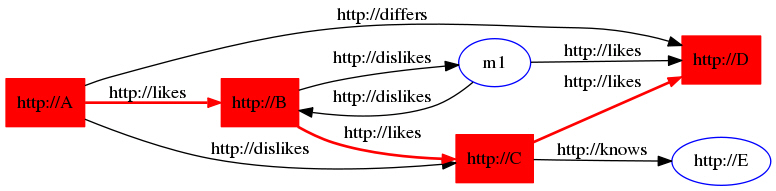
[Description of "Figure 7-1 Visual Representation of Analytical Function Output"](img_text/shortest_a_to_d.md)

**Parent topic:** Analytical Functions for RDF Data

### 7.11 Support for Server-Side APIs

This section describes some of the RDF Semantic Graph features that are exposed by RDF Semantic Graph support for Apache Jena.

For comprehensive documentation of the API calls that support the available features, see the RDF Semantic Graph support for Apache Jena reference information (Javadoc). For additional information about the server-side features exposed by the support for Apache Jena, see the relevant chapters in this manual.

- Virtual Models Support
- Connection Pooling Support
- Semantic Model PL/SQL Interfaces
- Inference Options
- PelletInfGraph Class Support Deprecated

**Parent topic:** RDF Semantic Graph Support for Apache Jena

#### 7.11.1 Virtual Models Support

Virtual models (explained in [Virtual Models](rdf-semantic-graph-overview.md)) are specified in the `GraphOracleSem` constructor, and they are handled transparently. If a virtual model exists for the model-rulebase combination, it is used in query answering; if such a virtual model does not exist, it is created in the database.

**Note:**

Virtual model support through the support for Apache Jena is available only with Oracle Database Release 11.2 or later.

The following example reuses an existing virtual model.

    String modelName = "EX";
    String m1 = "EX_1";

    ModelOracleSem defaultModel =
      ModelOracleSem.createOracleSemModel(oracle, modelName);

    // create these models in case they don't exist
    ModelOracleSem model1 = ModelOracleSem.createOracleSemModel(oracle, m1);

    String vmName = "VM_" + modelName;

    //create a virtual model containing EX and EX_1
    oracle.executeCall(
    "begin sem_apis.create_virtual_model(?,sem_models('"+ m1 + "','"+ modelName+"'),null); end;",vmName);

    String[] modelNames = {m1};
    String[] rulebaseNames = {};

    Attachment attachment = Attachment.createInstance(modelNames, rulebaseNames,
    InferenceMaintenanceMode.NO_UPDATE, QueryOptions.ALLOW_QUERY_VALID_AND_DUP);

    // vmName is passed to the constructor, so GraphOracleSem will use the virtual
    // model named vmname (if the current user has read privileges on it)
    GraphOracleSem graph = new GraphOracleSem(oracle, modelName, attachment, vmName);
    graph.add(Triple.create(Node.createURI("urn:alice"),
                            Node.createURI("http://xmlns.com/foaf/0.1/mbox"),
                            Node.createURI("mailto:alice@example")));
    ModelOracleSem model = new ModelOracleSem(graph);

    String queryString =

       " SELECT ?subject ?object WHERE { ?subject ?p ?object } ";

    Query query = QueryFactory.create(queryString) ;
    QueryExecution qexec = QueryExecutionFactory.create(query, model) ;

    try {
       ResultSet results = qexec.execSelect() ;
       for ( ; results.hasNext() ; ) {
          QuerySolution soln = results.nextSolution() ;
          psOut.println("soln " + soln);
       }
    }
    finally {
       qexec.close() ;
    }

    OracleUtils.dropSemanticModel(oracle, modelName);
    OracleUtils.dropSemanticModel(oracle, m1);

    oracle.dispose();

You can also use the GraphOracleSem constructor to create a virtual model, as in the following example:

    GraphOracleSem graph = new GraphOracleSem(oracle, modelName, attachment, true);

In this example, the fourth parameter (`true`) specifies that a virtual model needs to be created for the specified `modelName` and `attachment`.

**Parent topic:** Support for Server-Side APIs

#### 7.11.2 Connection Pooling Support

Oracle Database Connection Pooling is provided through the support for Apache Jena `OraclePool` class. Once this class is initialized, it can return Oracle objects out of its pool of available connections. Oracle objects are essentially database connection wrappers. After `dispose` is called on the Oracle object, the connection is returned to the pool. More information about using `OraclePool` can be found in the API reference information (Javadoc).

The following example sets up an OraclePool object with five (5) initial connections.

    public static void main(String[] args) throws Exception
      {
        String szJdbcURL = args[0];
        String szUser    = args[1];
        String szPasswd  = args[2];
        String szModelName = args[3];

        // test with connection properties
        java.util.Properties prop = new java.util.Properties();
        prop.setProperty("MinLimit", "2");     // the cache size is 2 at least
        prop.setProperty("MaxLimit", "10");
        prop.setProperty("InitialLimit", "2"); // create 2 connections at startup
        prop.setProperty("InactivityTimeout", "1800");    //  seconds
        prop.setProperty("AbandonedConnectionTimeout", "900");  //  seconds
        prop.setProperty("MaxStatementsLimit", "10");
        prop.setProperty("PropertyCheckInterval", "60"); // seconds

        System.out.println("Creating OraclePool");
        OraclePool op = new OraclePool(szJdbcURL, szUser, szPasswd, prop,
                   "OracleSemConnPool");
        System.out.println("Done creating OraclePool");

        // grab an Oracle and do something with it
        System.out.println("Getting an Oracle from OraclePool");
        Oracle oracle = op.getOracle();
        System.out.println("Done");
        System.out.println("Is logical connection:" +
            oracle.getConnection().isLogicalConnection());
        GraphOracleSem g = new GraphOracleSem(oracle, szModelName);
        g.add(Triple.create(Node.createURI("u:John"),
                            Node.createURI("u:parentOf"),
                            Node.createURI("u:Mary")));
        g.close();
        // return the Oracle back to the pool
        oracle.dispose();

        // grab another Oracle and do something else
        System.out.println("Getting an Oracle from OraclePool");
        oracle = op.getOracle();
        System.out.println("Done");
        System.out.println("Is logical connection:" +
            oracle.getConnection().isLogicalConnection());
        g = new GraphOracleSem(oracle, szModelName);
        g.add(Triple.create(Node.createURI("u:John"),
                            Node.createURI("u:parentOf"),
                            Node.createURI("u:Jack")));
        g.close();

        OracleUtils.dropSemanticModel(oracle, szModelName);

        // return the Oracle object back to the pool
        oracle.dispose();
    }

**Parent topic:** Support for Server-Side APIs

#### 7.11.3 Semantic Model PL/SQL Interfaces

Several semantic PL/SQL subprograms are available through the support for Apache Jena. Table 7-2 lists the subprograms and their corresponding Java class and methods.

Table 7-2 PL/SQL Subprograms and Corresponding RDF Semantic Graph support for Apache Jena Java Class and Methods

| PL/SQL Subprogram                                   | Corresponding Java Class and Methods |
|:----------------------------------------------------|:-------------------------------------|
| [SEM_APIS.DROP_SEM_MODEL](SEM_APIS-reference.md)    | OracleUtils.dropSemanticModel        |
| [SEM_APIS.MERGE_MODELS](SEM_APIS-reference.md)      | OracleUtils.mergeModels              |
| [SEM_APIS.SWAP_NAMES](SEM_APIS-reference.md)        | OracleUtils.swapNames                |
| [SEM_APIS.REMOVE_DUPLICATES](SEM_APIS-reference.md) | OracleUtils.removeDuplicates         |
| [SEM_APIS.RENAME_MODEL](SEM_APIS-reference.md)      | OracleUtils.renameModels             |

For information about these PL/SQL utility subprograms, see the reference information in [SEM_APIS Package Subprograms](SEM_APIS-reference.md). For information about the corresponding Java class and methods, see the RDF Semantic Graph support for Apache Jena API Reference documentation (Javadoc).

**Parent topic:** Support for Server-Side APIs

#### 7.11.4 Inference Options

You can add options to entailment calls by using the following methods in the `Attachment` class (in package `oracle.spatial.rdf.client.jena`):

    public void setUseLocalInference(boolean useLocalInference)
    public boolean getUseLocalInference()

    public void setDefGraphForLocalInference(String defaultGraphName)
    public String getDefGraphForLocalInference()

    public String getInferenceOption()
    public void setInferenceOption(String inferenceOption)

Example 7-8 Specifying Inference Options

For more information about these methods, see the Javadoc.

Example 7-8 enables parallel inference (with a degree of 4) and RAW format when creating an entailment. The example also uses the `performInference` method to create the entailment (comparable to using the [SEM_APIS.CREATE_ENTAILMENT](SEM_APIS-reference.md) PL/SQL procedure).

    import java.io.*;
    import org.apache.jena.query.*;
    import oracle.spatial.rdf.client.jena.*;
    import org.apache.jena.update.*;
    import org.apache.jena.sparql.core.DatasetImpl;

    public class TestNewInference
    {
      public static void main(String[] args) throws Exception
      {
        String szJdbcURL = args[0];
        String szUser    = args[1];
        String szPasswd  = args[2];

        PrintStream psOut = System.out;

        Oracle oracle = new Oracle(szJdbcURL, szUser, szPasswd);

        String szTBoxName = "test_new_tbox";
        {
          // First construct a TBox and load a few axioms
          ModelOracleSem modelTBox = ModelOracleSem.createOracleSemModel(oracle, szTBoxName);
          String insertString =
            " PREFIX my:  <http://my.com/> " +
            " PREFIX rdfs:  <http://www.w3.org/2000/01/rdf-schema#> " +
            " INSERT DATA "                                     +
            " { my:C1  rdfs:subClassOf my:C2 .                " +
            "   my:C2  rdfs:subClassOf my:C3 .                " +
            "   my:C3  rdfs:subClassOf my:C4 .                " +
            " }   ";
          UpdateAction.parseExecute(insertString,  modelTBox);
          modelTBox.close();
        }

        String szABoxName = "test_new_abox";
        {
          // Construct an ABox and load a few quads
          ModelOracleSem modelABox = ModelOracleSem.createOracleSemModel(oracle, szABoxName);
          DatasetGraphOracleSem dataset = DatasetGraphOracleSem.createFrom(modelABox.getGraph());
          modelABox.close();

          String insertString =
            " PREFIX my:    <http://my.com/> " +
            " PREFIX rdf:   <http://www.w3.org/1999/02/22-rdf-syntax-ns#> " +
            " INSERT DATA                                                 " +
            " { GRAPH my:G1 { my:I1  rdf:type my:C1 .                     " +
            "                 my:I2  rdf:type my:C2 .                     " +
            "               }                                             " +
            " };                                                          " +
            " INSERT DATA                                                 " +
            " { GRAPH my:G2 { my:J1  rdf:type my:C3 .                     " +
            "               }                                             " +
            " }    ";
          UpdateAction.parseExecute(insertString,  dataset);
          dataset.close();
        }

        String[] attachedModels = new String[1];
        attachedModels[0] = szTBoxName;

        String[] attachedRBs = {"OWL2RL"};

        Attachment attachment = Attachment.createInstance(
            attachedModels, attachedRBs,
            InferenceMaintenanceMode.NO_UPDATE,
            QueryOptions.ALLOW_QUERY_INVALID);

        // We are going to run named graph based local inference
        attachment.setUseLocalInference(true);

        // Set the default graph (TBox)
        attachment.setDefGraphForLocalInference(szTBoxName);

        // Set the inference option to use parallel inference
        // with a degree of 4, and RAW format.
        attachment.setInferenceOption("DOP=4,RAW8=T");

        GraphOracleSem graph = new GraphOracleSem(
            oracle,
            szABoxName,
            attachment
            );
        DatasetGraphOracleSem dsgos = DatasetGraphOracleSem.createFrom(graph);
        graph.close();

        // Invoke create_entailment PL/SQL API
        dsgos.performInference();

        psOut.println("TestNewInference: # of inferred graph " +
            Long.toString(dsgos.getInferredGraphSize()));

        String queryString =
          " SELECT ?g ?s ?p ?o WHERE {  GRAPH ?g {?s ?p ?o } } " ;

        Query query = QueryFactory.create(queryString, Syntax.syntaxARQ);
        QueryExecution qexec = QueryExecutionFactory.create(
            query, DatasetImpl.wrap(dsgos));
        ResultSet results = qexec.execSelect();

        ResultSetFormatter.out(psOut, results);

        dsgos.close();
        oracle.dispose();
      }
    }

The output of Example 7-8 is as follows.

    TestNewInference: # of inferred graph 9

    --------------------------------------------------------------------------------------------------------------------
    | g                  | s                  | p                                                 | o                  |
    ====================================================================================================================
    | <http://my.com/G1> | <http://my.com/I2> | <http://www.w3.org/1999/02/22-rdf-syntax-ns#type> | <http://my.com/C3> |
    | <http://my.com/G1> | <http://my.com/I2> | <http://www.w3.org/1999/02/22-rdf-syntax-ns#type> | <http://my.com/C2> |
    | <http://my.com/G1> | <http://my.com/I2> | <http://www.w3.org/1999/02/22-rdf-syntax-ns#type> | <http://my.com/C4> |
    | <http://my.com/G1> | <http://my.com/I1> | <http://www.w3.org/1999/02/22-rdf-syntax-ns#type> | <http://my.com/C3> |
    | <http://my.com/G1> | <http://my.com/I1> | <http://www.w3.org/1999/02/22-rdf-syntax-ns#type> | <http://my.com/C1> |
    | <http://my.com/G1> | <http://my.com/I1> | <http://www.w3.org/1999/02/22-rdf-syntax-ns#type> | <http://my.com/C2> |
    | <http://my.com/G1> | <http://my.com/I1> | <http://www.w3.org/1999/02/22-rdf-syntax-ns#type> | <http://my.com/C4> |
    | <http://my.com/G2> | <http://my.com/J1> | <http://www.w3.org/1999/02/22-rdf-syntax-ns#type> | <http://my.com/C3> |
    | <http://my.com/G2> | <http://my.com/J1> | <http://www.w3.org/1999/02/22-rdf-syntax-ns#type> | <http://my.com/C4> |
    --------------------------------------------------------------------------------------------------------------------

For information about using OWL inferencing, see [Using OWL Inferencing](owl-concepts.md).

**Parent topic:** Support for Server-Side APIs

#### 7.11.5 PelletInfGraph Class Support Deprecated

The support for the `PelletInfGraph` class within the support for Apache Jena is deprecated. You should instead use the more optimized Oracle/Pellet integration through the PelletDb OWL 2 reasoner for Oracle Database.

**Parent topic:** Support for Server-Side APIs

### 7.12 Bulk Loading Using RDF Semantic Graph Support for Apache Jena

To load thousands to hundreds of thousands of RDF/OWL data files into an Oracle database, you can use the `prepareBulk` and `completeBulk` methods in the `OracleBulkUpdateHandler` Java class to simplify the task.

The `addInBulk` method in the `OracleBulkUpdateHandler` class can load triples of a graph or model into an Oracle database in bulk loading style. If the graph or model is a Jena in-memory graph or model, the operation is limited by the size of the physical memory. The `prepareBulk` method bypasses the Jena in-memory graph or model and takes a direct input stream to an RDF data file, parses the data, and load the triples into an underlying staging table. If the staging table and an accompanying table for storing long literals do not already exist, they are created automatically.

The `prepareBulk` method can be invoked multiple times to load multiple data files into the same underlying staging table. It can also be invoked concurrently, assuming the hardware system is balanced and there are multiple CPU cores and sufficient I/O capacity.

Once all the data files are processed by the `prepareBulk` method, you can invoke `completeBulk` to load all the data into the semantic network.

Example 7-9 Loading Data into the Staging Table (prepareBulk)

Example 7-9 shows how to load all data files in directory `dir_1` into the underlying staging table. Long literals are supported and will be stored in a separate table. The data files can be compressed using GZIP to save storage space, and the `prepareBulk` method can detect automatically if a data file is compressed using GZIP or not.

    Oracle oracle = new Oracle(szJdbcURL, szUser, szPasswd);
    GraphOracleSem graph = new GraphOracleSem(oracle, szModelName);

    PrintStream psOut = System.out;

    String dirname = "dir_1";
    File fileDir = new File(dirname);
    String[] szAllFiles = fileDir.list();

    // loop through all the files in a directory
    for (int idx = 0; idx < szAllFiles.length; idx++) {
      String szIndFileName = dirname + File.separator + szAllFiles[idx];
      psOut.println("process to [ID = " + idx + " ] file " + szIndFileName);
      psOut.flush();

      try {
        InputStream is = new FileInputStream(szIndFileName);
        graph.getBulkUpdateHandler().prepareBulk(
            is,                    // input stream
            "http://example.com",  // base URI
            "RDF/XML",             // data file type: can be RDF/XML, N-TRIPLE, etc.
            "SEMTS",               // tablespace
            null,                  // flags
            null,                  // listener
            null                   // staging table name.
            );
        is.close();
      }
      catch (Throwable t) {
        psOut.println("Hit exception " + t.getMessage());
      }
    }

    graph.close();
    oracle.dispose();

The code in Example 7-9, starting from creating a new Oracle object and ending with disposing of the Oracle object, can be executed in parallel. Assume there is a quad-core CPU and enough I/O capacity on the database hardware system; you can divide up all the data files and save them into four separate directories: `dir_1`, `dir_2`, `dir_3`, and `dir_4`. Four Java threads of processes can be started to work on those directories separately and concurrently. (For more information, see Using prepareBulk in Parallel (Multithreaded) Mode.)

Example 7-10 Loading Data from the Staging Table into the Semantic Network (completeBulk)

After all data files are processed, you can invoke, just once, the `completeBulk` method to load the data from staging table into the semantic network, as shown in Example 7-10. Triples with long literals will be loaded also.

    graph.getBulkUpdateHandler().completeBulk(
      null,  // flags for invoking SEM_APIS.bulk_load_from_staging_table
      null   // staging table name
    );

The `prepareBulk` method can also take a Jena model as an input data source, in which case triples in that Jena model are loaded into the underlying staging table. For more information, see the Javadoc.

Example 7-11 Using prepareBulk with RDFa

In addition to loading triples from Jena models and data files, the `prepareBulk` method supports RDFa, as shown in Example 7-11. (RDFa is explained in [`http://www.w3.org/TR/xhtml-rdfa-primer/`](http://www.w3.org/TR/xhtml-rdfa-primer/).)

    graph.getBulkUpdateHandler().prepareBulk(
      rdfaUrl,   // url to a web page using RDFa
      "SEMTS",   // tablespace
      null,      // flags
      null,      // listener
      null       // staging table name
    );

To parse RDFa, the relevant `java-rdfa` libraries must be included in the classpath. No additional setup or API calls are required. (For information about java-rdfa, see [`http://www.rootdev.net/maven/projects/java-rdfa/`](http://www.rootdev.net/maven/projects/java-rdfa/) and the other topics there under Project Information.)

Note that if the `rdfaUrl` is located outside a firewall, you may need to set the following HTTP Proxy-related Java VM properties:

    -Dhttp.proxyPort=...
    -Dhttp.proxyHost=...

Example 7-12 Loading Quads into a DatasetGraph

The preceding examples in this section load triple data into a single graph. Loading quad data that may span across multiple named graphs (such as data in NQUADS format) requires the use of the `DatasetGraphOracleSem` class. The `DatasetGraphOracleSem` class does not use the `BulkUpdateHandler` API, but does provide a similar `prepareBulk` and `completeBulk` interface, as shown in Example 7-12.

    Oracle oracle = new Oracle(szJdbcURL, szUser, szPasswd);

    // Can only create DatasetGraphOracleSem from an existing GraphOracleSem
    GraphOracleSem graph = new GraphOracleSem(oracle, szModelName);
    DatasetGraphOracleSem dataset = DatasetGraphOracleSem.createFrom(graph);

    // Don't need graph anymore, close it to free resources
    graph.close();

    try {
        InputStream is = new FileInputStream(szFileName);
        // load NQUADS file into a staging table. This file can be gzipp'ed.
        dataset.prepareBulk(
            is,                // input stream
            "http://my.base/", // base URI
            "N-QUADS",         // data file type; can be "TRIG"
            "SEMTS",           // tablespace
            null,              // flags
            null,              // listener
            null,              // staging table name
            false              // truncate staging table before load
        );
        // Load quads from staging table into the dataset
        dataset.completeBulk(
            null, // flags; can be "PARSE PARALLEL_CREATE_INDEX PARALLEL=4
                  //                mbv_method=shadow" on a quad core machine
            null  // staging table name
        );
    }
    catch (Throwable t) {
        System.out.println("Hit exception " + t.getMessage());
    }
    finally {
        dataset.close();
        oracle.dispose();
    }

- Using prepareBulk in Parallel (Multithreaded) Mode
- Handling Illegal Syntax During Data Loading

**Parent topic:** RDF Semantic Graph Support for Apache Jena

#### 7.12.1 Using prepareBulk in Parallel (Multithreaded) Mode

Example 7-9 provided a way to load, sequentially, a set of files under a file system directory to an Oracle Database table (staging table). Example 7-13 loads, concurrently, a set of files to an Oracle table (staging table). The degree of parallelism is controlled by the input parameter `iMaxThreads`.

On a balanced hardware setup with 4 or more CPU cores, setting `iMaxThreads` to 8 (or 16) can improve significantly the speed of `prepareBulk` operation when there are many data files to be processed.

Example 7-13 Using prepareBulk with iMaxThreads

    public void testPrepareInParallel(String jdbcUrl, String user,
                           String password, String modelName,
                           String lang,
                           String tbs,
                           String dirname,
                           int iMaxThreads,
                           PrintStream psOut)
       throws SQLException, IOException,  InterruptedException
     {
       File dir = new File(dirname);
       File[] files = dir.listFiles();

       // create a set of physical Oracle connections and graph objects
       Oracle[] oracles = new Oracle[iMaxThreads];
       GraphOracleSem[] graphs = new GraphOracleSem[iMaxThreads];
       for (int idx = 0; idx < iMaxThreads; idx++) {
         oracles[idx] = new Oracle(jdbcUrl, user, password);
         graphs[idx] = new GraphOracleSem(oracles[idx], modelName);
       }

       PrepareWorker[] workers = new PrepareWorker[iMaxThreads];
       Thread[] threads = new Thread[iMaxThreads];
       for (int idx = 0; idx < iMaxThreads; idx++) {
         workers[idx] = new PrepareWorker(
             graphs[idx],
             files,
             idx,
             iMaxThreads,
             lang,
             tbs,
             psOut
             );
         threads[idx] = new Thread(workers[idx], workers[idx].getName());
         psOut.println("testPrepareInParallel: PrepareWorker " + idx + " running");
         threads[idx].start();
       }

       psOut.println("testPrepareInParallel: all threads started");

       for (int idx = 0; idx < iMaxThreads; idx++) {
         threads[idx].join();
       }
       for (int idx = 0; idx < iMaxThreads; idx++) {
         graphs[idx].close();
         oracles[idx].dispose();
       }
     }

     static class PrepareWorker implements Runnable
     {
       GraphOracleSem graph = null;
       int idx;
       int threads;
       File[] files = null;
       String lang = null;
       String tbs  = null;
       PrintStream psOut;

       public void run()
       {
         long lStartTime = System.currentTimeMillis();
         for (int idxFile = idx; idxFile < files.length; idxFile += threads) {
           File file = files[idxFile];
           try {
             FileInputStream fis = new FileInputStream(file);
             graph.getBulkUpdateHandler().prepareBulk(
                 fis,
                 "http://base.com/",
                 lang,
                 tbs,
                 null,                   // flags
                 new MyListener(psOut),  // listener
                 null                    // table name
                 );
             fis.close();
           }
           catch (Exception e) {
             psOut.println("PrepareWorker: thread ["+getName()+"] error "+ e.getMessage());
           }
           psOut.println("PrepareWorker: thread ["+getName()+"] done to "
               + idxFile + ", file = " + file.toString()
               + " in (ms) " + (System.currentTimeMillis() - lStartTime));
         }
       }

       public PrepareWorker(GraphOracleSem graph,
                            File[] files,
                            int idx,
                            int threads,
                            String lang,
                            String tbs,
                            PrintStream psOut)
       {
         this.graph   = graph;
         this.files   = files;
         this.psOut   = psOut;
         this.idx     = idx;
         this.threads = threads;
         this.files   = files;
         this.lang    = lang;
         this.tbs     = tbs ;
       }

       public String getName()
       {
         return "PrepareWorker" + idx;
       }
     }

     static class MyListener implements StatusListener
     {
       PrintStream m_ps = null;
       public MyListener(PrintStream ps) { m_ps = ps; }
       long lLastBatch = 0;

       public void statusChanged(long count)
       {
         if (count - lLastBatch >= 10000) {
           m_ps.println("process to " + Long.toString(count));
           lLastBatch = count;
         }
       }

       public int illegalStmtEncountered(Node graphNode, Triple triple, long count)
       {
         m_ps.println("hit illegal statement with object " + triple.getObject().toString());
         return 0; // skip it
       }
     }

**Parent topic:** Bulk Loading Using RDF Semantic Graph Support for Apache Jena

#### 7.12.2 Handling Illegal Syntax During Data Loading

You can skip illegal triples and quads when using `prepareBulk`. This feature is useful if the source RDF data may contain syntax errors. In Example 7-14, a customized implementation of the `StatusListener` interface (defined in package `oracle.spatial.rdf.client.jena`) is passed as a parameter to prepareBulk. In this example, the `illegalStmtEncountered` method prints the object field of the illegal triple, and returns 0 so that `prepareBulk` can skip that illegal triple and move on.

Example 7-14 Skipping Triples with Illegal Syntax

    ....

    Oracle oracle = new Oracle(jdbcUrl, user, password);
    GraphOracleSem graph = new GraphOracleSem(oracle, modelName);
    PrintStream psOut = System.err;

    graph.getBulkUpdateHandler().prepareBulk(
      new FileInputStream(rdfDataFilename),
      "http://base.com/",    // base
      lang,                  // data format, can be "N-TRIPLES" "RDF/XML" ...
      tbs,                   // tablespace name
      null,                  // flags
      new MyListener(psOut), // call back to show progress and also process illegal triples/quads
      null,                  // tableName, if null use default names
      false                  // truncate existing staging tables
      );

     graph.close();
     oracle.dispose();
     ....

     // A customized StatusListener interface implementation
      public class MyListener implements StatusListener
     {
       PrintStream m_ps = null;
       public MyListener(PrintStream ps) { m_ps = ps; }

       public void statusChanged(long count)
       {
         // m_ps.println("process to " + Long.toString(count));
       }

      public int illegalStmtEncountered(Node graphNode, Triple triple, long count)
      {
        m_ps.println("hit illegal statement with object " + triple.getObject().toString());
        return 0; // skip it
      }
     }

**Parent topic:** Bulk Loading Using RDF Semantic Graph Support for Apache Jena

### 7.13 Automatic Variable Renaming

Automatic variable renaming can enable certain queries that previously failed to run successfully.

Previously, variable names used in SPARQL queries were passed directly on to Oracle Database as a part of a SQL statement. If the variable names included a SQL or PL/SQL reserved keyword, the query failed to execute. For example, the following SPARQL query used to fail because the word date as a special meaning to the Oracle Database SQL processing engine.

    select ?date { :event  :happenedOn ?date }

Currently, this query does not fail, because a "smart scan" is performed and automatic replacement is done on certain reserved variable names (or variable names that are very long) before the query is sent to Oracle database for execution. The replacement is based on a list of reserved keywords that are stored in the following file embedded in `sdordfclient.jar`:

    oracle/spatial/rdf/client/jena/oracle_sem_reserved_keywords.lst

This file contains over 100 entries, and you can edit the file to add entries if necessary.

The following are examples of SPARQL queries that use SQL or PL/SQL reserved keywords as variables, and that will succeed because of automatic variable renaming:

- Query using `SELECT` as a variable name:

      PREFIX foaf: <http://xmlns.com/foaf/0.1/>
      select ?SELECT ?z
      where
      {    ?SELECT foaf:name ?y.
           optional {?SELECT foaf:knows ?z.}
      }

- Query using `ARRAY` and `DATE` as variable names:

      PREFIX x:    <http://example.com#>
      construct {
          ?ARRAY x:date ?date .
      }
      where {
          ?ARRAY x:happenedOn ?date .
      }

**Parent topic:** RDF Semantic Graph Support for Apache Jena

### 7.14 JavaScript Object Notation (JSON) Format Support

JavaScript Object Notation (JSON) format is supported for SPARQL query responses. JSON data format is simple, compact, and well suited for JavaScript programs.

For example, assume the following Java code snippet, which calls the `ResultSetFormatter.outputAsJSON` method:

    Oracle oracle = new Oracle(jdbcUrl, user, password);

    GraphOracleSem graph = new GraphOracleSem(oracle, modelName);
    ModelOracleSem model = new ModelOracleSem(graph);

    graph.add(new Triple(
                       Node.createURI("http://ds1"),
                       Node.createURI("http://dp1"),
                       Node.createURI("http://do1")
                       )
             );

    graph.add(new Triple(
                       Node.createURI("http://ds2"),
                       Node.createURI("http://dp2"),
                       Node.createURI("http://do2")
                       )
             );
    graph.commitTransaction();

    Query q = QueryFactory.create("select ?s ?p ?o where {?s ?p ?o}",
                                  Syntax.syntaxARQ);
    QueryExecution qexec = QueryExecutionFactory.create(q, model);

    ResultSet results = qexec.execSelect();
    ResultSetFormatter.outputAsJSON(System.out, results);

The JSON output is as follows:

    {
      "head": {
        "vars": [ "s" , "p" , "o" ]
      } ,
      "results": {
        "bindings": [
          {
            "s": { "type": "uri" , "value": "http://ds1" } ,
            "p": { "type": "uri" , "value": "http://dp1" } ,
            "o": { "type": "uri" , "value": "http://do1" }
          } ,
          {
            "s": { "type": "uri" , "value": "http://ds2" } ,
            "p": { "type": "uri" , "value": "http://dp2" } ,
            "o": { "type": "uri" , "value": "http://do2" }
          }
        ]
      }
    }

The preceding example can be changed as follows to query a remote SPARQL endpoint instead of directly against an Oracle database. (If the remote SPARQL endpoint is outside a firewall, then the HTTP Proxy probably needs to be set.)

    Query q = QueryFactory.create("select ?s ?p ?o where {?s ?p ?o}",
                                  Syntax.syntaxARQ);
    QueryExecution qe = QueryExecutionFactory.sparqlService(sparqlURL, q);

    ResultSet results = qexec.execSelect();
    ResultSetFormatter.outputAsJSON(System.out, results);

To extend the first example in this section to named graphs, the following code snippet adds two quads to the same Oracle model, executes a named graph-based SPARQL query, and serializes the query output into JSON format:

    DatasetGraphOracleSem dsgos = DatasetGraphOracleSem.createFrom(graph);
    graph.close();

    dsgos.add(new Quad(Node.createURI("http://g1"),
                       Node.createURI("http://s1"),
                       Node.createURI("http://p1"),
                       Node.createURI("http://o1")
                       )
             );
    dsgos.add(new Quad(Node.createURI("http://g2"),
                       Node.createURI("http://s2"),
                       Node.createURI("http://p2"),
                       Node.createURI("http://o2")
                       )
             );

    Query q1 = QueryFactory.create(
      "select ?g ?s ?p ?o where { GRAPH ?g {?s ?p ?o} }");

    QueryExecution qexec1 = QueryExecutionFactory.create(q1,
        DatasetImpl.wrap(dsgos));

    ResultSet results1 = qexec1.execSelect();
    ResultSetFormatter.outputAsJSON(System.out, results1);

    dsgos.close();
    oracle.dispose();

The JSON output is as follows:

    {
      "head": {
        "vars": [ "g" , "s" , "p" , "o" ]
      } ,
      "results": {
        "bindings": [
          {
            "g": { "type": "uri" , "value": "http://g1" } ,
            "s": { "type": "uri" , "value": "http://s1" } ,
            "p": { "type": "uri" , "value": "http://p1" } ,
            "o": { "type": "uri" , "value": "http://o1" }
          } ,
          {
            "g": { "type": "uri" , "value": "http://g2" } ,
            "s": { "type": "uri" , "value": "http://s2" } ,
            "p": { "type": "uri" , "value": "http://p2" } ,
            "o": { "type": "uri" , "value": "http://o2" }
          }
        ]
      }
    }

You can also get a JSON response through HTTP against a Fuseki-based SPARQL endpoint, as in the following example. Normally, when executing a SPARQL query against a SPARQL Web service endpoint, the `Accept request-head` field is set to be `application/sparql-results+xm`l. For JSON output format, replace the` Accept request-head` field with `application/sparql-results+json`.

    http://hostname:7001/fuseki/oracle?query=<URL_ENCODED_SPARQL_QUERY>&output=json

**Parent topic:** RDF Semantic Graph Support for Apache Jena

### 7.15 Other Recommendations and Guidelines

This section contains various recommendations and other information related to SPARQL queries.

- BOUND or !BOUND Instead of EXISTS or NOT EXISTS
- SPARQL 1.1 SELECT Expressions
- Syntax Involving Bnodes (Blank Nodes)
- Limit in the SERVICE Clause
- OracleGraphWrapperForOntModel Class for Better Performance

**Parent topic:** RDF Semantic Graph Support for Apache Jena

#### 7.15.1 BOUND or !BOUND Instead of EXISTS or NOT EXISTS

For better performance, use `BOUND` or `!BOUND` instead of `EXISTS` or `NOT EXISTS`.

**Parent topic:** Other Recommendations and Guidelines

#### 7.15.2 SPARQL 1.1 SELECT Expressions

You can use SPARQL 1.1 SELECT expressions without any significant performance overhead, even if the function is not currently supported within Oracle Database. Examples include the following:

    -- Query using MD5 and SHA1 functions
    PREFIX foaf: <http://xmlns.com/foaf/0.1/>
    PREFIX xsd:  <http://www.w3.org/2001/XMLSchema#>
    PREFIX eg:   <http://biometrics.example/ns#>
    SELECT ?name (md5(?name) as ?name_in_md5) (sha1(?email) as ?sha1)
    WHERE
    {
      ?x foaf:name  ?name ; eg:email ?email .
    }

    -- Query using CONCAT function
    PREFIX foaf:   <http://xmlns.com/foaf/0.1/>
    SELECT ( CONCAT(?G, " ", ?S) AS ?name )
    WHERE
    {
      ?P foaf:givenName ?G ; foaf:surname ?S
    }

**Parent topic:** Other Recommendations and Guidelines

#### 7.15.3 Syntax Involving Bnodes (Blank Nodes)

Syntax involving bnodes can be used freely in query patterns. For example, the following bnode-related syntax is supported at the parser level, so each is equivalent to its full triple-query-pattern-based version.

    :x :q [ :p "v" ] .

    (1 ?x 3 4) :p "w" .

    (1 [:p :q] ( 2 ) ) .

**Parent topic:** Other Recommendations and Guidelines

#### 7.15.4 Limit in the SERVICE Clause

When writing a SPARQL 1.1 federated query, you can set a limit on returned rows in the subquery inside the SERVICE clause. This can effectively constrain the amount of data to be transported between the local repository and the remote SPARQL endpoint.

For example, the following query specifies `limit 100 `in the subquery in the SERVICE clause:

    PREFIX : <http://example.com/>
    SELECT ?s ?o
     WHERE
         {
           ?s :name "CA"
           SERVICE <http://REMOTE_SPARQL_ENDPOINT_HERE>
              {
                 select ?s  ?o
                     {?s :info ?o}
                  limit 100
               }
         }

**Parent topic:** Other Recommendations and Guidelines

#### 7.15.5 OracleGraphWrapperForOntModel Class for Better Performance

The Jena `OntModel` class lets you create, modify, and analyze an ontology stored in a Jena model. However, the `OntModel` implementation is not optimized for semantic data stored in a database. This results in suboptimal performance when using `OntModel` with an Oracle model. Therefore, the class `OracleGraphWrapperForOntModel` has been created to alleviate this performance issue.

The `OracleGraphWrapperForOntModel` class implements the Jena `Graph` interface and represents a graph backed by an Oracle RDF/OWL model that is meant for use with the Jena `OntModel` API. The `OracleGraphWrapperForOntModel` class uses two semantic stores in a hybrid approach for persisting changes and responding to queries. Both semantic stores contain the same data, but one resides in memory while the other resides in the Oracle database.

When queried through `OntModel`, the `OracleGraphWrapperForOntModel` graph runs the queries against the in-memory store to improve performance. However, the `OracleGraphWrapperForOntModel` class persists changes made through `OntModel`, such as adding or removing classes, by applying changes to both stores.

Due to its hybrid approach, an `OracleGraphWrapperForOntModel` graph requires that sufficient memory be allocated to the JVM to store a copy of the ontology in memory. In internal experiments, it was found that an ontology with approximately 3 million triples requires 6 or more GB of physical memory.

Example 7-15 Using OntModel with Ontology Stored in Oracle Database

Example 7-15 shows how to use the `OntModel` APIs with an existing ontology stored in an Oracle model.

    // Set up connection to Oracle semantic store and the Oracle model
    // containing the ontology
    Oracle oracle = new Oracle(szJdbcURL, szUser, szPasswd);
    GraphOracleSem oracleGraph = new GraphOracleSem(oracle, szModelName);

    // Create a new hybrid graph using the oracle graph to persist
    // changes.  This method will copy all the data from the oracle graph
    // into an in-memory graph, which may significantly increase JVM memory
    // usage.
    Graph hybridGraph = OracleGraphWrapperForOntModel.getInstance(oracleGraph);

    // Build a model around the hybrid graph and wrap the model with Jena's
    // OntModel
    Model model = ModelFactory.createModelForGraph(hybridGraph);
    OntModel ontModel = ModelFactory.createOntologyModel(ontModelSpec, model);

    // Perform operations on the ontology
    OntClass personClass = ontModel.createClass("<http://someuri/person>");
    ontModel.createIndividual(personClass);

    // Close resources (will also close oracleGraph)!
    hybridGraph.close();
    ontModel.close();

Note that any `OntModel` object created using `OracleGraphWrapperForOntModel` will not reflect changes made to the underlying Oracle model by another process, through a separate `OntModel`, or through a separate Oracle graph referencing the same underlying model. All changes to an ontology should go through a single `OntModel` object and its underlying `OracleGraphWrapperForOntModel` graph until the model or graph have been closed.

Example 7-16 Using a Custom In-Memory Graph

If the default in-memory semantic store used by `OracleGraphWrapperForOntModel` is not sufficient for an ontology and system, the class provides an interface for specifying a custom graph to use as the in-memory store. Example 7-16 shows how to create an `OracleGraphWrapperForOntModel` that uses a custom in-memory graph to answer queries from `OntModel`.

    // Set up connection to Oracle semantic store and the Oracle model
    // containing the ontology
    Oracle oracle = new Oracle(szJdbcURL, szUser, szPasswd);
    GraphOracleSem oracleGraph = new GraphOracleSem(oracle, szModelName);

    // Create a custom in-memory graph to use instead of the default
    // Jena in-memory graph for quickly answering OntModel queries.
    // Note that this graph does not *need* to be in-memory, but in-memory
    // is preferred.
    GraphBase queryGraph = new CustomInMemoryGraphImpl();

    // Create a new hybrid graph using the oracle graph to persist
    // changes and the custom in-memory graph to answer queries.
    // Also set the degree of parallelism to use when copying data from
    // the oracle graph to the querying graph.
    int degreeOfParallelism = 4;
    Graph hybridGraph = OracleGraphWrapperForOntModel.getInstance(oracleGraph, queryGraph, degreeOfParallelism);

    // Build a model and wrap the model with Jena's OntModel
    Model model = ModelFactory.createModelForGraph(hybridGraph);
    OntModel ontModel = ModelFactory.createOntologyModel(ontModelSpec, model);

    // Perform operations on the ontology
    // ...

    // Close resources (will close oracleGraph and queryGraph)!
    hybridGraph.close();
    ontModel.close();

**Parent topic:** Other Recommendations and Guidelines

### 7.16 Example Queries Using RDF Semantic Graph Support for Apache Jena

This section includes example queries using the support for Apache Jena. Each example is self-contained: it typically creates a model, creates triples, performs a query that may involve inference, displays the result, and drops the model.

This section includes queries that do the following:

- Count asserted triples and asserted plus inferred triples in an example "university" ontology, both by referencing the ontology by a URL and by bulk loading the ontology from a local file

- Run several SPARQL queries using a "family" ontology, including features such as LIMIT, OFFSET, TIMEOUT, DOP (degree of parallelism), ASK, DESCRIBE, CONSTRUCT, GRAPH, ALLOW_DUP (duplicate triples with multiple models), SPARUL (inserting data)

- Use the ARQ built-in function

- Use a SELECT cast query

- Instantiate Oracle Database using OracleConnection

- Use Oracle Database connection pooling

To run a query, you must do the following:

1.  Include the code in a Java source file. The examples used in this section are supplied in files in the `examples` directory of the support for Apache Jena download.

2.  Compile the Java source file. For example:

        > javac -classpath ../jar/'*' Test.java

    **Note:**

    The `javac` and `java` commands must each be on a single command line.

3.  Run the compiled file. For example:

        > java -classpath ./:../jar/'*'  Test jdbc:oracle:thin:@localhost:1521:orcl scott <password-for-scott> M1

**Note:**

All examples in the following subtopics are based on RDF metadata stored in the MDSYS schema. For schema-private networks (supported starting in Oracle Database 19c, the equivalent Java test files can be found in the OTN kit.

The main difference is that for schema-private networks, extra parameters defining the network owner and network name should be used when creating the semantic model objects.

- Test.java: Query Family Relationships
- Test6.java: Load OWL Ontology and Perform OWLPrime inference
- Test7.java: Bulk Load OWL Ontology and Perform OWLPrime inference
- Test8.java: SPARQL OPTIONAL Query
- Test9.java: SPARQL Query with LIMIT and OFFSET
- Test10.java: SPARQL Query with TIMEOUT and DOP
- Test11.java: Query Involving Named Graphs
- Test12.java: SPARQL ASK Query
- Test13.java: SPARQL DESCRIBE Query
- Test14.java: SPARQL CONSTRUCT Query
- Test15.java: Query Multiple Models and Specify "Allow Duplicates"
- Test16.java: SPARQL Update
- Test17.java: SPARQL Query with ARQ Built-In Functions
- Test18.java: SELECT Cast Query
- Test19.java: Instantiate Oracle Database Using OracleConnection
- Test20.java: Oracle Database Connection Pooling

**Parent topic:** RDF Semantic Graph Support for Apache Jena

#### 7.16.1 Test.java: Query Family Relationships

Example 7-17 Query Family Relationships

Example 7-17 specifies that John is the father of Mary, and it selects and displays the subject and object in each `fatherOf` relationship

    import oracle.spatial.rdf.client.jena.*;
    import org.apache.jena.rdf.model.Model;
    import org.apache.jena.graph.*;
    import org.apache.jena.query.*;
    public class Test {

      public static void main(String[] args) throws Exception
      {
        String szJdbcURL = args[0];
        String szUser    = args[1];
        String szPasswd  = args[2];
        String szModelName = args[3];

        Oracle oracle = new Oracle(szJdbcURL, szUser, szPasswd);
        Model model = ModelOracleSem.createOracleSemModel(
          oracle, szModelName);

        model.getGraph().add(Triple.create(
              Node.createURI("http://example.com/John"),
              Node.createURI("http://example.com/fatherOf"),
              Node.createURI("http://example.com/Mary")));
        Query query = QueryFactory.create(
            "select ?f ?k WHERE {?f <http://example.com/fatherOf> ?k .}");
        QueryExecution qexec = QueryExecutionFactory.create(query, model);
        ResultSet results = qexec.execSelect();
        ResultSetFormatter.out(System.out, results, query);
        model.close();
        oracle.dispose();
      }
    }

The following are the commands to compile and run Example 7-17, as well as the expected output of the `java` command.

    javac -classpath ../jar/'*' Test.java
    java -classpath ./:../jar/'*'  Test jdbc:oracle:thin:@localhost:1521:orcl scott <password-for-scott> M1

    ---------------------------------------------------------
    | f                         | k                         |
    =========================================================
    | <http://example.com/John> | <http://example.com/Mary> |
    ---------------------------------------------------------

**Parent topic:** Example Queries Using RDF Semantic Graph Support for Apache Jena

#### 7.16.2 Test6.java: Load OWL Ontology and Perform OWLPrime inference

Example 7-18 loads an OWL ontology and performs OWLPrime inference. Note that the OWL ontology is in RDF/XML format, and after it is loaded into Oracle it will be serialized out in N-TRIPLE form. The example also queries for the number of asserted and inferred triples.

The ontology in this example can be retrieved from [`http://swat.cse.lehigh.edu/onto/univ-bench.owl`](http://swat.cse.lehigh.edu/onto/univ-bench.owl), and it describes roles, resources, and relationships in a university environment.

Example 7-18 Load OWL Ontology and Perform OWLPrime inference

    import java.io.*;
    import org.apache.jena.query.*;
    import org.apache.jena.rdf.model.Model;
    import org.apache.jena.util.FileManager;
    import oracle.spatial.rdf.client.jena.*;
    public class Test6 {
      public static void main(String[] args) throws Exception
      {
        String szJdbcURL = args[0];
        String szUser    = args[1];
        String szPasswd  = args[2];
        String szModelName = args[3];

        Oracle oracle = new Oracle(szJdbcURL, szUser, szPasswd);
        Model model = ModelOracleSem.createOracleSemModel(oracle, szModelName);

        // load UNIV ontology
        InputStream in = FileManager.get().open("./univ-bench.owl" );
        model.read(in, null);
        OutputStream os = new FileOutputStream("./univ-bench.nt");
        model.write(os, "N-TRIPLE");
        os.close();

        String queryString =
          " SELECT ?subject ?prop ?object WHERE { ?subject ?prop ?object } ";

        Query query = QueryFactory.create(queryString) ;
        QueryExecution qexec = QueryExecutionFactory.create(query, model) ;

        try {
          int iTriplesCount = 0;
          ResultSet results = qexec.execSelect() ;
          for ( ; results.hasNext() ; ) {
            QuerySolution soln = results.nextSolution() ;
            iTriplesCount++;
          }
          System.out.println("Asserted  triples count: " + iTriplesCount);
        }
        finally {
          qexec.close() ;
        }

        Attachment attachment = Attachment.createInstance(
            new String[] {}, "OWLPRIME",
            InferenceMaintenanceMode.NO_UPDATE, QueryOptions.DEFAULT);

        GraphOracleSem graph = new GraphOracleSem(oracle, szModelName, attachment);
        graph.analyze();
        graph.performInference();

        query = QueryFactory.create(queryString) ;
        qexec = QueryExecutionFactory.create(query,new ModelOracleSem(graph)) ;

        try {
          int iTriplesCount = 0;
          ResultSet results = qexec.execSelect() ;
          for ( ; results.hasNext() ; ) {
            QuerySolution soln = results.nextSolution() ;
            iTriplesCount++;
          }
          System.out.println("Asserted + Infered triples count: " + iTriplesCount);
        }
        finally {
          qexec.close() ;
        }
        model.close();

        OracleUtils.dropSemanticModel(oracle, szModelName);
        oracle.dispose();
      }
    }

The following are the commands to compile and run Example 7-18, as well as the expected output of the `java` command.

    javac -classpath ../jar/'*' Test6.java
    java -classpath ./:../jar/'*'  Test6 jdbc:oracle:thin:@localhost:1521:orcl scott <password-for-scott> M1
    Asserted  triples count: 293
    Asserted + Infered triples count: 340

Note that this output reflects an older version of the LUBM ontology. The latest version of the ontology has more triples.

**Parent topic:** Example Queries Using RDF Semantic Graph Support for Apache Jena

#### 7.16.3 Test7.java: Bulk Load OWL Ontology and Perform OWLPrime inference

Example 7-19 loads the same OWL ontology as in Test6.java: Load OWL Ontology and Perform OWLPrime inference, but stored in a local file using Bulk Loader. Ontologies can also be loaded using an incremental and batch loader; these two methods are also listed in the example for completeness.

Example 7-19 Bulk Load OWL Ontology and Perform OWLPrime inference

    import java.io.*;
    import org.apache.jena.graph.*;
    import org.apache.jena.rdf.model.*;
    import org.apache.jena.util.*;
    import oracle.spatial.rdf.client.jena.*;

    public class Test7
    {
      public static void main(String[] args) throws Exception
      {
        String szJdbcURL = args[0];
        String szUser    = args[1];
        String szPasswd  = args[2];
        String szModelName = args[3];
        // in memory Jena Model
        Model model = ModelFactory.createDefaultModel();
        InputStream is = FileManager.get().open("./univ-bench.owl");
        model.read(is, "", "RDF/XML");
        is.close();

        Oracle oracle = new Oracle(szJdbcURL, szUser, szPasswd);
        ModelOracleSem modelDest = ModelOracleSem.createOracleSemModel(oracle,
    szModelName);

        GraphOracleSem g = modelDest.getGraph();
        g.dropApplicationTableIndex();

        int method = 2; // try bulk loader
        String tbs = "SYSAUX"; // can be customized
        if (method == 0) {
          System.out.println("start incremental");
          modelDest.add(model);
          System.out.println("end size " + modelDest.size());
        }
        else if (method == 1) {
          System.out.println("start batch load");
          g.getBulkUpdateHandler().addInBatch(
              GraphUtil.findAll(model.getGraph()), tbs);
          System.out.println("end size " + modelDest.size());
        }
        else {
          System.out.println("start bulk load");
          g.getBulkUpdateHandler().addInBulk(
              GraphUtil.findAll(model.getGraph()), tbs);
          System.out.println("end size " + modelDest.size());
        }
        g.rebuildApplicationTableIndex();

        long lCount = g.getCount(Triple.ANY);
        System.out.println("Asserted  triples count: " + lCount);
        model.close();
        OracleUtils.dropSemanticModel(oracle, szModelName);
        oracle.dispose();
      }
    }

The following are the commands to compile and run Example 7-19, as well as the expected output of the `java` command.

    javac -classpath ../jar/'*' Test7.java
    java -classpath ./:../jar/'*'  Test7 jdbc:oracle:thin:@localhost:1521:orcl scott <password-for-scott> M1
    start bulk load
    end size 293
    Asserted  triples count: 293

Note that this output reflects an older version of the LUBM ontology. The latest version of the ontology has more triples.

**Parent topic:** Example Queries Using RDF Semantic Graph Support for Apache Jena

#### 7.16.4 Test8.java: SPARQL OPTIONAL Query

Example 7-20 shows a SPARQL OPTIONAL query. It inserts triples that postulate the following:

- John is a parent of Mary.

- John is a parent of Jack.

- Mary is a parent of Jill.

It then finds parent-child relationships, optionally including any grandchild (gkid) relationships.

Example 7-20 SPARQL OPTIONAL Query

    import org.apache.jena.query.*;
    import oracle.spatial.rdf.client.jena.*;
    import org.apache.jena.graph.*;

    public class Test8
    {
      public static void main(String[] args) throws Exception
      {
        String szJdbcURL = args[0];
        String szUser    = args[1];
        String szPasswd  = args[2];
        String szModelName = args[3];

        Oracle oracle = new Oracle(szJdbcURL, szUser, szPasswd);
        ModelOracleSem model = ModelOracleSem.createOracleSemModel(oracle,
    szModelName);
        GraphOracleSem g = model.getGraph();

        g.add(Triple.create(
              Node.createURI("u:John"), Node.createURI("u:parentOf"),
    Node.createURI("u:Mary")));
        g.add(Triple.create(
              Node.createURI("u:John"), Node.createURI("u:parentOf"),
    Node.createURI("u:Jack")));
        g.add(Triple.create(
              Node.createURI("u:Mary"), Node.createURI("u:parentOf"),
    Node.createURI("u:Jill")));

        String queryString =
      " SELECT ?s ?o ?gkid " +
      " WHERE { ?s <u:parentOf> ?o . OPTIONAL {?o <u:parentOf> ?gkid }} ";

        Query query = QueryFactory.create(queryString) ;
        QueryExecution qexec = QueryExecutionFactory.create(query, model) ;

        try {
          int iMatchCount = 0;
          ResultSet results = qexec.execSelect() ;
          ResultSetFormatter.out(System.out, results, query);
        }
        finally {
          qexec.close() ;
        }
        model.close();

        OracleUtils.dropSemanticModel(oracle, szModelName);
        oracle.dispose();
      }
    }

The following are the commands to compile and run Example 7-20, as well as the expected output of the `java` command.

    javac -classpath ../jar/'*' Test8.java
    java -classpath ./:../jar/'*'  Test8 jdbc:oracle:thin:@localhost:1521:orcl scott <password-for-scott> M1
    ----------------------------------
    | s        | o        | gkid     |
    ==================================
    | <u:John> | <u:Mary> | <u:Jill> |
    | <u:Mary> | <u:Jill> |          |
    | <u:John> | <u:Jack> |          |
    ----------------------------------

**Parent topic:** Example Queries Using RDF Semantic Graph Support for Apache Jena

#### 7.16.5 Test9.java: SPARQL Query with LIMIT and OFFSET

Example 7-21 shows a SPARQL query with LIMIT and OFFSET. It inserts triples that postulate the following:

- John is a parent of Mary.

- John is a parent of Jack.

- Mary is a parent of Jill.

It then finds one parent-child relationship (LIMIT 1), skipping the first two parent-child relationships encountered (OFFSET 2), and optionally includes any grandchild (gkid) relationships for the one found.

Example 7-21 SPARQL Query with LIMIT and OFFSET

    import org.apache.jena.query.*;
    import oracle.spatial.rdf.client.jena.*;
    import org.apache.jena.graph.*;
    public class Test9
    {
      public static void main(String[] args) throws Exception
      {
        String szJdbcURL = args[0];
        String szUser    = args[1];
        String szPasswd  = args[2];
        String szModelName = args[3];

        Oracle oracle = new Oracle(szJdbcURL, szUser, szPasswd);
        ModelOracleSem model = ModelOracleSem.createOracleSemModel(oracle,
    szModelName);
        GraphOracleSem g = model.getGraph();

        g.add(Triple.create(Node.createURI("u:John"), Node.createURI("u:parentOf"),
                        Node.createURI("u:Mary")));
        g.add(Triple.create(Node.createURI("u:John"), Node.createURI("u:parentOf"),
                        Node.createURI("u:Jack")));
        g.add(Triple.create(Node.createURI("u:Mary"), Node.createURI("u:parentOf"),
                        Node.createURI("u:Jill")));

        String queryString =
          " SELECT ?s ?o ?gkid " +
          " WHERE { ?s <u:parentOf> ?o . OPTIONAL {?o <u:parentOf> ?gkid }} " +
          " LIMIT 1 OFFSET 2";

        Query query = QueryFactory.create(queryString) ;
        QueryExecution qexec = QueryExecutionFactory.create(query, model) ;

        int iMatchCount = 0;
        ResultSet results = qexec.execSelect() ;
        ResultSetFormatter.out(System.out, results, query);
        qexec.close() ;
        model.close();

        OracleUtils.dropSemanticModel(oracle, szModelName);
        oracle.dispose();
      }
    }

The following are the commands to compile and run Example 7-21, as well as the expected output of the `java` command.

    javac -classpath ../jar/'*' Test9.java
    java -classpath ./:../jar/'*'  Test9 jdbc:oracle:thin:@localhost:1521:orcl scott <password-for-scott> M1
    ------------------------------
    | s        | o        | gkid |
    ==============================
    | <u:John> | <u:Jack> |      |
    ------------------------------

**Parent topic:** Example Queries Using RDF Semantic Graph Support for Apache Jena

#### 7.16.6 Test10.java: SPARQL Query with TIMEOUT and DOP

Example 7-22 shows the SPARQL query from Test9.java: SPARQL Query with LIMIT and OFFSET with additional features, including a timeout setting (TIMEOUT=1, in seconds) and parallel execution setting (DOP=4).

Example 7-22 SPARQL Query with TIMEOUT and DOP

    import org.apache.jena.query.*;
    import oracle.spatial.rdf.client.jena.*;
    import org.apache.jena.graph.*;

    public class Test10 {
      public static void main(String[] args) throws Exception  {
        String szJdbcURL = args[0];
        String szUser    = args[1];
        String szPasswd  = args[2];
        String szModelName = args[3];

        Oracle oracle = new Oracle(szJdbcURL, szUser, szPasswd);
        ModelOracleSem model = ModelOracleSem.createOracleSemModel(oracle, szModelName);
        GraphOracleSem g = model.getGraph();

        g.add(Triple.create(Node.createURI("u:John"), Node.createURI("u:parentOf"),
                                Node.createURI("u:Mary")));
        g.add(Triple.create(Node.createURI("u:John"), Node.createURI("u:parentOf"),
                            Node.createURI("u:Jack")));
        g.add(Triple.create(Node.createURI("u:Mary"), Node.createURI("u:parentOf"),
                            Node.createURI("u:Jill")));
        String queryString =
            " PREFIX ORACLE_SEM_FS_NS: <http://oracle.com/semtech#dop=4,timeout=1> "
          + " SELECT ?s ?o ?gkid WHERE { ?s <u:parentOf> ?o . "
          + " OPTIONAL {?o <u:parentOf> ?gkid }} "
          + " LIMIT 1 OFFSET 2";

        Query query = QueryFactory.create(queryString) ;
        QueryExecution qexec = QueryExecutionFactory.create(query, model) ;

        int iMatchCount = 0;
        ResultSet results = qexec.execSelect() ;
        ResultSetFormatter.out(System.out, results, query);
        qexec.close() ;
        model.close();

        OracleUtils.dropSemanticModel(oracle, szModelName);
        oracle.dispose();
      }
    }

The following are the commands to compile and run Example 7-22, as well as the expected output of the `java` command.

    javac -classpath ../jar/'*' Test10.java
    java -classpath ./:../jar/'*'  Test10 jdbc:oracle:thin:@localhost:1521:orcl scott <password-for-scott> M1
    ------------------------------
    | s        | o        | gkid |
    ==============================
    | <u:John> | <u:Jack> |      |
    ------------------------------

**Parent topic:** Example Queries Using RDF Semantic Graph Support for Apache Jena

#### 7.16.7 Test11.java: Query Involving Named Graphs

Example 7-23 shows a query involving named graphs. It involves a default graph that has information about named graph URIs and their publishers. The query finds graph names, their publishers, and within each named graph finds the mailbox value using the `foaf:mbox` predicate.

Example 7-23 Named Graph Based Query

    import org.apache.jena.query.*;
    import oracle.spatial.rdf.client.jena.*;
    import org.apache.jena.graph.*;

    public class Test11
    {
      public static void main(String[] args) throws Exception
      {
        String szJdbcURL = args[0];
        String szUser    = args[1];
        String szPasswd  = args[2];
        String szModelName = args[3];

        Oracle oracle = new Oracle(szJdbcURL, szUser, szPasswd);
        GraphOracleSem graph = new GraphOracleSem(oracle, szModelName);
        DatasetGraphOracleSem dataset = DatasetGraphOracleSem.createFrom(graph);

        // don't need the GraphOracleSem anymore, release resources
        graph.close();

        // add data to the default graph
        dataset.add(new Quad(
              Quad.defaultGraphIRI, // specifies default graph
              Node.createURI("http://example.org/bob"),
              Node.createURI("http://purl.org/dc/elements/1.1/publisher"),
              Node.createLiteral("Bob Hacker")));
        dataset.add(new Quad(
              Quad.defaultGraphIRI, // specifies default graph
              Node.createURI("http://example.org/alice"),
              Node.createURI("http://purl.org/dc/elements/1.1/publisher"),
              Node.createLiteral("alice Hacker")));

        // add data to the bob named graph
        dataset.add(new Quad(
              Node.createURI("http://example.org/bob"), // graph name
              Node.createURI("urn:bob"),
              Node.createURI("http://xmlns.com/foaf/0.1/name"),
              Node.createLiteral("Bob")));
        dataset.add(new Quad(
              Node.createURI("http://example.org/bob"), // graph name
              Node.createURI("urn:bob"),
              Node.createURI("http://xmlns.com/foaf/0.1/mbox"),
              Node.createURI("mailto:bob@example")));

        // add data to the alice named graph
        dataset.add(new Quad(
              Node.createURI("http://example.org/alice"), // graph name
              Node.createURI("urn:alice"),
              Node.createURI("http://xmlns.com/foaf/0.1/name"),
              Node.createLiteral("Alice")));
        dataset.add(new Quad(
              Node.createURI("http://example.org/alice"), // graph name
              Node.createURI("urn:alice"),
              Node.createURI("http://xmlns.com/foaf/0.1/mbox"),
              Node.createURI("mailto:alice@example")));

        DataSource ds = DatasetFactory.create(dataset);

        String queryString =
              " PREFIX foaf: <http://xmlns.com/foaf/0.1/> "
            + " PREFIX dc: <http://purl.org/dc/elements/1.1/> "
            + " SELECT ?who ?graph ?mbox "
            + " FROM NAMED <http://example.org/alice> "
            + " FROM NAMED <http://example.org/bob> "
            + " WHERE "
            + " { "
            + "    ?graph dc:publisher ?who . "
            + "    GRAPH ?graph { ?x foaf:mbox ?mbox } "
            + " } ";

        Query query = QueryFactory.create(queryString);
        QueryExecution qexec = QueryExecutionFactory.create(query, ds);

        ResultSet results = qexec.execSelect();
        ResultSetFormatter.out(System.out, results, query);

        qexec.close();
        dataset.close();

        oracle.dispose();
      }
    }

The following are the commands to compile and run Example 7-23, as well as the expected output of the `java` command.

    javac -classpath ./:./jena-2.6.4.jar:./sdordfclient.jar:./ojdbc6.jar:./slf4j-api-1.5.8.jar:./slf4j-log4j12-1.5.8.jar:./arq-2.8.8.jar:./xercesImpl-2.7.1.jar Test11.java
    java -classpath ./:../jar/'*'  Test11 jdbc:oracle:thin:@localhost:1521:orcl scott <password-for-scott> M1
    ------------------------------------------------------------------------
    | who            | graph                      | mbox                   |
    ========================================================================
    | "alice Hacker" | <http://example.org/alice> | <mailto:alice@example> |
    | "Bob Hacker"   | <http://example.org/bob>   | <mailto:bob@example>   |
    ------------------------------------------------------------------------

**Parent topic:** Example Queries Using RDF Semantic Graph Support for Apache Jena

#### 7.16.8 Test12.java: SPARQL ASK Query

Example 7-24 shows a SPARQL ASK query. It inserts a triple that postulates that John is a parent of Mary. It then finds whether John is a parent of Mary.

Example 7-24 SPARQL ASK Query

    import org.apache.jena.query.*;
    import oracle.spatial.rdf.client.jena.*;
    import org.apache.jena.graph.*;
    {
      public static void main(String[] args) throws Exception
      {
        String szJdbcURL = args[0];
        String szUser    = args[1];
        String szPasswd  = args[2];
        String szModelName = args[3];

        Oracle oracle = new Oracle(szJdbcURL, szUser, szPasswd);
        ModelOracleSem model = ModelOracleSem.createOracleSemModel(oracle,
              szModelName);
        GraphOracleSem g = model.getGraph();

        g.add(Triple.create(Node.createURI("u:John"), Node.createURI("u:parentOf"),
                            Node.createURI("u:Mary")));
        String queryString = " ASK { <u:John> <u:parentOf> <u:Mary> } ";

        Query query = QueryFactory.create(queryString) ;
        QueryExecution qexec = QueryExecutionFactory.create(query, model) ;
        boolean b = qexec.execAsk();
        System.out.println("ask result = " + ((b)?"TRUE":"FALSE"));
        qexec.close() ;

        model.close();
        OracleUtils.dropSemanticModel(oracle, szModelName);
        oracle.dispose();
      }
    }

The following are the commands to compile and run Example 7-24, as well as the expected output of the `java` command.

    javac -classpath ../jar/'*' Test12.java
    java -classpath ./:../jar/'*'  Test12 jdbc:oracle:thin:@localhost:1521:orcl scott <password-for-scott> M1
    ask result = TRUE

**Parent topic:** Example Queries Using RDF Semantic Graph Support for Apache Jena

#### 7.16.9 Test13.java: SPARQL DESCRIBE Query

Example 7-25 shows a SPARQL DESCRIBE query. It inserts triples that postulate the following:

- John is a parent of Mary.

- John is a parent of Jack.

- Amy is a parent of Jack.

It then finds all relationships that involve any parents of Jack.

Example 7-25 SPARQL DESCRIBE Query

    import org.apache.jena.query.*;
    import org.apache.jena.rdf.model.Model;
    import oracle.spatial.rdf.client.jena.*;
    import org.apache.jena.graph.*;

    public class Test13
    {
      public static void main(String[] args) throws Exception
      {
        String szJdbcURL = args[0];
        String szUser    = args[1];
        String szPasswd  = args[2];
        String szModelName = args[3];

        Oracle oracle = new Oracle(szJdbcURL, szUser, szPasswd);
        ModelOracleSem model = ModelOracleSem.createOracleSemModel(oracle, szModelName);
        GraphOracleSem g = model.getGraph();

        g.add(Triple.create(Node.createURI("u:John"), Node.createURI("u:parentOf"),
                        Node.createURI("u:Mary")));
        g.add(Triple.create(Node.createURI("u:John"), Node.createURI("u:parentOf"),
     Node.createURI("u:Jack")));
        g.add(Triple.create(Node.createURI("u:Amy"), Node.createURI("u:parentOf"),
     Node.createURI("u:Jack")));
        String queryString = " DESCRIBE ?x WHERE {?x <u:parentOf> <u:Jack>}";

        Query query = QueryFactory.create(queryString) ;
        QueryExecution qexec = QueryExecutionFactory.create(query, model) ;
        Model m = qexec.execDescribe();
        System.out.println("describe result = " + m.toString());

        qexec.close() ;
        model.close();
        OracleUtils.dropSemanticModel(oracle, szModelName);
        oracle.dispose();
      }
    }

The following are the commands to compile and run Example 7-25, as well as the expected output of the `java` command.

    javac -classpath ../jar/'*' Test13.java
    java -classpath ./:../jar/'*'  Test13 jdbc:oracle:thin:@localhost:1521:orcl scott <password-for-scott> M1
    describe result = <ModelCom   {u:Amy @u:parentOf u:Jack;
         u:John @u:parentOf u:Jack; u:John @u:parentOf u:Mary} |  [u:Amy, u:parentOf, u:Jack] [u:John, u:parentOf,
           u:Jack] [u:John, u:parentOf, u:Mary]>

**Parent topic:** Example Queries Using RDF Semantic Graph Support for Apache Jena

#### 7.16.10 Test14.java: SPARQL CONSTRUCT Query

Example 7-26 shows a SPARQL CONSTRUCT query. It inserts triples that postulate the following:

- John is a parent of Mary.

- John is a parent of Jack.

- Amy is a parent of Jack.

- Each parent loves their children.

It then constructs an RDF graph with information about who loves whom.

Example 7-26 SPARQL CONSTRUCT Query

    import org.apache.jena.query.*;
    import org.apache.jena.rdf.model.Model;
    import oracle.spatial.rdf.client.jena.*;
    import org.apache.jena.graph.*;

    public class Test14
    {
      public static void main(String[] args) throws Exception
      {
        String szJdbcURL = args[0];
        String szUser    = args[1];
        String szPasswd  = args[2];
        String szModelName = args[3];

        Oracle oracle = new Oracle(szJdbcURL, szUser, szPasswd);
        ModelOracleSem model = ModelOracleSem.createOracleSemModel(oracle, szModelName);
        GraphOracleSem g = model.getGraph();

        g.add(Triple.create(Node.createURI("u:John"), Node.createURI("u:parentOf"),
     Node.createURI("u:Mary")));
        g.add(Triple.create(Node.createURI("u:John"), Node.createURI("u:parentOf"),
     Node.createURI("u:Jack")));
        g.add(Triple.create(Node.createURI("u:Amy"), Node.createURI("u:parentOf"),
     Node.createURI("u:Jack")));
        String queryString = " CONSTRUCT { ?s <u:loves> ?o } WHERE {?s <u:parentOf> ?o}";

        Query query = QueryFactory.create(queryString) ;
        QueryExecution qexec = QueryExecutionFactory.create(query, model) ;
        Model m = qexec.execConstruct();
        System.out.println("Construct result = " + m.toString());

        qexec.close() ;
        model.close();
        OracleUtils.dropSemanticModel(oracle, szModelName);
        oracle.dispose();
      }
    }

The following are the commands to compile and run Example 7-26, as well as the expected output of the `java` command.

    javac -classpath ../jar/'*' Test14.java
    java -classpath ./:../jar/'*'  Test14 jdbc:oracle:thin:@localhost:1521:orcl scott <password-for-scott> M1
    Construct result = <ModelCom   {u:Amy @u:loves u:Jack;
      u:John @u:loves u:Jack; u:John @u:loves u:Mary} |  [u:Amy, u:loves, u:Jack] [u:John, u:loves,
        u:Jack] [u:John, u:loves, u:Mary]>

**Parent topic:** Example Queries Using RDF Semantic Graph Support for Apache Jena

#### 7.16.11 Test15.java: Query Multiple Models and Specify "Allow Duplicates"

Example 7-27 queries multiple models and uses the "allow duplicates" option. It inserts triples that postulate the following:

- John is a parent of Jack (in Model 1).

- Mary is a parent of Jack (in Model 2).

- Each parent loves their children.

It then finds out who loves whom. It searches both models and allows for the possibility of duplicate triples in the models (although there are no duplicates in this example).

Example 7-27 Query Multiple Models and Specify "Allow Duplicates"

    import org.apache.jena.query.*;
    import org.apache.jena.rdf.model.Model;
    import oracle.spatial.rdf.client.jena.*;
    import org.apache.jena.graph.*;

    public class Test15
    {
      public static void main(String[] args) throws Exception
      {
        String szJdbcURL = args[0];
        String szUser    = args[1];
        String szPasswd  = args[2];
        String szModelName1 = args[3];
        String szModelName2 = args[4];

        Oracle oracle = new Oracle(szJdbcURL, szUser, szPasswd);
        ModelOracleSem model1 = ModelOracleSem.createOracleSemModel(oracle, szModelName1);
        model1.getGraph().add(Triple.create(Node.createURI("u:John"),
                         Node.createURI("u:parentOf"), Node.createURI("u:Jack")));
        model1.close();

        ModelOracleSem model2 = ModelOracleSem.createOracleSemModel(oracle, szModelName2);
        model2.getGraph().add(Triple.create(Node.createURI("u:Mary"),
                         Node.createURI("u:parentOf"), Node.createURI("u:Jack")));
        model2.close();

        String[] modelNamesList = {szModelName2};
        String[] rulebasesList  = {};
        Attachment attachment = Attachment.createInstance(modelNamesList, rulebasesList,
                  InferenceMaintenanceMode.NO_UPDATE,
                  QueryOptions.ALLOW_QUERY_VALID_AND_DUP);

        GraphOracleSem graph = new GraphOracleSem(oracle, szModelName1, attachment);
        ModelOracleSem model = new ModelOracleSem(graph);

        String queryString = " CONSTRUCT { ?s <u:loves> ?o } WHERE {?s <u:parentOf> ?o}";
        Query query = QueryFactory.create(queryString) ;
        QueryExecution qexec = QueryExecutionFactory.create(query, model) ;
        Model m = qexec.execConstruct();
        System.out.println("Construct result = " + m.toString());

        qexec.close() ;
        model.close();
        OracleUtils.dropSemanticModel(oracle, szModelName1);
        OracleUtils.dropSemanticModel(oracle, szModelName2);
        oracle.dispose();
      }
    }

The following are the commands to compile and run Example 7-27, as well as the expected output of the `java` command.

    javac -classpath ../jar/'*' Test15.java
    java -classpath ./:../jar/'*'  Test15 jdbc:oracle:thin:@localhost:1521:orcl scott <password-for-scott> M1 M2
    Construct result = <ModelCom   {u:Mary @u:loves u:Jack; u:John @u:loves u:Jack} |  [u:Mary, u:loves, u:Jack] [u:John, u:loves, u:Jack]>

**Parent topic:** Example Queries Using RDF Semantic Graph Support for Apache Jena

#### 7.16.12 Test16.java: SPARQL Update

Example 7-28 inserts two triples into a model.

Example 7-28 SPARQL Update

    import org.apache.jena.util.iterator.*;
    import oracle.spatial.rdf.client.jena.*;
    import org.apache.jena.graph.*;
    import org.apache.jena.update.*;

    public class Test16
    {
      public static void main(String[] args) throws Exception
      {
        String szJdbcURL = args[0];
        String szUser    = args[1];
        String szPasswd  = args[2];
        String szModelName = args[3];

        Oracle oracle = new Oracle(szJdbcURL, szUser, szPasswd);
        ModelOracleSem model = ModelOracleSem.createOracleSemModel(oracle, szModelName);
        GraphOracleSem g = model.getGraph();
        String insertString =
          " PREFIX dc: <http://purl.org/dc/elements/1.1/> "         +
          " INSERT DATA "                                           +
          " { <http://example/book3> dc:title    \"A new book\" ; " +
          "                         dc:creator  \"A.N.Other\" . "   +
          " }   ";

        UpdateAction.parseExecute(insertString,  model);
        ExtendedIterator ei = GraphUtil.findAll(g);
        while (ei.hasNext()) {
          System.out.println("Triple " + ei.next().toString());
        }
        model.close();
        OracleUtils.dropSemanticModel(oracle, szModelName);
        oracle.dispose();
      }
    }

The following are the commands to compile and run Example 7-28, as well as the expected output of the `java` command.

    javac -classpath ../jar/'*' Test16.java
    java -classpath ./:../jar/'*'  Test16 jdbc:oracle:thin:@localhost:1521:orcl scott <password-for-scott> M1
    Triple http://example/book3 @dc:title "A new book"
    Triple http://example/book3 @dc:creator "A.N.Other"

**Parent topic:** Example Queries Using RDF Semantic Graph Support for Apache Jena

#### 7.16.13 Test17.java: SPARQL Query with ARQ Built-In Functions

Example 7-29 inserts data about two books, and it displays the book titles in all uppercase characters and the length of each title string.

Example 7-29 SPARQL Query with ARQ Built-In Functions

    import org.apache.jena.query.*;
    import oracle.spatial.rdf.client.jena.*;
    import org.apache.jena.update.*;

    public class Test17 {
      public static void main(String[] args) throws Exception  {
        String szJdbcURL = args[0];
        String szUser    = args[1];
        String szPasswd  = args[2];
        String szModelName = args[3];

        Oracle oracle = new Oracle(szJdbcURL, szUser, szPasswd);
        ModelOracleSem model = ModelOracleSem.createOracleSemModel(oracle, szModelName);
        GraphOracleSem g = model.getGraph();
        String insertString =
          " PREFIX dc: <http://purl.org/dc/elements/1.1/> "         +
          " INSERT DATA "                                           +
          " { <http://example/book3> dc:title    \"A new book\" ; " +
          "                         dc:creator  \"A.N.Other\" . "   +
          "   <http://example/book4> dc:title    \"Semantic Web Rocks\" ; " +
          "                         dc:creator  \"TB\" . "   +
          " }   ";

        UpdateAction.parseExecute(insertString,  model);
        String queryString = "PREFIX  dc:   <http://purl.org/dc/elements/1.1/> " +
          " PREFIX  fn: <http://www.w3.org/2005/xpath-functions#> " +
          " SELECT ?subject (fn:upper-case(?object) as ?object1)  " +
          "                 (fn:string-length(?object) as ?strlen) " +
          " WHERE { ?subject dc:title ?object } "
          ;
        Query query = QueryFactory.create(queryString, Syntax.syntaxARQ);
        QueryExecution qexec = QueryExecutionFactory.create(query, model);
        ResultSet results = qexec.execSelect();
        ResultSetFormatter.out(System.out, results, query);
        model.close();
        OracleUtils.dropSemanticModel(oracle, szModelName);
        oracle.dispose();
      }
    }

The following are the commands to compile and run Example 7-29, as well as the expected output of the `java` command.

    javac -classpath ../jar/'*' Test17.java
    java -classpath ./:../jar/'*'  Test17 jdbc:oracle:thin:@localhost:1521:orcl scott <password-for-scott> M1
    ----------------------------------------------------------
    | subject                | object1              | strlen |
    ==========================================================
    | <http://example/book3> | "A NEW BOOK"         | 10     |
    | <http://example/book4> | "SEMANTIC WEB ROCKS" | 18     |
    ----------------------------------------------------------

**Parent topic:** Example Queries Using RDF Semantic Graph Support for Apache Jena

#### 7.16.14 Test18.java: SELECT Cast Query

Example 7-30 "converts" two Fahrenheit temperatures (18.1 and 32.0) to Celsius temperatures.

Example 7-30 SELECT Cast Query

    import org.apache.jena.query.*;
    import oracle.spatial.rdf.client.jena.*;
    import org.apache.jena.update.*;

    public class Test18 {
      public static void main(String[] args) throws Exception  {
        String szJdbcURL = args[0];
        String szUser    = args[1];
        String szPasswd  = args[2];
        String szModelName = args[3];

        Oracle oracle = new Oracle(szJdbcURL, szUser, szPasswd);
        ModelOracleSem model = ModelOracleSem.createOracleSemModel(oracle,
    szModelName);
        GraphOracleSem g = model.getGraph();
        String insertString =
          " PREFIX xsd: <http://www.w3.org/2001/XMLSchema#> " +
          " INSERT DATA "                                     +
          " { <u:Object1> <u:temp>    \"18.1\"^^xsd:float ; " +
          "               <u:name>    \"Foo... \" . "         +
          "   <u:Object2> <u:temp>    \"32.0\"^^xsd:float ; " +
          "               <u:name>    \"Bar... \" . "         +
          " }   ";

        UpdateAction.parseExecute(insertString,  model);
        String queryString =
          " PREFIX  fn: <http://www.w3.org/2005/xpath-functions#> " +
          " SELECT ?subject ((?temp - 32.0)*5/9 as ?celsius_temp) " +
          "WHERE { ?subject <u:temp> ?temp } "
          ;
        Query query = QueryFactory.create(queryString, Syntax.syntaxARQ);
        QueryExecution qexec = QueryExecutionFactory.create(query, model);
        ResultSet results = qexec.execSelect();
        ResultSetFormatter.out(System.out, results, query);

        model.close();
        OracleUtils.dropSemanticModel(oracle, szModelName);
        oracle.dispose();
      }
    }

The following are the commands to compile and run Example 7-30, as well as the expected output of the `java` command.

    javac -classpath ../jar/'*' Test18.java
    java -classpath ./:../jar/'*'  Test18 jdbc:oracle:thin:@localhost:1521:orcl scott <password-for-scott> M1
    ------------------------------------------------------------------------
    | subject     | celsius_temp                                           |
    ========================================================================
    | <u:Object1> | "-7.7222223"^^<http://www.w3.org/2001/XMLSchema#float> |
    | <u:Object2> | "0.0"^^<http://www.w3.org/2001/XMLSchema#float>        |
    ------------------------------------------------------------------------

**Parent topic:** Example Queries Using RDF Semantic Graph Support for Apache Jena

#### 7.16.15 Test19.java: Instantiate Oracle Database Using OracleConnection

Example 7-31 shows a different way to instantiate an Oracle object using a given `OracleConnection` object. (In a J2EE Web application, users can normally get an `OracleConnection` object from a J2EE data source.)

Example 7-31 Instantiate Oracle Database Using OracleConnection

    import org.apache.jena.query.*;
    import org.apache.jena.graph.*;
    import oracle.spatial.rdf.client.jena.*;
    import oracle.jdbc.pool.*;
    import oracle.jdbc.*;

    public class Test19 {
      public static void main(String[] args) throws Exception {
        String szJdbcURL = args[0];
        String szUser    = args[1];
        String szPasswd  = args[2];
        String szModelName = args[3];

        OracleDataSource ds = new OracleDataSource();
        ds.setURL(szJdbcURL);
        ds.setUser(szUser);
        ds.setPassword(szPasswd);
        OracleConnection conn = (OracleConnection) ds.getConnection();
        Oracle oracle = new Oracle(conn);

        ModelOracleSem model = ModelOracleSem.createOracleSemModel(oracle,
    szModelName);
        GraphOracleSem g = model.getGraph();

        g.add(Triple.create(Node.createURI("u:John"), Node.createURI("u:parentOf"),
                            Node.createURI("u:Mary")));
        g.add(Triple.create(Node.createURI("u:John"), Node.createURI("u:parentOf"),
                            Node.createURI("u:Jack")));
        g.add(Triple.create(Node.createURI("u:Mary"), Node.createURI("u:parentOf"),
             Node.createURI("u:Jill")));
        String queryString =
           " SELECT ?s ?o  WHERE { ?s <u:parentOf> ?o .} ";
        Query query = QueryFactory.create(queryString) ;
        QueryExecution qexec = QueryExecutionFactory.create(query, model) ;

        ResultSet results = qexec.execSelect() ;
        ResultSetFormatter.out(System.out, results, query);
        qexec.close() ;
        model.close();
        OracleUtils.dropSemanticModel(oracle, szModelName);
        oracle.dispose();
      }
    }

The following are the commands to compile and run Example 7-31, as well as the expected output of the `java` command.

    javac -classpath ../jar/'*' Test19.java
    java -classpath ./:../jar/'*'  Test19 jdbc:oracle:thin:@localhost:1521:orcl scott <password-for-scott> M1
    -----------------------
    | s        | o        |
    =======================
    | <u:John> | <u:Mary> |
    | <u:John> | <u:Jack> |
    | <u:Mary> | <u:Jill> |
    -----------------------

**Parent topic:** Example Queries Using RDF Semantic Graph Support for Apache Jena

#### 7.16.16 Test20.java: Oracle Database Connection Pooling

Example 7-32 uses Oracle Database connection pooling.

Example 7-32 Oracle Database Connection Pooling

    import org.apache.jena.graph.*;
    import oracle.spatial.rdf.client.jena.*;

    public class Test20
    {
      public static void main(String[] args) throws Exception
      {
        String szJdbcURL = args[0];
        String szUser    = args[1];
        String szPasswd  = args[2];
        String szModelName = args[3];

        // test with connection properties (taken from some example)
        java.util.Properties prop = new java.util.Properties();
        prop.setProperty("MinLimit", "2");     // the cache size is 2 at least
        prop.setProperty("MaxLimit", "10");
        prop.setProperty("InitialLimit", "2"); // create 2 connections at startup
        prop.setProperty("InactivityTimeout", "1800");    //  seconds
        prop.setProperty("AbandonedConnectionTimeout", "900");  //  seconds
        prop.setProperty("MaxStatementsLimit", "10");
        prop.setProperty("PropertyCheckInterval", "60"); // seconds

        System.out.println("Creating OraclePool");
        OraclePool op = new OraclePool(szJdbcURL, szUser, szPasswd, prop,
                   "OracleSemConnPool");
        System.out.println("Done creating OraclePool");

        // grab an Oracle and do something with it
        System.out.println("Getting an Oracle from OraclePool");
        Oracle oracle = op.getOracle();
        System.out.println("Done");
        System.out.println("Is logical connection:" +
            oracle.getConnection().isLogicalConnection());
        GraphOracleSem g = new GraphOracleSem(oracle, szModelName);
        g.add(Triple.create(Node.createURI("u:John"), Node.createURI("u:parentOf"),
                            Node.createURI("u:Mary")));
        g.close();
        // return the Oracle back to the pool
        oracle.dispose();

        // grab another Oracle and do something else
        System.out.println("Getting an Oracle from OraclePool");
        oracle = op.getOracle();
        System.out.println("Done");
        System.out.println("Is logical connection:" +
            oracle.getConnection().isLogicalConnection());
        g = new GraphOracleSem(oracle, szModelName);
        g.add(Triple.create(Node.createURI("u:John"), Node.createURI("u:parentOf"),
                            Node.createURI("u:Jack")));
        g.close();

        OracleUtils.dropSemanticModel(oracle, szModelName);

        // return the Oracle back to the pool
        oracle.dispose();
      }
    }

The following are the commands to compile and run Example 7-32, as well as the expected output of the `java` command.

    javac -classpath ../jar/'*' Test20.java
    java -classpath ./:../jar/'*'  Test20 jdbc:oracle:thin:@localhost:1521:orcl scott <password-for-scott> M1
    Creating OraclePool
    Done creating OraclePool
    Getting an Oracle from OraclePool
    Done
    Is logical connection:true
    Getting an Oracle from OraclePool
    Done
    Is logical connection:true

**Parent topic:** Example Queries Using RDF Semantic Graph Support for Apache Jena

### 7.17 SPARQL Gateway and Semantic Data

SPARQL Gateway is a J2EE web application that is included with the support for Apache Jena. It is designed to make semantic data (RDF/OWL/SKOS) easily available to applications that operate on relational and XML data, including Oracle Business Intelligence Enterprise Edition (OBIEE) 11g.

- SPARQL Gateway Features and Benefits Overview
- Installing and Configuring SPARQL Gateway
- Using SPARQL Gateway with Semantic Data
- Customizing the Default XSLT File
- Using the SPARQL Gateway Java API
- Using the SPARQL Gateway Graphical Web Interface
- Using SPARQL Gateway as an XML Data Source to OBIEE

**Parent topic:** RDF Semantic Graph Support for Apache Jena

#### 7.17.1 SPARQL Gateway Features and Benefits Overview

SPARQL Gateway handles several challenges in exposing semantic data to a non-semantic application:

- RDF syntax, SPARQL query syntax and SPARQL protocol must be understood.

- The SPARQL query response syntax must be understood.

- A transformation must convert a SPARQL query response to something that the application can consume.

To address these challenges, SPARQL Gateway manages SPARQL queries and XSLT operations, executes SPARQL queries against any arbitrary standard-compliant SPARQL endpoints, and performs necessary XSL transformations before passing the response back to applications. Applications can then consume semantic data as if it is coming from an existing data source.

Different triple stores or quad stores often have different capabilities. For example, the SPARQL endpoint supported by Oracle Database, with RDF Semantic Graph support for Apache Jena, allows parallel execution, query timeout, dynamic sampling, result cache, and other features, in addition to the core function of parsing and answering a given standard-compliant SPARQL query. However, these features may not be available from another given semantic data store.

With the RDF Semantic Graph SPARQL Gateway, you get certain highly desirable capabilities, such as the ability to set a timeout on a long running query and the ability to get partial results from a complex query in a given amount of time. Waiting indefinitely for a query to finish is a challenge for end users, as is an application with a response time constraint. SPARQL Gateway provides both timeout and best effort query functions on top of a SPARQL endpoint. This effectively removes some uncertainty from consuming semantic data through SPARQL query executions. (See Specifying a Timeout Value and Specifying Best Effort Query Execution.)

**Parent topic:** SPARQL Gateway and Semantic Data

#### 7.17.2 Installing and Configuring SPARQL Gateway

To install and configure SPARQL Gateway, follow these major steps, which are explained in their own topics:

1.  Download the RDF Semantic Graph Support for Apache Jena .zip File (if Not Already Done)

2.  Deploy SPARQL Gateway in WebLogic Server

3.  Modify Proxy Settings\_ if Necessary

4.  Configure the OracleSGDS Data Source\_ if Necessary

5.  Add and Configure the SparqlGatewayAdminGroup Group\_ if Desired

- Download the RDF Semantic Graph Support for Apache Jena .zip File (if Not Already Done)
- Deploy SPARQL Gateway in WebLogic Server
- Modify Proxy Settings, if Necessary
- Configure the OracleSGDS Data Source, if Necessary
- Add and Configure the SparqlGatewayAdminGroup Group, if Desired

**Parent topic:** SPARQL Gateway and Semantic Data

##### 7.17.2.1 Download the RDF Semantic Graph Support for Apache Jena .zip File (if Not Already Done)

If you have not already done so, download the RDF Semantic Graph support for Apache Jena file from the RDF Semantic Graph page and unzip it into a temporary directory, as explained in Setting Up the Software Environment.

Note that the SPARQL Gateway Java class implementations are embedded in `sdordfclient.jar` (see Using the SPARQL Gateway Java API).

**Parent topic:** Installing and Configuring SPARQL Gateway

##### 7.17.2.2 Deploy SPARQL Gateway in WebLogic Server

Deploy SPARQL Gateway in Oracle WebLogic Server, as follows:

1.  Go to the autodeploy directory of WebLogic Server, and copy over the prebuilt `sparqlgateway.war` file as follows. (For information about auto-deploying applications in development domains, see: [`http://docs.oracle.com/cd/E11035_01/wls100/deployment/autodeploy.html`](http://docs.oracle.com/cd/E11035_01/wls100/deployment/autodeploy.html))

        cp -rf  /tmp/jena_adapter/sparqlgateway_web_app/sparqlgateway.war  <domain_name>/autodeploy/sparqgateway.war

    In this example, \<domain_name\> is the name of a WebLogic Server domain.

    You can customize the prebuilt application in the following ways:

    - Modify the `WEB-INF/web.xml` file embedded in `sparqlgateway_web_app/sparqlgateway.war` as needed. Be sure to specify appropriate values for the `sparql_gateway_repository_filedir` and `sparql_gateway_repository_url` parameters.

    - Add XSLT files or SPARQL query files to the top-level directory of `sparqlgateway_web_app/sparqlgateway.war`, if necessary.

      The following files are provided by Oracle in that directory: `default.xslt`, `noop.xslt`, and `qb1.sparql`. The `default.xslt` file is intended mainly for transforming SPARQL query responses (XML) to a format acceptable to Oracle.

      (These files are described in Storing SPARQL Queries and XSL Transformations; using SPARQL Gateway with OBIEE is explained in Using SPARQL Gateway as an XML Data Source to OBIEE.)

2.  Verify your deployment by using your Web browser to connect to a URL in the following format (assume that the Web application is deployed at port 7001):

        http://<hostname>:7001/sparqlgateway

**Parent topic:** Installing and Configuring SPARQL Gateway

##### 7.17.2.3 Modify Proxy Settings, if Necessary

If your SPARQL Gateway is behind a firewall and you want SPARQL Gateway to communicate with SPARQL endpoints on the Internet as well as those inside the firewall, you probably need to use the following JVM settings:

    -Dhttp.proxyHost=<your_proxy_host>
    -Dhttp.proxyPort=<your_proxy_port>
    -Dhttp.nonProxyHosts=127.0.0.1|<hostname_1_for_sparql_endpoint_inside_firewall>|<hostname_2_for_sparql_endpoint_inside_firewall>|...|<hostname_n_for_sparql_endpoint_inside_firewall>

You can specify these settings in the `startWebLogic.sh` script.

**Parent topic:** Installing and Configuring SPARQL Gateway

##### 7.17.2.4 Configure the OracleSGDS Data Source, if Necessary

If an Oracle database is used for storage of and access to SPARQL queries and XSL transformations for SPARQL Gateway, then a data source named `OracleSGDS` must be available.

If the `OracleSGDS` data source is configured and available, SPARQL Gateway servlet will automatically create all the necessary tables and indexes upon initialization.

**Parent topic:** Installing and Configuring SPARQL Gateway

##### 7.17.2.5 Add and Configure the SparqlGatewayAdminGroup Group, if Desired

The following JSP files in SPARQL Gateway can help you to view, edit, and update SPARQL queries and XSL transformations that are stored in an Oracle database:

    http://<host>:7001/sparqlgateway/admin/sparql.jsp
    http://<host>:7001/sparqlgateway/admin/xslt.jsp

These files are protected by HTTP Basic Authentication. In `WEB-INF/weblogic.xml`, a principal named `SparqlGatewayAdminGroup` is defined.

To be able to log in to either of these JSP pages, you must use the WebLogic Server to add a group named `SparqlGatewayAdminGroup`, and create a new user or assign an existing user to this group.

**Parent topic:** Installing and Configuring SPARQL Gateway

#### 7.17.3 Using SPARQL Gateway with Semantic Data

The primary interface for an application to interact with SPARQL Gateway is through a URL with the following format:

    http://host:port/sparqlgateway/sg?<SPARQL_ENDPOINT>&<SPARQL_QUERY>&<XSLT>

In the preceding format:

- \<SPARQL_ENDPOINT\> specifies the `ee` parameter, which contains a URL encoded form of a SPARQL endpoint.

  For example, `ee=http%3A%2F%2Fsparql.org%2Fbooks` is the URL encoded string for SPARQL endpoint `http://sparql.org/books`. It means that SPARQL queries are to be executed against endpoint `http://sparql.org/books`.

- \<SPARQL_QUERY\> specifies either the SPARQL query, or the location of the SPARQL query.

  If it is feasible for an application to accept a very long URL, you can encode the whole SPARQL query and set `eq=``<encoded_SPARQL_query>` in the URL If it is not feasible for an application to accept a very long URL, you can store the SPARQL queries and make them available to SPARQL Gateway using one of the approaches described in Storing SPARQL Queries and XSL Transformations.

- \<XSLT\> specifies either the XSL transformation, or the location of the XSL transformation.

  If it is feasible for an application to accept a very long URL, you can encode the whole XSL transformation and set `ex=``<encoded_XSLT>` in the URL If it is not feasible for an application to accept a very long URL, you can store the XSL transformations and make them available to SPARQL Gateway using one of the approaches described in Storing SPARQL Queries and XSL Transformations.

<!-- -->

- Storing SPARQL Queries and XSL Transformations
- Specifying a Timeout Value
- Specifying Best Effort Query Execution
- Specifying a Content Type Other Than text/xml

**Parent topic:** SPARQL Gateway and Semantic Data

##### 7.17.3.1 Storing SPARQL Queries and XSL Transformations

If it is not feasible for an application to accept a very long URL, you can specify the location of the SPARQL query and the XSL transformation in the \<SPARQL_QUERY\> and \<XSLT\> portions of the URL format described in Using SPARQL Gateway with Semantic Data, using any of the following approaches:

- Store the SPARQL queries and XSL transformations in the SPARQL Gateway Web application itself.

  To do this, unpack the `sparqlgateway.war` file, and store the SPARQL queries and XSL transformations in the top-level directory; then pack the `sparqlgateway.war` file and redeploy it.

  The `sparqlgateway.war` file includes the following example files: `qb1.sparql` (SPARQL query) and `default.xslt `(XSL transformation).

  **Tip:**

  Use the file extension `.sparql` for SPARQL query files, and the file extension `.xslt` for XSL transformation files.

  The syntax for specifying these files (using the provided example file names) is `wq``=qb1`.sparql for a SPARQL query file and `wx``=default.xslt` for an XSL transformation file.

  If you want to customize the default XSL transformations, see the examples in Customizing the Default XSLT File.

  If you specify `wx=noop.xslt`, XSL transformation is not performed and the SPARQL response is returned "as is" to the client.

- Store the SPARQL queries and XSL transformations in a file system directory, and make sure that the directory is accessible for the deployed SPARQL Gateway Web application.

  By default, the directory is set to `/tmp`, as shown in the following `<init-param>` setting:

      <init-param>
         <param-name>sparql_gateway_repository_filedir</param-name>
         <param-value>/tmp/</param-value>
      </init-param>

  It is recommended that you customize this directory before deploying the SPARQL Gateway. To change the directory setting, edit the text in between the `<param-value>` and `</param-value>` tags.

  The following example specifies a SPARQL query file and an XSL transformation file that are in the directory specified in the `<init-param>` element for `sparql_gateway_repository_filedir`:

      fq=qb1.sparql
      fx=myxslt1.xslt

- Make the SPARQL queries and XSL transformations accessible from a website.

  By default, the website directory is set to `http://127.0.0.1/queries/`, as shown in the following `<init-param>` setting:

      <init-param>
         <param-name>sparql_gateway_repository_url</param-name>
         <param-value>http://127.0.0.1/queries/</param-value>
      </init-param>

  Customize this directory before deploying the SPARQL Gateway. To change the website setting, edit the text in between the `<param-value>` and `</param-value>` tags.

  The following example specifies a SPARQL query file and an XSL transformation file that are in the URL specified in the `<init-param>` element for `sparql_gateway_repository_url`.

      uq=qb1.sparql
      ux=myxslt1.xslt

  Internally, SPARQL Gateway computes the appropriate complete URL, fetches the content, starts query execution, and applies the XSL transformation to the query response XML.

- Store the SPARQL queries and XSL transformations in an Oracle database.

  This approach requires that the J2EE data source `OracleSGDS` be defined. After SPARQL Gateway retrieves a database connection from the OracleSGDS data source, a SPARQL query is read from the database table ORACLE_ORARDF_SG_QUERY using the integer ID provided.

  The syntax for fetching a SPARQL query from an Oracle database is `dq=``<integer-id>`, and the syntax for fetching an XSL transformation from an Oracle database is `dx=``<integer-id>`.

  Upon servlet initialization, the following tables are created automatically if they do not already exist (you do not need to create them manually):

  - ORACLE_ORARDF_SG_QUERY with a primary key of QID (integer type)

  - ORACLE_ORARDF_SG_XSLT with a primary key of XID (integer type)

**Parent topic:** Using SPARQL Gateway with Semantic Data

##### 7.17.3.2 Specifying a Timeout Value

When you submit a potentially long-running query using the URL format described in Using SPARQL Gateway with Semantic Data, you can limit the execution time by specifying a timeout value in milliseconds. For example, the following shows the URL format and a timeout specification that the SPARQL query execution started from SPARQL Gateway is to be ended after 1000 milliseconds (1 second):

    http://host:port/sparqlgateway/sg?<SPARQL_ENDPOINT>&<SPARQL_QUERY>&<XSLT>&t=1000

If a query does not finish when timeout occurs, then an empty SPARQL response is constructed by SPARQL Gateway.

Note that even if SPARQL Gateway times out a query execution at the HTTP connection level, the query may still be running on the server side. The actual behavior will be vendor-dependent.

**Parent topic:** Using SPARQL Gateway with Semantic Data

##### 7.17.3.3 Specifying Best Effort Query Execution

**Note:**

You can specify best effort query execution only if you also specify a timeout value (described in Specifying a Timeout Value).

When you submit a potentially long-running query using the URL format described in Using SPARQL Gateway with Semantic Data, if you specify a timeout value, you can also specify a "best effort" limitation on the query. For example, the following shows the URL format with a timeout specification of 1000 milliseconds (1 second) and a best effort specification (`&b=t`):

    http://host:port/sparqlgateway/sg?<SPARQL_ENDPOINT>&<SPARQL_QUERY>&<XSLT>&t=1000&b=t

The web.xml file includes two parameter settings that affect the behavior of the best effort option: `sparql_gateway_besteffort_maxrounds` and `sparql_gateway_besteffort_maxthreads`. The following show the default definitions:

    <init-param>
      <param-name>sparql_gateway_besteffort_maxrounds</param-name>
      <param-value>10</param-value>
    </init-param>

    <init-param>
      <param-name>sparql_gateway_besteffort_maxthreads</param-name>
      <param-value>3</param-value>
    </init-param>

When a SPARQL SELECT query is executed in best effort style, a series of queries will be executed with an increasing LIMIT value setting in the SPARQL query body. (The core idea is based on the observation that a SPARQL query runs faster with a smaller LIMIT setting.) SPARQL Gateway starts query execution with a "LIMIT 1" setting. Ideally, this query can finish before the timeout is due. Assume that is the case, the next query will have its LIMIT setting is increased, and subsequent queries have higher limits. The maximum number of query executions is controlled by the `sparql_gateway_besteffort_maxrounds` parameter.

If it is possible to run the series of queries in parallel, the `sparql_gateway_besteffort_maxthreads` parameter controls the degree of parallelism.

**Parent topic:** Using SPARQL Gateway with Semantic Data

##### 7.17.3.4 Specifying a Content Type Other Than text/xml

By default, SPARQL Gateway assumes that XSL transformations generate XML, and so the default content type set for HTTP response is `text/xml`. However, if your application requires a response format other than XML, you can specify the format in an additional URL parameter (with syntax `&rt=`), using the following format:

    http://host:port/sparqlgateway/sg?<SPARQL_ENDPOINT>&<SPARQL_QUERY>&<XSLT>&rt=<content_type>

Note that \<content_type\> must be URL encoded.

**Parent topic:** Using SPARQL Gateway with Semantic Data

#### 7.17.4 Customizing the Default XSLT File

You can customize the default XSL transformation file (the one referenced using `wx=default.xslt`). This section presents some examples of customizations.

The following example implements this namespace prefix replacement logic: if a variable binding returns a URI that starts with `http://purl.org/goodrelations/v1#`, that portion is replaced by `gr:`; and if a variable binding returns a URI that starts with `http://www.w3.org/2000/01/rdf-schema#`, that portion is replaced by `rdfs:`.

    <xsl:when test="starts-with(text(),'http://purl.org/goodrelations/v1#')">
       <xsl:value-of select="concat('gr:',substring-after(text(),'http://purl.org/goodrelations/v1#'))"/>
    </xsl:when>
    ...
    <xsl:when test="starts-with(text(),'http://www.w3.org/2000/01/rdf-schema#')">
       <xsl:value-of select="concat('rdfs:',substring-after(text(),'http://www.w3.org/2000/01/rdf-schema#'))"/>
    </xsl:when>

The following example implements logic to trim a leading `http://localhost/` or a leading `http://127.0.0.1/`.

    <xsl:when test="starts-with(text(),'http://localhost/')">
      <xsl:value-of select="substring-after(text(),'http://localhost/')"/>
    </xsl:when>
    <xsl:when test="starts-with(text(),'http://127.0.0.1/')">
      <xsl:value-of select="substring-after(text(),'http://127.0.0.1/')"/>
    </xsl:when>

**Parent topic:** SPARQL Gateway and Semantic Data

#### 7.17.5 Using the SPARQL Gateway Java API

In addition to a Web interface, the SPARQL Gateway administration service provides a convenient Java application programming interface (API) for managing SPARQL queries and their associated XSL transformations. The Java API is included in the RDF Semantic Graph support for Apache Jena library, `sdordfclient.jar`.

Java API reference information is available in the `javadoc_sparqlgateway.zip` file that is included in the SPARQL Gateway .zip file (described in Download the RDF Semantic Graph Support for Apache Jena .zip File (if Not Already Done)).

The main entry point for this API is the `oracle.spatial.rdf.client.jena.SGDBHandler` class (SPARQL Gateway Database Handler), which provides the following static methods for managing queries and transformations:

- `deleteSparqlQuery(Connection, int)`

- `deleteXslt(Connection, int)`

- `insertSparqlQuery(Connection, int, String, String, boolean)`

- `insertXslt(Connection, int, String, String, boolean)`

- `getSparqlQuery(Connection, int, StringBuilder, StringBuilder)`

- `getXslt(Connection, int, StringBuilder, StringBuilder)`

These methods manipulate and retrieve entries in the SPARQL Gateway associated tables that are stored in an Oracle Database instance. To use these methods, the necessary associated tables must already exist. If the tables do not exist, deploy the SPARQL Gateway on a Web server and access a URL in the following format:

    http://<host>:<port>/sparqlgateway/sg?

where \<host\> is the host name of the Web server and \<port\> is the listening port of the Web server. Accessing this URL will automatically create the necessary tables if they do not already exist.

Any changes made through the Java API affect the SPARQL Gateway Web service in the same way as changes made through the administration Web interface. This provides the flexibility to manage queries and transformations using the interface you find most convenient.

Note that the insert methods provided by the Java API will not replace existing queries or transformations stored in the tables. Attempting to replace an existing query or transformation will fail. To replace a query or transformation, you must remove the existing entry in the table using one of the delete methods, and then insert the new query or transformation using one of the insert methods.

The following examples demonstrate how to perform common management tasks using the Java API. The examples assume a connection has already been established to the underlying Oracle Database instance backing the SPARQL Gateway.

Example 7-33 Storing a SPARQL Query and an XSL Transformation

Example 7-33 adds a query and an XSL transformation to the database backing the SPARQL Gateway. After the query and transformation are added, other programs can use the query and transformation through the gateway by specifying the appropriate query ID (`qid`) and XSL transformation ID (`xid`) in the request URL.

Note that Although Example 7-33 inserts both a query and transformation, the query and transformation are not necessarily related and do not need to be used together when accessing SPARQL Gateway. Any query in the database can be used with any transformation in the database when submitting a request to SPARQL Gateway.

    String query = "PREFIX ... SELECT ..."; // full SPARQL query text
    String xslt  = "<?xml ...> ...";        // full XSLT transformation text

    String queryDesc = "Conference attendee information"; // description of SPARQL query
    String xsltDesc = "BIEE table widget transformation"; // description of XSLT transformation

    int queryId = queryIdCounter++; // assign a unique ID to this query
    int xsltId  = xsltIdCounter++;  // assign a unique ID to this transformation

    // Inserting a query or transformation will fail if the table already contains
    // an entry with the same ID.  Setting this boolean to true will ignore these
    // exceptions (but the table will remain unchanged). Here we specify that we
    // want an exception thrown if we encounter a duplicate ID.
    boolean ignoreDupException = false;

    // add the query
    try {
      // Delete query if one already exists with this ID (this will not throw an
      // error if no such entry exists)
      SGDBHandler.deleteSparqlQuery( connection, queryId );
      SGDBHandler.insertSparqlQuery( connection, queryId, query, queryDesc, ignoreDupException );
    } catch( SQLException sqle ) {
      // Handle exception
    } catch( QueryException qe ) {
      // Handle query syntax exception
    }

    // add the XSLT
    try {
      // Delete xslt if one already exists with this ID (this will not throw an
      // error if no such entry exists)
      SGDBHandler.deleteXslt( connection, xsltId );
      SGDBHandler.insertXslt( connection, xsltId, xslt, xsltDesc, ignoreDupException );
    }  catch( SQLException sqle ) {
      // Handle database exception
    } catch( TransformerConfigurationException tce ) {
      // Handle XSLT syntax exception
    }

Example 7-34 Modifying a Query

Example 7-34 retrieves an existing query from the database, modifies it, then stores the updated version of the query back in the database. These steps simulate editing a query and saving the changes. (Note that if the query does not exist, an exception is thrown.)

    StringBuilder query;
    StringBuilder description;

    // Populate these with the query text and description from the database
    query = new StringBuilder( );
    description = new StringBuilder( );

    // Get the query from the database
    try {
      SGDBHandler.getSparqlQuery( connection, queryId, query, description );
    } catch( SQLException sqle ) {
      // Handle exception
      // NOTE: exception is thrown if query with specified ID does not exist
    }

    // The query and description should be populated now

    // Modify the query
    String updatedQuery = query.toString( ).replaceAll("invite", "attendee");

    // Insert the query back into the database
    boolean ignoreDup = false;
    try {
      // First must delete the old query
      SGDBHandler.deleteSparqlQuery( connection, queryId );
      // Now we can add
      SGDBHandler.insertSparqlQuery( connection, queryId, updatedQuery, description.toString( ), ignoreDup );
    } catch( SQLException sqle ) {
      // Handle exception
    } catch( QueryException qe ) {
      // Handle query syntax exception
    }

Example 7-35 Retrieving and Printing an XSL Transformation

Example 7-35 retrieves an existing XSL transformation and prints it to standard output. (Note that if the transformation does not exist, an exception is thrown.)

    StringBuilder xslt;
    StringBuilder description;

    // Populate these with the XSLT text and description from the database
    xslt = new StringBuilder( );
    description = new StringBuilder( );

    try {
      SGDBHandler.getXslt( connection, xsltId, xslt, description );
    } catch( SQLException sqle ) {
      // Handle exception
      // NOTE: exception is thrown if transformation with specified ID does not exist
    }

    // Print it to standard output
    System.out.printf( "XSLT description: %s\n", description.toString( ) );
    System.out.printf( "XSLT body:\n%s\n", xslt.toString( ) );

**Parent topic:** SPARQL Gateway and Semantic Data

#### 7.17.6 Using the SPARQL Gateway Graphical Web Interface

SPARQL Gateway provides several browser-based interfaces to help you test queries, navigate semantic data, and manage SPQARQL query and XSLT files.

- Main Page (index.html)
- Navigation and Browsing Page (browse.jsp)
- XSLT Management Page (xslt.jsp)
- SPARQL Management Page (sparql.jsp)

**Parent topic:** SPARQL Gateway and Semantic Data

##### 7.17.6.1 Main Page (index.html)

`http://``<host>:<port>``/sparqlgateway/index.html` provides a simple interface for executing SPARQL queries and then applying the transformations in the default.xslt file to the response. Figure 7-2 shows this interface for executing a query.

Figure 7-2 Graphical Interface Main Page (index.html)

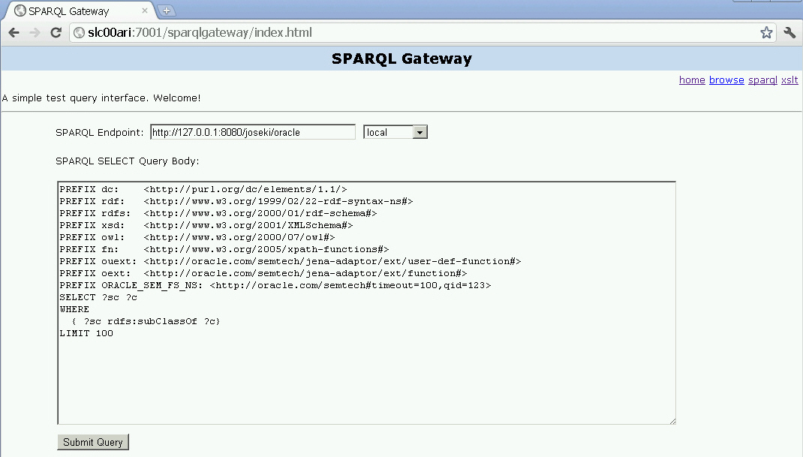
[Description of "Figure 7-2 Graphical Interface Main Page (index.html)"](img_text/spgateway_index_11.md)

Enter or select a SPARQL Endpoint, specify the SPARQL SELECT Query Body, and press Submit Query.

For example, if you specify `http://dbpedia.org/sparql` as the SPARQL endpoint and use the SPARQL query body from Figure 7-2, the response will be similar to Figure 7-3. Note that the default transformations (in `default.xslt`) have been applied to the XML output in this figure.

Figure 7-3 SPARQL Query Main Page Response

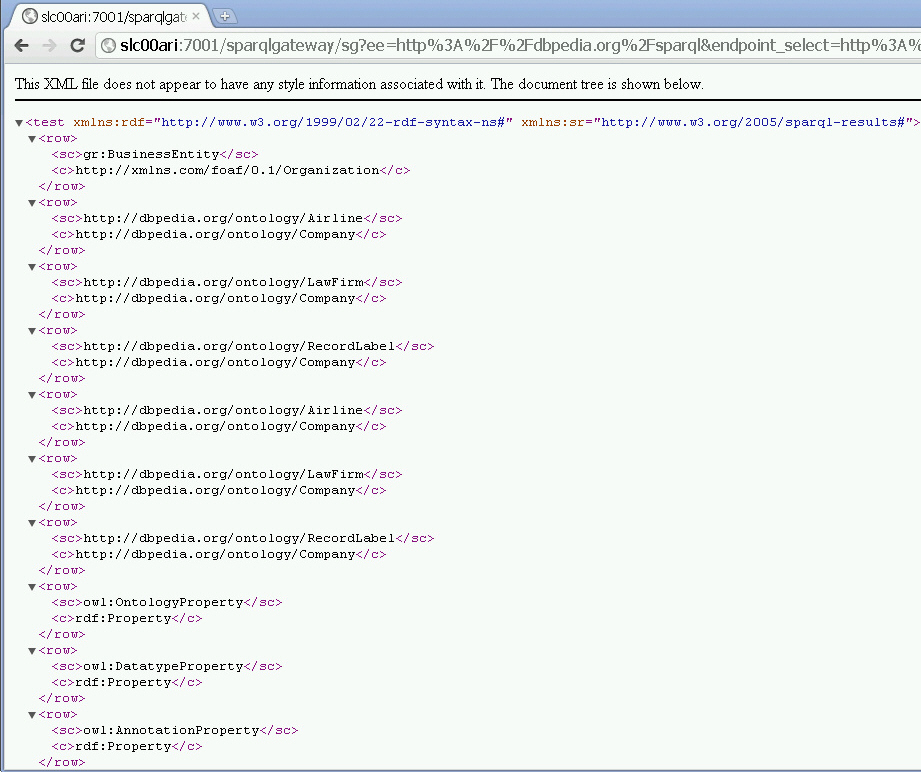
[Description of "Figure 7-3 SPARQL Query Main Page Response"](img_text/spgateway_index_21.md)

**Parent topic:** Using the SPARQL Gateway Graphical Web Interface

##### 7.17.6.2 Navigation and Browsing Page (browse.jsp)

`http://<host>:<port>/sparqlgateway/browse.jsp` provides navigation and browsing capabilities for semantic data. It works against any standard compliant SPARQL endpoint. Figure 7-4 shows this interface for executing a query.

Figure 7-4 Graphical Interface Navigation and Browsing Page (browse.jsp)

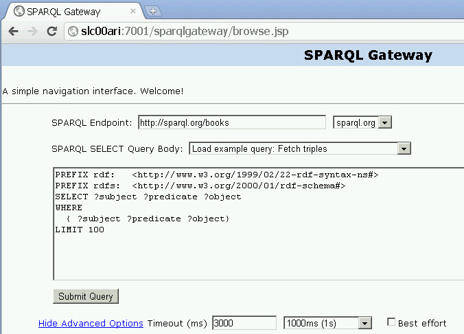
[Description of "Figure 7-4 Graphical Interface Navigation and Browsing Page (browse.jsp)"](img_text/spgateway_browse_11.md)

Enter or select a SPARQL Endpoint, specify the SPARQL SELECT Query Body, optionally specify a Timeout (ms) value in milliseconds and the Best Effort option, and press Submit Query.

The SPARQL response is parsed and then presented in table form, as shown in Figure 7-5.

Figure 7-5 Browsing and Navigation Page: Response

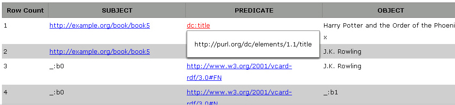
[Description of "Figure 7-5 Browsing and Navigation Page: Response"](img_text/spgateway_browse_1a1.md)

In Figure 7-5, note that URIs are clickable to allow navigation, and that when users move the cursor over a URI, tool tips are shown for the URIs which have been shortened for readability (as in `http://purl.org.dc/elements/1.1/title` being displayed as the tool tip for `dc:title` in the figure).

If you click the URI `http://example.org/book/book5` in the output shown in Figure 7-5, a new SPARQL query is automatically generated and executed. This generated SPARQL query has three query patterns that use this particular URI as subject, predicate, and object, as shown in Figure 7-6. Such a query can give you a good idea about how this URI is used and how it is related to other resources in the data set.

Figure 7-6 Query and Response from Clicking URI Link

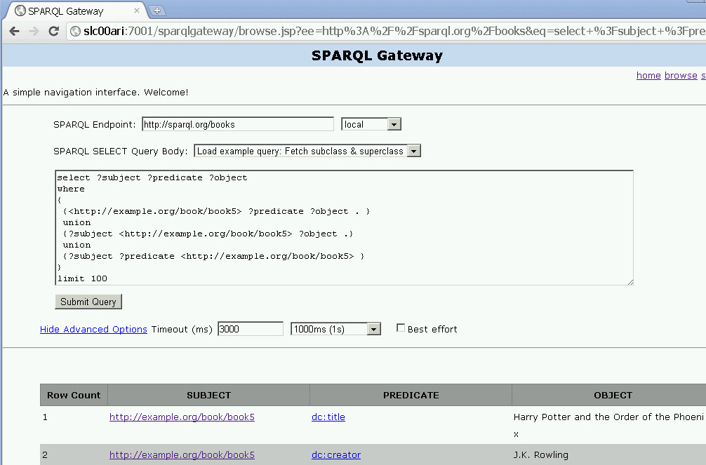
[Description of "Figure 7-6 Query and Response from Clicking URI Link"](img_text/spgateway_browse_31.md)

When there are many matches of a query, the results are organized in pages and you can click on any page. The page size by default is 50 results. To display more (or fewer) than 50 rows per page in a response with the Browsing and Navigation Page (`browse.jsp`), you can specify the `&resultsPerPage` parameter in the URL. For example, to allow 100 rows per page, include the following in the URL:

    &resultsPerPage=100

**Parent topic:** Using the SPARQL Gateway Graphical Web Interface

##### 7.17.6.3 XSLT Management Page (xslt.jsp)

`http://``<host>:<port>``/sparqlgateway/admin/xslt.jsp` provides a simple XSLT management interface. You can enter an XSLT ID (integer) and click Get XSLT to retrieve both the Description and XSLT Body. You can modify the XSLT Body text and then save the changes by clicking Save XSLT. Note that there is a previewer to help you navigate among available XSLT definitions.

Figure 7-7 shows the XSLT Management Page.

Figure 7-7 XSLT Management Page

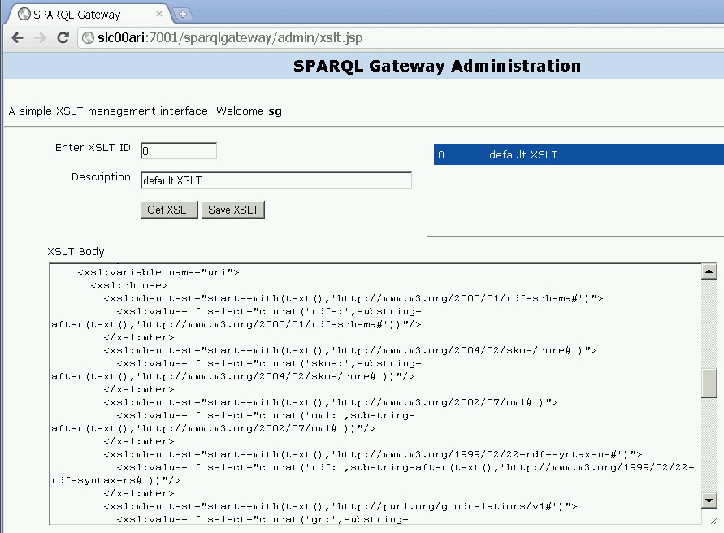
[Description of "Figure 7-7 XSLT Management Page"](img_text/spgateway_xslt1.md)

**Parent topic:** Using the SPARQL Gateway Graphical Web Interface

##### 7.17.6.4 SPARQL Management Page (sparql.jsp)

`http://``<host>:<port>``/sparqlgateway/admin/xslt.jsp` provides a simple SPARQL management interface. You can enter a SPARQL ID (integer) and click Get SPARQL to retrieve both the Description and SPARQL Body. You can modify the SPARQL Body text and then save the changes by clicking Save SPARQL. Note that there is a previewer to help you navigate among available SPARQL queries.

Figure 7-8 shows the SPARQL Management Page.

Figure 7-8 SPARQL Management Page

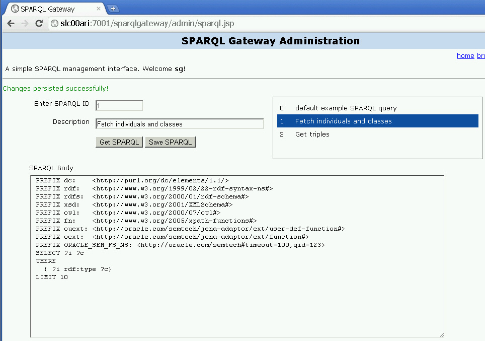
[Description of "Figure 7-8 SPARQL Management Page"](img_text/spgateway_sparql_mgmt1.md)

**Parent topic:** Using the SPARQL Gateway Graphical Web Interface

#### 7.17.7 Using SPARQL Gateway as an XML Data Source to OBIEE

This section explains how to create an XML Data source for Oracle Business Intelligence Enterprise Edition (OBIEE), by integrating OBIEE with RDF using SPARQL Gateway as a bridge. (The specific steps and illustrations reflect the Oracle BI Administration Tool Version 11.1.1.3.0.100806.0408.000.)

1.  Start the Oracle BI Administration Tool.
2.  Click File, then Import Metadata. The first page of the Import Metadata wizard is displayed, as shown in Figure 7-9.
    Figure 7-9 Import Metadata - Select Data Source

    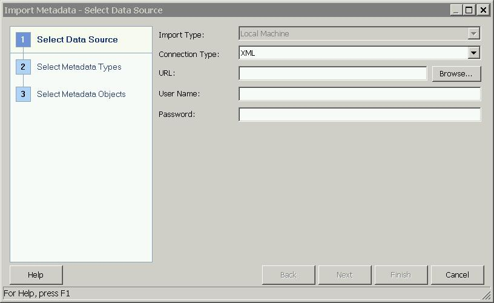
    [Description of "Figure 7-9 Import Metadata - Select Data Source"](img_text/obiee_impmeta_datasource1.md)
    Connection Type: Select `XML`.

    URL: URL for an application to interact with SPARQL Gateway, as explained in Using SPARQL Gateway with Semantic Data. You can also include the timeout and best effort options.

    Ignore the User Name and Password fields.
3.  Click Next. The second page of the Import Metadata wizard is displayed, as shown in Figure 7-10.
    Figure 7-10 Import Metadata - Select Metadata Types

    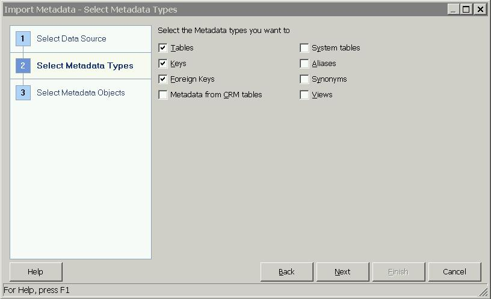
    [Description of "Figure 7-10 Import Metadata - Select Metadata Types"](img_text/obiee_impmeta_metatypes1.md)
    Select the desired metadata types to be imported. Be sure that Tables is included in the selected types.
4.  Click Next. The third page of the Import Metadata wizard is displayed, as shown in Figure 7-11.
    Figure 7-11 Import Metadata - Select Metadata Objects

    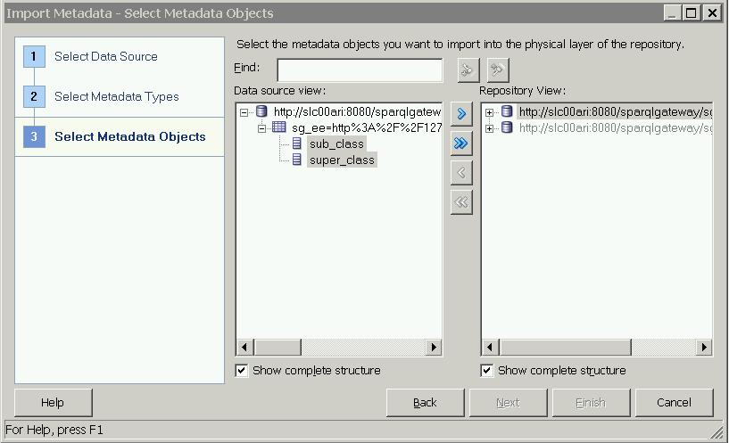
    [Description of "Figure 7-11 Import Metadata - Select Metadata Objects"](img_text/obiee_impmeta_metaobjects1.md)
    In the Data Source View, expand the node that has the table icon, select the column names (mapped from projected variables defined in the SPARQL SELECT statement), and click the right-arrow (\>) button to move the selected columns to the Repository View.
5.  Click Finish.
6.  Complete the remaining steps for the usual BI Business Model work and Mapping and Presentation definition work, which are not specific to SPARQL Gateway or RDF data.

**Parent topic:** SPARQL Gateway and Semantic Data

### 7.18 Deploying Fuseki in Apache Tomcat

To deploy Fuseki in Apache Tomcat, you can use the Tomcat admin web page, or you can just copy the Fuseki `.war` file into the `webapps` folder of Tomcat and it will be automatically deployed.

This topic describe the auto-deploy steps. It assumes that the \$FUSEKI_BASE setup is done and the configuration files exist (by default, Fuseki uses `/etc/fuseki` as the directory to store its configuration files).

1.  Download and install the latest version of Apache Tomcat.

    The directory root for Apache Tomcat installation will be referred to in these instructions as \$CATALINA_HOME.

2.  Copy the `fuseki.war` into the Tomcat webapps folder. For example:

        cd $CATALINA_HOME/webapps
        cp /tmp/jena_adapter/fuseki_web_app/fuseki.war  .

3.  Start Tomcat:

        $CATALINA_HOME/bin/startup.sh

    If this file does not have executable permission, enter the following command and then again attempt to start Tomcat:

        chmod u+x $CATALINA_HOME/bin/startup.sh

4.  In a browser go to: `http://hostname:8080/fuseki`

**Parent topic:** RDF Semantic Graph Support for Apache Jena

### 7.19 ORARDFLDR Utility for Bulk Loading RDF Data

This section describes using the ORARDFLDR utility program for Bulk Loading RDF Data.

This utility program loads all files in a directory into a semantic model in Oracle database. It supports several RDF serializations like RDF/XML, Turtle, N-Triple, N-Quads and Trig. Files compressed with gzip can be directly loaded without uncompressing the gzip file. In addition, Unicode character escaping and long literals (CLOBs) are handled automatically.

Running ORARDFLDR Utility Program

The following describes the commands to execute ORARDFLDR:

Prerequisite: Ensure that the environment variable `${ORACLE_JENA_HOME}` is pointing to the directory where the OTN kit is stored.

Usage:

    java -cp ${ORACLE_JENA_HOME}/jar/'*' oracle.spatial.rdf.client.jena.utilities.RDFLoader <command_line_arguments>

For help details:

    java -cp ${ORACLE_JENA_HOME}/jar/'*' oracle.spatial.rdf.client.jena.utilities.RDFLoader --help

For convenience, a shell script in the bin directory can also be executed. The following describes the commands to use this script

Prerequisite: Set `${ORACLE_JENA_HOME}` and ensure `${ORACLE_JENA_HOME}/bin` is in your Unix `PATH` environment variable.

Usage:

    orardfldr <command_line_arguments>

For help details:

    orardfldr --help

- Using ORARDFLDR with Oracle Autonomous Database

**Parent topic:** RDF Semantic Graph Support for Apache Jena

#### 7.19.1 Using ORARDFLDR with Oracle Autonomous Database

This section describes using the ORARDFLDR utility with Oracle Autonomous Database.

The ORARDFLDR utility included with support for Apache Jena can be used to bulk load RDF files from your client computer to Oracle Autonomous Database. The connection with the database is based on a cloud wallet.

General instructions for connecting to an Oracle Autonomous Database with JDBC can be found in [Java connectivity to ATP](https://www.oracle.com/database/technologies/java-connectivity-to-atp.html).

The following example describes establishing a JDBC connection to Oracle Autonomous Database following the [Plain JDBC using JKS files](https://www.oracle.com/database/technologies/java-connectivity-to-atp.html) procedure.

Example 7-36 JDBC connectivity to Oracle Autonomous Database

Prerequisite: Ensure you have the following Oracle jar files: `ojdbc8.jar`, `ucp.jar`, `oraclepki.jar`,` osdt_core.jar`, and `osdt_cert.jar`.

1.  Unzip your `wallet_<dbname>.zip` file. You should see something similar to the listing below after unzipping the file.

        [oracle@localhost Wallet_Info]$ ls
        cwallet.sso  keystore.jks      README      tnsnames.ora
        ewallet.p12  ojdbc.properties  sqlnet.ora  truststore.jks

2.  Modify `ojdbc.properties` to add JKS related connection properties. The final version of your ojdbc.properties file should be similar as shown below:

        # Connection property while using Oracle wallets.
        #oracle.net.wallet_location=(SOURCE=(METHOD=FILE)(METHOD_DATA=(DIRECTORY=${TNS_ADMIN})))
        # FOLLOW THESE STEPS FOR USING JKS
        # (1) Uncomment the following properties to use JKS.
        # (2) Comment out the oracle.net.wallet_location property above
        # (3) Set the correct password for both trustStorePassword and keyStorePassword.
        # It's the password you specified when downloading the wallet from OCI Console or the Service Console.
        javax.net.ssl.trustStore=${TNS_ADMIN}/truststore.jks
        javax.net.ssl.trustStorePassword=password
        javax.net.ssl.keyStore=${TNS_ADMIN}/keystore.jks
        javax.net.ssl.keyStorePassword=password

Use the following JDBC URL:

`jdbc:oracle:thin:@dbname_alias?TNS_ADMIN=<path_to_wallet_directory>`

The following examples loads the RDF files using the ORAFLDR utility for a database named `rdfdb` and having a wallet directory as `/home/oracle/RDF/Wallet_Info/` .

Example 7-37 Using ORAFLDR Utility to load RDF Data files

Prerequisite: Ensure you have copied the prerequisite jars listed in Example 7-36 to `$ORACLE_JENA_HOME/jar/`.

Invoke `ORARDFLDR` to load RDF files from your client computer to an Autonomous database.

    orardfldr --modelName=M1 --fileDir=./data --lang=N-TRIPLE
        --jdbcUrl=jdbc:oracle:thin:@rdfdb_medium?TNS_ADMIN=/home/oracle/RDF/Wallet_Info/
        --user="RDFUSER" --password=password --networkOwner="RDFUSER" --networkName=NET1

It loads RDF data in N-Triple format into a model named M1 in a network named NET1 owned by RDFUSER. RDFUSER is also used for the database connection.

**Parent topic:** ORARDFLDR Utility for Bulk Loading RDF Data
