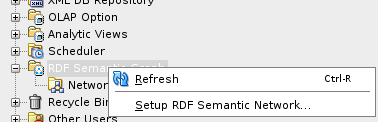
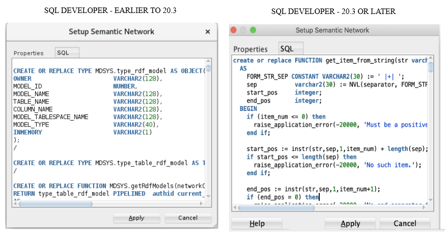
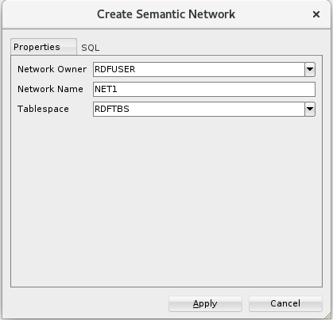

## C RDF Support in SQL Developer

You can use Oracle SQL Developer to perform operations related to the RDF Knowledge Graph feature of Oracle Spatial and Graph.

- About RDF Support in SQL Developer
  The RDF support in SQL Developer is available through the Connections navigator.
- Setting Up the RDF Semantic Graph Support In SQL Developer
  This section applies only if you are using Oracle Database 19c or later. You must execute a setup procedure to enable RDF Semantic Graph support in SQL Developer for schema-private networks only.
- Working with RDF Semantic Networks Using SQL Developer
  You can create an RDF semantic network to work with RDF data using SQL Developer.
- Bulk Loading RDF Data Using SQL Developer
  RDF Bulk load operations can be invoked from SQL Developer.

### C.1 About RDF Support in SQL Developer

The RDF support in SQL Developer is available through the Connections navigator.

You can use SQL Developer to create and manage RDF-related objects in an Oracle database. Oracle Spatial and Graph support for semantic technologies consists mainly of Resource Description Framework (RDF) and a subset of the Web Ontology Language (OWL). These capabilities are referred to as the RDF Knowledge Graph feature of Oracle Spatial and Graph.

Support for SQL Developer is included in RDF if the following conditions are true:

- The database connection is to Oracle Database release 12.1 or later.
- RDF semantic graph support is enabled in the database. After this support is enabled, the SDO_RDF_TRIPLE_S type will be available.

If you expand an Oracle Database connection that meets these conditions, near the bottom of the child nodes for the connection is RDF Semantic Graph.

**Parent topic:** RDF Support in SQL Developer

### C.2 Setting Up the RDF Semantic Graph Support In SQL Developer

This section applies only if you are using Oracle Database 19c or later. You must execute a setup procedure to enable RDF Semantic Graph support in SQL Developer for schema-private networks only.

**Note:**

This setup is not required for semantic networks in MDSYS schema. Starting from Oracle Database 19c, it is always recommended to create semantic networks in database user schemas.

Running this setup creates helper functions that are needed to populate RDF network dictionary information in SQL Developer.

**Note:**

If you do not perform this one-time setup procedure, you may encounter an error when trying to expand RDF network metadata nodes (such as `REGULAR_MODELS`, `RDF_VIEWS`, `RULEBASES`, and so on) in SQL Developer.

To perform this setup:

1.  Open SQL Developer.

2.  Right-click the RDF Semantic Graph node and select Setup RDF Semantic Graph to execute the one-time setup procedure.

    Figure C-1 RDF Semantic Graph Setup

    
    [Description of "Figure C-1 RDF Semantic Graph Setup"](img_text/sql_dev_rdf_setup.md)
    The following table helps you to determine if you require a DBA privilege to have this option available.

    Table C-1 RDF Semantic Graph Setup Specific To SQL Developer and Oracle DB Version

    | Oracle DB Version | SQL Developer Version | Type of User                                     | Expected Result                                                                                                                                                                                                                                                                                                                                                                                                                                            |
    |:------------------|:----------------------|:-------------------------------------------------|:-----------------------------------------------------------------------------------------------------------------------------------------------------------------------------------------------------------------------------------------------------------------------------------------------------------------------------------------------------------------------------------------------------------------------------------------------------------|
    | 19c or later      | Earlier to 20.3       | To be executed once by a user with DBA privilege | Required types and functions are installed in MDSYS schema.                                                                                                                                                                                                                                                                                                                                                                                                |
    | 19c or later      | 20.3 or later         | To be executed once individually by each user    | Required types and functions are installed in the user's schema. **Note:** If you have already set up the RDF Semantic Graph support in Oracle Database Release 19c or later with a SQL Developer version earlier than 20.3, but you have started using SQL Developer Release 20.3 or later, then you will need to perform the setup again, because the metadata functions are different from previous ones that were installed in the MDSYS schema. |

3.  Click Apply.

    Optionally, you can also click the SQL tab to view the procedure.

    Figure C-2 Apply RDF Semantic Graph Setup

    
    [Description of "Figure C-2 Apply RDF Semantic Graph Setup"](img_text/sql_dev_apply_setup.md)
    The required types and function are installed in the appropriate schema. Once this setup is executed, the RDF Semantic Graph option appears grayed out.

**Parent topic:** RDF Support in SQL Developer

### C.3 Working with RDF Semantic Networks Using SQL Developer

You can create an RDF semantic network to work with RDF data using SQL Developer.

You can view the available networks in the database schema associated with your connection by expanding the Networks node in the RDF Semantic Graph tree.

From Release 19c onwards, an RDF semantic network is supported in both user schema and MDSYS schema. See the following table to determine the semantic network type recommended for you depending on your database version.

Table C-2 Recommended Semantic Network Type

| Database Release | Supported Network(s)                            | Recommended Network    |
|:-----------------|:------------------------------------------------|:-----------------------|
| 18c or earlier   | All RDF metadata belongs only to MDSYS Network. | MDSYS Network          |
| 19c or later     | • MDSYS Network • Schema-Private Network     | Schema-Private Network |

- Creating an RDF Semantic Network Using SQL Developer
  Under the Networks node, you can create one or more RDF semantic networks.
- Refreshing Semantic Network Indexes Using SQL Developer
  RDF uses semantic network indexes (some created automatically), which you can refresh.
- Gathering RDF Statistics Using SQL Developer
  You can gather statistics about RDF and OWL tables and their indexes.
- Purging Unused Values from a Network Using SQL Developer
  You can purge unused (invalid) geometry literal values from the semantic network.
- Dropping a Semantic Network Using SQL Developer
  Dropping a semantic network removes structures used for persistent storage of semantic data..

**Parent topic:** RDF Support in SQL Developer

#### C.3.1 Creating an RDF Semantic Network Using SQL Developer

Under the Networks node, you can create one or more RDF semantic networks.

To create a new semantic network:

1.  Right-click Networks and select Create Semantic Network.

    This operation is available for users depending on the Oracle Database version and the SQL Developer version used. See the following table for more information:

    Table C-3 Release Specific Instructions to Create a Semantic Network

    | Oracle DB Release           | SQL Developer Version | User Requirement                                                   |
    |:----------------------------|:----------------------|:-------------------------------------------------------------------|
    | 18c or earlier              | Any                   | Only a user having a DBA role can create an MDSYS network.         |
    | For Release 19c- prior 19.3 | Any                   | Only a user having a DBA role can create a schema-private network. |
    | 19.3 or later               | Prior 20.3            | Only a user having a DBA role can create a schema-private network. |
    | 19.3 or later               | 20.3 or later         | Any database user can create a schema-private network directly.    |

    Create Semantic Network window opens as shown:

    Figure C-3 Create Semantic Network

    
    [Description of "Figure C-3 Create Semantic Network"](img_text/sql_dev_create_sem_nw.md)

2.  Select a Network Owner, that is, the database schema that will be the owner of the network.
    - For release 18c and earlier, the owner is always MDSYS.
    - For release 19c before 19.3, select the network owner.
    - For release 19.3 and later, the network owner is always the connection user schema.

3.  Enter a Network Name.
    **Note:**

    For release 18c and earlier, this field is blank and not editable.

4.  Select a Tablespace to be associated with the network. (If the tablespace or tablespaces necessary for semantic networks do not already exist, see Creating Tablespaces for Semantic Networks Using SQL Developer.)

5.  Click Apply.

    The RDF semantic network is created.

    You can verify the RDF semantic network creation by viewing the following child nodes under the created Nework:

    - REGULAR_MODELS
    - VIRTUAL_MODELS
    - RDF_VIEWS
    - RULEBASES
    - ENTAILMENTS
    - NETWORK_INDEXES (RDF_LINK\$)
    - DATATYPE_INDEXES (RDF_VALUE\$)
    - BULK_LOAD_TRACES

You can now perform the following operations on each created network:

- Gather Statistics
- Refresh semantic network indexes
- Purge unused values
- Drop semantic network

<!-- -->

- Creating Tablespaces for Semantic Networks Using SQL Developer
  If the tablespace or tablespaces required for semantic networks do not already exist, you can create them.

**Parent topic:** Working with RDF Semantic Networks Using SQL Developer

##### C.3.1.1 Creating Tablespaces for Semantic Networks Using SQL Developer

If the tablespace or tablespaces required for semantic networks do not already exist, you can create them.

You can adjust those that were created automatically as part of the semantic network setup operation.

The recommended practice is to use three tablespaces for RDF Semantic Graph:

- Tablespace for RDF storage (create a new tablespace named RDFTBS)

- Tablespace for temporary data (create a new tablespace named TEMPTBS)

- Tablespace for other user data (use the existing tablespace named USERS)

In the DBA navigator (not the Connections navigator), for the `system` connection click Storage, then Tablespaces. For the new tablespaces (right-click and select Create New), and select any desired name (the ones listed here are just examples). Accept default values or specified desired options.

1.  Create RDFTBS for storing RDF data.

    Name (tablespace name): `RDFTBS`

    Tablespace Type: `Permanent`

    Under File Specification, Name: `'RDFTBS.DBF'`

    Directory: Desired file system directory. For example: `/u01/app/oracle/oradata/orcl12c/orcl`

    File Size: Desired file initial size. For example: `1 G`

    Check Reuse and Auto Extend On.

    Next Size: Desired size of each extension increment. For example: `512 M`

    Max Size: Desired file maximum size. For example: `10 G`

    Click OK.

2.  Create TEMPTBS for temporary work space.

    Right-click and select Create New.

    Name (tablespace name): `TEMPTBS`

    Tablespace Type: `Temporary`

    Under File Specification, Name: `'TEMPTBS.DBF'`

    Directory: Desired file system directory. For example: `/u01/app/oracle/oradata/orcl12c/orcl`

    File Size: Desired file initial size. For example: `1 G`

    Check Reuse and Auto Extend On.

    Next Size: Desired size of each extension increment. For example: `256 M`

    Max Size: Desired file maximum size. For example: `8 G`

3.  Make TEMPTBS the default temporary tablespace for the database, by using the SQL Worksheet for the `system` connection’s SQL Worksheet to execute the following statement:

        SQL> alter database default temporary tablespace TEMPTBS;

**Parent topic:** Creating an RDF Semantic Network Using SQL Developer

#### C.3.2 Refreshing Semantic Network Indexes Using SQL Developer

RDF uses semantic network indexes (some created automatically), which you can refresh.

You can create additional semantic indexes if you wish, and you can adjust those that were created automatically.

There are multicolumn B-Tree semantic indexes over the following columns:

- S - subject

- P - predicate

- C - canonical object

- G - graph

- M - model

Two indexes are created by default: PCSGM and PSCGM. However, you can use a three-index setup to better cover more combinations of S, P, and C: PSCGM, SPCGM, and CSPGM.

In the Connections navigator (not the DBA navigator), expand the `system` connection, expand RDF Semantic Graph, then click Network Indexes (RDF_LINK).

1.  Add the SPCGM index.

    Right-click and select Create Semantic Index. Suggested Index code: `SPCGM`

    Click OK.

2.  Add the CSPGM index.

    Right-click and select Create Semantic Index. Suggested Index code: `CSPGM`

    Click OK.

3.  Drop the PSCGM index.

    Right-click `RDF_LINK_PSCGM_IDX` and select Drop Semantic Index.

The result will be these three indexes:

- RDF_LINK_PSCGM_IDX

- RDF_LINK_SPCGM_IDX

- RDF_LINK_CSPGM_IDX

**Parent topic:** Working with RDF Semantic Networks Using SQL Developer

#### C.3.3 Gathering RDF Statistics Using SQL Developer

You can gather statistics about RDF and OWL tables and their indexes.

To gather statistics about a semantic network, right-click the network name and select Gather Statistics.

The following parameters can be defined in the dialog box:

Network Owner: The connection user (not editable).

Network Name: Name of the network (not editable).

Just on Values: If enabled (checked), collects statistics only on the table containing the lexical values of triples. If not enabled (unchecked), collects statistics on all major tables related to the storage of RDF and OWL data.

Degree of Parallelism: Number of parallel execution servers associated with the operation.

To complete the network creation, click Apply.

**Parent topic:** Working with RDF Semantic Networks Using SQL Developer

#### C.3.4 Purging Unused Values from a Network Using SQL Developer

You can purge unused (invalid) geometry literal values from the semantic network.

Deletion of triples over time may lead to a subset of the values in the RDF_VALUE\$ table becoming unused in any of the RDF triples or rules currently in the semantic network. To delete such unused values from the RDF_VALUE\$ table, right-click the network name and select Purge Unused Values..

The following parameters can be defined in the dialog box:

Network Owner: The connection user (not editable).

Network Name: Name of the network (not editable).

MBV_METHOD=SHADOW: If enabled (checked), may result faster processing when a large number of values need to be purged.

Degree of Parallelism: Number of parallel execution servers associated with the operation.

PUV_COMPUTE_VIDS_USED: If enabled (checked), may result faster processing when most of the values are expected to be purged.

Extra Flags: Specify any additional keywords and values to be added in the `flags` parameter for the SEM_APIS.PURGE_UNUSED_VALUES procedure that will be executed (click the SQL tab to see the complete SQL statement).

To perform the operation, click Apply.

**Parent topic:** Working with RDF Semantic Networks Using SQL Developer

#### C.3.5 Dropping a Semantic Network Using SQL Developer

Dropping a semantic network removes structures used for persistent storage of semantic data..

To drop a semantic network, right-click the network name and select Drop Semantic Network.

The following parameters can be defined in the dialog box:

Network Owner: The connection user (not editable).

Network Name: Name of the network (not editable).

Cascade: If enabled (checked), also drops any existing semantic technology models and rulebases for the network, and removes structures used for persistent storage of semantic data for the network. If not enabled (unchecked), the operation will fail if any semantic technology models or rulebases exist in the network.

To perform the operation, click Apply.

**Parent topic:** Working with RDF Semantic Networks Using SQL Developer

### C.4 Bulk Loading RDF Data Using SQL Developer

RDF Bulk load operations can be invoked from SQL Developer.

Two major steps are required after some initial preparation: (1) loading data from the file system into a “staging“ table and (2) loading data from a “staging“ table into a semantic model.

Do the following to prepare for the actual bulk loading.

1.  Prepare the RDF dataset or datasets.

    - The data must be on the file system of the Database server – not on the client system.

    - The data must be in N-triple or N-quad format. (Apache Jena, for example, can be used to convert other formats to N-triple/N-quad,)

    - A Unix named pipe can be used to decompress zipped files on the fly.

    For example, you can download RDF datasets from LinkedGeoData. For an introduction, see [http://linkedgeodata.org/Datasets](http://linkedgeodata.org/docs/downloads) and [http://linkedgeodata.org/RDFMapping](http://linkedgeodata.org/docs/rdf-mapping.html).

    To download from LinkedGeoData, go to <https://hobbitdata.informatik.uni-leipzig.de/LinkedGeoData/downloads.linkedgeodata.org/releases/> and browse the listed directories. For a fairly small dataset you can download <https://hobbitdata.informatik.uni-leipzig.de/LinkedGeoData/downloads.linkedgeodata.org/releases/2014-09-09/2014-09-09-ontology.sorted.nt.bz2>.

    Each .bz2 file is a compressed archive containing a comparable-named .nt file. To specify an .nt file as a data source, you must extract (decompress) the corresponding .bz2 file, unless you create a Unix named pipe to avoid having to store uncompressed data.

2.  Create a regular, non-DBA user to perform the load.

    For example, using the DBA navigator (not the Connections navigator), expand the `system` connection, expand Security, right-click Users, and select Create New.

    Create a user (for example, named `RDFUSER`) with CONNECT, RESOURCE, and UNLIMITED TABLESPACE privileges.

3.  Add a connection for this regular, non-DBA user (for example, a connection named `RDFUSER`).

    Default Tablespace: `USERS`

    Temporary Tablespace: `TEMPTBS`

4.  As the system user, create a directory in the database that points to your RDF data directory.

    Using the Connections navigator (not the DBA navigator), expand the `system` connection, right-click Directory and select Create Directory.

    Directory Name: Desired directory name. For example: `RDFDIR`

    Database Server Directory: Desired location for the directory. For example: `/home/oracle/RDF/MyData`

    Click Apply.

5.  Grant privileges on the directory to the regular, non-DBA user (for example, RDFUSER). For example, using the `system` connection's SQL Worksheet:

        SQL> grant read, write on directory RDFDIR to RDFUSER;

    Tip: you can use a named pipe to avoid having to store uncompressed data. For example:

        $ mkfifo named_pipe.nt
        $ bzcat myRdfFile.nt.bz2 > named_pipe.nt

6.  Expand the regular, non-DBA user (for example, `RDFUSER`) connection and click RDF Semantic Graph.

7.  Create a model to hold the RDF data.

    Click Model, then New Model.

    Model Name: Enter a model name (for example, `MY_ONTOLOGY`)

    Application Table: `* Create new <Model_Name>_TPL table *` (that is, have an application table with a triple column named TRIPLE automatically created)

    Model Tablespace: tablespace to hold the RDF data (for example, `RDFTBS`)

    Click Apply.

    To see the model, expand Models in the object hierarchy, and click the model name to bring up the SPARQL editor for that model.

    You can run a query and see that the model is empty.

Using the Models menu, perform a bulk load from the Models menu. Bulk load has two phases:

- Loading data from the file system into a simple "staging" table in the database. This uses an external table to read from the file system.

- Loading data from the staging table into the semantic network. Load from the staging table into the model (for example, `MY_ONTOLOGY`).

To perform these two phases:

1.  Load data into the staging table.

    Right-click the model name (under Regular Models) and select Load RDF Data into Staging Table from External Table.

    For Source External Table, Source Table: Desired table name (for example, `MY_ONTOLOGY_EXT`).

    Log File: Desired file name (for example, `my_ontology.log`)

    Bad File: Desired file name (for example, `my_ontology.bad`)

    Source Table Owner: Schema of the table with RDF data (for example, `RDFUSER`)

    For Input Files, Input Files: Input file (for example, `named_pipe.nt`).

    For Staging Table, Staging table: Name for the staging table (for example, `MY_ONTOLOGY_STAGE`).

    If the table does not exist, check Create Staging Table.

    Input Format: Desired format (for example, `N-QUAD`)

    Staging Table Owner: Schema for the staging table (for example, `RDFUSER`)

2.  Load from the staging table into the model.

    **Note:**

    Unicode data in the staging table should be escaped as specified in WC3 N-Triples format (<http://www.w3.org/TR/rdf-testcases/#ntriples>). You can use the SEM_APIS.ESCAPE_RDF_TERM function to escape Unicode values in the staging table. For example:

        create table esc_stage_tab(rdf$stc_sub, rdf$stc_pred, rdf$stc_obj);

        insert /*+ append nologging parallel */ into esc_stage_tab (rdf$stc_sub, rdf$stc_pred, rdf$stc_obj)
        select sem_apis.escape_rdf_term(rdf$stc_sub, options=>’ UNI_ONLY=T '), sem_apis.escape_rdf_term(rdf$stc_pred, options=>’ UNI_ONLY=T '), sem_apis.escape_rdf_term(rdf$stc_obj, options=>’ UNI_ONLY=T ')
        from stage_tab;

    Right-click the model name (under Regular Models) and select Bulk Load into Model from staging Table.

    Model: Name for the model (for example, `MY_ONTOLOGY`).

    (If the model does not exist, check Create Model. However, in this example, the model does already exist.)

    Staging Table Owner: Schema of the staging table (for example, `RDFUSER`)

    Staging Table Name: Name of the staging table (for example, `MY_ONTOLOGY_STAGE`)

    Parallel: Degree of parallelism (for example, `2`)

    Suggestion: Check the following options: MBV_METHOD=SHADOW, Rebuild application table indexes, Create event trace table

    Click Apply.

Do the following after the bulk load operation.

1.  Gather statistics for the whole semantic network.

    In the Connections navigator for a DBA user, expand the RDF Semantic Graph node for the connection and select Gather Statistics (DBA)).

2.  Run some SPARQL queries on our model.

    In the Connections navigator, expand the RDF Semantic Graph node for the connection and select the model.

    Use the SPARQL Query Editor to enter and execute desired SPARQL queries.

3.  Optionally, check the bulk load trace to get information about each step.

    Expand RDF Semantic Graph and then expand Bulk Load Traces to display a list of bulk load traces. Clicking one of them will show useful information about the execution time for the load, number of distinct values and triples, number of duplicate triples, and other details.

**Parent topic:** RDF Support in SQL Developer
