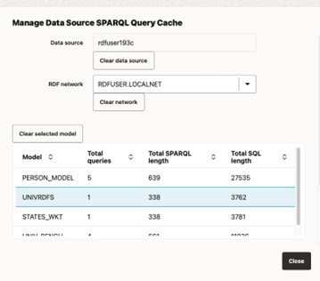

## 14.3.2.4 SPARQL Query Cache Manager

SPARQL queries are cached data source, and they apply to Oracle data sources. The translations of the SPARQL queries into SQL expressions are cached for Oracle RDF network models. Each model can stores up to 64 different SPARQL queries translations. The Query Cache Manager dialog, allows you to browse data source network cache for queries executed in models.

Figure 14-27 SPARQL Query Cache Manager

[Description of "Figure 14-27 SPARQL Query Cache Manager"](img_text/rdf_query_cache.md)

You can clear cache at different levels. The following describes the cache cleared against each level:

- Data source: All network caches are cleared.
- Network: All model caches are cleared.
- Model: All cached queries for model are cleared.
- Model Cache Identifier: Selected cache identifier is cleared.

Figure 14-28 Manage SPARQL Query Cache

[Description of "Figure 14-28 Manage SPARQL Query Cache"](img_text/manage_query_cache.md)

**Parent topic:** [RDF Data Page](rdf-data-page.md)
