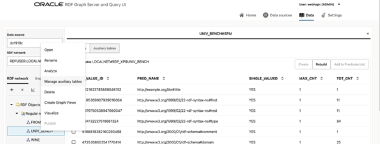

## 14.3.2.10 Support for Auxiliary Tables

Subject-Property-Matrix (SPM) auxiliary tables can be used to speed up SPARQL query execution. It is recommended you first refer to [Speeding up Query Execution with SPM Auxiliary Tables](rdf-semantic-graph-overview.md), for a detailed description of SPM tables.

Single-Valued Property (SVP) tables hold values for single-valued RDF properties. A property `p` is single-valued in an RDF model if each resource in the model has at most one value for `p`.

Multi-Valued Property (MVP) tables hold values for multi-valued RDF properties. A property `p` is multi-valued in an RDF model if there exist two triples in the model `(s p o1)` and `(s p o2)` with `o1` not equal to `o2`.

Property Chain (PCN) tables hold paths in the RDF graph. A set of triples `t1, t2, …, tn` form a path if for each `ti` where `i > 1`, the object value of `ti-1` is equal to the subject value of `ti`.

SVP and PCN tables can be used to reduce joins on SPARQL query execution, while MVP tables allow better query optimizer statistics and query plans, which can help in speeding up the query execution. These auxiliary tables are supported in Oracle Database 19c Release Update 19.15 and later, and they are associated with RDF models. Once they are created, they are automatically used during SPARQL queries execution, unless options are passed to not to use them.

The RDF Server and Query UI web application extends support to the SPM tables. You can manage these auxiliary tables by right clicking the RDF model and selecting the Auxiliary tables menu item as shown:

Figure 14-44 Auxiliary tables Menu

[Description of "Figure 14-44 Auxiliary tables Menu"](img_text/rdf_auxiliary_tables_menu.md)

- [Creating Auxiliary Tables](creating-result-tables.md)
- [Managing Auxiliary Tables](managing-resulttables.md)

**Parent topic:** [RDF Data Page](rdf-data-page.md)
