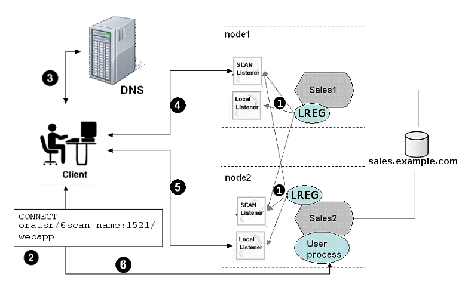

## How Database Connections are Created When Using SCANs

Based on the environment, the following actions occur when you use a SCAN to connect to an Oracle RAC database using a service name.

The numbered actions correspond to the arrows shown in Load Balancing Actions for Oracle RAC Connections That Use SCAN:

1.  The LREG process of each instance registers the database services with the default listener on the local node and with each SCAN listener, which is specified by the `REMOTE_LISTENER` database parameter. The listeners are dynamically updated on the amount of work being handled by the instances and dispatchers.

2.  The client issues a database connection request using a connect descriptor of the form:

        orausr/@scan_name:1521/webapp

    **Note:**

    If you use the Easy Connect naming method, then ensure that the `sqlnet.ora` file on the client contains `EZCONNECT` in the list of naming methods specified by the `NAMES.DIRECTORY_PATH` parameter.

3.  The client uses DNS to resolve `scan_name`. After DNS returns the three addresses assigned to the SCAN, the client sends a connect request to the first IP address. If the connect request fails, then the client attempts to connect using the next IP address.

4.  When the connect request is successful, the client connects to a SCAN listener for the cluster that hosts the `sales` database and has an instance offering the `webapp` service, which in this example is `sales1` and `sales2`. The SCAN listener compares the workload of the instances `sales1` and `sales2` and the workload of the nodes on which they run. If the SCAN listener determines that `node2` is less loaded than `node1`, then the SCAN listener selects `node2` and sends the address for the local listener on that node back to the client.

5.  The client connects to the local listener on `node2`. The local listener starts a dedicated server process for the connection to the database.

6.  The client connects directly to the dedicated server process on `node2` and accesses the `sales2` database instance.

Figure 6-1 Load Balancing Actions for Oracle RAC Connections That Use SCAN

[Description of "Figure 6-1 Load Balancing Actions for Oracle RAC Connections That Use SCAN"](img_text/scancnpt.md)

**Parent topic:** [Oracle Net Services Configuration for Oracle RAC Databases](oracle-net-services-configuration-for-oracle-rac-databases.md)
