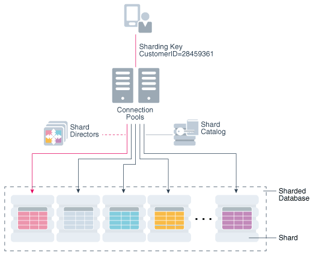
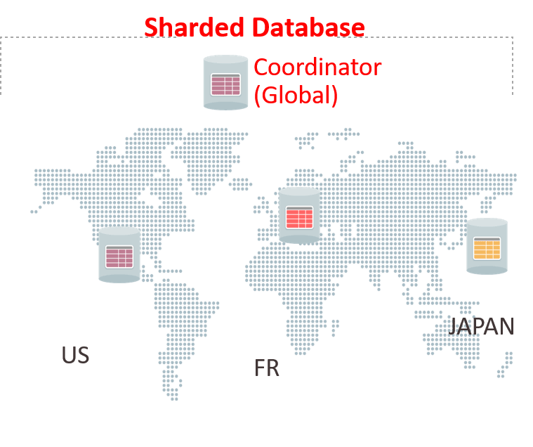
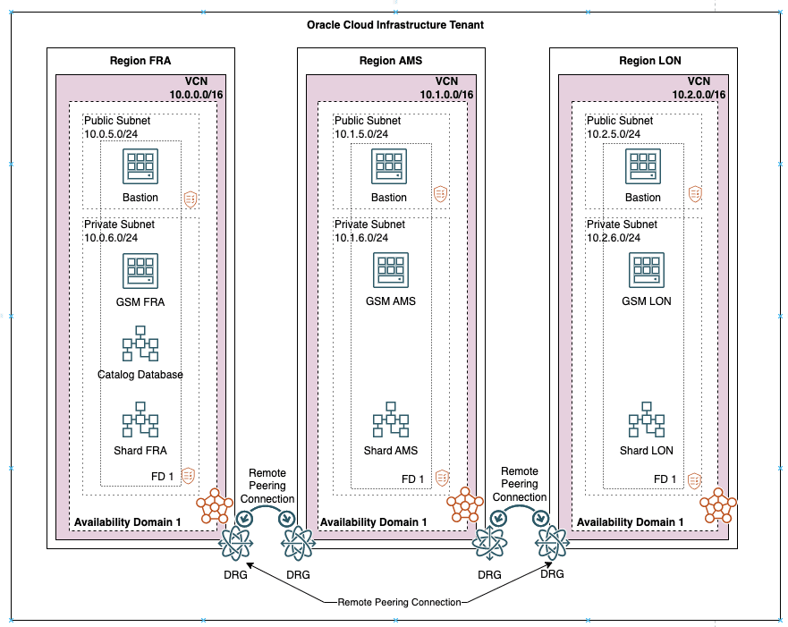
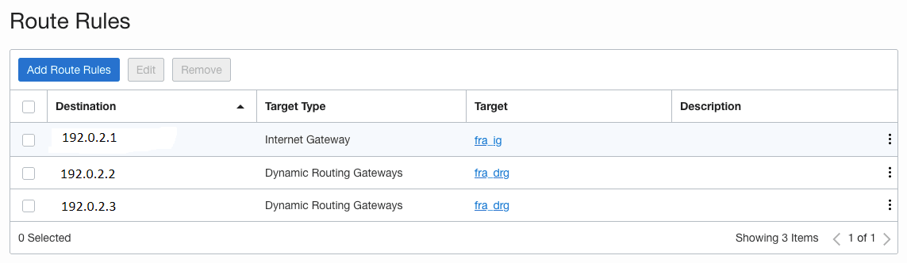
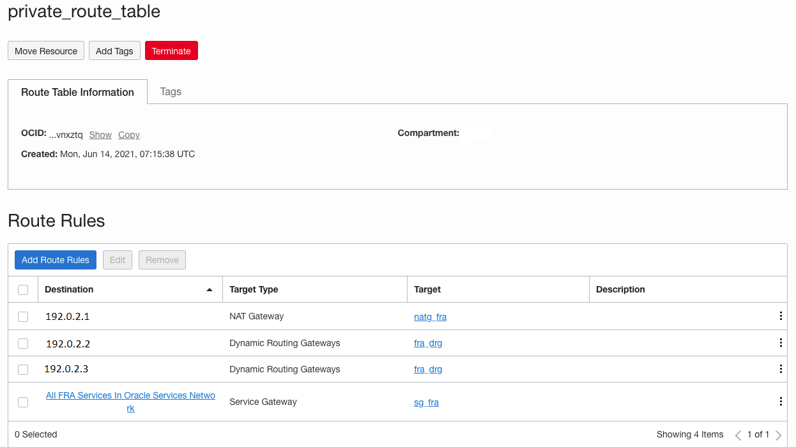
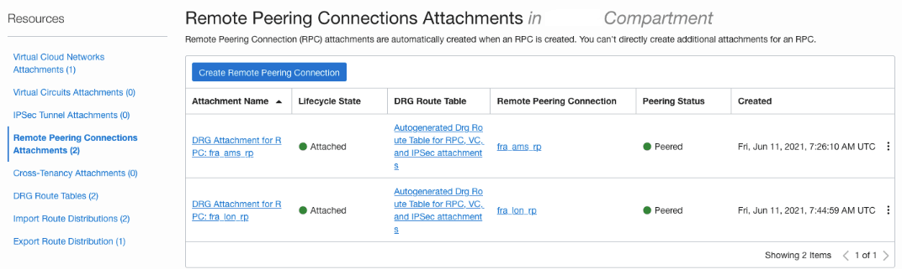

## 11 Achieving Data Sovereignty with Oracle Sharding

The proliferation of cloud computing has brought heightened concerns about industry-standard regulations especially around protecting data and its privacy. Today, most organizations want to know where their data is stored, and who has access to it. This creates a key concern about managing data residency—the requirement that data be stored in a specific geographic location.

There are more than 120 countries already engaged in some form of international privacy laws for data protection to ensure that citizens' data are offered more rigorous protections and controls, be it on-premises or on cloud.

### Overview of Data Sovereignty

Data sovereignty generally refers to how data is governed by regulations specific to the region in which it originated. These types of regulations can specify where data is stored, how it is accessed, how it is processed, and the life-cycle of the data.

With the exponential growth of data crossing borders and public cloud regions, more than 100 countries now have passed regulations concerning where data is stored and how it is transferred. Personally identifiable information (PII) in particular increasingly is subject to the laws and governance structures of the nation in which it is collected. Data transfers to other countries often are restricted or allowed based on whether that country offers similar levels of data protection, and whether that nation collaborates in forensic investigations.

Data sovereignty requirements are driven by local regulations which could result in different application architectures. A few of them are:

- Data must be physically stored in a certain geographic location. For example, within the boundaries of a specific country or a region comprising of several countries. It is fine to access and process the data remotely so far as the data is not stored in remote locations. From a technical standpoint, this implies that data stores like databases, object stores, and messaging stores that physically store the persistent data must be in a certain geographic location. However, the application run time which has business logic for processing of data could be outside the geographic location. Examples of such applications parts include application servers, mobile applications, API Gateways, Workflows, and so on.

- Data must be physically stored and processed in a certain geographic location: In this case, storing of data and processing of data must take place within the defined geographic location.

### Benefits of Implementing Data Sovereignty with Oracle Sharding

Oracle Sharding meets data sovereignty requirements and supports applications that require low latency and high availability.

- Sharding makes it possible to locate different parts of the data in different countries or regions – thus satisfying regulatory requirements where data has to be located in a certain jurisdiction.

- It also supports storing particular data closer to its consumers. Oracle Sharding automates the entire lifecycle of a sharded database – deployment, schema creation, data-dependent routing with superior run-time performance, elastic scaling, and life-cycle management.

- It also provides the advantages of an enterprise RDBMS, including relational schema, SQL, and other programmatic interfaces, support for complex data types, online schema changes, multi-core scalability, advanced security, compression, high-availability, ACID properties, consistent reads, developer agility with JSON, and much more.

### Implementing Data Sovereignty with Oracle Sharding

Oracle Sharding distributes segments of a data set across many databases (shards) on different computers, on-premises, or in the cloud. These shards can be deployed in multiple regions across the globe. This enables Oracle Sharding to create globally distributed databases honoring data residency.

All of the shards in a given database are presented to the application as a single logical database. Applications are seamlessly connected to the right shard based on the queries they run. For example, if an application instance deployed in the US needs data that resides in Europe, the application request is seamlessly routed to an EU data center, without the application having to do anything special.

Figure 11-1 Oracle Sharding Architecture

[Description of "Figure 11-1 Oracle Sharding Architecture"](img_text/admin_3v_143d.md)

Additionally, Oracle Database security features such as Real Application Security (RAS) and Oracle Database Vault can be used to limit data access further, even within a region. For example, an administrator in the EU region can further be restricted to see data only from a subset of countries and not all EU countries. Within a Data Sovereignty region, data can be replicated across multiple data centers by using Oracle Data Guard and Oracle GoldenGate for such replication.

Oracle Sharding management interfaces give you control of the global metadata and provide a view of the physical databases (replicas), data they contain, replication topology, and more. Oracle Sharding handles data redistribution when nodes are added or dropped.

You can access worldwide reporting without actually copying the data from the various regions. Sharding can run multi-shard reports without copying any data from any region. Oracle Sharding pushes queries to the nodes where the data resides.

Oracle Sharding provides comprehensive data sovereignty solutions that focus on the following aspects:

- Data Residency: Data can be distributed across multiple shards, which can be deployed in different geographical locations.

- Data Processing: Application requests are automatically routed to the correct shard irrespective of where the application is running.

- Data Access: Data access within a region can be restricted further using the Virtual Private Database capability of Oracle Database.

- Derivative Data: Ensuring that the data is stored in an Oracle Database, and using Oracle Database features to contain the proliferation of derivative data.

- Data Replication: Oracle Sharding can be used with Oracle Data Guard or Oracle GoldenGate to replicate data within the same Data Sovereignty region.

### Use Case of Achieving Data Sovereignty with Oracle Sharding

A large but imaginary financial institute, Shard Bank, wants to offer credit services to users in multiple counties. Each country where credit service will be provided has its own data privacy regulations and the Personally Identifiable Information (PII) data have to be stored in this country.

The access to the data has to be limited and data administrators in one country cannot see data in others. The solution for this use case is user-defined Sharding with shards configured in different countries and Real Application Security (RAS) for data access control.

#### Overview of Oracle Sharding Solution

Oracle Sharding solution provides you with in-country data storage, and still supports a global view of all the data.

The example below demonstrates a hybrid Oracle Sharding user-defined deployment between OCI data centers and on-premises across multiple regions. In this Oracle Sharding configuration, you can store and process all data locally. Each database (in each sovereign region) is made into a shard and the shards belong to a single sharded database. Oracle Sharding allows you to query data in one shard (within one country), and Oracle Sharding supports multi-shard queries (that can query data from all the countries).

Figure 11-2 Sharded Database

[Description of "Figure 11-2 Sharded Database"](img_text/sharded_database.md)

The global sharded database is sharded by a key indicating the country in which it must reside. In-country applications connect to the local database as usual, and all data is stored and processed locally.

Any multi-shard queries are directed to the shard coordinator. The coordinator rewrites the query and sends it to each shard (country) that has the required data. The coordinator processes and aggregates the results from all of the countries and returns result.

Oracle Sharding makes this use case possible with the following capabilities:

- Direct-to-shard routing for in-country queries.
- The user-defined sharding method allows you to use a range or list of countries to partition data among the shards.
- Automatic configuration of replication using Oracle Active Data Guard, and constrain the replicas to be in-country.

The benefits of this approach are:

- Each shard can be in a cloud or on-premises within the country.
- Shards can use different cloud providers (multi-cloud strategy) and replicas of a shard can be in a different cloud or on-premises.
- Online resharding allows you to move data between clouds, or to and from the cloud and on-premises.
- Strict enforcement of data sovereignty providing protection from inadvertent cross region data leak.
- Single Multimodel Big Data store with reduced volume of data duplication.
- Better fault isolation as planned/unplanned down time within one region/LOB does not impact other regions/LOBs.
- Ability to split busy partitions and shards as needed.
- Support for full ACID properties is critical for transactional applications.

#### Deployment Topology of Data Sovereignty with Oracle Sharding

In this example use case, we create a sharded database on Oracle Cloud Infrastructure that spans three regions, Frankfurt (Region1 FRA), Amsterdam (Region 2 AMS), and London (Region 3 LON).

Each region hosts a shard director (Virtual Machine global service manager (GSM)) and one shard (System Database Shard 1, 2, and 3 respectively), and Region 1 (FRA) hosts the shard catalog (System Database GSM Catalog Database).

Figure 11-3 Deployment Topology of Data Sovereignty with Oracle Sharding

[Description of "Figure 11-3 Deployment Topology of Data Sovereignty with Oracle Sharding"](img_text/deployment_topology_datasovereignty_sharding.md)

#### Configuring Data Sovereignty with Oracle Sharding

Configure Data Sovereignty with Oracle Sharding by performing the steps given in the following topics.

##### Configuring VCN Networks in All Three OCI Regions

In Oracle Cloud Infrastructure (OCI), a virtual cloud network is a virtual version of a traditional network on which your instances run. Deploy and configure a virtual cloud network (VCN) in each of our regions (FRA, AMS, and LON).

In each region, create a VCN with two subnets: public and private.

1.  Create new route table for private subnet and associate it with private subnet. The default route table should only be used for the public subnet and the private subnet should have a dedicated private route table.
2.  Create an internet gateway and associate it with default route table.
3.  Create a Network Address Translation (NAT) gateway, Service Gateway, and associate it with route table for private subnet.

Example for FRA:

- VCN Name/CIDER: Oracle Sharding VCN FRA 10.0.0.0/16
- Public Subnet name/CIDER: public_fra 10.0.5.0/24
- Private Subnet name/CIDER: private_fra 10.0.6.0/24

**Note:**

Repeat the steps in all regions used in the sharding deployment. The subnet CIDER must be different in each region and you must provide region prefix in the VCN/subnet name.

##### Configuring Remote VCN Peering Between All Three Regions

Remote VCN peering is the process of connecting two VCNs in different regions, which allows the VCNs' resources to communicate using private IP addresses without routing the traffic over the internet.

Configure two remote peering connections (RPCs) in each region to connect with the other two regions in the topology.

1.  See [Remote VCN Peering using an RPC](https://docs.oracle.com/en-us/iaas/Content/Network/Tasks/remoteVCNpeering.htm) for the steps to configure an RPC.
2.  Configure routing rules for the public subnet/VCN.

    
    [Description of the illustration public_route_rules.png](img_text/public_route_rules.md)

3.  Configure routing rules for the private subnet/VCN.

    
    [Description of the illustration private_route_tables_subnet.png](img_text/private_route_tables_subnet.md)

4.  Configure security rules.

For example, in Region 1 (FRA):

[Description of the illustration remote_vcn_peering.png](img_text/remote_vcn_peering.md)

##### Configuring Private DNS for Naming Resolution Between the Regions

You create private views for the public and private subnet for each domain in each region, resulting in a total of 6 private zones within 1 zone. Then all entries are added to each private zone configuration.

1.  See [Private DNS](https://docs.oracle.com/en-us/iaas/Content/DNS/Tasks/privatedns.htm) to create and manage private DNS zones.
2.  Verify that all names are resolved correctly before you proceed with the next task.

**Note:**

These steps must be done in each region on all VCNs/VMs so that names can be correctly resolved.

##### Installing a Global Service Manager in Each Region

Oracle Global Data Services global service manager (GSM) is used in Oracle Sharding to route queries from the application to the correct shard in a sharded database.

Download the software and perform the following tasks:

- Download the global service manager (Oracle Database 19c) software into the bastion VM.
- Apply the latest version of OPatch.
- Apply the latest available Oracle Database Bundle Patch on the newly installed global service manager (Oracle Database 19c).

To install a GSM in each region:

1.  Create a 200 GB block storage using iSCSI. Configure iSCSI on the OCI Compute for GSM. Mount block storage under`/u01` .
    See [Connecting to Volumes With Consistent Device Paths](https://docs.oracle.com/en-us/iaas/Content/Block/References/consistentdevicepaths.htm) for the mounting block storage process.
2.  As the `root` user, install all the required packages.
    `# yum install -y oracle-database-preinstall-19c`
3.  As the `root` user, ensure that `/u01` is owned by `oracle:oinstall`.
    `# chown oracle:oinstall /u01`
4.  Download the GSM software to the designated shard director VM and install it in silent mode.
    See [Performing a Silent Install of Global Service Manager](https://docs.oracle.com/en/database/oracle/oracle-database/21/gsmug/global-data-services-config.html#GUID-C03F39F9-576F-48B7-892B-2636F423BF21).
5.  Add `gsm home ` to `/etc/oratab`.
    `gsm:/u01/app/oracle/product/19.0.0.0/dbhome_1:N`
6.  Apply the latest OPatch version.
7.  Apply the latest available bundle patch version for Oracle Database 19c.
8.  Open GSM port on Firewall:
        $ systemctl start firewalld.service
        $ systemctl enable firewalld.service
        $ firewall-cmd --permanent --zone=public --add-port=1522/tcp # firewall-cmd --reload
        $ firewall-cmd --permanent --zone=public --list-ports
        1522/tcp 22/tcp
9.  Ensure that the required port is open on security lists assigned to GSM VMs to allow applications to connect to GSM.

##### Collecting TNS entries for Shard Catalog and Sharded Databases

The collection of TNS entries is required to prepare GSM server for configuration of shard catalog and shard databases. The shard catalog requires access only to PDB that stores the shard catalog objects. However for the shard database, prepare the entries for each shared CDB and PDB that stores the application schemas.

1.  Prepare the `tnsnames` entries to access the shard catalog database and all shards (Shard Catalog and Shards).
2.  Add these entries to `$ORACLE_HOME/network/admin/tnsnames.ora` on the GSM VMs.
    **Note:**

    Use FQDN for hostnames in connection strings.
        db_unique_name =
          (DESCRIPTION =
            (ADDRESS = (PROTOCOL = TCP)(HOST = host_name_fqdn)(PORT = 1521))
            (CONNECT_DATA =
              (SERVER = DEDICATED)
              (SERVICE_NAME = cdb_service_name)
            )
          )

        pdb_name =
          (DESCRIPTION =
            (ADDRESS = (PROTOCOL = TCP)(HOST = host_name_fqdn)(PORT = 1521))
            (CONNECT_DATA =
              (SERVER = DEDICATED)
              (SERVICE_NAME = pdb_service_name)
            )
          )

##### Configuring the Shard Catalog

The shard catalog manages the metadata for Oracle Sharding. Configure a database on Region 1 (FRA) which will be the shard catalog database.

1.  Connect to all DBCS instances and update `sqlnet` encryption algorithms configured in `sqlnet.ora` file and add the `RC4_256` encryption method as a supported algorithm for client and server.
    **Note:**

    The patch is required to enable the AES encryption as the AES encryption is not supported by default by GSM: `Enh 29496977 - GDS ONLY USES RC4_256 TYPE ENCRYPTION`. To enable the AES encryption, apply the patch in Oracle Database 19c. However, this patch is not required in Oracle Database 21c.
    **Note:**

    The `RC4_256` algorithm is required only for Oracle Database 19c.
2.  Configure the shard catalog database with requirements for Oracle Sharding.
        SQL> alter system set open_links=16 scope=spfile;
        SQL> alter system set open_links_per_instance=16 scope=spfile;
        SQL> shu immediate
        SQL> startup
3.  Configure users on the shard catalog database.
        SQL> alter user gsmcatuser account unlock.
        SQL> alter user gsmcatuser identified by password;
        # Switch to PDB dedicated for catalog database
        SQL> alter session set container=catalog_db_pdb;
        SQL> create user mysdbadmin identified by password;
        SQL> grant connect, create session, gsmadmin_role to mysdbadmin;
        SQL> grant inherit privileges on user SYS to GSMADMIN_INTERNAL;

##### Configuring the Shard Databases

Configure a database in each region which will be a shard in the Oracle Sharding configuration.

1.  Connect to all DBCS instances and update `sqlnet` encryption algorithms configured in `sqlnet.ora` file and add the `RC4_256` encryption method as a supported algorithm for client and server.
    **Note:**

    The patch is required to enable the AES encryption as the AES encryption is not supported by default by GSM: `Enh 29496977 - GDS ONLY USES RC4_256 TYPE ENCRYPTION`. To enable the AES encryption, apply the patch in Oracle Database 19c. However, this patch is not required in Oracle Database 21c.
    **Note:**

    The `RC4_256` algorithm is required only for Oracle Database 19c.
2.  Run the following commands:
        SQL> alter database flashback on;
        SQL> alter system set dg_broker_start=true;
        SQL> alter user GSMROOTUSER account unlock;
        SQL> alter user GSMUSER account unlock;
        SQL> alter user GSMADMIN_INTERNAL account unlock;
        SQL> alter user GSMROOTUSER identified by password;
        SQL> alter user GSMUSER identified by password;
        SQL> alter user GSMADMIN_INTERNAL identified by password;
        SQL> grant sysdg to gsmuser;
        SQL> grant SYSBACKUP to gsmuser;
        SQL> grant sysdg to GSMROOTUSER;
        SQL> grant SYSBACKUP to GSMROOTUSER;
        SQL> alter system set global_names=false;
        SQL> shu immediate
        SQL> startup
        # Switch to PDB used as shared database
        SQL> alter session set container= pdb_name;
        SQL> grant read,write on directory DATA_PUMP_DIR to GSMADMIN_INTERNAL;
        SQL> grant sysdg to gsmuser;
        SQL> grant SYSBACKUP to gsmuser;

##### Creating Oracle Sharding Global Database

Configure global service manager listener, create shard catalog database, and add all shards to configuration. The deployment step configures all shards as a single global database.

1.  Configure the shard catalog in Oracle Sharding.
    **Note:**

    By default system-managed sharding is configured. If you require any other sharding method, specify it during shard catalog creation.
        GDSCTL> create shardcatalog -database catalog_pdb_tns_entry -sharding user -user
              mysdbadmin/password -region region1
2.  Add the GSM listener and start it. Execute the listener from GDSCTL.
        GDSCTL> add gsm -gsm sharddirector1 -listener 1522 -pwd password -catalog pdb_tns_entry
              -region region1
3.  Use the following template to add shards to the configuration. Repeat for each shard database.
    Add shard in FRA:

        GDSCTL> add invitednode shard_hostname
        GDSCTL> add cdb -connect cdb_conn_tns_entry -pwd gsmrootuser_pwd
        GDSCTL> add shardspace -shardspace primary_shardspace_fra
        GDSCTL> add shard -cdb cdb_conn_string -connect pdb_conn_string
         -shardspace primary_shardspace_fra -pwd gsmuser_pwd -deploy_as PRIMARY

    Add shard in AMS:

        GDSCTL> add invitednode shard_hostname
        GDSCTL> add cdb -connect cdb_conn_tns_entry -pwd gsmrootuser_pwd
        GDSCTL> add shardspace -shardspace primary_shardspace_ams
        GDSCTL> add shard -cdb cdb_conn_string -connect pdb_conn_string
         -shardspace primary_shardspace_ams -pwd gsmuser_pwd -deploy_as PRIMARY

    Add shard in LON:

        GDSCTL> add invitednode shard_hostname
        GDSCTL> add cdb -connect cdb_conn_tns_entry -pwd gsmrootuser_pwd
        GDSCTL> add shardspace -shardspace primary_shardspace_lon
        GDSCTL> add shard -cdb cdb_conn_string -connect pdb_conn_string
         -shardspace primary_shardspace_lon -pwd gsmuser_pwd -deploy_as PRIMARY
4.  Deploy the sharded database configuration.
    Run the `GDSCTL DEPLOY` command, to get the following output:
        GDSCTL> deploy
        deploy: examining configuration...
        deploy: requesting Data Guard configuration on shards via GSM
        deploy: shards configured successfully
        The operation completed successfully
5.  Create global database services on the shards to service incoming connection requests from your application. The global service is an extension to the traditional database service. All the properties of traditional services are supported for global services. For sharded databases additional properties are set for global services. See [Create and Start Global Database Services](sharding-deployment.md).
    For example, database role, replication lag tolerance, region affinity between clients and shards, and so on. For a read-write transactional workload, create a single global service to access data from any primary shard in a sharded database. For highly available shards using Active Data Guard, create a separate read-only global service.
        GDSCTL> add service -service oltp_rw_srvc -role primary

Load the data into the shards using the methods described in [Migrating to a Sharded Database](migration1.md)

**Related Topics**

- [C.35 create shardcatalog](../gsmug/gdsctl-reference.md)
- [Create the Shard Catalog Database](sharding-deployment.md)
