## 2 Oracle Sharding Architecture and Concepts

### Components of the Oracle Sharding Architecture

The following figure illustrates the major architectural components of Oracle Sharding, which are described in the topics that follow.

Figure 2-1 Oracle Sharding Architecture

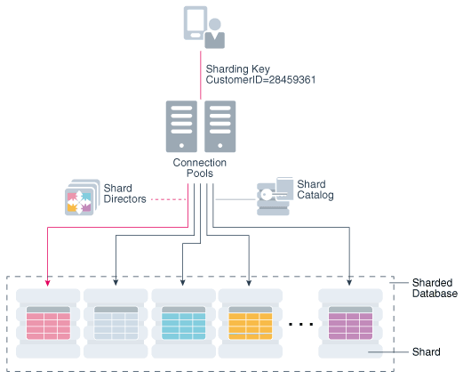
[Description of "Figure 2-1 Oracle Sharding Architecture"](img_text/admin_3v_143d.md)

#### Sharded Database and Shards

A **sharded database** is a collection of **shards**.

A sharded database is a single logical Oracle Database that is horizontally partitioned across a pool of physical Oracle Databases (shards) that share no hardware or software.

Each shard in the sharded database is an independent Oracle Database instance that hosts subset of a sharded database's data. Shared storage is not required across the shards.

Shards can be hosted anywhere an Oracle database can be hosted. Oracle Sharding supports all of the deployment choices for a shard that you would expect with a single instance or clustered Oracle Database, including on-premises, any cloud platform, Oracle Exadata Database Machine, virtual machines, and so on.

Shards can all be placed in one region or can be placed in different regions. A region in the context of Oracle Sharding represents a data center or multiple data centers that are in close network proximity.

Shards are replicated for high availability and disaster recovery with Oracle Data Guard. For high availability, Data Guard standby shards can be placed in the same region where the primary shards are placed. For disaster recovery, the standby shards can be located in another region.

**Note:**

Oracle GoldenGate replication support for Oracle Sharding High Availability is deprecated in Oracle Database 21c.

#### Shard Catalog

A **shard catalog** is an Oracle Database that supports automated shard deployment, centralized management of a sharded database, and multi-shard queries.

A shard catalog serves following purposes

- Serves as an administrative server for entire shareded database

- Stores a gold copy of the database schema

- Manages multi-shard queries with a multi-shard query coordinator

- Stores a gold copy of duplicated table data

The shard catalog is a special-purpose Oracle Database that is a persistent store for sharded database configuration data and plays a key role in centralized management of a sharded database. All configuration changes, such as adding and removing shards and global services, are initiated on the shard catalog. All DDLs in a sharded database are executed by connecting to the shard catalog.

The shard catalog also contains the master copy of all duplicated tables in a sharded database. The shard catalog uses materialized views to automatically replicate changes to duplicated tables in all shards. The shard catalog database also acts as a query coordinator used to process multi-shard queries and queries that do not specify a sharding key.

Multiple shard catalogs can be deployed for high availability purposes. Using Oracle Data Guard for shard catalog high availability is a recommended best practice.

At run time, unless the application uses key-based queries, the shard catalog is required to direct queries to the shards. Sharding key-based transactions continue to be routed and executed by the sharded database and are unaffected by a catalog outage.

During the brief period required to complete an automatic failover to a standby shard catalog, downtime affects the ability to perform maintenance operations, make schema changes, update duplicated tables, run multi-shard queries, or perform other operations like add shard, move chunks, and so on, which induce topology change.

#### Shard Director

Shard directors are network listeners that enable high performance connection routing based on a sharding key.

Oracle Database 12c introduced the global service manager to route connections based on database role, load, replication lag, and locality. In support of Oracle Sharding, global service managers support routing of connections based on data location. A global service manager, in the context of Oracle Sharding, is known as a shard director.

A shard director is a specific implementation of a global service manager that acts as a regional listener for clients that connect to a sharded database. The director maintains a current topology map of the sharded database. Based on the sharding key passed during a connection request, the director routes the connections to the appropriate shard.

For a typical sharded database, a set of shard directors are installed on dedicated low-end commodity servers in each region. To achieve high availability and scalability, deploy multiple shard directors. You can deploy up to 5 shard directors in a given region.

The following are the key capabilities of shard directors:

- Maintain runtime data about sharded database configuration and availability of shards

- Measure network latency between its own and other regions

- Act as a regional listener for clients to connect to a sharded database

- Manage global services

- Perform connection load balancing

#### Global Service

A **global service** is a database service that is use to access data in a sharded database.

A global service is an extension to the notion of the traditional database service. All of the properties of traditional database services are supported for global services. For sharded databases, additional properties are set for global services — for example, database role, replication lag tolerance, region affinity between clients and shards, and so on. For a read-write transactional workload, a single global service is created to access data from any primary shard in a sharded database. For highly available shards using Active Data Guard, a separate read-only global service can be created.

### Partitions, Tablespaces, and Chunks

Distribution of partitions across shards is achieved by creating partitions in tablespaces that reside on different shards.

Each partition of a sharded table is stored in a separate tablespace, making the tablespace the unit of data distribution in an SDB.

As described in Sharded Table Family, to minimize the number of multi-shard joins, corresponding partitions of all tables in a table family are always stored in the same shard. This is guaranteed when tables in a table family are created in the same set of distributed tablespaces as shown in the syntax examples where tablespace set `ts1` is used for all tables.

However, it is possible to create different tables from a table family in different tablespace sets, for example the Customers table in tablespace set `ts1` and Orders in tablespace set `ts2`. In this case, it must be guaranteed that the tablespace that stores partition 1 of Customers always resides in the same shard as the tablespace that stores partition 1 of Orders.

To support this functionality, a set of corresponding partitions from all of the tables in a table family, called a chunk, is formed. A chunk contains a single partition from each table of a table family. This guarantees that related data from different sharded tables can be moved together. In other words, a chunk is the unit of data migration between shards. In system-managed and composite sharding, the number of chunks within each shard is specified when the sharded database is created. In user-defined sharding, the total number of chunks is equal to the number of partitions.

A chunk that contains corresponding partitions from the tables of Cutomers-Orders-LineItems schema is shown in the following figure.

Figure 2-2 Chunk as a Set of Partitions

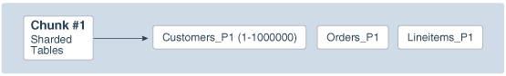
[Description of "Figure 2-2 Chunk as a Set of Partitions"](img_text/admin_3v_125a.md)

Each shard contains multiple chunks as shown in the following figure.

Figure 2-3 Contents of a Shard

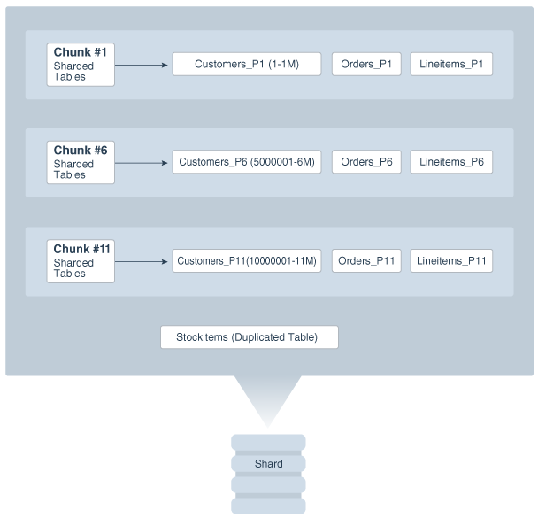
[Description of "Figure 2-3 Contents of a Shard"](img_text/admin_3v_126a.md)

In addition to sharded tables, a shard can also contain one or more duplicated tables. Duplicated tables cannot be stored in tablespaces that are used for sharded tables.

### Tablespace Sets

Oracle Sharding creates and manages tablespaces as a unit called a `TABLESPACE SET`.

System-managed and composite sharding use `TABLESPACE SET`, while user-defined sharding uses regular tablespaces.

A tablespace is a logical unit of data distribution in a sharded database. The distribution of partitions across shards is achieved by automatically creating partitions in tablespaces that reside on different shards. To minimize the number of multi-shard joins, the corresponding partitions of related tables are always stored in the same shard. Each partition of a sharded table is stored in a separate tablespace.

The `PARTITIONS AUTO` clause specifies that the number of partitions should be automatically determined. This type of hashing provides more flexibility and efficiency in migrating data between shards, which is important for elastic scalability.

The number of tablespaces created per tablespace set is determined based on the number of chunks that were defined for the shardspace during deployment.

**Note:**

Only Oracle Managed Files are supported by tablespace sets.

Individual tablespaces cannot be dropped or altered independently of the entire tablespace set.

`TABLESPACE SET` cannot be used with the user-defined sharding method.

### Sharding Methods

The following topics discuss sharding methods supported by Oracle Sharding, how to choose a method, and how to use subpartitioning.

#### System-Managed Sharding

System-managed sharding is a sharding method which does not require the user to specify mapping of data to shards. Data is automatically distributed across shards using partitioning by consistent hash. The partitioning algorithm evenly and randomly distributes data across shards.

The distribution used in system-managed sharding is intended to eliminate hot spots and provide uniform performance across shards. Oracle Sharding automatically maintains the balanced distribution of chunks when shards are added to or removed from an SDB.

Consistent hash is a partitioning strategy commonly used in scalable distributed systems. It is different from traditional hash partitioning. With traditional hashing, the bucket number is calculated as `HF(key) % N` where HF is a hash function and N is the number of buckets. This approach works fine if N is constant, but requires reshuffling of all data when N changes.

More advanced algorithms, such as linear hashing, do not require rehashing of the entire table to add a hash bucket, but they impose restrictions on the number of buckets, such as the number of buckets can only be a power of 2, and on the order in which the buckets can be split.

The implementation of consistent hashing used in Oracle Sharding avoids these limitations by dividing the possible range of values of the hash function (for example. from 0 to 232) into a set of N adjacent intervals, and assigning each interval to a chunk , as shown in the figure below. In this example, the SDB contains 1024 chunks, and each chunk gets assigned a range of 222 hash values. Therefore partitioning by consistent hash is essentially partitioning by the range of hash values.

Figure 2-4 Ranges of Hash Values Assigned to Chunks

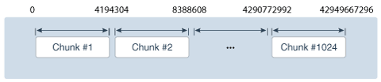
[Description of "Figure 2-4 Ranges of Hash Values Assigned to Chunks"](img_text/admin_3v_127a.md)

Assuming that all of the shards have the same computing power, an equal number of chunks is assigned to each shard in the SDB. For example, if 1024 chunks are created in an SDB that contains 16 shards, each shard will contain 64 chunks.

In the event of resharding, when shards are added to or removed from an SDB, some of the chunks are relocated among the shards to maintain an even distribution of chunks across the shards. The contents of the chunks does not change during this process; no rehashing takes place.

When a chunk is split, its range of hash values is divided into two ranges, but nothing needs to be done for the rest of the chunks. Any chunk can be independently split at any time.

All of the components of an SDB that are involved in directing connection requests to shards maintain a routing table that contains a list of chunks hosted by each shard and ranges of hash values associated with each chunk. To determine where to route a particular database request, the routing algorithm applies the hash function to the provided value of the sharding key, and maps the calculated hash value to the appropriate chunk, and then to a shard that contains the chunk.

The number of chunks in an SDB with system-managed sharding can be specified in the GDSCTL command, `CREATE SHARDCATALOG`. If not specified, the default value, 120 chunks per shard, is used. Once an SDB is deployed, the number of chunks can only be changed by splitting chunks.

Before creating a sharded table partitioned by consistent hash, a set of tablespaces (one tablespace per chunk) has to be created to store the table partitions. The tablespaces are automatically created by executing the SQL statement, `CREATE TABLESPACE SET`.

All of the tablespaces in a tablespace set have the same physical attributes and can only contain Oracle Managed Files (OMF). In its simplest form, the `CREATE TABLESPACE SET` statement has only one parameter, the name of the tablespace set, for example:

    CREATE TABLESPACE SET ts1;

In this case each tablespace in the set contains a single OMF file with default attributes. To customize tablespace attributes, the `USING TEMPLATE` clause (shown in the example below) is added to the statement. The `USING TEMPLATE` clause specifies attributes that apply to each tablespace in the set.

    CREATE TABLESPACE SET ts1
    USING TEMPLATE
    (
     DATAFILE SIZE 10M
     EXTENT MANAGEMENT LOCAL UNIFORM SIZE 256K
     SEGMENT SPACE MANAGEMENT AUTO
     ONLINE
    )
    ;

After a tablespace set has been created, a table partitioned by consistent hash can be created with partitions stored in the tablespaces that belong to the set. The `CREATE TABLE` statement might look as follows:

    CREATE SHARDED TABLE customers
    ( cust_id     NUMBER NOT NULL
    , name        VARCHAR2(50)
    , address     VARCHAR2(250)
    , location_id VARCHAR2(20)
    , class       VARCHAR2(3)
    , signup      DATE
    , CONSTRAINT cust_pk PRIMARY KEY(cust_id)
    )
    PARTITION BY CONSISTENT HASH (cust_id)
    PARTITIONS AUTO
    TABLESPACE SET ts1
    ;

`PARTITIONS AUTO` in this statement means that the number of partitions is automatically set to the number of tablespaces in the tablespace set `ts1` (which is equal to the number of chunks) and each partition will be stored in a separate tablespace.

Each tablespace in a tablespace set belongs to a distinct chunk. In the other words, a chunk can contain only one tablespace from a given tablespace set. However, the same tablespace set can be used for multiple tables that belong to the same table family. In this case, each tablespace in the set will store multiple partitions, one from each table.

Alternatively, each table in a table family can be stored in a separate tablespace set. In this case, a chunk contains multiple tablespaces, one from each tablespace set with each tablespace storing a single partition.

The following figure illustrates the relationship between partitions, tablespaces, and shards for a use case with a single sharded table. In this case, each chunk contains a single tablespace, and each tablespace stores a single partition.

Figure 2-5 System-Managed Sharding

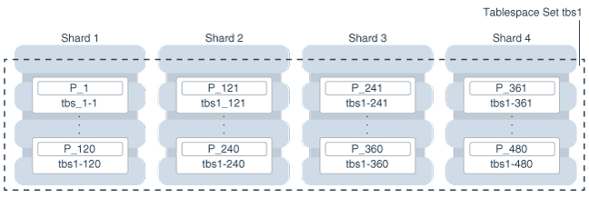
[Description of "Figure 2-5 System-Managed Sharding"](img_text/admin_3v_128a.md)

**Note:**

The sharding method is specified in the `GDSCTL CREATE SHARDCATALOG` command and cannot be changed later.

#### User-Defined Sharding

User-defined sharding lets you explicitly specify the mapping of data to individual shards. It is used when, because of performance, regulatory, or other reasons, certain data needs to be stored on a particular shard, and the administrator needs to have full control over moving data between shards.

For a user-defined sharded database, two replication schemes are supported: Oracle Data Guard or Oracle Active Data Guard. User-defined sharding is not supported where Oracle GoldenGate is used as the replication method.

Another advantage of user-defined sharding is that, in case of planned or unplanned outage of a shard, the user knows exactly what data is not available. The disadvantage of user-defined sharding is the need for the database administrator to monitor and maintain balanced distribution of data and workload across shards.

With user-defined sharding, a sharded table can be partitioned by range or list. The `CREATE TABLE` syntax for a sharded table is not very different from the syntax for a regular table, except for the requirement that each partition should be stored in a separate tablespace.

     CREATE SHARDED TABLE accounts
    ( id             NUMBER
    , account_number NUMBER
    , customer_id    NUMBER
    , branch_id      NUMBER
    , state          VARCHAR(2) NOT NULL
    , status         VARCHAR2(1)
    )
    PARTITION BY LIST (state)
    ( PARTITION p_northwest VALUES ('OR', 'WA') TABLESPACE ts1
    , PARTITION p_southwest VALUES ('AZ', 'UT', 'NM') TABLESPACE ts2
    , PARTITION p_northcentral VALUES ('SD', 'WI') TABLESPACE ts3
    , PARTITION p_southcentral VALUES ('OK', 'TX') TABLESPACE ts4
    , PARTITION p_northeast VALUES ('NY', 'VM', 'NJ') TABLESPACE ts5
    , PARTITION p_southeast VALUES ('FL', 'GA') TABLESPACE ts6
    )
    ;

There is no tablespace set for user-defined sharding. Each tablespace has to be created individually and explicitly associated with a shardspace. A shardspace is set of shards that store data that corresponds to a range or list of key values.

In user-defined sharding, a shardspace consists of a shard or a set of fully replicated shards. See Shard-Level High Availability for details about replication with user-defined sharding. For simplicity, assume that each shardspace consists of a single shard.

The following statements can be used to create the tablespaces for the accounts table in the example above.

    CREATE TABLESPACE tbs1 IN SHARDSPACE west;
    CREATE TABLESPACE tbs2 IN SHARDSPACE west;

    CREATE TABLESPACE tbs3 IN SHARDSPACE central;
    CREATE TABLESPACE tbs4 IN SHARDSPACE central;

    CREATE TABLESPACE tbs5 IN SHARDSPACE east;
    CREATE TABLESPACE tbs6 IN SHARDSPACE east;

Before executing the `CREATE TABLESPACE` statements, the shardspaces must be created and populated with shards. For example, you can use the following GDSCTL commands:

    ADD SHARDSPACE -SHARDSPACE east
    ADD SHARDSPACE -SHARDSPACE central
    ADD SHARDSPACE -SHARDSPACE west
    ADD SHARD –CONNECT shard-1 –SHARDSPACE west;
    ADD SHARD –CONNECT shard-2 –SHARDSPACE central;
    ADD SHARD –CONNECT shard-3 –SHARDSPACE east;

The following figure shows the mapping of partitions to tablespaces, and tablespaces to shards, for the `accounts` table in the previous examples.

Figure 2-6 User-Defined Sharding

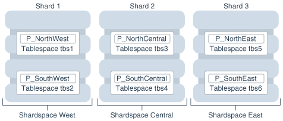
[Description of "Figure 2-6 User-Defined Sharding"](img_text/admin_3v_129a.md)

As with system-managed sharding, tablespaces created for user-defined sharding are assigned to chunks. However, no chunk migration is automatically started when a shard is added to the SDB. The user needs to execute the GDSCTL `MOVE CHUNK` command for each chunk that needs to be migrated.

The GDSCTL `SPLIT CHUNK` command, which is used to split a chunk in the middle of the hash range for system-managed sharding, is not supported for user-defined sharding. You must use the `ALTER TABLE SPLIT PARTITION` statement to split a chunk.

**Note:**

The sharding method is specified in the `GDSCTL CREATE SHARDCATALOG` command and cannot be changed later.

#### Composite Sharding

The composite sharding method allows you to create multiple shardspaces for different subsets of data in a table partitioned by consistent hash. A shardspace is set of shards that store data that corresponds to a range or list of key values.

System-managed sharding uses partitioning by consistent hash to randomly distribute data across shards. This provides better load balancing compared to user-defined sharding that uses partitioning by range or list. However, system-managed sharding does not give the user any control on assignment of data to shards.

When sharding by consistent hash on a primary key, there is often a requirement to differentiate subsets of data within an SDB in order to store them in different geographic locations, allocate to them different hardware resources, or configure high availability and disaster recovery differently. Usually this differentiation is done based on the value of another (non-primary) column, for example, customer location or a class of service.

Composite sharding is a combination of user-defined and system-managed sharding which, when required, provides benefits of both methods. With composite sharding, data is first partitioned by list or range across multiple shardspaces, and then further partitioned by consistent hash across multiple shards in each shardspace. The two levels of sharding make it possible to automatically maintain balanced distribution of data across shards in each shardspace, and, at the same time, partition data across shardspaces.

For example, suppose you want to allocate three shards hosted on faster servers to “gold” customers and four shards hosted on slower machines to “silver” customers. Within each set of shards, customers have to be distributed using partitioning by consistent hash on customer ID.

Figure 2-7 Composite Sharding

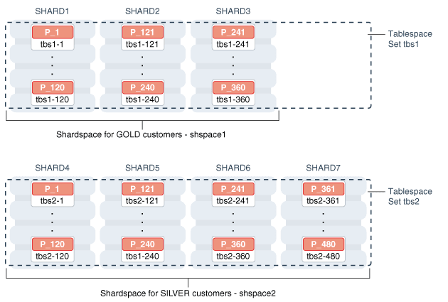
[Description of "Figure 2-7 Composite Sharding"](img_text/admin_3v_131a.md)

The following commands would be issued to create this configuration. Note that two shardspaces need to be created for this configuration.

    create SHARDCATALOG -sharding composite -database
         cat_host:1521/cat_pdb.domain -user gsmcatuser/gsmcatuser_pwd
         -region dc1

    add gsm -gsm gsm1 -listener 1540 -catalog cat_host:1521/cat_pdb.domain
         -region dc1 -pwd gsmcatuser_pwd
    gdsctl start gsm

    add shardspace -shardspace shspace1 -chunks 60
    add shardspace -shardspace shspace2 -chunks 120

    ADD SHARDGROUP -shardgroup gold -shardspace shspace1 -region dc1 -deploy_as
         primary
    ADD SHARDGROUP -shardgroup silver -shardspace shspace2 -region dc1 -deploy_as
         primary

    add CDB -connect cdb1_host:1521/cdb1.domain -pwd gsmrootuser_pwd
    add CDB -connect cdb2_host:1521/cdb2.domain -pwd gsmrootuser_pwd
    add CDB -connect cdb3_host:1521/cdb3.domain -pwd gsmrootuser_pwd
    add CDB -connect cdb4_host:1521/cdb4.domain -pwd gsmrootuser_pwd
    add CDB -connect cdb5_host:1521/cdb5.domain -pwd gsmrootuser_pwd
    add CDB -connect cdb6_host:1521/cdb6.domain -pwd gsmrootuser_pwd
    add CDB -connect cdb7_host:1521/cdb7.domain -pwd gsmrootuser_pwd

    add shard -cdb cdb1 -shardgroup gold -connect
         cdb1_host:1521/sh1_pdb.domain -pwd gsmuser_pwd
    add shard -cdb cdb2 -shardgroup gold -connect
         cdb2_host:1521/sh2_pdb.domain -pwd gsmuser_pwd
    add shard -cdb cdb3 -shardgroup gold -connect
         cdb3_host:1521/sh3_pdb.domain -pwd gsmuser_pwd

    add shard -cdb cdb4 -shardgroup silver -connect
         cdb4_host:1521/sh4_pdb.domain -pwd gsmuser_pwd
    add shard -cdb cdb5 -shardgroup silver -connect
         cdb5_host:1521/sh5_pdb.domain -pwd gsmuser_pwd
    add shard -cdb cdb6 -shardgroup silver -connect
         cdb6_host:1521/sh6_pdb.domain -pwd gsmuser_pwd
    add shard -cdb cdb7 -shardgroup silver -connect
         cdb7_host:1521/sh7_pdb.domain -pwd gsmuser_pwd

    deploy

With composite sharding, as with the other sharding methods, tablespaces are used to specify the mapping of partitions to shards. To place subsets of data in a sharded table into different shardspaces, a separate tablespace set must be created in each shardspace as shown in the following example.

    CREATE TABLESPACE SET tbs1 IN SHARDSPACE shspace1;
    CREATE TABLESPACE SET tbs2 IN SHARDSPACE shspace2;

To store user-defined subsets of data in different tablespaces, Oracle Sharding provides syntax to group partitions into sets and associate each set of partitions with a tablespace set. Support for partition sets can be considered a logical equivalent of a higher level of partitioning which is implemented on top of partitioning by consistent hash.

The statement in the following example partitions a sharded table into two partition sets: gold and silver, based on class of service. Each partition set is stored in a separate tablespace. Then data in each partition set is further partitioned by consistent hash on customer ID.

    CREATE SHARDED TABLE customers
    ( cust_id NUMBER NOT NULL
    , name VARCHAR2(50)
    , address VARCHAR2(250)
    , location_id VARCHAR2(20)
    , class VARCHAR2(3)
    , signup_date DATE
    , CONSTRAINT cust_pk PRIMARY KEY(cust_id, class)
    )
    PARTITIONSET BY LIST (class)
      PARTITION BY CONSISTENT HASH (cust_id)
      PARTITIONS AUTO
    (PARTITIONSET gold VALUES (‘gld’) TABLESPACE SET tbs1,
     PARTITIONSET silver VALUES (‘slv’) TABLESPACE SET tbs2)
    ;

**Note:**

In Oracle Database 12c Release 2 only a single partition set from a table can be stored in a shardspace.

The sharding method is specified in the `GDSCTL CREATE SHARDCATALOG` command and cannot be changed later.

#### Using Subpartitions with Sharding

Because Oracle Sharding is based on table partitioning, all of the subpartitioning methods provided by Oracle Database are also supported for sharding.

Subpartitioning splits each partition into smaller parts and may be beneficial for efficient parallel execution within a shard, especially in the case of sharding by range or list when the number of partitions per shard may be small.

From a manageability perspective, subpartitioning makes it possible to support the tiered storage approach by putting subpartitions into separate tablespaces and moving them between storage tiers. Migration of subpartitions between storage tiers can be done without sacrificing the scalability and availability benefits of sharding and the ability to perform partition pruning and partition-wise joins on a primary key.

The following example shows system-managed sharding by consistent hash combined with subpartitioning by range.

    CREATE SHARDED TABLE customers
    ( cust_id     NUMBER NOT NULL
    , name        VARCHAR2(50)
    , address     VARCHAR2(250)
    , location_id VARCHAR2(20)
    , class       VARCHAR2(3)
    , signup_date DATE
    , CONSTRAINT cust_pk PRIMARY KEY(cust_id, signup_date)
    )
    TABLESPACE SET ts1
    PARTITION BY CONSISTENT HASH (cust_id)
    SUBPARTITION BY RANGE (signup_date)
    SUBPARTITION TEMPLATE
    ( SUBPARTITION per1 VALUES LESS THAN (TO_DATE('01/01/2000','DD/MM/YYYY')),
      SUBPARTITION per2 VALUES LESS THAN (TO_DATE('01/01/2010','DD/MM/YYYY')),
      SUBPARTITION per3 VALUES LESS THAN (TO_DATE('01/01/2020','DD/MM/YYYY')),
      SUBPARTITION future VALUES LESS THAN (MAXVALUE)
    )
    PARTITIONS AUTO
    ;

The following figure offers a graphical view of the table created by this statement.

Figure 2-8 Subpartitions Stored in the Tablespace of the Parent Partition

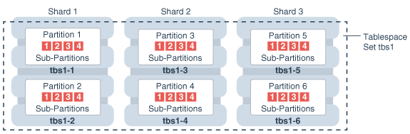
[Description of "Figure 2-8 Subpartitions Stored in the Tablespace of the Parent Partition"](img_text/admin_3v_130a.md)

In this example each subpartition is stored in the parent partition’s tablespace. Because subpartitioning is done by date, it makes more sense to store subpartitions in separate tablespaces to provide the ability to archive older data or move it to a read-only storage. The appropriate syntax is shown here.

    CREATE SHARDED TABLE customers
    ( cust_id     NUMBER NOT NULL
    , name        VARCHAR2(50)
    , address     VARCHAR2(250)
    , location_id VARCHAR2(20)
    , class       VARCHAR2(3)
    , signup_date DATE NOT NULL
    , CONSTRAINT cust_pk PRIMARY KEY(cust_id, signup_date)
    )
    PARTITION BY CONSISTENT HASH (cust_id)
    SUBPARTITION BY RANGE(signup_date)
    SUBPARTITION TEMPLATE
    ( SUBPARTITION per1 VALUES LESS THAN (TO_DATE('01/01/2000','DD/MM/YYYY'))
           TABLESPACE SET ts1,
      SUBPARTITION per2 VALUES LESS THAN (TO_DATE('01/01/2010','DD/MM/YYYY'))
           TABLESPACE SET ts2,
      SUBPARTITION per3 VALUES LESS THAN (TO_DATE('01/01/2020','DD/MM/YYYY'))
           TABLESPACE SET ts3,
      SUBPARTITION future VALUES LESS THAN (MAXVALUE)
           TABLESPACE SET ts4
    )
    PARTITIONS AUTO
    ;

Note that in the case of a database that is not sharded, when tablespaces are specified in the subpartition template it means that subpartition N from every partition is stored in the same tablespace. This is different in case of sharding when subpartitions that belong to the different partitions must be stored in separate tablespaces so that they can be moved in the event of resharding.

Subpartitioning can be used with composite sharding, too. In this case data in a table is organized in three levels: partition sets, partitions, and subpartitions. Examples of the three levels of data organization are shown below.

Specifying subpartition templates per partitionset is not supported to ensure that there is uniformity in the number and bounds of subpartitions across partitionsets. If you need to specify tablespaces for subpartitions per partitionset, you can use the `SUBPARTITIONS STORE IN` clause.

    CREATE SHARDED TABLE customers
    ( cust_id     NUMBER NOT NULL
    , name        VARCHAR2(50)
    , address     VARCHAR2(250)
    , location_id VARCHAR2(20)
    , class       VARCHAR2(3) NOT NULL
    , signup_date DATE NOT NULL
    , CONSTRAINT cust_pk PRIMARY KEY(cust_id, class, signup_date)
    )
    PARTITIONSET BY LIST (class)
    PARTITION BY CONSISTENT HASH (cust_id)
    SUBPARTITION BY RANGE (signup_date)
      SUBPARTITION TEMPLATE /* applies to both SHARDSPACEs */
      ( SUBPARTITION per1 VALUES LESS THAN (TO_DATE('01/01/2000','DD/MM/YYYY'))
      , SUBPARTITION per2 VALUES LESS THAN (TO_DATE('01/01/2010','DD/MM/YYYY'))
      , SUBPARTITION per3 VALUES LESS THAN (TO_DATE('01/01/2020','DD/MM/YYYY'))
      , SUBPARTITION future VALUES LESS THAN (MAXVALUE)
    )
    PARTITIONS AUTO
    (
      PARTITIONSET gold   VALUES (‘gld’) TABLESPACE SET tbs1
     subpartitions store in(tbs1)
    , PARTITIONSET silver VALUES (‘slv’) TABLESPACE SET tbs2
     subpartitions store in(tbs2)
    )
    ;

### Sharded Database Schema Objects

To obtain the benefits of sharding, the schema of a sharded database should be designed in a way that maximizes the number of database requests executed on a single shard. The following topics define and illustrate the schema objects that form a sharded database to inform your design.

#### Sharded Tables

A database table is split up across the shards, so that each shard contains the table with the same columns, but a different subset of rows. A table split up in this manner is called a sharded table.

The following figure shows how a set of large tables (referred to as a table family), shown in the one database on the left, can be horizontally partitioned across the three shards shown on the right, so that each shard contains a subset of the data, indicated with red, yellow, and blue rows.

Figure 2-9 Horizontal Partitioning of a Table Across Shards

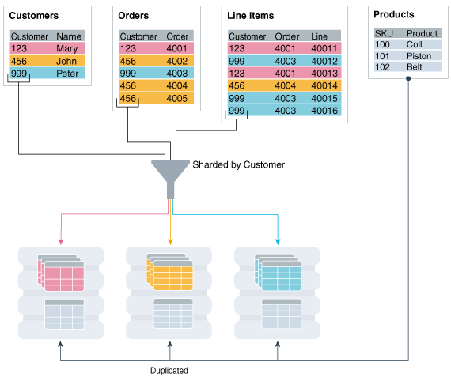
[Description of "Figure 2-9 Horizontal Partitioning of a Table Across Shards"](img_text/admin_3v_138e.md)

Partitions are distributed across shards at the tablespace level, based on a sharding key. Examples of keys include customer ID, account number, and country ID. The following data types are supported for the sharding key.

- `NUMBER`

- `INTEGER`

- `SMALLINT`

- `RAW`

- `(N)VARCHAR`

- `(N)VARCHAR2`

- `(N)CHAR`

- `DATE`

- `TIMESTAMP`

Each partition of a sharded table resides in a separate tablespace, and each tablespace is associated with a specific shard. Depending on the sharding method, the association can be established automatically or defined by the administrator.

Even though the partitions of a sharded table reside in multiple shards, to the application, the table looks and behaves exactly the same as a partitioned table in a single database. SQL statements issued by an application never have to refer to shards or depend on the number of shards and their configuration.

The familiar SQL syntax for table partitioning specifies how rows should be partitioned across shards. For example, the following SQL statement creates a sharded table, horizontally partitioning the table across shards based on the sharding key `cust_id`.

    CREATE SHARDED TABLE customers
    ( cust_id     NUMBER NOT NULL
    , name        VARCHAR2(50)
    , address     VARCHAR2(250)
    , region      VARCHAR2(20)
    , class       VARCHAR2(3)
    , signup      DATE
    ,CONSTRAINT cust_pk PRIMARY KEY(cust_id)
    )
    PARTITION BY CONSISTENT HASH (cust_id)
    PARTITIONS AUTO
    TABLESPACE SET ts1
    ;

The sharded table is partitioned by consistent hash, a special type of hash partitioning commonly used in scalable distributed systems. This technique automatically spreads tablespaces across shards to provide an even distribution of data and workload.

**Note:**

Global indexes on sharded tables are not supported, but local indexes are supported.

#### Sharded Table Family

A sharded table family is a set of tables that are sharded in the same way. Often there is a parent-child relationship between database tables with a referential constraint in a child table (foreign key) referring to the primary key of the parent table.

Multiple tables linked by such relationships typically form a tree-like structure where every child has a single parent. A set of such tables is referred to as a table family. A table in a table family that has no parent is called the root table. There can be only one root table in a table family.

##### How a Table Family Is Sharded

Sharding a table family is illustrated here with the Customers–Orders–LineItems schema.

Before sharding, the tables in the schema may look as shown in the examples below. The three tables have a parent-child relationship, with Customers as the root table.

Customers Table (Root) Before Sharding

    CustNo    Name       Address        Location  Class
    --------- ---------- -------------- --------- ------
    123       Brown      100 Main St    us3       Gold
    456       Jones      300 Pine Ave   us1       Silver
    999       Smith      453 Cherry St  us2       Bronze

Orders Table Before Sharding

    OrderNo   CustNo   OrderDate
    --------- -------- -----------
    4001      123      14-FEB-2013
    4002      456      09-MAR-2013
    4003      456      05-APR-2013
    4004      123      27-MAY-2013
    4005      999      01-SEP-2013

LineItems Table Before Sharding

    LineNo  OrderNo  CustNo  StockNo    Quantity
    ------  -------  ------  -------    --------
    40011   4001     123     05683022   1
    40012   4001     123     45423609   4
    40013   4001     123     68584904   1
    40021   4002     456     05683022   1
    40022   4002     456     45423509   3
    40022   4003     456     80345330   16
    40041   4004     123     45423509   1
    40042   4004     123     68584904   2
    40051   4005     999     80345330   12

The tables can be sharded by the customer number, `CustNo`, in the Customers table, which is the root. The shard containing data pertaining to customer 123 is shown in the following example tables.

Customers Table Shard With Customer 123 Data

    CustNo    Name       Address        Location   Class
    --------- ---------- -------------- ---------- ------
    123       Brown      100 Main St    us3        Gold

Orders Table Shard With Customer 123 Data

    OrderNo   CustNo   OrderDate
    --------- -------- -----------
    4001      123      14-FEB-2013
    4004      123      27-MAY-2013

LineItems Table Shard With Customer 123 Data

    LineNo  OrderNo  CustNo  StockNo    Quantity
    ------  -------  ------  -------    --------
    40011   4001     123     05683022   1
    40012   4001     123     45423609   4
    40013   4001     123     68584904   1
    40041   4004     123     45423509   1
    40042   4004     123     68584904   2

##### Designing Schemas With Multiple Table Families

A sharded database schema can have multiple table families, where all of the data from different table families reside in the same chunks, which contain partitions from different table families sharing the same hash key range.

**Note:**

Multiple table families are supported in system-managed sharded databases only. Composite and user-defined sharded databases only support one table family.

To create a new table family, create a root sharded table and specify tablespace sets that are not used by existing tablespace families. Each table family is identified by its root table. Tables in the different table families should not be related to each other.

Each table family should have its own sharding key definition, while the same restriction on having the same sharding key columns in child tables still holds true within each table family. This means that all tables from different table families are sharded the same way with consistent hash into the same number of chunks, with each chunk containing data from all the table families.

Design your table families such that queries between different table-families are minimal and only carried out on the sharding coordinator, as many such joins will have an effect on performance

The following example shows you how to create multiple table families using the `PARENT` clause with a system-managed sharding methodology (`PARTITION BY CONSISTENT HASH`).

    CREATE SHARDED TABLE Customers <=== Table Family #1
    ( CustId NUMBER NOT NULL
    , Name VARCHAR2(50)
    , Address VARCHAR2(250)
    , region VARCHAR2(20)
    , class VARCHAR2(3)
    , signup DATE
    )
    PARTITION BY CONSISTENT HASH (CustId)
    PARTITIONS AUTO
    TABLESPACE SET ts1
    ;

    CREATE SHARDED TABLE Orders
    ( OrderNo NUMBER
    , CustId NUMBER
    , OrderDate DATE
    )
    PARENT Customers
    PARTITION BY CONSISTENT HASH (CustId)
    PARTITIONS AUTO
    TABLESPACE SET ts1
    ;

    CREATE SHARDED TABLE LineItems
    ( LineNo NUMBER
    , OrderNo NUMBER
    , CustId NUMBER
    , StockNo NUMBER
    , Quantity NUMBER
    )
    )
    PARENT Customers
    PARTITION BY CONSISTENT HASH (CustId)
    PARTITIONS AUTO
    TABLESPACE SET ts1
    ;

    CREATE SHARDED TABLE Products <=== Table Family #2
    ( ProdId NUMBER NOT NULL,
      CONSTRAINT pk_products PRIMARY KEY (ProdId)
    )
    PARTITION BY CONSISTENT HASH (ProdId)
    PARTITIONS AUTO
    TABLESPACE SET ts_2
    ;

**Note:**

ORA-3850 is thrown if you attempt to use a tablespace set for a table family, but that tablespace set is already in use by an existing table family.

Joins across table families may not be efficient, and if you have many such joins, or if they are performance-critical, you should use duplicated tables instead of multiple table families.

Associating Global Services With Multiple Table Families

Each table family should be associated with a different global service. Applications from different table families each have their own connection pool and service, and use their own sharding key for routing to the correct shard.

When you create the first root table (that is, the first table family) all of the existing global services are automatically associated with it. You can use the `GDSCTL` `MODIFY SERVICE` command to change the services associated with a table family after more table families are created, as shown in this example.

    GDSCTL> MODIFY SERVICE –GDSPOOL shdpool –TABLE_FAMILY sales.customer -SERVICE sales

#### Duplicated Tables

In Oracle Sharding a table with the same contents in each shard is called a duplicated table.

For many applications, the number of database requests handled by a single shard can be maximized by duplicating read-only or read-mostly tables across all shards. This strategy is a good choice for relatively small tables that are not updated frequently, and that are often accessed together with sharded tables. Duplicated tables tend to be updated less frequently than sharded tables and are not expected to be very large.

A sharded database includes both sharded tables that are horizontally partitioned across shards, and duplicated tables that are replicated to all shards. Duplicated tables contain reference information, for example, a Stock Items table that is common to each shard. The combination of sharded and duplicated tables enables all transactions associated with a sharding key to be processed by a single shard. This technique enables linear scalability and fault isolation.

As an example of the need for a duplicated table, consider the table family that is described in Sharded Table Family. The database schema might also include a `Products` table which contains data that is shared by all the customers in the shards that were created for this table family, and it cannot be sharded by the customer number. To prevent multi-shard queries during order processing, the entire table must be duplicated on all shards.

The difference between sharded tables (Customers, Orders, and LineItems) and a duplicated table (Products) is shown in the following figure.

Figure 2-10 Sharded Tables and a Duplicated Table in a Sharded Database

[Description of "Figure 2-10 Sharded Tables and a Duplicated Table in a Sharded Database"](img_text/admin_3v_138e.md)

#### Non-Table Objects Created on All Shards

In addition to duplicated tables, other schema objects, such as users, roles, views, indexes, synonyms, functions, procedures, and packages, and non-schema database objects, such as tablespaces, tablespace sets, directories, and contexts, can be created on all shards.

Unlike tables, which require an extra keyword in the `CREATE` statement—`SHARDED` or `DUPLICATED`—other objects are created on all shards using existing syntax. The only requirement is that the `SHARD DDL` session property must be enabled.

Note that automatic creation on all shards of the following objects is not supported in this release. These objects can be created by connecting to individual shards.

- Cluster

- Control file

- Database link

- Disk group

- Edition

- Flashback archive

- Materialized zone map

- Outline

- Pfile

- Profile

- Restore point

- Rollback segment

- Summary

Materialized views and view logs are supported starting in Oracle Database 18c, with the following restrictions:

- Materialized views created on sharded tables remain empty on the catalog database, while the corresponding materialized views on shards contain data from each of the individual shards.

- Only the `REFRESH COMPLETE ON DEMAND USING TRUSTED CONSTRAINTS` option is supported for materialized views on sharded tables.

### Shard-Level High Availability

Oracle Sharding is integrated with Oracle Database replication technologies for high availability and disaster recovery at the shard level.

The following topics describe how to use Oracle’s replication technologies to make your sharded databases highly available:

#### About Sharding and Replication

Oracle Sharding is tightly integrated with the Oracle replication and disaster recovery technologies Oracle Data Guard and Oracle GoldenGate.

**Note:**

Oracle GoldenGate replication support for Oracle Sharding High Availability is deprecated in Oracle Database 21c.

Replication provides high availability, disaster recovery, and additional scalability for reads. A unit of replication can be a shard, a part of a shard, or a group of shards.

Replication topology in a sharded database is declaratively specified using GDSCTL command syntax. You can choose one of two technologies—Oracle Data Guard or Oracle GoldenGate—to replicate your data. Oracle Sharding automatically deploys the specified replication topology and enables data replication.

The availability of a sharded database is not affected by an outage or slowdown of one or more shards. Replication is used to provide individual shard-level high availability (Oracle Active Data Guard or Oracle GoldenGate). Replication is automatically configured and deployed when the sharded database is created. Optionally, you can use Oracle RAC for shard-level high availability, complemented by replication, to maintain shard-level data availability in the event of a cluster outage. Oracle Sharding automatically fails over database connections from a shard to its replica in the event of an unplanned outage.

#### Using Oracle Data Guard with a Sharded Database

Oracle Data Guard replication maintains one or more synchronized copies (standbys) of a shard (the primary) for high availability and data protection. Standbys may be deployed locally or remotely, and when using Oracle Active Data Guard can also be open for read-only access.

Oracle Data Guard can be used as the replication technology for sharded databases using the system-managed, user-defined, or composite method of sharding.

##### Using Oracle Data Guard with a System-Managed Sharded Database

In system-managed and composite sharding, the logical unit of replication is a group of shards called a shardgroup. In system-managed sharding, a shardgroup contains all of the data stored in the sharded database. The data is sharded by consistent hash across shards that make up the shardgroup. Shards that belong to a shardgroup are usually located in the same data center. An entire shardgroup can be fully replicated to one or more shardgroups in the same or different data centers.

The following figure illustrates how Data Guard replication is used with system-managed sharding. In the example in the figure there is a primary shardgroup, Shardgroup 1, and two standby shardgroups, Shardgroup 2 and Shardgroup 3. Shardgroup 1 consists of Data Guard primary databases (shards 1-3). Shardgroup 2 consists of local standby databases (shards 4-6) which are located in the same datacenter and configured for synchronous replication. And Shardgroup 3 consists of remote standbys (shards 7-9) located in a different datacenter and configured for asynchronous replication. Oracle Active Data Guard is enabled in this configuration, so each standby is open read-only.

Figure 2-11 System-Managed Sharding with Data Guard Replication

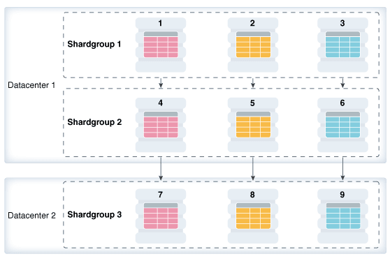
[Description of "Figure 2-11 System-Managed Sharding with Data Guard Replication"](img_text/admin_3v_136a.md)

The concept of shardgroup as a logical unit of replication hides from the user the implementation details of replication. With Data Guard, replication is done at the shard (database) level. The sharded database in the figure above consists of three sets of replicated shards: {1, 4, 7}, {2, 5, 8} and {3, 6, 9}. Each set of replicated shards is managed as a Data Guard Broker configuration with fast-start failover (FSFO) enabled.

To deploy replication, specify the properties of the shardgroups (region, role, and so on) and add shards to them. Oracle Sharding automatically configures Data Guard and starts an FSFO observer for each set of replicated shards. It also provides load balancing of the read-only workload, role based global services and replication lag, and locality based routing.

Run the following GDSCTL commands to deploy the example configuration shown in the figure above.

    CREATE SHARDCATALOG –database host00:1521:shardcat –region dc1,dc2

    ADD GSM -gsm gsm1 -listener 1571 –catalog host00:1521:shardcat –region dc1
    ADD GSM -gsm gsm2 -listener 1571 –catalog host00:1521:shardcat –region dc2
    START GSM -gsm gsm1
    START GSM -gsm gsm2

    ADD SHARDGROUP -shardgroup shardgroup1 -region dc1 -deploy_as primary
    ADD SHARDGROUP -shardgroup shardgroup2 -region dc1 -deploy_as active_standby
    ADD SHARDGROUP -shardgroup shardgroup3 -region dc2 -deploy_as active_standby

    CREATE SHARD -shardgroup shardgroup1 -destination host01 -credential oracle_cred
    CREATE SHARD -shardgroup shardgroup1 -destination host02 -credential oracle_cred
    CREATE SHARD -shardgroup shardgroup1 -destination host03 -credential oracle_cred
    ...
    CREATE SHARD -shardgroup shardgroup3  -destination host09 -credential oracle_cred

    DEPLOY

##### Using Oracle Data Guard with a User-Defined Sharded Database

With user-defined sharding the logical (and physical) unit of replication is a shard. Shards are not combined into shardgroups. Each shard and its replicas make up a shardspace which corresponds to a single Data Guard Broker configuration. Replication can be configured individually for each shardspace. Shardspaces can have different numbers of standbys which can be located in different data centers. An example of user-defined sharding with Data Guard replication is shown in the following figure.

Figure 2-12 User-Defined Sharding with Data Guard Replication

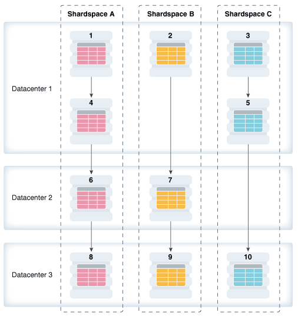
[Description of "Figure 2-12 User-Defined Sharding with Data Guard Replication"](img_text/admin_3v_135a.md)

Run the following GDSCTL commands to deploy the example user-defined sharded database with Data Guard replication shown in the figure above.

    CREATE SHARDCATALOG -sharding user –database host00:1521:cat –region dc1,dc2,dc3

    ADD GSM -gsm gsm1 -listener 1571 –catalog host00:1521:cat –region dc1
    ADD GSM -gsm gsm2 -listener 1571 –catalog host00:1521:cat –region dc2
    ADD GSM -gsm gsm3 -listener 1571 –catalog host00:1521:cat –region dc3
    START GSM -gsm gsm1
    START GSM -gsm gsm2
    START GSM -gsm gsm3

    ADD SHARDSPACE -shardspace shardspace_a
    ADD SHARDSPACE -shardspace shardspace_b
    ADD SHARDSPACE -shardspace shardspace_c

    CREATE SHARD -shardspace shardspace_a –region dc1 -deploy_as primary  -destination
    host01 -credential oracle_cred -netparamfile /home/oracle/netca_dbhome.rsp

    CREATE SHARD -shardspace shardspace_a –region dc1 -deploy_as standby  -destination
    host04 -credential oracle_cred -netparamfile /home/oracle/netca_dbhome.rsp

    CREATE SHARD -shardspace shardspace_a –region dc2 -deploy_as standby  -destination
    host06 -credential oracle_cred -netparamfile /home/oracle/netca_dbhome.rsp

    CREATE SHARD -shardspace shardspace_a –region dc3 -deploy_as standby  -destination
    host08 -credential oracle_cred -netparamfile /home/oracle/netca_dbhome.rsp

    CREATE SHARD -shardspace shardspace_b –region dc1 -deploy_as primary  -destination
    host08 -credential oracle_cred -netparamfile /home/oracle/netca_dbhome.rs
    ...

    CREATE SHARD -shardspace shardspace_c –region dc3 -deploy_as standby  -destination
    host10 -credential oracle_cred -netparamfile /home/oracle/netca_dbhome.rsp

    DEPLOY

##### Using Oracle Data Guard with a Composite Sharded Database

In composite sharding, similar to user-defined sharding, a sharded database consists of multiple shardspaces. However, each shardspace, instead of replicated shards, contains replicated shardgroups.

Figure 2-13 Composite Sharding with Data Guard Replication

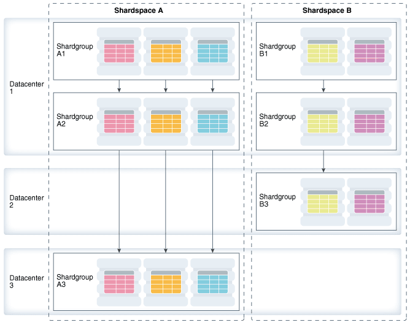
[Description of "Figure 2-13 Composite Sharding with Data Guard Replication"](img_text/admin_3v_133c.md)

Run the following GDSCTL commands to deploy the example configuration shown in the previous figure.

    CREATE SHARDCATALOG -sharding composite –database host00:1521:cat –region dc1,dc2,dc3

    ADD GSM -gsm gsm1 -listener 1571 –catalog host00:1521:cat –region dc1
    ADD GSM -gsm gsm2 -listener 1571 –catalog host00:1521:cat –region dc2
    ADD GSM -gsm gsm3 -listener 1571 –catalog host00:1521:cat –region dc3
    START GSM -gsm gsm1
    START GSM -gsm gsm2
    START GSM -gsm gsm3

    ADD SHARDSPACE -shardspace shardspace_a
    ADD SHARDSPACE -shardspace shardspace_b

    ADD SHARDGROUP -shardgroup shardgroup_a1 –shardspace shardspace_a -region dc1
    -deploy_as primary
    ADD SHARDGROUP -shardgroup shardgroup_a2 –shardspace shardspace_a -region dc1
    -deploy_as active_standby
    ADD SHARDGROUP -shardgroup shardgroup_a3 –shardspace shardspace_a -region dc3
    -deploy_as active_standby
    ADD SHARDGROUP -shardgroup shardgroup_b1 –shardspace shardspace_b -region dc1
    -deploy_as primary
    ADD SHARDGROUP -shardgroup shardgroup_b2 –shardspace shardspace_b -region dc1
    -deploy_as active_standby
    ADD SHARDGROUP -shardgroup shardgroup_b3 –shardspace shardspace_b -region dc2
    -deploy_as active_standby

    CREATE SHARD -shardgroup shardgroup_a1 -destination host01 –credential orcl_cred
    ...

    CREATE SHARD -shardgroup shardgroup_b3 -destination host09 -credential orcl_cred

    DEPLOY

#### Using Oracle GoldenGate with a Sharded Database

Oracle GoldenGate is used for fine-grained active-active replication where all shards are writable, and each shard can be partially replicated to other shards within a shardgroup.

**Note:**

Oracle Database 21c supports only multitenant architecture (CDB). Oracle GoldenGate versions 12.3-19.1 only support Oracle Sharding with single-instance Oracle databases (release 11g through 19c.)

In Oracle GoldenGate, replication is handled at the chunk level. For example, in Shardgroup 1 in the following figure, half of the data stored in each shard is replicated to one shard, and the other half to another shard. If any shard becomes unavailable, its workload is split between two other shards in the shardgroup. The multiple failover destinations mitigate the impact of a shard failure because there is no single shard that has to handle all of the workload from the failed shard.

Figure 2-14 System-Managed Sharding with Golden Gate Replication

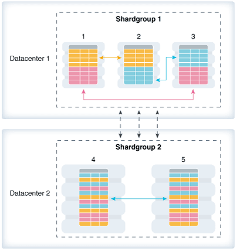
[Description of "Figure 2-14 System-Managed Sharding with Golden Gate Replication"](img_text/admin_3v_137a.md)

With Oracle GoldenGate replication, a shardgroup can contain multiple replicas of each row in a sharded table; therefore, high availability is provided within a shardgroup, and there is no need to have a local replica of the shardgroup, as there is in the case of Data Guard replication. The number of times each row is replicated within a shardgroup is called its replication factor and is a configurable parameter.

To provide disaster recovery, a shardgroup can be replicated to one or more data centers. Each replica of a shardgroup can have a different number of shards, replication factor, database versions, and hardware platforms. However, all shardgroup replicas must have the same number of chunks, because replication is done at the chunk level.

Shardgroup 2 in the figure above contains the same data as Shardgroup 1, but resides in a different data center. Shards in both data centers are writable. The default replication factor, 2, is used for both shardgroups.

Note that because Shardgroup 2 contains only two shards and the replication factor is 2, the shards are fully replicated, and each of them contains all of the data stored in the sharded database. This means that any query routed to these shards can be executed without going across shards. There is only one failover destination in this shardgroup; if a shard goes down, the load on the other shard doubles.

Oracle Sharding is designed to minimize the number of conflicting updates performed to the same row on different shards. This is achieved designating a master chunk for each range of hash values and routing most of requests for the corresponding data to this chunk.

Sometimes it is impossible to avoid update conflicts because of state transitions, such as a chunk move or split, or a shard going up or down. The user may also intentionally allow conflicts in order to minimize transaction latency. For such cases Oracle GoldenGate provides automatic conflict detection and resolution which handles all kinds of conflicts including insert-delete conflicts.

**Note:**

Oracle GoldenGate does not support the user defined sharding method.

For system-managed sharding with Oracle GoldenGate, a shard must have at least two chunks.

Oracle GoldenGate does not support PDBs as shards.

**See Also:**

[Working with Oracle GoldenGate Sharding](https://docs.oracle.com/pls/topic/lookup?ctx=en/database/oracle/oracle-database/19/shard&id=GGSAU-GUID-2C059382-7753-4EFA-B313-A6E0DAF7EA1C) in the Fusion Middleware Using the Oracle GoldenGate Microservices Architecture guide for more information about using Oracle GoldenGate with Oracle Sharding.

### Query Processing and the Query Coordinator

The **query coordinator** is part of the shard catalog. The query coordinator provides query processing support for the sharded database. With its access to the sharded database topology metadata in the shard catalog, there are three general cases in which the query coordinator plays an important part.

1.  Single Shard Queries with No Sharding Key

    If a sharding key is not passed from the application, the query coordinator figures out which shard contains the data required by the query and sends the query there for execution.

2.  Multi-Shard Queries

    The query coordinator can also assist with queries that need data from more than one shard, called **multi-shard queries**, for example `SELECT COUNT(*) FROM Customer`.

3.  Aggregate Queries

    The query coordinator handles aggregate queries typically used in reporting, such as aggregates on sales data.

In every case, the query coordinator’s SQL compiler identifies the relevant shards automatically and coordinates the query execution across all of the participating shards.

In a single-shard query scenario, the entire query is executed on the single participating shard, and the query coordinator just passes processed rows back to the client.

For a multi-shard query the SQL compiler analyzes and rewrites the query into query fragments that are sent and executed by the participating shards. The queries are rewritten so that most of the query processing is done on the participating shards and then aggregated by the coordinator.

The query coordinator uses Oracle Database's parallel query engine to optimize and push multi-shard queries in parallel to the shards. Each shard executes the query on the subset of data that it has. Then the results are returned back to the query coordinator, which sends them back to the client.

In essence, the shards act as compute nodes for the queries executed by the query coordinator. Because the computation is pushed to the data, there is reduced movement of data between shards and the coordinator. This arrangement also enables the effective use of resources by offloading processing from the query coordinator on to the shards as much as possible.

Specifying Consistency Levels

You can specify different consistency levels for multi-shard queries. For example, you might want some queries to avoid the cost of SCN synchronization across shards, and these shards could be globally distributed. Another use case is when you use standbys for replication and slightly stale data is acceptable for multi-shard queries, as the results could be fetched from the primary and its standbys. A multi-shard query must maintain global read consistency (CR) by issuing the query at the highest common SCN across all the shards.

High Availability and Performance

It is highly recommended that the query coordinator be protected with Oracle Data Guard in Maximum Availability protection mode (zero data loss failover) with fast-start failover enabled. The query coordinator may optionally be Oracle RAC-enabled for additional availability and scalability. To improve the scalability and availability of multi-shard query workloads, Oracle Active Data Guard standby shard catalog databases in read-only mode can act as multi-shard query coordinators.

In aggregation use cases and SQL execution without a sharding key, you will experience a reduced level of performance compared with direct, key-based, routing.

### Client Application Request Routing

To route a client application request directly to a shard, you connect to the shard using the Oracle drivers and provide a sharding key with the request.

About Sharding Keys

All database requests that require high performance and fault isolation must only access data associated with a single value of the sharding key. The application must provide the sharding key when establishing a database connection. If this is the case, the request is routed directly to the appropriate shard.

Multiple requests can be executed in the same session as long as they all are related to the same sharding key. Such transactions typically access 10s or 100s of rows. Examples of single-shard transactions include order entry, lookup and update of a customer’s billing record, and lookup and update of a subscriber’s documents.

Database requests that must access data associated with multiple values of the sharding key, or for which the value of the sharding key is unknown, must be executed from the query coordinator which orchestrates parallel execution of the query across multiple shards.

About Oracle Connection Drivers

At run time, connection pools act as shard directors by routing database requests across pooled connections. Oracle Database supports connection-pooling in data access drivers such as OCI, JDBC, and ODP.NET. These drivers can recognize sharding keys specified as part of a connection request. Similarly, the Oracle Universal Connection Pool (UCP) for JDBC clients can recognize sharding keys specified in a connection URL. Oracle UCP also enables non-Oracle application clients such as Apache Tomcat and WebSphere to work with Oracle Sharding.

Oracle clients use UCP cache routing information to directly route a database request to the appropriate shard, based on the sharding keys provided by the application. Such data-dependent routing of database requests eliminates an extra network hop, decreasing the transactional latency for high volume applications.

Routing information is cached during an initial connection to a shard, which is established using a shard director. Subsequent database requests for sharding keys within the cached range are routed directly to the shard, bypassing the shard director.

Like UCP, a shard director can process a sharding key specified in a connect string and cache routing information. However, UCP routes database requests using an already established connection, while a shard director routes connection requests to a shard. The routing cache automatically refreshes when a shard becomes unavailable or changes occur to the sharding topology. For high-performance, data-dependent routing, Oracle recommends using a connection pool when accessing data in the sharded database.

Separate connection pools must be used for direct routing and routing requests through the query coordinator. For direct routing, separate global services must be created for read-write and read-only workloads. This is true only if Data Guard replication is used. For proxy routing, use the `GDS$CATALOG` service on the shard catalog database.

### Management Interfaces for a Sharded Database

The GDSCTL command-line utility is used to configure, deploy, monitor, and manage an Oracle Sharding sharded database. Oracle Enterprise Manager Cloud Control can also be used for sharded database monitoring and management.

Like SQL\*Plus, `GDSCTL` is a command-line utility with which you can control all stages of a sharded database's life cycle. You can run `GDSCTL` remotely from a different server or laptop to configure and deploy a sharded database topology, and then montior and manage your sharded database.

`GDSCTL` provides a simple declarative way of specifying the configuration of a sharded database and automating its deployment. Only a few GDSCTL commands are required to create a sharded database.

You can also use Cloud Control for sharded database monitoring and life cycle management if you prefer a graphical user interface. With Cloud Control you can monitor availability and performance, and you can make changes to a sharding configuration, such as add and deploy shards, services, shard directors, and other sharding components.
