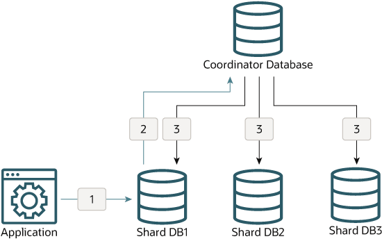
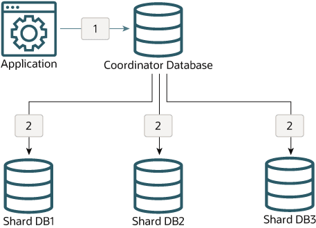
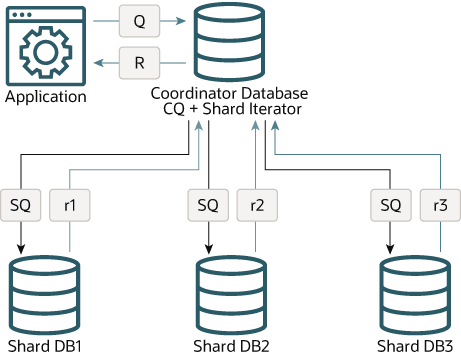

## 8 Query and DML Execution

On a sharded database, queries and DML can be routed to the shards for execution with or without a sharding key. If a key is provided by the application a database request is routed directly to the shards, but if no key is provided the request is processed by the shard catalog, and then directed to the necessary shards for execution.

### How Database Requests are Routed to the Shards

In Oracle Sharding, database query and DML requests are routed to the shards in two main ways, depending on whether a sharding key is supplied with the request.

These two routing methods are called direct routing and proxy routing.

Direct Routing

You can connect directly to the shards to execute queries and DML by providing a sharding key with the database request. Direct routing is the preferred way of accessing shards to achieve better performance, among other benefits.

Proxy Routing

Queries that need data from multiple shards, and queries that do not specify a sharding key, cannot be routed directly by the application. Those queries require a proxy to route requests between the application and the shards. Proxy routing is handled by the shard catalog query coordinator.

#### Routing Queries and DMLs Directly to Shards

Applications can have their requests routed directly to the shards if they provide a sharding key. With the direct routing mechanism, requests can only query and manipulate the data that belongs to the shard they were routed to.

Direct access to the data on the shards has several advantages.

- Offers better performance: Overall, applications experience better performance compared to routing requests to the shards indirectly through the shard catalog (by proxy). With direct routing there is no need for the requests and the results to pass through a coordinator database.

- Accommodates geographic distribution of shards: Applications can access the data in shards localized in their region.

- Eases load balancing: Load balancing application requests across the shards can be easily achieved by moving the data across shards using chunk moves.

- Supports all type of queries:
  - `SELECT`, `INSERT`, and `UPDATE` on sharded tables: The scope of these queries is the data that belong to the shards accessed.
  - `SELECT`, `INSERT`, and `UPDATE` on duplicated tables: The scope of theses queries is all of the data in the duplicated tables. Because the master copies of a duplicated tables reside in the coordinator database, the DMLs on the duplicated tables are re-routed to the coordinator database.

The following figure illustrates DML on duplicated tables using direct routing to a shard.

1.  The Application sends the DML request directly to one of the shards, Shard DB1.
2.  The DML is forwarded from Shard DB1 to the Coordinator Database, where it is run on the master duplicated tables.
3.  The Coordinator Database refresh mechanism runs periodically to update the instances of the duplicated tables on all of the shards.

Figure 8-1 DML on a Duplicated Table with Direct Routing

[Description of "Figure 8-1 DML on a Duplicated Table with Direct Routing"](img_text/dml_duptable_direct.md)

For more information about direct routing, see [Client Application Request Routing](architecture-and-concepts1.md).

For information about developing applications for direct routing, see [Developing Applications for the Sharded Database](developing-applications.md)

#### Routing Queries and DMLs by Proxy

Using the shard catalog query coordinator as a proxy, Oracle Sharding can handle request routing for queries and DMLs that do not specify a sharding key.

By using the coordinator as a proxy, Oracle Sharding provides you with the flexibility to allow any database application to run SQL statements without the need to specify the shards where the query should be executed.

The following figure illustrates DML on duplicated tables using proxy routing.

1.  The Application sends the DML request to the Coordinator Database where it is run on the master duplicated tables.
2.  The Coordinator Database refresh mechanism runs periodically to update the instances of the duplicated tables on all of the shards.

Figure 8-2 DML on a Duplicated Table with Proxy Routing

[Description of "Figure 8-2 DML on a Duplicated Table with Proxy Routing"](img_text/dml_duptable_coord.md)

For more information about the coordinator, see [Query Processing and the Query Coordinator](architecture-and-concepts1.md).

The remaining topics in this chapter discuss routing and processing database requests by proxy.

### Connecting to the Query Coordinator

The Oracle Sharding query coordinator, a component of the shard catalog, contains the metadata of the sharded topology and provides query processing support for sharded databases.

To perform multi-shard queries, connect to the coordinator using the `GDS$CATALOG` service on the shard catalog database.

    sqlplus app_schema/app_schema@shardcatvm:1521/GDS\$CATALOG.oradbcloud

For more information about the coordinator, see [Query Processing and the Query Coordinator](architecture-and-concepts1.md)

### Query Coordinator Operation

The SQL compiler in the shard catalog identifies the relevant shards automatically, and coordinates the query execution across all of the participating shards. Database links are used for the communication between the coordinator and the shards.

As shown in the following figure, at a high level, the coordinator rewrites each incoming query, Q, into two queries, Coordinator Query (CQ) and Shard Query (SQ) where SQ, where SQ (Shard Query) is the part of Q that runs on each participating shard, and CQ (Coordinator Query) is the part of Q that runs on the coordinator shard.

A query, Q, is rewritten into CQ ( Shard_Iterator( SQ ) ), where the **Shard_Iterator** is the operator that connects to the shards and runs SQ. It can be run in parallel or serially.

Figure 8-3 Query Coordinator Operation

[Description of "Figure 8-3 Query Coordinator Operation"](img_text/cross_shard_query.md)

The following is an example of an aggregate query, Q1, rewritten into Q1’.

    Q1 : SELECT COUNT(*) FROM customers

    Q1’: SELECT SUM(sc) FROM (Shard_Iterator(SELECT COUNT(*) sc FROM s1 (i) ))

There are two main elements in this process.

1.  The relevant shards are identified.

2.  The query is rewritten into a distributive form and iterated across the relevant shards.

During the query compilation on the coordinator database, the query compiler analyzes the predicates on the sharding key, and extracts the predicates that can be used to identify the participating shards, that is, the shards that will contribute rows for the sharded tables referenced in the query. The rest of the shards are referred to as pruned shards.

In the case where only one participating shard was identified, the full query is routed to that shard for execution. This is called a single-shard query.

If there is more than one participating shard, the query is called a multi-shard query and it is rewritten. The rewriting process takes into account the expressions computed by the query as well as the query shape.

### Query Processing for Single-Shard Queries

A single-shard query is a query which needs to scan data from only one shard and does not need to lookup data from any other shards.

The single-shard query is similar to a client connecting to a specific shard and issuing a query on that shard. In this scenario, the entire query will be executed on the single participating shard, and the coordinator just passes processed rows back to the client. The plan on the coordinator is similar to the remote mapped cursor.

For example, the following query is fully mapped to a single shard because the data for customer 123 is located only on that shard.

    SELECT count(*) FROM customers c, orders o WHERE c.custno = o.custno and c.custno = 123;

The query contains a condition on the shard key that maps to one and only one shard which is known at query compilation time (literals) or query start time (bind). The query is fully executed on the qualifying shard.

Single-shard queries are supported for:

- Equality and In-list, such as `Area = ‘West’`

- Conditions containing literal, bind, or expression of literals and binds, such as

      Area = :bind

      Area = CASE :bind <10 THEN ‘West’ ELSE ‘East’ END

- `SELECT`, `UPDATE`, `DELETE`, `INSERT`, `FOR UPDATE`, and `MERGE`. `UPSERT` is not supported.

### Query Processing for Multi-Shard Queries

A multi-shard query is a query that must scan data from more than one shard, and the processing on each shard is independent of any other shard.

A multi-shard query maps to more than one shard and the coordinator might need to do some processing before sending the result to the client. For example, the following query gets the number of orders placed by each customer.

    SELECT count(*), c.custno FROM customers c, orders o WHERE c.custno = o.custno
     GROUP BY c.custno;

The query is transformed to the following by the coordinator.

    SELECT sum(count_col), custno FROM (SELECT count(*) count_col, c.custno
     FROM customers c, orders o
     WHERE c.custno = o.custno GROUP BY c.custno) GROUP BY custno;

The inline query block is mapped to every shard just as a remote mapped query block. The coordinator performs further aggregation and `GROUP BY` on top of the result set from all shards. The unit of execution on every shard is the inline query block.

#### Multi-Shard Queries and Global Read Consistency

A multi-shard query must maintain global read consistency (CR) by issuing the query at the highest common SCN across all the shards. See Specifying Consistency Levels in a Multi-Shard Query for information about how to set consistency levels.

#### Passing Hints in Multi-Shard Queries

Any hint specified in the original query on the coordinator is propagated to the shards.

#### Tracing and Troubleshooting Slow Running Multi-Shard Queries

Set the trace event `shard_sql` on the coordinator to trace the query rewrite and shard pruning. One of the common performance issues observed is when the GROUP BY is not pushed to the shards because of certain limitations of the sharding. Check if all of the possible operations are pushed to the shards and the coordinator has minimal work to consolidate the results from shards.

#### Specifying Consistency Levels in a Multi-Shard Query

You can use the initialization parameter MULTISHARD_QUERY_DATA_CONSISTENCY to set different consistency levels when executing multi-shard queries across shards.

You can specify different consistency levels for multi-shard queries. For example, you might want some queries to avoid the cost of SCN synchronization across shards, and these shards could be globally distributed. Another use case is when you use standbys for replication and slightly stale data is acceptable for multi-shard queries, as the results could be fetched from the primary and its standbys.

The default mode is strong, which performs SCN synchronization across all shards. Other modes skip SCN synchronization. The delayed_standby_allowed level allows fetching data from the standbys as well, depending on load balancing and other factors, and could contain stale data.

This parameter can be set either at the system level or at the session level.

**See Also:**

[Oracle Database Reference](../refrn/MULTISHARD_QUERY_DATA_CONSISTENCY.md) for more information about MULTISHARD_QUERY_DATA_CONSISTENCY usage.

### Supported Query Constructs and Example Query Shapes

Oracle Sharding supports single-shard and multi-shard query shapes with some restrictions.

The following are restrictions on query constructs in Oracle Sharding.

- CONNECT BY Queries `CONNECT BY` queries are not supported.

- MODEL Clause The `MODEL` clause is not supported.

- User-Defined PL/SQL in the WHERE Clause User-defined PL/SQL is allowed in multi-shard queries only in the `SELECT` clause. If it is specified in the `WHERE` clause then an error is thrown.

- XLATE and XML Query type XLATE and XML Query type columns are not supported.

- Object types You can include object types in `SELECT` lists, `WHERE` clauses, and so on, but custom constructors and member functions of type object type are not permitted in `WHERE` clauses.

  Furthermore, for duplicated tables, non-final types, that is, object types that are created with the `NOT FINAL` keyword, cannot be used as a column data type. For sharded tables, non-final types can be used as a column data type but the column must be created with keywords `NOT SUBSTITUTABLE AT ALL LEVELS`.

**Note:**

Queries involving only duplicated tables are run on the coordinator.

The following topics show several examples of query shapes supported in Oracle Sharding.

#### Queries on Sharded Tables Only

For a single-table query, the query can have an equality filter on the sharding key that qualifies a shard. For join queries, all of the tables should be joined using equality on the sharding key.

The following examples show queries where only sharded tables participate.

Example 8-1 Inner Join

    SELECT … FROM s1 INNER JOIN s2 ON s1.sk=s2.sk
    WHERE any_filter(s1) AND any_filter(s2)

Example 8-2 Left Outer Join

    SELECT … FROM s1 LEFT OUTER JOIN s2 ON s1.sk=s2.sk

Example 8-3 Right Outer Join

    SELECT … FROM s1 RIGHT OUTER JOIN s2 ON s1.sk=s2.sk

Example 8-4 Full Outer Join

    SELECT … FROM s1 FULL OUTER JOIN s2 ON s1.sk=s2.sk
    WHERE any_filter(s1) AND any_filter(s2)

#### Queries Involving Both Sharded and Duplicated Tables

A query involving both sharded and duplicated tables can be either a single-shard or multi-shard query, based on the predicates on the sharding key. The only difference is that the query contains a non-sharded table.

**Note:**

Joins between a sharded table and a duplicated table can be on any column, using any comparison operator, = \< \> \<= \>=, or arbitrary join expressions.

Example 8-5 Inner Join

    SELECT … FROM s1 INNER JOIN r1 ON any_join_condition(s1,r1)
    WHERE any_filter(s1) AND any_filter(r1)

Example 8-6 Left or Right Outer Join

In this case, the sharded table is the first table in `LEFT OUTER JOIN`.

    SELECT … FROM s1 LEFT OUTER JOIN r1 ON any_join_condition(s1,r1)
    WHERE any_filter(s1) AND any_filter(r1)

    SELECT … FROM r1 LEFT OUTER JOIN s1 ON any_join_condition(s1,s2)
    AND any_filter(r1) AND filter_one_shard(s1)

In this case, the sharded table is the second table in `RIGHT OUTER JOIN`.

    SELECT … FROM r1 RIGHT OUTER JOIN s1 ON any_join_condition(s1,r1)
    WHERE any_filter(s1) AND any_filter(r1)

    SELECT … FROM s1 RIGHT OUTER JOIN r1 ON any_join_condition(s1,s2)
    AND filter_one_shard(s1) AND any_filter(r1)

In some cases, the duplicated table is the first table in `LEFT OUTER JOIN`, or the sharded table is first and it maps to a single shard, based on filter predicate on the sharding key.

    SELECT … FROM r1 LEFT OUTER JOIN s1 ON any_join_condition(s1,s2)
    AND any_filter(r1) AND any_filter(s1)

In some cases, the duplicated table is the second table in `RIGHT OUTER JOIN`, or the sharded table is second and it maps to a single shard based on filter predicate on sharding key.

    SELECT … FROM s1 RIGHT OUTER JOIN r1 ON any_join_condition(s1,s2)
    AND any_filter (s1) AND any_filter(r1)

Example 8-7 Full Outer Join

    SELECT … FROM s1 FULL OUTER JOIN r1 ON s1.sk=s2.sk
    WHERE any_filter(s1) AND any_filter(s2)

In this case, the sharded table requires access to multiple shards:

    SELECT … FROM s1 FULL OUTER JOIN r1 ON s1.non_sk=s2.non_sk
    WHERE any_filter(s1) AND any_filter(s2)

Example 8-8 Semi-Join (`EXISTS`)

    SELECT … FROM s1 EXISTS
    (SELECT 1 FROM r1 WHERE r1.anykey=s1.anykey)

    SELECT … FROM r1 EXISTS
    (SELECT 1 FROM s1 WHERE r1.anykey=s1.anykey and filter_one_shard(s1))

In this case, the sharded table is in a subquery that requires the participation of multiple shards.

    SELECT … FROM r1 EXISTS
    (SELECT 1 FROM s1 WHERE r1.anykey=s1.anykey)

Example 8-9 Anti-Join (`NOT EXISTS`)

    SELECT … FROM s1 NOT EXISTS
    (SELECT 1 FROM r1 WHERE r1.anykey=s1.anykey)

In this case, the sharded table is in the sub-query.

    SELECT … FROM r1 NOT EXISTS
    (SELECT 1 FROM s1 WHERE r1.anykey=s1.anykey

#### Aggregate Functions Supported by Oracle Sharding

The following aggregations are supported by proxy routing in Oracle Sharding.

- `COUNT`

- `SUM`

- `MIN`

- `MAX`

- `AVG`

#### Queries with User-Defined Types

User-defined SQL object types and user-defined SQL collection types are referred to as user-defined types. Oracle Sharding supports queries with user-defined types.

Example 8-10 Create Table with User-Defined Types

The following example creates an all-shard type and type body, then creates a sharded table referencing the type.

    ALTER SESSION ENABLE SHARD DDL;

    CREATE OR REPLACE TYPE person_typ AS OBJECT (
        first_name   VARCHAR2(20),
        last_name    VARCHAR2(25),
        email        VARCHAR2(25),
        phone        VARCHAR2(20),
        MEMBER FUNCTION details (
        self IN person_typ
        ) RETURN VARCHAR2
    );
    /

    CREATE OR REPLACE TYPE BODY person_typ AS
        MEMBER FUNCTION details (
        self IN person_typ
        ) RETURN VARCHAR2 IS
            result VARCHAR2(100);
        BEGIN
            result := first_name || ' ' || last_name || ' ' || email || ' ' || phone;
            RETURN result;
        END;
    END;
    /

    CREATE SHARDED TABLE Employees
    ( Employee_id      NUMBER NOT NULL
    , person      person_typ
    , signup_date DATE NOT NULL
    , CONSTRAINT RootPK PRIMARY KEY(CustNo)
    )
    PARTITION BY CONSISTENT HASH (CustNo)
    PARTITIONS AUTO
    TABLESPACE SET ts1
    ;

Example 8-11 Insert Data Using Type Constructor

    INSERT INTO Employees values ( 1, person_typ('John', 'Doe', 'jdoe@example.com', '123-456-7890'), to_date('24 Jun 2020', 'dd Mon YYYY'));

Example 8-12 Multi-Shard Query of a User-Defined Type Column

    SELECT e.person FROM Employees e;

    SELECT e.person.first_name, e.person.last_name FROM Employees e;

    SELECT e.person.details() FROM Employee e where e.person.first_name = 'John’;

    SELECT signup_date from Employees e where e.person = person_typ('John', 'Doe', 'jdoe@example.com', '123-456-7890’);

#### Execution Plans for Proxy Routing

In a multi-shard query, each shard produces an independent execution plan which is optimized for the data size and compute resources available on the shard.

You do not need to connect to individual shards to see the explain plan for SQL fragments. Interfaces provided in `dbms_xplan.display_cursor()` display on the coordinator the plans for the SQL segments executed on the shards, and `[V/X]$SHARD_SQL` uniquely maps a shard SQL fragment of a multi-shard query to the target shard database.

##### SQL Segment Interfaces for `dbms_xplan.display_cursor()`

Two interfaces can display the plan for a SQL segment executed on shards. The interfaces take shard IDs as the argument to display the plans from the specified shards. The `ALL_SHARDS` format displays the plans from all of the shards.

To print all of the plans from all shards use the `format` value `ALL_SHARDS` as shown here.

    select * from table(dbms_xplan.display_cursor(sql_id=>:sqlid,
                                                  cursor_child_no=>:childno,
                                                  format=>'BASIC +ALL_SHARDS‘,
                                                  shard_ids=>shard_ids))

To print selective plans from the shards, pass shard IDs in the `display_cursor()` function. For plans from multiple shards, pass an array of numbers containing shard IDs in the `shard_ids` parameter as shown here.

    select * from table(dbms_xplan.display_cursor(sql_id=>:sqlid,
                                                   cursor_child_no=>:childno,
                                                   format=>'BASIC',
                                                   shard_ids=>ids))

To return a plan from one shard pass the shard ID directly to the `shard_id` parameter, as shown here.

    select * from table(dbms_xplan.display_cursor(sql_id=>:sqlid,
                                                  cursor_child_no=>:childno,
                                                  format=>'BASIC',
                                                  shard_id=>1))

##### V\$SQL_SHARD

`V$SQL_SHARD` uniquely maps a shard SQL fragment of a multi-shard query to the target shard database. This view is relevant only for the shard coordinator database to store a list of shards accessed for each shard SQL fragment for a given multi-shard query. Every execution of a multi-shard query can execute a shard SQL fragment on different set of shards, so every execution updates the shard IDs. This view maintains the SQL ID of a shard SQL fragment for each REMOTE node and the SHARD IDs on which the shard SQL fragment was executed.

    Name                                      Null?    Type
    ----------------------------------------- -------- ----------------------------
     SQL_ID                                            VARCHAR2(13)
     CHILD_NUMBER                                      NUMBER
     NODE_ID                                           NUMBER
     SHARD_SQL_ID                                      VARCHAR2(13)
     SHARD_ID                                          NUMBER
     SHARD_CHILD_NUMBER                                NUMBER

- SQL_ID – SQL ID of a multi-shard query on coordinator

- CHILD_NUMBER – cursor child number of a multi-shard query on coordinator

- NODE_ID – ID of REMOTE node for a shard SQL fragment of a multi-shard query

- SHARD_SQL_ID – SQL ID of the shard SQL fragment for given remote NODE ID

- SHARD_ID – IDs of shards where the shard SQL fragment was executed

- SHARD \_CHILD_NUMBER– cursor child number of a shard SQL fragment on a shard (default 0)

The following is an example of a multi-shard query on the sharded database and the execution plan.

    SQL> select count(*) from departments a where exists (select distinct department_id
     from departments b where b.department_id=60);
    ------------------------------------------------
    | Id  | Operation          | Name              |
    ------------------------------------------------
    |   0 | SELECT STATEMENT   |                   |
    |   1 |  SORT AGGREGATE    |                   |
    |   2 |   FILTER           |                   |
    |   3 |    VIEW            | VW_SHARD_377C5901 |
    |   4 |     SHARD ITERATOR |                   |
    |   5 |      REMOTE        |                   |
    |   6 |    VIEW            | VW_SHARD_EEC581E4 |
    |   7 |     SHARD ITERATOR |                   |
    |   8 |      REMOTE        |                   |
    ------------------------------------------------

A query of SQL_ID on the `V$SQL_SHARD` view.

    SQL> Select * from v$sql_shard where SQL_ID = ‘1m024z033271u’;
    SQL_ID        NODE_ID   SHARD_SQL_ID  SHARD_ID
    ------------- -------  -------------- --------
    1m024z033271u       5   5z386yz9suujt        1
    1m024z033271u       5   5z386yz9suujt       11
    1m024z033271u       5   5z386yz9suujt       21
    1m024z033271u       8   8f50ctj1a2tbs       11

**See Also:**

[Oracle Database PL/SQL Packages and Types Reference](../arpls/DBMS_XPLAN.md)

[Oracle Database Reference](../refrn/dynamic-performance-v-views-3.md)

### Supported DMLs and Examples

DMLs in Oracle sharding can target either duplicated tables or sharded tables. There are no limitations on DMLs when the target is a duplicated table.

DMLs (mainly Insert, Update and Delete) targeting sharded tables can be

- Simple DMLs where only the target table is referenced
- DMLs referencing other tables
- Merge statements

#### Simple DMLs Where Only the Target Table is Referenced

The following are several examples of supported DMLs.

Example 8-13 Update all of the rows

    UPDATE employees SET salary = salary *1.1;

Example 8-14 Insert one row

    INSERT INTO employees VALUES (102494, 'Jane Doe, ...
        );

Example 8-15 Delete one row

    DELETE employees WHERE employee_id = 103678;

#### DMLs Referencing Other Tables

DMLs on sharded tables can reference other sharded tables, duplicated tables, or local tables.

Example 8-16 DML referencing duplicated table

In this example, `employees` is a sharded table and `ref_jobs` is a duplicated table.

    DELETE employees
                WHERE job_id IN (SELECT job_id FROM ref_jobs
                                WHERE job_id = 'SA_REP');

Example 8-17 DML referencing another sharded table

    UPDATE departments SET department_name = 'ABC‘
                WHERE department_id IN (SELECT department_id
                                        FROM employees
                                        WHERE salary < 10000);

Example 8-18 Insert as select from a local table

    INSERT INTO employees SELECT * FROM local_employees;

Example 8-19 DML affecting one shard

A DML statement might affect only one shard, or it can involve multiple shards. For example, the `DELETE` statement shown here affects only one shard because there is a predicate on the sharding key (`employee_id`) in the `WHERE` clause..

    DELETE employees WHERE employee_id = 103678;

Example 8-20 DML affecting multiple shards

The following statement affects all of the rows in the `EMPLOYEES` table because it does not have a `WHERE` clause.

    UPDATE employees SET salary = salary *1.1;

To run this `UPDATE` statement on all shards, the shard coordinator iterates over all of the primary shard databases and invokes remote execution of the `UPDATE` statement. The coordinator starts a distributed transaction and performs two phase commit to guarantee the consistency of the distributed transaction. If there is an in-doubt transaction, you must recover it manually.

#### Example Merge Statements

The `MERGE` statement can target a sharded table or a duplicated table. The merge is allowed as long as the `MERGE` operation itself can be pushed to the shards.

Example 8-21 Merge statement with sharded table employees as the target table

In this example, the `employee_id` column is the sharding key, and the join predicate on the source query is on the sharding key, so the `MERGE` statement will get pushed to all of the shards to be executed.

    MERGE INTO employees D
       USING (SELECT employee_id, salary, department_id FROM employees
       WHERE department_id = 80) S
       ON (D.employee_id = S.employee_id)
       WHEN MATCHED THEN UPDATE SET D.salary = D.salary + S.salary*.01
         DELETE WHERE (S.salary > 8000)
       WHEN NOT MATCHED THEN INSERT (D.employee_id, D.salary)
         VALUES (S.employee_id, S.salary*0.1)
         WHERE (S.salary <= 8000);

Example 8-22 Merge statement with duplicated table as the target table

In this example, the target table is the duplicated table `ref_employees`. The source query references the sharded table `employees` and the join predicate is on the sharding key `employee_id`.

    MERGE INTO ref_employees D
       USING (SELECT employee_id, salary, department_id FROM employees
       WHERE department_id = 80) S
       ON (D.employee_id = S.employee_id)
       WHEN MATCHED THEN UPDATE SET D.salary = D.salary + S.salary*.01
         DELETE WHERE (S.salary > 8000)
       WHEN NOT MATCHED THEN INSERT (D.employee_id, D.salary)
         VALUES (S.employee_id, S.salary*0.1)
          WHERE (S.salary <= 8000);

#### Limitations in Multi-Shard DML Support

The following DML features are not supported by multi-shard DML in Oracle Sharding.

- Parallel DML Parallel DML is not supported by multi-shard DML. The DML will always run on one shard at a time (serially) in multi-shard DML.
- Error Logging The `ERROR LOG` clause with DML is not supported by multi-shard DML. A user error is raised in this case.
- Array DML Array DML is not supported by multi-shard DML. ORA-2681 is raised in this cases.
- RETURNING Clause The `RETURNING INTO` clause is not supported by regular distributed DMLs; therefore, it is not supported by Oracle Sharding. ORA-22816 is raised if you try to use the `RETURNING INTO` clause in multi-shard DMLs.
- MERGE and UPSERT The `MERGE` statement is partially supported by Oracle Sharding, that is, a `MERGE` statement affecting only single shard is supported. ORA error is raised if a `MERGE` statement requires the modification of multiple shards.
- Multi-Table INSERT Multi-table inserts are not supported by database links; therefore, multi-table inserts are not supported by Oracle Sharding.
- Updatable Join View ORA-1779 is thrown when the updatable join view has a join on a sharded table on sharding keys. The reason for this error is that the primary key defined on a sharded table is combination of internal column `SYS_HASHVAL` + sharding key and you cannot specify `SYS_HASHVAL` in the updatable join view. Because of this restriction you cannot establish the key-preserved table resulting in raising ORA-1779.
- Triggers

### Gathering Optimizer Statistics on Sharded Tables

You can gather statistics on sharded tables from the coordinator database.

The statistic preference parameter `COORDINATOR_TRIGGER_SHARD`, when set to `TRUE` on all of the shards, allows the coordinator database to import the statistics gathered on the shards.

The PL/SQL procedures `DBMS_STATS.GATHER_SCHEMA_STATS()` and `DBMS_STATS.GATHER_TABLE_STATS()` gather statistics on sharded tables and duplicated tables in the shards and in the coordinator database. See also, [REPORT_GATHER_TABLE_STATS Function](../arpls/DBMS_STATS.md).

Manual Statistics Gathering

1.  Set `COORDINATOR_TRIGGER_SHARD` to `TRUE` on all of the shards.

    This step is performed only one time and only on the shards. If, for example, you have a schema named `sharduser`:

        connect / as sysdba
        EXECUTE DBMS_STATS.SET_SCHEMA_PREFS('SHARDUSER','COORDINATOR_TRIGGER_SHARD','TRUE');

2.  Gather statistics across the shards.

    The user should be an all-shards user and needs to have privileges to access dictionary tables.

    1.  On the shards run the following.

            connect sharduser/password
            EXEC DBMS_STATS.GATHER_SCHEMA_STATS(ownname => 'SHARDUSER', options => 'GATHER');

    2.  When all shards are completed, to pull aggregated statistics run the following on the coordinator.

            connect sharduser/password
            EXEC DBMS_STATS.GATHER_SCHEMA_STATS(ownname => 'SHARDUSER', options => 'GATHER');

    3.  Check the statistics on all of the shards.

            connect sharduser/password

            ALTER SESSION SET nls_date_format='DD-MON-YYYY HH24:MI:SS';
              col TABLE_NAME form a40
              set pagesize 200 linesize 200

            SELECT TABLE_NAME, NUM_ROWS, sharded, duplicated, last_analyzed
              FROM user_tables
              WHERE table_name not like 'MLOG%' and table_name not like 'RUPD%'
              and table_name not like 'USLOG%';

Automatic Statistics Gathering

1.  Set `COORDINATOR_TRIGGER_SHARD` to `TRUE` on all of the shards.

    This step is performed only one time and only on the shards. If, for example, you have a schema named `sharduser`:

        connect / as sysdba
        EXECUTE DBMS_STATS.SET_SCHEMA_PREFS('SHARDUSER','COORDINATOR_TRIGGER_SHARD','TRUE');

2.  Schedule a job to pull aggregated statistics on the shards and on the coordinator database.

    The user should be an all-shards user and must have privileges to access dictionary tables.

    Start the following job on the shards:

        connect sharduser/password
        BEGIN
        DBMS_SCHEDULER.CREATE_JOB (
           job_name => 'Gather_Stats_2',
           job_type => 'PLSQL_BLOCK',
           job_action => 'BEGIN DBMS_STATS.GATHER_SCHEMA_STATS(ownname => ''DEMO'', options => ''GATHER''); END;',
           start_date => SYSDATE,
           repeat_interval => 'freq=daily;byday=MON,TUE,WED,THU,FRI,SAT,SUN;byhour=14;byminute=10;bysecond=00',
           end_date => NULL,
           enabled => TRUE,
           comments => 'Gather table statistics');
        END;
        /

    After the job on all of the shards is finished, start the following job on the coordinator.

        connect sharduser/password
        BEGIN
        DBMS_SCHEDULER.CREATE_JOB (
           job_name             => 'Gather_Stats_2',
           job_type             => 'PLSQL_BLOCK',
           job_action           => 'BEGIN DBMS_STATS.GATHER_SCHEMA_STATS(ownname => ''DEMO'', options => ''GATHER''); END;',
           start_date           =>  SYSDATE,
           repeat_interval      => 'freq=daily;byday=MON,TUE,WED,THU,FRI,SAT,SUN;byhour=15;byminute=10;bysecond=00',
           end_date             =>  NULL,
           enabled              =>  TRUE,
           comments             => 'Gather table statistics');
        END;
        /
