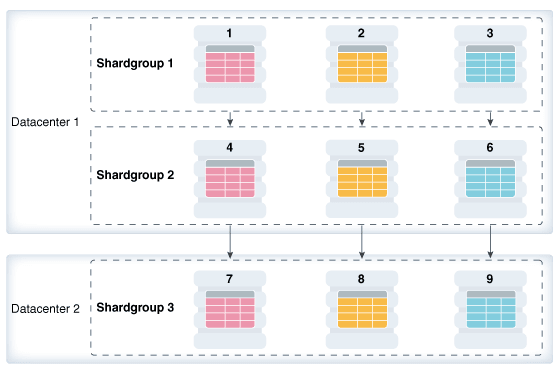

## 4 Sharded Database Deployment

Sharded database deployment includes the prerequisites and instructions for installing the required software components, creating the catalog, roles, and the sharded database, configuring replication for high availability, and creating the schema for the sharded database.

The following topics contain the concepts and tasks you need to deploy a sharded database:

### Introduction to Sharded Database Deployment

Oracle Sharding provides the capability to automatically deploy the sharded database, which includes both the shards and the replicas.

The sharded database administrator defines the topology (regions, shard hosts, replication technology) and invokes the `DEPLOY` command with a declarative specification using the `GDSCTL` command-line interface.

Before You Begin

Note that there are many different configurations and topologies that can be used for a sharded database. Your particular sharded database may employ a variety of Oracle software components such as Oracle Data Guard, Oracle GoldenGate, and Oracle Real Application Clusters (Oracle RAC) along with different sharding methodologies including system-managed, composite, and user-defined sharding.

Depending on your application’s particular architecture and system requirements, you may have several choices from which to choose when designing your system. See [Sharding Methods](architecture-and-concepts1.md), [Shard-Level High Availability](architecture-and-concepts1.md) for information about the various sharding methodologies and disaster recovery and high-availability options.

#### Choosing a Shard Creation Method

When deploying a sharded configuration, there are two different `GDSCTL` commands, `ADD SHARD` and `CREATE SHARD`, that can be used to add a shard.

Before you start to configure the sharding topology, decide which shard creation method to use because this decision affects some of the configuration steps.

The differences between the `ADD SHARD` and `CREATE SHARD` methods are explained where necessary in the configuration instructions.

ADD SHARD Method

The `GDSCTL ADD SHARD` command can be used to add a shard to an Oracle Sharding configuration. When using this command, you are responsible for creating the Oracle databases that will become shards during deployment. You can use whatever method you want to create the databases as long as the databases meet the prerequisites for inclusion in an Oracle Sharding configuration.

Some of the benefits of using the `ADD SHARD` method include:

- You have complete control over the process used to create the databases.
- It is straightforward to customize database parameters, naming, and storage locations.
- Both PDB and non-CDB shards are supported.
- There is less Oracle software to configure on the shard hosts.
- There is much less complexity in the deployment process because the shard databases are created before you run any `GDSCTL` commands.

CREATE SHARD Method

The `GDSCTL CREATE SHARD` command can be used to create a shard in an Oracle Sharding configuration. With `CREATE SHARD`, the shard catalog leverages the Oracle Remote Scheduler Agent to run the Database Configuration Assistant (DBCA) remotely on each shard host to create a database for you. This method does not support PDBs, so any shard databases added must be non-CDBs.

Some of the benefits of using the `CREATE SHARD` method include:

- It is easier to create shard databases for non-database administrators.
- It provides a standard way to provision a new database, when no standard is in current practice.
- Any database created with `CREATE SHARD` is automatically configured correctly for Oracle Sharding without the need to run SQL statements against the database or otherwise adjust database parameters.
- You can create standby databases automatically.

#### Sharded Database Deployment Roadmap

Follow this roadmap to set up hosts, install the required software, and configure and deploy a sharded database.

At a high level, the deployment steps are:

1.  Set up the components.
    - Provision and configure the hosts that will be needed for the sharding configuration and topology selected (see Provision and Configure Hosts and Operating Systems).
    - Install Oracle Database software on the selected catalog and shard nodes (see Install the Oracle Database Software).
    - Install global service manager (GSM) software on the shard director nodes (see Install the Shard Director Software).
2.  Create databases needed to store the sharding metadata and the application data.
    - Create a database that will become the shard catalog along with any desired replicas for disaster recovery (DR) and high availability (HA) (see Create the Shard Catalog Database).
    - If you are using the `ADD SHARD` method to deploy shards, create databases that will become the shards in the configuration including any standby databases needed for DR and HA (see Create the Shard Databases).
3.  Specify the sharding topology using some or all the following commands from the `GDSCTL` command line utility, among others (see Configure the Sharded Database Topology).
    - `CREATE SHARDCATALOG`
    - `ADD GSM`
    - `START GSM`
    - `ADD SHARDSPACE`
    - `ADD SHARDGROUP`
    - `ADD CDB`
    - `ADD SHARD`
    - `ADD CREDENTIAL`
    - `ADD FILE`
    - `CREATE SHARD`
    - `ADD INVITEDNODE`
4.  Run `DEPLOY` to deploy the sharding topology configuration (see Deploy the Sharding Configuration).
5.  Add the global services needed to access any shard in the sharded database (see Create and Start Global Database Services).
6.  Verify the status of each shard (see Verify Shard Status).

When the sharded database configuration deployment is complete and successful, you can create the sharded schema objects needed for your application. See [Sharded Database Schema Objects](architecture-and-concepts1.md).

The topics that follow describe each of the deployment tasks in more detail along with specific requirements for various components in the system. These topics can act as a reference for the set up and configuration of each particular step in the process. However, by themselves, they will not produce a fully functional sharding configuration since they do not implement a complete sharding scenario, but only provide the requirements for each step.

Example Sharded Database Deployment walks you through a specific deployment scenario of a representative reference configuration. This section provides examples of every command needed to produce a fully functional sharded database after all of the steps are completed.

### Provision and Configure Hosts and Operating Systems

Before you install any software, review these hardware, network, and operating system requirements for Oracle Sharding.

- Oracle Database Enterprise Edition is required when running an Oracle Sharded Database.

- Hardware and operating system requirements for shards are the same as those for Oracle Database. See your Oracle Database installation documentation for these requirements.

- Hardware and operating system requirements for the shard catalog and shard directors are the same as those for the Global Data Services catalog and global service manager. See [Oracle Database Global Data Services Concepts and Administration Guide](../gsmug/global-data-services-config.md) for these requirements.

- Network requirements are Low Latency GigE.

- Port communication requirements are as follows.

  - Each and every shard must be able to reach each and every shard director's listener and ONS ports. The shard director listener ports and the ONS ports must also be opened to the application/client tier, all of the shards, the shard catalog, and all other shard directors.

    The default listener port of the shard director is 1522, and the default ONS ports on most platforms are 6123 for the local ONS and 6234 for remote ONS.

  - Each and every shard must be able to reach the TNS Listener port (default 1521) of the shard catalog (both primary and standbys).

  - The TNS Listener port of each shard must be opened to all shard directors and the shard catalog.

  - All of the port numbers listed above are modifiable during the deployment configuration. However, the port numbers to be used must be known before setting up the host software.

- Host name resolution must be successful between all of the shard catalog, shards, and shard director hosts. Operating system commands such as ‘ping’ must succeed from a given host to any other host when specifying any host names provided during sharded database configuration commands.

Number and Sizing of Host Systems

Depending on your specific configuration, the hosts that are needed may include the following:

- Shard catalog host. The shard catalog host runs the Oracle Database that serves as the shard catalog. This database contains a small amount of sharding topology metadata and any duplicated tables that are created for your application. In addition, this database acts as a query coordinator for cross-shard queries and services connections for applications that have not been written to be sharding-aware. In general, the transaction workload and size of this database are not particularly large.

- Shard catalog database standbys (replicas). At least one more host to contain a replica or standby of the primary shard catalog database is recommended. This host is necessary in case of a failure of the primary catalog host. In addition, while acting as a standby database, this host can also be configured to be a query coordinator for cross-shard queries.

- Shard director host. The shard director (global service manager) software can reside on a separate host, or it can be co-located on the same host as the shard catalog. This component of the sharding system is comprised of a network listener and several background processes used to monitor and configure a sharded configuration. If the shard director is co-located on the same host as the catalog database it must be installed in a separate Oracle Home from the catalog database because the installation package is different than the one used for Oracle Database.

- Multiple shard directors. For high-availability purposes, it is recommended that you have more than one shard director running in a sharded system. Any additional shard directors can run on their own hosts or on the hosts running the standby shard catalog databases.

- Shards. In addition to the above hosts, each shard that is configured in the system should also run on its own separate host. The hosts and their configurations chosen for this task should be sized in the same way as a typical Oracle Database host depending on how much load is put on each particular shard.

- Shard standbys (replicas). Again, for high-availability and disaster recovery purposes, replication technology such as Oracle Data Guard or Oracle Golden Gate should be used, and replicas created for all sharded data. Additional hosts will be needed to run these replica or standby databases.

  **Note:**

  Oracle GoldenGate replication support for Oracle Sharding High Availability is deprecated in Oracle Database 21c.

Once the number of hosts and capacity requirements for each host have been determined, provision your hardware resources as appropriate for your environment using whatever methodologies you choose. Before installing any software, you must confirm that the hosts can communicate with each other though the ports as described above. Because a sharding configuration is inherently a distributed system, it is crucial that this connectivity between and among all of the hosts is confirmed before moving on to the next steps in the deployment process. Failure to set up port access correctly will lead to failures in subsequent commands.

### Install the Oracle Database Software

Install Oracle Database on each system that will host the shard catalog, a database shard, or their replicas.

Aside from the requirement that the shard catalog and all of the shards in an Oracle Sharding configuration require Oracle Database Enterprise Edition, there are no other special installation considerations needed for sharding as long as the installation is successful and all post-install scripts have been run successfully.

See your platform’s installation guide at [https://docs.oracle.com/en/database/oracle/oracle-database/](../..) for information about configuring operating system users.

If you will be using the `CREATE SHARD` method to add shards to your configuration, you must also install the Remote Scheduler Agent software on each shard host. The agent does not need to be installed on the shard catalog hosts. See [Installing and Configuring the Scheduler Agent on a Remote Host](../admin/administering-oracle-scheduler.md) for more information.

The `CREATE SHARD` method also requires the creation of two directories on each shard host, `$ORACLE_BASE/oradata` and `$ORACLE_BASE/fast_recovery_area`. Create these two directories while logged into the shard host as the owner of the Oracle Database software. Permissions should be set the same as for the directories that will hold the data files for your shard database, which is typically full access for the software owner only.

### Install the Shard Director Software

Install the global service manager software on each system that you want to host a shard director.

Note that this software installation is distinct from an Oracle Database installation. If you choose to co-locate the shard director software on the same host as the shard catalog database, it must be installed in a separate Oracle Home.

See [Oracle Database Global Data Services Concepts and Administration Guide](../gsmug/global-data-services-config.md) for information about installing the global service manager software.

### Create the Shard Catalog Database

Use the following information and guidelines to create the shard catalog database.

The shard catalog database contains a small amount of sharding topology metadata and also contains all the duplicated tables that will be created for use by your sharded application. The catalog database also acts as a query coordinator to run cross-shard queries that select and aggregate data from more than one shard.

From a sharding perspective, the way in which you create or provision the catalog database is irrelevant. The database can be created with the Database Configuration Assistant (DBCA), manually using SQL\*Plus, or provisioned from cloud infrastructure tools.

As long as you have a running Oracle Database Enterprise Edition instance on the shard catalog host with the following characteristics, it can used as the shard catalog.

- Create a legacy database or a pluggable database (PDB) for use as the shard catalog database. Using the root container (`CDB$ROOT`) of a container database (CDB) as the shard catalog database is not supported.

- Your shard catalog database must use a server parameter file (`SPFILE`). This is required because the sharding infrastructure uses internal database parameters to store configuration metadata, and that data needs to persist across database startup and shutdown operations.

      $ sqlplus / as sysdba

      SQL> show parameter spfile

      NAME     TYPE      VALUE
      -------- --------- ------------------------------------
      spfile   string    /u01/app/oracle/dbs/spfilecat.ora

- The database character set and national character set must be the same because it is used for all of the shard databases. This means that the character set chosen must contain all possible characters that will be inserted into the shard catalog or any of the shards.

  This requirement arises from the fact that Oracle Data Pump is used internally to move transportable tablespaces from one shard to another during sharding `MOVE CHUNK` commands. A requirement of that mechanism is that character sets must match on the source and destination.

      $ sqlplus / as sysdba

      SQL> REM run the following command if using a CDB
      SQL> alter session set container=catalog_pdb_name;

      SQL> select * from nls_database_parameters
        2  where parameter like '%CHARACTERSET';

      PARAMETER                                VALUE
      ---------------------------------------- --------------------
      NLS_NCHAR_CHARACTERSET                   AL16UTF16
      NLS_CHARACTERSET                         WE8DEC

- Because the shard catalog database can run multi-shard queries which connect to shards over database links, the `OPEN_LINKS` and `OPEN_LINKS_PER_INSTANCE` database initialization parameter values must be greater than or equal to the number of shards that will be part of the sharded database configuration.

      $ sqlplus / as sysdba

      SQL> REM run the following command if using a CDB
      SQL> alter session set container=catalog_pdb_name;

      SQL> show parameter open_links

      NAME                                 TYPE        VALUE
      ------------------------------------ ----------- ------------
      open_links                           integer     20
      open_links_per_instance              integer     20

- Set the `DB_FILES` database initialization parameter greater than or equal to the total number of chunks and/or tablespaces in the system.

  Each data chunk in a sharding configuration is implemented as a tablespace partition and resides in its own operating system data file. As a result, the `DB_FILES` database initialization parameter must be greater than or equal to the total number of chunks (as specified on the `CREATE SHARDCATALOG` or `ADD SHARDSPACE` commands) and/or tablespaces in the system.

      $ sqlplus / as sysdba

      SQL> REM run the following command if using a CDB
      SQL> alter session set container=catalog_pdb_name;

      SQL> show parameter db_files

      NAME                                 TYPE        VALUE
      ------------------------------------ ----------- ------------
      db_files                             integer     1024

- If you are planning to use `CREATE SHARD` to add shards to the sharding configuration, then the `SHARED_SERVERS` and `DISPATCHERS` database initialization parameters must be set to allow the Remote Scheduler Agent to connect to the catalog over an XDB connection. This is not necessary if `ADD SHARD` will be used.

  Specifically, `SHARED_SERVERS` must be greater than 0 (zero) to allow shared server connections to the shard catalog from the Remote Scheduler Agent processes running on the shard hosts. In addition, the value of `DISPATCHERS` must contain a service for XDB, based on the Oracle SID value.

      $ sqlplus / as sysdba

      SQL> show parameter shared_servers

      NAME                                 TYPE        VALUE
      ------------------------------------ ----------- ------------
      shared_servers                       integer     5

      SQL> show parameter dispatchers

      NAME                                 TYPE        VALUE
      ------------------------------------ ----------- ----------------------
      Dispatchers                          string      (PROTOCOL=TCP), (PROTO
                                                       COL=TCP)(SERVICE=mysid
                                                       XDB)

  After setting the parameter values appropriately, run the `ALTER SYSTEM REGISTER` command to ensure that the XDB service is available for incoming connection requests.

- To support Oracle Managed Files, which is used by the sharding chunk management infrastructure, the `DB_CREATE_FILE_DEST` database parameter must be set to a valid value.

  This location is used during chunk movement operations (for example `MOVE CHUNK` or automatic rebalancing) to store the transportable tablespaces holding the chunk data. In addition, files described in Oracle Database Administrator’s Guide, "[Using Oracle Managed Files](../admin/using-oracle-managed-files.md)," are also stored in this location as is customary for any Oracle database using Oracle Managed Files.

      $ sqlplus / as sysdba

      SQL> REM run the following command if using a CDB
      SQL> alter session set container=catalog_pdb_name;

      SQL> show parameter db_create_file_dest

      NAME                  TYPE      VALUE
      --------------------- --------- -----------------------------
      db_create_file_dest   string    /u01/app/oracle/oradata

- If a standby catalog database will be part of the sharding configuration, the `STANDBY_FILE_MANAGEMENT` database parameter should be set to in order to automatically create new database files on any standby catalog databases.

  If this parameter is set to `MANUAL` (which is the default), then new database files created during `CREATE TABLESPACE` commands, for example, will not be created on the standby. This will cause data unavailability and application errors if the standby ever becomes a primary database.

      $ sqlplus / as sysdba

      SQL> alter session set container=catalog_pdb_name;
      SQL> show parameter standby_file_management

      NAME TYPE VALUE
      ------------------------------------ ----------- ------------
      standby_file_management stirng AUTO

- An Oracle-provided user account named `GSMCATUSER` must be unlocked and assigned a password inside the legacy database or PDB designated for the shard catalog. This account is used by the shard director processes to connect to the shard catalog database and perform administrative tasks in response to sharding commands.

  If you are using a PDB as the shard catalog, note that `GSMCATUSER` is a common user in the container database. As a result, its password is the same for `CDB$ROOT` and all PDBs in the CDB. If multiple PDBs in a single CDB are to be used as catalog databases for different sharding configurations, they will all share the same `GSMCATUSER` password which can be a security concern. To avoid this, host only one shard catalog PDB per CDB, and do not unlock the `GSMCATUSER` account in any other PDBs.

  The password you specify is used later during sharding topology creation in any `ADD GSM` commands that are issued. It never needs to be specified again because the shard director stores it securely in an Oracle Wallet and decrypts it only when necessary.

  The `MODIFY GSM` command can be used to update the stored password if it is later changed on the shard catalog database.

      $ sqlplus / as sysdba

      SQL> alter user gsmcatuser account unlock;

      User altered.

      SQL> alter user gsmcatuser identified by gsmcatuser_password;

      User altered.

  If you are using a PDB as the shard catalog, also run the following commands.

      SQL> alter session set container=catalog_pdb_name;
      SQL> alter user gsmcatuser account unlock;

      User altered.

- A shard catalog administrator account must be created, assigned a password, and granted privileges inside the legacy database or PDB designated as the shard catalog.

  This account is the administrator account for the sharding metadata in the shard catalog database. It is used to access the shard catalog using the `GDSCTL` utility when an administrator needs to makes changes to the sharded database topology or perform other administrative tasks.

  `GDSCTL` connects as this user to the shard catalog database when `GDSCTL` commands are run. The user name and password specified are used later in the `CREATE SHARDCATALOG` command. As with the `GSMCATUSER` account above, the user name and password are stored securely in an Oracle Wallet for later use. The stored credentials can be updated by issuing an explicit `CONNECT` command from `GDSCTL` to reset the values in the wallet.

      $ sqlplus / as sysdba

      SQL> REM run the following command if using a CDB
      SQL> alter session set container=catalog_pdb_name;

      SQL> create user mysdbadmin identified by mysdbadmin_password;

      User created.

      SQL> grant gsmadmin_role to mysdbadmin;

      Grant succeeded.

- Set up and run an Oracle Net TNS Listener at your chosen port (default is 1521) that can service incoming connection requests for the shard catalog legacy database or PDB.

  The TNS Listener can be created and configured in whatever way you wish. If the shard catalog is a PDB, depending on how the database was created, it may be necessary to explicitly create a database service that can allow for direct connection requests to the PDB without the need to use `ALTER SESSION SET CONTAINER`.

  To validate that the listener is configured correctly when using a PDB for the shard catalog, do the following using your newly created mysdbadmin account above and an appropriate connect string. Running `LSNRCTL SERVICES` lists all services currently available using the listener.

      $ sqlplus mysdbadmin/mysdbadmin_password@catalog_connect_string

      SQL> show con_name

      CON_NAME
      -----------------------
      catalog_pdb_name

  Once you confirm connectivity, make note of the catalog_connect_string above. It is used later in the configuration process in the `GDSCTL CREATE SHARDCATALOG` command. Typically, it will be of the form host:port/service_name (for example, `cathost.example.com:1521/catalog_pdb.example.com`).

After all of the above requirements have been met, the newly created database can now be the target of a `GDSCTL CREATE SHARDCATALOG` command.

For high availability and disaster recovery purposes, it is highly recommended that you also create one or more standby shard catalog databases. From a sharding perspective, as long as the above requirements are also met on the standby databases, and all changes to the primary shard catalog database are consistently applied to the standbys, there are no further sharding-specific configuration steps required.

### Create the Shard Databases

If you are using the `CREATE SHARD` method to add shards to your configuration, then skip this topic as it does not apply to `CREATE SHARD`. Otherwise, the databases that will be used as shards should be created on their respective hosts.

As with the shard catalog database, the way in which you create or provision the shard databases is irrelevant from a sharding perspective. The database can be created with the Database Configuration Assistant (DBCA), manually using SQL\*Plus, or provisioned from cloud infrastructure tools.

As long as you have a running Oracle Database Enterprise Edition instance on each shard host, with the following characteristics, it can be used as a shard.

- If the shard will be a PDB in a CDB, then an Oracle-provided user account named `GSMROOTUSER` must be unlocked and assigned a password inside `CDB$ROOT` of the database designated for a shard. In addition, this user must be granted the `SYSDG` and `SYSBACKUP` system privileges.

  The `GSMROOTUSER` account is used by `GDSCTL` and the shard director processes to connect to the shard database to perform administrative tasks in response to sharding commands. The password specified is used by `GDSCTL` during sharding topology creation in any `ADD CDB` commands that are issued. It is also be used by the shard director during the `DEPLOY` command to configure Oracle Data Guard (as necessary) on the shard databases. It never needs to be specified again by the user, because `GDSCTL` and the shard director store it securely in an Oracle Wallet and decrypt it only when necessary. The `MODIFY CDB` command can be used to update the stored password if it is later changed on the shard database.

      $ sqlplus / as sysdba

      SQL> alter user gsmrootuser account unlock;

      User altered.

      SQL> alter user gsmrootuser identified by gsmrootuser_password;

      User altered.

      SQL> grant SYSDG, SYSBACKUP to gsmrootuser;

      Grant succeeded.

- If the shard will be a PDB, then create a PDB for use as the shard database. Using the root container (`CDB$ROOT`) of a CDB as a shard is not supported.

- Your shard database must use a server parameter file (`SPFILE`). The `SPFILE` is required because the sharding infrastructure uses internal database parameters to store configuration metadata, and that data must persist through database startup and shutdown operations.

      $ sqlplus / as sysdba

      SQL> REM run the following command if using a CDB
      SQL> alter session set container=shard_pdb_name;

      SQL> show parameter spfile

      NAME     TYPE      VALUE
      -------- --------- ------------------------------------
      spfile   string    /u01/app/oracle/dbs/spfileshard.ora

- The database character set and national character set of the shard database must be the same as that used for the shard catalog database and all other shard databases. This means that the character set you choose must contain all possible characters that will be inserted into the shard catalog or any of the shards.

  This requirement arises from the fact that Oracle Data Pump is used internally to move transportable tablespaces from one shard to another during sharding `MOVE CHUNK` commands. A requirement of that mechanism is that character sets must match on the source and destination.

      $ sqlplus / as sysdba

      SQL> REM run the following command if using a CDB
      SQL> alter session set container=shard_pdb_name;

      SQL> select * from nls_database_parameters
        2  where parameter like '%CHARACTERSET';

      PARAMETER                                VALUE
      ---------------------------------------- --------------------
      NLS_NCHAR_CHARACTERSET                   AL16UTF16
      NLS_CHARACTERSET                         WE8DEC

- The `COMPATIBLE` initialization parameter must be set to at least 12.2.0.

      $ sqlplus / as sysdba

      SQL> REM run the following command if using a CDB
      SQL> alter session set container=shard_pdb_name;

      SQL> show parameter compatible

      NAME                   TYPE        VALUE
      ---------------------- ----------- -----------------
      compatible             string      19.0.0

- Enable Flashback Database if your sharded database will use standby shard databases.

      $ sqlplus / as sysdba

      SQL> REM run the following command if using a CDB
      SQL> alter session set container=shard_pdb_name;

      SQL> select flashback_on from v$database;

      FLASHBACK_ON
      ------------------
      YES

- `FORCE LOGGING` mode must be enabled if your shard database will use standby shard databases.

      $ sqlplus / as sysdba

      SQL> REM run the following command if using a CDB
      SQL> alter session set container=shard_pdb_name;

      SQL> select force_logging from v$database;

      FORCE_LOGGING
      ---------------------------------------
      YES

- Set the `DB_FILES` database initialization parameter greater than or equal to the total number of chunks and/or tablespaces in the system.

  Each data chunk in a sharding configuration is implemented as a tablespace partition and resides in its own operating system datafile. As a result, the `DB_FILES` database initialization parameter must be greater than or equal to the total number of chunks (as specified in the `CREATE SHARDCATALOG` or `ADD SHARDSPACE` commands) and/or tablespaces in the system.

      $ sqlplus / as sysdba

      SQL> REM run the following command if using a CDB
      SQL> alter session set container=shard_pdb_name;

      SQL> show parameter db_files

      NAME                                 TYPE        VALUE
      ------------------------------------ ----------- ------------
      db_files                             integer     1024

- To support Oracle Managed Files, used by the sharding chunk management infrastructure, the `DB_CREATE_FILE_DEST` database parameter must be set to a valid value.

  This location is used during chunk movement operations (for example `MOVE CHUNK` or automatic rebalancing) to store the transportable tablespaces holding the chunk data. In addition, files described in Oracle Database Administrator’s Guide, "Using Oracle Managed Files," are also stored in this location as is customary for any Oracle database using Oracle Managed Files.

      $ sqlplus / as sysdba

      SQL> REM run the following command if using a CDB
      SQL> alter session set container=shard_pdb_name;

      SQL> show parameter db_create_file_dest

      NAME                  TYPE      VALUE
      --------------------- --------- -----------------------------
      db_create_file_dest   string    /u01/app/oracle/oradata

- A directory object named `DATA_PUMP_DIR` must be created and accessible in the shard database from the `GSMADMIN_INTERNAL` account.

  `GSMADMIN_INTERNAL` is an Oracle-supplied account that owns all of the sharding metadata tables and PL/SQL packages. It should remain locked and is never used to login interactively. It’s only purpose is to own and control access to the sharding metadata and PL/SQL.

      $ sqlplus / as sysdba

      SQL> REM run the following command if using a CDB
      SQL> alter session set container=shard_pdb_name;

      SQL> create or replace directory DATA_PUMP_DIR as ‘/u01/app/oracle/oradata’;

      Directory created.

      SQL> grant read, write on directory DATA_PUMP_DIR to gsmadmin_internal;

      Grant succeeded.

- To support file movement from shard to shard, the `DB_FILE_NAME_CONVERT` database parameter must be set to a valid value. This location is used when standby databases are in use, as is typical with non-sharded databases, and the location can also be used during chunk movement operations. For regular file system locations, it is recommended that this parameter end with a trailing slash (/).

      $ sqlplus / as sysdba

      SQL> REM run the following command if using a CDB
      SQL> alter session set container=shard_pdb_name;

      SQL> show parameter db_file_name_convert

      NAME TYPE VALUE
      ---------------------- --------- -----------------------------
      db_file_name_convert   string    /dbs/SHARD1/, /dbs/SHARD1S/

- If a standby shard databases will be part of the sharding configuration, the `STANDBY_FILE_MANAGEMENT` database parameter should be set to `AUTO` to automatically create new database files on any standby shard databases.

  If this parameter is set to `MANUAL` (which is the default), then new database files created during `CREATE TABLESPACE` commands, for example, will not be created on the standby. This will cause data unavailability and application errors if the standby ever becomes a primary database.

      $ sqlplus / as sysdba

      SQL> alter session set container=shard_pdb_name;
      SQL> show parameter standby_file_management

      NAME TYPE VALUE
      ------------------------------------ ----------- ------------
      standby_file_management string AUTO

- An Oracle-provided user account named `GSMUSER` must be unlocked and assigned a password inside the PDB or legacy database designated as the shard database. In addition, this user must be granted the `SYSDG` and `SYSBACKUP` system privileges.

  If the shards are PDBs, note that `GSMUSER` is a common user in the CDB. As a result, its password is the same for `CDB$ROOT` and all PDBs in the CDB, which can be a security concern. To avoid this, host only one shard PDB per CDB, and do not unlock the `GSMUSER` account in any other PDBs.

  This account is used by the shard director processes to connect to the shard database and perform administrative tasks in response to sharding commands. The password specified is used later during sharding topology creation in any `ADD SHARD` commands that are issued. The password never needs to be specified again because the shard director stores it securely in an Oracle Wallet and only decrypts it when necessary. You can update the stored password using the `MODIFY SHARD` command if the password is later changed on the shard database.

      $ sqlplus / as sysdba

      SQL> alter user gsmuser account unlock;

      User altered.

      SQL> alter user gsmuser identified by gsmuser_password;

      User altered.

      SQL> REM run the following commands if using a CDB
      SQL> alter session set container=shard_pdb_name;

      SQL> alter user gsmuser account unlock;

      User altered.

      SQL> REM all cases run the following command

      SQL> grant SYSDG, SYSBACKUP to gsmuser;

      Grant succeeded.

- Set up and run an Oracle Net TNS Listener at your chosen port (default is 1521) that can service incoming connection requests for the shard PDB.

  The TNS Listener can be created and configured in whatever way you wish. If the shard is a PDB, depending on how the database was created, it may be necessary to explicitly create a database service that can allow for direct connection requests to the PDB without the need to use `ALTER SESSION SET CONTAINER`.

  To validate that the listener is configured correctly when using a PDB for the shard, run the following command using your newly unlocked `GSMUSER` account and an appropriate connect string. Running `LSNRCTL SERVICES` lists all services currently available using the listener.

      $ sqlplus gsmuser/gsmuser_password@shard_connect_string

      SQL> show con_name

      CON_NAME
      -----------------------
      shard_pdb_name

  Once you confirm connectivity, make note of the shard_connect_string above. It is used later in the configuration process in the `GDSCTL ADD SHARD` command. Typically, the connect string is in the form host:port/service_name (for example, `shardhost.example.com:1521/shard_pdb.example.com`).

Validate the Shard Database

To validate that all of the above requirements have been met, you can run an Oracle-supplied procedure, `validateShard`, that inspects the shard database and reports any issues encountered. This procedure is read-only and makes no changes to the database configuration.

The `validateShard` procedure can and should be run against primary, mounted (unopened) standby, and Active Data Guard standby databases that are part of the sharded database configuration. You can run `validateShard` multiple times and at any time during the sharded database life cycle, including after upgrades and patching.

To run the `validateShard` package, do the following:

    $ sqlplus / as sysdba

    SQL> REM run the following command if using a CDB
    SQL> alter session set container=shard_pdb_name;

    SQL> set serveroutput on
    SQL> execute dbms_gsm_fix.validateShard

This procedure will produce output similar to the following:

    INFO: Data Guard shard validation requested.
    INFO: Database role is PRIMARY.
    INFO: Database name is SHARD1.
    INFO: Database unique name is shard1.
    INFO: Database ID is 4183411430.
    INFO: Database open mode is READ WRITE.
    INFO: Database in archivelog mode.
    INFO: Flashback is on.
    INFO: Force logging is on.
    INFO: Database platform is Linux x86 64-bit.
    INFO: Database character set is WE8DEC. This value must match the character set of the catalog database.
    INFO: 'compatible' initialization parameter validated successfully.
    INFO: Database is a multitenant container database.
    INFO: Current container is SHARD1_PDB1.
    INFO: Database is using a server parameter file (spfile).
    INFO: db_create_file_dest set to: '/u01/app/oracle/dbs'
    INFO: db_recovery_file_dest set to: '/u01/app/oracle/dbs'
    INFO: db_files=1000. Must be greater than the number of chunks and/or
    tablespaces to be created in the shard.
    INFO: dg_broker_start set to TRUE.
    INFO: remote_login_passwordfile set to EXCLUSIVE.
    INFO: db_file_name_convert set to: '/dbs/SHARD1/, /dbs/SHARD1S/'
    INFO: GSMUSER account validated successfully.
    INFO: DATA_PUMP_DIR is '/u01/app/oracle/dbs/9830571348DFEBA8E0537517C40AF64B'.

All output lines marked `INFO` are for informational purposes and should be validated as correct for your configuration.

All output lines marked `ERROR` must be fixed before moving on to the next deployment steps. These issues will cause errors for certain sharding operations if they are not resolved.

All output lines marked `WARNING` may or may not be applicable for your configuration. For example, if standby databases will not be used for this particular deployment, then any warnings related to standby databases or recovery can be ignored. This is especially true for non-production, proof-of-concept, or application development deployments. Review all warnings and resolve as necessary.

Once all of the above steps have been completed, the newly created database can now be the target of a `GDSCTL ADD SHARD` command.

For high availability and disaster recovery purposes, it is highly recommended that you also create one or more standby shard databases. From a sharding perspective, as long as the above requirements are also met on the standby databases, and all changes to the primary shard database are applied to the standbys, the standby database only needs to be added to the sharding configuration with an `ADD SHARD` command.

### Configure the Sharded Database Topology

The sharded database topology is descibed by the sharding metadata in the shard catalog database. Use `GDSCTL` to configure the sharded database topology.

The sharded database topology consists of the sharding method, replication (high availability) technology, the default number of chunks to be present in the sharded database, the location and number of shard directors, the numbers of shardgroups, shardspaces, regions, and shards in the sharded database, and the global services that will be used to connect to the sharded database.

Keep the [Global Data Services Control Utility (GDSCTL) Command Reference](../gsmug/gdsctl-reference.md) in the Oracle Database Global Data Services Concepts and Administration Guide on hand for information about usage and options for the `GDSCTL` commands used in the configuration procedures.

- Follow the procedures listed below, in the order presented, to complete your sharded database topology configuration.
  Run the commands from a shard director host because the `GDSCTL` command line interface is installed there as part of the shard director (global service manager) installation.

#### Create the Shard Catalog

Use the `GDSCTL CREATE SHARDCATALOG` command to create metadata describing the sharded database topology in the shard catalog database.

Note that once you run `CREATE SHARDCATALOG`, and the rest of the sharding metadata has been created, there are several metadata properties that cannot be modified without recreating the entire sharded database from scratch. These include the sharding method (system-managed, composite, user-defined), replication technology (Oracle Data Guard, Oracle GoldenGate), default number of chunks in the database, and others. Make sure that you consult the `GDSCTL` reference documentation for the complete list of possible command options and their defaults.

Consult the `GDSCTL` documentation or run `GDSCTL HELP CREATE SHARDCATALOG` for more details about the command usage.

Shard Catalog Connect String

When you run the `CREATE SHARDCATALOG` command, `GDSCTL` connects to the shard catalog database with the user name and connect string specified.

If your shard catalog database has an associated standby database for high availability or disaster recovery purposes, the connection string, catalog_connect_string, in the examples that follow, should specify all of the primary and standby databases. If you don't include the standby databases in the connect string, then the shard director processes will not be able to connect to the standby if the primary shard catalog is unavailable.

If the shard catalog database is a PDB, note that catalog_connect_string should specify the PDB for the shard catalog database, not the `CDB$ROOT`.

The following is a simple `tnsnames.ora` entry.

    CATALOG_CONNECT_STRING=
      (DESCRIPTION =
        (ADDRESS_LIST =
          (ADDRESS = (PROTOCOL = tcp)(HOST = primary_catalog)(PORT = 1521))
          (ADDRESS = (PROTOCOL = tcp)(HOST = standby_catalog)(PORT = 1521))
        )
        (CONNECT_DATA =
          (SERVICE_NAME = catpdb.example.com)
        )
      )

If you are using the `ADD SHARD` method to create shards, do only the first step. If you are using the `CREATE SHARD` method, do both steps.

1.  Run `CREATE SHARDCATALOG` with the settings appropriate for your planned sharding topology.

    Additional Parameters Required for CREATE SHARD Method

    If you will use the `CREATE SHARD` method to add shards to the configuration, then when you run `CREATE SHARDCATALOG` you must set the following additional parameters, which are required for Remote Scheduler Agent registration in the next step.

    - `–agent_password` specifies the password that will be used by the Remote Scheduler Agent to register with the shard catalog.
    - `–agent_port` specifies the port number that the Agent uses to create an XDB connection to the shard catalog. The default for this parameter is 8080.

    System-Managed Sharding Method

    In the following example, the sharded database metadata is created for a system-managed sharding configuration with two regions named region1 and region2. Because system-managed is the default sharding method, it does not need to be specified with the `-sharding` parameter.

        GDSCTL> create shardcatalog -database catalog_connect_string
         -user mysdbadmin/mysdbadmin_password -repl DG -region region1,region2

    Note also that if `-shardspace` is not specified, a default shardspace named shardspaceora is created. If `-region` is not specified, the default region named regionora is created. If the single default region is created along with the default shardspace, then a default shardgroup named shardspaceora_regionora is also created in the shardspace.

    Composite Sharding Method

    The following example shows you how to create shard catalog metadata for a composite sharded database with Data Guard replication in `MaxAvailability` protection mode, 60 chunks per shardspace, and two shardspaces.

        GDSCTL> create shardcatalog -database catalog_connect_string
         -user mysdbadmin/mysdbadmin_password -sharding composite -chunks 60
         -protectmode maxavailability -shardspace shardspace1,shardspace2

    User-Defined Sharding Method

    The next example shows you how to create shard catalog metadata for a user-defined sharded database with Data Guard replication.

        GDSCTL> create shardcatalog -database catalog_connect_string
         -user mysdbadmin/mysdbadmin_password -sharding user
         -protectmode maxperformance

2.  For CREATE SHARD method only: Register the Remote Scheduler Agents with the shard catalog, and start the agents on each shard host.

    Go to each shard host, log in as the owner of the Oracle software installation, and run the following `schagent` commands in the Oracle Home from which the shard database will run.

        schagent –registerdatabase catalog_hostname agent_port
        schagent -start

    In the `schagent` command above, replace catalog_hostname with the name of the shard catalog host, and replace agent_port as with the port number you configured in `CREATE SHARDCATALOG` above.

    For example:

        $ $ORACLE_HOME/bin/schagent –registerdatabase cathost.example.com 8080
        $ $ORACLE_HOME/bin/schagent -start

    After successful agent registration, the shard host can receive remote job requests from the shard catalog during `GDSCTL DEPLOY`. After a successful deployment on a given host, the Remote Scheduler Agent is no longer used during a sharded database’s life cycle and can be stopped safely using the following command.

        $ $ORACLE_HOME/bin/schagent –stop

Future Connections to the Shard Catalog

`GDSCTL` stores the credentials for the shard catalog administrator in a wallet on the local host. However, for subsequent `GDSCTL` sessions on other hosts, it may be necessary to explicitly connect to the shard catalog in order to perform administrative tasks by running the `GDSCTL CONNECT` command, as shown here.

    GDSCTL> connect mysdbadmin/mysdbadmin_password@catalog_connect_string

#### Add and Start Shard Directors

Add to the configuration the shard directors, which will monitor the sharding system and run background tasks in response to `GDSCTL` commands and other events, and start them.

The following commands must be run on the host where the shard director processes are to run. This can be the shard catalog host or a dedicated host for the shard director processes.

1.  Add and start a shard director (GSM), as shown in the following example.
        GDSCTL> connect mysdbadmin/mysdbadmin_password@catalog_connect_string
        GDSCTL> add gsm -gsm sharddirector1 -catalog catalog_connect_string -pwd gsmcatuser_password
        GDSCTL> start gsm -gsm sharddirector1

    The value for the `-gsm` parameter is the name that you will be using to reference this shard director in later `GDSCTL` commands. The values for the `-catalog` and `-pwd` parameters should be the same used when you created the shard catalog database.

    Use the `-listener`, `-localons`, and `-remoteons` parameters as described in the `GDSCTL` reference to override the default port numbers of 1522, 6123, and 6234, respectively. Always confirm that the port numbers to be used, whether default or user-specified, are available on the host and do not conflict with other running software or Oracle listeners.
2.  Repeat the `ADD GSM` and `START GSM` commands for any additional shard directors on each shard director host.
    Replace the shard director name (that is, sharddirector1 in the example) with an appropriate value for each shard director.

    If more than one shard director is used, then multiple regions must have been created for them in the `CREATE SHARDCATALOG` command, or you can add them later by running `ADD REGION`.

    Specify a region for each shard director with the `-region` parameter on each `ADD GSM` command, as shown here.

        GDSCTL> add gsm -gsm sharddirector2 -catalog catalog_connect_string -pwd gsmcatuser_password -region dc2

For later `GDSCTL` sessions, you might need to explicitly specify the shard director to be administered. If an error message is shown referencing the default GSMORA shard director, run `GDSCTL SET GSM` before continuing, as shown here.

    GDSCTL> set gsm -gsm sharddirector1

#### Add Shardspaces If Needed

If you are using composite or user-defined sharding, and you need to add more shardspaces to complete your desired sharding topology, use the `ADD SHARDSPACE` command to add additional shardspaces.

- Run `ADD SHARDSPACE` as shown here.
      GDSCTL> add shardspace -shardspace shardspace2

  By default, the `ADD SHARDSPACE` command inherits the `-chunks` and `-protectmode` values that you used in the `CREATE SHARDCATALOG` command. You can specify, on a per-shardspace basis,the number of chunks and the Data Guard protection mode by using the `-chunks` and `-protectmode` parameters with `ADD SHARDSPACE`.

#### Add Shardgoups If Needed

If your sharded database topology uses the system-managed or composite sharding method, you can add any necessary additional shardgroups for your application.

Each shardspace must contain at least one primary shardgroup and may contain any number or type of standby shardgroups. Shardgroups are not used in the user-defined sharding method.

- Run `ADD SHARDGROUP` to add shardgroups to the configuration.
      GDSCTL> add shardgroup -shardgroup shardgroup_primary -shardspace shardspace1
       -deploy_as primary -region region1
      GDSCTL> add shardgroup -shardgroup shardgroup_standby -shardspace shardspace1
       -deploy_as active_standby -region region2

  Note that when you run `ADD SHARDGROUP` you can specify one of three types of shardgroups: `primary`, `standby` (mounted, not open), and `active_standby` (open, available for queries) using the `-deploy_as` parameter (the default is `standby`).

  Any shards subsequently added to the shardgroup must be opened in the mode corresponding to the `-deploy_as` setting for the shardgroup. For example, read-write for primary shardgroups, mounted for standby shardgroups, or read-only with apply for active standby shardgroups.

  After shards are deployed, their current mode is monitored by the shard directors and communicated to the shard catalog such that it is possible and expected that shards of different open modes may be in the same shardgroup, depending upon subsequent switchover or failover operations.

#### Verify the Sharding Topology

Before adding information about your shard databases to the catalog, verify that your sharding topology is correct before proceeding by using the various `GDSCTL CONFIG` commands.

Once shards are added and deployed, it is no longer possible to change much of the shard catalog metadata, so validating your configuration is an important task at this point.

- Run `GDSCTL CONFIG` to view overall configuration information.
      GDSCTL> config

      Regions
      ------------------------
      region1
      region2

      GSMs
      ------------------------
      sharddirector1
      sharddirector2

      Sharded Database
      ------------------------
      orasdb

      Databases
      ------------------------

      Shard Groups
      ------------------------
      shardgroup_primary
      shardgroup_standby

      Shard spaces
      ------------------------
      shardspaceora

      Services
      ------------------------

      GDSCTL pending requests
      ------------------------
      Command                   Object                  Status
      -------                   ------                  ------

      Global properties
      ------------------------
      Name: oradbcloud
      Master GSM: sharddirector1
      DDL sequence #: 0

  You can use the various `GDSCTL CONFIG` commands to display more information about shardspaces, shardgroups, and other shard catalog objects. For a complete list of `GDSCTL CONFIG` command variants, see the `GDSCTL` reference documentation or run `GDSCTL HELP`.

#### Add the Shard CDBs

If your shards will be PDBs inside CDBs, then add the CDBs containing the shard PDBs to the sharding configuration with the `ADD CDB` command. If you will be using non-CDBs as your shards, or will be using `CREATE SHARD` to add shards, skip to the next section.

1.  Run the `ADD CDB` command as shown here.
        GDSCTL> add cdb -connect cdb_connect_string -pwd gsmrootuser_password

    This command causes `GDSCTL` to connect to `GSMROOTUSER`/gsmrootuser_password@cdb_connect_string as SYSDG to validate settings and to retrieve the `DB_UNIQUE_NAME` of the CDB, which will become the CDB name in the shard catalog.
2.  Repeat the `ADD CDB` command for all of the CDBs that contain a shard PDB in the configuration.
3.  When all of the CDBs are added, run `GDSCTL CONFIG CDB` to display a list of CDBs in the catalog.
        GDSCTL> config cdb

#### Add the Shards

Depending on whether you use `ADD SHARD` or `CREATE SHARD` to add shards to your configuration, follow the appropriate instructions below.

##### Add Shards Using GDSCTL ADD SHARD

Use the `GDSCTL ADD SHARD` command to add the shard information to the shard catalog.

1.  Run `ADD SHARD` with the usage appropriate to your sharding method, as shown in the following examples.
    For system-managed or composite sharding, run `ADD SHARD` with the parameters shown here.

        GDSCTL> add shard -connect shard_connect_string -pwd gsmuser_password
        -shardgroup shardgroup_name -cdb cdb_name

    For user-defined sharding, the command usage is slightly different.

        GDSCTL> add shard -connect shard_connect_string -pwd gsmuser_password
        -shardspace shardspace_name -deploy_as db_mode -cdb cdb_name

    Do not specify the `–cdb` parameter if you are not using PDBs as your shards.

    In the examples above, the `-cdb` parameter specifies the name of the CDB in which the shard PDB exists, `-shardgroup` or `-shardspace` specifies the location of the shard in your sharding topology, and `-deploy_as` specifies the open mode (primary, standby, active_standby) of the shard.

    **Note:**

    It is highly recommended that you set `server=dedicated` in the connect string.
    When you run `ADD SHARD`, `GDSCTL` connects to `GSMUSER`/gsmuser_password@shard_connect_string as SYSDG to validate the settings on the shard, and re-runs `dbms_gsm_fix.validateShard` to check for errors. Then `GDSCTL` constructs the shard name using the following conventions.

    - For PDB shards: db_unique_name_of_CDB\_PDB_name, for example `cdb1_pdb1`
    - For legacy database shards: db_unique_name_of_DB, which is simply the `db_unique_name`

    Finally, the metadata that describes the shard is added to the shard catalog.
2.  Run `GDSCTL CONFIG SHARD` to view the shard metadata on the shard catalog.
        GDSCTL> config shard
        Name      Shard Group          Status    State    Region    Availability
        --------- -------------------  ------    -----    ------    ------------
        cdb1_pdb1 shardgroup_primary   U         none     region1   -
        cdb2_pdb1 shardgroup_standby   U         none     region2   -
        cdb3_pdb2 shardgroup_primary   U         none     region1   -
        cdb4_pdb2 shardgroup_standby   U         none     region2   -

    Note that the value for Status is `U` for “undeployed”, and State and Availability are `none` and `-` until the `DEPLOY` command is successfully run.

##### Add Shards Using GDSCTL CREATE SHARD

Use the `GDSCTL CREATE SHARD` command to create the shard database and add the shard information to the shard catalog.

Run `CREATE SHARD` with the parameters appropriate to your sharding method, as shown in the following examples.

For system-managed or composite sharding, run `CREATE SHARD` with the parameters shown here.

    GDSCTL> create shard -shardgroup shardgroup_name –destination shard_hostname
     –osaccount account_name –ospassword account_password

For user-defined sharding, the command usage is slightly different.

    GDSCTL> create shard -shardspace shardspace_name –deploy_as db_mode
     –destination shard_hostname –osaccount account_name –ospassword account_password

The `-shardgroup` or `-shardspace` parameters specify the location of the shard in your sharding topology, and `-deploy_as` specifies the intended open mode (primary, standby, active_standby) of the shard.

The `–destination` parameter specifies which Remote Scheduler Agent the shard catalog contacts to spawn NETCA and DBCA to create the shard database. This value is typically the host name of the shard host. To see the list of available destinations, select from the `ALL_SCHEDULER_EXTERNAL_DESTS` view on the shard catalog database.

The `–osaccount` and `–ospassword` parameters specify the operating system user name and password to be used when spawning the NETCA and DBCA processes on the shard host. Typically, the user name is the owner of the Oracle Database software.

Password Encryption

To avoid specifying the cleartext password for the account on each `CREATE SHARD` command, you can store the encrypted password in the shard catalog for later use by using the `GDSCTL ADD CREDENTIAL` command. In the `CREATE SHARD` command specify the credential name in the command parameters instead of `–osaccount` and `–ospassword` as shown below.

    GDSCTL> add credential –credential credential_name
     –osaccount account_name –ospassword account_password

    GDSCTL> create shard -shardgroup shardgroup_name –destination shard_hostname
     –credential credential_name

What Happens When You Run CREATE SHARD

When you run `CREATE SHARD`, `GDSCTL` validates the input parameters and the shard host setup and then adds shard metadata to the shard catalog, which in turn causes the following operations to be performed during `GDSCTL DEPLOY`:

- Create and start a TNS Listener process on shard hosts at port 1521 with a listener name of “LISTENER” (by default)

- For primary shards, create the shard database using the default DBCA template located on the shard host at `$ORACLE_HOME/assistants/dbca/templates/General_Purpose.dbc` (by default)

  The primary shards will have the following characteristics, by default:

  - Randomly generated passwords for `SYS`, `SYSTEM`, and `GSMUSER`
  - A `db_unique_name`, `db_name`, and SID of the form ‘shNN’ where NN is a sequence-based number to uniquely identify added shards
  - A `db_domain` value the same as the domain found in the `ALL_SCHEDULER_EXTERNAL_DESTS.HOSTNAME` column corresponding to the specified destination. If no domain is found, then `db_domain` is set to the `db_domain` of the shard catalog database.
  - `NLS_CHARACTERSET` and `NLS_NCHAR_CHARACTERSET` values the same as those for the shard catalog database
  - The `db_file_name_convert` parameter set to `‘*’,’$ORACLE_BASE/oradata/’`
  - The `db_create_file_dest` parameter set to `$ORACLE_BASE/oradata`
  - The `remote_login_passwordfile` parameter set to `EXCLUSIVE`
  - The database is in archivelog mode
  - Force logging is enabled
  - Database flashback is on
  - If Oracle Data Guard replication was specified on `CREATE SHARDCATALOG`, the following parameters are set.
    - `dg_broker_start` set to `TRUE`
    - `db_recovery_file_dest` set to `$ORACLE_BASE/fast_recovery_area`
    - `db_recovery_file_dest_size` set to `51200 MB`
    - `standby_file_management` set to `AUTO`
    - `db_flashback_retention_target` set to `60`

- For standby shards, use DBCA and RMAN to create the standby database based on the existing primary. In general, all primary database parameters are inherited by the standbys.

CREATE SHARD Usage Tips For Database Customization

The `GDSCTL CREATE SHARD` command has several parameters that let you customize the shard databases.

- The `–sys_password` and `–system_password` parameters let you specify the passwords for the `SYS` and `SYSTEM` accounts on your new shards.

  Note that the `GSMUSER` password is always created randomly because this account is not intended to be used for interactive logins. To change the `GSMUSER` password after deployment, change the password on the database with `ALTER USER` and then use the `GDSCTL MODIFY SHARD` command to update the sharding metadata with the new password.

- The `–netparam` and `–netparamfile` parameters let you customize the TNS listener name and port number when they are created on the shard host.

  The value specified for these parameters is the file name of a NETCA response file. Examples of response files can be found in `$ORACLE_HOME/assistants/netca` on the shard hosts.

- Likewise, you can use the `-dbtemplate` and `-dbtemplatefile` parameters to specify the DBCA template file to be used when creating the shard database.

  The default template is `$ORACLE_HOME/assistants/dbca/templates/General_Purpose.dbc` on the shard host.

- You can use the `-dbparam` and `-dbparamfile` parameters to directly pass DBCA command line parameters to the DBCA process on the shard host, just as you would enter them when running DBCA from the command line.

  To see all of the possible parameters for primary database creation, run `dbca -help -createDatabase`. To see parameters for standby database creation, run `dbca -help -createDuplicateDB`. For example, to change the global database name and SID for a primary shard, create a file with a single line as shown below, and specify that file name in `-dbparam` or `-dbparamfile`.

      -gdbName mydb.example.com -sid mysid

- When specifying any of these parameters, you can use `-netparamfile`, `-dbtemplatefile`, or `-dbparamfile` with an operating system file name, as seen from `GDSCTL`.

  Alternatively, you can save the contents of the file in the shard catalog database with the `ADD FILE` command and then use `-netparam`, `-dbtemplate`, or `-dbparam` on your `CREATE SHARD` command.

      GDSCTL> create shard -dbtemplatefile /home/user/mytemplate.dbc -netparamfile /home/user/mynetca.rsp ...

  or

      GDSCTL> add file –file mytemplate –source /home/user/mytemplate.dbc
      GDSCTL> add file –file mynetca –source /home/user/mynetca.rsp
      GDSCTL> create shard –dbtemplate mytemplate –netparam mynetca ...

If you wish to ensure that a standby shard on a particular host is in the same Data Guard configuration as a specific primary shard, it is recommended that you create the primary shard first followed by the standby shard using the desired `–destination` value in `CREATE SHARD`. If you create several primary shards sequentially, and then create several standby shards, the primaries and standbys are matched in Data Guard configurations in a non-deterministic way.

Verify the Shard Configuration

Run `GDSCTL CONFIG SHARD` to verify that the shard metadata on the shard catalog is as expected.

    GDSCTL> config shard
    Name      Shard Group          Status    State    Region    Availability
    --------- -------------------  ------    -----    ------    ------------
    sh1       shardgroup_primary   U         none     region1   -
    sh2       shardgroup_primary   U         none     region1   -
    sh3       shardgroup_standby   U         none     region2   -
    sh4       shardgroup_standby   U         none     region2   -

Note that the value for Status is U for “undeployed”, and State and Availability are none and - until the `GDSCTL DEPLOY` command is successfully run.

#### Add Host Metadata

Add all of the host names and IP addresses of your shard hosts to the shard catalog.

As part of the deployment process, the shard director contacts the shards and directs them to register with the shard director’s TNS listener process. This listener process only accepts incoming registration requests from trusted sources and will reject registration requests from unknown hosts.

If your shard hosts have multiple host names or network interfaces assigned to them, it is possible that the incoming registration request to the shard director may come from a host that was not automatically added during `ADD SHARD` or `CREATE SHARD`. In this case, the registration request is rejected and the shard will not deploy correctly. The visible symptom of this problem will be that `CONFIG SHARD` shows `PENDING` for the shard’s Availability after `DEPLOY` has completed.

To avoid this issue, use the `GDSCTL ADD INVITEDNODE` command to manually add all host names and IP addresses of your shard hosts to the shard catalog metadata.

1.  View a list of trusted hosts.
    By default, the `ADD SHARD` and `CREATE SHARD` commands add the default host name of the shard host to the shard catalog metadata, so that any registration requests from that host to the shard director will be accepted. You can view the list of trusted hosts by running the `GDSCTL CONFIG VNCR` command.

        GDSCTL> config vncr
2.  Ping from all of the hosts in the configuration to verify successful host name resolution.
    Any hosts listed in the `CONFIG VNCR` output must be reachable by name from all of the other hosts in the topology. Use the `ping` command from the shard, shard catalog, and shard director hosts to verify that hostname resolution succeeds for all of the host names listed.

    To resolve any issues, use operating system commands or settings to ensure that all of the host names can be resolved.
3.  Run the `REMOVE INVITEDNODE` command to manually remove any host names that are not necessary and cannot be resolved from all of the hosts.
4.  Run the `ADD INVITEDNODE` command to manually add all host names and IP addresses of your shard hosts to the shard catalog metadata.
        GDSCTL> add invitednode 127.0.0.1

### Deploy the Sharding Configuration

When the sharded database topology has been fully configured with `GDSCTL` commands, run the `GDSCTL DEPLOY` command to deploy the sharded database configuration.

When you run the `GDSCTL DEPLOY` command, the output looks like the following if you used the `ADD SHARD` command to configure the shards.

    GDSCTL> deploy
    deploy: examining configuration...
    deploy: requesting Data Guard configuration on shards via GSM
    deploy: shards configured successfully
    The operation completed successfully

If you used `CREATE SHARD` to configure the shards, the `GDSCTL DEPLOY` command output will look similar to the following.

    GDSCTL> deploy
    deploy: examining configuration...
    deploy: deploying primary shard 'sh1' ...
    deploy: network listener configuration successful at destination 'shard1'
    deploy: starting DBCA at destination 'shard1' to create primary shard 'sh1' ...
    deploy: deploying primary shard 'sh2' ...
    deploy: network listener configuration successful at destination 'shard2'
    deploy: starting DBCA at destination 'shard2' to create primary shard 'sh2' ...
    deploy: waiting for 2 DBCA primary creation job(s) to complete...
    deploy: waiting for 2 DBCA primary creation job(s) to complete...
    deploy: DBCA primary creation job succeeded at destination 'shard1' for shard 'sh1'
    deploy: DBCA primary creation job succeeded at destination 'shard2' for shard 'sh2'
    deploy: deploying standby shard 'sh3' ...
    deploy: network listener configuration successful at destination 'shard3'
    deploy: starting DBCA at destination 'shard3' to create standby shard 'sh3' ...
    deploy: deploying standby shard 'sh4' ...
    deploy: network listener configuration successful at destination 'shard4'
    deploy: starting DBCA at destination 'shard4' to create primary shard 'sh4' ...
    deploy: waiting for 2 DBCA standby creation job(s) to complete...
    deploy: waiting for 2 DBCA standby creation job(s) to complete...
    deploy: DBCA standby creation job succeeded at destination 'shard3' for shard 'sh3'
    deploy: DBCA standby creation job succeeded at destination 'shard4' for shard 'sh4'
    deploy: requesting Data Guard configuration on shards via GSM
    deploy: shards configured successfully
    The operation completed successfully

What Happens During Deployment

As you can see, when you run `DEPLOY` several things happen.

- GDSCTL calls a PL/SQL procedure on the shard catalog that examines the sharded database topology configuration to determine if there are any undeployed shards present that are able to be deployed.
- If the `CREATE SHARD` method is used to create shards, PL/SQL code on the shard catalog schedules a Remote Scheduler Agent job on each shard host that runs NETCA, which creates and starts a TNS Listener. Then, a second job is scheduled to run DBCA on the shard host, which creates the shard database. If standbys are to be deployed, then another set of NETCA and DBCA jobs are run, which create the standby databases on their respective hosts after the primary databases are successfully created.
- For shards that are being deployed, the shard catalog sends requests to the shard director to update database parameters on the shards, populate topology metadata on the shard, and direct the shard to register with the shard director.
- If Oracle Data Guard replication is in use, and standby databases are present to deploy, then the shard director calls PL/SQL APIs on the primary shards to create a Data Guard configuration, or to validate an existing configuration on the primary and standby sets. Fast Start Failover functionality is enabled on all of the shards and, in addition, the shard director starts a Data Guard observer process on its host to monitor the Data Guard configuration.
- If new shards are being added to an existing sharded database that already contains deployed shards (called an incremental deployment), then any DDL statements that have been run previously are run on the new shards to ensure that the application schemas are identical across all of the shards.
- Finally, in the case of an incremental deployment on a sharded database using system-managed or composite sharding methods, automatic chunk movement is scheduled in the background, which is intended to balance the number of chunks distributed among the shards now in the configuration. This process can be monitored using the `GDSCTL CONFIG CHUNKS` command after the `DEPLOY` command returns control to `GDSCTL`.

What Does a Successful Deployment Look Like?

Following a successful deployment using PDBs and the `ADD SHARD` method, the output from `CONFIG SHARD` should look similar to the following, if Data Guard active standby shards are in use.

    GDSCTL> config shard
    Name      Shard Group          Status   State     Region   Availability
    --------- -------------------  -------  --------  -------  ------------
    cdb1_pdb1 shardgroup_primary   Ok       Deployed  region1  ONLINE
    cdb2_pdb1 shardgroup_standby   Ok       Deployed  region2  READ ONLY
    cdb3_pdb2 shardgroup_primary   Ok       Deployed  region1  ONLINE
    cdb4_pdb2 shardgroup_standby   Ok       Deployed  region2  READ ONLY

If you used the `CREATE SHARD` method, or used `ADD SHARD` with non-CDBs, then the shard names are the `db_unique_name` value of the shard databases.

If mounted, non-open standbys are in use, the output will be similar to the following, because the shard director is unable to log in to check the status of a mounted database.

    GDSCTL> config shard
    Name      Shard Group         Status        State     Region   Availability
    --------- ------------------  ------------- --------  -------  ------------
    cdb1_pdb1 shardgroup_primary  Ok            Deployed  region1  ONLINE
    cdb2_pdb1 shardgroup_standby  Uninitialized Deployed  region2  -
    cdb3_pdb2 shardgroup_primary  Ok            Deployed  region1  ONLINE
    cdb4_pdb2 shardgroup_standby  Uninitialized Deployed  region2  -

What To Do If Something Is Not Right

If any shards are showing an availability of `PENDING`, confirm that all steps related to `ADD INVITEDNODE` and `CONFIG VNCR` from the topology configuration were completed. If not, complete them now and run `GDSCTL SYNC DATABASE -database ``shard_name` to complete shard deployment.

If you used the `CREATE SHARD` method to add shards to your configuration, and errors from NETCA or DBCA are returned during `GDSCTL DEPLOY` from Remote Scheduler Agent jobs, then do the following steps to resolve the errors and retry the deployment.

1.  Resolve the issues.

    The error message returned by `GDSCTL DEPLOY` should have enough information to view the output from the failed job on the shard host.

    Typically, there will be trace and log files from the NETCA or DBCA execution in `$ORACLE_BASE/cfgtoollogs` on the shard host. Resolve any underlying issues that caused the failure (bad parameters, resource issues on the host, and the like).

2.  Re-set the shard host.

    1.  Stop any running TNS listeners created during the attempted deployment.
    2.  Stop any running shard databases started during the attempted deployment.
    3.  Delete `$ORACLE_HOME/network/admin/listener.ora`
    4.  Delete all files associated with the failed shard creation from `$ORACLE_BASE/oradata` and `$ORACLE_BASE/fast_recovery_area`

3.  Run `GDSCTL DEPLOY` again.

### Create and Start Global Database Services

After the shards are successfully deployed, and the correct status is confirmed, create and start global database services on the shards to service incoming connection requests from your application.

As an example, the commands in the following examples create read-write services on the primary shards in the configuration and read-only services on the standby shards. These service names can then be used in connect strings from your application to appropriately route requests to the correct shards.

After the services are started, your sharded database is ready for application schema creation and incoming client connection requests.

Example 4-1 Add and start a global service that runs on all of the primary shards

The following commands create and start a global service named `oltp_rw_srvc` that a client can use to connect to the sharded database. The `oltp_rw_srvc` service runs read/write transactions on the primary shards.

    GDSCTL> add service -service oltp_rw_srvc -role primary
    GDSCTL> start service -service oltp_rw_srvc

Example 4-2 Add and start a global service for the read-only workload to run on the standby shards

The `oltp_ro_srvc` global service is created and started to run read-only workloads on the standby shards. This assumes that the standby shards are Oracle Active Data Guard standby shards which are open for read-only access. Mounted, non-open standbys cannot service read-only connections, and exist for disaster recovery and high availability purposes only.

    GDSCTL> add service -service oltp_ro_srvc -role physical_standby
    GDSCTL> start service -service oltp_ro_srvc

Example 4-3 Verify the status of the global services

    GDSCTL> config service

    Name         Network name                    Pool    Started Preferred all
    ----         ------------                    ----    ------- -------------
    oltp_rw_srvc oltp_rw_srvc.orasdb.oracdbcloud orasdb  Yes     Yes
    oltp_ro_srvc oltp_ro_srvc.orasdb.oracdbcloud orasdb  Yes     Yes

    GDSCTL> status service
    Service "oltp_rw_srvc.orasdb.oradbcloud" has 2 instance(s). Affinity: ANYWHERE
       Instance "orasdb%1", name: "cdb1_pdb1", db: "cdb1_pdb1", region: "region1", status: ready.
       Instance "orasdb%21", name: "cdb3_pdb2", db: "cdb3_pdb2", region: "region1", status: ready.
    Service "oltp_ro_srvc.orasdb.oradbcloud" has 2 instance(s). Affinity: ANYWHERE
       Instance "orasdb%11", name: "cdb2_pdb1", db: "cdb2_pdb1", region: "region2", status: ready.
       Instance "orasdb%31", name: "cdb4_pdb2", db: "cdb4_pdb2", region: "region2", status: ready.

### Verify Shard Status

Once you complete the `DEPLOY` step in your sharding configuration deployment, verify the detailed status of each shard.

Run `GDSCTL CONFIG SHARD` to see the detailed status of each shard.

    GDSCTL> config shard -shard cdb1_pdb1
    Name: cdb1_pdb1
    Shard Group: shardgroup_primary
    Status: Ok
    State: Deployed
    Region: region1
    Connection string:shard_connect_string
    SCAN address:
    ONS remote port: 0
    Disk Threshold, ms: 20
    CPU Threshold, %: 75
    Version: 19.0.0.0
    Failed DDL:
    DDL Error: ---
    Management error:
    Failed DDL id:
    Availability: ONLINE
    Rack:

    Supported services
    ------------------------
    Name Preferred Status
    ---- --------- ------
    oltp_ro_srvc Yes Enabled
    oltp_rw_srvc Yes Enabled

### Example Sharded Database Deployment

This example explains how to deploy a typical system-managed sharded database with multiple replicas, using Oracle Data Guard for high availability. The shard catalog and the shards in this example are PDBs and the shards are added to the configuration with the `ADD SHARD` command.

To deploy a system-managed sharded database you create shardgroups and shards, create and configure the databases to be used as shards, execute the `DEPLOY` command, and create role-based global services.

You are not required to map data to shards in system-managed sharding, because the data is automatically distributed across shards using partitioning by consistent hash. The partitioning algorithm evenly and randomly distributes data across shards. For more conceptual information about the system-managed sharded Database, see [System-Managed Sharding](architecture-and-concepts1.md).

#### Example Sharded Database Topology

Consider the following system-managed sharded database configuration, where shardgroup 1 contains the primary shards, while shardgroups 2 and 3 contain standby replicas.

In addition, let’s assume that the replicas in shardgroup 2 are Oracle Active Data Guard standbys (that is, databases open for read-only access), while the replicas in shardgroup 3 are mounted databases that have not been opened.

[Description of the illustration admin_3v_136a.eps](img_text/admin_3v_136a.md)

Table 4-1 Example System-Managed Topology Host Names

| Topology Object                           | Description                                                                                                                                                                                                                                                                                                                                                                                                                    |
|:------------------------------------------|:-------------------------------------------------------------------------------------------------------------------------------------------------------------------------------------------------------------------------------------------------------------------------------------------------------------------------------------------------------------------------------------------------------------------------------|
| Shard Catalog Database                    | Every sharded database topology requires a shard catalog. In our example, the shard catalog database has 2 standbys, one in each data center. Primary • Data center = 1 • Host name = cathost • DB_UNIQUE_NAME = catcdb • PDB name = catpdb • Connect service name = catpdb Active Standby • Data center = 1 • Host name = cathost1 Standby • Data center = 2 • Host name = cathost2       |
| Regions                                   | Because there are two datacenters involved in this configuration, there are two corresponding regions created in the shard catalog database. Data center 1 • Region name = dc1 Data center 2 • Region name = dc2                                                                                                                                                                                                   |
| Shard Directors (global service managers) | Each region requires a shard director running on a host within that data center. This example shows how to use two shard directors per region, which is the best practice recommendation. Data center 1 • Shard director host names = gsmhost1 and gsmhost1b • Shard director name = gsm1 and gsm1b Data center 2 • Shard director hast name = gsmhost2 and gsmhost2b • Shard director name = gsm2 and gsm2b |
| Shardgroups                               | Data center 1 • sg1 • sg2 Data center 2 • sg3                                                                                                                                                                                                                                                                                                                                                                      |
| Shards                                    | • Host names = shardhost1, …, shardhost9 • DB_UNIQUE_NAME = cdb1, …, cdb9 • PDB names = pdb1, pdb2, pdb3 • PDB names on standby replicas are the same as the PDB names on their corresponding primaries                                                                                                                                                                                                               |

#### Deploy the Example Sharded Database

Do the following steps to deploy the example system-managed sharded database with multiple replicas, using Oracle Data Guard for high availability.

1.  Provision and configure the following hosts: cathost, cathost1, cathost2, gsmhost1, gsmhost1b, gsmhost2 gsmhost2b, and shardhost1 through shardhost9.
    See Provision and Configure Hosts and Operating Systems for details.
2.  Install the Oracle Database software on the following hosts: cathost, cathost1, cathost2, and shardhost1 through shardhost9.
    See Install the Oracle Database Software for details.
3.  Install the shard director software on hosts gsmhost1, gsmhost1b, gsmhost2, and gsmhost2b.
    See Install the Shard Director Software for details.
4.  Create the shard catalog database and start an Oracle TNS Listener on cathost.
    Additionally, create standby replicas of the catalog on cathost1 and cathost2, and verify that changes made to the primary catalog are applied on these standbys.

    See Create the Shard Catalog Database for details.
5.  Create the 3 primary databases that will contain the sharded data on hosts shardhost1, shardhost2 and shardhost3.
    Create the corresponding replicas, located and named as listed here.

    - shardhost1 (cdb1/pdb1) replicas on shardhost4 (cdb4) and shardhost7 (cdb7)
    - shardhost2 (cdb2/pdb2) replicas on shardhost5 (cdb5) and shardhost8 (cdb8)
    - shardhost3 (cdb3/pdb3) replicas on shardhost6 (cdb6) and shardhost9 (cdb9)

    The `db_unique_name` of the 9 container databases (CDB) should be cdb1 through cdb9, in which the PDB names should be pdb1, pdb2 and pdb3 on the three primaries and their replicas.

    The service names for the CDBs should be cdb1 through cdb9, which the service names for the PDB shards are pdb1, pdb2, and pdb3.

    See Create the Shard Databases for details.
6.  Assuming that all port numbers are the defaults, to configure the sharded database topology, issue the following `GDSCTL` commands, replacing domains and passwords with the appropriate values.
    1.  On host gsmhost1, run the following commands in `GDSCTL`.

            create shardcatalog -database cathost.example.com:1521/catpdb.example.com -user mydbsadmin/mydbsadmin_password -region dc1,dc2

            add gsm -gsm gsm1 -region dc1 -catalog cathost.example.com:1521/catpdb.example.com -pwd gsmcatuser_password
            start gsm -gsm gsm1

        See Create the Shard Catalog and Add and Start Shard Directors for details.

    2.  On host gsmhost1b, run the following commands in `GDSCTL`.

            connect mydbsadmin/mydbsadmin_password@cathost.example.com:1521/catpdb.example.com
            add gsm -gsm gsm1b -region dc1 -catalog cathost.example.com:1521/catpdb.example.com -pwd gsmcatuser_password
            start gsm -gsm gsm1b

        See Add and Start Shard Directors for details.

    3.  On host gsmhost2, run the following commands in `GDSCTL`.

            connect mydbsadmin/mydbsadmin_password@cathost.example.com:1521/catpdb.example.com
            add gsm -gsm gsm2 -region dc2 -catalog cathost.example.com:1521/catpdb.example.com -pwd gsmcatuser_password
            start gsm -gsm gsm2

        See Add and Start Shard Directors for details.

    4.  On host gsmhost2b, run the following commands in `GDSCTL`.

            connect mydbsadmin/mydbsadmin_password@cathost.example.com:1521/catpdb.example.com
            add gsm -gsm gsm2b -region dc2 -catalog cathost.example.com:1521/catpdb.example.com -pwd gsmcatuser_password
            start gsm -gsm gsm2b

        See Add and Start Shard Directors for details.

    5.  Back on host gsmhost1, run the following from `GDSCTL` to complete the sharded database setup.

            add shardgroup -shardgroup sg1 -deploy_as primary -region dc1
            add shardgroup -shardgroup sg2 -deploy_as active_standby -region dc1
            add shardgroup -shardgroup sg3 -deploy_as standby -region dc2
            add cdb -connect shardhost1.example.com:1521/cdb1.example.com -pwd gsmrootuser_password
            add cdb -connect shardhost2.example.com:1521/cdb2.example.com -pwd gsmrootuser_password

        Repeat the `ADD CDB` command for shardhost3 through shardhost9 and cdb3 through cdb9, then run the following commands.

            add shard -connect shardhost1.example.com:1521/pdb1.example.com -pwd gsmuser_password -shardgroup sg1 -cdb cdb1
            add shard -connect shardhost2.example.com:1521/pdb2.example.com -pwd gsmuser_password -shardgroup sg1 -cdb cdb2
            add shard -connect shardhost3.example.com:1521/pdb3.example.com -pwd gsmuser_password -shardgroup sg1 -cdb cdb3
            add shard -connect shardhost4.example.com:1521/pdb1.example.com -pwd gsmuser_password -shardgroup sg2 -cdb cdb4
            add shard -connect shardhost5.example.com:1521/pdb2.example.com -pwd gsmuser_password -shardgroup sg2 -cdb cdb5
            add shard -connect shardhost6.example.com:1521/pdb3.example.com -pwd gsmuser_password -shardgroup sg2 -cdb cdb6
            add shard -connect shardhost7.example.com:1521/pdb1.example.com -pwd gsmuser_password -shardgroup sg3 -cdb cdb7
            add shard -connect shardhost8.example.com:1521/pdb2.example.com -pwd gsmuser_password -shardgroup sg3 -cdb cdb8
            add shard -connect shardhost9.example.com:1521/pdb3.example.com -pwd gsmuser_password -shardgroup sg3 -cdb cdb9

        See Add Shardgoups If Needed, Add the Shard CDBs, and Add Shards Using GDSCTL ADD SHARD for details.

    6.  Use the `CONFIG VNCR` and `ADD INVITEDNODE` commands to validate that all of the VNCR entries are valid and sufficient for a successful deployment.

        See Add Host Metadata for details.

    7.  Run `DEPLOY` from `GDSCTL` to complete the configuration of the sharded database.

        See Deploy the Sharding Configuration for details.

    8.  Add and start services for read-write and read-only access to the sharded database.

            add service -service oltp_rw_srvc -role primary
            start service -service oltp_rw_srvc
            add service -service oltp_ro_srvc -role physical_standby
            start service -service oltp_ro_srvc

        See Create and Start Global Database Services for details.
7.  You can use the `GDSCL CONFIG`, `CONFIG SHARD`, and `CONFIG SERVICE` commands to validate that all of the shards and services are online and running.
    See Verify Shard Status for details.
