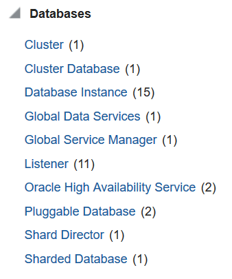
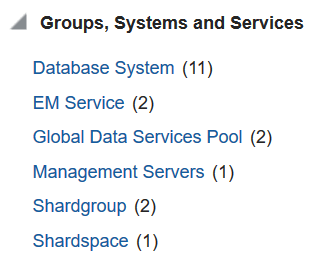
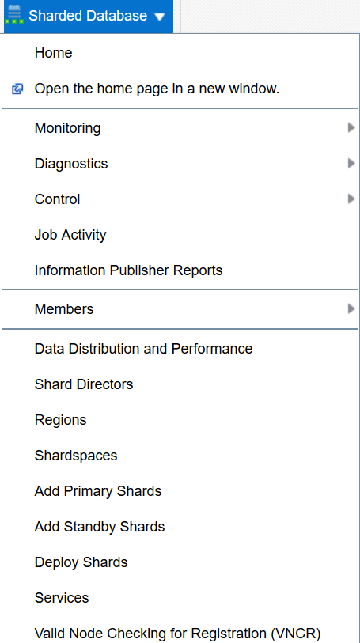
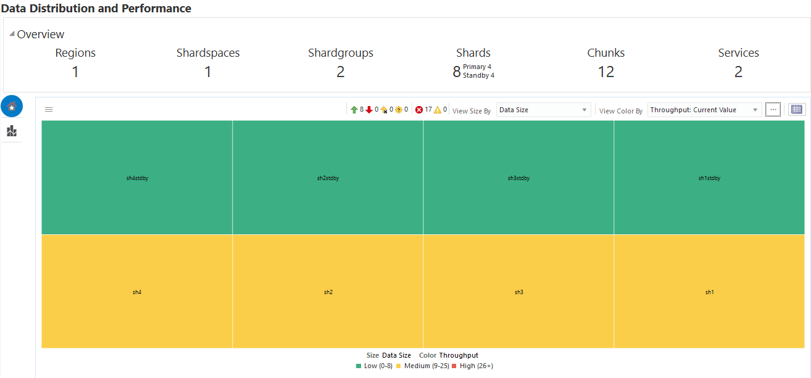
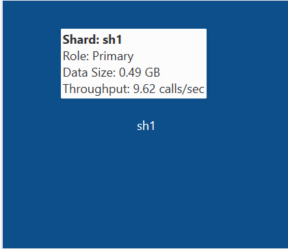
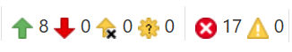
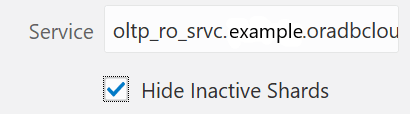
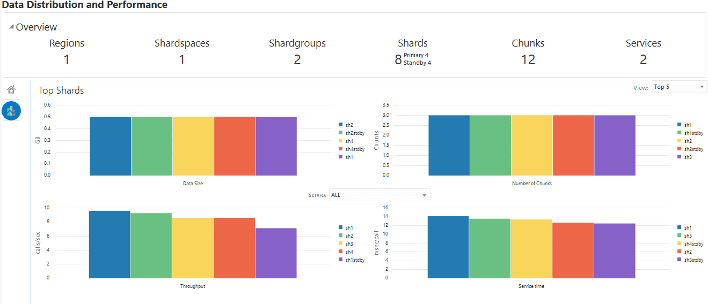
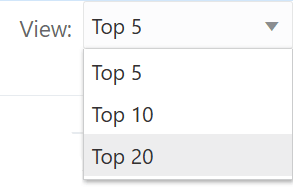
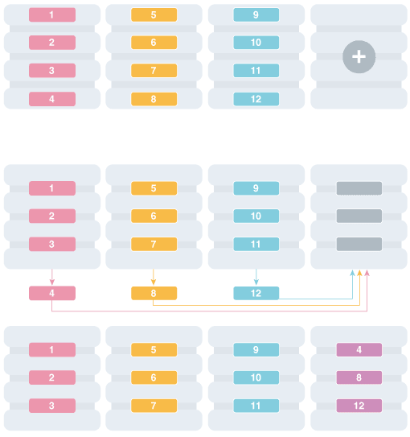

## 10 Sharded Database Administration

Oracle Sharding provides tools and some automation for the administration of a sharded database.

The following topics describe sharded database administration in detail:

### Managing the Sharding-Enabled Stack

This section describes the startup and shutdown of components in the sharded database configuration. It contains the following topics:

#### Starting Up the Sharding-Enabled Stack

The following is the recommended startup sequence of the sharding-enabled stack:

- Start the shard catalog database and local listener.

- Start the shard directors (GSMs).

- Start up the shard databases and local listeners.

- Start the global services.

- Start the connection pools and clients.

#### Shutting Down the Sharding-Enabled Stack

The following is the recommended shutdown sequence of the sharding-enabled stack:

- Shut down the connection pools and clients.

- Stop the global services.

- Shut down the shard databases and local listeners.

- Stop the shard directors (GSMs).

- Stop the shard catalog database and local listener.

### Oracle Globally Distributed Database Users and Roles

Here you will learn about the management of database users and roles specific to Oracle Globally Distributed Database.

#### Overview of Users and Roles

In Oracle Sharding some types of users require certain roles and privileges.

For sharded databases there are two kinds of users:

- Sharded database/GSM administrator - Grant this user the `GSMADMIN_ROLE` role. This role should be granted to one, or only a few accounts, that require elevated privileges to do administrative tasks. This role has a number of powerful privileges, including `ALTER SYSTEM`.

- Regular sharded database user - This type of user includes any account which has been created under `ENABLE SHARD DDL`; these users have no special privileges or roles except those needed to run a sharded application. The database administrator decides which privileges these accounts need, and grants them individually to the account.

#### Oracle Sharding Database Roles

Oracle Sharding provides a set of predefined database roles to help in sharded database administration.

Most of the Oracle Sharding database roles don't have many privileges, but they do have execute rights on certain Oracle-delivered procedures and packages which allow them to perform administrative tasks.

| Predefined Role  | Description                                                                                                        |
|:-----------------|:-------------------------------------------------------------------------------------------------------------------|
| GSMADMIN_ROLE    | Should be granted to sharded database administrators, so that they can administer a sharded database configuration |
| GSMCATUSER_ROLE  | Granted only the Oracle delivered account `GSMCATUSER` for internal use                                            |
| GSMROOTUSER_ROLE | Granted only to Oracle delivered account `GSMROOTUSER` for internal use                                            |
| GSMUSER_ROLE     | Granted only to Oracle delivered account `GSMUSER` for internal use                                                |

For more information about database roles, see [Predefined Roles in an Oracle Database Installation](../dbseg/configuring-privilege-and-role-authorization.md).

#### About the GSMUSER Account

The `GSMUSER` account is used by GDSCTL and global service managers to connect to databases in a GDS configuration.

`GSMUSER` exists by default on any Oracle database. In an Oracle Sharding configuration, the account is used to connect to shards instead of pool databases, and it must be granted both the SYSDG and SYSBACKUP system privileges after the account has been unlocked.

The password given to the `GSMUSER` account is used in the `gdsctl add shard` command. Failure to grant SYSDG and SYSBACKUP to `GSMUSER` on a new shard causes `gdsctl add shard` to fail with an ORA-1031: insufficient privileges error.

If you use the `gdsctl create shard` command to create a new shard with the Database Configuration Assistant (DBCA), the `GSMUSER` account is automatically granted the SYSDG and SYSBACKUP privileges and assigned a random password during the deployment process. Because the `GSMUSER` account never needs to be logged into interactively, the value of the password does not need to be known by administrators; however, the password can be changed after deployment if required by using the `alter user` SQL command on the shard, in combination with the `gdsctl modify shard -pwd` command.

**See Also:**

[add shard](../gsmug/gdsctl-reference.md) in Global Data Services Concepts and Administration Guide

#### About the GSMROOTUSER Account

`GSMROOTUSER` is a database account specific to Oracle Sharding that is only used when pluggable database (PDB) shards are present. The account is used by GDSCTL and global service managers to connect to the root container of container databases (CDBs) to perform administrative tasks.

If PDB shards are not in use, the GSMROOTUSER user should not by unlocked nor assigned a password on any database. However, in sharded configurations containing PDB shards, GSMROOTUSER must be unlocked and granted the SYSDG and SYSBACKUP privileges before a successful `gdsctl add cdb` command can be run. The password for the GSMROOTUSER account can be changed after deployment if desired using the `alter user` SQL command in the root container of the CDB in combination with the `gdsctl modify cdb -pwd` command.

**See Also:**

[add cdb](../gsmug/gdsctl-reference.md) in Global Data Services Concepts and Administration Guide

### Backing Up and Recovering a Sharded Database

Because shards are hosted on individual Oracle databases, you can use Oracle Maximum Availability best practices to back up and restore shards individually.

If you are using Data Guard and Oracle Active Data Guard for SDB high availability, be sure to take observers offline and disable Fast Start Failover before taking a primary or standby database offline.

Contact Oracle Support for specific steps to recover a shard in the event of a disaster.

**See Also:**

[Oracle Maximum Availability Architecture](http://www.oracle.com/goto/maa) for MAA best practices white papers

### Modifying a Sharded Database Schema

When making changes to duplicated tables or sharded tables in a sharded database, these changes should be done from the shard catalog database.

Before executing any DDL operations on a sharded database, enable sharded DDL with

    ALTER SESSION ENABLE SHARD DDL;

This statement ensures that the DDL changes will be propagated to each shard in the sharded database.

The DDL changes that are propagated are commands that are defined as “schema related,” which include operations such as `ALTER TABLE`.  There are other operations that are propagated to each shard, such as the `CREATE, ALTER, DROP` user commands for simplified user management, and `TABLESPACE` operations to simplify the creation of tablespaces on multiple shards.

`GRANT` and `REVOKE` operations can be done from the shard catalog and are propagated to each shard, providing you have enabled shard DDL for the session. If more granular control is needed you can issue the command directly on each shard.

Operations such as DBMS package calls or similar operations are not propagated. For example, operations gathering statistics on the shard catalog are not propagated to each shard.

If you perform an operation that requires a lock on a table, such as adding a not null column, it is important to remember that each shard needs to obtain the lock on the table in order to perform the DDL operation. Oracle’s best practices for applying DDL in a single instance apply to sharded environments.

Multi-shard queries, which are executed on the shard catalog, issue remote queries across database connections on each shard. In this case it is important to ensure that the user has the appropriate privileges on each of the shards, whether or not the query will return data from that shard.

**See Also:**

[Oracle Database SQL Language Reference](../sqlrf/index.md) for information about operations used with duplicated tables and sharded tables

### Propagation of Parameter Settings Across Shards

When you configure system parameter settings at the shard catalog, they are automatically propagated to all shards of the sharded database.

Before Oracle Database 19c, you had to configure `ALTER SYSTEM` parameter settings on each shard in a sharded database. In Oracle Database 19c, Oracle Sharding provides centralized management by allowing you to set parameters on the shard catalog. Then the settings are automatically propagated to all shards of the sharded database.

Propagation of system parameters happens only if done under `ENABLE SHARD DDL` on the shard catalog, then include `SHARD=ALL` in the `ALTER` statement.

    SQL>alter session enable shard ddl;
    SQL>alter system set enable_ddl_logging=true shard=all;

**Note:**

Propagation of the `enable_goldengate_replication` parameter setting is not supported.

### Migrating a Non-PDB Shard to a PDB

Do the following steps if you want to migrate shards from a legacy single-instance database to Oracle multitenant architecture.

1.  Back up each existing non-PDB shard, and then create a new CDB, and a PDB inside it.
2.  Restore each shard to the PDB inside the CDB.
3.  Run the `GDSCTL ADD CDB` command to add the new CDB.
        GDSCTL> add cdb -connect cdb_connect_string -pwd gsmrootuser_password
4.  Run the `GDSCTL ADD SHARD -REPLACE` command, specifying the connect string of the PDB, shard_connect_string, which tells the sharding infrastructure to replace the old location of the shard with new PDB location.
    For system-managed or composite sharding, run `ADD SHARD` with the parameters shown here.

        GDSCTL> add shard -replace db_unique_name_of_non_PDB -connect shard_connect_string -pwd gsmuser_password
        -shardgroup shardgroup_name -cdb cdb_name

    For user-defined sharding, the command usage is slightly different.

        GDSCTL> add shard -replace db_unique_name_of_non_PDB -connect shard_connect_string -pwd gsmuser_password
        -shardspace shardspace_name -deploy_as db_mode -cdb cdb_name

### Managing Sharded Database Software Versions

This section describes the version management of software components in the sharded database configuration. It contains the following topics:

#### Patching and Upgrading a Sharded Database

Applying an Oracle patch to a sharded database environment can be done on a single shard or all shards; however, the method you use depends on the replication option used for the environment and the type of patch being applied.

Oracle Sharding uses consolidated patching to update a shard director (GSM) ORACLE_HOME, so you must apply the Oracle Database release updates to the ORACLE_HOME to get security and Global Data Services fixes.

##### Patching a Sharded Database

Most patches can be applied to a single shard at a time; however, some patches should be applied across all shards. Use Oracle’s best practices for applying patches to single shards just as you would a non-sharded database, keeping in mind the replication method that is being used with the sharded database. Oracle `opatchauto` can be used to apply patches to multiple shards at a time, and can be done in a rolling manner. Data Guard configurations are applied one after another, and in some cases (depending on the patch) you can use Standby First patching.

When using Oracle GoldenGate be sure to apply patches in parallel across the entire shardspace. If a patch addresses an issue with multi-shard queries, replication, or the sharding infrastructure, it should be applied to all of the shards in the sharded database.

**Note:**

Because logical standbys are not supported in Oracle Sharding, rolling upgrades may run into a DDL recovery issue because a physical standby database becomes a 'transient logical standby' during a rolling upgrade. To avoid this issue, follow the steps in Performing a Rolling Upgrade.

**Note:**

Oracle GoldenGate replication support for Oracle Sharding High Availability is deprecated in Oracle Database 21c.

##### Upgrading a Sharded Database

Upgrading the Oracle Sharding environment is not much different from upgrading other Oracle Database and global service manager environments; however, the components must be upgraded in a particular sequence such that the shard catalog is upgraded first, followed by the shard directors, and finally the shards.

**See Also:**

[Oracle OPatch User's Guide](https://docs.oracle.com/pls/topic/lookup?ctx=en/database/oracle/oracle-database/19/shard&id=OPTCH149)

[Oracle Database Global Data Services Concepts and Administration Guide](../gsmug/global-data-services-config.md) for information about upgrading the shard directors.

[Oracle Data Guard Concepts and Administration](../sbydb/upgrading-patching-downgrading-oracle-data-guard-configuration.md) for information about patching and upgrading in an Oracle Data Guard configuration.

#### Performing a Rolling Upgrade

Because logical standbys are not supported in Oracle Sharding, rolling upgrades may run into a DDL recovery issue because a physical standby database becomes a 'transient logical standby' during a rolling upgrade.

To avoid this issue, perform the following steps.

1.  Shut down the shard catalog database.
    Shutting down the shard catalog database prevents any shard director (GSM) from becoming the master, and the catalog will not try to apply any DDL in this state, but the shard director will continue in steady-state allowing production applications to connect and run.
2.  Perform the rolling upgrade.
3.  When the rolling upgrade is complete, start up the shard catalog database.

**Note:**

During a rolling upgrade, some operations such as automatic failover may not be available while the shard catalog is shut down.

#### Upgrading Sharded Database Components

The order in which sharded database components are upgraded is important for limiting downtime and avoiding errors as components are brought down and back online.

Before upgrading any sharded database components you must

- Complete any pending `MOVE CHUNK` operations that are in progress.

- Do not start any new `MOVE CHUNK` operations.

- Do not add any new shards during the upgrade process.

1.  Upgrade the shards with the following points in mind.
    - For system-managed sharded databases: upgrade each set of shards in a Data Guard Broker configuration in a rolling manner.

    - For user-defined sharded databases: upgrade each set of shards in a shardspace in a rolling manner.

    - For composite sharded databases: in a given shardspace, upgrade each set of shards in a Data Guard Broker configuration in a rolling manner.

    - If you are upgrading an Oracle Database 18c sharded database configuration containing pluggable database (PDB) shards, follow the PDB-specific upgrade instructions in Compatibility and Migration from Oracle Database 18c.
2.  Upgrade the shard catalog database.
     For best results the catalog should be upgraded using a rolling database upgrade; however, global services will remain available during the upgrade if the catalog is unavailable, although service failover will not occur.
3.  Upgrade any shard directors that are used to run GDSCTL clients, and which do not also run a global service manager server.
    Shard director upgrades should be done in-place; however, an in-place upgrade causes erroneous error messages unless permissions on the following files for the following platforms are updated to 755:

    - On Linux, Solaris64, and Solaris Sparc64:

          $ORACLE_HOME/QOpatch/qopiprep.bat
          $ORACLE_HOME/jdk/bin/jcontrol
          $ORACLE_HOME/jdk/jre/bin/jcontrol

    - On AIX:

          $ORACLE_HOME/QOpatch/qopiprep.bat
          $ORACLE_HOME/jdk/jre/bin/classic/libjvm.a
          $ORACLE_HOME/jdk/bin/policytool

    - On HPI:

          $ORACLE_HOME/jdk/jre/lib/IA64N/server/Xusage.txt
          $ORACLE_HOME/jdk/jre/bin/jcontrol
          $ORACLE_HOME/QOpatch/qopiprep.bat

    - On Windows no error messages are expected.
4.  Stop, upgrade, and restart all shard director servers one at a time.
     To ensure zero downtime, at least one shard director server should always be running. Shard director servers at an earlier version than the catalog will continue to operate fully until catalog changes are made.

**See Also:**

[Oracle Data Guard Concepts and Administration](../sbydb/using-DBMS_ROLLING-to-perform-rolling-upgrade.md) for information about using DBMS_ROLLING to perform a rolling upgrade.

[Oracle Data Guard Concepts and Administration](../sbydb/upgrading-patching-downgrading-oracle-data-guard-configuration.md) for information about patching and upgrading databases in an Oracle Data Guard configuration.

#### Downgrading a Sharded Database

Oracle Sharding does not support downgrading.

Sharded database catalogs and shards cannot be downgraded.

#### Compatibility and Migration from Oracle Database 18c

When upgrading from an Oracle Database 18c installation which contains a single PDB shard for a given CDB, you must update the shard catalog metadata for any PDB.

Specifically, in 18c, the name of a PDB shard is the `DB_UNIQUE_NAME` of its CDB; however, in Oracle Database 19c, the shard names are db_unique_name_of_CDB\_pdb_name.

To update the catalog metadata to reflect this new naming methodology, and to also support the new `GSMROOTUSER` account as described in About the GSMROOTUSER Account, perform the following steps during the upgrade process as described in Upgrading Sharded Database Components.

1.  After upgrading any CDB that contains a PDB shard, ensure that the `GSMROOTUSER` account exists, is unlocked, has been assigned a password, and has been granted `SYSDG`, `SYSBACKUP`, and `gsmrootuser_role` privileges.
    The following SQL statements in SQL\*Plus will successfully set up `GSMROOTUSER` while connected to the root container (`CDB$ROOT`) of the CDB.

        SQL> alter session set "_oracle_script"=true;
        Session altered.

        SQL> create user gsmrootuser;
        User created.

        SQL> alter user gsmrootuser identified by new_GSMROOTUSER_password
          account unlock;
        User altered.

        SQL> grant sysdg, sysbackup, gsmrootuser_role to gsmrootuser container=current;
        Grant succeeded.

        SQL> alter session set "_oracle_script"=false;
        Session altered.
2.  After upgrading the catalog database to the desired Oracle Database version, run the following PL/SQL procedure to update the catalog metadata to reflect the new name for the PDB shards present in the configuration.
    This procedure must be executed for each Oracle Database 18c PDB shard.

    The first parameter to `pdb_fixup` is the value of `db_unique_name` in the CDB that contains the PDB shard. In Oracle Database 18c, this is the same as the shard name as shown by `gdsctl config shard`.

    The second parameter is the PDB name of the shard PDB as shown by `show con_name` in SQL\*Plus when connected to the shard PDB.

    The `pdb_fixup` procedure will update the catalog metadata to make it compatible with the new naming method for PDB shards.

        SQL> connect sys/password as sysdba
        Connected.
        SQL> set serveroutput on
        SQL> execute gsmadmin_internal.dbms_gsm_pooladmin.pdb_fixup('cdb1', 'pdb1');
3.  After upgrading all of the shard directors to the desired version, run the following `GDSCTL` command once for each CDB in the configuration to inform the shard directors of the password for the `GSMROOTUSER` in each CDB.
        GDSCTL> modify cdb -cdb CDB_name -pwd new_GSMROOTUSER_password

### Managing Oracle Sharded Database with Enterprise Manager Cloud Control

Oracle Enterprise Manager Cloud Control lets you discover, monitor, and manage a sharded database and its components.

See the following topics for information about sharded database discovery, monitoring, and management using Enterprise Manager Cloud Control:

- Prerequisite: Enable Sharded Database Metrics
- Prerequisite: Discover the Sharded Database Topology
- Monitoring a Sharded Database with Enterprise Manager Cloud Control
- Overview of Sharded Database Management Using Oracle Enterprise Manager Cloud Control
- Shard Management
- Chunk Management
- Shard Director Management
- Region Management
- Shardspace Management
- Shardgroup Management
- Services Management

#### Prerequisite: Enable Sharded Database Metrics

By default sharded database performance metrics are disabled. They can be enabled from the Enterprise Manager Cloud Console or the monitoring template.

There are two methods of gathering metrics, which require you to follow different setup steps as explained in each section below.

Using Default Enterprise Manager Database Metrics

By default metrics shown in the Enterprise Manager Cloud Console Sharded Database pages are the default database metrics, require that you create a metrics query user, and are only gathered on the shard databases discovered in Enterprise Manager.

The default database metrics do not give you data as frequently as the enhanced sharded database metrics described later.

Because multi-shard queries are used to gather metrics, you must also create a user that can access all shards in the sharded database to run the queries.

To use default metrics:

1.  Grant the user permission to run the cross shard queries.

        alter session enable shard ddl;

2.  Create a new metrics query account on every shard and the shard catalog manually.

        create user SHARD_SYS identified by password;
        grant connect, create session, gsmadmin_role to SHARD_SYS;
        GRANT ALL PRIVILEGES TO SHARD_SYS; /*Needed to get all the schemas stats*/
        GRANT SELECT ANY DICTIONARY TO SHARD_SYS; /*Needed to get all the schemas stats*/

3.  Use the same metrics query account credentials to discover the shard catalog and all shard databases in Enterprise Manager.

    See Prerequisite: Discovering the Sharded Database Topology

4.  To enable the default metrics:

        $emctl set property
         -sysman_pwd password
         -name oracle.sysman.db.ha.sdb.dd.usesdbmetrics
         -value false

Using Enhanced Sharded Database Metrics

With Sharded Database enhanced metrics you can gather information about the shards from the shard catalog, so it is not required that you discover all of the shard databases in Enterprise Manager to get complete metrics for the sharded database topology.

To use enhanced metrics:

1.  Discover the shard catalog in Enterprise Manager.

    See Prerequisite: Discovering the Sharded Database Topology

2.  Enable the Sharded Database metrics using the Console or using the monitoring template.

        $emctl set property
         -sysman_pwd password
         -name oracle.sysman.db.ha.sdb.dd.usesdbmetrics
         -value true

#### Discovering Sharded Database Components

In Enterprise Manager Cloud Control, you can discover the shard catalog and shard databases, then add the shard directors, sharded databases, shardspaces, and shardgroups using guided discovery.

As a prerequisite to managing the sharded database in Cloud Control, you must first discover at minimum the shard director hosts and the shard catalog database. Optionally to manage all of the shards in the sharded database, you must also discover the shard databases.

Because the shard catalog database and each of the shards is a database itself, you can use standard database discovery procedures.

Managing the shards is only possible when the individual shards are discovered using database discovery. Discovering the shards is optional to discovering a sharded database, because you can have a sharded database configuration without the shards.

1.  In Enterprise Manager Cloud Control, select Setup, choose Add Target, then choose Add Target Manually.
2.  In the Add Targets Manually page, click Add Using Guided Process in the Add Non-Host Target Using Guided Process panel.
3.  In the Add Using Guided Process dialog, locate and select Sharded Database, and click Add.
4.  In the Add Sharded Database: Catalog Database page, click the browse icon next to Catalog Database to locate the shard catalog database.
5.  In the Select Targets dialog, click the target name corresponding to the catalog database and click Select.
    The Catalog Database and Monitoring Credentials fields are filled in if they exist. The monitoring credential is used to query the shard catalog database to get the configuration information.

    The monitoring user (usually DBSNMP) should be granted the `GDS_CATALOG_SELECT` role and has read only privileges on the shard catalog repository tables.

        SQL> grant GDS_CATALOG_SELECT to dbsnmp;

    Click Next to proceed to the next step.

    In the Add Sharded Database: Components page you are shown information about the sharded database that is managed by the catalog database, including the sharded database name, its domain name, the sharding method employed on the sharded database, and a list of discovered shard directors.
6.  To set monitoring credentials on a shard director, click the plus sign icon on the right side of the list entry.
    A dialog opens allowing you to set the credentials.

    Click OK to close the dialog, and click Next to proceed to the next step.
7.  In the Add Sharded Database: Review page, verify that all of the shard directors, shardspaces, and shardgroups were discovered.
8.  Click Submit to finalize the steps.
    An Enterprise Manager Deployment Procedure is submitted and you are returned to the Add Targets Manually page.

    At the top of the page you will see information about the script that was submitted to add all of the discovered components to Cloud Control.
9.  Click the link to view the provisioning status of the sharded database components.
    In another browser window you can go to the Cloud Control All Targets page to observe the status of the sharded database.

When the target discovery procedure is finished, sharded database targets are added in Cloud Control. You can open the sharded database in Cloud Control to monitor and manage the components.

#### Overview of Sharded Database Management with Oracle Enterprise Manager Cloud Control

Your sharded database can be configured, deployed, monitored, and managed using Oracle Enterprise Manager Cloud Control

Any discovered sharded database objects can be found in the All Targets page in Enterprise Manager.

Shown below are the Oracle Sharding objects Shard Director and Shard Database in the Databases target type category.

Shown below are the Oracle Sharding objects Shardgroup and Shardspace in the Groups, Systems and Services target type category.

On the Sharded Database page, you can access most of the management tools from the Sharded Database menu, such as Add Primary Shards, Add Standby Shards, and Deploy Shards, as shown below.

Management tools for other sharded database objects are located in the menus of other Sharded Database object pages, which are described in the procedures requiring that access to those pages.

### Monitoring a Sharded Database

Sharded databases can be monitored using Enterprise Manager Cloud Control or GDSCTL.

See the following topics to use Enterprise Manager Cloud Control or GDSCTL to monitor sharded databases.

#### Querying System Objects Across Shards

Use the SHARDS() clause to query Oracle-supplied tables to gather performance, diagnostic, and audit data from V\$ views and DBA\_\* views.

The shard catalog database can be used as the entry point for centralized diagnostic operations using the SQL `SHARDS()` clause. The `SHARDS()` clause allows you to query the same Oracle supplied objects, such as V\$, DBA/USER/ALL views and dictionary objects and tables, on all of the shards and return the aggregated results.

As shown in the examples below, an object in the `FROM` part of the `SELECT` statement is wrapped in the `SHARDS()` clause to specify that this is not a query to local object, but to objects on all shards in the sharded database configuration. A virtual column called `SHARD_ID` is automatically added to a `SHARDS()`-wrapped object during execution of a multi-shard query to indicate the source of every row in the result. The same column can be used in predicate for pruning the query.

A query with the `SHARDS()` clause can only be run on the shard catalog database.

##### Examples

The following statement queries performance views

    SQL> SELECT shard_id, callspersec FROM SHARDS(v$servicemetric)
     WHERE service_name LIKE 'oltp%' AND group_id = 10;

The following statement gathers statistics.

    SQL> SELECT table_name, partition_name, blocks, num_rows
     FROM SHARDS(dba_tab_partition) p
     WHERE p.table_owner= :1;

The following example statement shows how to find the `SHARD_ID` value for each shard.

    SQL> select ORA_SHARD_ID, INSTANCE_NAME from SHARDS(sys.v_$instance);

        ORA_SHARD_ID INSTANCE_NAME
        ------------ ----------------
                   1 sh1
                  11 sh2
                  21 sh3
                  31 sh4

The following example statement shows how to use the `SHARD_ID` to prune a query.

    SQL> select ORA_SHARD_ID, INSTANCE_NAME
     from SHARDS(sys.v_$instance)
     where ORA_SHARD_ID=21;

        ORA_SHARD_ID INSTANCE_NAME
        ------------ ----------------
                  21 sh3

**See Also:**

[Oracle Database SQL Language Reference](../sqlrf/SELECT.md) for more information about the `SHARDS()` clause.

#### Monitoring a Sharded Database with GDSCTL

There are numerous `GDSCTL CONFIG` commands that you can use to obtain the health status of individual shards, shardgroups, shardspaces, and shard directors.

Monitoring a shard is just like monitoring a normal database, and standard Oracle best practices should be used to monitor the individual health of a single shard. However, it is also important to monitor the overall health of the entire sharded environment. The GDSCTL commands can also be scripted and through the use of a scheduler and can be done at regular intervals to help ensure that everything is running smoothly. When using Oracle GoldenGate for replication it is also important to monitor the lag of each replication stream.

**See Also:**

[Oracle Database Global Data Services Concepts and Administration Guide](../gsmug/gdsctl-reference.md) for information about using the `GDSCTL CONFIG` commands

#### Monitoring a Sharded Database with Enterprise Manager Cloud Control

Sharded database targets are found in the All Targets page in Enterprise Manager Cloud Control.

To monitor sharded database components you must first enable statistics gathering and then discover the sharded database. See Prerequisite: Enable Sharded Database Metrics and Discovering Sharded Database Components for more information.

##### Sharded Database Home Page

The target home page for a sharded database shows you a summary of the sharded database components and their statuses.

##### Summary

The Summary pane, in the top left of the page, shows the following information:

- Sharded Database Name: Sharded database name

- Sharded Database Domain Name: Sharded database domain name

- Catalog Database: Shard catalog database name. You can click the name to view more information about the shard catalog database.

- Catalog Version: Oracle Database version of the shard catalog

- Sharding Type: Sharding method used to shard the database. This could be System-managed, User-defined, or Composite.

- Replication Type: Replication technology used for high availability.

- Shard Directors: Number and status of the shard directors

- Master Shard Director: Master shard director name. You can click the shard director name to view more information about the master shard director, including the shard director (global service manager) version, current status, ports used, and incidents.

##### Members

The Members pane, in the upper right of the page, shows some relevant information about each of the sharded database components.

The pane is divided into tabs for each component: Shardspaces, Shardgroups, Shard Directors, Shards, Catalog Databases, and Global Services. Click on a tab to view the information about each type of component

- Shardspaces:

  Shardspaces are only displayed for databases sharded with the user-defined or composite sharding method.

  The Shardspaces tab displays the shardspace names, status, number of chunks, and protection mode. The shardspace names can be clicked to reveal more details about the selected shardspace.

  You can click the shardspace name to view more details, including information about the shardgroups within the shardspace (for composite sharding) and incidents.

- Shardgroups:

  Shardgroups are only displayed for databases sharded with the system-managed or composite sharding method.

  The Shardgroups tab displays the shardgroup names, status, the shardspace to which it belongs, the number of chunks, Data Guard role, and the region to which it belongs.

  You can click the shardgroup name to reveal more details about the selected component, including information about the shards within the shardgroup, and incidents.

  Note that for a database sharded using the system-managed sharding method, `shardspaceora` is the shardspace created by Oracle Sharding to contain all of the shardgroups. It is managed by Oracle Sharding and will not appear in the Shardspaces tab.

- Shard Directors:

  The Shard Directors tab displays the shard director names, status, region, host, and Oracle home.

  You can click the shard director names to reveal more details about the selected shard director, including the shard director (global service manager) version, current status, ports used, and incidents.

  You can also click the shard director host to view more details about the host system.

- Shards:

  The Shards tab displays the shard names, Data Guard roles, target type, target status, the shardspaces and shardgroups to which they belong, the regions to which they belong, and the state (deployed or .

  In the Names column, you can expand the primary shards to display the information about their corresponding standby shards.

  You can hover the mouse over the Deployed column icon and the deployment status details are displayed. You can click on the shard, shardspace, and shardgroup names to reveal more details about the selected component.

- Catalog Databases

  The Catalog Databases tab lists the shard catalog databases and displays the shard catalog database name, type, status, and role for each catalog database.

  You can click on the catalog database name to view more information about the database.

- Global Services:

  The Global Services tab displays the name, status, and Data Guard role of the sharded database global services. Above the list is shown the total number of services and an icon showing how many services are in a particular status. You can hover your mouse pointer over the icon to read a description of the status icon.

##### Incidents

The Incidents pane displays messages and warnings about the various components in the sharded database environment. More information about how to use this pane is in the Cloud Control online help.

##### Sharded Database Menu

The Sharded Database menu, located in the top left corner, provides you with access to tools to manage the sharded database components.

##### Target Navigation

The Target Navigation pane gives you easy access to more details about any of the components in the sharded database.

Clicking the navigation tree icon on the upper left corner of the Sharded Database home page opens the Target Navigation pane. This pane shows all of the discovered components in the sharded database in tree form.

Expanding a shardspace reveals the shardgroups in them. Expanding a shardgroup reveals the shards in that shardgroup.

Any of the component names can be clicked to view more details about them.

##### Data Distribution and Performance Page

In Enterprise Manager Cloud Control, the Sharded Database page, Data Distribution and Performance, gives you an overall view of the data in your sharded database and how the shards are performing.

##### Overview

The Overview section at the top of the page displays number of regions, shardspaces, shardgroups, shards (broken down into primary and standby), chunks, and services in the sharded database configuration that are represented by the data in the chart. If you apply a filter to the chart these numbers change.

##### Data Distribution and Performance Chart Views

The two icons at the top left corner of the chart toggle the chart between two views:

Figure 10-1 Home and Top Shards Icons

- Home: is the default view. Home displays data for all shards in the sharded database by default. You can filter the chart and change the metrics on display as described below.

- Top Shards: shows you charts for the top 5, 10, or 20 shards for certain metrics.

##### Shard Blocks

The color-coded chart displays data by shard. Each shard is indicated by a block.

Figure 10-2 Shard Block with Mouse Over Text

Each block is labeled with the shard name. Moving the mouse over a block displays the Shard name, Data Guard Role, Number of Chunks in the shard, and the Service Time (msec/call).

**Note:**

If you are using default database metrics then you will not see data from any undiscovered shards in the chart.

If you are using enhanced metrics, the data for all shards is displayed because the shards are discovered by the shard catalog.

##### Home View Summary Icons

The row of icons above the chart display the following information:

Figure 10-3 Home View Summary Icons

- Up: (Green arrow pointing up) Number of shard databases that are up

- Down: (Red arrow pointing down) Number of shards that are down

- Unmonitored: (Yellow arrow with "X") Number of shards that are unmonitored. This is the number of shards not discovered by Enterprise Manager.

- Other: (Yellow gear with question mark "?")Sharded database targets discovered in Enterprise Manager, but that have some issue with target monitoring, such as an unreachable agent, or an availability evaluation error.

- Critical: (Red circle with "X") Number of critical incidents

- Warning: (Yellow triangle with exclamation point "!") Number of warning incidents

##### Chart View Controls

Compare metrics on each of the shards by size and color of the blocks in the chart.

Figure 10-4 Chart View Controls

- View Size By: changes the size distribution of the blocks by the metric selected

- View Color By: changes the comparative color of the blocks by the metric selected

  By default, the colors are light, medium, and dark blue, which indicates that the thresholds for the lightest and darkest color categories are set to arbitrary Enterprise Manager defaults.

  Click Configure Threshold (button with three dots) to set custom thresholds for low and high categories in each metric. Charts configured with custom thresholds are shown in a different color spectrum with green=low, yellow=medium, and red=high.

- Tree Map Table View: (button with table at the top right corner of the chart) displays a table view of the data shown in the chart

##### Filters

Click the hamburger icon at the top left corner of the chart to apply filters to the data.

Figure 10-5 Filters Icon

- Shard Search: Filter by shard name. You can use an asterisk (\*) to select a group of shards with matching name patterns.

- Key Search: Lets you enter a shard key value to view the shards that contain data with that key. In the resulting chart you can right-click a block and select Shard-Level Data Distribution to drill down into a particular shard.

- SQL ID Search: Display which shards are executing a query by the SQL ID for the query, which you can find in the `V$SQL_SHARD` view in the catalog database.

- Sort By: Sort the blocks in the chart by size in the default tiled view, in a sequence of bars, or show only the top or bottom 5 blocks.

- Filter By: Lets you display only shards in the specified Role, Shardgroup, or Service.

  Hide Inactive Shards: When using the Service filter, you will see all of the shards; however, shards on which the service is not running are shown in grey (inactive), and you can use the checkbox to hide the inactive shards. 

- Group By: Toggles that display aggregates for the group, which is indicated by a box line around the group of shards.

  - Shardgroup displays a shardgroup box at the top of the grouping, which displays aggregate info about the shardgroup on hover, and you can drill down for shardgroup-based data.

  - Region displays a region box at the top of the group, which displays aggregate info about the region on hover.

  - Data Guard Aggregate Group groups each shard and its standbys as a single entity, so that you can see the data set being handled by a particular shard and its standbys as a whole.

##### Top Shards View

Click the Top Shards button on the left side of the chart to view graphs with metrics on the shards with the highest Data Size, Number of Chunks, Throughput, and Service Time.

Use the View list at the top right corner of the view to display the top 5, 10, or 20 shards in each graph.

### Shard Management

You can manage shards in your Oracle Sharding deployment with Oracle Enterprise Manager Cloud Control and GDSCTL.

The following topics describe shard management concepts and tasks:

#### About Adding Shards

New shards can be added to an existing sharded database environment to scale out and to improve fault tolerance.

For fault tolerance, it is beneficial to have many smaller shards than a few very large ones. As an application matures and the amount of data increases, you can add an entire shard or multiple shards to the SDB to increase capacity. 

When you add a shard to a sharded database, if the environment is sharded by consistent hash, then chunks from existing shards are automatically moved to the new shard to rebalance the sharded environment.

When using user-defined sharding, populating a new shard with data may require manually moving chunks from existing shards to the new shard using the GDSCTL `split chunk` and `move chunk` commands.

Oracle Enterprise Manager Cloud Control can be used to help identify chunks that would be good candidates to move, or split and move to the new shard.

When you add a shard to the environment, verify that the standby server is ready, and after the new shard is in place take backups of any shards that have been involved in a `move chunk` operation.

#### Resharding and Hot Spot Elimination

The process of redistributing data between shards, triggered by a change in the number of shards, is called resharding. Automatic resharding is a feature of the system-managed sharding method that provides elastic scalability of an SDB.

Sometimes data in an SDB needs to be migrated from one shard to another. Data migration across shards is required in the following cases:

- When one or multiple shards are added to or removed from an SDB

- When there is skew in the data or workload distribution across shards

The unit of data migration between shards is the chunk. Migrating data in chunks guaranties that related data from different sharded tables are moved together.

When a shard is added to or removed from an SDB, multiple chunks are migrated to maintain a balanced distribution of chunks and workload across shards.

Depending on the sharding method, resharding happens automatically (system-managed) or is directed by the user (composite). The following figure shows the stages of automatic resharding when a shard is added to an SDB with three shards.

Figure 10-6 Resharding an SDB

[Description of "Figure 10-6 Resharding an SDB"](img_text/admin_3v_132a.md)

A particular chunk can also be moved from one shard to another, when data or workload skew occurs, without any change in the number of shards. In this case, chunk migration can be initiated by the database administrator to eliminate the hot spot.

RMAN Incremental Backup, Transportable Tablespace, and Oracle Notification Service technologies are used to minimize impact of chunk migration on application availability. A chunk is kept online during chunk migration. There is a short period of time (a few seconds) when data stored in the chunk is available for read-only access only.

FAN-enabled clients receive a notification when a chunk is about to become read-only in the source shard, and again when the chunk is fully available in the destination shard on completion of chunk migration. When clients receive the `chunk read-only` event, they can either repeat connection attempts until the chunk migration is completed, or access the read-only chunk in the source chunk. In the latter case, an attempt to write to the chunk will result in a run-time error.

**Note:**

Running multi-shard queries while a sharded database is resharding can result in errors, so it is recommended that you do not deploy new shards during multi-shard workloads.

**See Also:**

Adding Shards to a System-Managed SDB

[Sharding Methods](architecture-and-concepts1.md)

#### Removing a Shard From the Pool

It may become necessary to remove a shard from the sharded database environment, either temporarily or permanently, without losing any data that resides on that shard.

For example, removing a shard might become necessary if a sharded environment is scaled down after a busy holiday, or to replace a server or infrastructure within the data center. Prior to decommissioning the shard, you must move all of the chunks from the shard to other shards that will remain online. As you move them, try to maintain a balance of data and activity across all of the shards.

If the shard is only temporarily removed, keep track of the chunks moved to each shard so that they can be easily identified and moved back once the maintenance is complete.

**See Also:**

About Moving Chunks

[Oracle Database Global Data Services Concepts and Administration Guide](../gsmug/gdsctl-reference.md) for information about using the `GDSCTL REMOVE SHARD` command

#### Adding Standby Shards

You can add Data Guard standby shards to an Oracle Sharding environment; however there are some limitations.

When using Data Guard as the replication method for a sharded database, Oracle Sharding supports only the addition of a primary or physical standby shard; other types of Data Guard standby databases are not supported when adding a new standby to the sharded database. However, a shard that is already part of the sharded database can be converted from a physical standby to a snapshot standby. When converting a physical standby to a snapshot standby, the following steps should be followed:

1.  Stop all global services on the shard using the GDSCTL command `STOP SERVICE`.
2.  Disable all global services on the shard using the GDSCTL command `DISABLE SERVICE`.
3.  Convert the shard to a snapshot standby using the procedure described in the Data Guard documentation.
    At this point, the shard remains part of the sharded database, but will not accept connections which use the sharding key.

If the database is converted back to a physical standby, the global services can be enabled and started again, and the shard becomes an active member of the sharded database.

**See Also:**

[Oracle Data Guard Concepts and Administration](../sbydb/managing-oracle-data-guard-physical-standby-databases.md)

#### Managing Shards with Oracle Enterprise Manager Cloud Control

You can manage database shards using Oracle Enterprise Manager Cloud Control

To manage shards using Cloud Control, they must first be discovered. Because each database shard is a database itself, you can use standard Cloud Control database discovery procedures.

The following topics describe shard management using Oracle Enterprise Manager Cloud Control:

##### Validating a Shard

Validate a shard prior to adding it to your Oracle Sharding deployment.

You can use Oracle Enterprise Manager Cloud Control to validate shards before adding them to your Oracle Sharding deployment. You can also validate a shard after deployment to confirm that the settings are still valid later in the shard lifecycle. For example, after a software upgrade you can validate existing shards to confirm correctness of their parameters and configuration.

To validate shards with Cloud Control, they should be existing targets that are being monitored by Cloud Control.

1.  From a shardgroup management page, open the Shardgroup menu, located in the top left corner of the shardgroup target page, and choose Manage Shards.
2.  If prompted, enter the shard catalog credentials, select the shard director to manage under Shard Director Credentials, select the shard director host credentials, and log in.
3.  Select a shard from the list and click Validate.
4.  Click OK to confirm you want to validate the shard.
5.  Click the link in the Information box at the top of the page to view the provisioning status of the shard.

When the shard validation script runs successfully check for errors reported in the output.

##### Adding Primary Shards

Use Oracle Enterprise Manager Cloud Control to add a primary shards to your Oracle Sharding deployment.

Primary shards should be existing targets that are being monitored by Cloud Control.

It is highly recommended that you validate a shard before adding it to your Oracle Sharding environment. You can either use Cloud Control to validate the shard (see Validating a Shard), or run the DBMS_GSM_FIX.validateShard procedure against the shard using SQL\*Plus (see Validating a Shard).

1.  Open the Sharded Database menu, located in the top left corner of the Sharded Database target page, and choose Add Primary Shards.
2.  If prompted, enter the shard catalog credentials, select the shard director to manage under Shard Director Credentials, select the shard director host credentials, and log in.
3.  Select Deploy All Shards in the sharded database to deploy all shards added to the sharded database configuration.
    The deployment operation validates the configuration of the shards and performs final configuration steps. Shards can be used only after they are deployed.
4.  Click Add.
5.  In the Database field of the Shard Details dialog, select a shard and click Select.
6.  In a composite Oracle Sharding environment you can select the shardspace to which to add the shard.
7.  Click OK.
8.  Enter the GSMUSER credentials if necessary, then click Next.
9.  Indicate when the ADD SHARD operation should occur, then click Next.
    - Immediately: the shard is provisioned upon confirmation

    - Later: schedule the timing of the shard addition using the calendar tool in the adjacent field
10. Review the configuration of the shard to be added and click Submit.
11. Click the link in the Information box at the top of the page to view the provisioning status of the shard.

If you did not select Deploy All Shards in the sharded database in the procedure above, deploy the shard in your Oracle Sharding deployment using the Deploying Shards task.

##### Adding Standby Shards

Use Oracle Enterprise Manager Cloud Control to add a standby shards to your Oracle Sharding deployment.

Standby shards should be existing targets that are being monitored by Cloud Control.

It is highly recommended that you validate a shard before adding it to your Oracle Sharding environment. You can either use Cloud Control to validate the shard (see Validating a Shard), or run the DBMS_GSM_FIX.validateShard procedure against the shard using SQL\*Plus (see Validating a Shard).

1.  Open the Sharded Database menu, located in the top left corner of the Sharded Database target page, and choose Add Standby Shards.
2.  If prompted, enter the shard catalog credentials, select the shard director to manage under Shard Director Credentials, select the shard director host credentials, and log in.
3.  Select Deploy All Shards in the sharded database to deploy all shards added to the sharded database configuration.
    The deployment operation validates the configuration of the shards and performs final configuration steps. Shards can be used only after they are deployed.
4.  Choose a primary shard for which the new shard will act as a standby in the Primary Shards list.
5.  Click Add.
6.  In the Database field of the Shard Details dialog, select the standby shard.
7.  Select the shardgroup to which to add the shard.
    Only shardgroups that do not already contain a standby for the selected primary are shown.
8.  Click OK.
9.  Enter the GSMUSER credentials if necessary, then click Next.
10. Indicate when the ADD SHARD operation should occur, then click Next.
    - Immediately: the shard is provisioned upon confirmation

    - Later: schedule the timing of the shard addition using the calendar tool in the adjacent field
11. Review the configuration of the shard to be added and click Submit.
12. Click the link in the Information box at the top of the page to view the provisioning status of the shard.

If you did not select Deploy All Shards in the sharded database in the procedure above, deploy the shard in your Oracle Sharding deployment using the Deploying Shards task.

##### Deploying Shards

Use Oracle Enterprise Manager Cloud Control to deploy shards that have been added to your Oracle Sharding environment.

1.  Open the Sharded Database menu, located in the top left corner of the Sharded Database target page, and choose Deploy Shards.
2.  If prompted, enter the shard catalog credentials, select the shard director to manage under Shard Director Credentials, select the shard director host credentials, and log in.
3.  Select the Perform Rebalance check box to redistribute data between shards automatically after the shard is deployed.
    If you want to move chunks to the shard manually, uncheck this box.
4.  Click Submit.
5.  Click the link in the Information box at the top of the page to view the provisioning status of the shard.

#### Managing Shards with GDSCTL

You can manage shards in your Oracle Sharding deployment using the GDSCTL command-line utility.

The following topics describe shard management using GDSCTL:

##### Validating a Shard

Before adding a newly created shard to a sharding configuration, you must validate that the shard has been configured correctly for the sharding environment.

Before you run `ADD SHARD`, run the `validateShard` procedure against the database that will be added as a shard. The `validateShard` procedure verifies that the target database has the initialization parameters and characteristics needed to act successfully as a shard.

The `validateShard` procedure analyzes the target database and reports any issues that need to be addressed prior to running `GDSCTL ADD SHARD` on that database. The `validateShard` procedure does not make any changes to the database or its parameters; it only reports information and possible issues.

The `validateShard` procedure takes one optional parameter that specifies whether the shard will be added to a shard catalog using Data Guard or to a shard catalog using Oracle GoldenGate as its replication technology. If you are using Data Guard, call `validateShard('DG')`.  If you are using Oracle GoldenGate, use `validateShard('OGG')`.  The default value is Data Guard if no parameter is passed to `validateShard`.

The `validateShard` procedure can also be run after the deployment of a shard to confirm that the settings are still valid later in the shard lifecycle. For example, after a software upgrade or after shard deployment, `validateShard` can be run on existing shards to confirm correctness of their parameters and configuration.

Run `validateShard` as follows:

    sqlplus / as sysdba
    SQL> set serveroutput on
    SQL> execute dbms_gsm_fix.validateShard

The following is an example of the output.

    INFO: Data Guard shard validation requested.
    INFO: Database role is PRIMARY.
    INFO: Database name is DEN27B.
    INFO: Database unique name is den27b.
    INFO: Database ID is 718463507.
    INFO: Database open mode is READ WRITE.
    INFO: Database in archivelog mode.
    INFO: Flashback is on.
    INFO: Force logging is on.
    INFO: Database platform is Linux x86 64-bit.
    INFO: Database character set is WE8DEC. This value must match the character set of
     the catalog database.
    INFO: 'compatible' initialization parameter validated successfully.
    INFO: Database is not a multitenant container database.
    INFO: Database is using a server parameter file (spfile).
    INFO: db_create_file_dest set to: '<ORACLE_BASE>/oracle/dbs2'
    INFO: db_recovery_file_dest set to: '<ORACLE_BASE>/oracle/dbs2'
    INFO: db_files=1000. Must be greater than the number of chunks and/or tablespaces
     to be created in the shard.
    INFO: dg_broker_start set to TRUE.
    INFO: remote_login_passwordfile set to EXCLUSIVE.
    INFO: db_file_name_convert set to: '/dbs/dt, /dbs/bt, dbs2/DEN27D/, dbs2/DEN27B/'
    INFO: GSMUSER account validated successfully.
    INFO: DATA_PUMP_DIR is '<ORACLE_BASE>//oracle/dbs2'.

Any lines tagged with `INFO` are informational in nature and confirm correct settings. Lines tagged with `WARNING` may or may not be issues depending on your configuration. For example, issues related to Data Guard parameters are reported, but if your configuration will only include primary databases, then any Data Guard issues can be ignored. Finally, any output with the `ERROR` tag must be corrected for the shard to deploy and operate correctly in a sharding configuration.

##### Adding Shards to a System-Managed SDB

Adding shards to a system-managed SDB elastically scales the SDB. In a system-managed SDB chunks are automatically rebalanced after the new shards are added.

To prepare a new shard host, do all of the setup procedures as you did for the initial sharded database environment including:

- [Install the Oracle Database Software](sharding-deployment.md)

1.  Connect to a shard director host, and verify the environment variables.
        $ ssh os_user@shard_director_home
        $ env |grep ORA
        ORACLE_BASE=/u01/app/oracle
        ORACLE_HOME=/u01/app/oracle/product/18.0.0/gsmhome_1
2.  Set the global service manager for the current session, and specify the credentials to administer it.
        $ gdsctl
        GDSCTL> set gsm -gsm sharddirector1
        GDSCTL> connect mysdbadmin/mysdbadmin_password
3.  Verify the current shard configuration.
        GDSCTL> config shard
        Name          Shard Group         Status    State       Region    Availability
        ----          -----------         ------    -----       ------    ------------
        sh1           primary_shardgroup  Ok        Deployed    region1   ONLINE
        sh2           standby_shardgroup  Ok        Deployed    region2   READ_ONLY
        sh3           primary_shardgroup  Ok        Deployed    region1   ONLINE
        sh4           standby_shardgroup  Ok        Deployed    region2   READ_ONLY
4.  Specify the shard group, destination, and the credentials for each new shard.
    In the examples the new shard hosts are called shard5 and shard6, and they are using the default templates for NETCA and DBCA.

        GDSCTL> add invitednode shard5
        GDSCTL> create shard -shardgroup primary_shardgroup -destination shard5
         -credential os_credential -sys_password
        GDSCTL> add invitednode shard6
        GDSCTL> create shard -shardgroup standby_shardgroup -destination shard6
         -credential os_credential -sys_password

    While creating the shards, you can also set the SYS password in the `create shard` using `-sys_password` as shown in the above example. This sets the SYS password after the shards are created during `DEPLOY`.

    The above example uses the CREATE SHARD method for creating new shards. To add a preconfigured shard using the ADD SHARD command, do the following after `ADD INVITEDNODE`:

        GDSCTL> add shard –shardgroup primary_shardgroup
         –connect shard_host:TNS_listener_port/shard_database_name
         –pwd GSMUSER_password

    If the shard to be added is a PDB, you must use the `-cdb` option in `ADD SHARD` to specify which CDB the PDB shard is in. In addition, `ADD CDB` must be used before the `ADD SHARD` command to add the CDB to the catalog. See Oracle Database Global Data Services Concepts and Administration Guide for the syntax for `ADD CDB` and `ADD SHARD`.

    **Note:**

    The valid node checking for registration (VNCR) feature provides the ability to configure and dynamically update a set of IP addresses, host names, or subnets from which registration requests are allowed by the shard directors. Database instance registration with a shard director succeeds only when the request originates from a valid node. By default, the shard management tier (based on Oracle Global Data Services framework) automatically adds a VNCR entry for the host on which a remote database is running each time `create shard` or `add shard` is executed. The automation (called auto-VNCR) finds the public IP address of the target host, and automatically adds a VNCR entry for that IP address. If the host has multiple public IP addresses, then the address on which the database registers may not be the same as the address which was added using auto-VNCR and , as a result, registration many be rejected. If the target database host has multiple public IP addresses, it is advisable that you configure VNCR manually for this host using the `add invitednode` or `add invitedsubnet` commands in GDSCTL.

    If there are multiple net-cards on the target host (`/sbin/ifconfig` returns more than one public interface), use `add invitednode` to be safe (after finding out which interface will be used to route packets).

    If there is any doubt about registration, then use `config vncr` and use `add invitednode` as necessary. There is no harm in doing this, because if the node is added already, auto-VNCR ignores it, and if you try to add it after auto-VNCR already added it, you will get a warning stating that it already exists.
5.  Run the `DEPLOY` command to create the shards and the replicas.
        GDSCTL> deploy
6.  Verify that the new shards are deployed.
        GDSCTL> config shard
        Name         Shard Group         Status    State       Region    Availability
        ----         -----------         ------    -----       ------    ------------
        sh1          primary_shardgroup  Ok        Deployed    region1   ONLINE
        sh2          standby_shardgroup  Ok        Deployed    region2   READ_ONLY
        sh3          primary_shardgroup  Ok        Deployed    region1   ONLINE
        sh4          standby_shardgroup  Ok        Deployed    region2   READ_ONLY
        sh5          primary_shardgroup  Ok        Deployed    region1   ONLINE
        sh6          standby_shardgroup  Ok        Deployed    region2   READ_ONLY
7.  Check the chunk configuration every minute or two to see the progress of automatic rebalancing of chunks.
        $ gdsctl config chunks -show_Reshard

        Chunks
        ------------------------
        Database                      From      To
        --------                      ----      --
        sh1                           1         4
        sh2                           1         4
        sh3                           7         10
        sh4                           7         10
        sh5                           5         6
        sh5                           11        12
        sh6                           5         6
        sh6                           11        12

        Ongoing chunk movement
        ------------------------
        Chunk     Source          Target             status
        -----     ------          ------             ------
8.  Observe that the shards (databases) are automatically registered.
        $ gdsctl databases

        Database: "sh1" Registered: Y State: Ok ONS: N. Role: PRIMARY Instances: 1
         Region: region1
           Service: "oltp_ro_srvc" Globally started: Y Started: N
                    Scan: N Enabled: Y Preferred: Y
           Service: "oltp_rw_srvc" Globally started: Y Started: Y
                    Scan: N Enabled: Y Preferred: Y
           Registered instances:
             cust_sdb%1
        Database: "sh2" Registered: Y State: Ok ONS: N. Role: PH_STNDBY Instances: 1
         Region: region2
           Service: "oltp_ro_srvc" Globally started: Y Started: Y
                    Scan: N Enabled: Y Preferred: Y
           Service: "oltp_rw_srvc" Globally started: Y Started: N
                    Scan: N Enabled: Y Preferred: Y
           Registered instances:
             cust_sdb%11
        Database: "sh3" Registered: Y State: Ok ONS: N. Role: PRIMARY Instances: 1
         Region: region1
           Service: "oltp_ro_srvc" Globally started: Y Started: N
                    Scan: N Enabled: Y Preferred: Y
           Service: "oltp_rw_srvc" Globally started: Y Started: Y
                    Scan: N Enabled: Y Preferred: Y
           Registered instances:
             cust_sdb%21
        Database: "sh4" Registered: Y State: Ok ONS: N. Role: PH_STNDBY Instances: 1
         Region: region2
           Service: "oltp_ro_srvc" Globally started: Y Started: Y
                    Scan: N Enabled: Y Preferred: Y
           Service: "oltp_rw_srvc" Globally started: Y Started: N
                    Scan: N Enabled: Y Preferred: Y
           Registered instances:
             cust_sdb%31
        Database: "sh5" Registered: Y State: Ok ONS: N. Role: PRIMARY Instances: 1
         Region: region1
           Service: "oltp_ro_srvc" Globally started: Y Started: N
                    Scan: N Enabled: Y Preferred: Y
           Service: "oltp_rw_srvc" Globally started: Y Started: Y
                    Scan: N Enabled: Y Preferred: Y
           Registered instances:
             cust_sdb%41
        Database: "sh6" Registered: Y State: Ok ONS: N. Role: PH_STNDBY Instances: 1
         Region: region2
           Service: "oltp_ro_srvc" Globally started: Y Started: Y
                    Scan: N Enabled: Y Preferred: Y
           Service: "oltp_rw_srvc" Globally started: Y Started: N
                    Scan: N Enabled: Y Preferred: Y
           Registered instances:
             cust_sdb%51
9.  Observe that the services are automatically brought up on the new shards.
        $ gdsctl services

        Service "oltp_ro_srvc.cust_sdb.oradbcloud" has 3 instance(s). Affinity: ANYWHERE
           Instance "cust_sdb%11", name: "sh2", db: "sh2", region: "region2", status: ready.
           Instance "cust_sdb%31", name: "sh4", db: "sh4", region: "region2", status: ready.
           Instance "cust_sdb%51", name: "sh6", db: "sh6", region: "region2", status: ready.
        Service "oltp_rw_srvc.cust_sdb.oradbcloud" has 3 instance(s). Affinity: ANYWHERE
           Instance "cust_sdb%1", name: "sh1", db: "sh1", region: "region1", status: ready.
           Instance "cust_sdb%21", name: "sh3", db: "sh3", region: "region1", status: ready.
           Instance "cust_sdb%41", name: "sh5", db: "sh5", region: "region1", status: ready.

**See Also:**

[Oracle Database Global Data Services Concepts and Administration Guide](../gsmug/gdsctl-reference.md) for information about GDSCTL command usage

##### Replacing a Shard

If a shard fails and is unrecoverable, or if you just want to move a shard to a new host for other reasons, you can replace it using the ADD SHARD -REPLACE command in GDSCTL.

When a shard database fails and the database can be recovered on the same host (using RMAN backup/restore or other methods), there is no need to replace the shard using the -replace parameter. If the shard cannot be recovered locally, or for some other reason you want to relocate the shard to another host or CDB, it is possible to create its replica on the new host. The sharding configuration can be updated with the new information by specifying the -replace option in GDSCTL command ADD SHARD.

The following are some cases where replacing a shard using ADD SHARD -REPLACE is useful.

- The server (machine) where the shard database was running suffered irreparable damage and has to be replaced

- You must replace a working server with another (more powerful, for example) server

- A shard in a PDB was relocated from one CDB to another

In all of these cases the number of shards and data distribution across shards does not change after ADD SHARD is executed; a shard is replaced with another shard that holds the same data. This is different from ADD SHARD used without the -replace option when the number of shards increases and data gets redistributed.

Upon running ADD SHARD -REPLACE, the old shard parameters, such as connect_string,  db_unique_name, and so on, are replaced with their new values. A new database can have different db_unique_name than the failed one. When replacing a standby in a Data Guard configuration, the DBID of the new database must match the old one, as Data Guard requires all of the members of the configuration to have same DBID.

##### Before Using Replace

Before you use ADD SHARD -REPLACE, verify the following:

- You have restored the database correctly (for example, using RMAN restore or other method). The new database shard must have the same sharding metadata as the failed one. Perform basic validation to ensure that you do not accidently provide a connect string to the wrong shard.

- The shard that failed must have been in a deployed state before failure happened.

- The shard that failed must be down when executing the ADD SHARD -REPLACE command.

- Fast-start failover observer must be running, if fast-start failover is enabled (which it is by default).

##### Replacing a Shard in a Data Guard Environment

The `ADD SHARD -REPLACE` command can only be used to replace a standby shard if the primary is still alive. In order to replace a primary shard that failed, wait for one of the remaining standbys to switch over to the primary role before trying to replace the failed shard.

When a switchover is not possible (primary and all the standbys are down), you must run ADD SHARD -REPLACE for each member starting with the primary. This creates a new broker configuration from scratch.

In MAXPROTECTION mode with no standbys alive, the primary database shuts down to maintain the protection mode. In this case, the primary database cannot be opened if the standby is not alive. To handle the replace operation in this scenario, you must first downgrade Data Guard protection mode using DGMGRL (to MAXAVAILABILITY or MAXPERFORMANCE) by starting up the database in mounted mode. After the protection mode is set, open the primary database and perform the replace operation using GDSCTL. After the replace operation finishes you can revert the protection mode back to the previous level using DGMGRL.

When replacing a standby in a Data Guard configuration, the DBID of the new database must match the old one, as Data Guard requires all of the members of the configuration to have same DBID.

Example 10-1 Example 1: Replacing the primary shard with no standbys in the configuration

The initial configuration has two primary shards deployed and no standbys, as shown in the following example. The Availability for shdc is shown as a dash because it has gone down in a disaster scenario.

    $ gdsctl config shard

    Name    Shard Group    Status    State       Region    Availability
    ----    -----------    ------    -----       ------    ------------
    shdb    dbs1           Ok        Deployed    east      ONLINE
    shdc    dbs1           Ok        Deployed    east      -

To recover, you create a replica of the primary from the backup, using RMAN for example. For this example, a new shard is created with db_unique_name shdd and connect string inst4. Now, the old shard, shdc, can be replaced with the new shard, shdd, as follows:

    $ gdsctl add shard -replace shdc -connect inst4 -pwd password

    DB Unique Name: SHDD

You can verify the configuration as follows:

    $ gdsctl config shard

    Name     Shard Group      Status    State       Region    Availability
    ----     -----------      ------    -----       ------    ------------
    shdb     dbs1             Ok        Deployed    east      ONLINE
    shdd     dbs1             Ok        Deployed    east      ONLINE

Example 10-2 Example 2: Replacing a standby shard

Note that you cannot replace a primary shard when the configuration contains a standby shard. In such cases, if the primary fails, the replace operation must be performed after one of the standbys becomes the new primary by automatic switchover.

The initial configuration has two shardgroups: one primary and one standby, each containing two shards, when the standby, shdd goes down.

    $ gdsctl config shard

    Name    Shard Group      Status    State       Region    Availability
    ----    -----------      ------    -----       ------    ------------
    shdb    dbs1             Ok        Deployed    east      ONLINE
    shdc    dbs1             Ok        Deployed    east      ONLINE
    shdd    dbs2             Ok        Deployed    east      -
    shde    dbs2             Ok        Deployed    east      READ ONLY

Create a new standby. Because the primary is running, this should be done using the `RMAN DUPLICATE` command with the `FOR STANDBY` option. Once the new standby, shdf, is ready, replace the old shard, shdd, as follows:

    $ gdsctl add shard -replace shdd -connect inst6 -pwd password

    DB Unique Name: shdf

You can verify the configuration as follows:

    $ gdsctl config shard

    Name    Shard Group      Status    State       Region    Availability
    ----    -----------      ------    -----       ------    ------------
    shdb    dbs1             Ok        Deployed    east      ONLINE
    shdc    dbs1             Ok        Deployed    east      ONLINE
    shde    dbs2             Ok        Deployed    east      READ ONLY
    shdf    dbs2             Ok        Deployed    east      READ ONLY

##### Replacing a Shard in an Oracle GoldenGate Environment

The GDSCTL command option ADD SHARD -REPLACE is not supported with Oracle GoldenGate.

##### Common Errors

ORA-03770: incorrect shard is given for replace

This error is thrown when the shard given for the replace operation is not the replica of the original shard. Specifically, the sharding metadata does not match the metadata stored in the shard catalog for this shard. Make sure that the database was copied correctly, preferably using RMAN. Note that this is not an exhaustive check. It is assumed that you created the replica correctly.

ORA-03768: The database to be replaced is still up: shardc

The database to be replaced must not be running when running the `add shard -replace` command. Verify this by looking at the output of GDSCTL command `config shard`. If the shard failed but still shows ONLINE in the output, wait for some time (about 2 minutes) and retry.

**See Also:**

[Oracle Database Global Data Services Concepts and Administration Guide](../gsmug/gdsctl-reference.md) for information about the ADD SHARD command.

### Chunk Management

You can manage chunks in your Oracle Sharding deployment with Oracle Enterprise Manager Cloud Control and GDSCTL.

The following topics describe chunk management concepts and tasks:

#### About Moving Chunks

Sometimes it becomes necessary to move a chunk from one shard to another. To maintain scalability of the sharded environment, it is important to attempt to maintain an equal distribution of the load and activity across all shards.

As the environment matures in a composite SDB, some shards may become more active and have more data than other shards. In order to keep a balance within the environment you must move chunks from more active servers to less active servers. There are other reasons for moving chunks:

- When a shard becomes more active than other shards, you can move a chunk to a less active shard to help redistribute the load evenly across the environment.

- When using range, list, or composite sharding, and you are adding a shard to a shardgroup.

- When using range, list, or composite sharding, and you a removing a shard from a shardgroup.

- After splitting a chunk it is often advisable to move one of the resulting chunks to a new shard.

When moving shards to maintain scalability, the ideal targets of the chunks are shards that are less active, or have a smaller portion of data. Oracle Enterprise Manager and AWR reports can help you identify the distribution of activity across the shards, and help identify shards that are good candidates for chunk movement.

**Note:**

Any time a chunk is moved from one shard to another, you should make a full backup of the databases involved in the operation (both the source of the chunk move, and the target of the chunk move.)

**See Also:**

[Oracle Database Global Data Services Concepts and Administration Guide](../gsmug/gdsctl-reference.md) for information about using the `GDSCTL MOVE CHUNK` command

#### Updating an In-Process Chunk Move Operation

While a `MOVE CHUNK` operation is in process, you can use the `GDSCTL ALTER MOVE` command to suspend, resume, or cancel any or all chunks scheduled to be moved (where the move is not yet started) in the operation.

There are three variations on this command: `-SUSPEND` is used to postpone chunk migration operation, `-RESUME` is used to restart the move process, and `-CANCEL` cancels chunk migration.

In addition, the `-CHUNK` and `-SHARD` options are used to filter the list of scheduled chunk moves. You can use the `CONFIG CHUNKS -SHOW_RESHARD` command to get a list of scheduled chunk moves.

Suspending Chunk Moves

`ALTER MOVE -SUSPEND` postpones chunk migration for a specified scope until you wish resume or cancel the operation. The shards on which to suspend operation must be specified, and you can list source and target shards. You can also specify a list of specific chunks to suspend.

If any chunk in the defined scope is already being moved (any state other than "scheduled"), that chunk will not be suspended.

For example, the following command suspends all scheduled chunk moves to or from shard1.

    GDSCTL> alter move -suspend -shard shard1

Restarting Chunk Moves

`ALTER MOVE -RESUME` resets any "move failed" flags on specified shards, and restarts any stalled or suspended chunk moves.

You can optionally provide a list of source and target shards that will have their "move failed" flags reset before the moves restart. If no shards are specified, the suspended moves are restarted once any moves in process are complete.

For example, the following command restarts chunk moves on any suspended or "failed" chunk moves scheduled to or from shard1.

    GDSCTL> alter move -resume -shard shard1

Canceling Chunk Moves

`ALTER MOVE -CANCEL` removes specified chunks from the move chunk schedule.

The `-CHUNK` option specifies that all listed chunks will be removed from the schedule, and `-SHARD` specifies that all chunk moves to/from this database will be removed from the schedule. If no chunks or shards are specified, then all chunk moves not already in process are canceled.

If any chunk in the defined scope is currently being moved (any state other than "scheduled"), that chunk move will not be canceled.

Chunks that are canceled cannot be resumed/restarted. You must issue a new `MOVE CHUNK` command to move these chunks.

For example, the following command removes chunks 1, 2, and 3 from the chunk move schedule, if they are not already being moved.

    GDSCTL> alter move -cancel -chunk 1,2,3

#### Moving Chunks

You can move chunks from one shard to another in your Oracle Sharding deployment using Oracle Enterprise Manager Cloud Control.

1.  From a shardspace management page, open the Shardspace menu, located in the top left corner of the Sharded Database target page, and choose Manage Shardgroups.
2.  Select a shardgroup in the list and click Move Chunks.
3.  In the Move Chunks dialog, select the source and destination shards between which to move the chunks.
4.  Select the chunks that you want to move by choosing one of the options.
    - Enter ID List: enter a comma separates list of chunk ID numbers

    - Select IDs From Table: click the chunk IDs in the table
5.  Indicate when the chunk move should occur.
    - Immediately: the chunk move is provisioned upon confirmation

    - Later: schedule the timing of the chunk move using the calendar tool in the adjacent field
6.  Click OK.
7.  Click the link in the Information box at the top of the page to view the provisioning status of the chunk move.

#### About Splitting Chunks

Splitting a chunk in a sharded database is required when chunks become too big, or only part of a chunk must be migrated to another shard.

Oracle Sharding supports the online split of a chunk. Theoretically it is possible to have a single chunk for each shard and split it every time data migration is required. However, even though a chunk split does not affect data availability, the split is a time-consuming and CPU-intensive operation because it scans all of the rows of the partition being split, and then inserts them one by one into the new partitions. For composite sharding, it is time consuming and may require downtime to redefine new values for the shard key or super shard key.

Therefore, it is recommended that you pre-create multiple chunks on each shard and split them either when the number of chunks is not big enough for balanced redistribution of data during re-sharding, or a particular chunk has become a hot spot.

Even with system-managed sharding, a single chunk may grow larger than other chunks or may become more active. In this case, splitting that chunk and allowing automatic resharding to move one of the resulting chunks to another shard maintains a more equal balanced distribution of data and activity across the environment.

Oracle Enterprise Manager heat maps show which chunks are more active than other chunks. Using this feature will help identify which chunks could be split, and one of the resulting chunks could then be moved to another shard to help rebalance the environment.

**See Also:**

[Oracle Database Global Data Services Concepts and Administration Guide](../gsmug/gdsctl-reference.md) for information about using the `GDSCTL SPLIT CHUNK` command

#### Splitting Chunks

You can split chunks in your Oracle Sharding deployment using Oracle Enterprise Manager Cloud Control.

1.  Open the Sharded Database menu, located in the top left corner of the Sharded Database target page, and choose Shardspaces.
2.  If prompted, enter the shard catalog credentials, select the shard director to manage under Shard Director Credentials, select the shard director host credentials, and log in.
3.  Select a shardspace in the list and click Split Chunks.
4.  Select the chunks that you want to split by choosing one of the options.
    - Enter ID List: enter a comma separate list of chunk ID numbers

    - Select IDs From Table: click the chunk IDs in the table
5.  Indicate when the chunk split should occur.
    - Immediately: the chunk split is provisioned upon confirmation

    - Later: schedule the timing of the chunk split using the calendar tool in the adjacent field
6.  Click OK.
7.  Click the link in the Information box at the top of the page to view the provisioning status of the chunk split.

When the chunk is split successfully the number of chunks is updated in the Shardspaces list. You might need to refresh the page to see the updates.

### Shard Director Management

You can add, edit, and remove shard directors in your Oracle Sharding deployment with Oracle Enterprise Manager Cloud Control.

The following topics describe shard director management tasks:

#### Creating a Shard Director

Use Oracle Enterprise Manager Cloud Control to create and add a shard director to your Oracle Sharding deployment.

1.  Open the Sharded Database menu, located in the top left corner of the Sharded Database target page, and choose Shard Directors.
2.  If prompted, enter the shard catalog credentials, select the shard director to manage under Shard Director Credentials, select the shard director host credentials, and log in.
3.  Click Create, or select a shard director from the list and click Create Like.
    Choosing Create opens the Add Shard Director dialog with default configuration values in the fields.

    Choosing Create Like opens the Add Shard Director dialog with configuration values from the selected shard director in the fields. You must select a shard director from the list to enable the Create Like option.
4.  Enter the required information in the Add Shard Director dialog, and click OK.
    **Note:**

    If you do not want the shard director to start running immediately upon creation, you must uncheck the Start Shard Director After Creation checkbox.
5.  Click OK on the confirmation dialog.
6.  Click the link in the Information box at the top of the page to view the provisioning status of the shard director.

When the shard director is created successfully it appears in the Shard Directors list. You might need to refresh the page to see the updates.

#### Editing a Shard Director Configuration

Use Oracle Enterprise Manager Cloud Control to edit a shard director configuration in your Oracle Sharding deployment.

You can change the region, ports, local endpoint, and host credentials for a shard director in Cloud Control. You cannot edit the shard director name, host, or Oracle home.

1.  Open the Sharded Database menu, located in the top left corner of the Sharded Database target page, and choose Shard Directors.
2.  If prompted, enter the shard catalog credentials, select the shard director to manage under Shard Director Credentials, select the shard director host credentials, and log in.
3.  Select a shard director from the list and click Edit.
    Note that you cannot edit the shard director name, host, or Oracle home.
4.  Edit the fields, enter the GSMCATUSER password, and click OK.
5.  Click the link in the Information box at the top of the page to view the provisioning status of the shard director configuration changes.

#### Removing a Shard Director

Use Oracle Enterprise Manager Cloud Control to remove shard directors from your Oracle Sharding deployment.

If the shard director you want to remove is the administrative shard director, as indicated by a check mark in that column of the Shard Directors list, you must choose another shard director to be the administrative shard director before removing it.

1.  Open the Sharded Database menu, located in the top left corner of the Sharded Database target page, and choose Shard Directors.
2.  If prompted, enter the shard catalog credentials, select the shard director to manage under Shard Director Credentials, select the shard director host credentials, and log in.
3.  Select a shard director from the list and click Delete.
4.  Click the link in the Information box at the top of the page to view the provisioning status of the shard director removal.

When the shard director is removed successfully it no longer appears in the Shard Directors list. You might need to refresh the page to see the changes.

### Region Management

You can add, edit, and remove regions in your Oracle Sharding deployment with Oracle Enterprise Manager Cloud Control.

The following topics describe region management tasks:

#### Creating a Region

Create sharded database regions in your Oracle Sharding deployment using Oracle Enterprise Manager Cloud Control.

1.  Open the Sharded Database menu, located in the top left corner of the Sharded Database target page, and choose Regions.
2.  If prompted, enter the shard catalog credentials, select the shard director to manage under Shard Director Credentials, select the shard director host credentials, and log in.
3.  Click Create.
4.  Enter a unique name for the region in the Create Region dialog.
5.  Optionally, select a buddy region from among the existing regions.
6.  Click OK.
7.  Click the link in the Information box at the top of the page to view the provisioning status of the region.

When the region is created successfully it appears in the Regions list. You might need to refresh the page to see the updates.

#### Editing a Region Configuration

Edit sharded database region configurations in your Oracle Sharding deployment using Oracle Enterprise Manager Cloud Control.

You can change the buddy region for a sharded database region in Cloud Control. You cannot edit the region name.

1.  Open the Sharded Database menu, located in the top left corner of the Sharded Database target page, and choose Regions.
2.  If prompted, enter the shard catalog credentials, select the shard director under Shard Director Credentials, select the shard director host credentials, and log in.
3.  Select a region from the list and click Edit.
4.  Select or remove a buddy region, and click OK.
5.  Click the link in the Information box at the top of the page to view the provisioning status of the region configuration changes.

When the region configuration is successfully updated the changes appear in the Regions list. You might need to refresh the page to see the updates.

#### Removing a Region

Remove sharded database regions in your Oracle Sharding deployment using Oracle Enterprise Manager Cloud Control.

1.  Open the Sharded Database menu, located in the top left corner of the Sharded Database target page, and choose Regions.
2.  If prompted, enter the shard catalog credentials, select the shard director under Shard Director Credentials, select the shard director host credentials, and log in.
3.  Select a region from the list and click Delete.
4.  Click the link in the Information box at the top of the page to view the provisioning status of the region removal.

When the region configuration is successfully removed the changes appear in the Regions list. You might need to refresh the page to see the updates.

### Shardspace Management

You can add, edit, and remove shardspaces in your Oracle Sharding deployment with Oracle Enterprise Manager Cloud Control.

The following topics describe shardspace management tasks:

#### Creating a Shardspace

Create shardspaces in your composite Oracle Sharding deployment using Oracle Enterprise Manager Cloud Control.

Only databases that are sharded using the composite method can have more than one shardspace. A system-managed sharded database can have only one shardspace.

1.  Open the Sharded Database menu, located in the top left corner of the Sharded Database target page, and choose Shardspaces.
2.  If prompted, enter the shard catalog credentials, select the shard director to manage under Shard Director Credentials, select the shard director host credentials, and log in.
3.  Click Create.
    **Note:**

    This option is disabled in the Shardspaces page for a system-managed sharded database.
4.  Enter the values in the fields in the Add Shardspace dialog, and click OK.
    - Name: enter a unique name for the shardspace (required)

    - Chunks: Enter the number of chunks that should be created in the shardspace (default 120)

    - Protection Mode: select the Data Guard protection mode (default Maximum Performance)
5.  Click the link in the Information box at the top of the page to view the provisioning status of the shardspace.

When the shardspace is created successfully it appears in the Shardspaces list. You might need to refresh the page to see the updates.

#### Adding a Shardspace to a Composite Sharded Database

Learn to create a new shardspace, add shards to the shardspace, create a tablespace set in the new shardspace, and add a partitionset to the sharded table for the added shardspace. Then verify that the partitions in the tables are created in the newly added shards in the corresponding tablespaces.

To add a new shardspace to an existing sharded database, make sure that the composite sharded database is deployed and all DDLs are propagated to the shards.

1.  Create a new shardspace, add shards to the shardspace, and deploy the environment.
    1.  Connect to the shard catalog database.
            GDSCTL> connect mysdbadmin/mysdbadmin_password
    2.  Add a shardspace and add a shardgroup to the shardspace.
            GDSCTL> add shardspace -chunks 8 -shardspace cust_asia
            GDSCTL> add shardgroup -shardspace cust_asia -shardgroup asia_shgrp1 -deploy_as primary -region region3
    3.  Add shards
            GDSCTL> add shard -shardgroup asia_shgrp1 –connect shard_host:TNS_listener_port/shard_database_name –pwd GSMUSER_password
            GDSCTL> add shard asia_shgrp1 –connect shard_host:TNS_listener_port/shard_database_name –pwd GSMUSER_password
    4.  Deploy the environment.
            GDSCTL> deploy

    Running `DEPLOY` ensures that all of the previous DDLs are replayed on the new shards and all of the tables are created. The partition is created in the default SYS_SHARD_TS tablespace.
2.  On the shard catalog create the tablespace set for the shardspace and add partitionsets to the sharded root table.
    1.  Create the tablespace set.
            SQL> CREATE TABLESPACE SET
              TSP_SET_3 in shardspace cust_asia using template
              (datafile size 100m autoextend on next 10M maxsize
               unlimited extent management
               local segment space management auto );
    2.  Add the partitionset.
            SQL> ALTER table customers add PARTITIONSET asia VALUES ('ASIA”') TABLESPACE SET TSP_SET_3 ;
    3.  When lobs are present, create the tablespace set for lobs and mention the lob storage information in the add partitionset command.
            SQL> alter table customers add partitionset asia VALUES ('ASIA') tablespace set TSP_SET_3 lob(docn) store as (tablespace set LOBTSP_SET_4)) ;
    4.  When the root table contains subpartitions, use the store as clause to specify the tablespace set for the subpartitions.
            SQL> alter table customers add partitionset asia VALUES ('ASIA') tablespace set TSP_SET_3 subpartitions store in(SUB_TSP_SET_1, SUB_TSP_SET_2);

    The `ADD PARTITIONSET` command ensures that the child tables are moved to the appropriate tablespaces.
3.  Verify that the partitions in the new shardspace are moved to the new tablespaces.
    Connect to the new shards and verify that the partitions are created in the new tablespace set.

        SQL> select table_name, partition_name, tablespace_name, read_only from dba_tab_partitions;

### Shardgroup Management

You can add, edit, and remove shardgroups in your Oracle Sharding deployment with Oracle Enterprise Manager Cloud Control.

The following topics describe shardgroup management tasks:

#### Creating a Shardgroup

Create shardgroups in your Oracle Sharding deployment using Oracle Enterprise Manager Cloud Control.

1.  Select a shardspace to which to add the shardgroup.
2.  Open the Shardspace menu, located in the top left corner of the shardspace target page, and choose Manage Shardgroups.
3.  Click Create.
4.  Enter values in the Create Shardgroup dialog, and click OK.
5.  Click the link in the Information box at the top of the page to view the provisioning status of the shardgroup.
    For example, with the values entered in the screenshots above, the following command is run:

        GDSCTL Command: ADD SHARDGROUP -SHARDGROUP 'north' -SHARDSPACE 'shardspaceora'
         -REGION 'north' -DEPLOY_AS 'STANDBY'

When the shardgroup is created successfully it appears in the Manage Shardgroups list. You might need to refresh the page to see the updates.

### Services Management

You can manage services in your Oracle Sharding deployment with Oracle Enterprise Manager Cloud Control.

To manage Oracle Sharding services, open the Sharded Database menu, located in the top left corner of the Sharded Database target page, and choose Services. On the Services page, using the controls at the top of the list of services, you can start, stop, enable, disable, create, edit, and delete services.

Selecting a service opens a service details list which displays the hosts and shards on which the service is running, and the status, state, and Data Guard role of each of those instances. Selecting a shard in this list allows you to enable, disable, start, and stop the service on the individual shards.

The following topics describe services management tasks:

#### Creating a Service

Create services in your Oracle Sharding deployment using Oracle Enterprise Manager Cloud Control.

1.  Open the Sharded Database menu, located in the top left corner of the Sharded Database target page, and choose Services.
2.  If prompted, enter the shard catalog credentials, select the shard director to manage under Shard Director Credentials, select the shard director host credentials, and log in.
3.  Click Create, or select a service from the list and click Create Like.
    Choosing Create opens the Create Service dialog with default configuration values in the fields.

    Choosing Create Like opens the Create Like Service dialog with configuration values from the selected service in the fields. You must select a service from the list to enable the Create Like option.
4.  Enter the required information in the dialog, and click OK.
    **Note:**

    If you do not want the service to start running immediately upon creation, you must uncheck the Start service on all shards after creation checkbox.
5.  Click the link in the Information box at the top of the page to view the provisioning status of the service.

When the service is created successfully it appears in the Services list. You might need to refresh the page to see the updates.
