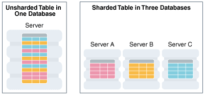
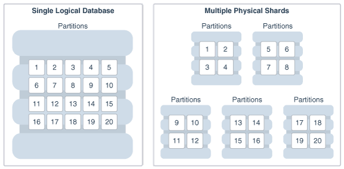

## 1 Oracle Sharding Overview

Learn about what Oracle Sharding can do in this high level conceptual discussion.

Oracle Sharding capabilities and benefits are described in the following topics:

### What is Sharding

Hyperscale computing is a computing architecture that can scale up or down quickly to meet increased demand on the system. This architecture innovation was originally driven by internet giants that run distributed sites and has been adopted by large-scale cloud providers.

Companies often achieve hyperscale computing using a technology called database sharding, in which they distribute segments of a data set—a shard—across lots of databases on lots of different computers.

Sharding uses a shared-nothing architecture in which shards share no hardware or software. All of the shards together make up a single logical database, called a sharded database.

From the perspective of the application, a sharded database looks like a single database: the number of shards, and the distribution of data across those shards, are completely transparent to database applications. From the perspective of a database administrator, a sharded database consists of multiple databases that can be managed collectively.

Figure 1-1 Distribution of a Table Across Database Shards

[Description of "Figure 1-1 Distribution of a Table Across Database Shards"](img_text/admin_3v_134a.md)

### About Oracle Sharding

Oracle Sharding is a feature of Oracle Database that lets you automatically distribute and replicate data across a pool of Oracle databases that share no hardware or software. Oracle Sharding provides the best features and capabilities of mature RDBMS and NoSQL databases, as described here.

- SQL language used for object creation, strict data consistency, complex joins, ACID transaction properties, distributed transactions, relational data store, security, encryption, robust performance optimizer, backup and recovery, and patching with Oracle Database

- Oracle innovations and enterprise-level features, including Advanced Security, Automatic Storage Management (ASM), Advanced Compression, partitioning, high-performance storage engine, SMP scalability, Oracle RAC, Exadata, in-memory columnar, online redefinition, JSON document store, and so on

- Sharding-aware Oracle Database tools, such as SQL Developer, Enterprise Manager Cloud Control, Recovery Manager (RMAN), and Data Pump, for sharded database application development and management

- Programmatic interfaces, such as Java Database Connectivity (JDBC), Oracle Call Interface (OCI), Universal Connection Pool (UCP), Oracle Data Provider for .NET (ODP.NET), and PL/SQL, including extensions for sharded application development

- Extreme availability with Oracle Data Guard and Active Data Guard.

  **Note:**

  Oracle GoldenGate replication support for Oracle Sharding High Availability is deprecated in Oracle Database 21c.

- Support for multi-model data like relational, text, and JSON

- Existing life-cycle management and operational processes can be kept, leveraging in-house and world-wide Oracle database administrator skill sets

- Enterprise-level support

- Extreme scalability and availability of NoSQL databases

### Oracle Sharding as Distributed Partitioning

Sharding is a database scaling technique based on horizontal partitioning of data across multiple independent physical databases. Each physical database in such a configuration is called a shard.

From the perspective of an application, a sharded database in Oracle Sharding looks like a single database; the number of shards, and the distribution of data across those shards, are completely transparent to the application.

Even though a sharded database looks like a single database to applications and application developers, from the perspective of a database administrator, a sharded database consists of a set of discrete Oracle databases, each of which is a single shard, that can be managed collectively.

A sharded table is partitioned across all shards of the sharded database. Table partitions on each shard are not different from partitions that could be used in an Oracle database that is not sharded.

The following figure shows the difference between partitioning on a single logical database and partitions distributed across multiple shards.

Figure 1-2 Sharding as Distributed Partitioning

[Description of "Figure 1-2 Sharding as Distributed Partitioning"](img_text/admin_3v_124a.md)

Oracle Sharding automatically distributes the partitions across shards when you execute the `CREATE SHARDED TABLE` statement, and the distribution of partitions is transparent to applications. The figure above shows the logical view of a sharded table and its physical implementation.

### Benefits of Oracle Sharding

Oracle Sharding provides linear scalability, complete fault isolation, and global data distribution for the most demanding applications.

Key benefits of Oracle Sharding include:

- Linear Scalability

  The Oracle Sharding shared–nothing architecture eliminates performance bottlenecks and provides unlimited scalability. Oracle Sharding supports scaling up to 1000 shards.

- Extreme Availability and Fault Isolation

  Single points of failure are eliminated because shards do not share resources such as software, CPU, memory, or storage devices. The failure or slow-down of one shard does not affect the performance or availability of other shards.

  Shards are protected by Oracle MAA best practice solutions, such as Oracle Data Guard and Oracle RAC.

  An unplanned outage or planned maintenance of a shard impacts only the availability of the data on that shard, so only the users of that small portion of the data are affected, for example, during a failover brownout.

- Geographical Distribution of Data

  Sharding enables Global Database where a single logical database could be distributed over multiple geographies. This makes it possible to satisfy data privacy regulatory requirements (Data Sovereignty) as well as allows to store particular data close to its consumers (Data Proximity).

### Example Applications using Database Sharding

Oracle Sharding provides benefits for a variety of use cases.

Real Time OLTP

Real time OLTP applications have a very high transaction processing throughput, a large user population, huge amounts of data, and require strict data consistency and management at scale. Some examples include internet-facing consumer applications, financial applications such as mobile payments, large scale SaaS applications such as billing and medical applications. The benefits of using Oracle Sharding for such applications include:

- Linear scalability of transactions per second, with response time staying constant as new shards are added to support larger data volume
- Better application SLAs, because planned and unplanned outages on any given shard does not impact the data stored and available on other shards
- Strict data consistency for transactional applications
- Transactions spanning multiple shards
- Support for complex joins, triggers, and stored procedures
- Simplified manageability at scale

Global Applications

Many enterprise applications are global in nature, where the same application serves customers in multiple geographic locations. Such applications typically use a single logical global database which is shared across multiple geographical regions. The benefits of a shared global database include:

- Strict enforcement of data sovereignty, where data privacy regulations require data to stay in a certain geographic location, region, country, or even state.
- Reduction of data replication across locations
- Better application SLAs, because planned and unplanned outages in one region do not impact other regions

Internet of Things and Data Streaming Applications

Typically such applications collect large amounts of data and stream it at a very high speed. Oracle Sharding has optimized data stream libraries which use Oracle Database's direct path I/O technology to load data into the sharded database with extremely high speed. Data load requirements for these applications can be in to 100s of millions of records per second. Once the data is loaded directly into the database, it is available for immediate processing with advanced query processing and analytic capabilities.

Machine Learning

Many machine learning applications require training and scoring of models in real time. Model training and scoring for many applications using algorithms like anomaly detection, and clustering is specific to a given entity (for example, a given user's financial transaction patterns or specific device metrics at a certain time of the day). This kind of data can easily be shared by using a sharding key specific to the user or devices. Additionally, Oracle Database Machine Learning algorithms can be applied directly in the database obviating the need for a separate data pipeline and machine learning processing infrastructure.

Big Data Analytics

When you have terabytes of data, sharding means you don't have to warehouse data to do analytics on it. With up to 1000 shards in capacity, Oracle Sharding can turn a relational database into a warehouse-sized data store. With the Federated Sharding solution, multiple database installations in different locations that run the same application can be converted into a federated sharded database so that you can run data analytics without moving the data.

NoSQL Alternative

NoSQL solutions lack major RDBMS features, such as relational schema, SQL, complex data types, online schema changes, multi-core scalability, security, ACID properties, CR for single-shard operations, and so on. With Oracle Sharding you get the nearly limitless scaling and sharding you had with NoSQL and all of the features and benefits of Oracle Database.

### Flexible Deployment Models

The shared-nothing architecture of Oracle Sharding lets you keep your data on-premises, in the cloud, or on a hybrid of cloud and on-premises systems. Because the database shards do not share any resources, the shards can exist anywhere on a variety of on-premises and cloud systems.

You can choose to deploy all of the shards on-premises, have them all in the cloud, or you can split them up between cloud and on-premises systems to suit your needs.

Shards can be deployed on all database deployment models such as single instance, Exadata, and Oracle RAC.

### High Availability in Oracle Sharding

Oracle Sharding is tightly integrated with Oracle Data Guard to provide high availability and disaster recovery. Replication is automatically configured and deployed when the sharded database is created.

Oracle Data Guard replication maintains one or more synchronized copies (standbys) of a shard (the primary) for high availability and data protection. Standbys can be deployed locally or remotely, and when using Oracle Active Data Guard can also be open for read-only access. Use this option when application needs strict data consistency and zero data loss.

Oracle GoldenGate is used for fine-grained active-active replication. Though applications must be able to deal with conflicts and data loss upon potential failover.

**Note:**

Oracle GoldenGate replication support for Oracle Sharding High Availability is deprecated in Oracle Database 21c.

Optionally, you can use Oracle RAC for shard-level high availability, complemented by replication, to maintain shard-level data availability in the event of a cluster outage. Each shard can be deployed on an Oracle RAC cluster to give it instant protection from node failure. For example, each shard could be a two node Oracle RAC cluster.

### Sharding Methods

Because Oracle Sharding is based on table partitioning, all of the sub-partitioning methods provided by Oracle Database are also supported by Oracle Sharding. A data sharding method controls the placement of the data on the shards. Oracle Sharding supports system-managed, user defined, or composite sharding methods.

- System-managed sharding does not require you to map data to shards. The data is automatically distributed across shards using partitioning by consistent hash. The partitioning algorithm uniformly and randomly distributes data across shards.

- User-defined sharding lets you explicitly specify the mapping of data to individual shards. It is used when, because of performance, regulatory, or other reasons, certain data needs to be stored on a particular shard, and the administrator needs to have full control over moving data between shards.

- Composite sharding allows you to use two levels of sharding. First the data is sharded by range or list and then it is sharded further by consistent hash.

  In many use cases, especially for data sovereignty and data proximity requirements, the composite sharding method offers the best of both system-managed and user-defined sharding methods, giving you the automation you want and the control over data placement you need.

### Client Request Routing

Oracle Sharding supports direct, key-based routing from an application to a shard, routing by proxy with the shard catalog, and routing to middle tiers, such as application containers, web containers, and so on, which are affinitized with shards. Oracle Database client drivers and connection pools are sharding aware.

- Key-based routing. Oracle client-side drivers (JDBC, OCI, UCP, ODP.NET) can recognize sharding keys specified in the connection string for high performance data dependent routing. A shard routing cache in the connection layer is used to route database requests directly to the shard where the data resides.

- Routing by proxy. Oracle Sharding supports routing for queries that do not specify a sharding key, giving any database application the flexibility to run SQL statements, without specifying the shards on which the query should be executed. Proxy routing can handle single-shard queries and multi-shard queries.

- Middle-tier routing. In addition to sharding the data tier, you can shard the web tier and application tier, distributing the shards of those middle tiers to service a particular set of database shards, creating a pattern known as a swim lane. A smart router can route client requests based on specific sharding keys to the appropriate swim lane, which in turn establishes connections on its subset of shards.

### Query Execution

No changes to query and DML statements are required to support Oracle Sharding. Most existing DDL statements will work the same way on a sharded database with the same syntax and semantics as they do on a non-sharded Oracle Database.

In the same way that DDL statements can be executed on all shards in a configuration, so too can certain Oracle-provided PL/SQL procedures.

Oracle Sharding also has its own keywords in the SQL DDL statements, which can only be run against a sharded database.

### High Speed Data Ingest

SQL\*Loader enables direct data loading into the database shards for a high speed data ingest.

SQL\*Loader is a bulk loader utility used for moving data from external files into the Oracle database. Its syntax is similar to that of the DB2 load utility, but comes with more options. SQL\*Loader supports various load formats, selective loading, and multi-table loads. Other benefits include:

- Streaming capability lets you receive data from a large group of clients without blocking
- Group records according to Oracle RAC shard affinity using native UCP
- Optimize CPU allocation while decoupling record processing from I/O
- Fastest insert method for the Oracle Database through Direct Path Insert, bypassing SQL and writing directly in the database files

### Deployment Automation

Sharded database deployment is highly automated with Terraform, Kubernetes, and Ansible scripts.

The deployment scripts take a simple input file describing your desired deployment topology, and run from a single host to deploy shards to all of the sharded database hosts. Pause, resume, and cleanup operations are included in the scripts in case of errors.

### Data Pump Migration

Oracle Data Pump is sharding aware and is used to migrate data from a non-sharded Oracle database to a sharded Oracle database.

You can load data directly into the shards by running Oracle Data Pump on each shard. This method is very fast because the entire data loading operation can complete within the period of time needed to load the shard with the maximum subset of the entire data set.

### Lifecycle Management of Shards

The Oracle Sharding command-line interface and Oracle Enterprise Manager help you manage your sharded database.

Using the tools provided you can:

- Provision new sharded databases with scripts
- Scale out as needed by adding more shards online and take advantage of automatic rebalancing
- Scale in by moving data and consolidating hardware when loads are low
- Monitor performance statistics using Enterprise Manager
- Back up for disaster recovery using Cloud Backup Service, RMAN, and Zero Data Loss Recovery Appliance
- Patches and Upgrades automated with oPatchAuto in rolling mode
