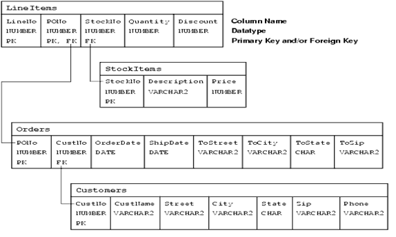
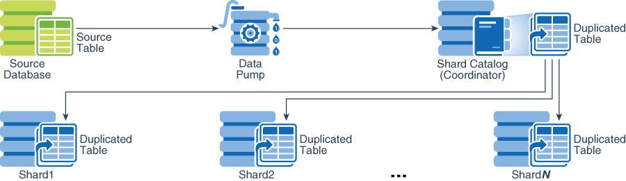
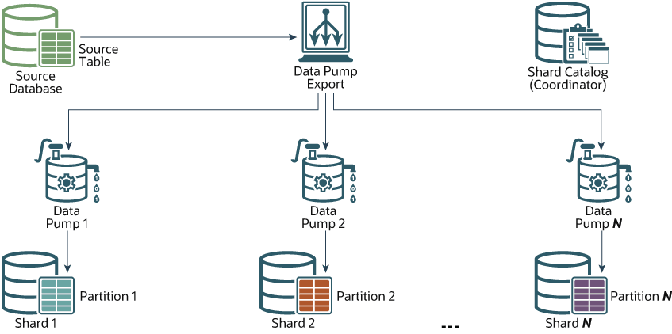

## Using Oracle Data Pump to Migrate to a Sharded Database

Using the examples and guidelines provided in the following topics, you can extract DDL definitions and data from the source database with the Oracle Data Pump export utility, and then use the Data Pump import utility against the database export files to populate the target sharded database.

If you already created the schema for your sharded database, you can go directly to the data migration topic.

### Migrating a Schema to a Sharded Database

Transition from a non-sharded database to a sharded database requires some schema changes. At a minimum, the keyword `SHARDED` or `DUPLICATED` should be added to `CREATE TABLE` statements. In some cases, the partitioning of tables should be changed as well, or a column with the shading key added.

To properly design the sharded database schema, you must analyze the schema and workload of the non-sharded database and make the following decisions.

- Which tables should be sharded and which should be duplicated
- What are the parent-child relationships between the sharded tables in the table family
- Which sharding method is used on the sharded tables
- What to use as the sharding key

If these decisions are not straightforward, you can use the Sharding Advisor to help you to make them. Sharding Advisor is a tool that you run against a non-sharded Oracle Database that you are considering to migrate to an Oracle Sharding environment.

To illustrate schema and data migration from a non-sharded to sharded database, we will use a sample data model shown in the following figure.

Figure 7-1 Schema Migration Example Data Model

[Description of "Figure 7-1 Schema Migration Example Data Model"](img_text/sample_schema.md)

The data model consists of four tables, Customers, Orders, StockItems, and LineItems, and the data model enforces the following primary key constraints.

- `Customer.(CustNo)`

- `Orders.(PONo)`

- `StockItems.(StockNo)`

- `LineItems.(LineNo, PONo)`

The data model defines the following referential integrity constraints.

- `Customers.CustNo -> Orders.CustNo`

- `Orders.PONo -> LineItems.PONo`

- `StockItems.StockNo -> LineItems.StockNo`

The following DDL statements create the example non-sharded schema definitions.

    CREATE TABLE Customers (
     CustNo     NUMBER(3) NOT NULL,
     CusName    VARCHAR2(30) NOT NULL,
     Street     VARCHAR2(20) NOT NULL,
     City       VARCHAR2(20) NOT NULL,
     State      CHAR(2) NOT NULL,
     Zip        VARCHAR2(10) NOT NULL,
     Phone      VARCHAR2(12),
     PRIMARY KEY (CustNo)
    );

    CREATE TABLE Orders (
     PoNo       NUMBER(5),
     CustNo     NUMBER(3) REFERENCES Customers,
     OrderDate  DATE,
     ShipDate   DATE,
     ToStreet   VARCHAR2(20),
     ToCity     VARCHAR2(20),
     ToState    CHAR(2),
     ToZip      VARCHAR2(10),
     PRIMARY KEY (PoNo)
    );

    CREATE TABLE LineItems (
     LineNo      NUMBER(2),
     PoNo        NUMBER(5) REFERENCES Orders,
     StockNo     NUMBER(4) REFERENCES StockItems,
     Quantity    NUMBER(2),
     Discount    NUMBER(4,2),
     PRIMARY KEY (LineNo, PoNo)
    );

    CREATE TABLE StockItems (
     StockNo     NUMBER(4) PRIMARY KEY,
     Description VARCHAR2(20),
     Price       NUMBER(6,2)
    );

### Migrating the Sample Schema

As an example, to migrate the sample schema described above to a sharded database, do the following steps.

1.  Get access to the source database export directory.
    The database administrator has to authorize the database user for required access to the database export directory, as shown here.

        CREATE OR REPLACE DIRECTORY expdir AS ‘/some/directory’;
        GRANT READ, WRITE ON DIRECTORY expdir TO uname;
        GRANT EXP_FULL_DATABASE TO uname;

    With a full database export, the database administrator must grant you the `EXP_FULL_DATABASE` role, `uname`. No additional role is required for a table level export.
2.  Extract the DDL definitions from the source database.
    A convenient way to extract the DDL statements is to create a Data Pump extract file. You can export only metadata, or only a part of the schema containing the set of tables you are interested in migrating, as shown in this example.

        expdp uname/pwd directory=EXPDIR dumpfile=sample_mdt.dmp logfile=sample_mdt.log INCLUDE=TABLE:\"IN \( \'CUSTOMERS\', \'ORDERS\', \'STOCKITEMS\', \'LINEITEMS\' \) \" CONTENT=METADATA_ONLY FLASHBACK_TIME=SYSTIMESTAMP

    Then, use the Data Pump import utility against this database export file.

        impdp uname/pwd@orignode directory=expdir dumpfile=sample_mdt.dmp sqlfile=sample_ddl.sql

    In this example, the `impdp` command does not actually perform an import of the contents of the dump file. Rather, the `sqlfile` parameter triggers the creation of a script named `sample_ddl.sql` which contains all of the DDL from within the export dump file.

    Trimming down the export in this way more efficiently captures a consistent image of the database metadata without a possibly lengthy database data dump process. You still must get the DDL statements in text format to perform the DDL modifications required by your sharded database schema design.
3.  Modify the extracted DDL statements for the sharded database.
    For the sample schema shown above, the corresponding DDL statements for the sharded database may look like the following. This is an example with system-managed sharding.

        CREATE SHARDED TABLE Customers (
         CustNo     NUMBER(3) NOT NULL,
         CusName    VARCHAR2(30) NOT NULL,
         Street     VARCHAR2(20) NOT NULL,
         City       VARCHAR2(20) NOT NULL,
         State      CHAR(2) NOT NULL,
         Zip        VARCHAR2(10) NOT NULL,
         Phone      VARCHAR2(12),
         CONSTRAINT RootPK PRIMARY KEY (CustNo)
        )
        PARTITION BY CONSISTENT HASH (CustNo)
        PARTITIONS AUTO
        TABLESPACE SET ts1
        ;

        CREATE SHARDED TABLE Orders (
         PoNo       NUMBER(5) NOT NULL,
         CustNo     NUMBER(3) NOT NULL,
         OrderDate  DATE,
         ShipDate   DATE,
         ToStreet   VARCHAR2(20),
         ToCity     VARCHAR2(20),
         ToState    CHAR(2),
         ToZip      VARCHAR2(10),
         CONSTRAINT OrderPK PRIMARY KEY (CustNo, PoNo),
         CONSTRAINT CustFK Foreign Key (CustNo) REFERENCES Customers (CustNo)
        )
        PARTITION BY REFERENCE (CustFK)
        ;
        CREATE SHARDED TABLE LineItems (
         LineNo      NUMBER(2) NOT NULL,
         PoNo        NUMBER(5) NOT NULL,
         CustNo      NUMBER(3) NOT NULL,
         StockNo     NUMBER(4) NOT NULL,
         Quantity    NUMBER(2),
         Discount    NUMBER(4,2),
         CONSTRAINT LinePK PRIMARY KEY (CustNo, LineNo, PoNo),
         CONSTRAINT LineFK FOREIGN KEY (CustNo, PoNo) REFERENCES Orders (CustNo, PoNo)
        )
        PARTITION BY REFERENCE (LineFK)
        ;

        CREATE DUPLICATED TABLE StockItems (
         StockNo     NUMBER(4) PRIMARY KEY,
         Description VARCHAR2(20),
         Price       NUMBER(6,2)
        );

    Here are some observations about the schema of the sharded database.

    - Customers-Orders-LineItems form a table family of `SHARDED` tables, with Customers as the root table and child tables are partitioned by reference. StockItems is a `DUPLICATED` table.

    - `CustNo` is chosen as the sharding key. Hence, this column must be included in all the tables of the table family. Note that in the non-sharded database, the LineItems table did not have a `CustNo` column, but it was included in the sharded version on the table. The sharding key column also needs to be present in all primary and foreign key constraints in sharded tables.

    - StockItems is now a duplicated table. The master copy of a duplicated table resides on the shard catalog database. Thus, the foreign key constraint in the LineItems table referencing StockItems table cannot be enforced and is removed.
4.  Run the modified DDLs against the target database.
    Connect to the shard catalog database and run

        ALTER SESSION ENABLE SHARD DDL;

    Then run the DDLs listed above to create the sharded and duplicated tables.

    It is recommended that you validate the sharding configuration using the `GDSCTL VALIDATE` command, before loading the data.

        gdsctl> validate

    If you see inconsistencies or errors, you must correct the problem using the `GDSCTL` commands `SHOW DDL` and `RECOVER`. After successful validation, the sharded database is ready for data loading.

### Migrating Data to a Sharded Database

Transitioning from a non-sharded database to a sharded database involves moving the data from non-sharded tables in the source database to sharded and duplicated tables in the target database.

Moving data from non-sharded tables to duplicated tables is straightforward, but moving data from non-sharded tables to sharded tables requires special attention.

#### Loading Data into Duplicated Tables

You can load data into a duplicated table using any existing database tools, such as Data Pump, SQL Loader, or plain SQL. The data must be loaded to the shard catalog database. Then it gets automatically replicated to all shards.

Because the contents of the duplicated table is fully replicated to the database shards using materialized views, loading a duplicated table may take longer than loading the same data into a regular table.

Figure 7-2 Loading Duplicated Tables

[Description of "Figure 7-2 Loading Duplicated Tables"](img_text/load_duplicate_tables.md)

#### Loading Data into Sharded Tables

When loading a sharded table, each database shard accommodates a distinct subset of the data set, so the data in each table must be split (partitioned) across shards during the load.

You can use the Oracle Data Pump utility to load the data across database shards in subsets. Data from the source database can be exported into a Data Pump dump file. Then Data Pump import can be run on each shard concurrently by using the same dump file.

The dump file can be either placed on shared storage accessible to all shards, or copied to the local storage of each shard. When importing to individual shards, Data Pump import ignores the rows that do not belong to the current shard.

Figure 7-3 Loading Sharded Tables Directly to the Database Shards

[Description of "Figure 7-3 Loading Sharded Tables Directly to the Database Shards"](img_text/load_sharded_tables_direct.md)

Loading the data directly into the shards is much faster, because all shards are loaded in parallel. It also provides linear scalability; the more shards there are in the sharded database, the higher data ingestion rate is achieved.

### Loading the Sample Schema Data

As an example, the following steps illustrate how to move the sample schema data from a non-sharded to sharded database. The syntax examples are based on the sample Customers-Orders-LineItems-StockItems schema introduced in the previous topics.

1.  Export the data from your database tables.
        expdp uname/pwd@non_sharded_db directory=expdir dumpfile=original_tables.dmp logfile=original_tables.log SCHEMAS=UNAME INCLUDE=TABLE:\"IN \( \'CUSTOMERS\', \'ORDERS\', \'STOCKITEMS\' ) \" FLASHBACK_TIME=SYSTIMESTAMP CONTENT=DATA_ONLY

    If the source table (in the non-sharded database) is partitioned, then export to dump files in non-partitioned format (`data_options=group_partition_table_data`).

    Example, if the Orders table is a partitioned table on the source database, export it as follows.

        $ cat ordexp.par
        directory=expdir
        logfile=ordexp.log
        dumpfile=ord_%U.dmp
        tables=ORDERS
        parallel=8
        COMPRESSION=ALL
        content=data_only
        DATA_OPTIONS=GROUP_PARTITION_TABLE_DATA

        $ expdp user/password parfile=ordexp.par

    Because the `SHARDED` and `DUPLICATED` tables were already created in the target database, you only export the table content (`DATA_ONLY`).

    Data Pump export utility files are consistent on a per table basis. If you want all of the tables in the export to be consistent at the same point in time, you must use the `FLASHBACK_SCN` or `FLASHBACK_TIME` parameters as shown in the example above. Having a consistent “as of” point in time database export files is recommended.
2.  Make the export file (`original_tables.dmp`) accessible by the target database nodes before you start importing the data to the sharded database.
    You can either move this file (or multiple files in the case of parallel export) to the target database system or share the file over the network.
3.  Prepare all the target databases (shard catalog and shards) for import.
    The database administrator has to authorize the database user for required access to the database import directory, as shown here.

        CREATE OR REPLACE DIRECTORY expdir AS ‘/some/directory’;
        GRANT READ, WRITE ON DIRECTORY expdir TO uname;
        GRANT IMP_FULL_DATABASE TO uname;
4.  Load the `DUPLICATED` table (StockItems) using the shard catalog.
    The following is an example of the import command.

        impdp uname/pwd@catnode:1521/ctlg directory=expdir dumpfile=original_tables.dmp logfile=imp_dup.log tables=StockItems content=DATA_ONLY
5.  Load the `SHARDED` tables on the shards directly.
    The best way to load the exported `SHARDED` tables (Customers, Orders) is to run the Data Pump on each shard (shrd1,2,…, N) directly. The following is an example of the import command on the first shard.

        impdp uname/pwd@shrdnode:1521/shrd1 directory=expdir DUMPFILE=original_tables.dmp LOGFILE=imp_shd1.log TABLES=”Customers, Orders, LineItems” CONTENT=DATA_ONLY

    Repeat this step on all of the other shards. Note that the same dump file (`original_tables.dmp`) is used to load data for all of the shards. Data Pump import will ignore rows that do not belong to the current shard. This operation can be run in parallel on all shards.

    To benefit from fast loading into very large partitioned tables with parallelism, the data pump parameter `DATA_OPTIONS` should include the value `_FORCE_PARALLEL_DML`.

        $ cat ordimp.par
        directory=expdir
        logfile=ordimp.log
        dumpfile=ord_%U.dmp
        tables=ORDERS
        parallel=8
        content=data_only
        DATA_OPTIONS=_force_parallel_dml
        $ impdp user/password parfile=ordimp.par

    You can alternatively migrate data using an external table of type `DATA PUMP`, as shown in the following example.

    1.  Export on the source database.

            CREATE TABLE ORDERS_EXT
             ORGANIZATION EXTERNAL
                ( TYPE ORACLE_DATAPUMP
                  DEFAULT DIRECTORY "expdir"
                  ACCESS PARAMETERS ( DEBUG = (3 , 33489664))
                  LOCATION ('ord1.dat',
                            'ord2.dat',
                            'ord3.dat',
                            'ord4.dat')
                )
            PARALLEL 8
            REJECT LIMIT UNLIMITED
            AS SELECT * FROM user.ORDERS;

    2.  Import into each target shard.

            CREATE TABLE ORDERS_EXT
             ORGANIZATION EXTERNAL
                ( TYPE ORACLE_DATAPUMP
                  DEFAULT DIRECTORY "expdir"
                  ACCESS PARAMETERS ( DEBUG = (3 , 33489664))
                  LOCATION ('ord1.dat',
                            'ord2.dat',
                            'ord3.dat',
                            'ord4.dat')
                )
            PARALLEL 8
            REJECT LIMIT UNLIMITED
            ;
            INSERT /*+ APPEND ENABLE_PARALLEL_DML PARALLEL(a,12) pq_distribute(a, random) */ INTO "user"."ORDERS" a
            SELECT /*+ full(b) parallel(b,12) pq_distribute(b, random)*/
            *
            FROM "ORDERS_EXT"
            WHERE <predicate*>;
            Commit;

        (\*) The predicate in the `WHERE` clause depends on the sharding method. For user-defined sharding by range, for example, it will be based on the range of CustNo on a particular shard. For system-managed (consistent hash-based) sharding, see the use case in [Using External Tables to Load Data into a Sharded Database](using-external-tables-load-data-sharded-database.md).

**Note:**

You can make Data Pump run faster by using the `PARALLEL` parameter in the `expdp` and `impdp` commands. For export, this parameter should be used in conjunction with the %U wild card in the `DUMPFILE` parameter to allow multiple dump files be created, as shown in this example.

    expdp uname/pwd@orignode SCHEMAS=uname directory=expdir dumpfile=samp_%U.dmp logfile=samp.log FLASHBACK_TIME=SYSTIMESTAMP PARALLEL=4

The above command uses four parallel workers and creates four dump files with suffixes \_01, \_02, \_03, and \_04. The same wild card can be used during the import to allow you to reference multiple input files.

### Migrating Data Without a Sharding Key

As an example, the following steps illustrate how to migrate data to a sharded table from a source table that does not contain the sharding key.

The examples of the Data Pump export and import commands in the previous topic do not include the LineItems table. The reason is that this table in the non-sharded database does not contain the sharding key column (CustNo). However, this column is required in the sharded version of the table.

Because of the schema mismatch between the non-sharded and sharded versions of the table, data migration for LineItems must be handled differently, as shown in the following steps.

1.  On the source, non-sharded, database, create a temporary view with the missing column and SQL expression to generate value for this column.
        CREATE OR REPLACE VIEW Lineitems_View AS
          SELECT l.*,
                (SELECT o.CustNo From Orders o WHERE l.PoNo=o.PoNo) CustNo
        FROM LineItems l;

    This creates a view `LineItems_View` with the column `CustNo` populated based on the foreign key relationship with the Orders table.
2.  Export the new view with VIEWS_AS_TABLES option of the data pump export utility.
        expdp uname/pwd@non_sharded_db directory=expdir DUMPFILE=original_tables_vat.dmp LOGFILE=original_tables_vat.log FLASHBACK_TIME=SYSTIMESTAMP CONTENT=DATA_ONLY TABLES=Uname.Customers,Uname.Orders,Uname.StockItems  VIEWS_AS_TABLES=Uname.LineItems_
3.  Import the data to sharded tables by directly running the data pump import on individual shards (shrd1, shrd2,.., shrdN).
    The following is an example of running the import on the first shard.

        impdp uname/pwd@shrdnode:1521/shrd1 directory=expdir DUMPFILE=original_tables_vat.dmp LOGFILE=imp_shd_vat1.log CONTENT=DATA_ONLY TABLES=Uname.Customers,Uname.Orders,Uname.LineItems_View VIEWS_AS_TABLES=Uname.LineItems_View REMAP_TABLE=Lineitems_View:Lineitems

    The examples uses the `impdp` tool `VIEWS_AS_TABLES` option to import the view `LineItems_View` exported as a table during export operation. And the parameter `REMAP_TABLE` is used to indicate that this data should actually be inserted in the original table LineItems.
