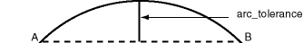
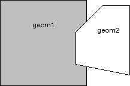
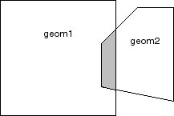
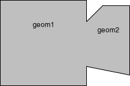
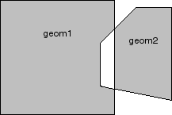

## 26  SDO_GEOM Package (Geometry)

The MDSIS.SDO_GEOM package contains subprograms for working with geometry objects.

This chapter contains descriptions of the geometry-related PL/SQL subprograms in the SDO_GEOM package, which can be grouped into the following categories:

- Relationship (True/False) between two objects: RELATE, WITHIN_DISTANCE

- Validation: VALIDATE_GEOMETRY_WITH_CONTEXT, VALIDATE_LAYER_WITH_CONTEXT, SDO_SELF_UNION

- Single-object operations: SDO_ALPHA_SHAPE, SDO_ARC_DENSIFY, SDO_AREA, SDO_BUFFER, SDO_CENTROID, SDO_CONVEXHULL, SDO_CONCAVEHULL, SDO_CONCAVEHULL_BOUNDARY, SDO_DIAMETER, SDO_DIAMETER_LINE, SDO_LENGTH, SDO_MBC, SDO_MBC_CENTER, SDO_MBC_RADIUS, SDO_MAX_MBR_ORDINATE, SDO_MIN_MBR_ORDINATE, SDO_MBR, SDO_POINTONSURFACE, SDO_TRIANGULATE, SDO_VOLUME, SDO_WIDTH, SDO_WIDTH_LINE

- Two-object operations: SDO_CLOSEST_POINTS, SDO_DISTANCE, SDO_DIFFERENCE, SDO_INTERSECTION, SDO_MAXDISTANCE, SDO_MAXDISTANCE_LINE, SDO_UNION, SDO_XOR

The following usage information applies to the geometry subprograms. (See also the Usage Notes under the reference information for each subprogram.)

- Certain combinations of input parameters and operations can return a null value, that is, an empty geometry. For example, requesting the intersection of two disjoint geometry objects returns a null value.

- A null value (empty geometry) as an input parameter to a geometry function (for example, SDO_GEOM.RELATE) produces an error.

- Certain operations can return a geometry of a different type than one or both input geometries. For example, the intersection of a line and an overlapping polygon returns a line; the intersection of two lines returns a point; and the intersection of two tangent polygons returns a line.

- SDO_GEOM subprograms are supported for two-dimensional geometries only, except for the following, which are supported for both two-dimensional and three-dimensional geometries:

  **Note:**

  The listed SDO_GEOM subprograms for three-dimensional geometries are supported only if Oracle JVM is enabled on your Oracle Autonomous Database Serverless deployments. To enable Oracle JVM, see [Use Oracle Java](https://docs.oracle.com/pls/topic/lookup?ctx=en/cloud/paas/autonomous-database&id=GUID-2516EE33-B38D-4270-BE52-30A4F9014E8B) in Using Oracle Autonomous Database Serverless for more information.
  - SDO_GEOM.RELATE with (A) the ANYINTERACT mask, or (B) the INSIDE mask (3D support for solid geometries only)

  - SDO_GEOM.SDO_AREA

  - SDO_GEOM.SDO_DISTANCE

  - SDO_GEOM.SDO_LENGTH

  - SDO_GEOM.SDO_MAX_MBR_ORDINATE

  - SDO_GEOM.SDO_MBR

  - SDO_GEOM.SDO_MIN_MBR_ORDINATE

  - SDO_GEOM.SDO_VOLUME

  - SDO_GEOM.VALIDATE_GEOMETRY_WITH_CONTEXT

  - SDO_GEOM.VALIDATE_LAYER_WITH_CONTEXT

  - SDO_GEOM.WITHIN_DISTANCE

<!-- -->

- SDO_GEOM.RELATE
- SDO_GEOM.SDO_ALPHA_SHAPE
- SDO_GEOM.SDO_ARC_DENSIFY
- SDO_GEOM.SDO_AREA
- SDO_GEOM.SDO_BUFFER
- SDO_GEOM.SDO_CENTROID
- SDO_GEOM.SDO_CLOSEST_POINTS
- SDO_GEOM.SDO_CONCAVEHULL
- SDO_GEOM.SDO_CONCAVEHULL_BOUNDARY
- SDO_GEOM.SDO_CONVEXHULL
- SDO_GEOM.SDO_DIAMETER
- SDO_GEOM.SDO_DIAMETER_LINE
- SDO_GEOM.SDO_DIFFERENCE
- SDO_GEOM.SDO_DISTANCE
- SDO_GEOM.SDO_INTERSECTION
- SDO_GEOM.SDO_LENGTH
- SDO_GEOM.SDO_MAX_MBR_ORDINATE
- SDO_GEOM.SDO_MAXDISTANCE
- SDO_GEOM.SDO_MAXDISTANCE_LINE
- SDO_GEOM.SDO_MBC
- SDO_GEOM.SDO_MBC_CENTER
- SDO_GEOM.SDO_MBC_RADIUS
- SDO_GEOM.SDO_MBR
- SDO_GEOM.SDO_MIN_MBR_ORDINATE
- SDO_GEOM.SDO_POINTONSURFACE
- SDO_GEOM.SDO_SELF_UNION
- SDO_GEOM.SDO_TRIANGULATE
- SDO_GEOM.SDO_UNION
- SDO_GEOM.SDO_VOLUME
- SDO_GEOM.SDO_WIDTH
- SDO_GEOM.SDO_WIDTH_LINE
- SDO_GEOM.SDO_XOR
- SDO_GEOM.VALIDATE_GEOMETRY_WITH_CONTEXT
- SDO_GEOM.VALIDATE_LAYER_WITH_CONTEXT
- SDO_GEOM.WITHIN_DISTANCE

**Parent topic:** [Reference Information](spatial-reference-information.md)

### 26.1 SDO_GEOM.RELATE

#### Format

    SDO_GEOM.RELATE(     
      geom1  IN SDO_GEOMETRY,      
      dim1   IN SDO_DIM_ARRAY,      
      mask   IN VARCHAR2,      
      geom2  IN SDO_GEOMETRY,      
      dim2   IN SDO_DIM_ARRAY       
    ) RETURN VARCHAR2;

or

    SDO_GEOM.RELATE(     
      geom1  IN SDO_GEOMETRY,      
      mask   IN VARCHAR2,      
      geom2  IN SDO_GEOMETRY,      
      tol    IN NUMBER       
    ) RETURN VARCHAR2;

#### Description

Examines two geometry objects to determine their spatial relationship.

#### Parameters

geom1
Geometry object.

dim1
Dimensional information array corresponding to `geom1`, usually selected from one of the xxx_SDO_GEOM_METADATA views (described in [Geometry Metadata Views](spatial-datatypes-metadata.md)).

mask
Specifies a list of relationships to check. See the list of keywords in the Usage Notes.

geom2
Geometry object.

dim2
Dimensional information array corresponding to `geom2`, usually selected from one of the xxx_SDO_GEOM_METADATA views (described in [Geometry Metadata Views](spatial-datatypes-metadata.md)).

tol
Tolerance value (see [Tolerance](spatial-concepts.md)).

#### Usage Notes

For better performance, use the [SDO_RELATE](spatial-operators-reference.md) operator or one of its convenience operator formats (all described in [Spatial Operators](spatial-operators-reference.md) ) instead of the `SDO_GEOM.RELATE` function, unless you need to use the function. For example, the DETERMINE mask keyword does not apply with the [SDO_RELATE](spatial-operators-reference.md) operator. For more information about performance considerations with operators and functions, see [Spatial Operators\_ Procedures\_ and Functions](spatial-concepts.md).

The `SDO_GEOM.RELATE` function can return the following types of answers:

- If you pass a `mask` listing one or more relationships, the function returns the specified `mask` value if one or more of the relationships are true for the pair of geometries. If all relationships are false, the procedure returns FALSE.

- If you pass the DETERMINE keyword in `mask`, the function returns the one relationship keyword that best matches the geometries.

- If you pass the ANYINTERACT keyword in `mask`, the function returns TRUE if the two geometries are not disjoint.

The following `mask` relationships can be tested:

- ANYINTERACT: Returns TRUE if the objects are not disjoint.

- CONTAINS: Returns CONTAINS if the second object is entirely within the first object and the object boundaries do not touch; otherwise, returns FALSE.

- COVEREDBY: Returns COVEREDBY if the first object is entirely within the second object and the object boundaries touch at one or more points; otherwise, returns FALSE.

- COVERS: Returns COVERS if the second object is entirely within the first object and the boundaries touch in one or more places; otherwise, returns FALSE.

- DISJOINT: Returns DISJOINT if the objects have no common boundary or interior points; otherwise, returns FALSE.

- EQUAL: Returns EQUAL if the boundaries and interior of the objects exactly overlap, including any holes (that is, if the two geometries are topologically equal); otherwise, returns FALSE.

- INSIDE: Returns INSIDE if the first object is entirely within the second object and the object boundaries do not touch; otherwise, returns FALSE.

- ON: Returns ON if the boundary and interior of a line (the first object) is completely on the boundary of a polygon (the second object); otherwise, returns FALSE.

- OVERLAPBDYDISJOINT: Returns OVERLAPBDYDISJOINT if the objects overlap, but their boundaries do not interact; otherwise, returns FALSE.

- OVERLAPBDYINTERSECT: Returns OVERLAPBDYINTERSECT if the objects overlap, and their boundaries intersect in one or more places; otherwise, returns FALSE.

- TOUCH: Returns TOUCH if the two objects share a common boundary point, but no interior points; otherwise, returns FALSE.

Values for `mask` can be combined using the logical Boolean operator OR. For example, 'INSIDE + TOUCH' returns `INSIDE+TOUCH` if the relationship between the geometries is INSIDE or TOUCH or both INSIDE and TOUCH; it returns `FALSE` if the relationship between the geometries is neither INSIDE nor TOUCH.

An exception is raised if `geom1` and `geom2` are based on different coordinate systems.

#### Examples

The following example finds the relationship between each geometry in the SHAPE column and the `cola_b` geometry. (The example uses the definitions and data from [Simple Example: Inserting\_ Indexing\_ and Querying Spatial Data](spatial-datatypes-metadata.md). The output is reformatted for readability.)

    SELECT c.name,
      SDO_GEOM.RELATE(c.shape, 'determine', c_b.shape, 0.005) relationship
      FROM cola_markets c, cola_markets c_b WHERE c_b.name = 'cola_b';

    NAME     RELATIONSHIP
    ---------------------------                                  cola_a   TOUCH
    cola_b   EQUAL
    cola_c   OVERLAPBDYINTERSECT
    cola_d   DISJOINT

#### Related Topics

- [SDO_RELATE](spatial-operators-reference.md) operator

**Parent topic:** SDO_GEOM Package (Geometry)

### 26.2 SDO_GEOM.SDO_ALPHA_SHAPE

#### Format

    SDO_GEOM.SDO_ALPHA_SHAPE(     
      geom   IN SDO_GEOMETRY,      
      tol    IN NUMBER,      
      radius IN NUMBER DEFALT NULL,      
      flag   IN BINARY_INTEGER DEFAULT 0       
    ) RETURN SDO_GEOMETRY;

#### Description

Returns the alpha shape geometry of the input geometry, based on a specified radius value.

#### Parameters

geom
Geometry object.

tol
Tolerance value (see [Tolerance](spatial-concepts.md)).

radius
Radius to be used in calculating the alpha shape. If this parameter is null, the alpha shape is the convex hull of the input geometry.

flag
Determines whether isolated points and edges are included: `0` (the default) includes isolated points and edges, so that the alpha shape is returned; `1` does not include isolated points and edges, so that only the polygon portion of the alpha shape is returned.

#### Usage Notes

The alpha shape is a generalization of the convex hull. This function takes all coordinates from the input geometry, uses them to compute Delaunay triangulations and the alpha shape.

If you specify a value for the `radius` parameter, you may first want to call the SDO_GEOM.SDO_CONCAVEHULL function using the format with the `radius` output parameter.

An exception is raised if `geom` is of point type, has fewer than three points or vertices, or consists of multiple points all in a straight line, or if `radius` is less than 0.

With geodetic data, this function is supported by approximations, as explained in [Functions Supported by Approximations with Geodetic Data](coordinate-systems-concepts.md).

#### Examples

The following example returns a geometry object that is the alpha shape of `cola_c`, which is also the convex hull of `cola_c` because the default value for the `radius` parameter (null) is used. (This simplified example uses a polygon as the input geometry; this function is normally used with a large set of point data. The example uses the definitions and data from [Simple Example: Inserting\_ Indexing\_ and Querying Spatial Data](spatial-datatypes-metadata.md).)

    SELECT c.name, SDO_GEOM.SDO_ALPHA_SHAPE(c.shape, 0.005)
      FROM cola_markets c WHERE c.name = 'cola_c';

    SDO_GEOM.SDO_ALPHA_SHAPE(C.SHAPE,0.005)(SDO_GTYPE, SDO_SRID, SDO_POINT(X, Y, Z),
    --------------------------------------------------------------------------------
    cola_c
    SDO_GEOMETRY(2003, NULL, NULL, SDO_ELEM_INFO_ARRAY(1, 1003, 1), SDO_ORDINATE_ARR
    AY(4, 5, 3, 3, 6, 3, 6, 5, 4, 5))

#### Related Topics

SDO_GEOM.SDO_CONCAVEHULL

SDO_GEOM.SDO_CONVEXHULL

**Parent topic:** SDO_GEOM Package (Geometry)

### 26.3 SDO_GEOM.SDO_ARC_DENSIFY

#### Format

    SDO_GEOM.SDO_ARC_DENSIFY(     
      geom    IN SDO_GEOMETRY,      
      dim     IN SDO_DIM_ARRAY       
      params  IN VARCHAR2      
    ) RETURN SDO_GEOMETRY;

or

    SDO_GEOM.SDO_ARC_DENSIFY(
      geom    IN SDO_GEOMETRY,      
      tol     IN NUMBER       
      params  IN VARCHAR2      
    ) RETURN SDO_GEOMETRY;

#### Description

Returns a geometry in which each circular arc in the input geometry is changed into an approximation of the circular arc consisting of straight lines, and each circle is changed into a polygon consisting of a series of straight lines that approximate the circle.

#### Parameters

geom
Geometry object.

dim
Dimensional information array corresponding to `geom`, usually selected from one of the xxx_SDO_GEOM_METADATA views (described in [Geometry Metadata Views](spatial-datatypes-metadata.md)).

tol
Tolerance value (see [Tolerance](spatial-concepts.md)).

params
A quoted string containing an arc tolerance value and optionally a unit value. See the Usage Notes for an explanation of the format and meaning.

#### Usage Notes

If you have geometries in a projected coordinate system that contain circles or circular arcs, you can use this function to densify them into regular polygons. You can then use the resulting straight-line polygon geometries for any spatial operations, or you can transform them to any projected or geodetic coordinate system.

The `params` parameter is a quoted string that can contain the `arc_tolerance` keyword, as well as the `unit` keyword to identify the unit of measurement associated with the `arc_tolerance` value. For example:

    'arc_tolerance=0.05 unit=km'

The `arc_tolerance` keyword specifies, for each arc in the geometry, the maximum length of the perpendicular line between the surface of the arc and the straight line between the start and end points of the arc. Figure 26-1 shows a line whose length is the `arc_tolerance` value for the arc between points A and B.

Figure 26-1 Arc Tolerance

[Description of "Figure 26-1 Arc Tolerance"](img_text/arc_tolerance1.md)

The `arc_tolerance` keyword value must be greater than the tolerance value associated with the geometry. (The default value for `arc_tolerance` is 20 times the tolerance value.) As you increase the `arc_tolerance` keyword value, the resulting polygon has fewer sides and a smaller area; as you decrease the `arc_tolerance` keyword value, the resulting polygon has more sides and a larger area (but never larger than the original geometry).

If the `unit` keyword is specified, the value must be an SDO_UNIT value from the MDSYS.SDO_DIST_UNITS table (for example, 'unit=KM'). If the `unit` keyword is not specified, the unit of measurement associated with the geometry is used. See [Unit of Measurement Support](spatial-datatypes-metadata.md) for more information about unit of measurement specification.

#### Examples

The following example returns the geometry that results from the arc densification of `cola_d`, which is a circle. (The example uses the definitions and data from [Simple Example: Inserting\_ Indexing\_ and Querying Spatial Data](spatial-datatypes-metadata.md).)

    -- Arc densification of the circle cola_d
    SELECT c.name, SDO_GEOM.SDO_ARC_DENSIFY(c.shape, m.diminfo,
                                           'arc_tolerance=0.05')
      FROM cola_markets c, user_sdo_geom_metadata m
      WHERE m.table_name = 'COLA_MARKETS' AND m.column_name = 'SHAPE'
      AND c.name = 'cola_d';

    NAME
    --------------------------------
    SDO_GEOM.SDO_ARC_DENSIFY(C.SHAPE,M.DIMINFO,'ARC_TOLERANCE=0.05')(SDO_GTYPE, SDO_
    --------------------------------------------------------------------------------
    cola_d
    SDO_GEOMETRY(2003, NULL, NULL, SDO_ELEM_INFO_ARRAY(1, 1003, 1), SDO_ORDINATE_ARR
    AY(8, 7, 8.76536686, 7.15224093, 9.41421356, 7.58578644, 9.84775907, 8.23463314,
     10, 9, 9.84775907, 9.76536686, 9.41421356, 10.4142136, 8.76536686, 10.8477591,
    8, 11, 7.23463314, 10.8477591, 6.58578644, 10.4142136, 6.15224093, 9.76536686, 6
    , 9, 6.15224093, 8.23463314, 6.58578644, 7.58578644, 7.23463314, 7.15224093, 8,
    7))

#### Related Topics

- [Other Considerations and Requirements with Geodetic Data](coordinate-systems-concepts.md)

- [SDO_UTIL.DENSIFY_GEOMETRY](SDO_UTIL-reference.md)

**Parent topic:** SDO_GEOM Package (Geometry)

### 26.4 SDO_GEOM.SDO_AREA

#### Format

    SDO_GEOM.SDO_AREA(     
      geom  IN SDO_GEOMETRY,      
      dim   IN SDO_DIM_ARRAY       
      [, unit  IN VARCHAR2]      
    ) RETURN NUMBER;

or

    SDO_GEOM.SDO_AREA(     
      geom  IN SDO_GEOMETRY,      
      tol   IN NUMBER       
      [, unit  IN VARCHAR2]      
    ) RETURN NUMBER;

#### Description

Returns the area of a two-dimensional polygon.

#### Parameters

geom
Geometry object.

dim
Dimensional information array corresponding to `geom`, usually selected from one of the xxx_SDO_GEOM_METADATA views (described in [Geometry Metadata Views](spatial-datatypes-metadata.md)).

unit
Unit of measurement: a quoted string with `unit=` and an SDO_UNIT value from the MDSYS.SDO_AREA_UNITS table (for example, 'unit=SQ_KM'). See [Unit of Measurement Support](spatial-datatypes-metadata.md) for more information about unit of measurement specification.

If this parameter is not specified, the unit of measurement associated with the data is assumed. For geodetic data, the default unit of measurement is square meters.

tol
Tolerance value (see [Tolerance](spatial-concepts.md)).

#### Usage Notes

This function works with any polygon, including polygons with holes.

Lines that close to form a ring have no area.

#### Examples

The following example returns the areas of geometry objects stored in the COLA_MARKETS table. The first statement returns the areas of all objects; the second returns just the area of `cola_a`. (The example uses the definitions and data from [Simple Example: Inserting\_ Indexing\_ and Querying Spatial Data](spatial-datatypes-metadata.md).)

    -- Return the areas of all cola markets.
    SELECT name, SDO_GEOM.SDO_AREA(shape, 0.005) FROM cola_markets;

    NAME                             SDO_GEOM.SDO_AREA(SHAPE,0.005)
    -------------------------------- ------------------------------
    cola_a                                                       24
    cola_b                                                     16.5
    cola_c                                                        5
    cola_d                                               12.5663706

    -- Return the area of just cola_a.
    SELECT c.name, SDO_GEOM.SDO_AREA(c.shape, 0.005) FROM cola_markets c
       WHERE c.name = 'cola_a';

    NAME                             SDO_GEOM.SDO_AREA(C.SHAPE,0.005)
    -------------------------------- --------------------------------
    cola_a                                                         24

#### Related Topics

None.

**Parent topic:** SDO_GEOM Package (Geometry)

### 26.5 SDO_GEOM.SDO_BUFFER

#### Format

    SDO_GEOM.SDO_BUFFER(     
      geom   IN SDO_GEOMETRY,      
      dim    IN SDO_DIM_ARRAY,      
      dist   IN NUMBER      
      [, params  IN VARCHAR2]      
    ) RETURN SDO_GEOMETRY;

or

    SDO_GEOM.SDO_BUFFER(     
      geom   IN SDO_GEOMETRY,      
      dist   IN NUMBER,      
      tol    IN NUMBER       
      [, params  IN VARCHAR2]      
    ) RETURN SDO_GEOMETRY;

#### Description

Generates a buffer polygon around or inside a geometry object.

#### Parameters

geom
Geometry object.

dim
Dimensional information array corresponding to `geom`, usually selected from one of the xxx_SDO_GEOM_METADATA views (described in [Geometry Metadata Views](spatial-datatypes-metadata.md)).

dist
Distance value. If the value is positive, the buffer is generated around the geometry; if the value is negative (valid only for polygons), the buffer is generated inside the geometry. The absolute value of this parameter must be greater than the tolerance value, as specified in the dimensional array (`dim` parameter) or in the `tol` parameter.

tol
Tolerance value (see [Tolerance](spatial-concepts.md)).

params
A quoted string that can contain one or both of the following keywords:

- `unit` and an SDO_UNIT value from the MDSYS.SDO_DIST_UNITS table. It identifies the unit of measurement associated with the `dist` parameter value, and also with the arc tolerance value if the `arc_tolerance` keyword is specified. See [Unit of Measurement Support](spatial-datatypes-metadata.md) for more information about unit of measurement specification.

- `arc_tolerance` and an arc tolerance value. See the Usage Notes for the SDO_GEOM.SDO_ARC_DENSIFY function in this chapter for more information about the `arc_tolerance` keyword.

For example: `'unit=km arc_tolerance=0.05'`

If the input geometry is geodetic data and if `arc_tolerance` is not specified, the default value is the tolerance value multiplied by 20. Spatial and Graph uses the `arc_tolerance` value to perform arc densification in computing the result. If the input geometry is Cartesian or projected data, `arc_tolerance` has no effect and should not be specified.

If this parameter is not specified for a Cartesian or projected geometry, or if the `arc_tolerance` keyword is specified for a geodetic geometry but the `unit` keyword is not specified, the unit of measurement associated with the data is assumed.

#### Usage Notes

This function returns a geometry object representing the buffer polygon.

This function creates a rounded buffer around a point, line, or polygon, or inside a polygon. The buffer within a void is also rounded, and is the same distance from the inner boundary as the outer buffer is from the outer boundary. (For an illustration, see the distance buffers figure in [Spatial Relationships and Filtering](spatial-concepts.md).)

If the buffer polygon geometry is in a projected coordinate system, it will contain arcs; and if you want to transform that geometry to a geodetic coordinate system, you must first densify it using the SDO_GEOM.SDO_ARC_DENSIFY function, and then transform the densified geometry.

If the input geometry has more than 50 ordinates, and the buffer width is less than 0.1 percent (0.001) of the root-mean-square spacing between consecutive coordinates, then the original geometry is returned unchanged.

With geodetic data, this function is supported by approximations, as explained in [Functions Supported by Approximations with Geodetic Data](coordinate-systems-concepts.md).

With geodetic data, this function should be used only for relatively small geometries: geometries for which the local tangent plane projection that is used for internal computations does not introduce significant distortions or errors. This limits the applicable domain of source geometries, whether line strings or polygons, to approximately the area of Texas (United States), France, or Manchuria province (China).

#### Examples

The following example returns a polygon representing a buffer of 1 around `cola_a`. Note the rounded corners (for example, at .292893219,.292893219) in the returned polygon. (The example uses the non-geodetic definitions and data from [Simple Example: Inserting\_ Indexing\_ and Querying Spatial Data](spatial-datatypes-metadata.md).)

    -- Generate a buffer of 1 unit around a geometry.
    SELECT c.name, SDO_GEOM.SDO_BUFFER(c.shape, m.diminfo, 1)
      FROM cola_markets c, user_sdo_geom_metadata m
      WHERE m.table_name = 'COLA_MARKETS'  AND m.column_name = 'SHAPE'
      AND c.name = 'cola_a';

    NAME
    --------------------------------
    SDO_GEOM.SDO_BUFFER(C.SHAPE,M.DIMINFO,1)(SDO_GTYPE, SDO_SRID, SDO_POINT(X, Y, Z)
    --------------------------------------------------------------------------------
    cola_a
    SDO_GEOMETRY(2003, NULL, NULL, SDO_ELEM_INFO_ARRAY(1, 1005, 8, 1, 2, 2, 5, 2, 1,
     7, 2, 2, 11, 2, 1, 13, 2, 2, 17, 2, 1, 19, 2, 2, 23, 2, 1), SDO_ORDINATE_ARRAY(
    0, 1, .292893219, .292893219, 1, 0, 5, 0, 5.70710678, .292893219, 6, 1, 6, 7, 5.
    70710678, 7.70710678, 5, 8, 1, 8, .292893219, 7.70710678, 0, 7, 0, 1))

The following example returns a polygon representing a buffer of 1 around `cola_a` using the geodetic definitions and data from [Example of Coordinate System Transformation](coordinate-systems-concepts.md).

    -- Generate a buffer of 1 kilometer around a geometry.
    SELECT c.name, SDO_GEOM.SDO_BUFFER(c.shape, m.diminfo, 1,
                                      'unit=km arc_tolerance=0.05')
     FROM cola_markets c, user_sdo_geom_metadata m
     WHERE m.table_name = 'COLA_MARKETS'
     AND m.column_name = 'SHAPE' AND c.name = 'cola_a';

    NAME
    --------------------------------
    SDO_GEOM.SDO_BUFFER(C.SHAPE,M.DIMINFO,1,'UNIT=KMARC_TOLERANCE=0.05')(SDO_GTYPE,
    --------------------------------------------------------------------------------
    cola_a
    SDO_GEOMETRY(2003, 8307, NULL, SDO_ELEM_INFO_ARRAY(1, 1003, 1), SDO_ORDINATE_ARR
    AY(.991023822, 1.00002073, .992223711, .995486419, .99551726, .99217077, 1.00001
    929, .990964898, 4.99998067, .990964929, 5.00448268, .9921708, 5.00777624, .9954
    86449, 5.00897618, 1.00002076, 5.00904194, 6.99997941, 5.00784065, 7.00450033, 5
    .00454112, 7.00781357, 5.00002479, 7.009034, .999975166, 7.00903403, .995458814,
     7.00781359, .992159303, 7.00450036, .990958058, 6.99997944, .991023822, 1.00002
    073))

#### Related Topics

- SDO_GEOM.SDO_UNION

- SDO_GEOM.SDO_INTERSECTION

- SDO_GEOM.SDO_XOR

**Parent topic:** SDO_GEOM Package (Geometry)

### 26.6 SDO_GEOM.SDO_CENTROID

#### Format

    SDO_GEOM.SDO_CENTROID(     
      geom1  IN SDO_GEOMETRY,      
      dim1   IN SDO_DIM_ARRAY       
    ) RETURN SDO_GEOMETRY;

or

    SDO_GEOM.SDO_CENTROID(     
      geom1  IN SDO_GEOMETRY,      
      tol    IN NUMBER       
    ) RETURN SDO_GEOMETRY;

#### Description

Returns a point geometry that is the centroid of a polygon, multipolygon, point, or point cluster. (The centroid is also known as the "center of gravity.")

For an input geometry consisting of multiple objects, the result is weighted by the area of each polygon in the geometry objects. If the geometry objects are a mixture of polygons and points, the points are not used in the calculation of the centroid. If the geometry objects are all points, the points have equal weight.

#### Parameters

geom1
Geometry object.

dim1
Dimensional information array corresponding to `geom`, usually selected from one of the xxx_SDO_GEOM_METADATA views (described in [Geometry Metadata Views](spatial-datatypes-metadata.md)).

tol
Tolerance value (see [Tolerance](spatial-concepts.md)).

#### Usage Notes

The function returns a null value if `geom1` is not a polygon, multipolygon, point, or point cluster, as identified by the SDO_GTYPE value in the SDO_GEOMETRY object.

If `geom1` is a point, the function returns the point (the input geometry).

With geodetic data, this function is supported by approximations, as explained in [Functions Supported by Approximations with Geodetic Data](coordinate-systems-concepts.md).

Depending on the shape and complexity of the input geometry, the returned point might not be on the surface of the input geometry.

#### Examples

The following example returns a geometry object that is the centroid of `cola_c`. (The example uses the definitions and data from [Simple Example: Inserting\_ Indexing\_ and Querying Spatial Data](spatial-datatypes-metadata.md).)

    -- Return the centroid of a geometry.
    SELECT c.name, SDO_GEOM.SDO_CENTROID(c.shape, m.diminfo)
      FROM cola_markets c, user_sdo_geom_metadata m
      WHERE m.table_name = 'COLA_MARKETS' AND m.column_name = 'SHAPE'
      AND c.name = 'cola_c';

    NAME
    --------------------------------
    SDO_GEOM.SDO_CENTROID(C.SHAPE,M.DIMINFO)(SDO_GTYPE, SDO_SRID, SDO_POINT(X, Y, Z)
    --------------------------------------------------------------------------------
    cola_c
    SDO_GEOMETRY(2001, NULL, NULL, SDO_ELEM_INFO_ARRAY(1, 1, 1), SDO_ORDINATE_ARRAY(
    4.73333333, 3.93333333))

#### Related Topics

None.

**Parent topic:** SDO_GEOM Package (Geometry)

### 26.7 SDO_GEOM.SDO_CLOSEST_POINTS

#### Format

    SDO_GEOM.SDO_CLOSEST_POINTS(     
      geom1          IN SDO_GEOMETRY,      
      geom2          IN SDO_GEOMETRY,      
      tolerance      IN NUMBER,       
      unit           IN VARCHAR2      
      [, ellipsoidal IN VARCHAR2 DEFAULT NULL]
    ) RETURN SDO_CLOSEST_POINTS_TYPE;

#### Description

Returns an object containing the computed minimum distance between two geometries and the points (one on each geometry) that are minimum distance apart.

#### Parameters

geom1
Geometry object.

geom2
Geometry object.

tolerance
Tolerance value (see [Tolerance](spatial-concepts.md)).

unit
Unit of measurement: a quoted string with `unit=` and an SDO_UNIT value from the MDSYS.SDO_DIST_UNITS table (for example, 'unit=KM'). See [Unit of Measurement Support](spatial-datatypes-metadata.md) for more information about unit of measurement specification.

If this parameter is not specified, the unit of measurement associated with the data is assumed.

ellipsoidal
Specifies if ellipsoidal distance is always used with geodetic data (`true`), or if spherical distance is used in some cases (`false`, the default). See [Distance: Spherical versus Ellipsoidal with Geodetic Data](coordinate-systems-concepts.md).

#### Usage Notes

This function returns an output object of type `SDO_CLOSEST_POINTS_TYPE`, that contains the computed minimum distance (`DIST`) and the output point geometries (`GEOMA` and `GEOMB`) associated with the minimum distance. Oracle Spatial defines the object type `SDO_CLOSEST_POINTS_TYPE` as:

    CREATE TYPE sdo_closest_points_type AS OBJECT (
        dist   NUMBER,
        geoma  SDO_GEOMETRY,
        geomb  SDO_GEOMETRY
    );

If the distance between the two points is 0 (zero), the output geometries (`GEOMA` and `GEOMB`) will be as follows:

- For two-dimensional (2D) geometries, if one of the input geometries is a point geometry, each output geometry is that point; otherwise, each output geometry is the first point in the first element of the intersection of the input geometries.

- For three-dimensional (3D) geometries, if one of the input geometries is a point geometry, each output geometry is that point; otherwise, the output geometries are null.

An exception is raised if `geom1` and `geom2` are based on different coordinate systems.

If the input data is three-dimensional and geodetic, a 3D SRID must be used for the geometries; otherwise, the results will be incorrect.

#### Examples

The following example computes the minimum distance between geometries `cola_c` and `cola_d`, as well as the one point on each input geometry associated with the minimum distance.

The resulting `SDO_CLOSEST_POINTS_TYPE` object, shows the minimum distance of `2.47213595` between the two input geometries along with the two output point geometries. The closest point on `cola_c` is at (6,5), and the closest point on `cola_d` is at (7.10557281, 7.21114562). (The example uses the definitions and data from [Simple Example: Inserting\_ Indexing\_ and Querying Spatial Data](spatial-datatypes-metadata.md).)

    SELECT sdo_geom.sdo_closest_points (c1.shape, c2.shape, 0.5, null) cp
    FROM cola_markets c1, cola_markets c2
    WHERE c1.name = 'cola_c'
    AND c2.name = 'cola_d';

    CP(DIST, GEOMA(SDO_GTYPE, SDO_SRID, SDO_POINT(X, Y, Z), SDO_ELEM_INFO, SDO_ORDINATES), GEOMB(SDO_GTYPE, SDO_SRID, SDO_POINT(X, Y, Z), SDO_ELEM_INFO, SDO_ORDINATES))
    --------------------------------------------------------------------------------------------------------------------------------------------------------------------------------------------------------
    SDO_CLOSEST_POINTS_TYPE(2.47213595, SDO_GEOMETRY(2001, NULL, SDO_POINT_TYPE(6, 5, NULL), NULL, NULL), SDO_GEOMETRY(2001, NULL, SDO_POINT_TYPE(7.10557281, 7.21114562, NULL), NULL, NULL))

#### Related Topics

None.

**Parent topic:** SDO_GEOM Package (Geometry)

### 26.8 SDO_GEOM.SDO_CONCAVEHULL

#### Format

    SDO_GEOM.SDO_CONCAVEHULL(     
      geom  IN SDO_GEOMETRY,      
      tol   IN NUMBER       
    ) RETURN SDO_GEOMETRY;

or

    SDO_GEOM.SDO_CONCAVEHULL(     
      geom   IN SDO_GEOMETRY,      
      tol    IN NUMBER,      
      radius OUT NUMBER       
    ) RETURN SDO_GEOMETRY;

or

    SDO_GEOM.SDO_CONCAVEHULL(     
      geom  IN SDO_GEOMETRY_ARRAY,      
      tol   IN NUMBER       
    ) RETURN SDO_GEOMETRY;

or

    SDO_GEOM.SDO_CONCAVEHULL(     
      geom   IN SDO_GEOMETRY_ARRAY,      
      tol    IN NUMBER,      
      radius OUT NUMBER       
    ) RETURN SDO_GEOMETRY;

#### Description

Returns a polygon-type object that represents the concave hull of a geometry object or of an array of geometry objects.

#### Parameters

geom
Geometry object (type SDO_GEOMETRY), or array of geometry objects (type SDO_GEOMETRY_ARRAY, which is defined as `VARRAY OF SDO_GEOMETRY` ).

tol
Tolerance value (see [Tolerance](spatial-concepts.md)).

radius
Output parameter to hold the radius of the circumcircle of the triangles created internally (using Delaunay triangulations) in computing the concave hull.

#### Usage Notes

The concave hull is a polygon that represents the area of the input geometry, such as a collection of points. With complex input geometries, the concave hull is typically significantly smaller in area than the convex hull.

This function takes all coordinates from the input geometry, uses them to compute Delaunay triangulations, and computes a concave hull. It returns only an exterior ring; any interior rings are discarded.

This function uses the alpha shape in computing the concave hull. By contrast, the SDO_GEOM.SDO_CONCAVEHULL_BOUNDARY function uses exterior boundary points.

The format with the `radius` parameter returns a radius value that can be useful if you plan to call the SDO_GEOM.SDO_ALPHA_SHAPE function.

An exception is raised if `geom` has fewer than three points or vertices, or consists of multiple points all in a straight line.

With geodetic data, this function is supported by approximations, as explained in [Functions Supported by Approximations with Geodetic Data](coordinate-systems-concepts.md).

#### Examples

The following example returns a geometry object that is the concave hull of `cola_c`. (The example uses the definitions and data from [Simple Example: Inserting\_ Indexing\_ and Querying Spatial Data](spatial-datatypes-metadata.md).

    -- Return the concave hull of a polygon.
    SELECT c.name, SDO_GEOM.SDO_CONCAVEHULL(c.shape, 0.005)
      FROM cola_markets c WHERE c.name = 'cola_c';

    NAME
    --------------------------------
    SDO_GEOM.SDO_CONCAVEHULL(C.SHAPE,0.005)(SDO_GTYPE, SDO_SRID, SDO_POINT(X, Y, Z),
    --------------------------------------------------------------------------------
    cola_c
    SDO_GEOMETRY(2003, NULL, NULL, SDO_ELEM_INFO_ARRAY(1, 1003, 1), SDO_ORDINATE_ARR
    AY(6, 3, 6, 5, 4, 5, 3, 3, 6, 3))

The following example returns a geometry that is the concave hull of an array of three geometry objects.

    SELECT sdo_geom.sdo_concavehull(SDO_GEOMETRY_ARRAY(
       SDO_GEOMETRY(2005, NULL, NULL, SDO_ELEM_INFO_ARRAY(1, 1, 4),
          SDO_ORDINATE_ARRAY(6, 3, 6, 5, 4, 5, 3, 3)),
       SDO_GEOMETRY(2005, NULL, NULL, SDO_ELEM_INFO_ARRAY(1, 1, 4),
          SDO_ORDINATE_ARRAY(16, 13, 16, 15, 14, 15, 13, 13)),
       SDO_GEOMETRY(2005, NULL, NULL, SDO_ELEM_INFO_ARRAY(1, 1, 4),
          SDO_ORDINATE_ARRAY(26, 23, 26, 25, 24, 25, 23, 23))), 0.000005)
    FROM dual;

    SDO_GEOM.SDO_CONCAVEHULL(SDO_GEOMETRY_ARRAY(SDO_GEOMETRY(2005,NULL,NULL,SDO_ELEM
    --------------------------------------------------------------------------------
    SDO_GEOMETRY(2003, NULL, NULL, SDO_ELEM_INFO_ARRAY(1, 1003, 1), SDO_ORDINATE_ARR
    AY(6, 3, 6, 5, 16, 13, 16, 15, 26, 23, 26, 25, 24, 25, 23, 23, 14, 15, 13, 13, 4
    , 5, 3, 3, 6, 3))

#### Related Topics

SDO_GEOM.SDO_ALPHA_SHAPE

SDO_GEOM.SDO_CONCAVEHULL_BOUNDARY

[SDO_AGGR_CONCAVEHULL](spatial-aggregate-functions.md)

**Parent topic:** SDO_GEOM Package (Geometry)

### 26.9 SDO_GEOM.SDO_CONCAVEHULL_BOUNDARY

#### Format

    SDO_GEOM.SDO_CONCAVEHULL_BOUNDARY(     
      geom   IN SDO_GEOMETRY,      
      tol    IN NUMBER,       
      length IN NUMBER DEFAULT NULL      
    ) RETURN SDO_GEOMETRY;

#### Description

Returns a polygon-type object that represents the concave hull of a geometry object, based on boundary points rather than the alpha shape.

#### Parameters

geom
Geometry object.

tol
Tolerance value (see [Tolerance](spatial-concepts.md)).

length
A value to control the size of the concave hull: specifically, computation of the concave hull is stopped when the longest edge in the concave hull is shorter than the `length` value. Thus, the larger the `length` value, the larger the concave hull will probably be. If you do not specify this parameter, computation continues as described in the Usage Notes.

#### Usage Notes

The concave hull is a polygon that represents the area of the input geometry, such as a collection of points. With complex input geometries, the concave hull is typically significantly smaller in area than the convex hull.

Like the SDO_GEOM.SDO_CONCAVEHULL function, this function takes all coordinates from the input geometry, and uses them to compute Delaunay triangulations. But after that, it computes a convex hull, puts all boundary edges into a priority queue based on the lengths of these edges, and then removes edges one by one as long as the shape is still a single connected polygon (unless stopped by a specified `length` parameter value). If an edge is removed during the computation, the other two edges of its triangle will be on the boundary.

An exception is raised if `geom` has fewer than three points or vertices, or consists of multiple points all in a straight line.

With geodetic data, this function is supported by approximations, as explained in [Functions Supported by Approximations with Geodetic Data](coordinate-systems-concepts.md).

#### Examples

The following example returns a geometry object that is the concave hull of `cola_c`. (The example uses the definitions and data from [Simple Example: Inserting\_ Indexing\_ and Querying Spatial Data](spatial-datatypes-metadata.md).)

    -- Return the concave hull of a polygon.
    SELECT c.name, SDO_GEOM.SDO_CONCAVEHULL_BOUNDARY(c.shape, 0.005)
      FROM cola_markets c WHERE c.name = 'cola_c';

    NAME
    --------------------------------
    SDO_GEOM.SDO_CONCAVEHULL_BOUNDARY(C.SHAPE,0.005)(SDO_GTYPE, SDO_SRID, SDO_POINT(
    --------------------------------------------------------------------------------
    cola_c
    SDO_GEOMETRY(2003, NULL, NULL, SDO_ELEM_INFO_ARRAY(1, 1003, 1), SDO_ORDINATE_ARR
    AY(6, 3, 6, 5, 4, 5, 3, 3, 6, 3))

#### Related Topics

SDO_GEOM.SDO_ALPHA_SHAPE

SDO_GEOM.SDO_CONCAVEHULL

SDO_GEOM.SDO_CONVEXHULL

**Parent topic:** SDO_GEOM Package (Geometry)

### 26.10 SDO_GEOM.SDO_CONVEXHULL

#### Format

    SDO_GEOM.SDO_CONVEXHULL(     
      geom1  IN SDO_GEOMETRY,      
      dim1   IN SDO_DIM_ARRAY      
    ) RETURN SDO_GEOMETRY;

or

    SDO_GEOM.SDO_CONVEXHULL(     
      geom1  IN SDO_GEOMETRY,      
      tol    IN NUMBER       
    ) RETURN SDO_GEOMETRY;

#### Description

Returns a polygon-type object that represents the convex hull of a geometry object.

#### Parameters

geom1
Geometry object.

dim1
Dimensional information array corresponding to `geom1`, usually selected from one of the xxx_SDO_GEOM_METADATA views (described in [Geometry Metadata Views](spatial-datatypes-metadata.md)).

tol
Tolerance value (see [Tolerance](spatial-concepts.md)).

#### Usage Notes

The convex hull is a simple convex polygon that completely encloses the geometry object. Spatial and Graph uses as few straight-line sides as possible to create the smallest polygon that completely encloses the specified object. A convex hull is a convenient way to get an approximation of a complex geometry object.

If the geometry (`geom1`) contains any arc elements, the function calculates the minimum bounding rectangle (MBR) for each arc element and uses these MBRs in calculating the convex hull of the geometry. If the geometry object (`geom1`) is a circle, the function returns a square that minimally encloses the circle.

The function returns a null value if `geom1` is of point type, has fewer than three points or vertices, or consists of multiple points all in a straight line.

With geodetic data, this function is supported by approximations, as explained in [Functions Supported by Approximations with Geodetic Data](coordinate-systems-concepts.md).

#### Examples

The following example returns a geometry object that is the convex hull of `cola_c`. (The example uses the definitions and data from [Simple Example: Inserting\_ Indexing\_ and Querying Spatial Data](spatial-datatypes-metadata.md). This specific example, however, does not produce useful output—the returned polygon has the same vertices as the input polygon—because the input polygon is already a simple convex polygon.)

    -- Return the convex hull of a polygon.
    SELECT c.name, SDO_GEOM.SDO_CONVEXHULL(c.shape, m.diminfo)
      FROM cola_markets c, user_sdo_geom_metadata m
      WHERE m.table_name = 'COLA_MARKETS' AND m.column_name = 'SHAPE'
      AND c.name = 'cola_c';

    NAME
    --------------------------------
    SDO_GEOM.SDO_CONVEXHULL(C.SHAPE,M.DIMINFO)(SDO_GTYPE, SDO_SRID, SDO_POINT(X, Y,
    --------------------------------------------------------------------------------
    cola_c
    SDO_GEOMETRY(2003, NULL, NULL, SDO_ELEM_INFO_ARRAY(1, 1003, 1), SDO_ORDINATE_ARR
    AY(6, 3, 6, 5, 4, 5, 3, 3, 6, 3))

#### Related Topics

SDO_GEOM.SDO_CONCAVEHULL

**Parent topic:** SDO_GEOM Package (Geometry)

### 26.11 SDO_GEOM.SDO_DIAMETER

**Note:**

This feature is available starting with Oracle Database 12c Release 1 (12.1.0.2).

#### Format

    SDO_GEOM.SDO_DIAMETER(     
      geom  IN SDO_GEOMETRY,      
      dim   IN SDO_DIM_ARRAY      
      [, unit  IN VARCHAR2]      
    ) RETURN NUMBER;

or

    SDO_GEOM.SDO_DIAMETER(     
      geom  IN SDO_GEOMETRY,      
      tol   IN NUMBER       
      [, unit  IN VARCHAR2]      
    ) RETURN NUMBER;

#### Description

Returns the length of the diameter of a geometry object.

#### Parameters

geom
Geometry object.

dim
Dimensional information array corresponding to `geom`, usually selected from one of the xxx_SDO_GEOM_METADATA views (described in [Geometry Metadata Views](spatial-datatypes-metadata.md)).

tol
Tolerance value (see [Tolerance](spatial-concepts.md)).

unit
Unit of measurement: a quoted string with `unit=` and an SDO_UNIT value from the MDSYS.SDO_DIST_UNITS table (for example, 'unit=KM'). See [Unit of Measurement Support](spatial-datatypes-metadata.md) for more information about unit of measurement specification.

If this parameter is not specified, the unit of measurement associated with the data is assumed. For geodetic data, the default unit of measurement is meters.

#### Usage Notes

This function can be used for circle and non-circle geometry objects. The input geometry does not need to contain any curves.

The returned diameter length is the maximum distance between any two points in the geometry object. (For a formal definition of diameter, see a college-level mathematics textbook or other appropriate reference source.)

The input geometry can have no more than two dimensions.

If a point geometry is specified, the function returns 0 (zero).

#### Examples

The following example returns the diameter length of all geometry objects stored in the COLA_MARKETS table. (The example uses the definitions and data from [Simple Example: Inserting\_ Indexing\_ and Querying Spatial Data](spatial-datatypes-metadata.md).)

    SELECT name, SDO_GEOM.SDO_DIAMETER(shape, 0.005) Diameter
      FROM cola_markets;

    NAME                               DIAMETER
    -------------------------------- ----------
    cola_a                           7.21110255
    cola_b                           6.70820393
    cola_c                           3.60555128
    cola_d                                    4

#### Related Topics

SDO_GEOM.SDO_DIAMETER_LINE

SDO_GEOM.SDO_WIDTH

**Parent topic:** SDO_GEOM Package (Geometry)

### 26.12 SDO_GEOM.SDO_DIAMETER_LINE

**Note:**

This feature is available starting with Oracle Database 12c Release 1 (12.1.0.2).

#### Format

    SDO_GEOM.SDO_DIAMETER_LINE(     
      geom  IN SDO_GEOMETRY,      
      dim   IN SDO_DIM_ARRAY      
    ) RETURN NUMBER;

or

    SDO_GEOM.SDO_DIAMETER_LINE(     
      geom  IN SDO_GEOMETRY,      
      tol   IN NUMBER       
    ) RETURN NUMBER;

#### Description

Returns a line string geometry reflecting the length of the diameter of a geometry object.

#### Parameters

geom
Geometry object.

dim
Dimensional information array corresponding to `geom`, usually selected from one of the xxx_SDO_GEOM_METADATA views (described in [Geometry Metadata Views](spatial-datatypes-metadata.md)).

tol
Tolerance value (see [Tolerance](spatial-concepts.md)).

#### Usage Notes

This function can be used for circle and non-circle geometry objects. The input geometry does not need to contain any curves.

The returned diameter length is the maximum distance between any two points in the geometry object. (For a formal definition of diameter, see a college-level mathematics textbook or other appropriate reference source.)

The input geometry can have no more than two dimensions.

If a point geometry is specified, the function returns 0 (zero).

#### Examples

The following example returns line strings reflecting diameter length of each geometry object stored in the COLA_MARKETS table. (The example uses the definitions and data from [Simple Example: Inserting\_ Indexing\_ and Querying Spatial Data](spatial-datatypes-metadata.md).)

    SELECT name, SDO_GEOM.SDO_DIAMETER_LINE(shape, 0.005)
      FROM cola_markets;

    NAME
    --------------------------------
    SDO_GEOM.SDO_DIAMETER_LINE(SHAPE,0.005)(SDO_GTYPE, SDO_SRID, SDO_POINT(X, Y, Z),
    --------------------------------------------------------------------------------
    cola_a
    SDO_GEOMETRY(2002, NULL, NULL, SDO_ELEM_INFO_ARRAY(1, 2, 1), SDO_ORDINATE_ARRAY(
    1, 1, 5, 7))

    cola_b
    SDO_GEOMETRY(2002, NULL, NULL, SDO_ELEM_INFO_ARRAY(1, 2, 1), SDO_ORDINATE_ARRAY(
    8, 1, 5, 7))

    cola_c
    SDO_GEOMETRY(2002, NULL, NULL, SDO_ELEM_INFO_ARRAY(1, 2, 1), SDO_ORDINATE_ARRAY(
    3, 3, 6, 5))

    cola_d
    SDO_GEOMETRY(2002, NULL, NULL, SDO_ELEM_INFO_ARRAY(1, 2, 1), SDO_ORDINATE_ARRAY(
    8, 7, 8, 11))

#### Related Topics

SDO_GEOM.SDO_DIAMETER

SDO_GEOM.SDO_WIDTH

**Parent topic:** SDO_GEOM Package (Geometry)

### 26.13 SDO_GEOM.SDO_DIFFERENCE

#### Format

    SDO_GEOM.SDO_DIFFERENCE(     
      geom1 IN SDO_GEOMETRY,      
      dim1  IN SDO_DIM_ARRAY,      
      geom2 IN SDO_GEOMETRY,      
      dim2  IN SDO_DIM_ARRAY       
    ) RETURN SDO_GEOMETRY;

or

    SDO_GEOM.SDO_DIFFERENCE(     
      geom1 IN SDO_GEOMETRY,      
      geom2 IN SDO_GEOMETRY,      
      tol   IN NUMBER       
    ) RETURN SDO_GEOMETRY;

#### Description

Returns a geometry object that is the topological difference (MINUS operation) of two geometry objects.

#### Parameters

geom1
Geometry object.

dim1
Dimensional information array corresponding to `geom1`, usually selected from one of the xxx_SDO_GEOM_METADATA views (described in [Geometry Metadata Views](spatial-datatypes-metadata.md)).

geom2
Geometry object.

dim2
Dimensional information array corresponding to `geom2`, usually selected from one of the xxx_SDO_GEOM_METADATA views (described in [Geometry Metadata Views](spatial-datatypes-metadata.md)).

tol
Tolerance value (see [Tolerance](spatial-concepts.md)).

#### Usage Notes

In Figure 26-2, the shaded area represents the polygon returned when SDO_DIFFERENCE is used with a square (`geom1`) and another polygon (`geom2`).

Figure 26-2 SDO_GEOM.SDO_DIFFERENCE

[Description of "Figure 26-2 SDO_GEOM.SDO_DIFFERENCE"](img_text/sdodiff.md)

An exception is raised if `geom1` and `geom2` are based on different coordinate systems.

#### Examples

The following example returns a geometry object that is the topological difference (MINUS operation) of `cola_a` and `cola_c`. (The example uses the definitions and data from [Simple Example: Inserting\_ Indexing\_ and Querying Spatial Data](spatial-datatypes-metadata.md).)

    -- Return the topological difference of two geometries.
    SELECT SDO_GEOM.SDO_DIFFERENCE(c_a.shape, m.diminfo, c_c.shape, m.diminfo)
      FROM cola_markets c_a, cola_markets c_c, user_sdo_geom_metadata m
      WHERE m.table_name = 'COLA_MARKETS' AND m.column_name = 'SHAPE'
      AND c_a.name = 'cola_a' AND c_c.name = 'cola_c';

    SDO_GEOM.SDO_DIFFERENCE(C_A.SHAPE,M.DIMINFO,C_C.SHAPE,M.DIMINFO)(SDO_GTYPE, SDO_
    --------------------------------------------------------------------------------
    SDO_GEOMETRY(2003, NULL, NULL, SDO_ELEM_INFO_ARRAY(1, 1003, 1), SDO_ORDINATE_ARR
    AY(1, 7, 1, 1, 5, 1, 5, 3, 3, 3, 4, 5, 5, 5, 5, 7, 1, 7)

Note that in the returned polygon, the SDO_ORDINATE_ARRAY starts and ends at the same point (1, 7).

#### Related Topics

- SDO_GEOM.SDO_INTERSECTION

- SDO_GEOM.SDO_UNION

- SDO_GEOM.SDO_XOR

**Parent topic:** SDO_GEOM Package (Geometry)

### 26.14 SDO_GEOM.SDO_DISTANCE

#### Format

    SDO_GEOM.SDO_DISTANCE(     
      geom1 IN SDO_GEOMETRY,      
      dim1  IN SDO_DIM_ARRAY,      
      geom2 IN SDO_GEOMETRY,      
      dim2  IN SDO_DIM_ARRAY       
      [, unit        IN VARCHAR2]      
      [, ellipsoidal IN VARCHAR2]      
    ) RETURN NUMBER;

or

    SDO_GEOM.SDO_DISTANCE(     
      geom1 IN SDO_GEOMETRY,      
      geom2 IN SDO_GEOMETRY,      
      tol   IN NUMBER       
      [, unit        IN VARCHAR2]      
      [, ellipsoidal IN VARCHAR2]     
    ) RETURN NUMBER;

#### Description

Computes the minimum distance between two geometry objects, which is the distance between the closest pair of points or segments of the two objects.

#### Parameters

geom1
Geometry object whose distance from `geom2` is to be computed.

dim1
Dimensional information array corresponding to `geom1`, usually selected from one of the xxx_SDO_GEOM_METADATA views (described in [Geometry Metadata Views](spatial-datatypes-metadata.md)).

geom2
Geometry object whose distance from `geom1` is to be computed.

dim2
Dimensional information array corresponding to `geom2`, usually selected from one of the xxx_SDO_GEOM_METADATA views (described in [Geometry Metadata Views](spatial-datatypes-metadata.md)).

unit
Unit of measurement: a quoted string with `unit=` and an SDO_UNIT value from the MDSYS.SDO_DIST_UNITS table (for example, 'unit=KM'). See [Unit of Measurement Support](spatial-datatypes-metadata.md) for more information about unit of measurement specification.

If this parameter is not specified, the unit of measurement associated with the data is assumed.

ellipsoidal
Specifies if ellipsoidal distance is always used with geodetic data (`true`), or if spherical distance is used in some cases (`false`, the default). See [Distance: Spherical versus Ellipsoidal with Geodetic Data](coordinate-systems-concepts.md).

tol
Tolerance value (see [Tolerance](spatial-concepts.md)).

#### Usage Notes

An exception is raised if `geom1` and `geom2` are based on different coordinate systems.

If the input data is three-dimensional and geodetic, a 3D SRID must be used for the geometries; otherwise, the results will be incorrect.

#### Examples

The following example returns the shortest distance between `cola_b` and `cola_d`. (The example uses the definitions and data from [Simple Example: Inserting\_ Indexing\_ and Querying Spatial Data](spatial-datatypes-metadata.md).)

    -- Return the distance between two geometries.
    SELECT SDO_GEOM.SDO_DISTANCE(c_b.shape, c_d.shape, 0.005)
       FROM cola_markets c_b, cola_markets c_d
       WHERE c_b.name = 'cola_b' AND c_d.name = 'cola_d';

    SDO_GEOM.SDO_DISTANCE(C_B.SHAPE,C_D.SHAPE,0.005)
    ------------------------------------------------
                                          .846049894

#### Related Topics

- SDO_GEOM.SDO_MAXDISTANCE

- SDO_GEOM.WITHIN_DISTANCE

**Parent topic:** SDO_GEOM Package (Geometry)

### 26.15 SDO_GEOM.SDO_INTERSECTION

#### Format

    SDO_GEOM.SDO_INTERSECTION(     
      geom1  IN SDO_GEOMETRY,      
      dim1   IN SDO_DIM_ARRAY,      
      geom2  IN SDO_GEOMETRY,      
      dim2   IN SDO_DIM_ARRAY       
    ) RETURN SDO_GEOMETRY;

or

    SDO_GEOM.SDO_INTERSECTION(     
      geom1  IN SDO_GEOMETRY,      
      geom2  IN SDO_GEOMETRY,      
      tol    IN NUMBER       
    ) RETURN SDO_GEOMETRY;

#### Description

Returns a geometry object that is the topological intersection (AND operation) of two geometry objects.

#### Parameters

geom1
Geometry object.

dim1
Dimensional information array corresponding to `geom1`, usually selected from one of the xxx_SDO_GEOM_METADATA views (described in [Geometry Metadata Views](spatial-datatypes-metadata.md)).

geom2
Geometry object.

dim2
Dimensional information array corresponding to `geom2`, usually selected from one of the xxx_SDO_GEOM_METADATA views (described in [Geometry Metadata Views](spatial-datatypes-metadata.md)).

tol
Tolerance value (see [Tolerance](spatial-concepts.md)).

#### Usage Notes

In Figure 26-3, the shaded area represents the polygon returned when SDO_INTERSECTION is used with a square (`geom1`) and another polygon (`geom2`).

Figure 26-3 SDO_GEOM.SDO_INTERSECTION

[Description of "Figure 26-3 SDO_GEOM.SDO_INTERSECTION"](img_text/sdointer.md)

An exception is raised if `geom1` and `geom2` are based on different coordinate systems.

#### Examples

The following example returns a geometry object that is the topological intersection (AND operation) of `cola_a` and `cola_c`. (The example uses the definitions and data from [Simple Example: Inserting\_ Indexing\_ and Querying Spatial Data](spatial-datatypes-metadata.md).)

    -- Return the topological intersection of two geometries.
    SELECT SDO_GEOM.SDO_INTERSECTION(c_a.shape, c_c.shape, 0.005)
       FROM cola_markets c_a, cola_markets c_c
       WHERE c_a.name = 'cola_a' AND c_c.name = 'cola_c';

    SDO_GEOM.SDO_INTERSECTION(C_A.SHAPE,C_C.SHAPE,0.005)(SDO_GTYPE, SDO_SRID, SDO_PO
    --------------------------------------------------------------------------------
    SDO_GEOMETRY(2003, NULL, NULL, SDO_ELEM_INFO_ARRAY(1, 1003, 1), SDO_ORDINATE_ARR
    AY(4, 5, 3, 3, 5, 3, 5, 5, 4, 5))

Note that in the returned polygon, the SDO_ORDINATE_ARRAY starts and ends at the same point (4, 5).

#### Related Topics

- SDO_GEOM.SDO_DIFFERENCE

- SDO_GEOM.SDO_UNION

- SDO_GEOM.SDO_XOR

**Parent topic:** SDO_GEOM Package (Geometry)

### 26.16 SDO_GEOM.SDO_LENGTH

#### Format

    SDO_GEOM.SDO_LENGTH(     
      geom  IN SDO_GEOMETRY,      
      dim   IN SDO_DIM_ARRAY      
      [, unit  IN VARCHAR2]      
      [, count_shared_edges  IN NUMBER]      
    ) RETURN NUMBER;

or

    SDO_GEOM.SDO_LENGTH(     
      geom  IN SDO_GEOMETRY,      
      tol   IN NUMBER       
      [, unit  IN VARCHAR2]      
      [, count_shared_edges  IN NUMBER]      
    ) RETURN NUMBER;

#### Description

Returns the length or perimeter of a geometry object.

#### Parameters

geom
Geometry object.

dim
Dimensional information array corresponding to `geom`, usually selected from one of the xxx_SDO_GEOM_METADATA views (described in [Geometry Metadata Views](spatial-datatypes-metadata.md)).

tol
Tolerance value (see [Tolerance](spatial-concepts.md)).

unit
Unit of measurement: a quoted string with `unit=` and an SDO_UNIT value from the MDSYS.SDO_DIST_UNITS table (for example, 'unit=KM'). See [Unit of Measurement Support](spatial-datatypes-metadata.md) for more information about unit of measurement specification.

If this parameter is not specified, the unit of measurement associated with the data is assumed. For geodetic data, the default unit of measurement is meters.

count_shared_edges
For three-dimensional geometries only: the number of times to count the length of shared parts of edges if the input geometry contains any edges that are fully or partially shared. If specified, must be 1 (count each once) or 2 (count each twice). The default is 1.

This parameter is ignored for two-dimensional input geometries.

#### Usage Notes

If the input polygon contains one or more holes, this function calculates the perimeters of the exterior boundary and all holes. It returns the sum of all perimeters.

#### Examples

The following example returns the perimeters of geometry objects stored in the COLA_MARKETS table. The first statement returns the perimeters of all objects; the second returns just the perimeter of `cola_a`. (The example uses the definitions and data from [Simple Example: Inserting\_ Indexing\_ and Querying Spatial Data](spatial-datatypes-metadata.md).)

    -- Return the perimeters of all cola markets.
    SELECT c.name, SDO_GEOM.SDO_LENGTH(c.shape, m.diminfo)
      FROM cola_markets c, user_sdo_geom_metadata m
      WHERE m.table_name = 'COLA_MARKETS' AND m.column_name = 'SHAPE';

    NAME                             SDO_GEOM.SDO_LENGTH(C.SHAPE,M.DIMINFO)
    -------------------------------- --------------------------------------
    cola_a                                                               20
    cola_b                                                       17.1622777
    cola_c                                                       9.23606798
    cola_d                                                       12.5663706

    -- Return the perimeter of just cola_a.
    SELECT c.name, SDO_GEOM.SDO_LENGTH(c.shape, m.diminfo)
      FROM cola_markets c, user_sdo_geom_metadata m
      WHERE m.table_name = 'COLA_MARKETS' AND m.column_name = 'SHAPE'
      AND c.name = 'cola_a';

    NAME                             SDO_GEOM.SDO_LENGTH(C.SHAPE,M.DIMINFO)
    -------------------------------- --------------------------------------
    cola_a                                                               20

#### Related Topics

None.

**Parent topic:** SDO_GEOM Package (Geometry)

### 26.17 SDO_GEOM.SDO_MAX_MBR_ORDINATE

#### Format

    SDO_GEOM.SDO_MAX_MBR_ORDINATE(     
      geom         IN SDO_GEOMETRY,      
      ordinate_pos IN NUMBER      
    ) RETURN NUMBER;

or

    SDO_GEOM.SDO_MAX_MBR_ORDINATE(     
      geom         IN SDO_GEOMETRY,      
      dim          IN SDO_DIM_ARRAY,      
      ordinate_pos IN NUMBER      
    ) RETURN NUMBER;

#### Description

Returns the maximum value for the specified ordinate (dimension) of the minimum bounding rectangle of a geometry object.

#### Parameters

geom
Geometry object.

dim
Dimensional information array corresponding to `geom`, usually selected from one of the xxx_SDO_GEOM_METADATA views (described in [Geometry Metadata Views](spatial-datatypes-metadata.md)).

ordinate_pos
Position of the ordinate (dimension) in the definition of the geometry object: 1 for the first ordinate, 2 for the second ordinate, and so on. For example, if `geom` has X, Y ordinates, 1 identifies the X ordinate and 2 identifies the Y ordinate.

#### Usage Notes

None.

#### Examples

The following example returns the maximum X (first) ordinate value of the minimum bounding rectangle of the `cola_d` geometry in the COLA_MARKETS table. (The example uses the definitions and data from [Simple Example: Inserting\_ Indexing\_ and Querying Spatial Data](spatial-datatypes-metadata.md). The minimum bounding rectangle of `cola_d` is returned in the example for the SDO_GEOM.SDO_MBR function.)

    SELECT SDO_GEOM.SDO_MAX_MBR_ORDINATE(c.shape, m.diminfo, 1)
      FROM cola_markets c, user_sdo_geom_metadata m
      WHERE m.table_name = 'COLA_MARKETS' AND m.column_name = 'SHAPE'
      AND c.name = 'cola_d';

    SDO_GEOM.SDO_MAX_MBR_ORDINATE(C.SHAPE,M.DIMINFO,1)
    --------------------------------------------------
                                                    10

#### Related Topics

- SDO_GEOM.SDO_MBR

- SDO_GEOM.SDO_MIN_MBR_ORDINATE

**Parent topic:** SDO_GEOM Package (Geometry)

### 26.18 SDO_GEOM.SDO_MAXDISTANCE

**Note:**

This feature is available starting with Oracle Database 12c Release 1 (12.1.0.2).

#### Format

    SDO_GEOM.SDO_MAXDISTANCE(     
      geom1  IN SDO_GEOMETRY,      
      dim1   IN SDO_DIM_ARRAY,      
      geom2  IN SDO_GEOMETRY,      
      dim2   IN SDO_DIM_ARRAY       
      [, unit IN VARCHAR2]      
    ) RETURN NUMBER;

or

    SDO_GEOM.SDO_MAXDISTANCE(     
      geom1  IN SDO_GEOMETRY,      
      geom2  IN SDO_GEOMETRY,      
      tol    IN NUMBER       
      [, unit IN VARCHAR2]      
    ) RETURN NUMBER;

#### Description

Computes the maximum distance between two geometry objects. The maximum distance between two geometry objects is the distance between the farthest pair of points or segments of the two objects.

#### Parameters

geom1
Geometry object whose distance from `geom2` is to be computed.

dim1
Dimensional information array corresponding to `geom1`, usually selected from one of the xxx_SDO_GEOM_METADATA views (described in [Geometry Metadata Views](spatial-datatypes-metadata.md)).

geom2
Geometry object whose distance from `geom1` is to be computed.

dim2
Dimensional information array corresponding to `geom2`, usually selected from one of the xxx_SDO_GEOM_METADATA views (described in [Geometry Metadata Views](spatial-datatypes-metadata.md)).

unit
Unit of measurement: a quoted string with `unit=` and an SDO_UNIT value from the MDSYS.SDO_DIST_UNITS table (for example, 'unit=KM'). See [Unit of Measurement Support](spatial-datatypes-metadata.md) for more information about unit of measurement specification.

If this parameter is not specified, the unit of measurement associated with the data is assumed.

tol
Tolerance value (see [Tolerance](spatial-concepts.md)).

#### Usage Notes

An exception is raised if `geom1` and `geom2` are based on different coordinate systems.

The input geometries can have no more than two dimensions.

#### Examples

The following example returns the maximum distance between `cola_b` and `cola_d`. (The example uses the definitions and data from [Simple Example: Inserting\_ Indexing\_ and Querying Spatial Data](spatial-datatypes-metadata.md).)

    SELECT SDO_GEOM.SDO_MAXDISTANCE(c_b.shape, c_d.shape, 0.005)
      FROM cola_markets c_b, cola_markets c_d
      WHERE c_b.name = 'cola_b' AND c_d.name = 'cola_d';

    SDO_GEOM.SDO_MAXDISTANCE(C_B.SHAPE,C_D.SHAPE,0.005)
    ---------------------------------------------------
                                             10.5440037

#### Related Topics

- SDO_GEOM.SDO_MAXDISTANCE_LINE

- SDO_GEOM.SDO_DISTANCE

- SDO_GEOM.WITHIN_DISTANCE

**Parent topic:** SDO_GEOM Package (Geometry)

### 26.19 SDO_GEOM.SDO_MAXDISTANCE_LINE

**Note:**

This feature is available starting with Oracle Database 12c Release 1 (12.1.0.2).

#### Format

    SDO_GEOM.SDO_MAXDISTANCE_LINE(     
      geom1  IN SDO_GEOMETRY,      
      dim1   IN SDO_DIM_ARRAY,      
      geom2  IN SDO_GEOMETRY,      
      dim2   IN SDO_DIM_ARRAY       
    ) RETURN SDO_GEOMETRY;

or

    SDO_GEOM.SDO_MAXDISTANCE_LINE(     
      geom1  IN SDO_GEOMETRY,      
      geom2  IN SDO_GEOMETRY,      
      tol    IN NUMBER       
    ) RETURN SDO_GEOMETRY;

#### Description

Computes the maximum distance between two geometry objects, and returns the line string geometry reflecting the maximum distance. The maximum distance between two geometry objects is the distance between the farthest pair of points or segments of the two objects. The returned geometry is a straight line between this farthest pair of points or segments.

#### Parameters

geom1
Geometry object whose distance from `geom2` is to be computed.

dim1
Dimensional information array corresponding to `geom1`, usually selected from one of the xxx_SDO_GEOM_METADATA views (described in [Geometry Metadata Views](spatial-datatypes-metadata.md)).

geom2
Geometry object whose distance from `geom1` is to be computed.

dim2
Dimensional information array corresponding to `geom2`, usually selected from one of the xxx_SDO_GEOM_METADATA views (described in [Geometry Metadata Views](spatial-datatypes-metadata.md)).

tol
Tolerance value (see [Tolerance](spatial-concepts.md)).

#### Usage Notes

An exception is raised if `geom1` and `geom2` are based on different coordinate systems.

The input geometries can have no more than two dimensions.

#### Examples

The following example returns the line string reflecting the maximum distance between `cola_b` and `cola_d`. (The example uses the definitions and data from [Simple Example: Inserting\_ Indexing\_ and Querying Spatial Data](spatial-datatypes-metadata.md).)

    SELECT SDO_GEOM.SDO_MAXDISTANCE_LINE(c_b.shape, c_d.shape, 0.005)
      FROM cola_markets c_b, cola_markets c_d
      WHERE c_b.name = 'cola_b' AND c_d.name = 'cola_d';

    SDO_GEOM.SDO_MAXDISTANCE_LINE(C_B.SHAPE,C_D.SHAPE,0.005)(SDO_GTYPE, SDO_SRID, SD
    --------------------------------------------------------------------------------
    SDO_GEOMETRY(2002, NULL, NULL, SDO_ELEM_INFO_ARRAY(1, 2, 1), SDO_ORDINATE_ARRAY(
    5, 1, 8.70224688, 10.8726584))

#### Related Topics

- SDO_GEOM.SDO_MAXDISTANCE

- SDO_GEOM.SDO_DISTANCE

- SDO_GEOM.WITHIN_DISTANCE

**Parent topic:** SDO_GEOM Package (Geometry)

### 26.20 SDO_GEOM.SDO_MBC

**Note:**

This feature is available starting with Oracle Database 12c Release 1 (12.1.0.2).

#### Format

    SDO_GEOM.SDO_MBC(     
      geom          IN SDO_GEOMETRY,      
      dim           IN SDO_DIM_ARRAY,      
      arc_tolerance IN NUMBER DEFAULT NULL      
    ) RETURN SDO_GEOMETRY;

or

    SDO_GEOM.SDO_MBC(     
      geom          IN SDO_GEOMETRY,      
      tol           IN NUMBER,      
      arc_tolerance IN NUMBER DEFAULT NULL      
    ) RETURN SDO_GEOMETRY;

#### Description

Returns a circle object that represents the minimum bounding circle (MBC) of a geometry object.

#### Parameters

geom
Geometry object.

dim
Dimensional information array corresponding to `geom`, usually selected from one of the xxx_SDO_GEOM_METADATA views (described in [Geometry Metadata Views](spatial-datatypes-metadata.md)).

tol
Tolerance value (see [Tolerance](spatial-concepts.md)).

arc_tolerance
Arc tolerance value (see the explanation of the `arc_tolerance` keyword in the Usage Notes for SDO_GEOM.SDO_ARC_DENSIFY). This parameter is mainly used for densifying geodetic arcs.

#### Usage Notes

The minimum bounding circle is the circle that minimally encloses the geometry.

If the geometry (`geom`) contains any arc elements, the function calculates the minimum bounding rectangle (MBR) for each arc element and uses these MBRs in calculating the minimum bounding circle of the geometry. Thus, for example, if the input geometry is a circle, the computed MBC will be larger than the input geometry.

#### Examples

The following example returns a geometry object that is the minimum bounding circle of `cola_a`. (The example uses the definitions and data from [Simple Example: Inserting\_ Indexing\_ and Querying Spatial Data](spatial-datatypes-metadata.md).)

    -- Return the MBC of cola_a.
    SELECT c.name, SDO_GEOM.SDO_MBC(c.shape, 0.005) FROM cola_markets c
      WHERE c.name = 'cola_a';

    NAME
    --------------------------------
    SDO_GEOM.SDO_MBC(C.SHAPE,0.005)(SDO_GTYPE, SDO_SRID, SDO_POINT(X, Y, Z), SDO_ELE
    --------------------------------------------------------------------------------
    cola_a
    SDO_GEOMETRY(2003, NULL, NULL, SDO_ELEM_INFO_ARRAY(1, 1003, 4), SDO_ORDINATE_ARR
    AY(3, .394448725, 6.60555128, 4, 3, 7.60555128))

#### Related Topics

SDO_GEOM.SDO_MBC_CENTER

SDO_GEOM.SDO_MBC_RADIUS

SDO_GEOM.SDO_MBR

**Parent topic:** SDO_GEOM Package (Geometry)

### 26.21 SDO_GEOM.SDO_MBC_CENTER

**Note:**

This feature is available starting with Oracle Database 12c Release 1 (12.1.0.2).

#### Format

    SDO_GEOM.SDO_MBC_CENTER(     
      geom   IN SDO_GEOMETRY,      
      dim    IN SDO_DIM_ARRAY      
    ) RETURN SDO_GEOMETRY;

or

    SDO_GEOM.SDO_MBC_CENTER(     
      geom   IN SDO_GEOMETRY,      
      tol    IN NUMBER       
    ) RETURN SDO_GEOMETRY;

#### Description

Returns the center of the minimum bounding circle (MBC) of a geometry object.

#### Parameters

geom
Geometry object.

dim
Dimensional information array corresponding to `geom`, usually selected from one of the xxx_SDO_GEOM_METADATA views (described in [Geometry Metadata Views](spatial-datatypes-metadata.md)).

tol
Tolerance value (see [Tolerance](spatial-concepts.md)).

#### Usage Notes

The minimum bounding circle is the circle that minimally encloses the geometry.

If the geometry (`geom`) contains any arc elements, the function calculates the minimum bounding rectangle (MBR) for each arc element and uses these MBRs in calculating the minimum bounding circle of the geometry.

#### Examples

The following example returns a point geometry object that is the center of the minimum bounding circle of `cola_a`. (The example uses the definitions and data from [Simple Example: Inserting\_ Indexing\_ and Querying Spatial Data](spatial-datatypes-metadata.md).)

    -- Return the MBC center of cola_a.
    SQL> SELECT c.name, SDO_GEOM.SDO_MBC_CENTER(c.shape, 0.005) FROM cola_markets c
      2     WHERE c.name = 'cola_a';

    NAME
    --------------------------------
    SDO_GEOM.SDO_MBC_CENTER(C.SHAPE,0.005)(SDO_GTYPE, SDO_SRID, SDO_POINT(X, Y, Z),
    --------------------------------------------------------------------------------
    cola_a
    SDO_GEOMETRY(2001, NULL, NULL, SDO_ELEM_INFO_ARRAY(1, 1, 1), SDO_ORDINATE_ARRAY(
    3, 4))

#### Related Topics

SDO_GEOM.SDO_MBC

SDO_GEOM.SDO_MBC_RADIUS

SDO_GEOM.SDO_MBR

**Parent topic:** SDO_GEOM Package (Geometry)

### 26.22 SDO_GEOM.SDO_MBC_RADIUS

**Note:**

This feature is available starting with Oracle Database 12c Release 1 (12.1.0.2).

#### Format

    SDO_GEOM.SDO_MBC_RADIUS(     
      geom  IN SDO_GEOMETRY,      
      dim   IN SDO_DIM_ARRAY,      
      unit  IN VARCHAR2 DEFAULT NULL      
    ) RETURN NUMBER;

or

    SDO_GEOM.SDO_MBC_RADIUS(     
      geom  IN SDO_GEOMETRY,      
      tol   IN NUMBER,      
      unit  IN VARCHAR2 DEFAULT NULL      
    ) RETURN NUMBER;

#### Description

Returns the length of the radius of the minimum bounding circle (MBC) of a geometry object.

#### Parameters

geom
Geometry object.

dim
Dimensional information array corresponding to `geom`, usually selected from one of the xxx_SDO_GEOM_METADATA views (described in [Geometry Metadata Views](spatial-datatypes-metadata.md)).

tol
Tolerance value (see [Tolerance](spatial-concepts.md)).

unit
Unit of measurement: a quoted string with `unit=` and an SDO_UNIT value from the MDSYS.SDO_DIST_UNITS table (for example, 'unit=KM'). See [Unit of Measurement Support](spatial-datatypes-metadata.md) for more information about unit of measurement specification.

If this parameter is not specified, the unit of measurement associated with the data is assumed. For geodetic data, the default unit of measurement is meters.

#### Usage Notes

The minimum bounding circle is the circle that minimally encloses the geometry.

If the geometry (`geom`) contains any arc elements, the function calculates the minimum bounding rectangle (MBR) for each arc element and uses these MBRs in calculating the minimum bounding circle of the geometry. Thus, for example, if the input geometry is a circle, the length of the radius of the computed MBC will be greater than that of the input geometry.

#### Examples

The following example returns the length of the radius of the minimum bounding circle of `cola_a`. (The example uses the definitions and data from [Simple Example: Inserting\_ Indexing\_ and Querying Spatial Data](spatial-datatypes-metadata.md).)

    -- Return the MBC radius of cola_a.
    SELECT c.name, SDO_GEOM.SDO_MBC_RADIUS(c.shape, 0.005) FROM cola_markets c
      WHERE c.name = 'cola_a';

    NAME                             SDO_GEOM.SDO_MBC_RADIUS(C.SHAPE,0.005)
    -------------------------------- --------------------------------------
    cola_a                                                       3.60555128

#### Related Topics

SDO_GEOM.SDO_MBC

SDO_GEOM.SDO_MBC_CENTER

SDO_GEOM.SDO_MBR

**Parent topic:** SDO_GEOM Package (Geometry)

### 26.23 SDO_GEOM.SDO_MBR

#### Format

    SDO_GEOM.SDO_MBR(     
      geom   IN SDO_GEOMETRY      
      [, dim IN SDO_DIM_ARRAY]      
    ) RETURN SDO_GEOMETRY;

#### Description

Returns the minimum bounding rectangle of a geometry object, that is, a single rectangle that minimally encloses the geometry.

**Note:**

SDO_GEOM_MBR is a SQL operator that is functionally identical to this function, but provides better performance. See SDO_GEOM_MBR Operator Alternative for Better Performance under Usage Notes for more information.

#### Parameters

geom
Geometry object.

dim
Dimensional information array corresponding to `geom`, usually selected from one of the xxx_SDO_GEOM_METADATA views (described in [Geometry Metadata Views](spatial-datatypes-metadata.md)).

#### Usage Notes

This function does not return an MBR geometry if a proper MBR cannot be constructed. Specifically:

- If the input geometry is null, the function returns a null geometry.

- If the input geometry is a point, the function returns the point.

- If the input geometry consists of points all on a straight line, the function returns a two-point line.

- If the input geometry has three dimensions but all Z dimension values are the same, the function returns a three-dimensional line.

SDO_GEOM_MBR Operator Alternative for Better Performance

SDO_GEOM_MBR is a SQL operator that is functionally identical to the SDO_GEOM.SDO_MBR function, but provides better performance.

The SDO_GEOM_MBR operator must be used within a SQL query, such as:

    SELECT sdo_geom_mbr(geom) INTO g FROM DUAL;

You can also use multiple SDO_GEOM_MBR operators in the same query For example:

    SELECT sdo_geom_mbr(geom1), sdo_geom_mbr(geom2) INTO g1, g2 FROM DUAL;

See also the example of the SDO_GEOM_MBR operator under Examples.

#### Examples

The following example returns the minimum bounding rectangle of the `cola_d` geometry in the COLA_MARKETS table. (The example uses the definitions and data from [Simple Example: Inserting\_ Indexing\_ and Querying Spatial Data](spatial-datatypes-metadata.md). Because `cola_d` is a circle, the minimum bounding rectangle in this case is a square.)

    -- Return the minimum bounding rectangle of cola_d (a circle).
    SELECT SDO_GEOM.SDO_MBR(c.shape, m.diminfo)
      FROM cola_markets c, user_sdo_geom_metadata m
      WHERE m.table_name = 'COLA_MARKETS' AND m.column_name = 'SHAPE'
      AND c.name = 'cola_d';

    SDO_GEOM.SDO_MBR(C.SHAPE,M.DIMINFO)(SDO_GTYPE, SDO_SRID, SDO_POINT(X, Y, Z), SDO
    --------------------------------------------------------------------------------
    SDO_GEOMETRY(2003, NULL, NULL, SDO_ELEM_INFO_ARRAY(1, 1003, 3), SDO_ORDINATE_ARR
    AY(6, 7, 10, 11))

The following example if functionally identical to the preceding one, except that it uses the SDO_GEOM_MBR operator.

    -- Return the minimum bounding rectangle of cola_d (a circle).
    SELECT SDO_GEOM_MBR(c.shape)
      FROM cola_markets c WHERE c.name = 'cola_d';

    SDO_GEOM_MBR(C.SHAPE)(SDO_GTYPE, SDO_SRID, SDO_POINT(X, Y, Z), SDO_ELEM_INFO, SD
    --------------------------------------------------------------------------------
    SDO_GEOMETRY(2003, NULL, NULL, SDO_ELEM_INFO_ARRAY(1, 1003, 3), SDO_ORDINATE_ARR
    AY(6, 7, 10, 11))

#### Related Topics

- SDO_GEOM.SDO_MAX_MBR_ORDINATE

- SDO_GEOM.SDO_MIN_MBR_ORDINATE

**Parent topic:** SDO_GEOM Package (Geometry)

### 26.24 SDO_GEOM.SDO_MIN_MBR_ORDINATE

#### Format

    SDO_GEOM.SDO_MIN_MBR_ORDINATE(     
      geom         IN SDO_GEOMETRY,      
      ordinate_pos IN NUMBER      
    ) RETURN NUMBER;

or

    SDO_GEOM.SDO_MIN_MBR_ORDINATE(     
      geom         IN SDO_GEOMETRY,      
      dim          IN SDO_DIM_ARRAY,      
      ordinate_pos IN NUMBER      
    ) RETURN NUMBER;

#### Description

Returns the minimum value for the specified ordinate (dimension) of the minimum bounding rectangle of a geometry object.

#### Parameters

geom
Geometry object.

dim
Dimensional information array corresponding to `geom`, usually selected from one of the xxx_SDO_GEOM_METADATA views (described in [Geometry Metadata Views](spatial-datatypes-metadata.md)).

ordinate_pos
Position of the ordinate (dimension) in the definition of the geometry object: 1 for the first ordinate, 2 for the second ordinate, and so on. For example, if `geom` has X, Y ordinates, 1 identifies the X ordinate and 2 identifies the Y ordinate.

#### Usage Notes

None.

#### Examples

The following example returns the minimum X (first) ordinate value of the minimum bounding rectangle of the `cola_d` geometry in the COLA_MARKETS table. (The example uses the definitions and data from [Simple Example: Inserting\_ Indexing\_ and Querying Spatial Data](spatial-datatypes-metadata.md). The minimum bounding rectangle of `cola_d` is returned in the example for the SDO_GEOM.SDO_MBR function.)

    SELECT SDO_GEOM.SDO_MIN_MBR_ORDINATE(c.shape, m.diminfo, 1)
      FROM cola_markets c, user_sdo_geom_metadata m
      WHERE m.table_name = 'COLA_MARKETS' AND m.column_name = 'SHAPE'
      AND c.name = 'cola_d';

    SDO_GEOM.SDO_MIN_MBR_ORDINATE(C.SHAPE,M.DIMINFO,1)
    --------------------------------------------------
                                                     6

#### Related Topics

- SDO_GEOM.SDO_MAX_MBR_ORDINATE

- SDO_GEOM.SDO_MBR

**Parent topic:** SDO_GEOM Package (Geometry)

### 26.25 SDO_GEOM.SDO_POINTONSURFACE

#### Format

    SDO_GEOM.SDO_POINTONSURFACE(     
      geom1  IN SDO_GEOMETRY,      
      dim1   IN SDO_DIM_ARRAY       
    ) RETURN SDO_GEOMETRY;

or

    SDO_GEOM.SDO_POINTONSURFACE(     
      geom1  IN SDO_GEOMETRY,      
      tol    IN NUMBER       
    ) RETURN SDO_GEOMETRY;

#### Description

Returns a point that is guaranteed to be on the surface of a polygon geometry object.

#### Parameters

geom1
Polygon geometry object.

dim1
Dimensional information array corresponding to `geom1`, usually selected from one of the xxx_SDO_GEOM_METADATA views (described in [Geometry Metadata Views](spatial-datatypes-metadata.md)).

tol
Tolerance value (see [Tolerance](spatial-concepts.md)).

#### Usage Notes

This function returns a point geometry object representing a point that is guaranteed to be on the surface of `geom1`; however, it is not guaranteed to be an interior point. (That is, it can be on the boundary or edge of `geom1`.)

The returned point can be any point on the surface. You should not make any assumptions about where on the surface the returned point is, or about whether the point is the same or different when the function is called multiple times with the same input parameter values.

In most cases this function is less useful than the [SDO_UTIL.INTERIOR_POINT](SDO_UTIL-reference.md) function, which returns a point that is guaranteed to be an interior point.

#### Examples

The following example returns a geometry object that is a point on the surface of `cola_a`. (The example uses the definitions and data from [Simple Example: Inserting\_ Indexing\_ and Querying Spatial Data](spatial-datatypes-metadata.md).)

    -- Return a point on the surface of a geometry.
    SELECT SDO_GEOM.SDO_POINTONSURFACE(c.shape, m.diminfo)
      FROM cola_markets c, user_sdo_geom_metadata m
      WHERE m.table_name = 'COLA_MARKETS' AND m.column_name = 'SHAPE'
      AND c.name = 'cola_a';

    SDO_GEOM.SDO_POINTONSURFACE(C.SHAPE,M.DIMINFO)(SDO_GTYPE, SDO_SRID, SDO_POINT(X,
    --------------------------------------------------------------------------------
    SDO_GEOMETRY(2001, NULL, NULL, SDO_ELEM_INFO_ARRAY(1, 1, 1), SDO_ORDINATE_ARRAY(
    1, 1))

#### Related Topics

None.

**Parent topic:** SDO_GEOM Package (Geometry)

### 26.26 SDO_GEOM.SDO_SELF_UNION

#### Format

    SDO_GEOM.SDO_SELF_UNION(     
      geom1  IN SDO_GEOMETRY,      
      dim1   IN SDO_DIM_ARRAY,      
    ) RETURN SDO_GEOMETRY;

or

    SDO_GEOM.SDO_SELF_UNION(     
      geom1  IN SDO_GEOMETRY,      
      tol    IN NUMBER       
    ) RETURN SDO_GEOMETRY;

#### Description

Returns a valid geometry object that is the topological self union of one geometry object, which can be invalid.

#### Parameters

geom1
Geometry object.

dim1
Dimensional information array corresponding to `geom1`, usually selected from one of the xxx_SDO_GEOM_METADATA views (described in [Geometry Metadata Views](spatial-datatypes-metadata.md)).

tol
Tolerance value (see [Tolerance](spatial-concepts.md)).

#### Usage Notes

This function can be used to fix the following problems that can make a geometry invalid:

- Polygon boundary intersecting itself

- Incorrect orientation of exterior or interior rings (or both) of a polygon

#### Examples

The following example returns a valid geometry object that is the topological self union of an invalid polygon.

    -- Return the topological self union of an invalid geometry.
    SELECT SDO_GEOM.SDO_SELF_UNION(
      SDO_GEOMETRY(2003, NULL, NULL, SDO_ELEM_INFO_ARRAY(1, 1003, 1),
        SDO_ORDINATE_ARRAY(1, 1, 1, 4, 4, 4, 4, 1, 1, 1)),
      0.00005)
    FROM dual;

    SDO_GEOM.SDO_SELF_UNION(SDO_GEOMETRY(2003,NULL,NULL,SDO_ELEM_INFO_ARRAY(1,1003,1
    --------------------------------------------------------------------------------
    SDO_GEOMETRY(2003, NULL, NULL, SDO_ELEM_INFO_ARRAY(1, 1003, 1), SDO_ORDINATE_ARRAY(1, 4, 1, 1, 4, 1, 4, 4, 1, 4))

#### Related Topics

- SDO_GEOM.SDO_UNION

- SDO_GEOM.VALIDATE_GEOMETRY_WITH_CONTEXT

- SDO_GEOM.VALIDATE_LAYER_WITH_CONTEXT

- [SDO_UTIL.RECTIFY_GEOMETRY](SDO_UTIL-reference.md)

**Parent topic:** SDO_GEOM Package (Geometry)

### 26.27 SDO_GEOM.SDO_TRIANGULATE

#### Format

    SDO_GEOM.SDO_TRIANGULATE(     
      geom  IN SDO_GEOMETRY,      
      tol   IN NUMBER       
    ) RETURN SDO_GEOMETRY;

#### Description

Returns a geometry with triangular elements that result from Delaunay triangulation of the input geometry.

#### Parameters

geom
Geometry object.

tol
Tolerance value (see [Tolerance](spatial-concepts.md)).

#### Usage Notes

This function takes all coordinates from the input geometry, uses them to compute Delaunay triangulations, and returns a geometry object, each element of which is a triangle.

An exception is raised if `geom` has fewer than three points or vertices, or consists of multiple points all in a straight line.

With geodetic data, this function is supported by approximations, as explained in [Functions Supported by Approximations with Geodetic Data](coordinate-systems-concepts.md).

#### Examples

The following example returns a geometry object that consists of triangular elements (two in this case) comprising the `cola_c` polygon geometry. (The example uses the definitions and data from [Simple Example: Inserting\_ Indexing\_ and Querying Spatial Data](spatial-datatypes-metadata.md).

    -- Return triangles comprising a specified polygon.
    SELECT c.name, SDO_GEOM.SDO_TRIANGULATE(c.shape, 0.005)
      FROM cola_markets c WHERE c.name = 'cola_c';

    NAME
    --------------------------------
    SDO_GEOM.SDO_TRIANGULATE(C.SHAPE,0.005)(SDO_GTYPE, SDO_SRID, SDO_POINT(X, Y, Z),
    --------------------------------------------------------------------------------
    cola_c
    SDO_GEOMETRY(2007, NULL, NULL, SDO_ELEM_INFO_ARRAY(1, 1003, 1, 9, 1003, 1), SDO_
    ORDINATE_ARRAY(3, 3, 6, 3, 4, 5, 3, 3, 4, 5, 6, 3, 6, 5, 4, 5))

#### Related Topics

SDO_GEOM.SDO_ALPHA_SHAPE

**Parent topic:** SDO_GEOM Package (Geometry)

### 26.28 SDO_GEOM.SDO_UNION

#### Format

    SDO_GEOM.SDO_UNION(     
      geom1 IN SDO_GEOMETRY,      
      dim1  IN SDO_DIM_ARRAY,      
      geom2 IN SDO_GEOMETRY,      
      dim2  IN SDO_DIM_ARRAY       
    ) RETURN SDO_GEOMETRY;

or

    SDO_GEOM.SDO_UNION(     
      geom1 IN SDO_GEOMETRY,      
      geom2 IN SDO_GEOMETRY,      
      tol   IN NUMBER       
    ) RETURN SDO_GEOMETRY;

#### Description

Returns a geometry object that is the topological union (OR operation) of two geometry objects.

#### Parameters

geom1
Geometry object.

dim1
Dimensional information array corresponding to `geom1`, usually selected from one of the xxx_SDO_GEOM_METADATA views (described in [Geometry Metadata Views](spatial-datatypes-metadata.md)).

geom2
Geometry object.

dim2
Dimensional information array corresponding to `geom2`, usually selected from one of the xxx_SDO_GEOM_METADATA views (described in [Geometry Metadata Views](spatial-datatypes-metadata.md)).

tol
Tolerance value (see [Tolerance](spatial-concepts.md)).

#### Usage Notes

In Figure 26-4, the shaded area represents the polygon returned when SDO_UNION is used with a square (`geom1`) and another polygon (`geom2`).

Figure 26-4 SDO_GEOM.SDO_UNION

[Description of "Figure 26-4 SDO_GEOM.SDO_UNION"](img_text/sdounion.md)

If it is sufficient to append one geometry to another geometry without performing a topological union operation, and if both geometries are disjoint, using the [SDO_UTIL.APPEND](SDO_UTIL-reference.md) function (described in [SDO_UTIL Package (Utility)](SDO_UTIL-reference.md)) is faster than using the SDO_UNION function.

An exception is raised if `geom1` and `geom2` are based on different coordinate systems.

#### Examples

The following example returns a geometry object that is the topological union (OR operation) of `cola_a` and `cola_c`. (The example uses the definitions and data from [Simple Example: Inserting\_ Indexing\_ and Querying Spatial Data](spatial-datatypes-metadata.md).)

    -- Return the topological union of two geometries.
    SELECT SDO_GEOM.SDO_UNION(c_a.shape, m.diminfo, c_c.shape, m.diminfo)
      FROM cola_markets c_a, cola_markets c_c, user_sdo_geom_metadata m
      WHERE m.table_name = 'COLA_MARKETS' AND m.column_name = 'SHAPE'
      AND c_a.name = 'cola_a' AND c_c.name = 'cola_c';

    SDO_GEOM.SDO_UNION(C_A.SHAPE,M.DIMINFO,C_C.SHAPE,M.DIMINFO)(SDO_GTYPE, SDO_SRID,
    --------------------------------------------------------------------------------
    SDO_GEOMETRY(2003, NULL, NULL, SDO_ELEM_INFO_ARRAY(1, 1003, 1), SDO_ORDINATE_ARR
    AY(5, 5, 5, 7, 1, 7, 1, 1, 5, 1, 5, 3, 6, 3, 6, 5, 5, 5))

Note that in the returned polygon, the SDO_ORDINATE_ARRAY starts and ends at the same point (5, 5).

#### Related Topics

- SDO_GEOM.SDO_DIFFERENCE

- SDO_GEOM.SDO_INTERSECTION

- SDO_GEOM.SDO_XOR

- SDO_GEOM.SDO_SELF_UNION

**Parent topic:** SDO_GEOM Package (Geometry)

### 26.29 SDO_GEOM.SDO_VOLUME

#### Format

    SDO_GEOM.SDO_VOLUME(     
      geom  IN SDO_GEOMETRY,      
      tol   IN NUMBER       
      [, unit IN VARCHAR2]      
    ) RETURN NUMBER;

#### Description

Returns the volume of a three-dimensional solid.

#### Parameters

geom
Geometry object.

tol
Tolerance value (see [Tolerance](spatial-concepts.md)).

unit
Unit of measurement: a quoted string with `unit=` and volume unit (for example, `'unit=CUBIC_FOOT'` or `'unit=CUBIC_METER'`). For a list of volume units, enter the following query:

    SELECT short_name FROM mdsys.sdo_units_of_measure WHERE unit_of_meas_type = 'volume';

See [Unit of Measurement Support](spatial-datatypes-metadata.md) for more information about unit of measurement specification.

If this parameter is not specified, the unit of measurement associated with the data is assumed.

#### Usage Notes

This function works with any solid, including solids with holes.

This function is not supported with geodetic data.

For information about support for three-dimensional geometries, see [Three-Dimensional Spatial Objects](spatial-concepts.md).

#### Examples

The following example returns the volume of a solid geometry object.

    -- Return the volume of a solid geometry.
    SELECT p.id, SDO_GEOM.SDO_VOLUME(p.geometry, 0.005) FROM polygons3d p
      WHERE p.id = 12;

            ID SDO_GEOM.SDO_VOLUME(P.GEOMETRY,0.005)
    ---------- -------------------------------------
            12                                     6

#### Related Topics

None.

**Parent topic:** SDO_GEOM Package (Geometry)

### 26.30 SDO_GEOM.SDO_WIDTH

**Note:**

This feature is available starting with Oracle Database 12c Release 1 (12.1.0.2).

#### Format

    SDO_GEOM.SDO_WIDTH(     
      geom  IN SDO_GEOMETRY,      
      dim   IN SDO_DIM_ARRAY      
      [, unit IN VARCHAR2]      
    ) RETURN NUMBER;

or

    SDO_GEOM.SDO_WIDTH(     
      geom  IN SDO_GEOMETRY,      
      tol   IN NUMBER       
      [, unit IN VARCHAR2]      
    ) RETURN NUMBER;

#### Description

Returns the width of a geometry object.

#### Parameters

geom
Geometry object.

dim
Dimensional information array corresponding to `geom`, usually selected from one of the xxx_SDO_GEOM_METADATA views (described in [Geometry Metadata Views](spatial-datatypes-metadata.md)).

tol
Tolerance value (see [Tolerance](spatial-concepts.md)).

unit
Unit of measurement: a quoted string with `unit=` and an SDO_UNIT value from the MDSYS.SDO_DIST_UNITS table (for example, 'unit=KM'). See [Unit of Measurement Support](spatial-datatypes-metadata.md) for more information about unit of measurement specification.

If this parameter is not specified, the unit of measurement associated with the data is assumed. For geodetic data, the default unit of measurement is meters.

#### Usage Notes

For a convex polygon, the width is the minimum distance between parallel lines of support.

For a non-convex geometry, this function determines its convex geometry and returns the width of that convex geometry.

The input geometry can have no more than two dimensions.

If a point geometry is specified, the function returns 0 (zero).

#### Examples

The following example returns the width of all geometry objects stored in the COLA_MARKETS table. (The example uses the definitions and data from [Simple Example: Inserting\_ Indexing\_ and Querying Spatial Data](spatial-datatypes-metadata.md).)

    SELECT name, SDO_GEOM.SDO_WIDTH(shape, 0.005) Width
      FROM cola_markets;

    NAME                                  WIDTH
    -------------------------------- ----------
    cola_a                                    4
    cola_b                                    3
    cola_c                                    2
    cola_d                                    4

#### Related Topics

SDO_GEOM.SDO_WIDTH_LINE

SDO_GEOM.SDO_DIAMETER

**Parent topic:** SDO_GEOM Package (Geometry)

### 26.31 SDO_GEOM.SDO_WIDTH_LINE

**Note:**

This feature is available starting with Oracle Database 12c Release 1 (12.1.0.2).

#### Format

    SDO_GEOM.SDO_WIDTH(_LINE     
      geom  IN SDO_GEOMETRY,      
      dim   IN SDO_DIM_ARRAY      
    ) RETURN NUMBER;

or

    SDO_GEOM.SDO_WIDTH_LINE(     
      geom  IN SDO_GEOMETRY,      
      tol   IN NUMBER       
    ) RETURN NUMBER;

#### Description

Returns a line string geometry reflecting the width of a geometry object.

#### Parameters

geom
Geometry object.

dim
Dimensional information array corresponding to `geom`, usually selected from one of the xxx_SDO_GEOM_METADATA views (described in [Geometry Metadata Views](spatial-datatypes-metadata.md)).

tol
Tolerance value (see [Tolerance](spatial-concepts.md)).

#### Usage Notes

For a convex polygon, the width is the minimum distance between parallel lines of support.

For a non-convex geometry, this function determines its convex geometry and returns the width of that convex geometry.

The input geometry can have no more than two dimensions.

If a point geometry is specified, the function returns 0 (zero).

#### Examples

The following example returns line strings reflecting width of each geometry object stored in the COLA_MARKETS table. (The example uses the definitions and data from [Simple Example: Inserting\_ Indexing\_ and Querying Spatial Data](spatial-datatypes-metadata.md).)

    SELECT name, SDO_GEOM.SDO_WIDTH_LINE(shape, 0.005)
      FROM cola_markets;

    NAME
    --------------------------------
    SDO_GEOM.SDO_WIDTH_LINE(SHAPE,0.005)(SDO_GTYPE, SDO_SRID, SDO_POINT(X, Y, Z), SD
    --------------------------------------------------------------------------------
    cola_a
    SDO_GEOMETRY(2002, NULL, NULL, SDO_ELEM_INFO_ARRAY(1, 2, 1), SDO_ORDINATE_ARRAY(
    5, 7, 1, 7))

    cola_b
    SDO_GEOMETRY(2002, NULL, NULL, SDO_ELEM_INFO_ARRAY(1, 2, 1), SDO_ORDINATE_ARRAY(
    8, 7, 5, 7))

    cola_c
    SDO_GEOMETRY(2002, NULL, NULL, SDO_ELEM_INFO_ARRAY(1, 2, 1), SDO_ORDINATE_ARRAY(
    3, 5, 3, 3))

    cola_d
    SDO_GEOMETRY(2002, NULL, NULL, SDO_ELEM_INFO_ARRAY(1, 2, 1), SDO_ORDINATE_ARRAY(
    10, 11, 6, 11))

#### Related Topics

SDO_GEOM.SDO_WIDTH

SDO_GEOM.SDO_DIAMETER_LINE

**Parent topic:** SDO_GEOM Package (Geometry)

### 26.32 SDO_GEOM.SDO_XOR

#### Format

    SDO_GEOM.SDO_XOR(     
      geom1  IN SDO_XOR,      
      dim1   IN SDO_DIM_ARRAY,      
      geom2  IN SDO_GEOMETRY,      
      dim2   IN SDO_DIM_ARRAY       
    ) RETURN SDO_GEOMETRY;

or

    SDO_GEOM.SDO_XOR(     
      geom1  IN SDO_GEOMETRY,      
      geom2  IN SDO_GEOMETRY,      
      tol    IN NUMBER       
    ) RETURN SDO_GEOMETRY;

#### Description

Returns a geometry object that is the topological symmetric difference (XOR operation) of two geometry objects.

#### Parameters

geom1
Geometry object.

dim1
Dimensional information array corresponding to `geom1`, usually selected from one of the xxx_SDO_GEOM_METADATA views (described in [Geometry Metadata Views](spatial-datatypes-metadata.md)).

geom2
Geometry object.

dim2
Dimensional information array corresponding to `geom2`, usually selected from one of the xxx_SDO_GEOM_METADATA views (described in [Geometry Metadata Views](spatial-datatypes-metadata.md)).

tol
Tolerance value (see [Tolerance](spatial-concepts.md)).

#### Usage Notes

In Figure 26-5, the shaded area represents the polygon returned when SDO_XOR is used with a square (`geom1`) and another polygon (`geom2`).

Figure 26-5 SDO_GEOM.SDO_XOR

[Description of "Figure 26-5 SDO_GEOM.SDO_XOR"](img_text/sdoxor.md)

An exception is raised if `geom1` and `geom2` are based on different coordinate systems.

#### Examples

The following example returns a geometry object that is the topological symmetric difference (XOR operation) of `cola_a` and `cola_c`. (The example uses the definitions and data from [Simple Example: Inserting\_ Indexing\_ and Querying Spatial Data](spatial-datatypes-metadata.md).)

    -- Return the topological symmetric difference of two geometries.
    SELECT SDO_GEOM.SDO_XOR(c_a.shape, m.diminfo, c_c.shape, m.diminfo)
      FROM cola_markets c_a, cola_markets c_c, user_sdo_geom_metadata m
      WHERE m.table_name = 'COLA_MARKETS' AND m.column_name = 'SHAPE'
      AND c_a.name = 'cola_a' AND c_c.name = 'cola_c';

    SDO_GEOM.SDO_XOR(C_A.SHAPE,M.DIMINFO,C_C.SHAPE,M.DIMINFO)(SDO_GTYPE, SDO_SRID, S
    --------------------------------------------------------------------------------
    SDO_GEOMETRY(2007, NULL, NULL, SDO_ELEM_INFO_ARRAY(1, 1003, 1, 19, 1003, 1), SDO
    _ORDINATE_ARRAY(1, 7, 1, 1, 5, 1, 5, 3, 3, 3, 4, 5, 5, 5, 5, 7, 1, 7, 5, 5, 5, 3
    , 6, 3, 6, 5, 5, 5))

Note that the returned polygon is a multipolygon (SDO_GTYPE = 2007), and the SDO_ORDINATE_ARRAY describes two polygons: one starting and ending at (1, 7) and the other starting and ending at (5, 5).

#### Related Topics

- SDO_GEOM.SDO_DIFFERENCE

- SDO_GEOM.SDO_INTERSECTION

- SDO_GEOM.SDO_UNION

**Parent topic:** SDO_GEOM Package (Geometry)

### 26.33 SDO_GEOM.VALIDATE_GEOMETRY_WITH_CONTEXT

#### Format

    SDO_GEOM.VALIDATE_GEOMETRY_WITH_CONTEXT(     
      theGeometry  IN SDO_GEOMETRY,      
      theDimInfo   IN SDO_DIM_ARRAY,      
      conditional  IN VARCHAR2 DEFAULT 'TRUE' ,      
      flag10g      IN VARCHAR2 DEFAULT 'FALSE'       
    ) RETURN VARCHAR2;

or

    SDO_GEOM.VALIDATE_GEOMETRY_WITH_CONTEXT(     
      theGeometry  IN SDO_GEOMETRY,      
      tolerance    IN NUMBER,      
      conditional  IN VARCHAR2 DEFAULT 'TRUE' ,      
      flag10g      IN VARCHAR2 DEFAULT 'FALSE'       
    ) RETURN VARCHAR2;

#### Description

Performs a consistency check for valid geometry types and returns context information if the geometry is invalid. The function checks the representation of the geometry from the tables against the element definitions.

#### Parameters

theGeometry
Geometry object.

theDimInfo
Dimensional information array corresponding to `theGeometry`, usually selected from one of the xxx_SDO_GEOM_METADATA views (described in [Geometry Metadata Views](spatial-datatypes-metadata.md)).

tolerance
Tolerance value (see [Tolerance](spatial-concepts.md)).

conditional
Conditional flag; relevant only for a three-dimensional composite surface or composite solid. A string value of `TRUE` (the default) causes validation to fail if two outer rings are on the same plane and share an edge; a string value of `FALSE` does not cause validation to fail if two outer rings are on the same plane and share an edge.

flag10g
Oracle Database 10g compatibility flag. A string value of `TRUE` causes only validation checks specific to two-dimensional geometries to be performed, and no 3D-specific validation checks to be performed. A string value of `FALSE` (the default) performs all validation checks that are relevant for the geometry. (See the Usage Notes for more information about the `flag10g` parameter.)

#### Usage Notes

You should validate all geometry data, and fix any validation errors, before performing any spatial operations on the data, as explained in [Recommendations for Loading and Validating Spatial Data](loading-spatial-data.md).

If the geometry is valid, this function returns TRUE. (For a user-defined geometry, that is, a geometry with an SDO_GTYPE value of 2000, this function returns the string NULL.)

If the geometry is not valid, this function returns the following:

- An Oracle error message number based on the specific reason the geometry is invalid, or FALSE if the geometry fails for some other reason

- The context of the error (the coordinate, edge, or ring that causes the geometry to be invalid). (See Context of Errors: Details in this section.)

This function checks for type consistency and geometry consistency.

For type consistency, the function checks for the following:

- The SDO_GTYPE is valid.

- The SDO_ETYPE values are consistent with the SDO_GTYPE value. For example, if the SDO_GTYPE is 2003, there should be at least one element of type POLYGON in the geometry.

- The SDO_ELEM_INFO_ARRAY has valid triplet values.

For geometry consistency, the function checks for the following, as appropriate for the specific geometry type:

- Polygons have at least four points, which includes the point that closes the polygon. (The last point is the same as the first.)

- Polygons are not self-crossing.

- No two consecutive vertices on a line or polygon are the same.

- Polygons are oriented correctly. (Exterior ring boundaries must be oriented counterclockwise, and interior ring boundaries must be oriented clockwise.)

- The interior of a polygon is connected.

- Line strings have at least two points.

- SDO_ETYPE 1-digit and 4-digit values are not mixed (that is, both used) in defining polygon ring elements.

- Points on an arc are not colinear (that is, are not on a straight line) and are not the same point.

- Geometries are within the specified bounds of the applicable DIMINFO column value (from the USER_SDO_GEOM_METADATA view).

- LRS geometries (see [Linear Referencing System](lrs-linear-referencing-system-concepts.md)) have three or four dimensions and a valid measure dimension position (3 or 4, depending on the number of dimensions).

For COLLECTION type geometries, some of the preceding checks mentioned above are not performed. Specifically, interior ring checks and polygon-polygon overlap checks are not performed for polygon elements of the COLLECTION type geometry.

For multipoint geometries, this function checks for duplicate vertices with three-dimensional geometries, but not with two-dimensional geometries.

For three-dimensional geometries, this function also performs the checks described in [Validation Checks for Three-Dimensional Geometries](spatial-concepts.md).

In checking for geometry consistency, the function considers the geometry's tolerance value in determining if lines touch or if points are the same.

If the function format with `tolerance` is used, no checking is done to validate that the geometry is within the coordinate system bounds as stored in the DIMINFO field of the USER_SDO_GEOM_METADATA view. If this check is required for your usage, use the function format with `theDimInfo`.

Setting the `flag10g` parameter value to `TRUE` causes the validation logic for Oracle Spatial Release 10.2 to be used, irrespective of the dimensionality of the geometry. This can be useful for allowing three-dimensional geometries that contain geometries in pre-Release 11.1 format to pass the validation check when they would otherwise fail. For example, a three-dimensional line is not valid if it contains circular arcs; and setting `flag10g` to `TRUE` will allow such geometries to avoid being considered invalid solely because of the circular arcs. (You should later make these geometries valid according to the criteria for the current release, such as by densifying the circular arcs.)

You can use this function in a PL/SQL procedure as an alternative to using the SDO_GEOM.VALIDATE_LAYER_WITH_CONTEXT procedure. See the Usage Notes for SDO_GEOM.VALIDATE_LAYER_WITH_CONTEXT for more information.

Context of Errors: Details

If a geometry is invalid, the result can include information about a combination of the following: coordinates, elements, rings, and edges.

- Coordinates: A coordinate refers to a vertex in a geometry. In a two-dimensional geometry, a vertex is two numbers (X and Y, or Longitude and Latitude). In a three-dimensional geometry, a vertex is defined using three numbers; and in a four-dimensional geometry, a vertex is defined using four numbers. (You can use the [SDO_UTIL.GETVERTICES](SDO_UTIL-reference.md) function to return the coordinates in a geometry.)

  If you receive a geometry validation error such as 13356 (adjacent points in a geometry are redundant), you can call the [SDO_UTIL.GETVERTICES](SDO_UTIL-reference.md) function, specifying a rownum stopping condition to include the coordinate one greater than the coordinate indicated with the error. The last two coordinates shown in the output are the redundant coordinates. These coordinates may be exactly the same, or they may be within the user-specified tolerance and thus are considered the same point. You can remove redundant coordinates by using the [SDO_UTIL.REMOVE_DUPLICATE_VERTICES](SDO_UTIL-reference.md) function.

- Elements: An element is a point, a line string, or an exterior polygon with zero or more corresponding interior polygons. (That is, a polygon element includes the exterior ring and all interior rings associated with that exterior ring.) If a geometry is a multi-element geometry (for example, multiple points, lines, or polygons), the first element is element 1, the second element is element 2, and so on.

- Rings: A ring is only used with polygon elements. Exterior rings in a polygon are considered polygon elements, and an exterior ring can include zero or more interior rings (or holes). Each interior ring has its own ring designation, but Ring 1 is associated with the exterior polygon itself. For example, Element 1, Ring 1 refers to the first exterior polygon in a geometry; Element 1, Ring 2 refers to the first interior polygon of the first exterior polygon; and Element 1, Ring 3 refers to the second interior polygon. If the geometry is a multipolygon, Element 2, Ring 1 is used to refers to the second exterior polygon. If there are interior polygons associated with it, Element 2, Ring 2 refers to the first interior polygon of the second exterior polygon.

- Edges: An edge refers to a line segment between two coordinates. Edge 1 refers to the segment between coordinate 1 and coordinate 2, Edge 2 refers to the line segment between coordinates 2 and 3, and so on. The most common place to see edge errors when validating geometries is with self-intersecting polygons. (The Open Geospatial Consortium simple features specification does not allow a polygon to self-intersect.) In such cases, Oracle reports error 13349 (polygon boundary crosses itself), including the Element, Ring, and Edge numbers where self-intersection occurs.

  If error 13351 (shared edge) is returned for an optimized rectangle that spans more than 119 degrees in longitude, some queries on this rectangle will return correct results, as explained in [Geodetic MBRs](coordinate-systems-concepts.md).

#### Examples

The following example validates a geometry (deliberately created as invalid) named `cola_invalid_geom`.

    -- Validate; provide context if invalid
    SELECT c.name, SDO_GEOM.VALIDATE_GEOMETRY_WITH_CONTEXT(c.shape, 0.005)
       FROM cola_markets c WHERE c.name = 'cola_invalid_geom';

    NAME
    --------------------------------
    SDO_GEOM.VALIDATE_GEOMETRY_WITH_CONTEXT(C.SHAPE,0.005)
    --------------------------------------------------------------------------------
    cola_invalid_geom
    13349 [Element <1>] [Ring <1>][Edge <1>][Edge <3>]

In the output for this example, 13349 indicates the error `ORA-13349: polygon boundary crosses itself`. The first ring of the first element has edges that intersect. The edges that intersect are edge 1 (the first and second vertices) and edge 3 (the third and fourth vertices).

#### Related Topics

- SDO_GEOM.VALIDATE_LAYER_WITH_CONTEXT

- SDO_GEOM.SDO_SELF_UNION

**Parent topic:** SDO_GEOM Package (Geometry)

### 26.34 SDO_GEOM.VALIDATE_LAYER_WITH_CONTEXT

#### Format

    SDO_GEOM.VALIDATE_LAYER_WITH_CONTEXT(     
      geom_table      IN VARCHAR2,      
      geom_column     IN VARCHAR2,      
      result_table    IN VARCHAR2,      
      commit_interval IN NUMBER DEFAULT -1,       
      conditional     IN VARCHAR2 DEFAULT 'TRUE' ,      
      flag10g         IN VARCHAR2 DEFAULT 'FALSE',      
      geom_schema     IN VARCHAR2 DEFAULT NULL);

#### Description

Examines a geometry column to determine if the stored geometries follow the defined rules for geometry objects, and returns context information about any invalid geometries.

#### Parameters

geom_table
Spatial geometry table. Can be specified in schema.table format (for example, `scott.shapes`), unless the `geom_schema` parameter is specified.

geom_column
Geometry object column to be examined.

result_table
Result table to hold the validation results. A row is added to `result_table` for each invalid geometry. If there are no invalid geometries, one or more (depending on the `commit_interval` value) rows with a result of DONE are added.

commit_interval
Number of geometries to validate before Spatial and Graph performs an internal commit operation and writes a row with a result of DONE to `result_table` (if no rows for invalid geometries have been written since the last commit operation). If `commit_interval` is not specified, no internal commit operations are performed during the validation.

The `commit_interval` option is helpful if you want to look at the contents of `result_table` while the validation is in progress.

conditional
Conditional flag; relevant only for a three-dimensional composite surface or composite solid. A string value of `TRUE` (the default) causes validation to fail if two outer rings are on the same plane and share an edge; a string value of `FALSE` does not cause validation to fail if two outer rings are on the same plane and share an edge.

flag10g
Oracle Database 10g compatibility flag. A string value of `TRUE` causes only validation checks specific to two-dimensional geometries to be performed, and no 3D-specific validation checks to be performed. A string value of `FALSE` (the default) performs all validation checks that are relevant for the geometries. (See the Usage Notes for the SDO_GEOM.VALIDATE_GEOMETRY_WITH_CONTEXT function for more information about the `flag10g` parameter.)

geom_schema
Specifies the schema of the `geom_table` table, if it differs from the current schema. If `geom_schema` is specified, the `geom_table` parameter cannot be specified in schema.table format.

#### Usage Notes

You should validate all geometry data, and fix any validation errors, before performing any spatial operations on the data, as explained in [Recommendations for Loading and Validating Spatial Data](loading-spatial-data.md).

This procedure loads the result table with validation results.

An empty result table (`result_table` parameter) should be created before calling this procedure. The format of the result table is: (sdo_rowid ROWID, result VARCHAR2(2000)). If `result_table` is not empty, it is automatically truncated by the procedure before any rows are added.

The result table contains one row for each invalid geometry. A row is not written if a geometry is valid, except as follows:

- If `commit_interval` is not specified (or if the `commit_interval` value is greater than the number of geometries in the layer) and no invalid geometries are found, a single row with a RESULT value of DONE is written.

- If `commit_interval` is specified and if no invalid geometries are found between an internal commit and the previous internal commit (or start of validation for the first internal commit), a single row with the primary key of the last geometry validated and a RESULT value of DONE is written. (If there have been no invalid geometries since the last internal commit operation, this row replaces the previous row that had a result of DONE.)

In each row for an invalid geometry, the SDO_ROWID column contains the ROWID value of the row containing the invalid geometry, and the RESULT column contains an Oracle error message number and the context of the error (the coordinate, edge, or ring that causes the geometry to be invalid). You can then look up the error message for more information about the cause of the failure.

This procedure performs the following checks on each geometry in the layer (`geom_column`):

- All type consistency and geometry consistency checks that are performed by the SDO_GEOM.VALIDATE_GEOMETRY_WITH_CONTEXT function (see the Usage Notes for that function).

- The geometry's SRID value (coordinate system) is the same as the one specified in the applicable DIMINFO column value (from the USER_SDO_GEOM_METADATA view, which is described in [Geometry Metadata Views](spatial-datatypes-metadata.md)).

#### Examples

The following example validates the geometry objects stored in the SHAPE column of the COLA_MARKETS table. The example includes the creation of the result table. For this example, a deliberately invalid geometry was inserted into the table before the validation was performed.

    -- Is a layer valid? (First, create the result table.)
    CREATE TABLE val_results (sdo_rowid ROWID, result varchar2(1000));
    -- (Next statement must be on one command line.)
    CALL SDO_GEOM.VALIDATE_LAYER_WITH_CONTEXT('COLA_MARKETS','SHAPE','VAL_RESULTS');

    Call completed.

    SQL> SELECT * from val_results;

    SDO_ROWID
    ------------------
    RESULT
    --------------------------------------------------------------------------------

    Rows Processed <12>

    AAABXNAABAAAK+YAAC
    13349 [Element <1>] [Ring <1>][Edge <1>][Edge <3>]

#### Related Topics

- SDO_GEOM.VALIDATE_GEOMETRY_WITH_CONTEXT

- SDO_GEOM.SDO_SELF_UNION

**Parent topic:** SDO_GEOM Package (Geometry)

### 26.35 SDO_GEOM.WITHIN_DISTANCE

#### Format

    SDO_GEOM.WITHIN_DISTANCE(     
      geom1  IN SDO_GEOMETRY,      
      dim1   IN SDO_DIM_ARRAY,      
      dist   IN NUMBER,      
      geom2  IN SDO_GEOMETRY,      
      dim2   IN SDO_DIM_ARRAY       
      [, units       IN VARCHAR2]      
      [, ellipsoidal IN VARCHAR2]
    ) RETURN VARCHAR2;

or

    SDO_GEOM.WITHIN_DISTANCE(     
      geom1  IN SDO_GEOMETRY,      
      dist   IN NUMBER,      
      geom2  IN SDO_GEOMETRY,      
      tol    IN NUMBER       
      [, units       IN VARCHAR2]      
      [, ellipsoidal IN VARCHAR2]
    ) RETURN VARCHAR2;

#### Description

Determines if two spatial objects are within some specified distance from each other.

#### Parameters

geom1
Geometry object.

dim1
Dimensional information array corresponding to `geom1`, usually selected from one of the xxx_SDO_GEOM_METADATA views (described in [Geometry Metadata Views](spatial-datatypes-metadata.md)).

dist
Distance value.

geom2
Geometry object.

dim2
Dimensional information array corresponding to `geom2`, usually selected from one of the xxx_SDO_GEOM_METADATA views (described in [Geometry Metadata Views](spatial-datatypes-metadata.md)).

tol
Tolerance value (see [Tolerance](spatial-concepts.md)).

units
Unit of measurement: a quoted string with `unit=` and an SDO_UNIT value from the MDSYS.SDO_AREA_UNITS table (for example, 'unit=KM'). See [Unit of Measurement Support](spatial-datatypes-metadata.md) for more information about unit of measurement specification.

If this parameter is not specified, the unit of measurement associated with the data is assumed. For geodetic data, the default unit of measurement is meters.

ellipsoidal
Specifies if ellipsoidal distance is always used with geodetic data (`true`), or if spherical distance is used in some cases (`false`, the default). See [Distance: Spherical versus Ellipsoidal with Geodetic Data](coordinate-systems-concepts.md).

#### Usage Notes

For better performance, use the [SDO_WITHIN_DISTANCE](spatial-operators-reference.md) operator (described in [Spatial Operators](spatial-operators-reference.md) ) instead of the `SDO_GEOM.WITHIN_DISTANCE` function. For more information about performance considerations with operators and functions, see [Spatial Operators\_ Procedures\_ and Functions](spatial-concepts.md).

This function returns TRUE for object pairs that are within the specified distance, and FALSE otherwise.

The distance between two extended objects (for example, nonpoint objects such as lines and polygons) is defined as the minimum distance between these two objects. Thus the distance between two adjacent polygons is zero.

An exception is raised if `geom1` and `geom2` are based on different coordinate systems.

#### Examples

The following example checks if `cola_b` and `cola_d` are within 1 unit apart at the shortest distance between them. (The example uses the definitions and data from [Simple Example: Inserting\_ Indexing\_ and Querying Spatial Data](spatial-datatypes-metadata.md).)

    -- Are two geometries within 1 unit of distance apart?
    SELECT SDO_GEOM.WITHIN_DISTANCE(c_b.shape, m.diminfo, 1,
         c_d.shape, m.diminfo)
      FROM cola_markets c_b, cola_markets c_d, user_sdo_geom_metadata m
      WHERE m.table_name = 'COLA_MARKETS' AND m.column_name = 'SHAPE'
      AND c_b.name = 'cola_b' AND c_d.name = 'cola_d';

    SDO_GEOM.WITHIN_DISTANCE(C_B.SHAPE,M.DIMINFO,1,C_D.SHAPE,M.DIMINFO)
    --------------------------------------------------------------------------------
    TRUE

#### Related Topics

- SDO_GEOM.SDO_DISTANCE

**Parent topic:** SDO_GEOM Package (Geometry)
