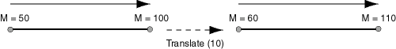

## 27  SDO_LRS Package (Linear Referencing System)

The MDSYS.SDO_LRS package contains subprograms that create, modify, query, and convert linear referencing elements.

These subprograms do not change the state of the database. Most LRS subprograms are functions.

To use the subprograms in this chapter, you must understand the linear referencing system (LRS) concepts and techniques described in [Linear Referencing System](lrs-linear-referencing-system-concepts.md).

**Note:**

The SDO_LRS subprograms for three-dimensional geometries are supported only if Oracle JVM is enabled on your Oracle Autonomous Database Serverless deployments. To enable Oracle JVM, see [Use Oracle Java](https://docs.oracle.com/pls/topic/lookup?ctx=en/cloud/paas/autonomous-database&id=GUID-2516EE33-B38D-4270-BE52-30A4F9014E8B) in Using Oracle Autonomous Database Serverless for more information.

Table 27-1 lists subprograms related to creating and editing geometric segments.

Table 27-1 Subprograms for Creating and Editing Geometric Segments

| Subprogram                        | Description                                                                                                                                                                               |
|:----------------------------------|:------------------------------------------------------------------------------------------------------------------------------------------------------------------------------------------|
| SDO_LRS.DEFINE_GEOM_SEGMENT       | Defines a geometric segment.                                                                                                                                                              |
| SDO_LRS.REDEFINE_GEOM_SEGMENT     | Populates the measures of all shape points of a geometric segment based on the start and end measures, overriding any previously assigned measures between the start point and end point. |
| SDO_LRS.CLIP_GEOM_SEGMENT         | Clips a geometric segment (synonym of SDO_LRS.DYNAMIC_SEGMENT).                                                                                                                           |
| SDO_LRS.DYNAMIC_SEGMENT           | Clips a geometric segment (synonym of SDO_LRS.CLIP_GEOM_SEGMENT).                                                                                                                         |
| SDO_LRS.CONCATENATE_GEOM_SEGMENTS | Concatenates two geometric segments into one segment.                                                                                                                                     |
| SDO_LRS.LRS_INTERSECTION          | Returns an LRS geometry object that is the topological intersection (AND operation) of two geometry objects where one or both are LRS geometries.                                         |
| SDO_LRS.OFFSET_GEOM_SEGMENT       | Returns the geometric segment at a specified offset from a geometric segment.                                                                                                             |
| SDO_LRS.SPLIT_GEOM_SEGMENT        | Splits a geometric segment into two segments.                                                                                                                                             |
| SDO_LRS.RESET_MEASURE             | Sets all measures of a geometric segment, including the start and end measures, to null values, overriding any previously assigned measures.                                              |
| SDO_LRS.SCALE_GEOM_SEGMENT        | Returns the geometry object resulting from a measure scaling operation on a geometric segment.                                                                                            |
| SDO_LRS.SET_PT_MEASURE            | Sets the measure value of a specified point.                                                                                                                                              |
| SDO_LRS.REVERSE_MEASURE           | Returns a new geometric segment by reversing the measure values, but not the direction, of the original geometric segment.                                                                |
| SDO_LRS.TRANSLATE_MEASURE         | Returns a new geometric segment by translating the original geometric segment (that is, shifting the start and end measures by a specified value).                                        |
| SDO_LRS.REVERSE_GEOMETRY          | Returns a new geometric segment by reversing the measure values and the direction of the original geometric segment.                                                                      |

Table 27-2 lists subprograms related to querying geometric segments.

Table 27-2 Subprograms for Querying and Validating Geometric Segments

| Subprogram                         | Description                                                                                                                 |
|:-----------------------------------|:----------------------------------------------------------------------------------------------------------------------------|
| SDO_LRS.VALID_GEOM_SEGMENT         | Checks if a geometric segment is valid.                                                                                     |
| SDO_LRS.VALID_LRS_PT               | Checks if an LRS point is valid.                                                                                            |
| SDO_LRS.VALID_MEASURE              | Checks if a measure falls within the measure range of a geometric segment.                                                  |
| SDO_LRS.CONNECTED_GEOM_SEGMENTS    | Checks if two geometric segments are spatially connected.                                                                   |
| SDO_LRS.GEOM_SEGMENT_LENGTH        | Returns the length of a geometric segment.                                                                                  |
| SDO_LRS.GEOM_SEGMENT_START_PT      | Returns the start point of a geometric segment.                                                                             |
| SDO_LRS.GEOM_SEGMENT_END_PT        | Returns the end point of a geometric segment.                                                                               |
| SDO_LRS.GEOM_SEGMENT_START_MEASURE | Returns the start measure of a geometric segment.                                                                           |
| SDO_LRS.GEOM_SEGMENT_END_MEASURE   | Returns the end measure of a geometric segment.                                                                             |
| SDO_LRS.GET_MEASURE                | Returns the measure of an LRS point.                                                                                        |
| SDO_LRS.GET_NEXT_SHAPE_PT          | Returns the next shape point on a geometric segment after a specified measure value or LRS point.                           |
| SDO_LRS.GET_NEXT_SHAPE_PT_MEASURE  | Returns the measure value of the next shape point on a geometric segment after a specified measure value or LRS point.      |
| SDO_LRS.GET_PREV_SHAPE_PT          | Returns the previous shape point on a geometric segment before a specified measure value or LRS point.                      |
| SDO_LRS.GET_PREV_SHAPE_PT_MEASURE  | Returns the measure value of the previous shape point on a geometric segment before a specified measure value or LRS point. |
| SDO_LRS.IS_GEOM_SEGMENT_DEFINED    | Checks if an LRS segment is defined correctly.                                                                              |
| SDO_LRS.IS_MEASURE_DECREASING      | Checks if the measure values along an LRS segment are decreasing (that is, descending in numerical value).                  |
| SDO_LRS.IS_MEASURE_INCREASING      | Checks if the measure values along an LRS segment are increasing (that is, ascending in numerical value).                   |
| SDO_LRS.IS_SHAPE_PT_MEASURE        | Checks if a specified measure value is associated with a shape point on a geometric segment.                                |
| SDO_LRS.MEASURE_RANGE              | Returns the measure range of a geometric segment, that is, the difference between the start measure and end measure.        |
| SDO_LRS.MEASURE_TO_PERCENTAGE      | Returns the percentage (0 to 100) that a specified measure is of the measure range of a geometric segment.                  |
| SDO_LRS.PERCENTAGE_TO_MEASURE      | Returns the measure value of a specified percentage (0 to 100) of the measure range of a geometric segment.                 |
| SDO_LRS.LOCATE_PT                  | Returns the point located at a specified distance from the start of a geometric segment.                                    |
| SDO_LRS.PROJECT_PT                 | Returns the projection point of a specified point. The projection point is on the geometric segment.                        |
| SDO_LRS.FIND_LRS_DIM_POS           | Returns the position of the measure dimension within the SDO_DIM_ARRAY structure for a specified SDO_GEOMETRY column.       |
| SDO_LRS.FIND_MEASURE               | Returns the measure of the closest point on a segment to a specified projection point.                                      |
| SDO_LRS.FIND_OFFSET                | Returns the signed offset (shortest distance) from a point to a geometric segment.                                          |
| SDO_LRS.VALIDATE_LRS_GEOMETRY      | Checks if an LRS geometry is valid.                                                                                         |

Table 27-3 lists subprograms related to converting geometric segments.

Table 27-3 Subprograms for Converting Geometric Segments

| Subprogram                       | Description                                                                                                                                                                                                   |
|:---------------------------------|:--------------------------------------------------------------------------------------------------------------------------------------------------------------------------------------------------------------|
| SDO_LRS.CONVERT_TO_LRS_DIM_ARRAY | Converts a standard dimensional array to an LRS dimensional array by creating a measure dimension.                                                                                                            |
| SDO_LRS.CONVERT_TO_LRS_GEOM      | Converts a standard SDO_GEOMETRY line string to an LRS geometric segment by adding measure information.                                                                                                       |
| SDO_LRS.CONVERT_TO_LRS_LAYER     | Converts all geometry objects in a column of type SDO_GEOMETRY from standard line string geometries without measure information to LRS geometric segments with measure information, and updates the metadata. |
| SDO_LRS.CONVERT_TO_STD_DIM_ARRAY | Converts an LRS dimensional array to a standard dimensional array by removing the measure dimension.                                                                                                          |
| SDO_LRS.CONVERT_TO_STD_GEOM      | Converts an LRS geometric segment to a standard SDO_GEOMETRY line string by removing measure information.                                                                                                     |
| SDO_LRS.CONVERT_TO_STD_LAYER     | Converts all geometry objects in a column of type SDO_GEOMETRY from LRS geometric segments with measure information to standard line string geometries without measure information, and updates the metadata. |

For more information about conversion subprograms, see [Converting LRS Geometries](lrs-linear-referencing-system-concepts.md).

The rest of this chapter provides reference information on the subprograms, listed in alphabetical order.

- SDO_LRS.CLIP_GEOM_SEGMENT
- SDO_LRS.CONCATENATE_GEOM_SEGMENTS
- SDO_LRS.CONNECTED_GEOM_SEGMENTS
- SDO_LRS.CONVERT_TO_LRS_DIM_ARRAY
- SDO_LRS.CONVERT_TO_LRS_GEOM
- SDO_LRS.CONVERT_TO_LRS_LAYER
- SDO_LRS.CONVERT_TO_STD_DIM_ARRAY
- SDO_LRS.CONVERT_TO_STD_GEOM
- SDO_LRS.CONVERT_TO_STD_LAYER
- SDO_LRS.DEFINE_GEOM_SEGMENT
- SDO_LRS.DYNAMIC_SEGMENT
- SDO_LRS.FIND_LRS_DIM_POS
- SDO_LRS.FIND_MEASURE
- SDO_LRS.FIND_OFFSET
- SDO_LRS.GEOM_SEGMENT_END_MEASURE
- SDO_LRS.GEOM_SEGMENT_END_PT
- SDO_LRS.GEOM_SEGMENT_LENGTH
- SDO_LRS.GEOM_SEGMENT_START_MEASURE
- SDO_LRS.GEOM_SEGMENT_START_PT
- SDO_LRS.GET_MEASURE
- SDO_LRS.GET_NEXT_SHAPE_PT
- SDO_LRS.GET_NEXT_SHAPE_PT_MEASURE
- SDO_LRS.GET_PREV_SHAPE_PT
- SDO_LRS.GET_PREV_SHAPE_PT_MEASURE
- SDO_LRS.IS_GEOM_SEGMENT_DEFINED
- SDO_LRS.IS_MEASURE_DECREASING
- SDO_LRS.IS_MEASURE_INCREASING
- SDO_LRS.IS_SHAPE_PT_MEASURE
- SDO_LRS.LOCATE_PT
- SDO_LRS.LRS_INTERSECTION
- SDO_LRS.MEASURE_RANGE
- SDO_LRS.MEASURE_TO_PERCENTAGE
- SDO_LRS.OFFSET_GEOM_SEGMENT
- SDO_LRS.PERCENTAGE_TO_MEASURE
- SDO_LRS.PROJECT_PT
- SDO_LRS.REDEFINE_GEOM_SEGMENT
- SDO_LRS.RESET_MEASURE
- SDO_LRS.REVERSE_GEOMETRY
- SDO_LRS.REVERSE_MEASURE
- SDO_LRS.SCALE_GEOM_SEGMENT
- SDO_LRS.SET_PT_MEASURE
- SDO_LRS.SPLIT_GEOM_SEGMENT
- SDO_LRS.TRANSLATE_MEASURE
- SDO_LRS.VALID_GEOM_SEGMENT
- SDO_LRS.VALID_LRS_PT
- SDO_LRS.VALID_MEASURE
- SDO_LRS.VALIDATE_LRS_GEOMETRY

**Parent topic:** [Reference Information](spatial-reference-information.md)

### 27.1 SDO_LRS.CLIP_GEOM_SEGMENT

#### Format

    SDO_LRS.CLIP_GEOM_SEGMENT(
         geom_segment  IN SDO_GEOMETRY,
         start_measure IN NUMBER,
         end_measure   IN NUMBER,
         tolerance     IN NUMBER DEFAULT 1.0e-8
         ) RETURN SDO_GEOMETRY;

or

    SDO_LRS.CLIP_GEOM_SEGMENT(
         geom_segment  IN SDO_GEOMETRY,
         dim_array     IN SDO_DIM_ARRAY,
         start_measure IN NUMBER,
         end_measure   IN NUMBER
         ) RETURN SDO_GEOMETRY;

#### Description

Returns the geometry object resulting from a clip operation on a geometric segment.

**Note:**

SDO_LRS.CLIP_GEOM_SEGMENT and SDO_LRS.DYNAMIC_SEGMENT are synonyms: both functions have the same parameters, behavior, and return value.

#### Parameters

geom_segment
Geometric segment (LRS segment) containing measure information.

dim_array
Dimensional information array corresponding to `geom_segment`, usually selected from one of the xxx_SDO_GEOM_METADATA views (described in [Geometry Metadata Views](spatial-datatypes-metadata.md)).

start_measure
Start measure of the geometric segment.

end_measure
End measure of the geometric segment.

tolerance
Tolerance value (see [Tolerance](spatial-concepts.md) and [Tolerance Values with LRS Functions](lrs-linear-referencing-system-concepts.md)). The default value is 0.00000001.

#### Usage Notes

An exception is raised if `geom_segment`, `start_measure`, or `end_measure` is invalid.

`start_measure` and `end_measure` can be any points on the geometric segment. They do not have to be in any specific order. For example, `start_measure` and `end_measure` can be 5 and 10, respectively, or 10 and 5, respectively.

The direction and measures of the resulting geometric segment are preserved (that is, they reflect the original segment).

The \_3D format of this function (SDO_LRS.CLIP_GEOM_SEGMENT_3D) is available. For information about \_3D formats of LRS functions, see [3D Formats of LRS Functions](lrs-linear-referencing-system-concepts.md).

For more information about clipping geometric segments, see [Clipping a Geometric Segment](lrs-linear-referencing-system-concepts.md).

#### Examples

The following example clips the geometric segment representing Route 1, returning the segment from measures 5 through 10. This segment might represent a construction zone. (This example uses the definitions from the example in [Example of LRS Functions](lrs-linear-referencing-system-concepts.md).)

    SELECT  SDO_LRS.CLIP_GEOM_SEGMENT(route_geometry, 5, 10)
      FROM lrs_routes WHERE route_id = 1;

    SDO_LRS.CLIP_GEOM_SEGMENT(ROUTE_GEOMETRY,5,10)(SDO_GTYPE, SDO_SRID, SDO_POINT(X,
    --------------------------------------------------------------------------------
    SDO_GEOMETRY(3302, NULL, NULL, SDO_ELEM_INFO_ARRAY(1, 2, 1), SDO_ORDINATE_ARRAY(
    5, 4, 5, 8, 4, 8, 10, 4, 10))

**Parent topic:** SDO_LRS Package (Linear Referencing System)

### 27.2 SDO_LRS.CONCATENATE_GEOM_SEGMENTS

#### Format

    SDO_LRS.CONCATENATE_GEOM_SEGMENTS(
         geom_segment_1  IN SDO_GEOMETRY,
         geom_segment_2  IN SDO_GEOMETRY,
         tolerance       IN NUMBER DEFAULT 1.0e-8
         ) RETURN SDO_GEOMETRY;

or

    SDO_LRS.CONCATENATE_GEOM_SEGMENTS(
         geom_segment_1  IN SDO_GEOMETRY,
         dim_array_1     IN SDO_DIM_ARRAY,
         geom_segment_2  IN SDO_GEOMETRY,
         dim_array_2     IN SDO_DIM_ARRAY
         ) RETURN SDO_GEOMETRY;

#### Description

Returns the geometry object resulting from the concatenation of two geometric segments.

#### Parameters

geom_segment_1
First geometric segment (LRS segment containing measure information) to be concatenated.

dim_array_1
Dimensional information array corresponding to `geom_segment_1`, usually selected from one of the xxx_SDO_GEOM_METADATA views (described in [Geometry Metadata Views](spatial-datatypes-metadata.md)).

geom_segment_2
Second geometric segment (LRS segment containing measure information) to be concatenated.

dim_array_2
Dimensional information array corresponding to `geom_segment_2`, usually selected from one of the xxx_SDO_GEOM_METADATA views (described in [Geometry Metadata Views](spatial-datatypes-metadata.md)).

tolerance
Tolerance value (see [Tolerance](spatial-concepts.md) and [Tolerance Values with LRS Functions](lrs-linear-referencing-system-concepts.md)). The default value is 0.00000001.

#### Usage Notes

An exception is raised if `geom_segment_1` or `geom_segment_2` has an invalid geometry type or dimensionality, or if `geom_segment_1` and `geom_segment_2` are based on different coordinate systems.

The direction of the first geometric segment is preserved, and all measures of the second segment are shifted so that its start measure is the same as the end measure of the first segment.

The geometry type of `geom_segment_1` and `geom_segment_2` must be line or multiline. Neither can be a polygon.

The \_3D format of this function (SDO_LRS.CONCATENATE_GEOM_SEGMENTS_3D) is available. For information about \_3D formats of LRS functions, see [3D Formats of LRS Functions](lrs-linear-referencing-system-concepts.md).

For more information about concatenating geometric segments, see [Concatenating Geometric Segments](lrs-linear-referencing-system-concepts.md).

#### Examples

The following example defines the geometric segment, splits it into two segments, then concatenates those segments. (This example uses the definitions from the example in [Example of LRS Functions](lrs-linear-referencing-system-concepts.md). The definitions of `result_geom_1`, `result_geom_2`, and `result_geom_3` are displayed in [Example 7-3](lrs-linear-referencing-system-concepts.md).)

    DECLARE
    geom_segment SDO_GEOMETRY;
    line_string SDO_GEOMETRY;
    dim_array SDO_DIM_ARRAY;
    result_geom_1 SDO_GEOMETRY;
    result_geom_2 SDO_GEOMETRY;
    result_geom_3 SDO_GEOMETRY;

    BEGIN

    SELECT a.route_geometry into geom_segment FROM lrs_routes a
      WHERE a.route_name = 'Route1';
    SELECT m.diminfo into dim_array from
      user_sdo_geom_metadata m
      WHERE m.table_name = 'LRS_ROUTES' AND m.column_name = 'ROUTE_GEOMETRY';

    -- Define the LRS segment for Route1.
    SDO_LRS.DEFINE_GEOM_SEGMENT (geom_segment,
      dim_array,
      0,    -- Zero starting measure: LRS segment starts at start of route.
      27);  -- End of LRS segment is at measure 27.

    SELECT a.route_geometry INTO line_string FROM lrs_routes a
      WHERE a.route_name = 'Route1';

    -- Split Route1 into two segments.
    SDO_LRS.SPLIT_GEOM_SEGMENT(line_string,dim_array,5,result_geom_1,result_geom_2);

    -- Concatenate the segments that were just split.
    result_geom_3 := SDO_LRS.CONCATENATE_GEOM_SEGMENTS(result_geom_1, dim_array, result_geom_2, dim_array);

    -- Insert geometries into table, to display later.
    INSERT INTO lrs_routes VALUES(
      11,
      'result_geom_1',
      result_geom_1
    );
    INSERT INTO lrs_routes VALUES(
      12,
      'result_geom_2',
      result_geom_2
    );
    INSERT INTO lrs_routes VALUES(
      13,
      'result_geom_3',
      result_geom_3
    );

    END;
    /

**Parent topic:** SDO_LRS Package (Linear Referencing System)

### 27.3 SDO_LRS.CONNECTED_GEOM_SEGMENTS

#### Format

    SDO_LRS.CONNECTED_GEOM_SEGMENTS(
         geom_segment_1  IN SDO_GEOMETRY,
         geom_segment_2  IN SDO_GEOMETRY,
         tolerance       IN NUMBER DEFAULT 1.0e-8
         ) RETURN VARCHAR2;

or

    SDO_LRS.CONNECTED_GEOM_SEGMENTS(
         geom_segment_1  IN SDO_GEOMETRY,
         dim_array_1     IN SDO_DIM_ARRAY,
         geom_segment_2  IN SDO_GEOMETRY,
         dim_array_2     IN SDO_DIM_ARRAY
         ) RETURN VARCHAR2;

#### Description

Checks if two geometric segments are spatially connected.

#### Parameters

geom_segment_1
First of two geometric segments (LRS segments containing measure information) to be checked.

dim_array_1
Dimensional information array corresponding to `geom_segment_1`, usually selected from one of the xxx_SDO_GEOM_METADATA views (described in [Geometry Metadata Views](spatial-datatypes-metadata.md)).

geom_segment_2
Second of two geometric segments (LRS segments containing measure information) to be checked.

dim_array_2
Dimensional information array corresponding to `geom_segment_2`, usually selected from one of the xxx_SDO_GEOM_METADATA views (described in [Geometry Metadata Views](spatial-datatypes-metadata.md)).

tolerance
Tolerance value (see [Tolerance](spatial-concepts.md) and [Tolerance Values with LRS Functions](lrs-linear-referencing-system-concepts.md)). The default value is 0.00000001.

#### Usage Notes

This function returns TRUE if the geometric segments are spatially connected and FALSE if the geometric segments are not spatially connected.

An exception is raised if `geom_segment_1` or `geom_segment_2` has an invalid geometry type or dimensionality, or if `geom_segment_1` and `geom_segment_2` are based on different coordinate systems.

The \_3D format of this function (SDO_LRS.CONNECTED_GEOM_SEGMENTS_3D) is available. For information about \_3D formats of LRS functions, see [3D Formats of LRS Functions](lrs-linear-referencing-system-concepts.md).

#### Examples

The following example checks if two geometric segments (results of a previous split operation) are spatially connected.

    -- Are result_geom_1 and result_geom2 connected?
    SELECT  SDO_LRS.CONNECTED_GEOM_SEGMENTS(a.route_geometry,
               b.route_geometry, 0.005)
      FROM lrs_routes a, lrs_routes b
      WHERE a.route_id = 11 AND b.route_id = 12;

    SDO_LRS.CONNECTED_GEOM_SEGMENTS(A.ROUTE_GEOMETRY,B.ROUTE_GEOMETRY,0.005)
    --------------------------------------------------------------------------------
    TRUE

**Parent topic:** SDO_LRS Package (Linear Referencing System)

### 27.4 SDO_LRS.CONVERT_TO_LRS_DIM_ARRAY

#### Format

    SDO_LRS.CONVERT_TO_LRS_DIM_ARRAY(
         dim_array      IN SDO_DIM_ARRAY
         [, lower_bound IN NUMBER,
         upper_bound    IN NUMBER,
         tolerance      IN NUMBER]
         ) RETURN SDO_DIM_ARRAY;

    or

    SDO_LRS.CONVERT_TO_LRS_DIM_ARRAY(
         dim_array      IN SDO_DIM_ARRAY,
         dim_name       IN VARCHAR2
         [, lower_bound IN NUMBER,
         upper_bound    IN NUMBER,
         tolerance      IN NUMBER]
         ) RETURN SDO_DIM_ARRAY;

    or

    SDO_LRS.CONVERT_TO_LRS_DIM_ARRAY(
         dim_array      IN SDO_DIM_ARRAY,
         dim_name       IN VARCHAR2,
         dim_pos        IN INTEGER
         [, lower_bound IN NUMBER,
         upper_bound    IN NUMBER,
         tolerance      IN NUMBER]
         ) RETURN SDO_DIM_ARRAY;

#### Description

Converts a standard dimensional array to an LRS dimensional array by creating a measure dimension.

#### Parameters

dim_array
Dimensional information array corresponding to the layer (column of geometries) to be converted, usually selected from one of the xxx_SDO_GEOM_METADATA views (described in [Geometry Metadata Views](spatial-datatypes-metadata.md)).

dim_name
Name of the measure dimension (`M`, if not otherwise specified).

dim_pos
Position of the measure dimension (the last SDO_DIM_ELEMENT object position in the SDO_DIM_ARRAY, if not otherwise specified).

lower_bound
Lower bound (SDO_LB value in the SDO_DIM_ELEMENT definition) of the ordinate in the measure dimension.

upper_bound
Upper bound (SDO_UB value in the SDO_DIM_ELEMENT definition) of the ordinate in the measure dimension.

tolerance
Tolerance value (see [Tolerance](spatial-concepts.md) and [Tolerance Values with LRS Functions](lrs-linear-referencing-system-concepts.md)). The default value is 0.00000001.

#### Usage Notes

This function converts a standard dimensional array to an LRS dimensional array by creating a measure dimension. Specifically, it adds an SDO_DIM_ELEMENT object at the end of the current SDO_DIM_ELEMENT objects in the SDO_DIM_ARRAY for the dimensional array (unless another `dim_pos` is specified), and sets the SDO_DIMNAME value in this added SDO_DIM_ELEMENT to M (unless another `dim_name` is specified). It sets the other values in the added SDO_DIM_ELEMENT according to the values of the `upper_bound`, `lower_bound`, and `tolerance` parameter values.

If `dim_array` already contains dimensional information, the `dim_array` is returned.

The \_3D format of this function (SDO_LRS.CONVERT_TO_LRS_DIM_ARRAY_3D) is available. For information about \_3D formats of LRS functions, see [3D Formats of LRS Functions](lrs-linear-referencing-system-concepts.md).

For more information about conversion functions, see [Converting LRS Geometries](lrs-linear-referencing-system-concepts.md).

#### Examples

The following example converts the dimensional array for the LRS_ROUTES table to LRS format. (This example uses the definitions from the example in [Example of LRS Functions](lrs-linear-referencing-system-concepts.md).)

    SELECT SDO_LRS.CONVERT_TO_LRS_DIM_ARRAY(m.diminfo)
       FROM user_sdo_geom_metadata m
       WHERE m.table_name = 'LRS_ROUTES' AND m.column_name = 'ROUTE_GEOMETRY';

    SDO_LRS.CONVERT_TO_LRS_DIM_ARRAY(M.DIMINFO)(SDO_DIMNAME, SDO_LB, SDO_UB, SDO_TOL
    --------------------------------------------------------------------------------
    SDO_DIM_ARRAY(SDO_DIM_ELEMENT('X', 0, 20, .005), SDO_DIM_ELEMENT('Y', 0, 20, .00
    5), SDO_DIM_ELEMENT('M', 0, 20, .005))

**Parent topic:** SDO_LRS Package (Linear Referencing System)

### 27.5 SDO_LRS.CONVERT_TO_LRS_GEOM

#### Format

    SDO_LRS.CONVERT_TO_LRS_GEOM(
         standard_geom    IN SDO_GEOMETRY
         [, start_measure IN NUMBER,
         end_measure      IN NUMBER]
         ) RETURN SDO_GEOMETRY;

    or

    SDO_LRS.CONVERT_TO_LRS_GEOM(
         standard_geom    IN SDO_GEOMETRY,
         dim_array        IN SDO_DIM_ARRAY
         [, start_measure IN NUMBER,
         end_measure      IN NUMBER]
         ) RETURN SDO_GEOMETRY;

    or

    SDO_LRS.CONVERT_TO_LRS_GEOM(
         standard_geom    IN SDO_GEOMETRY,
         m_pos            IN INTEGER
         [, start_measure IN NUMBER,
         end_measure      IN NUMBER]   
        ) RETURN SDO_GEOMETRY;

#### Description

Converts a standard SDO_GEOMETRY line string to an LRS geometric segment by adding measure information.

#### Parameters

standard_geom
Line string geometry that does not contain measure information.

dim_array
Dimensional information array corresponding to `standard_geom`, usually selected from one of the xxx_SDO_GEOM_METADATA views (described in [Geometry Metadata Views](spatial-datatypes-metadata.md)).

m_pos
Position of the measure dimension. If specified, must be 3 or 4. By default, the measure dimension is the last dimension in the SDO_DIM_ARRAY.

start_measure
Distance measured from the start point of a geometric segment to the start point of the linear feature. The default is 0.

end_measure
Distance measured from the end point of a geometric segment to the start point of the linear feature. The default is the cartographic length (for example, 75 if the cartographic length is 75 and the unit of measure is miles).

#### Usage Notes

This function returns an LRS geometric segment with measure information, with measure information provided for all shape points.

An exception is raised if `standard_geom `has an invalid geometry type or dimensionality, if `m_pos` is less than 3 or greater than 4, or if `start_measure` or `end_measure` is out of range.

The \_3D format of this function (SDO_LRS.CONVERT_TO_LRS_GEOM_3D) is available; however, the `m_pos` parameter is not available for SDO_LRS.CONVERT_TO_LRS_GEOM_3D. For information about \_3D formats of LRS functions, see [3D Formats of LRS Functions](lrs-linear-referencing-system-concepts.md).

For more information about conversion functions, see [Converting LRS Geometries](lrs-linear-referencing-system-concepts.md).

#### Examples

The following example converts the geometric segment representing Route 1 to LRS format. (This example uses the definitions from the example in [Example of LRS Functions](lrs-linear-referencing-system-concepts.md).)

    SELECT SDO_LRS.CONVERT_TO_LRS_GEOM(a.route_geometry, m.diminfo)
      FROM lrs_routes a, user_sdo_geom_metadata m
      WHERE m.table_name = 'LRS_ROUTES' AND m.column_name = 'ROUTE_GEOMETRY'
        AND a.route_id = 1;

    SDO_LRS.CONVERT_TO_LRS_GEOM(A.ROUTE_GEOMETRY,M.DIMINFO)(SDO_GTYPE, SDO_SRID, SDO
    --------------------------------------------------------------------------------
    SDO_GEOMETRY(3302, NULL, NULL, SDO_ELEM_INFO_ARRAY(1, 2, 1), SDO_ORDINATE_ARRAY(
    2, 2, 0, 2, 4, 2, 8, 4, 8, 12, 4, 12, 12, 10, NULL, 8, 10, 22, 5, 14, 27))

**Parent topic:** SDO_LRS Package (Linear Referencing System)

### 27.6 SDO_LRS.CONVERT_TO_LRS_LAYER

#### Format

    SDO_LRS.CONVERT_TO_LRS_LAYER(
         table_name     IN VARCHAR2,
         column_name    IN VARCHAR2
         [, lower_bound IN NUMBER,
         upper_bound    IN NUMBER,
         tolerance      IN NUMBER]
         ) RETURN VARCHAR2;

or

    SDO_LRS.CONVERT_TO_LRS_LAYER(
         table_name     IN VARCHAR2,
         column_name    IN VARCHAR2,
         dim_name       IN VARCHAR2,
         dim_pos        IN INTEGER
         [, lower_bound IN NUMBER,
         upper_bound    IN NUMBER,
         tolerance      IN NUMBER]
         ) RETURN VARCHAR2;

#### Description

Converts all geometry objects in a column of type SDO_GEOMETRY (that is, converts a layer) from standard line string geometries without measure information to LRS geometric segments with measure information, and updates the metadata in the USER_SDO_GEOM_METADATA view.

#### Parameters

table_name
Table containing the column with the SDO_GEOMETRY objects.

column_name
Column in `table_name` containing the SDO_GEOMETRY objects.

dim_name
Name of the measure dimension. If this parameter is null, `M` is assumed.

dim_pos
Position of the measure dimension within the SDO_DIM_ARRAY structure for the specified SDO_GEOMETRY column. If this parameter is null, the number corresponding to the last position is assumed.

lower_bound
Lower bound (SDO_LB value in the SDO_DIM_ELEMENT definition) of the ordinate in the measure dimension.

upper_bound
Upper bound (SDO_UB value in the SDO_DIM_ELEMENT definition) of the ordinate in the measure dimension.

tolerance
Tolerance value (see [Tolerance](spatial-concepts.md) and [Tolerance Values with LRS Functions](lrs-linear-referencing-system-concepts.md)). The default value is 0.00000001.

#### Usage Notes

This function returns TRUE if the conversion was successful or if the layer already contains measure information, and the function returns an exception if the conversion was not successful.

An exception is raised if the existing dimensional information for the table is invalid.

The measure values are assigned based on a start measure of zero and an end measure of the cartographic length.

If a spatial index already exists on `column_name`, you must delete (drop) the index before converting the layer and create a new index after converting the layer. For information about deleting and creating indexes, see the [DROP INDEX](sql-indexing-spatial-data.md) and [CREATE INDEX](sql-indexing-spatial-data.md) statements in [SQL Statements for Indexing Spatial Data](sql-indexing-spatial-data.md).

The \_3D format of this function (SDO_LRS.CONVERT_TO_LRS_LAYER_3D) is available. For information about \_3D formats of LRS functions, see [3D Formats of LRS Functions](lrs-linear-referencing-system-concepts.md).

For more information about conversion functions, see [Converting LRS Geometries](lrs-linear-referencing-system-concepts.md).

#### Examples

The following example converts the geometric segments in the ROUTE_GEOMETRY column of the LRS_ROUTES table to LRS format. (This example uses the definitions from the example in [Example of LRS Functions](lrs-linear-referencing-system-concepts.md).) The SELECT statement shows that dimensional information has been added (that is, `SDO_DIM_ELEMENT('M', NULL, NULL, NULL)` is included in the definition).

    BEGIN
      IF (SDO_LRS.CONVERT_TO_LRS_LAYER('LRS_ROUTES', 'ROUTE_GEOMETRY') =  'TRUE')
        THEN
          DBMS_OUTPUT.PUT_LINE('Conversion from STD_LAYER to LRS_LAYER succeeded.');
        ELSE
          DBMS_OUTPUT.PUT_LINE('Conversion from STD_LAYER to LRS_LAYER failed.');
      END IF;
    END;
    .
    /
    Conversion from STD_LAYER to LRS_LAYER succeeded.

    PL/SQL procedure successfully completed.

    SQL> SELECT diminfo FROM user_sdo_geom_metadata WHERE table_name = 'LRS_ROUTES' AND column_name = 'ROUTE_GEOMETRY';

    DIMINFO(SDO_DIMNAME, SDO_LB, SDO_UB, SDO_TOLERANCE)
    --------------------------------------------------------------------------------
    SDO_DIM_ARRAY(SDO_DIM_ELEMENT('X', 0, 20, .005), SDO_DIM_ELEMENT('Y', 0, 20, .00
    5), SDO_DIM_ELEMENT('M', NULL, NULL, NULL))

**Parent topic:** SDO_LRS Package (Linear Referencing System)

### 27.7 SDO_LRS.CONVERT_TO_STD_DIM_ARRAY

#### Format

    SDO_LRS.CONVERT_TO_STD_DIM_ARRAY(
         dim_array IN SDO_DIM_ARRAY
         [, m_pos  IN INTEGER]
         ) RETURN SDO_DIM_ARRAY;

#### Description

Converts an LRS dimensional array to a standard dimensional array by removing the measure dimension.

#### Parameters

dim_array
Dimensional information array corresponding to the layer (column of geometries) to be converted, usually selected from one of the xxx_SDO_GEOM_METADATA views (described in [Geometry Metadata Views](spatial-datatypes-metadata.md)).

m_pos
Position of the measure dimension. If specified, must be 3 or 4. By default, the measure dimension is the last dimension in the SDO_DIM_ARRAY.

#### Usage Notes

This function converts an LRS dimensional array to a standard dimensional array by removing the measure dimension. Specifically, it removes the SDO_DIM_ELEMENT object at the end of the current SDO_DIM_ELEMENT objects in the SDO_DIM_ARRAY for the `dim_array`.

An exception is raised if `m_pos` is invalid (less than 3 or greater than 4).

If `dim_array` is already a standard dimensional array (that is, does not contain dimensional information), the `dim_array` is returned.

The \_3D format of this function (SDO_LRS.CONVERT_TO_STD_DIM_ARRAY_3D) is available. For information about \_3D formats of LRS functions, see [3D Formats of LRS Functions](lrs-linear-referencing-system-concepts.md).

For more information about conversion functions, see [Converting LRS Geometries](lrs-linear-referencing-system-concepts.md).

#### Examples

The following example converts the dimensional array for the LRS_ROUTES table to standard format. (This example uses the definitions from the example in [Example of LRS Functions](lrs-linear-referencing-system-concepts.md).)

    SELECT SDO_LRS.CONVERT_TO_STD_DIM_ARRAY(m.diminfo)
       FROM user_sdo_geom_metadata m
       WHERE m.table_name = 'LRS_ROUTES' AND m.column_name = 'ROUTE_GEOMETRY';

    SDO_LRS.CONVERT_TO_STD_DIM_ARRAY(M.DIMINFO)(SDO_DIMNAME, SDO_LB, SDO_UB, SDO_TOL
    --------------------------------------------------------------------------------
    SDO_DIM_ARRAY(SDO_DIM_ELEMENT('X', 0, 20, .005), SDO_DIM_ELEMENT('Y', 0, 20, .00
    5))

**Parent topic:** SDO_LRS Package (Linear Referencing System)

### 27.8 SDO_LRS.CONVERT_TO_STD_GEOM

#### Format

    SDO_LRS.CONVERT_TO_STD_GEOM(
         lrs _geom    IN SDO_GEOMETRY
         [, dim_array IN SDO_DIM_ARRAY]
         ) RETURN SDO_GEOMETRY;

#### Description

Converts an LRS geometric segment to a standard SDO_GEOMETRY line string by removing measure information.

#### Parameters

lrs_geom
LRS geometry that contains measure information.

dim_array
Dimensional information array corresponding to `lrs_geom`, usually selected from one of the xxx_SDO_GEOM_METADATA views (described in [Geometry Metadata Views](spatial-datatypes-metadata.md)).

#### Usage Notes

This function returns an SDO_GEOMETRY object in which all measure information is removed.

The \_3D format of this function (SDO_LRS.CONVERT_TO_STD_GEOM_3D) is available. For information about \_3D formats of LRS functions, see [3D Formats of LRS Functions](lrs-linear-referencing-system-concepts.md).

For more information about conversion functions, see [Converting LRS Geometries](lrs-linear-referencing-system-concepts.md).

#### Examples

The following example converts the geometric segment representing Route 1 to standard format. (This example uses the definitions from the example in [Example of LRS Functions](lrs-linear-referencing-system-concepts.md).)

    SELECT SDO_LRS.CONVERT_TO_STD_GEOM(a.route_geometry, m.diminfo)
      FROM lrs_routes a, user_sdo_geom_metadata m
      WHERE m.table_name = 'LRS_ROUTES' AND m.column_name = 'ROUTE_GEOMETRY'
        AND a.route_id = 1;

    SDO_LRS.CONVERT_TO_STD_GEOM(A.ROUTE_GEOMETRY,M.DIMINFO)(SDO_GTYPE, SDO_SRID, SDO
    --------------------------------------------------------------------------------
    SDO_GEOMETRY(2002, NULL, NULL, SDO_ELEM_INFO_ARRAY(1, 2, 1), SDO_ORDINATE_ARRAY(
    2, 2, 2, 4, 8, 4, 12, 4, 12, 10, 8, 10, 5, 14))

**Parent topic:** SDO_LRS Package (Linear Referencing System)

### 27.9 SDO_LRS.CONVERT_TO_STD_LAYER

#### Format

    SDO_LRS.CONVERT_TO_STD_LAYER(
         table_name  IN VARCHAR2,
         column_name IN VARCHAR2
         ) RETURN VARCHAR2;

#### Description

Converts all geometry objects in a column of type SDO_GEOMETRY (that is, converts a layer) from LRS geometric segments with measure information to standard line string geometries without measure information, and updates the metadata in the USER_SDO_GEOM_METADATA view.

#### Parameters

table_name
Table containing the column with the SDO_GEOMETRY objects.

column_name
Column in `table_name` containing the SDO_GEOMETRY objects.

#### Usage Notes

This function returns TRUE if the conversion was successful or if the layer already is a standard layer (that is, contains geometries without measure information), and the function returns an exception if the conversion was not successful.

If a spatial index already exists on `column_name`, you must delete (drop) the index before converting the layer and create a new index after converting the layer. For information about deleting and creating indexes, see the [DROP INDEX](sql-indexing-spatial-data.md) and [CREATE INDEX](sql-indexing-spatial-data.md) statements in [SQL Statements for Indexing Spatial Data](sql-indexing-spatial-data.md).

The \_3D format of this function (SDO_LRS.CONVERT_TO_STD_LAYER_3D) is available. For information about \_3D formats of LRS functions, see [3D Formats of LRS Functions](lrs-linear-referencing-system-concepts.md).

For more information about conversion functions, see [Converting LRS Geometries](lrs-linear-referencing-system-concepts.md).

#### Examples

The following example converts the geometric segments in the ROUTE_GEOMETRY column of the LRS_ROUTES table to standard format. (This example uses the definitions from the example in [Example of LRS Functions](lrs-linear-referencing-system-concepts.md).) The SELECT statement shows that dimensional information has been removed (that is, no `SDO_DIM_ELEMENT('M', NULL, NULL, NULL)` is included in the definition).

    BEGIN
      IF (SDO_LRS.CONVERT_TO_STD_LAYER('LRS_ROUTES', 'ROUTE_GEOMETRY') =  'TRUE')
        THEN
          DBMS_OUTPUT.PUT_LINE('Conversion from LRS_LAYER to STD_LAYER succeeded.');
        ELSE
          DBMS_OUTPUT.PUT_LINE('Conversion from LRS_LAYER to STD_LAYER failed.');
      END IF;
    END;
    .
    /
    Conversion from LRS_LAYER to STD_LAYER succeeded.

    PL/SQL procedure successfully completed.

    SELECT diminfo FROM user_sdo_geom_metadata
       WHERE table_name = 'LRS_ROUTES' AND column_name = 'ROUTE_GEOMETRY';

    DIMINFO(SDO_DIMNAME, SDO_LB, SDO_UB, SDO_TOLERANCE)
    --------------------------------------------------------------------------------
    SDO_DIM_ARRAY(SDO_DIM_ELEMENT('X', 0, 20, .005), SDO_DIM_ELEMENT('Y', 0, 20, .00
    5))

**Parent topic:** SDO_LRS Package (Linear Referencing System)

### 27.10 SDO_LRS.DEFINE_GEOM_SEGMENT

#### Format

    SDO_LRS.DEFINE_GEOM_SEGMENT(
         geom_segment     IN OUT SDO_GEOMETRY
         [, start_measure IN NUMBER,
         end_measure      IN NUMBER]);

or

    SDO_LRS.DEFINE_GEOM_SEGMENT(
         geom_segment     IN OUT SDO_GEOMETRY,
         dim_array        IN SDO_DIM_ARRAY
         [, start_measure IN NUMBER,
         end_measure      IN NUMBER]);

#### Description

Defines a geometric segment by assigning start and end measures to a geometric segment, and assigns values to any null measures.

#### Parameters

geom_segment
Geometric segment (LRS segment) containing measure information.

dim_array
Dimensional information array corresponding to `geom_segment`, usually selected from one of the xxx_SDO_GEOM_METADATA views (described in [Geometry Metadata Views](spatial-datatypes-metadata.md)).

start_measure
Distance measured from the start point of a geometric segment to the start point of the linear feature. The default is the existing value (if any) in the measure dimension; otherwise, the default is 0.

end_measure
Distance measured from the end point of a geometric segment to the start point of the linear feature. The default is the existing value (if any) in the measure dimension; otherwise, the default is the cartographic length of the segment.

#### Usage Notes

An exception is raised if `geom_segment `has an invalid geometry type or dimensionality, or if `start_measure` or `end_measure` is out of range.

All unassigned measures of the geometric segment will be populated automatically.

To store the resulting geometric segment (`geom_segment`) in the database, you must execute an UPDATE or INSERT statement, as appropriate.

The \_3D format of this procedure (SDO_LRS.DEFINE_GEOM_SEGMENT_3D) is available. For information about \_3D formats of LRS functions and procedures, see [3D Formats of LRS Functions](lrs-linear-referencing-system-concepts.md).

For more information about defining a geometric segment, see [Defining a Geometric Segment](lrs-linear-referencing-system-concepts.md) .

#### Examples

The following example defines the geometric segment, splits it into two segments, then concatenates those segments. (This example uses the definitions from the example in [Example of LRS Functions](lrs-linear-referencing-system-concepts.md). The definitions of `result_geom_1`, `result_geom_2`, and `result_geom_3` are displayed in [Example 7-3](lrs-linear-referencing-system-concepts.md).)

    DECLARE
    geom_segment SDO_GEOMETRY;
    line_string SDO_GEOMETRY;
    dim_array SDO_DIM_ARRAY;
    result_geom_1 SDO_GEOMETRY;
    result_geom_2 SDO_GEOMETRY;
    result_geom_3 SDO_GEOMETRY;

    BEGIN

    SELECT a.route_geometry into geom_segment FROM lrs_routes a
      WHERE a.route_name = 'Route1';
    SELECT m.diminfo into dim_array from
      user_sdo_geom_metadata m
      WHERE m.table_name = 'LRS_ROUTES' AND m.column_name = 'ROUTE_GEOMETRY';

    -- Define the LRS segment for Route1. This will populate any null measures.
    SDO_LRS.DEFINE_GEOM_SEGMENT (geom_segment,
      dim_array,
      0,    -- Zero starting measure: LRS segment starts at start of route.
      27);  -- End of LRS segment is at measure 27.

    SELECT a.route_geometry INTO line_string FROM lrs_routes a
      WHERE a.route_name = 'Route1';

    -- Split Route1 into two segments.
    SDO_LRS.SPLIT_GEOM_SEGMENT(line_string,dim_array,5,result_geom_1,result_geom_2);

    -- Concatenate the segments that were just split.
    result_geom_3 := SDO_LRS.CONCATENATE_GEOM_SEGMENTS(result_geom_1, dim_array, result_geom_2, dim_array);

    -- Update and insert geometries into table, to display later.
    UPDATE lrs_routes a SET a.route_geometry = geom_segment
       WHERE a.route_id = 1;

    INSERT INTO lrs_routes VALUES(
      11,
      'result_geom_1',
      result_geom_1
    );
    INSERT INTO lrs_routes VALUES(
      12,
      'result_geom_2',
      result_geom_2
    );
    INSERT INTO lrs_routes VALUES(
      13,
      'result_geom_3',
      result_geom_3
    );

    END;
    /

**Parent topic:** SDO_LRS Package (Linear Referencing System)

### 27.11 SDO_LRS.DYNAMIC_SEGMENT

#### Format

    SDO_LRS.DYNAMIC_SEGMENT(
         geom_segment  IN SDO_GEOMETRY,
         start_measure IN NUMBER,
         end_measure   IN NUMBER,
         tolerance     IN NUMBER DEFAULT 1.0e-8
         ) RETURN SDO_GEOMETRY;

or

    SDO_LRS.DYNAMIC_SEGMENT(
         geom_segment  IN SDO_GEOMETRY,
         dim_array     IN SDO_DIM_ARRAY,
         start_measure IN NUMBER,
         end_measure   IN NUMBER
         ) RETURN SDO_GEOMETRY;

#### Description

Returns the geometry object resulting from a clip operation on a geometric segment.

**Note:**

SDO_LRS.CLIP_GEOM_SEGMENT and SDO_LRS.DYNAMIC_SEGMENT are synonyms: both functions have the same parameters, behavior, and return value.

#### Parameters

geom_segment
Geometric segment (LRS segment) containing measure information.

dim_array
Dimensional information array corresponding to `geom_segment`, usually selected from one of the xxx_SDO_GEOM_METADATA views (described in [Geometry Metadata Views](spatial-datatypes-metadata.md)).

start_measure
Start measure of the geometric segment.

end_measure
End measure of the geometric segment.

tolerance
Tolerance value (see [Tolerance](spatial-concepts.md) and [Tolerance Values with LRS Functions](lrs-linear-referencing-system-concepts.md)). The default value is 0.00000001.

#### Usage Notes

An exception is raised if `geom_segment`, `start_measure`, or `end_measure` is invalid.

The direction and measures of the resulting geometric segment are preserved.

For more information about clipping a geometric segment, see [Clipping a Geometric Segment](lrs-linear-referencing-system-concepts.md).

#### Examples

The following example clips the geometric segment representing Route 1, returning the segment from measures 5 through 10. This segment might represent a construction zone. (This example uses the definitions from the example in [Example of LRS Functions](lrs-linear-referencing-system-concepts.md).)

    SELECT  SDO_LRS.DYNAMIC_SEGMENT(route_geometry, 5, 10)
      FROM lrs_routes WHERE route_id = 1;

    SDO_LRS.DYNAMIC_SEGMENT(ROUTE_GEOMETRY,5,10)(SDO_GTYPE, SDO_SRID, SDO_POINT(X, Y
    --------------------------------------------------------------------------------
    SDO_GEOMETRY(3302, NULL, NULL, SDO_ELEM_INFO_ARRAY(1, 2, 1), SDO_ORDINATE_ARRAY(
    5, 4, 5, 8, 4, 8, 10, 4, 10))

**Parent topic:** SDO_LRS Package (Linear Referencing System)

### 27.12 SDO_LRS.FIND_LRS_DIM_POS

#### Format

    SDO_LRS.FIND_LRS_DIM_POS(
         table_name  IN VARCHAR2,
         column_name IN VARCHAR2
         ) RETURN INTEGER;

#### Description

Returns the position of the measure dimension within the SDO_DIM_ARRAY structure for a specified SDO_GEOMETRY column.

#### Parameters

table_name
Table containing the column with the SDO_GEOMETRY objects.

column_name
Column in `table_name` containing the SDO_GEOMETRY objects.

#### Usage Notes

None.

#### Examples

The following example returns the position of the measure dimension within the SDO_DIM_ARRAY structure for geometries in the ROUTE_GEOMETRY column of the LRS_ROUTES table. (This example uses the definitions from the example in [Example of LRS Functions](lrs-linear-referencing-system-concepts.md).)

    SELECT SDO_LRS.FIND_LRS_DIM_POS('LRS_ROUTES', 'ROUTE_GEOMETRY') FROM DUAL;

    SDO_LRS.FIND_LRS_DIM_POS('LRS_ROUTES','ROUTE_GEOMETRY')
    -------------------------------------------------------
                                                          3

**Parent topic:** SDO_LRS Package (Linear Referencing System)

### 27.13 SDO_LRS.FIND_MEASURE

#### Format

    SDO_LRS.FIND_MEASURE(
         geom_segment IN SDO_GEOMETRY,
         point        IN SDO_GEOMETRY
         ) RETURN NUMBER;

or

    SDO_LRS.FIND_MEASURE(
         geom_segment IN SDO_GEOMETRY,
         dim_array    IN SDO_DIM_ARRAY,
         point        IN SDO_GEOMETRY
         ) RETURN NUMBER;

#### Description

Returns the measure of the closest point on a segment to a specified projection point.

#### Parameters

geom_segment
Geometric segment (LRS segment) containing measure information.

dim_array
Dimensional information array corresponding to `geom_segment`, usually selected from one of the xxx_SDO_GEOM_METADATA views (described in [Geometry Metadata Views](spatial-datatypes-metadata.md)).

point
Projection point. This function returns the measure of the point on `geom_segment` that is closest to the projection point.

#### Usage Notes

This function returns the measure of the point on `geom_segment` that is closest to the projection point. For example, if the projection point represents a shopping mall, the function could be used to find how far from the start of the highway is the point on the highway that is closest to the shopping mall.

An exception is raised if `geom_segment` has an invalid geometry type or dimensionality, or if `geom_segment` and `point` are based on different coordinate systems.

The \_3D format of this function (SDO_LRS.FIND_MEASURE_3D) is available. For information about \_3D formats of LRS functions, see [3D Formats of LRS Functions](lrs-linear-referencing-system-concepts.md).

#### Examples

The following example finds the measure for the point on the geometric segment representing Route 1 that is closest to the point (10, 7). (This example uses the definitions from the example in [Example of LRS Functions](lrs-linear-referencing-system-concepts.md).)

    -- Find measure for point on segment closest to 10,7.
    -- Should return 15 (for point 12,7).
    SELECT  SDO_LRS.FIND_MEASURE(a.route_geometry, m.diminfo,
      SDO_GEOMETRY(3001, NULL, NULL,
         SDO_ELEM_INFO_ARRAY(1, 1, 1),
         SDO_ORDINATE_ARRAY(10, 7, NULL)) )
     FROM lrs_routes a, user_sdo_geom_metadata m
     WHERE m.table_name = 'LRS_ROUTES' AND m.column_name = 'ROUTE_GEOMETRY'
       AND a.route_id = 1;

    SDO_LRS.FIND_MEASURE(A.ROUTE_GEOMETRY,M.DIMINFO,SDO_GEOMETRY(3001,NULL,NUL
    --------------------------------------------------------------------------------
                                                                                  15

**Parent topic:** SDO_LRS Package (Linear Referencing System)

### 27.14 SDO_LRS.FIND_OFFSET

#### Format

    SDO_LRS.FIND_OFFSET(
         geom_segment IN SDO_GEOMETRY,
         point        IN SDO_GEOMETRY,
         tolerance    IN NUMBER DEFAULT 1.0e-8
         ) RETURN NUMBER;

or

    SDO_LRS.FIND_OFFSET(
         geom_segment IN SDO_GEOMETRY,
         dim_array    IN SDO_DIM_ARRAY,
         point        IN SDO_GEOMETRY
         [, point_dim_array  IN SDO_GEOMETRY]
         ) RETURN NUMBER;

#### Description

Returns the signed offset (shortest distance) from a point to a geometric segment.

#### Parameters

geom_segment
Geometric segment (LRS segment) containing measure information.

point
Point whose shortest distance from `geom_segment` is to be returned.

tolerance
Tolerance value (see [Tolerance](spatial-concepts.md) and [Tolerance Values with LRS Functions](lrs-linear-referencing-system-concepts.md)). The default value is 0.00000001.

dim_array
Dimensional information array corresponding to `geom_segment`, usually selected from one of the xxx_SDO_GEOM_METADATA views (described in [Geometry Metadata Views](spatial-datatypes-metadata.md)).

point_dim_array
Dimensional information array corresponding to `point`, usually selected from one of the xxx_SDO_GEOM_METADATA views (described in [Geometry Metadata Views](spatial-datatypes-metadata.md)).

#### Usage Notes

This function calls the SDO_LRS.PROJECT_PT function format that includes the `offset` output parameter: it passes in the geometric segment and point information, and it returns the SDO_LRS.PROJECT_PT `offset` parameter value. Thus, to find the offset of a point from a geometric segment, you can use either this function or the SDO_LRS.PROJECT_PT function with the `offset` parameter.

An exception is raised if `geom_segment` or `point` has an invalid geometry type or dimensionality, or if `geom_segment` and `point` are based on different coordinate systems.

For more information about offsets to a geometric segment, see [Offset](lrs-linear-referencing-system-concepts.md).

#### Examples

The following example returns the offset of point (9,3,NULL) from the geometric segment representing Route 1. (This example uses the definitions from the example in [Example of LRS Functions](lrs-linear-referencing-system-concepts.md).) As you can see from [Example of LRS Functions](lrs-linear-referencing-system-concepts.md), the point at (9,3,NULL) is on the right side along the segment, and therefore the offset has a negative value, as explained in [Offset](lrs-linear-referencing-system-concepts.md). The point at (9,3.NULL) is one distance unit away from the point at (9,4,NULL), which is on the segment.

    -- Find the offset of point (9,3,NULL) from the road; should return -1.
    SELECT  SDO_LRS.FIND_OFFSET(route_geometry,
      SDO_GEOMETRY(3301, NULL, NULL,
         SDO_ELEM_INFO_ARRAY(1, 1, 1),
         SDO_ORDINATE_ARRAY(9, 3, NULL)) )
      FROM lrs_routes WHERE route_id = 1;

    SDO_LRS.FIND_OFFSET(ROUTE_GEOMETRY,SDO_GEOMETRY(3301,NULL,NULL,SDO_ELEM_INFO_ARR
    --------------------------------------------------------------------------------
                                                                                  -1

**Parent topic:** SDO_LRS Package (Linear Referencing System)

### 27.15 SDO_LRS.GEOM_SEGMENT_END_MEASURE

#### Format

    SDO_LRS.GEOM_SEGMENT_END_MEASURE(
         geom_segment IN SDO_GEOMETRY
         [, dim_array IN SDO_DIM_ARRAY]
         ) RETURN NUMBER;

#### Description

Returns the end measure of a geometric segment.

#### Parameters

geom_segment
Geometric segment (LRS segment) containing measure information.

dim_array
Dimensional information array corresponding to `geom_segment`, usually selected from one of the xxx_SDO_GEOM_METADATA views (described in [Geometry Metadata Views](spatial-datatypes-metadata.md)).

#### Usage Notes

This function returns the end measure of `geom_segment`.

An exception is raised if `geom_segment` has an invalid geometry type or dimensionality.

The \_3D format of this function (SDO_LRS.GEOM_SEGMENT_END_MEASURE_3D) is available. For information about \_3D formats of LRS functions, see [3D Formats of LRS Functions](lrs-linear-referencing-system-concepts.md).

#### Examples

The following example returns the end measure of the geometric segment representing Route 1. (This example uses the definitions from the example in [Example of LRS Functions](lrs-linear-referencing-system-concepts.md).)

    SELECT  SDO_LRS.GEOM_SEGMENT_END_MEASURE(route_geometry)
      FROM lrs_routes WHERE route_id = 1;

    SDO_LRS.GEOM_SEGMENT_END_MEASURE(ROUTE_GEOMETRY)
    ------------------------------------------------
                                                  27

**Parent topic:** SDO_LRS Package (Linear Referencing System)

### 27.16 SDO_LRS.GEOM_SEGMENT_END_PT

#### Format

    SDO_LRS.GEOM_SEGMENT_END_PT(
         geom_segment IN SDO_GEOMETRY
         [, dim_array IN SDO_DIM_ARRAY]
         ) RETURN SDO_GEOMETRY;

#### Description

Returns the end point of a geometric segment.

#### Parameters

geom_segment
Geometric segment (LRS segment) containing measure information.

dim_array
Dimensional information array corresponding to `geom_segment`, usually selected from one of the xxx_SDO_GEOM_METADATA views (described in [Geometry Metadata Views](spatial-datatypes-metadata.md)).

#### Usage Notes

This function returns the end point of `geom_segment`.

An exception is raised if `geom_segment` has an invalid geometry type or dimensionality.

The \_3D format of this function (SDO_LRS.GEOM_SEGMENT_END_PT_3D) is available. For information about \_3D formats of LRS functions, see [3D Formats of LRS Functions](lrs-linear-referencing-system-concepts.md).

#### Examples

The following example returns the end point of the geometric segment representing Route 1. (This example uses the definitions from the example in [Example of LRS Functions](lrs-linear-referencing-system-concepts.md).)

    SELECT  SDO_LRS.GEOM_SEGMENT_END_PT(route_geometry)
      FROM lrs_routes WHERE route_id = 1;

    SDO_LRS.GEOM_SEGMENT_END_PT(ROUTE_GEOMETRY)(SDO_GTYPE, SDO_SRID, SDO_POINT(X, Y,
    --------------------------------------------------------------------------------
    SDO_GEOMETRY(3301, NULL, NULL, SDO_ELEM_INFO_ARRAY(1, 1, 1), SDO_ORDINATE_ARRAY(
    5, 14, 27))

**Parent topic:** SDO_LRS Package (Linear Referencing System)

### 27.17 SDO_LRS.GEOM_SEGMENT_LENGTH

#### Format

    SDO_LRS.GEOM_SEGMENT_LENGTH(
         geom_segment IN SDO_GEOMETRY
         [, dim_array IN SDO_DIM_ARRAY]
         ) RETURN NUMBER;

#### Description

Returns the length of a geometric segment.

#### Parameters

geom_segment
Geometric segment (LRS segment) containing measure information.

dim_array
Dimensional information array corresponding to `geom_segment`, usually selected from one of the xxx_SDO_GEOM_METADATA views (described in [Geometry Metadata Views](spatial-datatypes-metadata.md)).

#### Usage Notes

This function returns the length of `geom_segment`. The length is the geometric length, which is not the same as the total of the measure unit values. To determine how long a segment is in terms of measure units, subtract the result of an SDO_LRS.GEOM_SEGMENT_START_MEASURE operation from the result of an SDO_LRS.GEOM_SEGMENT_END_MEASURE operation.

An exception is raised if `geom_segment` has an invalid geometry type or dimensionality.

The \_3D format of this function (SDO_LRS.GEOM_SEGMENT_LENGTH_3D) is available. For information about \_3D formats of LRS functions, see [3D Formats of LRS Functions](lrs-linear-referencing-system-concepts.md).

#### Examples

The following example returns the length of the geometric segment representing Route 1. (This example uses the definitions from the example in [Example of LRS Functions](lrs-linear-referencing-system-concepts.md).)

    SELECT  SDO_LRS.GEOM_SEGMENT_LENGTH(route_geometry)
      FROM lrs_routes WHERE route_id = 1;

    SDO_LRS.GEOM_SEGMENT_LENGTH(ROUTE_GEOMETRY)
    -------------------------------------------
                                             27

**Parent topic:** SDO_LRS Package (Linear Referencing System)

### 27.18 SDO_LRS.GEOM_SEGMENT_START_MEASURE

#### Format

    SDO_LRS.GEOM_SEGMENT_START_MEASURE(
         geom_segment IN SDO_GEOMETRY
         [, dim_array IN SDO_DIM_ARRAY]
         ) RETURN NUMBER;

#### Description

Returns the start measure of a geometric segment.

#### Parameters

geom_segment
Geometric segment (LRS segment) containing measure information.

dim_array
Dimensional information array corresponding to `geom_segment`, usually selected from one of the xxx_SDO_GEOM_METADATA views (described in [Geometry Metadata Views](spatial-datatypes-metadata.md)).

#### Usage Notes

This function returns the start measure of `geom_segment`.

An exception is raised if `geom_segment` has an invalid geometry type or dimensionality.

The \_3D format of this function (SDO_LRS.GEOM_SEGMENT_START_MEASURE_3D) is available. For information about \_3D formats of LRS functions, see [3D Formats of LRS Functions](lrs-linear-referencing-system-concepts.md).

#### Examples

The following example returns the start measure of the geometric segment representing Route 1. (This example uses the definitions from the example in [Example of LRS Functions](lrs-linear-referencing-system-concepts.md).)

    SELECT  SDO_LRS.GEOM_SEGMENT_START_MEASURE(route_geometry)
      FROM lrs_routes WHERE route_id = 1;

    SDO_LRS.GEOM_SEGMENT_START_MEASURE(ROUTE_GEOMETRY)
    --------------------------------------------------
                                                     0

**Parent topic:** SDO_LRS Package (Linear Referencing System)

### 27.19 SDO_LRS.GEOM_SEGMENT_START_PT

#### Format

    SDO_LRS.GEOM_SEGMENT_START_PT(
         geom_segment IN SDO_GEOMETRY
         [, dim_array IN SDO_DIM_ARRAY]
         ) RETURN SDO_GEOMETRY;

#### Description

Returns the start point of a geometric segment.

#### Parameters

geom_segment
Geometric segment (LRS segment) containing measure information.

dim_array
Dimensional information array corresponding to `geom_segment`, usually selected from one of the xxx_SDO_GEOM_METADATA views (described in [Geometry Metadata Views](spatial-datatypes-metadata.md)).

#### Usage Notes

This function returns the start point of `geom_segment`.

An exception is raised if `geom_segment` has an invalid geometry type or dimensionality.

The \_3D format of this function (SDO_LRS.GEOM_SEGMENT_START_PT_3D) is available. For information about \_3D formats of LRS functions, see [3D Formats of LRS Functions](lrs-linear-referencing-system-concepts.md).

#### Examples

The following example returns the start point of the geometric segment representing Route 1. (This example uses the definitions from the example in [Example of LRS Functions](lrs-linear-referencing-system-concepts.md).)

    SELECT  SDO_LRS.GEOM_SEGMENT_START_PT(route_geometry)
      FROM lrs_routes WHERE route_id = 1;

    SDO_LRS.GEOM_SEGMENT_START_PT(ROUTE_GEOMETRY)(SDO_GTYPE, SDO_SRID, SDO_POINT(X,
    --------------------------------------------------------------------------------
    SDO_GEOMETRY(3301, NULL, NULL, SDO_ELEM_INFO_ARRAY(1, 1, 1), SDO_ORDINATE_ARRAY(
    2, 2, 0))

**Parent topic:** SDO_LRS Package (Linear Referencing System)

### 27.20 SDO_LRS.GET_MEASURE

#### Format

    SDO_LRS.GET_MEASURE(
         point        IN SDO_GEOMETRY
         [, dim_array IN SDO_DIM_ARRAY]
         ) RETURN NUMBER;

#### Description

Returns the measure of an LRS point.

#### Parameters

point
Point whose measure is to be returned.

dim_array
Dimensional information array corresponding to `point`, usually selected from one of the xxx_SDO_GEOM_METADATA views (described in [Geometry Metadata Views](spatial-datatypes-metadata.md)).

#### Usage Notes

This function returns the measure of an LRS point.

If `point` is not valid, an "invalid LRS point" exception is raised.

Contrast this function with SDO_LRS.PROJECT_PT, which accepts as input a point that is not necessarily on the geometric segment, but which returns a point that is on the geometric segment, as opposed to a measure value. As the following example shows, the SDO_LRS.GET_MEASURE function can be used to return the measure of the projected point returned by SDO_LRS.PROJECT_PT.

The \_3D format of this function (SDO_LRS.GET_MEASURE_3D) is available. For information about \_3D formats of LRS functions, see [3D Formats of LRS Functions](lrs-linear-referencing-system-concepts.md).

#### Examples

The following example returns the measure of a projected point. In this case, the point resulting from the projection is 9 units from the start of the segment.

    SELECT SDO_LRS.GET_MEASURE(
       SDO_LRS.PROJECT_PT(a.route_geometry, m.diminfo,
        SDO_GEOMETRY(3001, NULL, NULL,
           SDO_ELEM_INFO_ARRAY(1, 1, 1),
           SDO_ORDINATE_ARRAY(9, 3, NULL)) ),
       m.diminfo )
       FROM lrs_routes a, user_sdo_geom_metadata m
       WHERE m.table_name = 'LRS_ROUTES' AND m.column_name = 'ROUTE_GEOMETRY'
           AND a.route_id = 1;

    SDO_LRS.GET_MEASURE(SDO_LRS.PROJECT_PT(A.ROUTE_GEOMETRY,M.DIMINFO,SDO_GEOM
    --------------------------------------------------------------------------------
                                                                                   9

**Parent topic:** SDO_LRS Package (Linear Referencing System)

### 27.21 SDO_LRS.GET_NEXT_SHAPE_PT

#### Format

    SDO_LRS.GET_NEXT_SHAPE_PT(
         geom_segment IN SDO_GEOMETRY,
         measure      IN NUMBER
         ) RETURN SDO_GEOMETRY;

or

    SDO_LRS.GET_NEXT_SHAPE_PT(
         geom_segment IN SDO_GEOMETRY,
         dim_array    IN SDO_DIM_ARRAY,
         measure      IN NUMBER
         ) RETURN SDO_GEOMETRY;

or

    SDO_LRS.GET_NEXT_SHAPE_PT(
         geom_segment IN SDO_GEOMETRY,
         point        IN SDO_GEOMETRY
         ) RETURN SDO_GEOMETRY;

or

    SDO_LRS.GET_NEXT_SHAPE_PT(
         geom_segment IN SDO_GEOMETRY,
         dim_array    IN SDO_DIM_ARRAY,
         point        IN SDO_GEOMETRY
         ) RETURN SDO_GEOMETRY;

#### Description

Returns the next shape point on a geometric segment after a specified measure value or LRS point.

#### Parameters

geom_segment
Geometric segment (LRS segment) containing measure information.

measure
Measure value on the geometric segment for which to return the next shape point.

point
Point for which to return the next shape point. If `point` is not on `geom_segment`, the point on the geometric segment closest to the specified point is computed, and the next shape point after that point is returned.

dim_array
Dimensional information array corresponding to `geom_segment`, usually selected from one of the xxx_SDO_GEOM_METADATA views (described in [Geometry Metadata Views](spatial-datatypes-metadata.md)).

#### Usage Notes

If `measure` or `point` identifies the end point of the geometric segment, a null value is returned.

An exception is raised if `measure` is not a valid value for `geom_segment` or if `point` is not a valid LRS point.

Contrast this function with SDO_LRS.GET_PREV_SHAPE_PT, which returns the previous shape point on a geometric segment before a specified measure value or LRS point.

The \_3D format of this function (SDO_LRS.GET_NEXT_SHAPE_PT_3D) is available. For information about \_3D formats of LRS functions, see [3D Formats of LRS Functions](lrs-linear-referencing-system-concepts.md).

#### Examples

The following example returns the next shape point after measure 14 on the geometric segment representing Route 1. (This example uses the definitions from the example in [Example of LRS Functions](lrs-linear-referencing-system-concepts.md).)

    SELECT SDO_LRS.GET_NEXT_SHAPE_PT(a.route_geometry, 14)
       FROM lrs_routes a WHERE a.route_id = 1;

    SDO_LRS.GET_NEXT_SHAPE_PT(A.ROUTE_GEOMETRY,14)(SDO_GTYPE, SDO_SRID, SDO_POINT(X,
    --------------------------------------------------------------------------------
    SDO_GEOMETRY(3301, NULL, NULL, SDO_ELEM_INFO_ARRAY(1, 1, 1), SDO_ORDINATE_ARRAY(
    12, 10, 18))

**Parent topic:** SDO_LRS Package (Linear Referencing System)

### 27.22 SDO_LRS.GET_NEXT_SHAPE_PT_MEASURE

#### Format

    SDO_LRS.GET_NEXT_SHAPE_PT_MEASURE(
         geom_segment IN SDO_GEOMETRY,
         measure      IN NUMBER
         ) RETURN NUMBER;

or

    SDO_LRS.GET_NEXT_SHAPE_PT_MEASURE(
         geom_segment IN SDO_GEOMETRY,
         dim_array    IN SDO_DIM_ARRAY,
         measure      IN NUMBER
         ) RETURN NUMBER;

or

    SDO_LRS.GET_NEXT_SHAPE_PT_MEASURE(
         geom_segment IN SDO_GEOMETRY,
         point        IN SDO_GEOMETRY
         ) RETURN NUMBER;

or

    SDO_LRS.GET_NEXT_SHAPE_PT_MEASURE(
         geom_segment IN SDO_GEOMETRY,
         dim_array    IN SDO_DIM_ARRAY,
         point        IN SDO_GEOMETRY
         ) RETURN NUMBER;

#### Description

Returns the measure value of the next shape point on a geometric segment after a specified measure value or LRS point.

#### Parameters

geom_segment
Geometric segment (LRS segment) containing measure information.

measure
Measure value on the geometric segment for which to return the measure value of the next shape point.

point
Point for which to return the measure value of the next shape point. If `point` is not on `geom_segment`, the point on the geometric segment closest to the specified point is computed, and the measure value of the next shape point after that point is returned.

dim_array
Dimensional information array corresponding to `geom_segment`, usually selected from one of the xxx_SDO_GEOM_METADATA views (described in [Geometry Metadata Views](spatial-datatypes-metadata.md)).

#### Usage Notes

If `measure` or `point` identifies the end point of the geometric segment, a null value is returned.

An exception is raised if `measure` is not a valid value for `geom_segment` or if `point` is not a valid LRS point.

Contrast this function with SDO_LRS.GET_PREV_SHAPE_PT_MEASURE, which returns the measure value of the previous shape point on a geometric segment before a specified measure value or LRS point.

The \_3D format of this function (SDO_LRS.GET_NEXT_SHAPE_PT_MEASURE_3D) is available. For information about \_3D formats of LRS functions, see [3D Formats of LRS Functions](lrs-linear-referencing-system-concepts.md).

#### Examples

The following example returns the measure value of the next shape point after measure 14 on the geometric segment representing Route 1. (This example uses the definitions from the example in [Example of LRS Functions](lrs-linear-referencing-system-concepts.md).)

    SELECT SDO_LRS.GET_NEXT_SHAPE_PT_MEASURE(a.route_geometry, 14)
       FROM lrs_routes a WHERE a.route_id = 1;

    SDO_LRS.GET_NEXT_SHAPE_PT_MEASURE(A.ROUTE_GEOMETRY,14)
    ------------------------------------------------------
                                                        18

**Parent topic:** SDO_LRS Package (Linear Referencing System)

### 27.23 SDO_LRS.GET_PREV_SHAPE_PT

#### Format

    SDO_LRS.GET_PREV_SHAPE_PT(
         geom_segment IN SDO_GEOMETRY,
         measure      IN NUMBER
         ) RETURN SDO_GEOMETRY;

or

    SDO_LRS.GET_PREV_SHAPE_PT(
         geom_segment IN SDO_GEOMETRY,
         dim_array    IN SDO_DIM_ARRAY,
         measure      IN NUMBER
         ) RETURN SDO_GEOMETRY;

or

    SDO_LRS.GET_PREV_SHAPE_PT(
         geom_segment IN SDO_GEOMETRY,
         point        IN SDO_GEOMETRY
         ) RETURN SDO_GEOMETRY;

or

    SDO_LRS.GET_PREV_SHAPE_PT(
         geom_segment IN SDO_GEOMETRY,
         dim_array    IN SDO_DIM_ARRAY,
         point        IN SDO_GEOMETRY
         ) RETURN SDO_GEOMETRY;

#### Description

Returns the previous shape point on a geometric segment before a specified measure value or LRS point.

#### Parameters

geom_segment
Geometric segment (LRS segment) containing measure information.

measure
Measure value on the geometric segment for which to return the previous shape point.

point
Point for which to return the previous shape point. If `point` is not on `geom_segment`, the point on the geometric segment closest to the specified point is computed, and the closest shape point before that point is returned.

dim_array
Dimensional information array corresponding to `geom_segment`, usually selected from one of the xxx_SDO_GEOM_METADATA views (described in [Geometry Metadata Views](spatial-datatypes-metadata.md)).

#### Usage Notes

If `measure` or `point` identifies the start point of the geometric segment, a null value is returned.

An exception is raised if `measure` is not a valid value for `geom_segment` or if `point` is not a valid LRS point.

Contrast this function with SDO_LRS.GET_NEXT_SHAPE_PT, which returns the next shape point on a geometric segment after a specified measure value or LRS point.

The \_3D format of this function (SDO_LRS.GET_PREV_SHAPE_PT_3D) is available. For information about \_3D formats of LRS functions, see [3D Formats of LRS Functions](lrs-linear-referencing-system-concepts.md).

#### Examples

The following example returns the closest shape point to measure 14 and before measure 14 on the geometric segment representing Route 1. (This example uses the definitions from the example in [Example of LRS Functions](lrs-linear-referencing-system-concepts.md).)

    SELECT SDO_LRS.GET_PREV_SHAPE_PT(a.route_geometry, 14)
       FROM lrs_routes a WHERE a.route_id = 1;

    SDO_LRS.GET_PREV_SHAPE_PT(A.ROUTE_GEOMETRY,14)(SDO_GTYPE, SDO_SRID, SDO_POINT(X,
    --------------------------------------------------------------------------------
    SDO_GEOMETRY(3301, NULL, NULL, SDO_ELEM_INFO_ARRAY(1, 1, 1), SDO_ORDINATE_ARRAY(
    12, 4, 12))

**Parent topic:** SDO_LRS Package (Linear Referencing System)

### 27.24 SDO_LRS.GET_PREV_SHAPE_PT_MEASURE

#### Format

    SDO_LRS.GET_PREV_SHAPE_PT_MEASURE(
         geom_segment IN SDO_GEOMETRY,
         measure      IN NUMBER
         ) RETURN NUMBER;

or

    SDO_LRS.GET_PREV_SHAPE_PT_MEASURE(
         geom_segment IN SDO_GEOMETRY,
         dim_array    IN SDO_DIM_ARRAY,
         measure      IN NUMBER
         ) RETURN NUMBER;

or

    SDO_LRS.GET_PREV_SHAPE_PT_MEASURE(
         geom_segment IN SDO_GEOMETRY,
         point        IN SDO_GEOMETRY
         ) RETURN NUMBER;

or

    SDO_LRS.GET_PREV_SHAPE_PT_MEASURE(
         geom_segment IN SDO_GEOMETRY,
         dim_array    IN SDO_DIM_ARRAY,
         point        IN SDO_GEOMETRY
         ) RETURN NUMBER;

#### Description

Returns the measure value of the previous shape point on a geometric segment before a specified measure value or LRS point.

#### Parameters

geom_segment
Geometric segment (LRS segment) containing measure information.

measure
Measure value on the geometric segment for which to return the measure value of the previous shape point.

point
Point for which to return the measure value of the previous shape point. If `point` is not on `geom_segment`, the point on the geometric segment closest to the specified point is computed, and the measure value of the closest shape point before that point is returned.

dim_array
Dimensional information array corresponding to `geom_segment`, usually selected from one of the xxx_SDO_GEOM_METADATA views (described in [Geometry Metadata Views](spatial-datatypes-metadata.md)).

#### Usage Notes

If `measure` or `point` identifies the start point of the geometric segment, a null value is returned.

An exception is raised if `measure` is not a valid value for `geom_segment` or if `point` is not a valid LRS point.

Contrast this function with SDO_LRS.GET_NEXT_SHAPE_PT_MEASURE, which returns the measure value of the next shape point on a geometric segment after a specified measure value or LRS point.

The \_3D format of this function (SDO_LRS.GET_PREV_SHAPE_PT_MEASURE_3D) is available. For information about \_3D formats of LRS functions, see [3D Formats of LRS Functions](lrs-linear-referencing-system-concepts.md).

#### Examples

The following example returns the measure value of the closest shape point to measure 14 and before measure 14 on the geometric segment representing Route 1. (This example uses the definitions from the example in [Example of LRS Functions](lrs-linear-referencing-system-concepts.md).)

    SELECT SDO_LRS.GET_PREV_SHAPE_PT_MEASURE(a.route_geometry, 14)
       FROM lrs_routes a WHERE a.route_id = 1;

    SDO_LRS.GET_PREV_SHAPE_PT_MEASURE(A.ROUTE_GEOMETRY,14)
    ------------------------------------------------------
                                                        12

**Parent topic:** SDO_LRS Package (Linear Referencing System)

### 27.25 SDO_LRS.IS_GEOM_SEGMENT_DEFINED

#### Format

    SDO_LRS.IS_GEOM_SEGMENT_DEFINED(
         geom_segment IN SDO_GEOMETRY
         [, dim_array IN SDO_DIM_ARRAY]
         ) RETURN VARCHAR2;

#### Description

Checks if an LRS segment is defined correctly.

#### Parameters

geom_segment
Geometric segment (LRS segment) containing measure information.

dim_array
Dimensional information array corresponding to `geom_segment`, usually selected from one of the xxx_SDO_GEOM_METADATA views (described in [Geometry Metadata Views](spatial-datatypes-metadata.md)).

#### Usage Notes

This function returns TRUE if `geom_segment` is defined correctly and FALSE if `geom_segment` is not defined correctly.

The start and end measures of `geom_segment` must be defined (cannot be null), and any measures assigned must be in an ascending or descending order along the segment direction.

The \_3D format of this function (SDO_LRS.IS_GEOM_SEGMENT_DEFINED_3D) is available. For information about \_3D formats of LRS functions, see [3D Formats of LRS Functions](lrs-linear-referencing-system-concepts.md).

See also the SDO_LRS.VALID_GEOM_SEGMENT function.

#### Examples

The following example checks if the geometric segment representing Route 1 is defined. (This example uses the definitions from the example in [Example of LRS Functions](lrs-linear-referencing-system-concepts.md).)

    SELECT  SDO_LRS.IS_GEOM_SEGMENT_DEFINED(route_geometry)
      FROM lrs_routes WHERE route_id = 1;

    SDO_LRS.IS_GEOM_SEGMENT_DEFINED(ROUTE_GEOMETRY)
    --------------------------------------------------------------------------------
    TRUE

**Parent topic:** SDO_LRS Package (Linear Referencing System)

### 27.26 SDO_LRS.IS_MEASURE_DECREASING

#### Format

    SDO_LRS.IS_MEASURE_DECREASING(
         geom_segment IN SDO_GEOMETRY
         [, dim_array IN SDO_DIM_ARRAY]
         ) RETURN VARCHAR2;

#### Description

Checks if the measure values along an LRS segment are decreasing (that is, descending in numerical value).

#### Parameters

geom_segment
Geometric segment (LRS segment) containing measure information.

dim_array
Dimensional information array corresponding to `geom_segment`, usually selected from one of the xxx_SDO_GEOM_METADATA views (described in [Geometry Metadata Views](spatial-datatypes-metadata.md)).

#### Usage Notes

This function returns TRUE if the measure values along an LRS segment are decreasing and FALSE if the measure values along an LRS segment are not decreasing.

The start and end measures of `geom_segment` must be defined (cannot be null).

The \_3D format of this function (SDO_LRS.IS_MEASURE_DECREASING_3D) is available. For information about \_3D formats of LRS functions, see [3D Formats of LRS Functions](lrs-linear-referencing-system-concepts.md).

See also the SDO_LRS.IS_MEASURE_INCREASING function.

#### Examples

The following example checks if the measure values along the geometric segment representing Route 1 are decreasing. (This example uses the definitions from the example in [Example of LRS Functions](lrs-linear-referencing-system-concepts.md).)

    SELECT SDO_LRS.IS_MEASURE_DECREASING(a.route_geometry, m.diminfo)
       FROM lrs_routes a, user_sdo_geom_metadata m
       WHERE m.table_name = 'LRS_ROUTES' AND m.column_name = 'ROUTE_GEOMETRY'
       AND a.route_id = 1;

    SDO_LRS.IS_MEASURE_DECREASING(A.ROUTE_GEOMETRY,M.DIMINFO)
    --------------------------------------------------------------------------------
    FALSE

**Parent topic:** SDO_LRS Package (Linear Referencing System)

### 27.27 SDO_LRS.IS_MEASURE_INCREASING

#### Format

    SDO_LRS.IS_MEASURE_INCREASING(
         geom_segment IN SDO_GEOMETRY
         [, dim_array IN SDO_DIM_ARRAY]
         ) RETURN VARCHAR2;

#### Description

Checks if the measure values along an LRS segment are increasing (that is, ascending in numerical value).

#### Parameters

geom_segment
Geometric segment (LRS segment) containing measure information.

dim_array
Dimensional information array corresponding to `geom_segment`, usually selected from one of the xxx_SDO_GEOM_METADATA views (described in [Geometry Metadata Views](spatial-datatypes-metadata.md)).

#### Usage Notes

This function returns TRUE if the measure values along an LRS segment are increasing and FALSE if the measure values along an LRS segment are not increasing.

The start and end measures of `geom_segment` must be defined (cannot be null).

The \_3D format of this function (SDO_LRS.IS_MEASURE_INCREASING_3D) is available. For information about \_3D formats of LRS functions, see [3D Formats of LRS Functions](lrs-linear-referencing-system-concepts.md).

See also the SDO_LRS.IS_MEASURE_DECREASING function.

#### Examples

The following example checks if the measure values along the geometric segment representing Route 1 are increasing. (This example uses the definitions from the example in [Example of LRS Functions](lrs-linear-referencing-system-concepts.md).)

    SELECT SDO_LRS.IS_MEASURE_INCREASING(a.route_geometry, m.diminfo)
       FROM lrs_routes a, user_sdo_geom_metadata m
       WHERE m.table_name = 'LRS_ROUTES' AND m.column_name = 'ROUTE_GEOMETRY'
       AND a.route_id = 1;

    SDO_LRS.IS_MEASURE_INCREASING(A.ROUTE_GEOMETRY,M.DIMINFO)
    --------------------------------------------------------------------------------
    TRUE

**Parent topic:** SDO_LRS Package (Linear Referencing System)

### 27.28 SDO_LRS.IS_SHAPE_PT_MEASURE

#### Format

    SDO_LRS.IS_SHAPE_PT_MEASURE(
         geom_segment IN SDO_GEOMETRY,
         measure      IN NUMBER
         ) RETURN VARCHAR2;

or

    SDO_LRS.IS_SHAPE_PT_MEASURE(
         geom_segment IN SDO_GEOMETRY,
         dim_array    IN SDO_DIM_ARRAY,
         measure      IN NUMBER
         ) RETURN VARCHAR2;

#### Description

Checks if a specified measure value is associated with a shape point on a geometric segment.

#### Parameters

geom_segment
Geometric segment (LRS segment) containing measure information.

measure
Measure value on the geometric segment to check if it is a shape point.

dim_array
Dimensional information array corresponding to `geom_segment`, usually selected from one of the xxx_SDO_GEOM_METADATA views (described in [Geometry Metadata Views](spatial-datatypes-metadata.md)).

#### Usage Notes

This function returns TRUE if the specified measure value is associated with a shape point and FALSE if the measure value is not associated with a shape point.

An exception is raised if `measure` is not a valid value for `geom_segment`.

The \_3D format of this function (SDO_LRS.IS_SHAPE_PT_MEASURE_3D) is available. For information about \_3D formats of LRS functions, see [3D Formats of LRS Functions](lrs-linear-referencing-system-concepts.md).

#### Examples

The following example checks if measure 14 on the geometric segment representing Route 1 is a shape point. (This example uses the definitions from the example in [Example of LRS Functions](lrs-linear-referencing-system-concepts.md).)

    SELECT SDO_LRS.IS_SHAPE_PT_MEASURE(a.route_geometry, 14)
      FROM lrs_routes a WHERE a.route_id = 1;

    SDO_LRS.IS_SHAPE_PT_MEASURE(A.ROUTE_GEOMETRY,14)
    --------------------------------------------------------------------------------
    FALSE

**Parent topic:** SDO_LRS Package (Linear Referencing System)

### 27.29 SDO_LRS.LOCATE_PT

#### Format

    SDO_LRS.LOCATE_PT(
         geom_segment IN SDO_GEOMETRY,
         measure      IN NUMBER
         [, offset    IN NUMBER]
         ) RETURN SDO_GEOMETRY;

or

    SDO_LRS.LOCATE_PT(
         geom_segment IN SDO_GEOMETRY,
         dim_array    IN SDO_DIM_ARRAY,
         measure      IN NUMBER
         [, offset    IN NUMBER]
         ) RETURN SDO_GEOMETRY;

#### Description

Returns the point located at a specified distance from the start of a geometric segment.

#### Parameters

geom_segment
Geometric segment (LRS segment) containing measure information.

dim_array
Dimensional information array corresponding to `geom_segment`, usually selected from one of the xxx_SDO_GEOM_METADATA views (described in [Geometry Metadata Views](spatial-datatypes-metadata.md)).

measure
Distance to measure from the start point of `geom_segment`.

offset
Distance to measure perpendicularly from the point that is located at `measure` units from the start point of `geom_segment`. The default is 0 (that is, the point is on `geom_segment`).

#### Usage Notes

This function returns the referenced point. For example, on a highway, the point might represent the location of an accident.

The unit of measurement for `offset` is the same as for the coordinate system associated with `geom_segment`. For geodetic data, the default unit of measurement is meters.

With geodetic data using the WGS 84 coordinate system, this function can be used to return the longitude and latitude coordinates of any point on or offset from the segment.

An exception is raised if `geom_segment` has an invalid geometry type or dimensionality, or if the location is out of range.

The \_3D format of this function (SDO_LRS.LOCATE_PT_3D) is available; however, the `offset` parameter is not available for SDO_LRS.LOCATE_PT_3D. For information about \_3D formats of LRS functions, see [3D Formats of LRS Functions](lrs-linear-referencing-system-concepts.md).

For more information about locating a point on a geometric segment, see [Locating a Point on a Geometric Segment](lrs-linear-referencing-system-concepts.md).

#### Examples

The following example creates a table for automobile accident data, inserts a record for an accident at the point at measure 9 and on (that is, offset 0) the geometric segment representing Route 1, and displays the data. (The accident table is deliberately oversimplified. This example also uses the route definition from the example in [Example of LRS Functions](lrs-linear-referencing-system-concepts.md).)

    -- Create a table for accidents.
    CREATE TABLE accidents (
      accident_id  NUMBER PRIMARY KEY,
      route_id  NUMBER,
      accident_geometry  SDO_GEOMETRY);

    -- Insert an accident record.
    DECLARE
    geom_segment SDO_GEOMETRY;

    BEGIN

    SELECT  SDO_LRS.LOCATE_PT(a.route_geometry, 9, 0) into geom_segment
      FROM lrs_routes a WHERE a.route_name = 'Route1';

    INSERT INTO accidents VALUES(1, 1, geom_segment);

    END;
    /

    SELECT * from accidents;

    ACCIDENT_ID   ROUTE_ID
    ----------- ----------
    ACCIDENT_GEOMETRY(SDO_GTYPE, SDO_SRID, SDO_POINT(X, Y, Z), SDO_ELEM_INFO, SDO_OR
    --------------------------------------------------------------------------------
              1          1
    SDO_GEOMETRY(3301, NULL, NULL, SDO_ELEM_INFO_ARRAY(1, 1, 1), SDO_ORDINATE_ARRAY(
    9, 4, 9))

**Parent topic:** SDO_LRS Package (Linear Referencing System)

### 27.30 SDO_LRS.LRS_INTERSECTION

#### Format

    SDO_LRS.LRS_INTERSECTION(
         geom_1      IN SDO_GEOMETRY,
         dim_array_1 IN SDO_DIM_ARRAY,
         geom_2      IN SDO_GEOMETRY,
         dim_array_2 IN SDO_DIM_ARRAY
         ) RETURN SDO_GEOMETRY;

or

    SDO_LRS.LRS_INTERSECTION(
         geom_1    IN SDO_GEOMETRY,
         geom_2    IN SDO_GEOMETRY,
         tolerance IN NUMBER
         ) RETURN SDO_GEOMETRY;

#### Description

Returns an LRS geometry object that is the topological intersection (AND operation) of two geometry objects where one or both are LRS geometries.

#### Parameters

geom_1
Geometry object.

dim_array_1
Dimensional information array corresponding to `geom_1`, usually selected from one of the xxx_SDO_GEOM_METADATA views (described in [Geometry Metadata Views](spatial-datatypes-metadata.md)).

geom_2
Geometry object.

dim_array_2
Dimensional information array corresponding to `geom_2`, usually selected from one of the xxx_SDO_GEOM_METADATA views (described in [Geometry Metadata Views](spatial-datatypes-metadata.md)).

tolerance
Tolerance value (see [Tolerance](spatial-concepts.md)).

#### Usage Notes

This function performs essentially the same intersection operation as the [SDO_GEOM.SDO_INTERSECTION](SDO_GEOM-reference.md) function (described in [SDO_GEOM Package (Geometry)](SDO_GEOM-reference.md)), except that SDO_LRS.LRS_INTERSECTION is designed to return a valid LRS geometry (point, line string, or multiline string) where one or both of the geometry-related input parameters are LRS geometries. (If neither input geometry is an LRS geometry, this function operates the same as the [SDO_GEOM.SDO_INTERSECTION](SDO_GEOM-reference.md) function.).

The returned geometry is an LRS line string, multiline string, or point geometry that includes measure dimension information. The measure values reflect those in the first LRS geometry specified as an input parameter.

The first LRS geometry specified as an input parameter must not be a polygon; it must be a line string, multiline string, or point.

If an LRS line string (geometric segment) intersects a line string (LRS or standard), the result is an LRS point; if an LRS line string intersects a polygon, the result is an LRS line string.

An exception is raised if `geom_1` and `geom_2` are based on different coordinate systems.

#### Examples

The following example shows an LRS geometric segment (illustrated in [Figure 7-20](lrs-linear-referencing-system-concepts.md) in [Example of LRS Functions](lrs-linear-referencing-system-concepts.md)) intersected by a vertical line from (8,2) to (8,6). The result is an LRS point geometry, in which the measure value (8) reflects the measure for that point (designated as Exit 3 in [Figure 7-20](lrs-linear-referencing-system-concepts.md)) in the `geom_1` geometry. (This example uses the definitions from the example in [Example of LRS Functions](lrs-linear-referencing-system-concepts.md).)

    -- Intersection of LRS segment and standard line segment
    SELECT SDO_LRS.LRS_INTERSECTION(route_geometry,
      SDO_GEOMETRY(2002, NULL, NULL, SDO_ELEM_INFO_ARRAY(1,2,1),
        SDO_ORDINATE_ARRAY(8,2, 8,6)), 0.005)
      FROM lrs_routes WHERE route_id = 1;

    SDO_LRS.LRS_INTERSECTION(ROUTE_GEOMETRY,SDO_GEOMETRY(2002,NULL,NULL,SDO_ELEM_INF
    --------------------------------------------------------------------------------
    SDO_GEOMETRY(3301, NULL, NULL, SDO_ELEM_INFO_ARRAY(1, 1, 1), SDO_ORDINATE_ARRAY(
    8, 4, 8))

The following example shows an LRS geometric segment (illustrated in [Figure 7-20](lrs-linear-referencing-system-concepts.md) in [Example of LRS Functions](lrs-linear-referencing-system-concepts.md)) intersected by a vertical line from (12,2) to (12,6). The result is an LRS line string geometry, in which the measure values (12 and 14) reflect measures for points (the first of which is designated as Exit 4 in [Figure 7-20](lrs-linear-referencing-system-concepts.md)) in the `geom_1` geometry. (This example uses the definitions from the example in [Example of LRS Functions](lrs-linear-referencing-system-concepts.md).)

    SELECT SDO_LRS.LRS_INTERSECTION(route_geometry,
      SDO_GEOMETRY(2002, NULL, NULL, SDO_ELEM_INFO_ARRAY(1,2,1),
       SDO_ORDINATE_ARRAY(12,2, 12,6)), 0.005)
      FROM lrs_routes WHERE route_id = 1;

    SDO_LRS.LRS_INTERSECTION(ROUTE_GEOMETRY,SDO_GEOMETRY(2002,NULL,NULL,SDO_ELEM_INF
    --------------------------------------------------------------------------------
    SDO_GEOMETRY(3302, NULL, NULL, SDO_ELEM_INFO_ARRAY(1, 2, 1), SDO_ORDINATE_ARRAY(
    12, 4, 12, 12, 6, 14))

**Parent topic:** SDO_LRS Package (Linear Referencing System)

### 27.31 SDO_LRS.MEASURE_RANGE

#### Format

    SDO_LRS.MEASURE_RANGE(
         geom_segment IN SDO_GEOMETRY
         [, dim_array IN SDO_DIM_ARRAY]
         ) RETURN NUMBER;

#### Description

Returns the measure range of a geometric segment, that is, the difference between the start measure and end measure.

#### Parameters

geom_segment
Geometric segment (LRS segment) containing measure information.

dim_array
Dimensional information array corresponding to `geom_segment`, usually selected from one of the xxx_SDO_GEOM_METADATA views (described in [Geometry Metadata Views](spatial-datatypes-metadata.md)).

#### Usage Notes

This function subtracts the start measure of `geom_segment` from the end measure of `geom_segment`.

The \_3D format of this function (SDO_LRS.MEASURE_RANGE_3D) is available. For information about \_3D formats of LRS functions, see [3D Formats of LRS Functions](lrs-linear-referencing-system-concepts.md).

#### Examples

The following example returns the measure range of the geometric segment representing Route 1. (This example uses the definitions from the example in [Example of LRS Functions](lrs-linear-referencing-system-concepts.md).)

    SELECT SDO_LRS.MEASURE_RANGE(route_geometry)
      FROM lrs_routes WHERE route_id = 1;

    SDO_LRS.MEASURE_RANGE(ROUTE_GEOMETRY)
    -------------------------------------
                                       27

**Parent topic:** SDO_LRS Package (Linear Referencing System)

### 27.32 SDO_LRS.MEASURE_TO_PERCENTAGE

#### Format

    SDO_LRS.MEASURE_TO_PERCENTAGE(
         geom_segment IN SDO_GEOMETRY,
         measure      IN NUMBER
         ) RETURN NUMBER;

or

    SDO_LRS.MEASURE_TO_PERCENTAGE(
         geom_segment IN SDO_GEOMETRY,
         dim_array    IN SDO_DIM_ARRAY,
         measure      IN NUMBER
         ) RETURN NUMBER;

#### Description

Returns the percentage (0 to 100) that a specified measure is of the measure range of a geometric segment.

#### Parameters

geom_segment
Geometric segment (LRS segment) containing measure information.

dim_array
Dimensional information array corresponding to `geom_segment`, usually selected from one of the xxx_SDO_GEOM_METADATA views (described in [Geometry Metadata Views](spatial-datatypes-metadata.md)).

measure
Measure value. This function returns the percentage that this measure value is of the measure range.

#### Usage Notes

This function returns a number (0 to 100) that is the percentage of the measure range that the specified measure represents. (The measure range is the end measure minus the start measure.) For example, if the measure range of `geom_segment` is 50 and `measure` is 20, the function returns 40 (because 20/50 = 40%).

This function performs the reverse of the SDO_LRS.PERCENTAGE_TO_MEASURE function, which returns the measure that corresponds to a percentage value.

An exception is raised if `geom_segment` or `measure` is invalid.

#### Examples

The following example returns the percentage that 5 is of the measure range of the geometric segment representing Route 1. (This example uses the definitions from the example in [Example of LRS Functions](lrs-linear-referencing-system-concepts.md).) The measure range of this segment is 27, and 5 is approximately 18.5 percent of 27.

    SELECT SDO_LRS.MEASURE_TO_PERCENTAGE(a.route_geometry, m.diminfo, 5)
      FROM lrs_routes a, user_sdo_geom_metadata m
      WHERE m.table_name = 'LRS_ROUTES' AND m.column_name = 'ROUTE_GEOMETRY'
        AND a.route_id = 1;

    SDO_LRS.MEASURE_TO_PERCENTAGE(A.ROUTE_GEOMETRY,M.DIMINFO,5)
    -----------------------------------------------------------
                                                     18.5185185

**Parent topic:** SDO_LRS Package (Linear Referencing System)

### 27.33 SDO_LRS.OFFSET_GEOM_SEGMENT

#### Format

    SDO_LRS.OFFSET_GEOM_SEGMENT(
         geom_segment  IN SDO_GEOMETRY,
         start_measure IN NUMBER,
         end_measure   IN NUMBER,
         offset        IN NUMBER,
         tolerance     IN NUMBER DEFAULT 1.0e-8
         [, unit       IN VARCHAR2]
         ) RETURN SDO_GEOMETRY;

or

    SDO_LRS.OFFSET_GEOM_SEGMENT(
         geom_segment  IN SDO_GEOMETRY,
         dim_array     IN SDO_DIM_ARRAY,
         start_measure IN NUMBER,
         end_measure   IN NUMBER,
         offset        IN NUMBER
         [, unit       IN VARCHAR2]
         ) RETURN SDO_GEOMETRY;

#### Description

Returns the geometric segment at a specified offset from a geometric segment.

#### Parameters

geom_segment
Geometric segment (LRS segment) containing measure information.

dim_array
Dimensional information array corresponding to `geom_segment`, usually selected from one of the xxx_SDO_GEOM_METADATA views (described in [Geometry Metadata Views](spatial-datatypes-metadata.md)).

start_measure
Start measure of `geom_segment` at which to start the offset operation.

end_measure
End measure of `geom_segment` at which to start the offset operation.

offset
Distance to measure perpendicularly from the points along `geom_segment`. Positive offset values are to the left of `geom_segment`; negative offset values are to the right of `geom_segment`.

tolerance
Tolerance value (see [Tolerance](spatial-concepts.md) and [Tolerance Values with LRS Functions](lrs-linear-referencing-system-concepts.md)). The default value is 0.00000001.

unit
Unit of measurement specification: a quoted string with one or both of the following keywords:

- `unit` and an SDO_UNIT value from the MDSYS.SDO_DIST_UNITS table. See [Unit of Measurement Support](spatial-datatypes-metadata.md) for more information about unit of measurement specification.

- `arc_tolerance` and an arc tolerance value. See the Usage Notes for the [SDO_GEOM.SDO_ARC_DENSIFY](SDO_GEOM-reference.md) function in [SDO_GEOM Package (Geometry)](SDO_GEOM-reference.md) for more information about the `arc_tolerance` keyword.

For example: 'unit=km arc_tolerance=0.05'

If the input geometry is geodetic data, this parameter is required, and `arc_tolerance` must be specified. If the input geometry is Cartesian or projected data, `arc_tolerance` has no effect and should not be specified.

If this parameter is not specified for a Cartesian or projected geometry, or if the `arc_tolerance` keyword is specified for a geodetic geometry but the `unit` keyword is not specified, the unit of measurement associated with the data is assumed.

#### Usage Notes

`start_measure` and `end_measure` can be any points on the geometric segment. They do not have to be in any specific order. For example, `start_measure` and `end_measure` can be 5 and 10, respectively, or 10 and 5, respectively.

The direction and measures of the resulting geometric segment are preserved (that is, they reflect the original segment).

The geometry type of `geom_segment` must be line or multiline. For example, it cannot be a polygon.

An exception is raised if `geom_segment`, `start_measure`, or `end_measure` is invalid.

#### Examples

The following example returns the geometric segment 2 distance units to the left (positive offset 2) of the segment from measures 5 through 10 of Route 1. Note in SDO_ORDINATE_ARRAY of the returned segment that the Y values (6) are 2 greater than the Y values (4) of the relevant part of the original segment. (This example uses the definitions from the example in [Example of LRS Functions](lrs-linear-referencing-system-concepts.md).)

    -- Create a segment offset 2 to the left from measures 5 through 10.
    -- First, display the original segment; then, offset.
    SELECT a.route_geometry FROM lrs_routes a WHERE a.route_id = 1;

    ROUTE_GEOMETRY(SDO_GTYPE, SDO_SRID, SDO_POINT(X, Y, Z), SDO_ELEM_INFO, SDO_ORDIN
    --------------------------------------------------------------------------------
    SDO_GEOMETRY(3302, NULL, NULL, SDO_ELEM_INFO_ARRAY(1, 2, 1), SDO_ORDINATE_ARRAY(
    2, 2, 0, 2, 4, 2, 8, 4, 8, 12, 4, 12, 12, 10, 18, 8, 10, 22, 5, 14, 27))

    SELECT  SDO_LRS.OFFSET_GEOM_SEGMENT(a.route_geometry, m.diminfo, 5, 10, 2)
        FROM lrs_routes a, user_sdo_geom_metadata m
        WHERE m.table_name = 'LRS_ROUTES' AND m.column_name = 'ROUTE_GEOMETRY'
          AND a.route_id = 1;

    SDO_LRS.OFFSET_GEOM_SEGMENT(A.ROUTE_GEOMETRY,M.DIMINFO,5,10,2)(SDO_GTYPE, SDO_SR
    --------------------------------------------------------------------------------
    SDO_GEOMETRY(3302, NULL, NULL, SDO_ELEM_INFO_ARRAY(1, 2, 1), SDO_ORDINATE_ARRAY(
    5, 6, 5, 10, 6, 10))

**Parent topic:** SDO_LRS Package (Linear Referencing System)

### 27.34 SDO_LRS.PERCENTAGE_TO_MEASURE

#### Format

    SDO_LRS.PERCENTAGE_TO_MEASURE(
         geom_segment IN SDO_GEOMETRY,
         percentage   IN NUMBER
         ) RETURN NUMBER;

or

    SDO_LRS.PERCENTAGE_TO_MEASURE(
         geom_segment IN SDO_GEOMETRY,
         dim_array    IN SDO_DIM_ARRAY,
         percentage   IN NUMBER
         ) RETURN NUMBER;

#### Description

Returns the measure value of a specified percentage (0 to 100) of the measure range of a geometric segment.

#### Parameters

geom_segment
Geometric segment (LRS segment) containing measure information.

dim_array
Dimensional information array corresponding to `geom_segment`, usually selected from one of the xxx_SDO_GEOM_METADATA views (described in [Geometry Metadata Views](spatial-datatypes-metadata.md)).

percentage
Percentage value. Must be from 0 to 100. This function returns the measure value corresponding to this percentage of the measure range.

#### Usage Notes

This function returns the measure value corresponding to the specified percentage of the measure range. (The measure range is the end measure minus the start measure.) For example, if the measure range of `geom_segment` is 50 and `percentage` is 40, the function returns 20 (because 40% of 50 = 20).

This function performs the reverse of the SDO_LRS.MEASURE_TO_PERCENTAGE function, which returns the percentage value that corresponds to a measure.

An exception is raised if `geom_segment` has an invalid geometry type or dimensionality, or if `percentage` is less than 0 or greater than 100.

#### Examples

The following example returns the measure that is 50 percent of the measure range of the geometric segment representing Route 1. (This example uses the definitions from the example in [Example of LRS Functions](lrs-linear-referencing-system-concepts.md).) The measure range of this segment is 27, and 50 percent of 27 is 13.5.

    SELECT SDO_LRS.PERCENTAGE_TO_MEASURE(a.route_geometry, m.diminfo, 50)
      FROM lrs_routes a, user_sdo_geom_metadata m
      WHERE m.table_name = 'LRS_ROUTES' AND m.column_name = 'ROUTE_GEOMETRY'
        AND a.route_id = 1;

    SDO_LRS.PERCENTAGE_TO_MEASURE(A.ROUTE_GEOMETRY,M.DIMINFO,50)
    ------------------------------------------------------------
                                                            13.5

**Parent topic:** SDO_LRS Package (Linear Referencing System)

### 27.35 SDO_LRS.PROJECT_PT

#### Format

    SDO_LRS.PROJECT_PT(
         geom_segment IN SDO_GEOMETRY,
         point        IN SDO_GEOMETRY,
         tolerance    IN NUMBER DEFAULT 1.0e-8
         [, offset    OUT NUMBER]
         ) RETURN SDO_GEOMETRY;

or

    SDO_LRS.PROJECT_PT(
         geom_segment IN SDO_GEOMETRY,
         dim_array    IN SDO_DIM_ARRAY,
         point        IN SDO_GEOMETRY
         [, point_dim_array IN SDO_DIM_ARRAY]
         ) RETURN SDO_GEOMETRY;

or

    SDO_LRS.PROJECT_PT(
         geom_segment    IN SDO_GEOMETRY,
         dim_array       IN SDO_DIM_ARRAY,
         point           IN SDO_GEOMETRY,
         point_dim_array IN SDO_DIM_ARRAY
         [, offset       OUT NUMBER]
         ) RETURN SDO_GEOMETRY;

#### Description

Returns the projection point of a specified point. The projection point is on the geometric segment.

#### Parameters

geom_segment
Geometric segment (LRS segment) containing measure information.

dim_array
Dimensional information array corresponding to `geom_segment`, usually selected from one of the xxx_SDO_GEOM_METADATA views (described in [Geometry Metadata Views](spatial-datatypes-metadata.md)).

point
Point on `geom_segment` to be projected.

tolerance
Tolerance value (see [Tolerance](spatial-concepts.md) and [Tolerance Values with LRS Functions](lrs-linear-referencing-system-concepts.md)). The default value is 0.00000001.

point_dim_array
Dimensional information array corresponding to `point`, usually selected from one of the xxx_SDO_GEOM_METADATA views (described in [Geometry Metadata Views](spatial-datatypes-metadata.md)).

offset
Offset (shortest distance) from the point to the geometric segment.

#### Usage Notes

This function returns the projection point (including its measure) of a specified point (`point`). The projection point is on the geometric segment.

If multiple projection points exist, the first projection point encountered from the start point is returned.

If you specify the output parameter `offset`, the function stores the signed offset (shortest distance) from the point to the geometric segment. For more information about the offset to a geometric segment, see [Offset](lrs-linear-referencing-system-concepts.md).

An exception is raised if `geom_segment` or `point` has an invalid geometry type or dimensionality, or if `geom_segment` and `point` are based on different coordinate systems.

The \_3D format of this function (SDO_LRS.PROJECT_PT_3D) is available. For information about \_3D formats of LRS functions, see [3D Formats of LRS Functions](lrs-linear-referencing-system-concepts.md).

For more information about projecting a point onto a geometric segment, see [Projecting a Point onto a Geometric Segment](lrs-linear-referencing-system-concepts.md).

#### Examples

The following example returns the point (9,4,9) on the geometric segment representing Route 1 that is closest to the specified point (9,3,NULL). (This example uses the definitions from the example in [Example of LRS Functions](lrs-linear-referencing-system-concepts.md).)

    -- Point 9,3,NULL is off the road; should return 9,4,9.
    SELECT  SDO_LRS.PROJECT_PT(route_geometry,
      SDO_GEOMETRY(3301, NULL, NULL,
         SDO_ELEM_INFO_ARRAY(1, 1, 1),
         SDO_ORDINATE_ARRAY(9, 3, NULL)) )
      FROM lrs_routes WHERE route_id = 1;

    SDO_LRS.PROJECT_PT(ROUTE_GEOMETRY,SDO_GEOMETRY(3301,NULL,NULL,SDO_EL
    --------------------------------------------------------------------------------
    SDO_GEOMETRY(3301, NULL, NULL, SDO_ELEM_INFO_ARRAY(1, 1, 1), SDO_ORDINATE_ARRAY(
    9, 4, 9))

**Parent topic:** SDO_LRS Package (Linear Referencing System)

### 27.36 SDO_LRS.REDEFINE_GEOM_SEGMENT

#### Format

    SDO_LRS.REDEFINE_GEOM_SEGMENT(
         geom_segment     IN OUT SDO_GEOMETRY
         [, start_measure IN NUMBER,
         end_measure      IN NUMBER]);

or

    SDO_LRS.REDEFINE_GEOM_SEGMENT(
         geom_segment     IN OUT SDO_GEOMETRY,
         dim_array        IN SDO_DIM_ARRAY
         [, start_measure IN NUMBER,
         end_measure      IN NUMBER]);

#### Description

Populates the measures of all shape points based on the start and end measures of a geometric segment, overriding any previously assigned measures between the start point and end point.

#### Parameters

geom_segment
Geometric segment (LRS segment) containing measure information.

dim_array
Dimensional information array corresponding to `geom_segment`, usually selected from one of the xxx_SDO_GEOM_METADATA views (described in [Geometry Metadata Views](spatial-datatypes-metadata.md)).

start_measure
Distance measured from the start point of a geometric segment to the start point of the linear feature. The default is the existing value (if any) in the measure dimension; otherwise, the default is 0.

end_measure
Distance measured from the end point of a geometric segment to the start point of the linear feature. The default is the existing value (if any) in the measure dimension; otherwise, the default is the cartographic length of the segment.

#### Usage Notes

An exception is raised if `geom_segment `has an invalid geometry type or dimensionality, or if `start_measure` or `end_measure` is out of range.

The \_3D format of this procedure (SDO_LRS.REDEFINE_GEOM_SEGMENT_3D) is available. For information about \_3D formats of LRS functions and procedures, see [3D Formats of LRS Functions](lrs-linear-referencing-system-concepts.md).

For more information about redefining a geometric segment, see [Redefining a Geometric Segment](lrs-linear-referencing-system-concepts.md).

#### Examples

The following example redefines a geometric segment, effectively converting miles to kilometers in the measure values. (This example uses the definitions from the example in [Example of LRS Functions](lrs-linear-referencing-system-concepts.md).)

    -- First, display the original segment; then, redefine.
    SELECT a.route_geometry FROM lrs_routes a WHERE a.route_id = 1;

    ROUTE_GEOMETRY(SDO_GTYPE, SDO_SRID, SDO_POINT(X, Y, Z), SDO_ELEM_INFO, SDO_ORDIN
    --------------------------------------------------------------------------------
    SDO_GEOMETRY(3302, NULL, NULL, SDO_ELEM_INFO_ARRAY(1, 2, 1), SDO_ORDINATE_ARRAY(
    2, 2, 0, 2, 4, 2, 8, 4, 8, 12, 4, 12, 12, 10, 18, 8, 10, 22, 5, 14, 27))

    -- Redefine geometric segment to "convert" miles to kilometers.
    DECLARE
    geom_segment SDO_GEOMETRY;
    dim_array SDO_DIM_ARRAY;

    BEGIN

    SELECT a.route_geometry into geom_segment FROM lrs_routes a
      WHERE a.route_name = 'Route1';
    SELECT m.diminfo into dim_array from
      user_sdo_geom_metadata m
      WHERE m.table_name = 'LRS_ROUTES' AND m.column_name = 'ROUTE_GEOMETRY';

    -- "Convert" mile measures to kilometers (27 * 1.609 = 43.443).
    SDO_LRS.REDEFINE_GEOM_SEGMENT (geom_segment,
      dim_array,
       0,    -- Zero starting measure: LRS segment starts at start of route.
       43.443);  -- End of LRS segment. 27 miles = 43.443 kilometers.

    -- Update and insert geometries into table, to display later.
    UPDATE lrs_routes a SET a.route_geometry = geom_segment
       WHERE a.route_id = 1;

    END;
    /

    PL/SQL procedure successfully completed.

    -- Display the redefined segment, with all measures "converted."
    SELECT a.route_geometry FROM lrs_routes a WHERE a.route_id = 1;

    ROUTE_GEOMETRY(SDO_GTYPE, SDO_SRID, SDO_POINT(X, Y, Z), SDO_ELEM_INFO, SDO_ORDIN
    --------------------------------------------------------------------------------
    SDO_GEOMETRY(3302, NULL, NULL, SDO_ELEM_INFO_ARRAY(1, 2, 1), SDO_ORDINATE_ARRAY(
    2, 2, 0, 2, 4, 3.218, 8, 4, 12.872, 12, 4, 19.308, 12, 10, 28.962, 8, 10, 35.398
    , 5, 14, 43.443))

**Parent topic:** SDO_LRS Package (Linear Referencing System)

### 27.37 SDO_LRS.RESET_MEASURE

#### Format

    SDO_LRS.RESET_MEASURE(
         geom_segment  IN OUT SDO_GEOMETRY
         [, dim_array  IN SDO_DIM_ARRAY]);

#### Description

Sets all measures of a geometric segment, including the start and end measures, to null values, overriding any previously assigned measures.

#### Parameters

geom_segment
Geometric segment (LRS segment) containing measure information.

dim_array
Dimensional information array corresponding to `geom_segment`, usually selected from one of the xxx_SDO_GEOM_METADATA views (described in [Geometry Metadata Views](spatial-datatypes-metadata.md)).

#### Usage Notes

An exception is raised if `geom_segment `has an invalid geometry type or dimensionality.

#### Examples

The following example sets all measures of a geometric segment to null values. (This example uses the definitions from the example in [Example of LRS Functions](lrs-linear-referencing-system-concepts.md).)

    -- First, display the original segment; then, redefine.
    SELECT a.route_geometry FROM lrs_routes a WHERE a.route_id = 1;

    ROUTE_GEOMETRY(SDO_GTYPE, SDO_SRID, SDO_POINT(X, Y, Z), SDO_ELEM_INFO, SDO_ORDIN
    --------------------------------------------------------------------------------
    SDO_GEOMETRY(3302, NULL, NULL, SDO_ELEM_INFO_ARRAY(1, 2, 1), SDO_ORDINATE_ARRAY(
    2, 2, 0, 2, 4, 2, 8, 4, 8, 12, 4, 12, 12, 10, 18, 8, 10, 22, 5, 14, 27))

    -- Reset geometric segment measures.
    DECLARE
    geom_segment SDO_GEOMETRY;

    BEGIN

    SELECT a.route_geometry into geom_segment FROM lrs_routes a
      WHERE a.route_name = 'Route1';

    SDO_LRS.RESET_MEASURE (geom_segment);

    -- Update and insert geometries into table, to display later.
    UPDATE lrs_routes a SET a.route_geometry = geom_segment
       WHERE a.route_id = 1;

    END;
    /

    PL/SQL procedure successfully completed.

    -- Display the segment, with all measures set to null.
    SELECT a.route_geometry FROM lrs_routes a WHERE a.route_id = 1;

    ROUTE_GEOMETRY(SDO_GTYPE, SDO_SRID, SDO_POINT(X, Y, Z), SDO_ELEM_INFO, SDO_ORDIN
    --------------------------------------------------------------------------------
    SDO_GEOMETRY(3302, NULL, NULL, SDO_ELEM_INFO_ARRAY(1, 2, 1), SDO_ORDINATE_ARRAY(
    2, 2, NULL, 2, 4, NULL, 8, 4, NULL, 12, 4, NULL, 12, 10, NULL, 8, 10, NULL, 5, 1
    4, NULL))

**Parent topic:** SDO_LRS Package (Linear Referencing System)

### 27.38 SDO_LRS.REVERSE_GEOMETRY

#### Format

    SDO_LRS.REVERSE_GEOMETRY(
         geom         IN SDO_GEOMETRY
         [, dim_array IN SDO_DIM_ARRAY]
         ) RETURN SDO_GEOMETRY;

#### Description

Returns a new geometric segment by reversing the measure values and the direction of the original geometric segment.

#### Parameters

geom
Geometric segment (LRS segment) containing measure information.

dim_array
Dimensional information array corresponding to `geom`, usually selected from one of the xxx_SDO_GEOM_METADATA views (described in [Geometry Metadata Views](spatial-datatypes-metadata.md)).

#### Usage Notes

This function:

- Reverses the measure values of `geom`

  That is, the start measure of `geom` is the end measure of the returned geometric segment, the end measure of `geom` is the start measure of the returned geometric segment, and all other measures are adjusted accordingly.

- Reverses the direction of `geom`

Compare this function with SDO_LRS.REVERSE_MEASURE, which reverses only the measure values (not the direction) of a geometric segment.

To reverse the vertices of a non-LRS line string geometry, use the [SDO_UTIL.REVERSE_LINESTRING](SDO_UTIL-reference.md) function, which is described in [SDO_UTIL Package (Utility)](SDO_UTIL-reference.md).

An exception is raised if `geom` has an invalid geometry type or dimensionality. The geometry type must be a line or multiline, and the dimensionality must be 3 (two dimensions plus the measure dimension).

The \_3D format of this function (SDO_LRS.REVERSE_GEOMETRY_3D) is available. For information about \_3D formats of LRS functions, see [3D Formats of LRS Functions](lrs-linear-referencing-system-concepts.md).

#### Examples

The following example reverses the measure values and the direction of the geometric segment representing Route 1. (This example uses the definitions from the example in [Example of LRS Functions](lrs-linear-referencing-system-concepts.md).)

    -- Reverse direction and measures (for example, to prepare for
    -- concatenating with another road).
    -- First, display the original segment; then, reverse.
    SELECT a.route_geometry FROM lrs_routes a WHERE a.route_id = 1;

    ROUTE_GEOMETRY(SDO_GTYPE, SDO_SRID, SDO_POINT(X, Y, Z), SDO_ELEM_INFO, SDO_ORDIN
    --------------------------------------------------------------------------------
    SDO_GEOMETRY(3302, NULL, NULL, SDO_ELEM_INFO_ARRAY(1, 2, 1), SDO_ORDINATE_ARRAY(
    2, 2, 0, 2, 4, 2, 8, 4, 8, 12, 4, 12, 12, 10, 18, 8, 10, 22, 5, 14, 27))

    SELECT  SDO_LRS.REVERSE_GEOMETRY(a.route_geometry, m.diminfo)
        FROM lrs_routes a, user_sdo_geom_metadata m
        WHERE m.table_name = 'LRS_ROUTES' AND m.column_name = 'ROUTE_GEOMETRY'
          AND a.route_id = 1;

    SDO_LRS.REVERSE_GEOMETRY(A.ROUTE_GEOMETRY,M.DIMINFO)(SDO_GTYPE, SDO_SRID, SDO_PO
    --------------------------------------------------------------------------------
    SDO_GEOMETRY(3302, NULL, NULL, SDO_ELEM_INFO_ARRAY(1, 2, 1), SDO_ORDINATE_ARRAY(
    5, 14, 27, 8, 10, 22, 12, 10, 18, 12, 4, 12, 8, 4, 8, 2, 4, 2, 2, 2, 0))

Note in the returned segment that the M values (measures) now go in descending order from 27 to 0, and the segment start and end points have the opposite X and Y values as in the original segment (5,14 and 2,2 here, as opposed to 2,2 and 5,14 in the original).

**Parent topic:** SDO_LRS Package (Linear Referencing System)

### 27.39 SDO_LRS.REVERSE_MEASURE

#### Format

    SDO_LRS.REVERSE_MEASURE(
         geom_segment IN SDO_GEOMETRY
         [, dim_array IN SDO_DIM_ARRAY]
         ) RETURN SDO_GEOMETRY;

#### Description

Returns a new geometric segment by reversing the measure values, but not the direction, of the original geometric segment.

#### Parameters

geom_segment
Geometric segment (LRS segment) containing measure information.

dim_array
Dimensional information array corresponding to `geom_segment`, usually selected from one of the xxx_SDO_GEOM_METADATA views (described in [Geometry Metadata Views](spatial-datatypes-metadata.md)).

#### Usage Notes

This function:

- Reverses the measure values of `geom_segment`

  That is, the start measure of `geom_segment` is the end measure of the returned geometric segment, the end measure of `geom_segment` is the start measure of the returned geometric segment, and all other measures are adjusted accordingly.

- Does not affect the direction of `geom_segment`

Compare this function with SDO_LRS.REVERSE_GEOMETRY, which reverses both the direction and the measure values of a geometric segment.

An exception is raised if `geom_segment `has an invalid geometry type or dimensionality.

The \_3D format of this function (SDO_LRS.REVERSE_MEASURE_3D) is available. For information about \_3D formats of LRS functions, see [3D Formats of LRS Functions](lrs-linear-referencing-system-concepts.md).

**Note:**

The behavior of the SDO_LRS.REVERSE_MEASURE function changed after release 8.1.7. In release 8.1.7, REVERSE_MEASURE reversed both the measures and the segment direction. However, if you want to have this same behavior with subsequent releases, you must use the SDO_LRS.REVERSE_GEOMETRY function.

#### Examples

The following example reverses the measure values of the geometric segment representing Route 1, but does not affect the direction. (This example uses the definitions from the example in [Example of LRS Functions](lrs-linear-referencing-system-concepts.md).)

    -- First, display the original segment; then, reverse.
    SELECT a.route_geometry FROM lrs_routes a WHERE a.route_id = 1;

    ROUTE_GEOMETRY(SDO_GTYPE, SDO_SRID, SDO_POINT(X, Y, Z), SDO_ELEM_INFO, SDO_ORDIN
    --------------------------------------------------------------------------------
    SDO_GEOMETRY(3302, NULL, NULL, SDO_ELEM_INFO_ARRAY(1, 2, 1), SDO_ORDINATE_ARRAY(
    2, 2, 0, 2, 4, 2, 8, 4, 8, 12, 4, 12, 12, 10, 18, 8, 10, 22, 5, 14, 27))

    SELECT SDO_LRS.REVERSE_MEASURE(a.route_geometry, m.diminfo)
      FROM lrs_routes a, user_sdo_geom_metadata m
      WHERE m.table_name = 'LRS_ROUTES' AND m.column_name = 'ROUTE_GEOMETRY'
        AND a.route_id = 1;

    SDO_LRS.REVERSE_MEASURE(A.ROUTE_GEOMETRY,M.DIMINFO)(SDO_GTYPE, SDO_SRID, SDO_POI
    --------------------------------------------------------------------------------
    SDO_GEOMETRY(3302, NULL, NULL, SDO_ELEM_INFO_ARRAY(1, 2, 1), SDO_ORDINATE_ARRAY(
    2, 2, 27, 2, 4, 25, 8, 4, 19, 12, 4, 15, 12, 10, 9, 8, 10, 5, 5, 14, 0))

Note in the returned segment that the M values (measures) now go in descending order from 27 to 0, but the segment start and end points have the same X and Y values as in the original segment (2,2 and 5,14).

**Parent topic:** SDO_LRS Package (Linear Referencing System)

### 27.40 SDO_LRS.SCALE_GEOM_SEGMENT

#### Format

    SDO_LRS.SCALE_GEOM_SEGMENT(
         geom_segment  IN SDO_GEOMETRY,
         start_measure IN NUMBER,
         end_measure   IN NUMBER,
         shift_measure IN NUMBER,
         tolerance     IN NUMBER DEFAULT 1.0e-8
         ) RETURN SDO_GEOMETRY;

or

    SDO_LRS.SCALE_GEOM_SEGMENT(
         geom_segment  IN SDO_GEOMETRY,
         dim_array     IN SDO_DIM_ARRAY,
         start_measure IN NUMBER,
         end_measure   IN NUMBER,
         shift_measure IN NUMBER,
         ) RETURN SDO_GEOMETRY;

#### Description

Returns the geometry object resulting from a measure scaling operation on a geometric segment.

#### Parameters

geom_segment
Geometric segment (LRS segment) containing measure information.

dim_array
Dimensional information array corresponding to `geom_segment`, usually selected from one of the xxx_SDO_GEOM_METADATA views (described in [Geometry Metadata Views](spatial-datatypes-metadata.md)).

start_measure
Start measure of the geometric segment.

end_measure
End measure of the geometric segment.

shift_measure
Amount to be added to each measure value after the initial scaling. A value of 0 (zero) means that nothing is added (no shifting of measure values).

tolerance
Tolerance value (see [Tolerance](spatial-concepts.md) and [Tolerance Values with LRS Functions](lrs-linear-referencing-system-concepts.md)). The default value is 0.00000001.

#### Usage Notes

This function performs the following actions:

1.  It redistributes the measure values of the LRS geometric segment, using between `start_measure` for the start point and `end_measure` for the end point, and adjusting (scaling) the measure values in between accordingly.

2.  If `shift_measure` is not 0 (zero), it translates (shifts) each measure value computed in step 1 by adding the `shift_measure` value.

The action of this function is sometimes referred to as "stretching" the measure values. The function affects only the measure values; the other coordinates of the geometry are not changed.

An exception is raised if `geom_segment`, `start_measure`, or `end_measure` is invalid.

The direction of the resulting geometric segment is preserved (that is, it reflects the original segment).

For more information about scaling geometric segments, see [Scaling a Geometric Segment](lrs-linear-referencing-system-concepts.md) .

#### Examples

The following example scales the geometric segment representing Route 1, returning a segment in which the start measure is specified as100, the end measure is specified 200, with a shift measure value of 10. Consequently, after all measure values are scaled according to the start and end measure values, 10 is added to all measure values. Thus, for example, the start point measure is 110 and the end point measure is 210 in the returned geometry. (This example uses the definitions from the example in [Example of LRS Functions](lrs-linear-referencing-system-concepts.md).)

    SQL> SELECT  SDO_LRS.SCALE_GEOM_SEGMENT(route_geometry, 100, 200, 10)
      FROM lrs_routes WHERE route_id = 1;

    SDO_LRS.SCALE_GEOM_SEGMENT(ROUTE_GEOMETRY,100,200,10)(SDO_GTYPE, SDO_SRID, SDO_P
    --------------------------------------------------------------------------------
    SDO_GEOMETRY(3302, NULL, NULL, SDO_ELEM_INFO_ARRAY(1, 2, 1), SDO_ORDINATE_ARRAY(
    2, 2, 110, 2, 4, 117.407407, 8, 4, 139.62963, 12, 4, 154.444444, 12, 10, 176.666
    667, 8, 10, 191.481481, 5, 14, 210))

**Parent topic:** SDO_LRS Package (Linear Referencing System)

### 27.41 SDO_LRS.SET_PT_MEASURE

#### Format

    SDO_LRS.SET_PT_MEASURE(
         geom_segment IN OUT SDO_GEOMETRY,
         point        IN SDO_GEOMETRY,
         measure      IN NUMBER) RETURN VARCHAR2;

or

    SDO_LRS.SET_PT_MEASURE(
         geom_segment IN OUT SDO_GEOMETRY,
         dim_array    IN SDO_DIM_ARRAY,
         point        IN SDO_GEOMETRY,
         pt_dim_array IN SDO_DIM_ARRAY,
         measure      IN NUMBER) RETURN VARCHAR2;

or

    SDO_LRS.SET_PT_MEASURE(
         point   IN OUT SDO_GEOMETRY,
         measure IN NUMBER) RETURN VARCHAR2;

or

    SDO_LRS.SET_PT_MEASURE(
         point     IN OUT SDO_GEOMETRY,
         dim_array IN SDO_DIM_ARRAY,
         measure   IN NUMBER) RETURN VARCHAR2;

#### Description

Sets the measure value of a specified point.

#### Parameters

geom_segment
Geometric segment (LRS segment containing measure information) that contains the point.

dim_array
Dimensional information array corresponding to `geom_segment` (in the second format) or `point` (in the fourth format), usually selected from one of the xxx_SDO_GEOM_METADATA views (described in [Geometry Metadata Views](spatial-datatypes-metadata.md)).

point
Point for which the measure value is to be set.

pt_dim_array
Dimensional information array corresponding to `point` (in the second format), usually selected from one of the xxx_SDO_GEOM_METADATA views (described in [Geometry Metadata Views](spatial-datatypes-metadata.md)).

measure
Measure value to be assigned to the specified point.

#### Usage Notes

The function returns TRUE if the measure value was successfully set, and FALSE if the measure value was not set.

If both `geom_segment` and `point` are specified, the behavior of the procedure depends on whether or not `point` is a shape point on `geom_segment`:

- If `point` is a shape point on `geom_segment`, the measure value of `point` is set.

- If `point` is not a shape point on `geom_segment`, the shape point on `geom_segment` that is nearest to `point` is found, and the measure value of that shape point is set.

The \_3D format of this function (SDO_LRS.SET_PT_MEASURE_3D) is available; however, only the formats that include the `geom_segment` parameter are available for SDO_LRS.SET_PT_MEASURE_3D. For information about \_3D formats of LRS functions, see [3D Formats of LRS Functions](lrs-linear-referencing-system-concepts.md).

An exception is raised if `geom_segment` or `point` is invalid.

#### Examples

The following example sets the measure value of point (8,10) to 20. (This example uses the definitions from the example in [Example of LRS Functions](lrs-linear-referencing-system-concepts.md).)

    -- Set the measure value of point 8,10 to 20 (originally 22).
    DECLARE
    geom_segment SDO_GEOMETRY;
    dim_array SDO_DIM_ARRAY;
    result VARCHAR2(32);

    BEGIN

    SELECT a.route_geometry into geom_segment FROM lrs_routes a
      WHERE a.route_name = 'Route1';
    SELECT m.diminfo into dim_array from
      user_sdo_geom_metadata m
      WHERE m.table_name = 'LRS_ROUTES' AND m.column_name = 'ROUTE_GEOMETRY';

    -- Set the measure value of point 8,10 to 20 (originally 22).
    result := SDO_LRS.SET_PT_MEASURE (geom_segment,
      SDO_GEOMETRY(3301, NULL, NULL,
         SDO_ELEM_INFO_ARRAY(1, 1, 1),
         SDO_ORDINATE_ARRAY(8, 10, 22)),
      20);

    -- Display the result.
    DBMS_OUTPUT.PUT_LINE('Returned value = ' || result);

    END;
    /
    Returned value = TRUE

    PL/SQL procedure successfully completed.

**Parent topic:** SDO_LRS Package (Linear Referencing System)

### 27.42 SDO_LRS.SPLIT_GEOM_SEGMENT

#### Format

    SDO_LRS.SPLIT_GEOM_SEGMENT(
         geom_segment  IN SDO_GEOMETRY,
         split_measure IN NUMBER,
         segment_1     OUT SDO_GEOMETRY,
         segment_2     OUT SDO_GEOMETRY);

or

    SDO_LRS.SPLIT_GEOM_SEGMENT(
         geom_segment  IN SDO_GEOMETRY,
         dim_array     IN SDO_DIM_ARRAY,
         split_measure IN NUMBER,
         segment_1     OUT SDO_GEOMETRY,
         segment_2     OUT SDO_GEOMETRY);

#### Description

Splits a geometric segment into two geometric segments.

#### Parameters

geom_segment
Input geometric segment (LRS segment) containing measure information.

dim_array
Dimensional information array corresponding to `geom_segment`, usually selected from one of the xxx_SDO_GEOM_METADATA views (described in [Geometry Metadata Views](spatial-datatypes-metadata.md)).

split_measure
Distance measured from the start point of a geometric segment to the split point.

segment_1
First geometric segment: from the start point of `geom_segment` to the split point.

segment_2
Second geometric segment: from the split point to the end point of `geom_segment`.

#### Usage Notes

An exception is raised if `geom_segment` or `split_measure` is invalid.

The directions and measures of the resulting geometric segments are preserved.

The \_3D format of this procedure (SDO_LRS.SPLIT_GEOM_SEGMENT_3D) is available. For information about \_3D formats of LRS functions and procedures, see [3D Formats of LRS Functions](lrs-linear-referencing-system-concepts.md).

For more information about splitting a geometric segment, see [Splitting a Geometric Segment](lrs-linear-referencing-system-concepts.md).

#### Examples

The following example defines the geometric segment, splits it into two segments, then concatenates those segments. (This example uses the definitions from the example in [Example of LRS Functions](lrs-linear-referencing-system-concepts.md). The definitions of `result_geom_1`, `result_geom_2`, and `result_geom_3` are displayed in [Example 7-3](lrs-linear-referencing-system-concepts.md).)

    DECLARE
    geom_segment SDO_GEOMETRY;
    line_string SDO_GEOMETRY;
    dim_array SDO_DIM_ARRAY;
    result_geom_1 SDO_GEOMETRY;
    result_geom_2 SDO_GEOMETRY;
    result_geom_3 SDO_GEOMETRY;

    BEGIN

    SELECT a.route_geometry into geom_segment FROM lrs_routes a
      WHERE a.route_name = 'Route1';
    SELECT m.diminfo into dim_array from
      user_sdo_geom_metadata m
      WHERE m.table_name = 'LRS_ROUTES' AND m.column_name = 'ROUTE_GEOMETRY';

    -- Define the LRS segment for Route1.
    SDO_LRS.DEFINE_GEOM_SEGMENT (geom_segment,
      dim_array,
      0,    -- Zero starting measure: LRS segment starts at start of route.
      27);  -- End of LRS segment is at measure 27.

    SELECT a.route_geometry INTO line_string FROM lrs_routes a
      WHERE a.route_name = 'Route1';

    -- Split Route1 into two segments.
    SDO_LRS.SPLIT_GEOM_SEGMENT(line_string,dim_array,5,result_geom_1,result_geom_2);

    -- Concatenate the segments that were just split.
    result_geom_3 := SDO_LRS.CONCATENATE_GEOM_SEGMENTS(result_geom_1, dim_array, result_geom_2, dim_array);

    -- Insert geometries into table, to display later.
    INSERT INTO lrs_routes VALUES(
      11,
      'result_geom_1',
      result_geom_1
    );
    INSERT INTO lrs_routes VALUES(
      12,
      'result_geom_2',
      result_geom_2
    );
    INSERT INTO lrs_routes VALUES(
      13,
      'result_geom_3',
      result_geom_3
    );

    END;
    /

**Parent topic:** SDO_LRS Package (Linear Referencing System)

### 27.43 SDO_LRS.TRANSLATE_MEASURE

#### Format

    SDO_LRS.TRANSLATE_MEASURE(
         geom_segment IN SDO_GEOMETRY,
         translate_m  IN NUMBER
         ) RETURN SDO_GEOMETRY;

or

    SDO_LRS.TRANSLATE_MEASURE(
         geom_segment IN SDO_GEOMETRY,
         dim_array    IN SDO_DIM_ARRAY,
         translate_m  IN NUMBER
         ) RETURN SDO_GEOMETRY;

#### Description

Returns a new geometric segment by translating the original geometric segment (that is, shifting the start and end measures by a specified value).

#### Parameters

geom_segment
Geometric segment (LRS segment) containing measure information.

dim_array
Dimensional information array corresponding to `geom_segment`, usually selected from one of the xxx_SDO_GEOM_METADATA views (described in [Geometry Metadata Views](spatial-datatypes-metadata.md)).

translate_m
Distance measured from the start point of a geometric segment to the start point of the linear feature.

#### Usage Notes

This function adds `translate_m` to the start and end measures of `geom_segment`. For example, if `geom_segment` has a start measure of 50 and an end measure of 100, and if `translate_m` is 10, the returned geometric segment has a start measure of 60 and an end measure of 110, as shown in th following figure.

Figure 27-1 Translating a Geometric Segment

[Description of "Figure 27-1 Translating a Geometric Segment"](img_text/translate.md)

An exception is raised if `geom_segment `has an invalid geometry type or dimensionality.

The \_3D format of this function (SDO_LRS.TRANSLATE_MEASURE_3D) is available. For information about \_3D formats of LRS functions, see [3D Formats of LRS Functions](lrs-linear-referencing-system-concepts.md).

#### Examples

The following example translates (shifts) by 10 the geometric segment representing Route 1. (This example uses the definitions from the example in [Example of LRS Functions](lrs-linear-referencing-system-concepts.md).)

    SELECT SDO_LRS.TRANSLATE_MEASURE(a.route_geometry, m.diminfo, 10)
      FROM lrs_routes a, user_sdo_geom_metadata m
      WHERE m.table_name = 'LRS_ROUTES' AND m.column_name = 'ROUTE_GEOMETRY'
        AND a.route_id = 1;

    SDO_LRS.TRANSLATE_MEASURE(A.ROUTE_GEOMETRY,M.DIMINFO,10)(SDO_GTYPE, SDO_SRID, SD
    --------------------------------------------------------------------------------
    SDO_GEOMETRY(3302, NULL, NULL, SDO_ELEM_INFO_ARRAY(1, 2, 1), SDO_ORDINATE_ARRAY(
    2, 2, 10, 2, 4, 12, 8, 4, 18, 12, 4, 22, 12, 10, 28, 8, 10, 32, 5, 14, 37))

**Parent topic:** SDO_LRS Package (Linear Referencing System)

### 27.44 SDO_LRS.VALID_GEOM_SEGMENT

#### Format

    SDO_LRS.VALID_GEOM_SEGMENT(
         geom_segment IN SDO_GEOMETRY
         [, dim_array IN SDO_DIM_ARRAY]
         ) RETURN VARCHAR2;

#### Description

Checks if a geometry object is a valid geometric segment.

#### Parameters

geom_segment
Geometric segment (LRS segment) containing measure information.

dim_array
Dimensional information array corresponding to `geom_segment`, usually selected from one of the xxx_SDO_GEOM_METADATA views (described in [Geometry Metadata Views](spatial-datatypes-metadata.md)).

#### Usage Notes

This function returns TRUE if `geom_segment` is valid and FALSE if `geom_segment` is not valid.

Measure information is assumed to be stored in the last element of the SDO_DIM_ARRAY in the Oracle Spatial and Graph metadata.

This function only checks for geometry type and number of dimensions of the geometric segment. To further validate measure information, use the SDO_LRS.IS_GEOM_SEGMENT_DEFINED function.

The \_3D format of this function (SDO_LRS.VALID_GEOM_SEGMENT_3D) is available. For information about \_3D formats of LRS functions, see [3D Formats of LRS Functions](lrs-linear-referencing-system-concepts.md).

#### Examples

The following example checks if the geometric segment representing Route 1 is valid. (This example uses the definitions from the example in [Example of LRS Functions](lrs-linear-referencing-system-concepts.md).)

    SELECT  SDO_LRS.VALID_GEOM_SEGMENT(route_geometry)
      FROM lrs_routes WHERE route_id = 1;

    SDO_LRS.VALID_GEOM_SEGMENT(ROUTE_GEOMETRY)
    --------------------------------------------------------------------------------
    TRUE

**Parent topic:** SDO_LRS Package (Linear Referencing System)

### 27.45 SDO_LRS.VALID_LRS_PT

#### Format

    SDO_LRS.VALID_LRS_PT(
         point        IN SDO_GEOMETRY
         [, dim_array IN SDO_DIM_ARRAY]
         ) RETURN VARCHAR2;

#### Description

Checks if an LRS point is valid.

#### Parameters

point
Point to be checked for validity.

dim_array
Dimensional information array corresponding to `point`, usually selected from one of the xxx_SDO_GEOM_METADATA views (described in [Geometry Metadata Views](spatial-datatypes-metadata.md)).

#### Usage Notes

This function returns TRUE if `point` is valid and FALSE if `point` is not valid.

This function checks if `point` is a point with measure information, and it checks for the geometry type and number of dimensions for the point geometry.

All LRS point data must be stored in the SDO_ELEM_INFO_ARRAY and SDO_ORDINATE_ARRAY, and cannot be stored in the SDO_POINT field in the SDO_GEOMETRY definition of the point.

The \_3D format of this function (SDO_LRS.VALID_LRS_PT_3D) is available. For information about \_3D formats of LRS functions, see [3D Formats of LRS Functions](lrs-linear-referencing-system-concepts.md).

#### Examples

The following example checks if point (9,3,NULL) is a valid LRS point. (This example uses the definitions from the example in [Example of LRS Functions](lrs-linear-referencing-system-concepts.md).)

    SELECT  SDO_LRS.VALID_LRS_PT(
        SDO_GEOMETRY(3301, NULL, NULL,
           SDO_ELEM_INFO_ARRAY(1, 1, 1),
           SDO_ORDINATE_ARRAY(9, 3, NULL)),
        m.diminfo)
        FROM lrs_routes a, user_sdo_geom_metadata m
        WHERE m.table_name = 'LRS_ROUTES' AND m.column_name = 'ROUTE_GEOMETRY'
          AND a.route_id = 1;

    SDO_LRS.VALID_LRS_PT(SDO_GEOMETRY(3301,NULL,NULL,SDO_ELEM_INFO_ARRAY(1,1,1),SDO_
    --------------------------------------------------------------------------------
    TRUE

**Parent topic:** SDO_LRS Package (Linear Referencing System)

### 27.46 SDO_LRS.VALID_MEASURE

#### Format

    SDO_LRS.VALID_MEASURE(
         geom_segment IN SDO_GEOMETRY,
         measure      IN NUMBER
         ) RETURN VARCHAR2;

or

    SDO_LRS.VALID_MEASURE(
         geom_segment IN SDO_GEOMETRY,
         dim_array    IN SDO_DIM_ARRAY,
         measure      IN NUMBER
         ) RETURN VARCHAR2;

#### Description

Checks if a measure falls within the measure range of a geometric segment.

#### Parameters

geom_segment
Geometric segment (LRS segment) containing measure information.

dim_array
Dimensional information array corresponding to `geom_segment`, usually selected from one of the xxx_SDO_GEOM_METADATA views (described in [Geometry Metadata Views](spatial-datatypes-metadata.md)).

measure
Measure value to be checked to see if it falls within the measure range of `geom_segment`.

#### Usage Notes

This function returns TRUE if `measure` falls within the measure range of `geom_segment` and FALSE if `measure` does not fall within the measure range of `geom_segment`.

An exception is raised if `geom_segment` has an invalid geometry type or dimensionality.

The \_3D format of this function (SDO_LRS.VALID_MEASURE_3D) is available. For information about \_3D formats of LRS functions, see [3D Formats of LRS Functions](lrs-linear-referencing-system-concepts.md).

#### Examples

The following example checks if 50 is a valid measure on the Route 1 segment. The function returns FALSE because the measure range for that segment is 0 to 27. For example, if the route is 27 miles long with mile markers at 1-mile intervals, there is no 50-mile marker because the last marker is the 27-mile marker. (This example uses the definitions from the example in [Example of LRS Functions](lrs-linear-referencing-system-concepts.md).)

    SELECT  SDO_LRS.VALID_MEASURE(route_geometry, 50)
      FROM lrs_routes WHERE route_id = 1;

    SDO_LRS.VALID_MEASURE(ROUTE_GEOMETRY,50)
    --------------------------------------------------------------------------------
    FALSE

**Parent topic:** SDO_LRS Package (Linear Referencing System)

### 27.47 SDO_LRS.VALIDATE_LRS_GEOMETRY

#### Format

    SDO_LRS.VALIDATE_LRS_GEOMETRY(
         geom_segment IN SDO_GEOMETRY
         [, dim_array IN SDO_DIM_ARRAY]
         ) RETURN VARCHAR2;

#### Description

Checks if an LRS geometry is valid.

#### Parameters

geom_segment
Geometric segment (LRS segment) containing measure information.

dim_array
Dimensional information array corresponding to `geom_segment`, usually selected from one of the xxx_SDO_GEOM_METADATA views (described in [Geometry Metadata Views](spatial-datatypes-metadata.md)).

#### Usage Notes

This function returns TRUE if `geom_segment` is valid and one of the following errors if `geom_segment` is not valid:

- ORA-13331 (invalid LRS segment)

- ORA-13335 (measure information not defined)

The \_3D format of this function (SDO_LRS.VALIDATE_LRS_GEOMETRY_3D) is available. For information about \_3D formats of LRS functions, see [3D Formats of LRS Functions](lrs-linear-referencing-system-concepts.md).

#### Examples

The following example checks if the Route 1 segment is a valid LRS geometry. (This example uses the definitions from the example in [Example of LRS Functions](lrs-linear-referencing-system-concepts.md).)

    SELECT SDO_LRS.VALIDATE_LRS_GEOMETRY(a.route_geometry, m.diminfo)
       FROM lrs_routes a, user_sdo_geom_metadata m
       WHERE m.table_name = 'LRS_ROUTES' AND m.column_name = 'ROUTE_GEOMETRY'
       AND a.route_id = 1;

    SDO_LRS.VALIDATE_LRS_GEOMETRY(A.ROUTE_GEOMETRY,M.DIMINFO)
    --------------------------------------------------------------------------------
    TRUE

**Parent topic:** SDO_LRS Package (Linear Referencing System)
