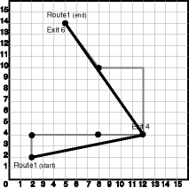
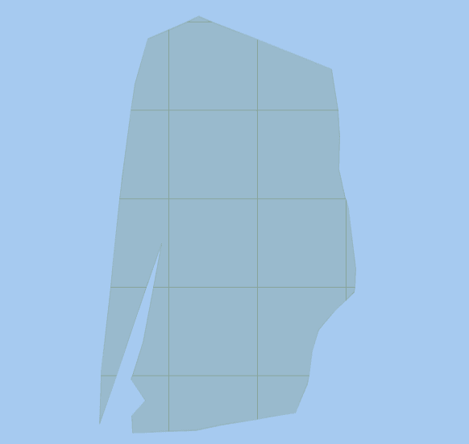
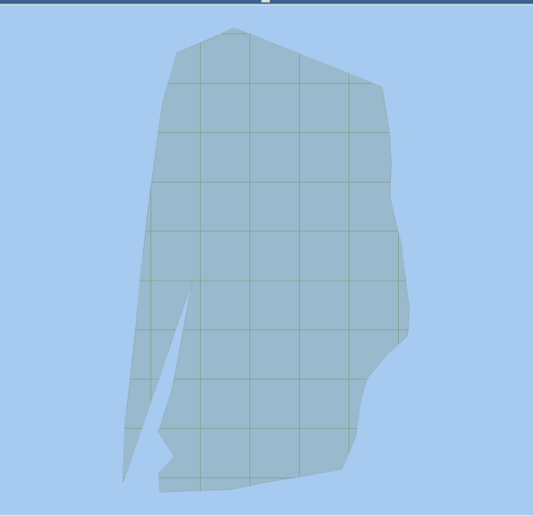
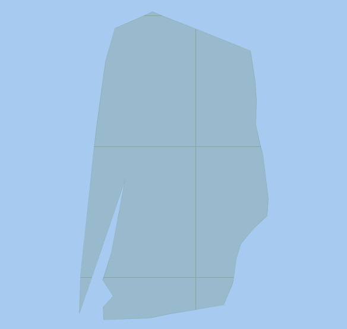

## 35  SDO_UTIL Package (Utility)

The MDSYS.SDO_UTIL package contains spatial utility subprograms.

- SDO_UTIL.AFFINETRANSFORMS
- SDO_UTIL.APPEND
- SDO_UTIL.BEARING_TILT_FOR_POINTS
- SDO_UTIL.CIRCLE_POLYGON
- SDO_UTIL.CONCAT_LINES
- SDO_UTIL.CONVERT_UNIT
- SDO_UTIL.CONVERT3007TO3008
- SDO_UTIL.DELETE_SDO_GEOM_METADATA
- SDO_UTIL.DENSIFY_GEOMETRY
- SDO_UTIL.DROP_WORK_TABLES
- SDO_UTIL.ELLIPSE_POLYGON
- SDO_UTIL.EXPAND_GEOM
- SDO_UTIL.EXTRACT
- SDO_UTIL.EXTRACT_ALL
- SDO_UTIL.EXTRACT3D
- SDO_UTIL.EXTRUDE
- SDO_UTIL.FROM_GEOJSON
- SDO_UTIL.FROM_GML311GEOMETRY
- SDO_UTIL.FROM_GMLGEOMETRY
- SDO_UTIL.FROM_JSON
- SDO_UTIL.FROM_KMLGEOMETRY
- SDO_UTIL.FROM_WKBGEOMETRY
- SDO_UTIL.FROM_WKTGEOMETRY
- SDO_UTIL.GEO_SEARCH
- SDO_UTIL.GET_2D_FOOTPRINT
- SDO_UTIL.GET_COORDINATE
- SDO_UTIL.GET_TILE_ENVELOPE
- SDO_UTIL.GET_VECTORTILE
- SDO_UTIL.GETFIRSTVERTEX
- SDO_UTIL.GETLASTVERTEX
- SDO_UTIL.GETNUMELEM
- SDO_UTIL.GETNUMVERTICES
- SDO_UTIL.GETNURBSAPPROX
- SDO_UTIL.GETVERTICES
- SDO_UTIL.H3_BASE_CELL
- SDO_UTIL.H3_BOUNDARY
- SDO_UTIL.H3_CENTER
- SDO_UTIL.H3_HEX_AREA
- SDO_UTIL.H3_HEX_EDGELEN
- SDO_UTIL.H3_NUM_CELLS
- SDO_UTIL.H3_IS_CLASS3
- SDO_UTIL.H3_IS_PENTAGON
- SDO_UTIL.H3_IS_VALID_CELL
- SDO_UTIL.H3_KEY
- SDO_UTIL.H3_MBR
- SDO_UTIL.H3_PARENT
- SDO_UTIL.H3_PENTAGON_AREA
- SDO_UTIL.H3_PENTAGON_EDGELEN
- SDO_UTIL.H3_RESOLUTION
- SDO_UTIL.H3SUM_AS_TABLE
- SDO_UTIL.H3SUM_CREATE_TABLE
- SDO_UTIL.H3SUM_ESTIMATE_RESOLUTION
- SDO_UTIL.H3SUM_GET_CURSOR
- SDO_UTIL.H3SUM_LIST_TABLES
- SDO_UTIL.H3SUM_VECTORTILE
- SDO_UTIL.INITIALIZE_INDEXES_FOR_TTS
- SDO_UTIL.INSERT_SDO_GEOM_METADATA
- SDO_UTIL.INTERIOR_POINT
- SDO_UTIL.POINT_AT_BEARING
- SDO_UTIL.POLYGONTOLINE
- SDO_UTIL.RECTIFY_GEOMETRY
- SDO_UTIL.REMOVE_DUPLICATE_VERTICES
- SDO_UTIL.REVERSE_LINESTRING
- SDO_UTIL.SIMPLIFY
- SDO_UTIL.SIMPLIFYVW
- SDO_UTIL.THEME3D_GET_BLOCK_TABLE
- SDO_UTIL.THEME3D_HAS_LOD
- SDO_UTIL.THEME3D_HAS_TEXTURE
- SDO_UTIL.TILE_GEOMETRY
- SDO_UTIL.TO_GEOJSON
- SDO_UTIL.TO_GML311GEOMETRY
- SDO_UTIL.TO_GMLGEOMETRY
- SDO_UTIL.TO_JSON
- SDO_UTIL.TO_JSON_VARCHAR
- SDO_UTIL.TO_KMLGEOMETRY
- SDO_UTIL.TO_WKBGEOMETRY
- SDO_UTIL.TO_WKTGEOMETRY
- SDO_UTIL.VALIDATE_3DTHEME
- SDO_UTIL.VALIDATE_SCENE
- SDO_UTIL.VALIDATE_VIEWFRAME
- SDO_UTIL.VALIDATE_WKBGEOMETRY
- SDO_UTIL.VALIDATE_WKTGEOMETRY

**Parent topic:** [Reference Information](spatial-reference-information.md)

### 35.1 SDO_UTIL.AFFINETRANSFORMS

#### Format

    SDO_UTIL.AFFINETRANSFORMS(
         geometry    IN SDO_GEOMETRY,
         translation IN VARCHAR2 DEFAULT 'FALSE',
         tx          IN NUMBER DEFAULT 0.0,
         ty          IN NUMBER DEFAULT 0.0,
         tz          IN NUMBER DEFAULT 0.0,
         scaling     IN VARCHAR2 DEFAULT 'FALSE',
         psc1        IN SDO_GEOMETRY DEFAULT NULL,
         sx          IN NUMBER DEFAULT 0.0,
         sy          IN NUMBER DEFAULT 0.0,
         sz          IN NUMBER DEFAULT 0.0,
         rotation    IN VARCHAR2 DEFAULT 'FALSE',
         p1          IN SDO_GEOMETRY DEFAULT NULL,
         line1       IN SDO_GEOMETRY DEFAULT NULL,
         angle       IN NUMBER DEFAULT 0.0,
         dir         IN NUMBER DEFAULT -1,
         shearing    IN VARCHAR2 DEFAULT 'FALSE',
         shxy        IN NUMBER DEFAULT 0.0,
         shyx        IN NUMBER DEFAULT 0.0,
         shxz        IN NUMBER DEFAULT 0.0,
         shzx        IN NUMBER DEFAULT 0.0,
         shyz        IN NUMBER DEFAULT 0.0,
         shzy        IN NUMBER DEFAULT 0.0,
         reflection  IN VARCHAR2 DEFAULT 'FALSE',
         pref        IN SDO_GEOMETRY DEFAULT NULL,
         lineR       IN SDO_GEOMETRY DEFAULT NULL,
         dirR        IN NUMBER DEFAULT -1,
         planeR      IN VARCHAR2 DEFAULT 'FALSE',
         n           IN SDO_NUMBER_ARRAY DEFAULT NULL,
         bigD        IN SDO_NUMBER_ARRAY DEFAULT NULL,
         ) RETURN SDO_GEOMETRY;

#### Description

Returns a geometry that reflects an affine transformation of the input geometry.

#### Parameters

geometry
Input geometry on which to perform the affine transformation.

translation
A string value of `TRUE` causes translation to be performed; a string value of `FALSE` (the default) causes translation not to be performed. If this parameter is `TRUE`, translation is performed about the point at (tx,ty) or (tx,ty,tz).

tx
X-axis value for translation. The default value is 0.0.

ty
Y-axis value for translation. The default value is 0.0.

tz
Z-axis value for translation. The default value is 0.0.

scaling
A string value of `TRUE` causes scaling to be performed; a string value of `FALSE` (the default) causes scaling not to be performed.

psc1
Point on the input geometry about which to perform the scaling. If `scaling` is `TRUE`, this geometry should be either a zero point (point geometry with 0,0 or 0,0,0 ordinates for scaling about the origin) or a nonzero point (point geometry with ordinates for scaling about a point other than the origin). If `scaling` is `FALSE`, `psc1` can be a null value.

sx
X-axis value for scaling (about either the point specified in the `psc1` parameter or the origin). The default value is 0.0.

sy
Y-axis value for scaling (about either the point specified in the `psc1` parameter or the origin). The default value is 0.0.

sz
Z-axis value for scaling (about either the point specified in the `psc1` parameter or the origin). The default value is 0.0.

rotation
A string value of `TRUE` causes rotation to be performed; a string value of `FALSE` (the default) causes rotation not to be performed.

For two-dimensional geometries, rotation uses the `p1` and `angle` values. For three-dimensional geometries, rotation uses either the `angle` and `dir` values or the `line1` and `angle` values.

p1
Point for two-dimensional geometry rotation about a specified point.

line1
Line for rotation about a specified axis.

angle
Angle rotation parameter (in radians) for rotation about a specified axis or about the X, Y, or Z axis. The default value is 0.0.

dir
Rotation parameter for x(0), y(1), or z(2)-axis roll. If the `rotation` parameter value is `TRUE` but the `dir` parameter is not used, use a value of -1 (the default)

shearing
A string value of `TRUE` causes shearing to be performed; a string value of `FALSE` (the default) causes shearing not to be performed.

For two-dimensional geometries, shearing uses the `shxy` and `shyx` parameter values. For three-dimensional geometries, shearing uses the `shxy`, `shyx`, `shxz`, `shzx`, `shyz`, and `shzy` parameter values.

shxy
Value for shearing due to X along the Y direction. The default value is 0.0.

shyx
Value for shearing due to Y along the X direction. The default value is 0.0.

shxz
Value for shearing due to X along the Z direction (three-dimensional geometries only). The default value is 0.0.

shzx
Value for shearing due to Z along the X direction (three-dimensional geometries only).

shyz
Value for shearing due to Y along the Z direction (three-dimensional geometries only).

shzy
Value for shearing due to Z along the Y direction (three-dimensional geometries only).

reflection
A string value of `TRUE` causes reflection to be performed; a string value of `FALSE` (the default) causes reflection not to be performed.

For two-dimensional geometries, reflection uses the `lineR` value for reflection about an axis and the `pref` value for the centroid for self-reflection. For three-dimensional geometries, reflection uses the `lineR` value for reflection about an axis; the `dirR` value for reflection about the yz, xz, and xy planes; the `planeR`, `n`, and `bigD` values for reflection about a specified plane; and the `pref` value for the centroid for self-reflection.

pref
Point through which to perform reflection.

lineR
Line along which to perform reflection.

dirR
Number indicating the plane about (through) which to perform reflection: 0 for the yz plane, 1 for the xz plane, or 2 for the xy plane. If the `reflection` parameter value is `TRUE` but the `dirR` parameter is not used, use a value of -1 (the default).

planeR
A string value of `TRUE` causes reflection about an arbitrary plane to be performed; a string value of `FALSE` (the default) causes reflection about an arbitrary plane not to be performed.

n
Normal vector of the plane.

bigD
Delta value for the plane equation in three-dimensional geometries.

For three-dimensional geometries, `bigD` = delta and `n` = (A,B,C) where `n` is the normal of the plane in three-dimensional space. Thus, the plane equation is:

    Ax+By+Cz+bigD = 3DDotProd(n,anypointonplane)+bigD = 0

#### Usage Notes

**Note:**

SDO_UTIL.AFFINETRANSFORMS function is supported only if Oracle JVM is enabled on your Oracle Autonomous Database Serverless deployments. To enable Oracle JVM, see [Use Oracle Java](https://docs.oracle.com/pls/topic/lookup?ctx=en/cloud/paas/autonomous-database&id=GUID-2516EE33-B38D-4270-BE52-30A4F9014E8B) in Using Oracle Autonomous Database Serverless for more information.

The order of affine transforms matter because these are matrix and vector multiplications.

You should validate the resulting geometry using the [SDO_GEOM.VALIDATE_GEOMETRY_WITH_CONTEXT](SDO_GEOM-reference.md) function.

#### Examples

The following example performs an affine transformation on a two-dimensional geometry.

    -- Polygon reflection in 2D about a specified line segment
    SELECT SDO_UTIL.AFFINETRANSFORMS(
      geometry =>   sdo_geometry (2003,8307,null,sdo_elem_info_array (1,1003,1),
                                  sdo_ordinate_array (0,2,2,0,5,3,3,5,0,2)),
      translation => 'FALSE',
      tx => 0.0,
      ty => 0.0,
      tz => 0.0,
      scaling => 'FALSE',
      psc1 => NULL,
      sx => 0.0,
      sy => 0.0,
      sz => 0.0,
      rotation => 'TRUE',
      p1 => sdo_geometry (2001,8307,sdo_point_type(0,2,null),null,null),
      line1 => NULL,
      angle => -2.35253274913915,
      dir => -1,
      shearing => 'FALSE',
      shxy => 0.0,
      shyx => 0.0,
      shxz => 0.0,
      shzx => 0.0,
      shyz => 0.0,
      shzy => 0.0,
      reflection => 'FALSE',
      pref => NULL,
      lineR => NULL,
      dirR => 0,
      planeR => 'FALSE',
      n => NULL,
      bigD => NULL
    ) FROM DUAL;

    SDO_UTIL.AFFINETRANSFORMS(GEOMETRY=>SDO_GEOMETRY(2003,8307,NULL,SDO_ELEM_INFO_AR
    --------------------------------------------------------------------------------
    SDO_GEOMETRY(2003, 8307, NULL, SDO_ELEM_INFO_ARRAY(1, 1003, 1), SDO_ORDINATE_ARR
    AY(0, 2, -2.8284082, 1.98964306, -2.8128727, -2.2529692, .015535417, -2.2426122,
     0, 2))

The following is a simplified version of the preceding example, using the default values for most parameters.

    -- Simpler form, using most default values
    SELECT SDO_UTIL.AFFINETRANSFORMS(
      geometry =>   sdo_geometry (2003,8307,null,sdo_elem_info_array (1,1003,1),
                                  sdo_ordinate_array (0,2,2,0,5,3,3,5,0,2)),
      rotation => 'TRUE',
      p1 => sdo_geometry (2001,8307,sdo_point_type(0,2,null),null,null),
      angle => -2.35253274913915
    ) FROM DUAL;

    SDO_UTIL.AFFINETRANSFORMS(GEOMETRY=>SDO_GEOMETRY(2003,8307,NULL,SDO_ELEM_INFO_AR
    --------------------------------------------------------------------------------
    SDO_GEOMETRY(2003, 8307, NULL, SDO_ELEM_INFO_ARRAY(1, 1003, 1), SDO_ORDINATE_ARR
    AY(0, 2, -2.8284082, 1.98964306, -2.8128727, -2.2529692, .015535417, -2.2426122,
     0, 2))

The following example performs an affine transformation on a three-dimensional geometry.

    -- Polygon reflection in 3D about a specified plane (z=1 plane in this example)
    SELECT SDO_UTIL.AFFINETRANSFORMS(
      geometry => MDSYS.SDO_GEOMETRY(3003, 0, NULL,
         MDSYS.SDO_ELEM_INFO_ARRAY(1,1003,1),
         MDSYS.SDO_ORDINATE_ARRAY(
         1.5,0,0,
         2.5,1,0,
         1.5,2,0,
         0.5,2,0,
         0.5,0,0,
         1.5,0,0)),
      translation => 'FALSE',
      tx => 0.0,
      ty => 0.0,
      tz => 0.0,
      scaling => 'FALSE',
      psc1 => NULL,
      sx => 0.0,
      sy => 0.0,
      sz => 0.0,
      rotation => 'FALSE',
      p1 => NULL,
      line1 => NULL,
      angle => 0.0,
      dir => 0,
      shearing => 'FALSE',
      shxy => 0.0,
      shyx => 0.0,
      shxz => 0.0,
      shzx => 0.0,
      shyz => 0.0,
      shzy => 0.0,
      reflection => 'TRUE',
      pref => NULL,
      lineR => NULL,
      dirR => -1,
      planeR => 'TRUE',
      n => SDO_NUMBER_ARRAY(0.0, 0.0, 1.0),
      bigD => SDO_NUMBER_ARRAY(-1.0)
    ) FROM DUAL;

    SDO_UTIL.AFFINETRANSFORMS(GEOMETRY=>MDSYS.SDO_GEOMETRY(3003,0,NULL,MDSYS.SDO_ELE
    --------------------------------------------------------------------------------
    SDO_GEOMETRY(3003, NULL, NULL, SDO_ELEM_INFO_ARRAY(1, 1003, 1), SDO_ORDINATE_ARR
    AY(1.5, 0, 2, 2.5, 1, 2, 1.5, 2, 2, .5, 2, 2, .5, 0, 2, 1.5, 0, 2))

#### Related Topics

- SDO_UTIL.CONVERT_UNIT

- SDO_UTIL.POINT_AT_BEARING

**Parent topic:** SDO_UTIL Package (Utility)

### 35.2 SDO_UTIL.APPEND

#### Format

    SDO_UTIL.APPEND(
         geometry1  IN SDO_GEOMETRY,
         geometry2  IN SDO_GEOMETRY
         ) RETURN SDO_GEOMETRY;

#### Description

Appends one geometry to another geometry to create a new geometry.

#### Parameters

geometry1
Geometry object to which `geometry2` is to be appended.

geometry2
Geometry object to append to `geometry1`.

#### Usage Notes

This function should be used only on geometries that do not have any spatial interaction (that is, on disjoint objects). If the input geometries are not disjoint, the resulting geometry might be invalid.

This function does not perform a union operation or any other computational geometry operation. To perform a union operation, use the [SDO_GEOM.SDO_UNION](SDO_GEOM-reference.md) function, which is described in [SDO_GEOM Package (Geometry)](SDO_GEOM-reference.md). The APPEND function executes faster than the [SDO_GEOM.SDO_UNION](SDO_GEOM-reference.md) function.

The geometry type (SDO_GTYPE value) of the resulting geometry reflects the types of the input geometries and the append operation. For example, if the input geometries are two-dimensional polygons (SDO_GTYPE = 2003), the resulting geometry is a two-dimensional multipolygon (SDO_GTYPE = 2007).

An exception is raised if `geometry1` and `geometry2` are based on different coordinate systems.

#### Examples

The following example appends the `cola_a` and `cola_c` geometries. (The example uses the definitions and data from [Simple Example: Inserting\_ Indexing\_ and Querying Spatial Data](spatial-datatypes-metadata.md).)

    SELECT SDO_UTIL.APPEND(c_a.shape, c_c.shape)
      FROM cola_markets c_a, cola_markets c_c
      WHERE c_a.name = 'cola_a' AND c_c.name = 'cola_c';

    SDO_UTIL.APPEND(C_A.SHAPE,C_C.SHAPE)(SDO_GTYPE, SDO_SRID, SDO_POINT(X, Y, Z), SD
    --------------------------------------------------------------------------------
    SDO_GEOMETRY(2007, NULL, NULL, SDO_ELEM_INFO_ARRAY(1, 1003, 3, 5, 1003, 1), SDO_
    ORDINATE_ARRAY(1, 1, 5, 7, 3, 3, 6, 3, 6, 5, 4, 5, 3, 3))

#### Related Topics

- [SDO_GEOM.SDO_UNION](SDO_GEOM-reference.md) (in [SDO_GEOM Package (Geometry)](SDO_GEOM-reference.md))

**Parent topic:** SDO_UTIL Package (Utility)

### 35.3 SDO_UTIL.BEARING_TILT_FOR_POINTS

#### Format

    SDO_UTIL.BEARING_TILT_FOR_POINTS(
         start_point IN SDO_GEOMETRY,
         end_point   IN SDO_GEOMETRY,
         tol         IN NUMBER,
         bearing     OUT NUMBER,
         tilt        OUT NUMBER
         ) RETURN SDO_GEOMETRY;

#### Description

Computes the bearing and tilt from a start point to an end point.

#### Parameters

start_point
Starting point geometry object from which to compute the bearing and tilt. The point geometry must be based on a geodetic coordinate system.

end_point
Ending point geometry object to use in computing the bearing and tilt. The point geometry must be based on the same geodetic coordinate system as `start_point`.

tol
Tolerance value (see [Tolerance](spatial-concepts.md)).

bearing
Number of radians, measured clockwise from North.

tilt
Number of radians, measured from the normal.

#### Usage Notes

The input point geometries must be based on the same geodetic coordinate system. If they are based on a non-geodetic coordinate system, the output bearing is a null value.

The tilt is computed as the arctangent of the difference between the height values divided by the distance between the points (with height excluded from the distance calculation). That is: `tilt = atan(height_difference/distance)`

To convert radians to decimal degrees or decimal degrees to radians, you can use the SDO_UTIL.CONVERT_UNIT function. To return a point geometry that is at a specified distance and bearing from a start point, you can use the SDO_UTIL.POINT_AT_BEARING function.

#### Examples

The following example computes the bearing and tilt for two longitude/latitude points, where the elevation of the start point is 0 (zero) and the elevation of the end point is 5000 meters. This example displays the bearing and tilt values in radians.

    DECLARE
      bearing NUMBER;
      tilt    NUMBER;
    BEGIN
      SDO_UTIL.BEARING_TILT_FOR_POINTS(
        SDO_GEOMETRY(2001, 8307,
          SDO_POINT_TYPE(-71.5, 43, 0), NULL, NULL), -- start_point
        SDO_GEOMETRY(2001, 8307,
          SDO_POINT_TYPE(-71, 43.5, 5000), NULL, NULL), -- end_point
        0.05,  --tolerance
        bearing,
        tilt);
      DBMS_OUTPUT.PUT_LINE('Bearing = ' || bearing);
      DBMS_OUTPUT.PUT_LINE('Tilt = ' || tilt);
    END;
    /
    Bearing = .628239101930666
    Tilt = .0725397288678286910476298724869396973718

The following example is the same as the preceding one, except that it displays the bearing and tilt in decimal degrees instead of radians.

    DECLARE
      bearing NUMBER;
      tilt    NUMBER;
    BEGIN
      SDO_UTIL.BEARING_TILT_FOR_POINTS(
        SDO_GEOMETRY(2001, 8307,
          SDO_POINT_TYPE(-71.5, 43, 0), NULL, NULL), -- start_point
        SDO_GEOMETRY(2001, 8307,
          SDO_POINT_TYPE(-71, 43.5, 5000), NULL, NULL), -- end_point
        0.05,  --tolerance
        bearing,
        tilt);
      DBMS_OUTPUT.PUT_LINE('Bearing in degrees = '
        || bearing * 180 / 3.1415926535897932384626433832795);
      DBMS_OUTPUT.PUT_LINE('Tilt in degrees = '
        || tilt * 180 / 3.1415926535897932384626433832795);
    END;
    /
    Bearing in degrees = 35.99544906571628894295547577999851892359
    Tilt in degrees = 4.15622031114988533540349823511872120415

#### Related Topics

- SDO_UTIL.CONVERT_UNIT

- SDO_UTIL.POINT_AT_BEARING

**Parent topic:** SDO_UTIL Package (Utility)

### 35.4 SDO_UTIL.CIRCLE_POLYGON

#### Format

    SDO_UTIL.CIRCLE_POLYGON(
         point         IN SDO_GEOMETRY,
         radius        IN NUMBER,
         arc_tolerance IN NUMBER,
         start_azimuth IN NUMBER DEFAULT NULL,
         end_azimuth   IN NUMBER DEFAULT NULL,
         orientation   IN NUMBER DEFAULT NULL,
         arc           IN NUMBER DEFAULT NULL
         ) RETURN SDO_GEOMETRY;

or

    SDO_UTIL.CIRCLE_POLYGON(
         center_longitude IN NUMBER,
         center_latitude  IN NUMBER,
         radius           IN NUMBER,
         arc_tolerance    IN NUMBER
         ) RETURN SDO_GEOMETRY;

or

    SDO_UTIL.CIRCLE_POLYGON(
         center_longitude IN NUMBER,
         center_latitude  IN NUMBER,
         radius           IN NUMBER,
         start_azimuth    IN NUMBER,
         end_azimuth      IN NUMBER,
         arc_tolerance    IN NUMBER
         ) RETURN SDO_GEOMETRY;

#### Description

Creates polygon or polyline approximations of circles and arcs in geodetic coordinate systems.

- The first format allows full control of the output.

- The second format returns the polygon geometry that approximates and is covered by a specified circle.

- The third format returns a line geometry that approximates the boundary of the circle from the start to the end azimuth (an arc).

#### Parameters

point
The center of the circle. Must be a point geometry in a geodetic coordinate system. The returned geometry will be in the same coordinate system.

center_longitude
Center longitude (in degrees) of the circle to be used to create the returned geometry.

center_latitude
Center latitude (in degrees) of the circle to be used to create the returned geometry.

radius
Length (in meters) of the radius of the circle to be used to create the returned geometry.

arc_tolerance
A numeric value to be used to construct the polygon geometry. The `arc_tolerance` parameter value has the same meaning and usage guidelines as the `arc_tolerance` keyword value in the `params` parameter string for the [SDO_GEOM.SDO_ARC_DENSIFY](SDO_GEOM-reference.md) function. The unit of measurement associated with the geometry is associated with the `arc_tolerance` parameter value. (For more information, see the Usage Notes for the [SDO_GEOM.SDO_ARC_DENSIFY](SDO_GEOM-reference.md) function in [SDO_GEOM Package (Geometry)](SDO_GEOM-reference.md).)

start_azimuth
Start angle (in degrees) of the arc, measured counterclockwise from due south.

If `start_azimuth` and `end_azimuth` are null, the behavior is comparable to the second format, which returns the polygon geometry that approximates and is covered by a specified circle.

end_azimuth
End angle (in degrees) of the arc, measured counterclockwise from due south. If `orientation` is not explicitly specified, then the arc will be the counterclockwise section of the circle from `start_azimuth` if `end_azimuth` is greater than `start_azimuth`, and the arc will be the clockwise section if `end_azimuth` is less than `start_azimuth`.

If `start_azimuth` and `end_azimuth` are null, the behavior is comparable to the second format, which returns the polygon geometry that approximates and is covered by a specified circle.

orientation
Controls which portion of the circle from `start_azimuth` to `end_azimuth` is used. This controls the shape of the returned output, not the orientation of the output: a returned polygon is always oriented counterclockwise, and a returned arc is always from `start_azimuth` to `end_azimuth`. The value can be one of the following:

- 0 or null (default): Automatic (see the `end_azimuth` parameter description).

- 1 or +1: Arc is drawn counterclockwise from `start_azimuth` to `end_azimuth`.

- -1: Arc is drawn clockwise from `start_azimuth` to `end_azimuth`.

arc
If set to 1, the result will be a line; if 0 or null (the default), the result is a polygon. If `start_azimuth` and `end_azimuth` specify a subset of the circle with a polygon result, the returned polygon will include the center of the circle (that is, will be a sector of the circle).

#### Usage Notes

The first format of this function is useful for creating a circle-like polygon around a specified center point when a true circle cannot be used (a circle is not valid for geodetic data with Oracle Spatial and Graph). The returned geometry has an SDO_SRID value of 8307 (for `Longitude / Latitude (WGS 84)`).

The second and third formats of this function are useful for creating a polyline approximation to a circular arc or a polygon that represents a sector of the circle.

If the start and end azimuth values are specified, they must not be equal to each other, and must cover no more than a 360 degree rotation. Angles must be in the range -720 to +720.

Circles will always be created with at least four distinct vertices (a square).

#### Examples

The following example returns a circle-like polygon around a point near the center of Concord, Massachusetts. A `radius` value of 100 meters and an `arc_tolerance` value of 5 meters are used in computing the polygon vertices.

    SELECT SDO_UTIL.CIRCLE_POLYGON(-71.34937, 42.46101, 100, 5)
       FROM DUAL;

    SDO_UTIL.CIRCLE_POLYGON(-71.34937,42.46101,100,5)(SDO_GTYPE, SDO_SRID, SDO_POINT
    --------------------------------------------------------------------------------
    SDO_GEOMETRY(2003, 8307, NULL, SDO_ELEM_INFO_ARRAY(1, 1003, 1), SDO_ORDINATE_ARR
    AY(-71.34937, 42.4601107, -71.348653, 42.4602824, -71.348211, 42.4607321, -71.34
    8211, 42.4612879, -71.348653, 42.4617376, -71.34937, 42.4619093, -71.350087, 42.
    4617376, -71.350529, 42.4612879, -71.350529, 42.4607321, -71.350087, 42.4602824,
     -71.34937, 42.4601107))

#### Related Topics

- SDO_UTIL.ELLIPSE_POLYGON

**Parent topic:** SDO_UTIL Package (Utility)

### 35.5 SDO_UTIL.CONCAT_LINES

#### Format

    SDO_UTIL.CONCAT_LINES(
         geometry1  IN SDO_GEOMETRY,
         geometry2  IN SDO_GEOMETRY
         ) RETURN SDO_GEOMETRY;

#### Description

Concatenates two line or multiline two-dimensional geometries to create a new geometry.

#### Parameters

geometry1
First geometry object for the concatenation operation.

geometry2
Second geometry object for the concatenation operation.

#### Usage Notes

Each input geometry must be a two-dimensional line or multiline geometry (that is, the SDO_GTYPE value must be 2002 or 2006). This function is not supported for LRS geometries. To concatenate LRS geometric segments, use the [SDO_LRS.CONCATENATE_GEOM_SEGMENTS](SDO_LRS-reference.md) function (described in [SDO_LRS Package (Linear Referencing System)](SDO_LRS-reference.md) ).

The input geometries must be line strings whose vertices are connected by straight line segments. Circular arcs and compound line strings are not supported.

If an input geometry is a multiline geometry, the elements of the geometry must be disjoint. If they are not disjoint, this function may return incorrect results.

The topological relationship between `geometry1` and `geometry2` must be DISJOINT or TOUCH; and if the relationship is TOUCH, the geometries must intersect only at two end points.

You can use the [SDO_AGGR_CONCAT_LINES](spatial-aggregate-functions.md) spatial aggregate function (described in [Spatial Aggregate Functions](spatial-aggregate-functions.md)) to concatenate multiple two-dimensional line or multiline geometries.

An exception is raised if `geometry1` and `geometry2` are based on different coordinate systems.

#### Examples

The following example concatenates two simple line string geometries.

    -- Concatenate two touching lines: one from (1,1) to (5,1) and the
    -- other from (5,1) to (8,1).
    SELECT SDO_UTIL.CONCAT_LINES(
      SDO_GEOMETRY(2002, NULL, NULL, SDO_ELEM_INFO_ARRAY(1,2,1),
         SDO_ORDINATE_ARRAY(1,1, 5,1)),
      SDO_GEOMETRY(2002, NULL, NULL, SDO_ELEM_INFO_ARRAY(1,2,1),
         SDO_ORDINATE_ARRAY(5,1, 8,1))
      ) FROM DUAL;

    SDO_UTIL.CONCAT_LINES(SDO_GEOMETRY(2002,NULL,NULL,SDO_ELEM_INFO_ARRAY(1,2,1),SDO
    --------------------------------------------------------------------------------
    SDO_GEOMETRY(2002, NULL, NULL, SDO_ELEM_INFO_ARRAY(1, 2, 1), SDO_ORDINATE_ARRAY(
    1, 1, 5, 1, 8, 1))

#### Related Topics

- [SDO_AGGR_CONCAT_LINES](spatial-aggregate-functions.md) (in [Spatial Aggregate Functions](spatial-aggregate-functions.md))

- [SDO_LRS.CONCATENATE_GEOM_SEGMENTS](SDO_LRS-reference.md) (in [SDO_LRS Package (Linear Referencing System)](SDO_LRS-reference.md) )

**Parent topic:** SDO_UTIL Package (Utility)

### 35.6 SDO_UTIL.CONVERT_UNIT

#### Format

    SDO_UTIL.CONVERT_UNIT(
         ivalue    IN NUMBER,
         in_unit   IN VARCHAR2,
         out_unit  IN VARCHAR2
         ) RETURN NUMBER;

#### Description

Converts values from one angle, area, or distance unit of measure to another.

#### Parameters

value
Number of units to be converted. For example, to convert 10 decimal degrees to radians, specify `10`.

in_unit
The unit of measure from which to convert the input value. Must be a value from the SDO_UNIT column of the MDSYS.SDO_ANGLE_UNITS table (described in [MDSYS.SDO_ANGLE_UNITS View](coordinate-systems-concepts.md)), the MDSYS.SDO_AREA_UNITS table (described in [Unit of Measurement Support](spatial-datatypes-metadata.md)), or the MDSYS.SDO_DIST_UNITS table (described in [Unit of Measurement Support](spatial-datatypes-metadata.md)). For example, to convert decimal degrees to radians, specify `Degree`.

out_unit
The unit of measure into which to convert the input value. Must be a value from the SDO_UNIT column of the same table used for `in_unit`. For example, to convert decimal degrees to radians, specify `Radian`.

#### Usage Notes

The value returned by this function might not be correct at an extremely high degree of precision because of the way internal mathematical operations are performed, especially if they involve small numbers or irrational numbers (such as pi). For example, converting 1 decimal degree into decimal minutes results in the value 60.0000017.

#### Examples

The following example converts 1 radian into decimal degrees.

    SQL> SELECT SDO_UTIL.CONVERT_UNIT(1, 'Radian', 'Degree') FROM DUAL;

    SDO_UTIL.CONVERT_UNIT(1,'RADIAN','DEGREE')
    ------------------------------------------
                                    57.2957796

#### Related Topics

None.

**Parent topic:** SDO_UTIL Package (Utility)

### 35.7 SDO_UTIL.CONVERT3007TO3008

#### Format

    SDO_UTIL.CONVERT3007TO3008(
         geometry  IN SDO_GEOMETRY
         ) RETURN SDO_GEOMETRY;

#### Description

Converts an input three-dimensional multisurface geometry (SDO_GTYPE 3007) to a simple solid geometry (SDO_GTYPE 3008).

#### Parameters

geometry
Geometry object with SDO_GTYPE 3007 (multisurface). The surfaces are simple polygons without interiors.

#### Usage Notes

**Note:**

SDO_UTIL.CONVERT3007TO3008 function is supported only if Oracle JVM is enabled on your Oracle Autonomous Database Serverless deployments. To enable Oracle JVM, see [Use Oracle Java](https://docs.oracle.com/pls/topic/lookup?ctx=en/cloud/paas/autonomous-database&id=GUID-2516EE33-B38D-4270-BE52-30A4F9014E8B) in Using Oracle Autonomous Database Serverless for more information.

For information about SDO_GEOMETRY attributes for 3D geometries, see [Three-Dimensional Spatial Objects](spatial-concepts.md).

This function does not check the validity of the returned simple solid geometry. To check the validity of a geometry object, use the [SDO_GEOM.VALIDATE_GEOMETRY_WITH_CONTEXT](SDO_GEOM-reference.md) function.

#### Examples

The following example converts an input three-dimensional multisurface geometry (SDO_GTYPE 3007) to a simple solid geometry (SDO_GTYPE 3008). It assumes that a table named GEOMS3D exists with at least a numeric ID column and a column named GEOM of type SDO_GEOMETRY containing three-dimensional multisurface geometries.

    SELECT sdo_util.convert3007to3008(g.geom) FROM geoms3d g WHERE g.id=1;

**Parent topic:** SDO_UTIL Package (Utility)

### 35.8 SDO_UTIL.DELETE_SDO_GEOM_METADATA

#### Format

    SDO_UTIL.DELETE_SDO_GEOM_METADATA(     
      owner       IN   VARCHAR2,
      table_name  IN VARCHAR2,
      column_name IN VARCHAR2);

#### Description

Deletes metadata for a spatial table from the geometry metadata views USER_SDO_GEOMETRY_METADATA and ALL_SDO_GEOMETRY_METADATA.

#### Parameters

owner
Name of the schema that owns the spatial table. Must be uppercase.

table_name
Name of the spatial table (a feature table that has a column of type SDO_GEOMETRY). Must be uppercase.

column_name
Name of the column of type SDO_GEOMETRY. Must be uppercase.

#### Usage Notes

Deleting the metadata for a spatial table from the geometry metadata views also effectively disables any spatial index based on that metadata (`owner`, `table_name`, and `column_name`).

If you want to restore the metadata after deleting it, you can use the SDO_UTIL.INSERT_SDO_GEOM_METADATA procedure.

To execute this procedure, you must be the owner of the metadata, have DBA privileges, or have the SELECT or INDEX privilege on the table.

To use this procedure on a spatial table in another user’s schema, you must have DBA privileges or the SELECT privilege on that other user’s table. For example, if USER1 wants to insert geometry metadata for the USER2.COLA_MARKETS table, then USER1 must have DBA privileges or the SELECT privilege on the USER2.COLA_MARKETS table.

#### Examples

The following example deletes metadata for a spatial table named COLA_MARKETS with the geometry column named SHAPE in the USER2 schema, and it thereby disables any spatial index defined on that metadata. (The example uses the definitions and data from [Simple Example: Inserting\_ Indexing\_ and Querying Spatial Data](spatial-datatypes-metadata.md).)

    EXECUTE SDO_UTIL.DELETE_SDO_GEOM_METADATA ('USER2', 'COLA_MARKETS', 'SHAPE');

#### Related Topics

- [Geometry Metadata Views](spatial-datatypes-metadata.md) for an explanation of the USER_SDO_GEOM_METADATA and ALL_SDO_GEOM_METADATA views

- SDO_UTIL.INSERT_SDO_GEOM_METADATA procedure

**Parent topic:** SDO_UTIL Package (Utility)

### 35.9 SDO_UTIL.DENSIFY_GEOMETRY

#### Format

    SDO_UTIL.DENSIFY_GEOMETRY(
         geometry  IN SDO_GEOMETRY,
         interval  IN NUMBER DEFAULT 5000
         ) RETURN SDO_GEOMETRY;

#### Description

Densifies the input geometry, based on an interval value.

#### Parameters

geometry
Geometry object to be densified.

interval
Interval value to be used for the geometry densification. Should be a positive number. (Zero or a negative number causes the input geometry to be returned.) The default is 5000. For a geodetic geometry, the default is 5000 meters.

#### Usage Notes

This function densifies the input geometry by adding more points so that no line segment is longer than the given `interval`.

This function is useful when a geodetic long line is to be shown on a planar map by showing the curvature of the great circle interpolation. When displaying geodetic geometries on a flat or planar map, the function helps you see the geodesic path between vertices along a line string or polygon, instead of connecting those vertices with straight lines. The densification is performed along the geodesic path.

#### Examples

The following example densifies an input geometry. (Descriptive comments are added in the output.)

    SELECT SDO_UTIL.DENSIFY_GEOMETRY(
      SDO_GEOMETRY(2004, 8307, NULL, SDO_ELEM_INFO_ARRAY(1, 2, 1, 5, 1, 1),
      SDO_ORDINATE_ARRAY(-78.24299, 31.50939, -31.99998, 31.51001, -64.6683, 32.38425)), 1000000)
    FROM DUAL;

    SDO_UTIL.DENSIFY_GEOMETRY(SDO_GEOMETRY(2004,8307,NULL,SDO_ELEM_INFO_ARRAY(1,2,1,
    --------------------------------------------------------------------------------
    SDO_GEOMETRY(2004, 8307, NULL, SDO_ELEM_INFO_ARRAY(1, 2, 1, 13, 1, 1),
    SDO_ORDINATE_ARRAY(-78.24299, 31.50939, -67.77851, 33.0389493, -57.05549, 33.6714211,
    -46.2911, 33.3720604, -35.71139, 32.1574866, -31.99998, 31.51001,  /* 4 points are added inside the long line */
    -64.6683, 32.38425)) /* single point is still the same as before */

#### Related Topics

- [SDO_GEOM.SDO_ARC_DENSIFY](SDO_GEOM-reference.md)

**Parent topic:** SDO_UTIL Package (Utility)

### 35.10 SDO_UTIL.DROP_WORK_TABLES

#### Format

    SDO_UTIL.DROP_WORK_TABLES(
         oidstr IN VARCHAR2);

#### Description

Drops any transient ("scratch") tables and views in the current schema that were created during the creation of a point cloud or TIN.

#### Parameters

oidstr
Object ID string representing a hexadecimal number. Use the string given in the error message that indicated that scratch tables need to be dropped.

#### Usage Notes

If scratch tables still exist from a previous [SDO_PC_PKG.CREATE_PC](SDO_PC_PKG-reference.md) or [SDO_TIN_PKG.CREATE_TIN](SDO_TIN_PKG-reference.md) operation when you try to create a point cloud or TIN, an error message is displayed indicating that you must first drop the scratch tables. Use the SDO_UTIL.DROP_WORK_TABLES procedure to drop these scratch tables.

This procedure drops all tables and views that match `'M%_<oidstr>$$%'`.

#### Examples

The following example drops the scratch tables from a previous [SDO_PC_PKG.CREATE_PC](SDO_PC_PKG-reference.md) or [SDO_TIN_PKG.CREATE_TIN](SDO_TIN_PKG-reference.md) operation, using an OID string specified in a previous error message.

    EXECXUTE SDO_UTIL.DROP_WORK_TABLES('A1B2C3');

#### Related Topics

- [SDO_PC_PKG.CREATE_PC](SDO_PC_PKG-reference.md)

- [SDO_TIN_PKG.CREATE_TIN](SDO_TIN_PKG-reference.md)

**Parent topic:** SDO_UTIL Package (Utility)

### 35.11 SDO_UTIL.ELLIPSE_POLYGON

#### Format

    SDO_UTIL.ELLIPSE_POLYGON(
         center_longitude IN NUMBER,
         center_latitude  IN NUMBER,
         semi_major_axis  IN NUMBER,
         semi_minor_axis  IN NUMBER,
         azimuth          IN NUMBER,
         arc_tolerance    IN NUMBER
         ) RETURN SDO_GEOMETRY;

#### Description

Returns the polygon geometry that approximates and is covered by a specified ellipse.

#### Parameters

center_longitude
Center longitude (in degrees) of the ellipse to be used to create the returned geometry.

center_latitude
Center latitude (in degrees) of the ellipse to be used to create the returned geometry.

semi_major_axis
Length (in meters) of the semi-major axis of the ellipse to be used to create the returned geometry.

semi_minor_axis
Length (in meters) of the semi-minor axis of the ellipse to be used to create the returned geometry.

azimuth
Number of degrees of the azimuth (clockwise rotation of the major axis from north) of the ellipse to be used to create the returned geometry. Must be from 0 to 180. The returned geometry is rotated by the specified number of degrees.

arc_tolerance
A numeric value to be used to construct the polygon geometry. The `arc_tolerance` parameter value has the same meaning and usage guidelines as the `arc_tolerance` keyword value in the `params` parameter string for the [SDO_GEOM.SDO_ARC_DENSIFY](SDO_GEOM-reference.md) function. The unit of measurement associated with the geometry is associated with the `arc_tolerance` parameter value. (For more information, see the Usage Notes for the [SDO_GEOM.SDO_ARC_DENSIFY](SDO_GEOM-reference.md) function in [SDO_GEOM Package (Geometry)](SDO_GEOM-reference.md).)

#### Usage Notes

This function is useful for creating an ellipse-like polygon around a specified center point when a true ellipse cannot be used (an ellipse is not valid for geodetic data with Oracle Spatial and Graph). The returned geometry has an SDO_SRID value of 8307 (for `Longitude / Latitude (WGS 84)`).

#### Examples

The following example returns an ellipse-like polygon, oriented east-west (`azimuth` = 90), around a point near the center of Concord, Massachusetts. An `arc_tolerance` value of 5 meters is used in computing the polygon vertices.

    SELECT SDO_UTIL.ELLIPSE_POLYGON(-71.34937, 42.46101, 100, 50, 90, 5)
       FROM DUAL;

    SDO_UTIL.ELLIPSE_POLYGON(-71.34937,42.46101,100,50,90,5)(SDO_GTYPE, SDO_SRID, SD
    --------------------------------------------------------------------------------
    SDO_GEOMETRY(2003, 8307, NULL, SDO_ELEM_INFO_ARRAY(1, 1003, 1), SDO_ORDINATE_ARR
    AY(-71.350589, 42.46101, -71.350168, 42.4606701, -71.349708, 42.460578, -71.3493
    7, 42.4605603, -71.349032, 42.460578, -71.348572, 42.4606701, -71.348151, 42.461
    01, -71.348572, 42.4613499, -71.349032, 42.461442, -71.34937, 42.4614597, -71.34
    9708, 42.461442, -71.350168, 42.4613499, -71.350589, 42.46101))

#### Related Topics

- SDO_UTIL.CIRCLE_POLYGON

**Parent topic:** SDO_UTIL Package (Utility)

### 35.12 SDO_UTIL.EXPAND_GEOM

#### Format

    SDO_UTIL.EXPAND_GEOM(
         geometry  IN SDO_GEOMETRY
         ) RETURN SDO_GEOMETRY;

#### Description

For a geometry with an exterior ring and/or one or more interior rings, where one or more of the rings are polygons specified in optimized form (optimized rectangles), returns the geometry in a form where all optimized polygon rings are specified as simple polygons (all vertices specified).

#### Parameters

geometry
Geometry with exterior and/or interior polygon rings specified in optimized form.

#### Usage Notes

If none of the rings in the input geometry are specified in optimized form (optimized rectangles), the function returns the input geometry.

Simple polygons and optimized rectangles have SDO_ETYPE values of 1003 or 2003 but different SDO_INTERPRETATION values, as explained in [SDO_ELEM_INFO](spatial-datatypes-metadata.md).

This function is supported with both 2D and 3D geometries.

This function can be useful if you use any applications that do not work with optimized rectangles, or if you prefer to use simple polygons instead of optimized rectangles.

#### Examples

The following example uses an input geometry whose exterior and interior polygon rings are optimized rectangles (and in this case, squares): the exterior ring is 8x8, and the interior ring is 2x2. It returns a geometry whose exterior and interior rings are specified as simple polygons.

    SELECT sdo_util.expand_geom(sdo_geometry(2003, null, null, -
         sdo_elem_info_array(1,1003,3, 5,2003,3), -
         sdo_ordinate_array(0,0, 8,8, 3,3, 5,5))) FROM DUAL;

    SDO_UTIL.EXPAND_GEOM(SDO_GEOMETRY(2003,NULL,NULL,SDO_ELEM_INFO_ARRAY(1,1003,3,5,
    --------------------------------------------------------------------------------
    SDO_GEOMETRY(2003, NULL, NULL, SDO_ELEM_INFO_ARRAY(1, 1003, 1, 11, 2003, 1), SDO
    _ORDINATE_ARRAY(0, 8, 0, 0, 8, 0, 8, 8, 0, 8, 3, 3, 3, 5, 5, 5, 5, 3, 3, 3))

**Parent topic:** SDO_UTIL Package (Utility)

### 35.13 SDO_UTIL.EXTRACT

#### Format

    SDO_UTIL.EXTRACT(
         geometry IN SDO_GEOMETRY,
         element  IN NUMBER,
         ring     IN NUMBER DEFAULT 0
         ) RETURN SDO_GEOMETRY;

#### Description

Returns the two-dimensional geometry that represents a specified element (and optionally a ring) of the input two-dimensional geometry.

#### Parameters

geometry
Geometry from which to extract the geometry to be returned. Must be a two-dimensional geometry.

element
Number of the element in the geometry: 1 for the first element, 2 for the second element, and so on. Geometries with SDO_GTYPE values (explained in [SDO_GTYPE](spatial-datatypes-metadata.md)) ending in 1, 2, or 3 have one element; geometries with SDO_GTYPE values ending in 4, 5, 6, or 7 can have more than one element. For example, a multipolygon with an SDO_GTYPE of 2007 might contain three elements (polygons).

ring
Number of the subelement (ring) within `element`: 1 for the first subelement, 2 for the second subelement, and so on. This parameter is valid only for specifying a subelement of a polygon with one or more holes or of a point cluster:

- For a polygon with holes, its first subelement is its exterior ring, its second subelement is its first interior ring, its third subelement is its second interior ring, and so on. For example, in the polygon with a hole shown in[Polygon with a Hole](spatial-datatypes-metadata.md), the exterior ring is subelement 1 and the interior ring (the hole) is subelement 2.

- For a point cluster, its first subelement is the first point in the point cluster, its second subelement is the second point in the point cluster, and so on.

The default is 0, which causes the entire element to be extracted.

#### Usage Notes

This function applies to two-dimensional geometries only. For three-dimensional geometries, use the SDO_UTIL.EXTRACT3D function.

This function is useful for extracting a specific element or subelement from a complex geometry. For example, if you have identified a geometry as invalid by using the [SDO_GEOM.VALIDATE_GEOMETRY_WITH_CONTEXT](SDO_GEOM-reference.md) function or the [SDO_GEOM.VALIDATE_LAYER_WITH_CONTEXT](SDO_GEOM-reference.md) procedure (both of which are documented in [SDO_GEOM Package (Geometry)](SDO_GEOM-reference.md)), you can use the EXTRACT function to extract the invalid geometry in order to examine it.

For a polygon with one or more holes, the returned geometry representing an extracted interior ring is reoriented so that its vertices are presented in counterclockwise order (as opposed to the clockwise order within an interior ring).

If `geometry` is null or has an SDO_GTYPE value ending in 0, this function returns a null geometry.

`geometry` cannot contain a type 0 (zero) element. Type 0 elements are described in [Type 0 (Zero) Element](spatial-datatypes-metadata.md).

This function is not intended for use with geometries that have any null ordinate values. Any null ordinate values in the returned geometry are replaced by 0 (zero).

An exception is raised if `element` or `ring` is an invalid number for `geometry`.

#### Examples

The following example extracts the first (and only) element in the `cola_c` geometry. (The example uses the definitions and data from [Simple Example: Inserting\_ Indexing\_ and Querying Spatial Data](spatial-datatypes-metadata.md).)

    SELECT c.name, SDO_UTIL.EXTRACT(c.shape, 1)
       FROM cola_markets c WHERE c.name = 'cola_c';

    NAME
    --------------------------------
    SDO_UTIL.EXTRACT(C.SHAPE,1)(SDO_GTYPE, SDO_SRID, SDO_POINT(X, Y, Z), SDO_ELEM_IN
    --------------------------------------------------------------------------------
    cola_c
    SDO_GEOMETRY(2003, NULL, NULL, SDO_ELEM_INFO_ARRAY(1, 1003, 1), SDO_ORDINATE_ARR
    AY(3, 3, 6, 3, 6, 5, 4, 5, 3, 3))

The following example inserts a polygon with a hole (using the same INSERT statement as in [Example 2-7](spatial-datatypes-metadata.md) in [Polygon with a Hole](spatial-datatypes-metadata.md)), and extracts the geometry representing the hole (the second subelement). Notice that in the geometry returned by the EXTRACT function, the vertices are in counterclockwise order, as opposed to the clockwise order in the hole (second subelement) in the input geometry.

    -- Insert polygon with hole.
    INSERT INTO cola_markets VALUES(
      10,
      'polygon_with_hole',
      SDO_GEOMETRY(
        2003,  -- two-dimensional polygon
        NULL,
        NULL,
        SDO_ELEM_INFO_ARRAY(1,1003,1, 19,2003,1), -- polygon with hole
        SDO_ORDINATE_ARRAY(2,4, 4,3, 10,3, 13,5, 13,9, 11,13, 5,13, 2,11, 2,4,
            7,5, 7,10, 10,10, 10,5, 7,5)
      )
    );

    1 row created.

    -- Extract the hole geometry (second subelement).
    SELECT SDO_UTIL.EXTRACT(c.shape, 1, 2)
       FROM cola_markets c WHERE c.name = 'polygon_with_hole';

    SDO_UTIL.EXTRACT(C.SHAPE,1,2)(SDO_GTYPE, SDO_SRID, SDO_POINT(X, Y, Z), SDO_ELEM_
    --------------------------------------------------------------------------------
    SDO_GEOMETRY(2003, NULL, NULL, SDO_ELEM_INFO_ARRAY(1, 1003, 1), SDO_ORDINATE_ARR
    AY(7, 5, 10, 5, 10, 10, 7, 10, 7, 5))

#### Related Topics

- SDO_UTIL.EXTRACT3D

- SDO_UTIL.GETVERTICES

- [SDO_GEOM.VALIDATE_GEOMETRY_WITH_CONTEXT](SDO_GEOM-reference.md)

- [SDO_GEOM.VALIDATE_LAYER_WITH_CONTEXT](SDO_GEOM-reference.md)

**Parent topic:** SDO_UTIL Package (Utility)

### 35.14 SDO_UTIL.EXTRACT_ALL

#### Format

    SDO_UTIL.EXTRACT_ALL(
         geometry IN SDO_GEOMETRY,
         flatten  IN NUMBER DEFAULT 1
         ) RETURN SDO_GEOMETRY_ARRAY;

#### Description

Returns all elements and subelements of the input two-dimensional geometry, as an array of one or more geometries. Returns an object of type SDO_GEOMETRY_ARRAY, which is defined as `VARRAY OF SDO_GEOMETRY`.

#### Parameters

geometry
Geometry from which to extract all elements and subelements. Must be a two-dimensional geometry.

flatten
A flag indicating whether to "flatten" rings into individual geometries for geometries that contain an exterior ring and one or more interior rings:

- `0` (zero) returns one geometry for each element, but does not flatten rings into individual geometries. (A geometry will still be returned for each element of the input geometry.)

- `1` (the default) or any other nonzero value flattens rings into individual geometries.

For example, if a polygon contains an outer ring and an inner ring, a value of `0` returns a single geometry containing both rings, and a value of `1` returns two geometries, each containing a ring as a geometry.

This parameter is ignored for geometries that do not contain an exterior ring and one or more interior rings.

#### Usage Notes

This function applies to two-dimensional geometries only. For three-dimensional geometries, use the SDO_UTIL.EXTRACT3D function.

This function enables you to extract all elements and subelements from a geometry, regardless of how many elements and subelements the geometry has. Geometries with SDO_GTYPE values (explained in [SDO_GTYPE](spatial-datatypes-metadata.md)) ending in 1, 2, or 3 have one element; geometries with SDO_GTYPE values ending in 4, 5, 6, or 7 can have more than one element. For example, a multipolygon with an SDO_GTYPE of 2007 might contain three elements (polygons). To extract individual elements, use the SDO_UTIL.EXTRACT function instead.

For a polygon with one or more holes, with the default value for the `flatten` parameter, the returned geometry representing an extracted interior ring is reoriented so that its vertices are presented in counterclockwise order (as opposed to the clockwise order within an interior ring). However, if the `flatten` parameter value is 0, no reorientation is performed.

If `geometry` is null or has an SDO_GTYPE value ending in 0, this function returns a null geometry.

`geometry` cannot contain a type 0 (zero) element. Type 0 elements are described in [Type 0 (Zero) Element](spatial-datatypes-metadata.md).

This function is not intended for use with geometries that have any null ordinate values. Any null ordinate values in the returned geometry are replaced by 0 (zero).

#### Examples

The following example extracts all elements from the `cola_b` geometry. (The example uses the definitions and data from [Simple Example: Inserting\_ Indexing\_ and Querying Spatial Data](spatial-datatypes-metadata.md).)

    SELECT * FROM TABLE(
      SELECT SDO_UTIL.EXTRACT_ALL(c.shape)
        FROM cola_markets c WHERE c.name = 'cola_b');

     SDO_GTYPE   SDO_SRID
    ---------- ----------
    SDO_POINT(X, Y, Z)
    --------------------------------------------------------------------------------
    SDO_ELEM_INFO
    --------------------------------------------------------------------------------
    SDO_ORDINATES
    --------------------------------------------------------------------------------
          2003

    SDO_ELEM_INFO_ARRAY(1, 1003, 1)
    SDO_ORDINATE_ARRAY(5, 1, 8, 1, 8, 6, 5, 7, 5, 1)

The following example inserts a polygon with a hole (using the same INSERT statement as in [Example 2-7](spatial-datatypes-metadata.md) in [Polygon with a Hole](spatial-datatypes-metadata.md)), and extracts all elements and subelements from the `polygon_with_hole` geometry. Notice that because the `flatten` parameter is not specified, in the second geometry returned by the EXTRACT_ALL function the vertices are in counterclockwise order, as opposed to the clockwise order in the hole (second subelement) in the input geometry.

    -- Insert polygon with hole.
    INSERT INTO cola_markets VALUES(
      10,
      'polygon_with_hole',
      SDO_GEOMETRY(
        2003,  -- two-dimensional polygon
        NULL,
        NULL,
        SDO_ELEM_INFO_ARRAY(1,1003,1, 19,2003,1), -- polygon with hole
        SDO_ORDINATE_ARRAY(2,4, 4,3, 10,3, 13,5, 13,9, 11,13, 5,13, 2,11, 2,4,
            7,5, 7,10, 10,10, 10,5, 7,5)
      )
    );

    1 row created.

    -- Extract all, with default for flatten.
    SELECT * FROM TABLE(
      SELECT SDO_UTIL.EXTRACT_ALL(c.shape)
      FROM cola_markets c WHERE c.name = 'polygon_with_hole');

     SDO_GTYPE   SDO_SRID
    ---------- ----------
    SDO_POINT(X, Y, Z)
    --------------------------------------------------------------------------------
    SDO_ELEM_INFO
    --------------------------------------------------------------------------------
    SDO_ORDINATES
    --------------------------------------------------------------------------------
          2003

    SDO_ELEM_INFO_ARRAY(1, 1003, 1)
    SDO_ORDINATE_ARRAY(2, 4, 4, 3, 10, 3, 13, 5, 13, 9, 11, 13, 5, 13, 2, 11, 2, 4)

     SDO_GTYPE   SDO_SRID
    ---------- ----------
    SDO_POINT(X, Y, Z)
    --------------------------------------------------------------------------------
    SDO_ELEM_INFO
    --------------------------------------------------------------------------------
    SDO_ORDINATES
    --------------------------------------------------------------------------------
          2003

    SDO_ELEM_INFO_ARRAY(1, 1003, 1)
    SDO_ORDINATE_ARRAY(7, 5, 10, 5, 10, 10, 7, 10, 7, 5)

The following example extracts all elements and subelements from the `polygon_with_hole` geometry (inserted in the preceding example), and it specifies the `flatten` parameter value as 0 (zero). This causes the returned array to contain a single geometry that is the same as the input geometry; thus, in the geometry returned by the EXTRACT_ALL function, the vertices are in same clockwise order in the hole (second subelement) as in the input geometry.

    -- Extract all, with flatten = 0.
    SELECT * FROM TABLE(
      SELECT SDO_UTIL.EXTRACT_ALL(c.shape, 0)
        FROM cola_markets c WHERE c.name = 'polygon_with_hole');

     SDO_GTYPE   SDO_SRID
    ---------- ----------
    SDO_POINT(X, Y, Z)
    --------------------------------------------------------------------------------
    SDO_ELEM_INFO
    --------------------------------------------------------------------------------
    SDO_ORDINATES
    --------------------------------------------------------------------------------
          2003

    SDO_ELEM_INFO_ARRAY(1, 1003, 1, 19, 2003, 1)
    SDO_ORDINATE_ARRAY(2, 4, 4, 3, 10, 3, 13, 5, 13, 9, 11, 13, 5, 13, 2, 11, 2, 4,
    7, 5, 7, 10, 10, 10, 10, 5, 7, 5)

     SDO_GTYPE   SDO_SRID
    ---------- ----------
    SDO_POINT(X, Y, Z)
    --------------------------------------------------------------------------------
    SDO_ELEM_INFO
    --------------------------------------------------------------------------------
    SDO_ORDINATES
    --------------------------------------------------------------------------------

#### Related Topics

- SDO_UTIL.EXTRACT

**Parent topic:** SDO_UTIL Package (Utility)

### 35.15 SDO_UTIL.EXTRACT3D

#### Format

    SDO_UTIL.EXTRACT3D(
         geometry IN SDO_GEOMETRY,
         label    IN VARCHAR2
         ) RETURN SDO_GEOMETRY;

#### Description

Returns the three-dimensional geometry that represents a specified subset of the input three-dimensional geometry.

#### Parameters

geometry
Geometry from which to extract the geometry to be returned. Must be a three-dimensional geometry

label
A comma-delimited string of numbers that identify the subset geometry to be returned. Each number identifies the relative position of a geometry item within the input geometry. The items and their positions within the `label` string are:

- `pointID`: Point number

- `edgeID`: Edge number

- `ringID`: Ring number

- `polygonID`: Polygon number

- `csurfID`: Composite surface number

- `solidID`: Solid number

- `multiID`: Multisolid number

A value of 0 (zero) means that the item does not apply, and you can omit trailing items that do not apply. For example, `'0,2,1,4,1'` means that point number does not apply, and it specifies the second edge of the first ring of the fourth polygon of the first composite surface.

#### Usage Notes

**Note:**

SDO_UTIL.EXTRACT3D function is supported only if Oracle JVM is enabled on your Oracle Autonomous Database Serverless deployments. To enable Oracle JVM, see [Use Oracle Java](https://docs.oracle.com/pls/topic/lookup?ctx=en/cloud/paas/autonomous-database&id=GUID-2516EE33-B38D-4270-BE52-30A4F9014E8B) in Using Oracle Autonomous Database Serverless for more information.

This function applies to three-dimensional geometries only. For two-dimensional geometries, use the SDO_UTIL.EXTRACT function.

This function uses the `getElementByLabel` method of the `oracle.spatial.geometry.ElementExtractor` Java class, which is described in [Oracle Spatial and Graph Java API Reference](../spajv/index.md).

#### Examples

The following example extracts, from a specified three-dimensional geometry, the subset geometry consisting of the following: edge 2 of ring 1 of polygon 4 of composite surface 1 of the input geometry.

    SELECT SDO_UTIL.EXTRACT3D(
      SDO_GEOMETRY (3008,NULL,NULL ,
        SDO_ELEM_INFO_ARRAY(
          1,1007,1,
          1,1006,6,
          1,1003,1,
          16,1003,1,
          31,1003,1,
          46,1003,1,
          61,1003,1,
          76,1003,1),
        SDO_ORDINATE_ARRAY(
          1.0,0.0,-1.0,
          1.0,1.0,-1.0,
          1.0,1.0,1.0,
          1.0,0.0,1.0,
          1.0,0.0,-1.0,
          1.0,0.0,1.0,
          0.0,0.0,1.0,
          0.0,0.0,-1.0,
          1.0,0.0,-1.0,
          1.0,0.0,1.0,
          0.0,1.0,1.0,
          0.0,1.0,-1.0,
          0.0,0.0,-1.0,
          0.0,0.0,1.0,
          0.0,1.0,1.0,
          1.0,1.0,-1.0,
          0.0,1.0,-1.0,
          0.0,1.0,1.0,
          1.0,1.0,1.0,
          1.0,1.0,-1.0,
          1.0,1.0,1.0,
          0.0,1.0,1.0,
          0.0,0.0,1.0,
          1.0,0.0,1.0,
          1.0,1.0,1.0,
          1.0,1.0,-1.0,
          1.0,0.0,-1.0,
          0.0,0.0,-1.0,
          0.0,1.0,-1.0,
          1.0,1.0,-1.0
          )
        ),
      '0,2,1,4,1')
    FROM DUAL;

    SDO_UTIL.EXTRACT3D(SDO_GEOMETRY(3008,NULL,NULL,SDO_ELEM_INFO_ARRAY(1,1007,1,1,10
    --------------------------------------------------------------------------------
    SDO_GEOMETRY(3002, NULL, NULL, SDO_ELEM_INFO_ARRAY(1, 2, 1), SDO_ORDINATE_ARRAY(
    0, 1, -1, 0, 1, 1))

#### Related Topics

- SDO_UTIL.EXTRACT

**Parent topic:** SDO_UTIL Package (Utility)

### 35.16 SDO_UTIL.EXTRUDE

#### Format

    SDO_UTIL.EXTRUDE(
         geometry  IN SDO_GEOMETRY,
         grdheight IN SDO_NUMBER_ARRAY,
         height    IN SDO_NUMBER_ARRAY,
         tol       IN NUMBER,
         optional3dSrid IN NUMBER DEFAULT NULL
         ) RETURN SDO_GEOMETRY;

#### Description

Returns the three-dimensional extrusion solid geometry from an input two-dimensional polygon or multipolygon geometry.

#### Parameters

geometry
Two-dimensional polygon geometry from which to return the extrusion geometry. This geometry forms the "base" of the returned geometry.

grdheight
Ground heights as a set of Z (height) values at the base of the solid. The numbers in this array should be the Z (height) values at the base of each vertex in the input geometry.

height
Height values for the extrusion geometry. The numbers in this array should be the Z (height) values at the "top" of each corresponding point in the grdheight array. For example, if the ground height at the base of the first vertex is 0 and the height at that vertex is 10, the solid at that point along the base extends 10 units high.

tol
Tolerance value (see [Tolerance](spatial-concepts.md)).

optional3dSrid
Three-dimensional coordinate system (SRID) to be assigned to the returned geometry. If you do not specify this parameter, Spatial and Graph automatically assigns a three-dimensional SRID value based on the SRID value of the input geometry.

#### Usage Notes

**Note:**

SDO_UTIL.EXTRUDE function is supported only if Oracle JVM is enabled on your Oracle Autonomous Database Serverless deployments. To enable Oracle JVM, see [Use Oracle Java](https://docs.oracle.com/pls/topic/lookup?ctx=en/cloud/paas/autonomous-database&id=GUID-2516EE33-B38D-4270-BE52-30A4F9014E8B) in Using Oracle Autonomous Database Serverless for more information.

The input geometry must be a two-dimensional polygon or multipolygon geometry.

If the input geometry is a polygon with multiple inner rings, this function internally combines these inner rings to make them one inner ring, producing a new geometry that approximately represents the original appearance; the function then performs the extrusion process on this new geometry, and returns the result.

#### Examples

The following example returns the three-dimensional solid geometry representing an extrusion from a two-dimensional polygon geometry.

    SELECT SDO_UTIL.EXTRUDE(
      SDO_GEOMETRY(
        2003,
        null,
        null,
        SDO_ELEM_INFO_ARRAY(1,1003,1),
        SDO_ORDINATE_ARRAY(5, 1,8,1,8,6,5,7,5,1)),
      SDO_NUMBER_ARRAY(0,0,0,0,0),
      SDO_NUMBER_ARRAY(5,10,10,5,5),
      0.005) from dual;

    SDO_UTIL.EXTRUDE(SDO_GEOMETRY(2003,NULL,NULL,SDO_ELEM_INFO_ARRAY(1,1003,1),SDO_O
    --------------------------------------------------------------------------------
    SDO_GEOMETRY(3008, NULL, NULL, SDO_ELEM_INFO_ARRAY(1, 1007, 1, 1, 1006, 6, 1, 10
    03, 1, 16, 1003, 1, 31, 1003, 1, 46, 1003, 1, 61, 1003, 1, 76, 1003, 1), SDO_ORD
    INATE_ARRAY(5, 1, 0, 5, 7, 0, 8, 6, 0, 8, 1, 0, 5, 1, 0, 5, 1, 5, 8, 1, 10, 8, 6
    , 10, 5, 7, 5, 5, 1, 5, 5, 1, 0, 8, 1, 0, 8, 1, 10, 5, 1, 5, 5, 1, 0, 8, 1, 0, 8
    , 6, 0, 8, 6, 10, 8, 1, 10, 8, 1, 0, 8, 6, 0, 5, 7, 0, 5, 7, 5, 8, 6, 10, 8, 6,
    0, 5, 7, 0, 5, 1, 0, 5, 1, 5, 5, 7, 5, 5, 7, 0))

The following example returns the three-dimensional composite solid geometry representing an extrusion from a two-dimensional polygon geometry with inner rings.

    SELECT SDO_UTIL.EXTRUDE(
      SDO_GEOMETRY(
        2003,
        null,
        null,
        SDO_ELEM_INFO_ARRAY(1, 1003, 1, 11, 2003, 1,
          21, 2003,1, 31,2003,1, 41, 2003, 1),
        SDO_ORDINATE_ARRAY(0,0, 8,0, 8,8, 0,8, 0,0,
          1,3, 1,4, 2,4, 2,3, 1,3, 1,1, 1,2, 2,2, 2,1, 1,1,
          1,6, 1,7, 2,7, 2,6, 1,6, 3,2, 3,4, 4,4, 4,2, 3,2)),
      SDO_NUMBER_ARRAY(-1.0),
      SDO_NUMBER_ARRAY(1.0),
      0.0001) from dual;

    SDO_UTIL.EXTRUDE(SDO_GEOMETRY(2003,NULL,NULL,SDO_ELEM_INFO_ARRAY(1,1003,1,11,200
    --------------------------------------------------------------------------------
    SDO_GEOMETRY(3008, NULL, NULL, SDO_ELEM_INFO_ARRAY(1, 1008, 4, 1, 1007, 1, 1, 10
    06, 16, 1, 1003, 1, 46, 1003, 1, 91, 1003, 1, 106, 1003, 1, 121, 1003, 1, 136, 1
    003, 1, 151, 1003, 1, 166, 1003, 1, 181, 1003, 1, 196, 1003, 1, 211, 1003, 1, 22
    6, 1003, 1, 241, 1003, 1, 256, 1003, 1, 271, 1003, 1, 286, 1003, 1, 301, 1007, 1
    , 301, 1006, 10, 301, 1003, 1, 328, 1003, 1, 355, 1003, 1, 370, 1003, 1, 385, 10
    03, 1, 400, 1003, 1, 415, 1003, 1, 430, 1003, 1, 445, 1003, 1, 460, 1003, 1, 475
    , 1007, 1, 475, 1006, 6, 475, 1003, 1, 490, 1003, 1, 505, 1003, 1, 520, 1003, 1,
     535, 1003, 1, 550, 1003, 1, 565, 1007, 1, 565, 1006, 10, 565, 1003, 1, 592, 100
    3, 1, 619, 1003, 1, 634, 1003, 1, 649, 1003, 1, 664, 1003, 1, 679, 1003, 1, 694,
     1003, 1, 709, 1003, 1, 724, 1003, 1), SDO_ORDINATE_ARRAY(4, 0, -1, 4, 2, -1, 4,
     4, -1, 3, 4, -1, 2, 4, -1, 2, 7, -1, 1, 7, -1, 1, 6, -1, 1, 4, -1, 1, 3, -1, 0,
     3, -1, 0, 8, -1, 8, 8, -1, 8, 0, -1, 4, 0, -1, 4, 0, 1, 8, 0, 1, 8, 8, 1, 0, 8,
     1, 0, 3, 1, 1, 3, 1, 1, 4, 1, 1, 6, 1, 1, 7, 1, 2, 7, 1, 2, 4, 1, 3, 4, 1, 4, 4
    , 1, 4, 2, 1, 4, 0, 1, 4, 0, -1, 8, 0, -1, 8, 0, 1, 4, 0, 1, 4, 0, -1, 8, 0, -1,
     8, 8, -1, 8, 8, 1, 8, 0, 1, 8, 0, -1, 8, 8, -1, 0, 8, -1, 0, 8, 1, 8, 8, 1, 8,
    8, -1, 0, 8, -1, 0, 3, -1, 0, 3, 1, 0, 8, 1, 0, 8, -1, 0, 3, -1, 1, 3, -1, 1, 3,
     1, 0, 3, 1, 0, 3, -1, 1, 3, -1, 1, 4, -1, 1, 4, 1, 1, 3, 1, 1, 3, -1, 1, 4, -1,
     1, 6, -1, 1, 6, 1, 1, 4, 1, 1, 4, -1, 1, 6, -1, 1, 7, -1, 1, 7, 1, 1, 6, 1, 1,
    6, -1, 1, 7, -1, 2, 7, -1, 2, 7, 1, 1, 7, 1, 1, 7, -1, 2, 7, -1, 2, 4, -1, 2, 4,
     1, 2, 7, 1, 2, 7, -1, 2, 4, -1, 3, 4, -1, 3, 4, 1, 2, 4, 1, 2, 4, -1, 3, 4, -1,
     4, 4, -1, 4, 4, 1, 3, 4, 1, 3, 4, -1, 4, 4, -1, 4, 2, -1, 4, 2, 1, 4, 4, 1, 4,
    4, -1, 4, 2, -1, 4, 0, -1, 4, 0, 1, 4, 2, 1, 4, 2, -1, 0, 3, -1, 1, 3, -1, 1, 1,
     -1, 2, 1, -1, 3, 2, -1, 4, 2, -1, 4, 0, -1, 0, 0, -1, 0, 3, -1, 0, 3, 1, 0, 0,
    1, 4, 0, 1, 4, 2, 1, 3, 2, 1, 2, 1, 1, 1, 1, 1, 1, 3, 1, 0, 3, 1, 0, 3, -1, 0, 0
    , -1, 0, 0, 1, 0, 3, 1, 0, 3, -1, 0, 0, -1, 4, 0, -1, 4, 0, 1, 0, 0, 1, 0, 0, -1
    , 4, 0, -1, 4, 2, -1, 4, 2, 1, 4, 0, 1, 4, 0, -1, 4, 2, -1, 3, 2, -1, 3, 2, 1, 4
    , 2, 1, 4, 2, -1, 3, 2, -1, 2, 1, -1, 2, 1, 1, 3, 2, 1, 3, 2, -1, 2, 1, -1, 1, 1
    , -1, 1, 1, 1, 2, 1, 1, 2, 1, -1, 1, 1, -1, 1, 3, -1, 1, 3, 1, 1, 1, 1, 1, 1, -1
    , 1, 3, -1, 0, 3, -1, 0, 3, 1, 1, 3, 1, 1, 3, -1, 1, 6, -1, 2, 6, -1, 2, 4, -1,
    1, 4, -1, 1, 6, -1, 1, 6, 1, 1, 4, 1, 2, 4, 1, 2, 6, 1, 1, 6, 1, 1, 6, -1, 1, 4,
     -1, 1, 4, 1, 1, 6, 1, 1, 6, -1, 1, 4, -1, 2, 4, -1, 2, 4, 1, 1, 4, 1, 1, 4, -1,
     2, 4, -1, 2, 6, -1, 2, 6, 1, 2, 4, 1, 2, 4, -1, 2, 6, -1, 1, 6, -1, 1, 6, 1, 2,
     6, 1, 2, 6, -1, 1, 3, -1, 2, 3, -1, 2, 4, -1, 3, 4, -1, 3, 2, -1, 2, 1, -1, 2,
    2, -1, 1, 2, -1, 1, 3, -1, 1, 3, 1, 1, 2, 1, 2, 2, 1, 2, 1, 1, 3, 2, 1, 3, 4, 1,
     2, 4, 1, 2, 3, 1, 1, 3, 1, 1, 3, -1, 1, 2, -1, 1, 2, 1, 1, 3, 1, 1, 3, -1, 1, 2
    , -1, 2, 2, -1, 2, 2, 1, 1, 2, 1, 1, 2, -1, 2, 2, -1, 2, 1, -1, 2, 1, 1, 2, 2, 1
    , 2, 2, -1, 2, 1, -1, 3, 2, -1, 3, 2, 1, 2, 1, 1, 2, 1, -1, 3, 2, -1, 3, 4, -1,
    3, 4, 1, 3, 2, 1, 3, 2, -1, 3, 4, -1, 2, 4, -1, 2, 4, 1, 3, 4, 1, 3, 4, -1, 2, 4
    , -1, 2, 3, -1, 2, 3, 1, 2, 4, 1, 2, 4, -1, 2, 3, -1, 1, 3, -1, 1, 3, 1, 2, 3, 1
    , 2, 3, -1))

#### Related Topics

None.

**Parent topic:** SDO_UTIL Package (Utility)

### 35.17 SDO_UTIL.FROM_GEOJSON

#### Format

    SDO_UTIL.FROM_GEOJSON(
         geometry  IN VARCHAR2,
         crs       IN VARCHAR2 DEFAULT NULL,
         srid      IN VARCHAR2 DEFAULT 4326
         ) RETURN SDO_GEOMETRY;

or

    SDO_UTIL.FROM_GEOJSON(
         geometry  IN CLOB,
         crs       IN VARCHAR2 DEFAULT NULL,
         srid      IN VARCHAR2 DEFAULT 4326
         ) RETURN SDO_GEOMETRY;

#### Description

Converts a GeoJSON object (or more specifically a geometry object in GeoJSON format) to a Spatial and Graph geometry object.

#### Parameters

geometry
Geometry in GeoJSON format to be converted to SDO_GEOMETRY format. The JSON object data type can be VARCHAR2 or CLOB.

crs
(Reserved for future use. The default is null.)

srid
SDO_SRID value to be used in the returned geometry. The default is 4326, which is the EPSG SRID value for the WGS 84 (longitude/latitude) coordinate system.

#### Usage Notes

The input geometry must be in GeoJSON format. For information about using JSON data that is stored in Oracle Database, see [Oracle Database JSON Developer's Guide](../adjsn/intro-to-json-data-and-oracle-database.md).

To convert an SDO_GEOMETRY object to GeoJSON format, use the SDO_UTIL.TO_GEOJSON function.

#### Examples

The following example shows conversion to and from GeoJSON format. (The example uses the definitions and data from [Simple Example: Inserting\_ Indexing\_ and Querying Spatial Data](spatial-datatypes-metadata.md), specifically the `cola_b` geometry from the COLA_MARKETS table.) In this example, specifying `srid => NULL` causes the returned SDO_GEOMETRY object to have an SDO_SRID value of NULL, as opposed to the default of 4326 if the parameter is not specified.

    DECLARE
      cola_b_geom SDO_GEOMETRY;
      returned_geom SDO_GEOMETRY;
      returned_json CLOB;

    BEGIN

    -- Populate geometry variable with cola market cols_b shape.
    SELECT c.shape into cola_b_geom FROM cola_markets c
      WHERE c.name = 'cola_b';

    -- From geometry to JSON
    returned_json := SDO_UTIL.TO_GEOJSON(cola_b_geom);

    -- From JSON to geometry
    returned_geom := SDO_UTIL.FROM_GEOJSON(returned_json, srid => NULL);

    END;
    /

#### Related Topics

- SDO_UTIL.TO_GEOJSON

**Parent topic:** SDO_UTIL Package (Utility)

### 35.18 SDO_UTIL.FROM_GML311GEOMETRY

#### Format

    SDO_UTIL.FROM_GML311GEOMETRY(
         geometry     IN CLOB,
         srsNamespace IN VARCHAR2 DEFAULT NULL
         ) RETURN SDO_GEOMETRY;

or

    SDO_UTIL.FROM_GML311GEOMETRY(
         geometry     IN CLOB,
         srsNamespace IN VARCHAR2,
         coordOrder   IN NUMBER
         ) RETURN SDO_GEOMETRY;

or

    SDO_UTIL.FROM_GML311GEOMETRY(
         geometry  IN VARCHAR2,
         srsNamespace  IN VARCHAR2 DEFAULT NULL
         ) RETURN SDO_GEOMETRY;

or

    SDO_UTIL.FROM_GML311GEOMETRY(
         geometry  IN VARCHAR2,
         coordOrder  IN NUMBER DEFAULT NULL
         ) RETURN SDO_GEOMETRY;

or

    SDO_UTIL.FROM_GML311GEOMETRY(
         geometry  IN VARCHAR2,
         srsNamespace  IN VARCHAR2,
         coordOrder  IN NUMBER
         ) RETURN SDO_GEOMETRY;

#### Description

Converts a geography markup language (GML 3.1.1) fragment to a Spatial and Graph geometry object.

#### Parameters

geometry
Geometry in GML version 3.1.1 format to be converted to SDO_GEOMETRY format.

srsNamespace
(Reserved for Oracle use.)

coordOrder
If the data in GML format is in latitude/longitude format instead of the longitude/latitude format used by Oracle Spatial, specify 1 for this parameter. Otherwise, do not specify this parameter. (See the Usage Notes for more information.)

#### Usage Notes

**Note:**

SDO_UTIL.FROM_GML311GEOMETRY function is supported only if Oracle JVM is enabled on your Oracle Autonomous Database Serverless deployments. To enable Oracle JVM, see [Use Oracle Java](https://docs.oracle.com/pls/topic/lookup?ctx=en/cloud/paas/autonomous-database&id=GUID-2516EE33-B38D-4270-BE52-30A4F9014E8B) in Using Oracle Autonomous Database Serverless for more information.

The input geometry must be a valid GML fragment describing a GML version 3.1.1 geometry type defined in the Open GIS Implementation Specification.

Some EPSG geodetic coordinate systems have the axis order reversed in their definition. For such SRIDs, the data in the GML format might come in as latitude/longitude instead of longitude/latitude. If such GML is to be converted to the SDO_GEOMETRY type, the `coordOrder` parameter should be specified as 1 so that the latitude/longitude values are converted to longitude/latitude, because longitude/latitude is the order used in the SDO_GEOMETRY type.

#### Examples

The following example shows conversion to and from GML version 3.1.1 format. (The example uses the definitions and data from [Simple Example: Inserting\_ Indexing\_ and Querying Spatial Data](spatial-datatypes-metadata.md), specifically the `cola_b` geometry from the COLA_MARKETS table.)

    DECLARE
      gmlgeom CLOB;
      geom_result SDO_GEOMETRY;
      geom SDO_GEOMETRY;
    BEGIN
    SELECT c.shape INTO geom FROM cola_markets c WHERE c.name = 'cola_b';

    -- To GML 3.1.1 geometry
    gmlgeom := SDO_UTIL.TO_GML311GEOMETRY(geom);
    DBMS_OUTPUT.PUT_LINE('To GML 3.1.1 geometry result = ' || TO_CHAR(gmlgeom));

    -- From GML 3.1.3 geometry
    geom_result := SDO_UTIL.FROM_GML311GEOMETRY(gmlgeom);

    END;
    /
    To GML 3.1.1 geometry result = <gml:Polygon srsName="SDO:"
    xmlns:gml="http://www.opengis.net/gml"><gml:exterior><gml:LinearRing><gml:posLis
    t srsDimension="2">5.0 1.0 8.0 1.0 8.0 6.0 5.0 7.0 5.0 1.0
    </gml:posList></gml:LinearRing></gml:exterior></gml:Polygon>

    PL/SQL procedure successfully completed.

#### Related Topics

- SDO_UTIL.FROM_GMLGEOMETRY

- SDO_UTIL.TO_GML311GEOMETRY

- SDO_UTIL.TO_GMLGEOMETRY

**Parent topic:** SDO_UTIL Package (Utility)

### 35.19 SDO_UTIL.FROM_GMLGEOMETRY

#### Format

    SDO_UTIL.FROM_GMLGEOMETRY(
         geometry     IN CLOB,
         srsNamespace IN VARCHAR2 DEFAULT NULL
         ) RETURN SDO_GEOMETRY;

or

    SDO_UTIL.FROM_GMLGEOMETRY(
         geometry     IN VARCHAR2,
         srsNamespace IN VARCHAR2 DEFAULT NULL
         ) RETURN SDO_GEOMETRY;

#### Description

Converts a geography markup language (GML 2.0) fragment to a Spatial and Graph geometry object.

#### Parameters

geometry
Geometry in GML version 2.0 format to be converted to SDO_GEOMETRY format.

srsNamespace
(Reserved for Oracle use.)

#### Usage Notes

**Note:**

SDO_UTIL.FROM_GMLGEOMETRY function is supported only if Oracle JVM is enabled on your Oracle Autonomous Database Serverless deployments. To enable Oracle JVM, see [Use Oracle Java](https://docs.oracle.com/pls/topic/lookup?ctx=en/cloud/paas/autonomous-database&id=GUID-2516EE33-B38D-4270-BE52-30A4F9014E8B) in Using Oracle Autonomous Database Serverless for more information.

The input geometry must be a valid GML fragment describing a GML version 2.0 geometry type defined in the Open GIS Implementation Specification.

#### Examples

The following example shows conversion to and from GML version 2.0 format. (The example uses the definitions and data from [Simple Example: Inserting\_ Indexing\_ and Querying Spatial Data](spatial-datatypes-metadata.md), specifically the `cola_b` geometry from the COLA_MARKETS table.)

    DECLARE
      gmlgeom CLOB;
      geom_result SDO_GEOMETRY;
      geom SDO_GEOMETRY;
    BEGIN
    SELECT c.shape INTO geom FROM cola_markets c WHERE c.name = 'cola_b';

    -- To GML geometry
    gmlgeom := SDO_UTIL.TO_GMLGEOMETRY(geom);
    DBMS_OUTPUT.PUT_LINE('To GML geometry result = ' || TO_CHAR(gmlgeom));

    -- From GML geometry
    geom_result := SDO_UTIL.FROM_GMLGEOMETRY(gmlgeom);

    END;
    /
    To GML geometry result = <gml:Polygon srsName="SDO:"
    xmlns:gml="http://www.opengis.net/gml"><gml:outerBoundaryIs><gml:LinearRing><gml
    :coordinates decimal="." cs="," ts=" ">5.0,1.0 8.0,1.0 8.0,6.0 5.0,7.0 5.0,1.0
    </gml:coordinates></gml:LinearRing></gml:outerBoundaryIs></gml:Polygon>

    PL/SQL procedure successfully completed.

#### Related Topics

- SDO_UTIL.FROM_GML311GEOMETRY

- SDO_UTIL.TO_GML311GEOMETRY

- SDO_UTIL.TO_GMLGEOMETRY

**Parent topic:** SDO_UTIL Package (Utility)

### 35.20 SDO_UTIL.FROM_JSON

#### Format

    SDO_UTIL.FROM_JSON(
         geometry  IN VARCHAR2,
         crs       IN VARCHAR2 DEFAULT NULL,
         srid      IN VARCHAR2 DEFAULT -1
         ) RETURN SDO_GEOMETRY;

or

    SDO_UTIL.FROM_JSON(
         geometry  IN CLOB,
         crs       IN VARCHAR2 DEFAULT NULL,
         srid      IN VARCHAR2 DEFAULT -16
         ) RETURN SDO_GEOMETRY;

#### Description

Converts a JSON object (or more specifically a geometry object in JSON format) to a Spatial and Graph geometry object.

#### Parameters

geometry
Geometry in JSON format to be converted to SDO_GEOMETRY format. The JSON object data type can be VARCHAR2 or CLOB. A geometry in JSON format can also be converted.

crs
(Reserved for future use. The default is null.)

srid
(Reserved for future use. The default is -1.)

#### Usage Notes

**Note:**

SDO_UTIL.FROM_JSON function is supported only if Oracle JVM is enabled on your Oracle Autonomous Database Serverless deployments. To enable Oracle JVM, see [Use Oracle Java](https://docs.oracle.com/pls/topic/lookup?ctx=en/cloud/paas/autonomous-database&id=GUID-2516EE33-B38D-4270-BE52-30A4F9014E8B) in Using Oracle Autonomous Database Serverless for more information.

The input geometry must be in JSON format. For information about using JSON data that is stored in Oracle Database, see [Oracle Database JSON Developer's Guide](../adjsn/intro-to-json-data-and-oracle-database.md).

For information about Spatial and Graph support for JSON, see [JSON and GeoJSON Support in Oracle Spatial and Graph](spatial-concepts.md).

To convert an SDO_GEOMETRY object to JSON format, use the SDO_UTIL.TO_JSON or SDO_UTIL.TO_JSON_VARCHAR function.

#### Examples

The following example shows conversion to and from JSON format. (The example uses the definitions and data from [Simple Example: Inserting\_ Indexing\_ and Querying Spatial Data](spatial-datatypes-metadata.md), specifically the `cola_b` geometry from the COLA_MARKETS table.)

    DECLARE
      cola_b_geom   SDO_GEOMETRY;
      returned_geom SDO_GEOMETRY;
      returned_json CLOB;
    BEGIN
      -- Populate geometry variable with cola market cols_b shape.
      SELECT c.shape into cola_b_geom
      FROM cola_markets c
      WHERE c.name = 'cola_b';

      -- From geometry to JSON
      returned_json := SDO_UTIL.TO_JSON(cola_b_geom);

      -- From JSON to geometry
      returned_geom := SDO_UTIL.FROM_JSON(returned_json);

    END;
    /

The following example shows a JSON object that represents a specified geometry being converted back into SDO_GEOMETRY. (In this case the JSON reflects the `cola_b` geometry from the COLA_MARKETS table, defined in [Simple Example: Inserting\_ Indexing\_ and Querying Spatial Data](spatial-datatypes-metadata.md).)

    SELECT SDO_UTIL.FROM_JSON(
      '{"polygon": {"boundary": [{"line": {"datapoints": [[5.0, 1.0],
           [8.0, 1.0], [8.0, 6.0], [5.0, 7.0], [5.0, 1.0]]}}]}}') GEOM
    FROM DUAL;

    GEOM
    ------
    SDO_GEOMETRY(2003, NULL, NULL,
      SDO_ELEM_INFO_ARRAY(1, 1003, 1),
      SDO_ORDINATE_ARRAY(5, 1, 8, 1, 8, 6, 5, 7, 5, 1))

#### Related Topics

- SDO_UTIL.TO_JSON

- SDO_UTIL.TO_JSON_VARCHAR

**Parent topic:** SDO_UTIL Package (Utility)

### 35.21 SDO_UTIL.FROM_KMLGEOMETRY

#### Format

    SDO_UTIL.FROM_KMLGEOMETRY(
         geometry  IN CLOB
         ) RETURN SDO_GEOMETRY;

or

    SDO_UTIL.FROM_KMLGEOMETRY(
         geometry  IN VARCHAR2
         ) RETURN SDO_GEOMETRY;

#### Description

Converts a KML (Keyhole Markup Language) document to a Spatial and Graph geometry object.

#### Parameters

geometry
Geometry in KML format of type CLOB or VARCHAR2 to be converted to SDO_GEOMETRY format.

#### Usage Notes

**Note:**

SDO_UTIL.FROM_KMLGEOMETRY function is supported only if Oracle JVM is enabled on your Oracle Autonomous Database Serverless deployments. To enable Oracle JVM, see [Use Oracle Java](https://docs.oracle.com/pls/topic/lookup?ctx=en/cloud/paas/autonomous-database&id=GUID-2516EE33-B38D-4270-BE52-30A4F9014E8B) in Using Oracle Autonomous Database Serverless for more information.

The input geometry must be a valid document conforming to the KML 2.1 specification.

This function does not process the whole KML document; it only processes the KML geometry tags.

#### Examples

The following example shows conversion to and from KML format. (The example uses the definitions and data from [Simple Example: Inserting\_ Indexing\_ and Querying Spatial Data](spatial-datatypes-metadata.md), specifically the `cola_c` geometry from the COLA_MARKETS table.)

    -- Convert cola_c geometry to a KML document; convert that result to
    -- a spatial geometry.
    DECLARE
      kmlgeom CLOB;
      val_result VARCHAR2(5);
      geom_result SDO_GEOMETRY;
      geom SDO_GEOMETRY;
    BEGIN
    SELECT c.shape INTO geom FROM cola_markets c WHERE c.name = 'cola_c';

    -- To KML geometry
    kmlgeom := SDO_UTIL.TO_KMLGEOMETRY(geom);
    DBMS_OUTPUT.PUT_LINE('To KML geometry result = ' || TO_CHAR(kmlgeom));

    -- From KML geometry
    geom_result := SDO_UTIL.FROM_KMLGEOMETRY(kmlgeom);
    -- Validate the returned geometry
    val_result := SDO_GEOM.VALIDATE_GEOMETRY_WITH_CONTEXT(geom_result, 0.005);
    DBMS_OUTPUT.PUT_LINE('Validation result = ' || val_result);

    END;
    /
    To KML geometry result =
    <Polygon><extrude>0</extrude><tessellate>0</tessellate><altitudeMode>relativeToG
    round</altitudeMode><outerBoundaryIs><LinearRing><coordinates>3.0,3.0 6.0,3.0
    6.0,5.0 4.0,5.0 3.0,3.0 </coordinates></LinearRing></outerBoundaryIs></Polygon>
    Validation result = TRUE

#### Related Topics

- SDO_UTIL.TO_KMLGEOMETRY

**Parent topic:** SDO_UTIL Package (Utility)

### 35.22 SDO_UTIL.FROM_WKBGEOMETRY

#### Format

    SDO_UTIL.FROM_WKBGEOMETRY(
         geometry  IN BLOB,
         srid      IN NUMBER DEFAULT NULL
         ) RETURN SDO_GEOMETRY;

or

    SDO_UTIL.FROM_WKBGEOMETRY(
         geometry  IN CLOB,
         srid      IN NUMBER DEFAULT NULL
         ) RETURN SDO_GEOMETRY;

or

    SDO_UTIL.FROM_WKBGEOMETRY(
         geometry  IN VARCHAR2,
         srid      IN NUMBER DEFAULT NULL
         ) RETURN SDO_GEOMETRY;

#### Description

Converts a geometry in the well-known binary (WKB) or extended well-known binary formats to a Spatial geometry object.

#### Parameters

geometry
Geometry in WKB format to be converted to SDO_GEOMETRY format.

srid
An optional SRID describing the input geometry. The value specified overrides any SRID specification in the input geometry.

#### Usage Notes

**Note:**

The SDO_UTIL.FROM_WKBGEOMETRY function is supported only if Oracle JVM is enabled on your Oracle Autonomous Database Serverless deployments. To enable Oracle JVM, see [Use Oracle Java](https://docs.oracle.com/pls/topic/lookup?ctx=en/cloud/paas/autonomous-database&id=GUID-2516EE33-B38D-4270-BE52-30A4F9014E8B) in Using Oracle Autonomous Database Serverless for more information.

The input geometry may be in the well-known binary (WKB) format, or in the extended well-known binary format. The input may optionally be hex-encoded as ASCII as a CLOB or VARCHAR2. The result will be the most suitable minimal SDO_GEOMETRY type required to represent the input geometry.

This function is patterned after the SQL Multimedia recommendations in ISO 13249-3, Information technology - Database languages - SQL Multimedia and Application Packages - Part 3: Spatial.

To convert an SDO_GEOMETRY object to WKB format, use the SDO_UTIL.TO_WKBGEOMETRY function.

#### Examples

The following example shows conversion to and from WKB and WKT format, and validation of WKB and WKT geometries. (The example uses the definitions and data from [Simple Example: Inserting\_ Indexing\_ and Querying Spatial Data](spatial-datatypes-metadata.md), specifically the `cola_b` geometry from the COLA_MARKETS table.)

    DECLARE
      wkbgeom BLOB;
      wktgeom CLOB;
      val_result VARCHAR2(5);
      geom_result SDO_GEOMETRY;
      geom SDO_GEOMETRY;
    BEGIN
    SELECT c.shape INTO geom FROM cola_markets c WHERE c.name = 'cola_b';

    -- To WBT/WKT geometry
    wkbgeom := SDO_UTIL.TO_WKBGEOMETRY(geom);
    wktgeom := SDO_UTIL.TO_WKTGEOMETRY(geom);
    DBMS_OUTPUT.PUT_LINE('To WKT geometry result = ' || TO_CHAR(wktgeom));

    -- From WBT/WKT geometry
    geom_result := SDO_UTIL.FROM_WKBGEOMETRY(wkbgeom);
    geom_result := SDO_UTIL.FROM_WKTGEOMETRY(wktgeom);

    -- Validate WBT/WKT geometry
    val_result := SDO_UTIL.VALIDATE_WKBGEOMETRY(wkbgeom);
    DBMS_OUTPUT.PUT_LINE('WKB validation result = ' || val_result);
    val_result := SDO_UTIL.VALIDATE_WKTGEOMETRY(wktgeom);
    DBMS_OUTPUT.PUT_LINE('WKT validation result = ' || val_result);

    END;/

    To WKT geometry result = POLYGON ((5.0 1.0, 8.0 1.0, 8.0 6.0, 5.0 7.0, 5.0 1.0))
    WKB validation result = TRUE
    WKT validation result = TRUE

#### Related Topics

- SDO_UTIL.FROM_WKTGEOMETRY

- SDO_UTIL.TO_WKBGEOMETRY

- SDO_UTIL.TO_WKTGEOMETRY

- SDO_UTIL.VALIDATE_WKBGEOMETRY

- SDO_UTIL.VALIDATE_WKTGEOMETRY

**Parent topic:** SDO_UTIL Package (Utility)

### 35.23 SDO_UTIL.FROM_WKTGEOMETRY

#### Format

    SDO_UTIL.FROM_WKTGEOMETRY(
         geometry  IN CLOB,
         srid      IN NUMBER DEFAULT NULL
         ) RETURN SDO_GEOMETRY;

or

    SDO_UTIL.FROM_WKTGEOMETRY(
         geometry  IN VARCHAR2,
         srid      IN NUMBER DEFAULT NULL
         ) RETURN SDO_GEOMETRY;

#### Description

Converts a geometry in the well-known text (WKT) or extended well-known text (EWKT) formats to a Spatial geometry object.

#### Parameters

geometry
Geometry in WKT format to be converted to SDO_GEOMETRY format.

srid
An optional SRID describing the input geometry. The value specified overrides any SRID specification in the input geometry.

#### Usage Notes

**Note:**

- Starting from Oracle Database Release 19.25, the SDO_UTIL.FROM_WKTGEOMETRY function automatically validates and fixes any incorrect ring rotation in the input geometry (in WKT format). The validation process will also update the SDO_GTYPE attribute of the resulting SDO_GEOMETRY object to accurately reflect the corrected orientation, if necessary.
- SDO_UTIL.FROM_WKTGEOMETRY function is supported only if Oracle JVM is enabled on your Oracle Autonomous Database Serverless deployments. To enable Oracle JVM, see [Use Oracle Java](https://docs.oracle.com/pls/topic/lookup?ctx=en/cloud/paas/autonomous-database&id=GUID-2516EE33-B38D-4270-BE52-30A4F9014E8B) in Using Oracle Autonomous Database Serverless for more information.

The input geometry may be in the well-known text (WKT) format, or in the EWKT format. The result will be the most suitable minimal SDO_GEOMETRY type required to represent the input geometry.

This function is patterned after the SQL Multimedia recommendations in ISO 13249-3, Information technology - Database languages - SQL Multimedia and Application Packages - Part 3: Spatial.

To convert an SDO_GEOMETRY object to a CLOB in WKT format, use the SDO_UTIL.TO_WKTGEOMETRY function. (You can use the SQL function TO_CHAR to convert the resulting CLOB to VARCHAR2 type.)

#### Examples

The following example shows conversion to and from WKB and WKT format, and validation of WKB and WKT geometries. (The example uses the definitions and data from [Simple Example: Inserting\_ Indexing\_ and Querying Spatial Data](spatial-datatypes-metadata.md), specifically the `cola_b` geometry from the COLA_MARKETS table.)

    DECLARE
      wkbgeom BLOB;
      wktgeom CLOB;
      val_result VARCHAR2(5);
      geom_result SDO_GEOMETRY;
      geom SDO_GEOMETRY;
    BEGIN
    SELECT c.shape INTO geom FROM cola_markets c WHERE c.name = 'cola_b';

    -- To WBT/WKT geometry
    wkbgeom := SDO_UTIL.TO_WKBGEOMETRY(geom);
    wktgeom := SDO_UTIL.TO_WKTGEOMETRY(geom);
    DBMS_OUTPUT.PUT_LINE('To WKT geometry result = ' || TO_CHAR(wktgeom));

    -- From WBT/WKT geometry
    geom_result := SDO_UTIL.FROM_WKBGEOMETRY(wkbgeom);
    geom_result := SDO_UTIL.FROM_WKTGEOMETRY(wktgeom);

    -- Validate WBT/WKT geometry
    val_result := SDO_UTIL.VALIDATE_WKBGEOMETRY(wkbgeom);
    DBMS_OUTPUT.PUT_LINE('WKB validation result = ' || val_result);
    val_result := SDO_UTIL.VALIDATE_WKTGEOMETRY(wktgeom);
    DBMS_OUTPUT.PUT_LINE('WKT validation result = ' || val_result);

    END;/

    To WKT geometry result = POLYGON ((5.0 1.0, 8.0 1.0, 8.0 6.0, 5.0 7.0, 5.0 1.0))
    WKB validation result = TRUE
    WKT validation result = TRUE

#### Related Topics

- SDO_UTIL.FROM_WKBGEOMETRY

- SDO_UTIL.TO_WKBGEOMETRY

- SDO_UTIL.TO_WKTGEOMETRY

- SDO_UTIL.VALIDATE_WKBGEOMETRY

- SDO_UTIL.VALIDATE_WKTGEOMETRY

**Parent topic:** SDO_UTIL Package (Utility)

### 35.24 SDO_UTIL.GEO_SEARCH

#### Format

    SDO_UTIL.GEO_SEARCH(
         name  IN SDO_VARCHAR2,
         fuzzy IN NUMBER DEFAULT NULL  
        ) RETURN SDO_GEO_SEARCH_TABLE;

#### Description

Queries the table with the geographic name hierarchy (ELOC_ADMIN_AREA_SEARCH).

#### Parameters

name
One or more names from the table with the geographic name hierarchy. Use commas to separate multiple name values.

This table is described in [ELOC_ADMIN_AREA_SEARCH Table](spatial-concepts.md).

fuzzy
Determines whether Oracle Text fuzzy matching will be used in finding matches for the `name` value or values. `0` (zero, the default) does not use fuzzy matching; `1` uses fuzzy matching. However, see the Usage Notes for further explanation and examples.

#### Usage Notes

To use this function, you must understand the concepts in [Location Data Enrichment](spatial-concepts.md), which also describes the necessary setup actions.

For the `fuzzy` parameter, if the value is 0 (the default), the values in name must match in spelling the values in the data set for the location, although for a location the data set may permit many variations in spelling and case. If the value is 1, minor errors in name values (like spelling mistakes) will also be considered as matching the location. For example:

- `fuzzy=>0` will match `‘nashua, nh, usa’` and `‘nashua, new hampshire, usa’` to the same standard name.

- `fuzzy=>1`, in addition to matching values included for 0, will match `‘nashuaa,NH,usa’` (where the city name is misspelled) to that same standard name.

#### Examples

The following example searches for information about San Francisco. It does not use fuzzy matching.

    SELECT * from TABLE(sdo_util.geo_search('San Francisco,Ca,UNITED STATES'));

The following example uses fuzzy matching (`fuzzy` value of `1`), and therefore will find matches for San Francisco, California, despite the misspelling of the city name in the `name` parameter (Sanf Fracisco).

    SELECT * from TABLE(sdo_util.geo_search('Sanf Fracisco,Ca,UNITED STATES', 1));

**Parent topic:** SDO_UTIL Package (Utility)

### 35.25 SDO_UTIL.GET_2D_FOOTPRINT

#### Format

    SDO_UTIL.GET_2D_FOOTPRINT(
         geometry  IN SDO_GEOMETRY,
         tolerance IN NUMBER  DEFAULT 0.0000005  
        ) RETURN SDO_GEOMETRY;

#### Description

Returns a two-dimensional geometry that reflects the footprint of the input three-dimensional geometry.

#### Parameters

geometry
Three-dimensional geometry object.

tolerance
Tolerance value (see [Tolerance](spatial-concepts.md)).

#### Usage Notes

**Note:**

SDO_UTIL.GET_2D_FOOTPRINT function is supported only if Oracle JVM is enabled on your Oracle Autonomous Database Serverless deployments. To enable Oracle JVM, see [Use Oracle Java](https://docs.oracle.com/pls/topic/lookup?ctx=en/cloud/paas/autonomous-database&id=GUID-2516EE33-B38D-4270-BE52-30A4F9014E8B) in Using Oracle Autonomous Database Serverless for more information.

You can use this function to return the 2D (on an x-y plane where z=0) footprint of 3D geometries such as buildings.

#### Examples

The following example returns the 2D footprint of a 3D geometry. It assumes that a table named FTPTS exists with at least a numeric ID column and a column named GEOMETRY of type SDO_GEOMETRY containing three-dimensional geometries.

    SELECT sdo_util.get_2d_footprint(geometry, 0.05) FROM ftpts WHERE id =1;

**Parent topic:** SDO_UTIL Package (Utility)

### 35.26 SDO_UTIL.GET_COORDINATE

#### Format

    SDO_UTIL.GET_COORDINATE(
         geometry    IN SDO_GEOMETRY,
         coord_index IN NUMBER
         ) RETURN MDSYS.SDO_GEOMETRY DETERMINISTIC PARALLEL_ENABLE;

#### Description

Returns the coordinate of a geometry.

#### Parameters

geometry
Input geometry.

coord_index
Index number for the geometry coordinate to be returned.

#### Usage Notes

If there is no corresponding coordinate for the given `coord_index` value (for example, such as `0`, `-1`, or any large value), then the SDO_UTIL.GET_COORDINATE function returns the last coordinate of the geometry.

#### Examples

The following example returns the second coordinate of a geometry object, `cola_b` . (The example uses the definitions and data from [Simple Example: Inserting\_ Indexing\_ and Querying Spatial Data](spatial-datatypes-metadata.md).)

    SQL> SELECT SDO_UTIL.get_coordinate(c.shape,2) FROM cola_markets c WHERE c.name='cola_b';

    SDO_UTIL.GET_COORDINATE(C.SHAPE,2)(SDO_GTYPE, SDO_SRID, SDO_POINT(X, Y, Z), SDO_
    --------------------------------------------------------------------------------
    SDO_GEOMETRY(2001, NULL, SDO_POINT_TYPE(8, 1, NULL), NULL, NULL)

The following example returns the last coordinate of a geometry object, `cola_b`, as the given index number is `0`. (The example uses the definitions and data from [Simple Example: Inserting\_ Indexing\_ and Querying Spatial Data](spatial-datatypes-metadata.md).)

    SQL> SELECT SDO_UTIL.get_coordinate(c.shape,0) FROM cola_markets c WHERE c.name='cola_b';

    SDO_UTIL.GET_COORDINATE(C.SHAPE,0)(SDO_GTYPE, SDO_SRID, SDO_POINT(X, Y, Z), SDO_
    --------------------------------------------------------------------------------
    SDO_GEOMETRY(2001, NULL, SDO_POINT_TYPE(5, 1, NULL), NULL, NULL)

**Parent topic:** SDO_UTIL Package (Utility)

### 35.27 SDO_UTIL.GET_TILE_ENVELOPE

#### Format

    SDO_UTIL.GET_TILE_ENVELOPE(
        tile_x     IN NUMBER,
        tile_y     IN NUMBER,
        tile_zoom  IN NUMBER,
        google_ts  IN BOOLEAN DEFAULT TRUE
    ) RETURN MDSYS.SDO_GEOMETRY;

#### Description

Converts a tile address into a tile envelope (an SDO geometry describing a square).

#### Parameters

tile_x
The X ordinate of the origin point of the tile being fetched.

The minimum valid value for this parameter is zero. The maximum valid value is dependent on the zoom specified and can be computed as `max(X) = (2^tile_zoom) - 1`. Note that specifying a X ordinate outside the valid range raises an exception.

tile_y
The Y ordinate (in `NUMBER` format) of the origin point of the tile being fetched.

The minimum valid value for this paramter is zero. The maximum valid value is dependent on the zoom specified and can be computed as `max(Y) = (2^tile_zoom) - 1`. Note that specifying a Y ordinate outside the valid range raises an exception.

tile_zoom
Determines the number of tiles required to divide a map. These segments can then be joined at a higher resolution without having to read in the entire map.

For instance, a `tile_zoom` of zero is a single tile of the entire map without a lot of details. A `tile_zoom` of `n` breaks the map into `2^n x 2^n` tiles (that is, the number of tiles along the X axis times the number of tiles along the Y axis). For example, at a `tile_zoom` of `8` there would be `65,536` tiles. This implies that higher the value of `n`, the more details there are in a tile. Note that the parameter values outside the valid range raise an exception.

google_ts
Boolean value that indicates if the Google tiling scheme is used.

The following two tiling schemes are supported when reading the tile addresses:

- GOOGLE: In this tiling scheme, the origin point (X,Y) of a tile is in the northwest corner. The X ordinates increase as tiles are read from west to east. The Y ordinates increase as tiles are read north to south.
- TMS: In this tiling scheme, the origin point (X,Y) of a tile is in the southwest corner. The X ordinates still increase as tiles are read from west to east, but the Y ordinates increase as tiles are read from south to north.

#### Usage Notes

None.

#### Example

The following example converts the tile coordinates into an SDO_GEOMETRY using the default Google tiling scheme.

    SELECT SDO_UTIL.GET_TILE_ENVELOPE(131, 84, 8) FROM DUAL;

    SDO_UTIL.GET_TILE_ENVELOPE(131,84,8)(SDO_GTYPE, SDO_SRID, SDO_POINT(X, Y, Z), SDO_ELEM_INFO, SDO_ORDINATES)
    -----------------------------------------------------------------------------------------------------------
    SDO_GEOMETRY(2003, 3857, NULL, SDO_ELEM_INFO_ARRAY(1, 1003, 3), SDO_ORDINATE_ARRAY(465715.526, 6727436.88, 630085.712, 6891807.07))

The following example converts the tile coordinates into an SDO_GEOMETRY using the TMS tiling scheme.

    SELECT SDO_UTIL.GET_TILE_ENVELOPE(131, 171, 8) FROM DUAL;

    SDO_UTIL.GET_TILE_ENVELOPE(131,171,8,FALSE)(SDO_GTYPE, SDO_SRID, SDO_POINT(X, Y, Z), SDO_ELEM_INFO, SDO_ORDINATES)
    ------------------------------------------------------------------------------------------------------------------
    SDO_GEOMETRY(2003, 3857, NULL, SDO_ELEM_INFO_ARRAY(1, 1003, 3), SDO_ORDINATE_ARRAY(465715.526, -6891807.1, 630085.712, -6727436.9))

**Parent topic:** SDO_UTIL Package (Utility)

### 35.28 SDO_UTIL.GET_VECTORTILE

#### Format

    SDO_UTIL.GET_VECTORTILE(
        TABLE_NAME       IN VARCHAR2,
        GEOM_COL_NAME    IN VARCHAR2,
        TILE_X           IN NUMBER,
        TILE_Y           IN NUMBER,
        TILE_ZOOM        IN NUMBER,
        ATT_COL_NAMES    IN MDSYS.SDO_STRING_ARRAY DEFAULT NULL,
        SIMPLE_PREDICATE IN MDSYS.SDO_STRING_ARRAY DEFAULT NULL,
        LAYER_NAME       IN VARCHAR2 DEFAULT 'LAYER',
        TILE_EXTENT      IN NUMBER DEFAULT 4096,
        GOOGLE_TS        IN BOOLEAN DEFAULT TRUE,
        MAX_FEATURES     IN NUMBER DEFAULT 20000,
        ROWID_FLG        IN BOOLEAN DEFAULT FALSE
        ) RETURN BLOB;

or

    SDO_UTIL.GET_VECTORTILE(
        TABLE_NAME       IN VARCHAR2,
        GEOM_COL_NAME    IN VARCHAR2,
        TILE_X           IN NUMBER,
        TILE_Y_PBF       IN VARCHAR2,
        TILE_ZOOM        IN NUMBER,
        ATT_COL_NAMES    IN MDSYS.SDO_STRING_ARRAY DEFAULT NULL,
        SIMPLE_PREDICATE IN MDSYS.SDO_STRING_ARRAY DEFAULT NULL,
        LAYER_NAME       IN VARCHAR2 DEFAULT 'LAYER',
        TILE_EXTENT      IN NUMBER DEFAULT 4096,
        GOOGLE_TS        IN BOOLEAN DEFAULT TRUE,
        MAX_FEATURES     IN NUMBER DEFAULT 20000,
        ROWID_FLG        IN BOOLEAN DEFAULT FALSE
        ) RETURN BLOB;

or

    FUNCTION GET_VECTORTILE(
      CUR              IN SYS_REFCURSOR,
      TILE_X           IN NUMBER,
      TILE_Y           IN NUMBER,
      TILE_ZOOM        IN NUMBER,
      LAYER_NAME       IN VARCHAR2 DEFAULT 'LAYER',
      TILE_EXTENT      IN NUMBER DEFAULT 4096,
      GOOGLE_TS        IN BOOLEAN DEFAULT TRUE,
      MAX_FEATURES     IN NUMBER DEFAULT 20000
    ) RETURN BLOB;

#### Description

Generates a BLOB that represents a Mapbox Vector Tile (MVT).

#### Parameters

table_name
Name of a valid table or view containing the named geometry column and all of the columns named in the attribute column list.

Ensure that you have `READ` access to the table (or view). If you do not have the necessary privilege, or if the table does not exist, then an exception is raised.

geom_col_name
Name of the SDO_GEOMETRY type column in `table_name` or a function-based spatial index.

If the column does not exist in `table_name`, or if it is not of SDO_GEOMETRY type, then an exception is raised.

cur
`CURSOR` for the SQL query used in the APEX application.

The format is `CURSOR(<``user_SQL_query``>)`.

Also, note the following for the SQL query:

- The first column in the `SELECT` clause must be a geometry column.

- The `WHERE` clause must contain a call to [SDO_RELATE](spatial-operators-reference.md) with the following parameters - `mask=anyinteract`, `min_resolution=' || res || '`, and `bypass_point=true`. Optionally, other predicates from the SQL query may also be included in the `WHERE` clause.

  The value for the `min_resolution` parameter can be calculated using the following formula: ` ((40075016.0/(2``<``tile_zoom``>``)) * .001)`, where `40075016` is the default value that indicates the number of meters along the `X` and `Y` axis of a tile at zoom level `0`, `tile_zoom` is the zoom of the tile being requested, and `.001` is a constant that should not be changed.

  Even if the call to the SDO_RELATE method is not specified in the `WHERE` clause, the resulting tile will still remain the same. However, the cost to compute the tile is far more expensive as all the geometries get processed instead of just the geometries of interest.

- Optionally, depending on how much distribution information is required in the vector tile, you can include the `ORDER BY` and `FETCH FIRST ROWS ONLY` clauses in the SQL query.

If the `CURSOR` is `NULL` or the query provided is invalid, then an exception is raised.

tile_x
The X ordinate of the origin point of the tile being fetched.

The minimum valid value for this parameter is zero. The maximum valid value is dependent on the zoom specified and can be computed as `max(X) = (2^tile_zoom) - 1`. Note that specifying a X ordinate outside the valid range raises an exception.

tile_y
The Y ordinate (in `NUMBER` format) of the origin point of the tile being fetched.

The minimum valid value for this parameter is zero. The maximum valid value is dependent on the zoom specified and can be computed as `max(Y) = (2^tile_zoom) - 1`. Note that specifying a Y ordinate outside the valid range raises an exception.

tile_y_pbf
The Y ordinate (in `VARCHAR2` format) of the origin point of the tile being fetched.

The `tile_y_pbf` value is a `VARCHAR2` string that specifies a number followed by any file extension. The Y ordinate value is extracted after stripping the file extension in the string. For example, consider the string value `‘23.pbf’` or `‘23.XYZ’`. Then `23` will be extracted as the Y ordinate value and everything after the ‘`.`’ will be stripped and ignored.

The minimum valid value for this parameter is zero. The maximum valid value is dependent on the zoom specified and can be computed as `max(Y) = (2^tile_zoom) - 1`. Note that specifying a Y ordinate outside the valid range raises an exception.

tile_zoom
Determines the number of tiles required to divide a map. These segments can be joined at a higher resolution without having to read in the entire map.

For instance, a `tile_zoom` of zero is a single tile of the entire map without a lot of details. A `tile_zoom` of `n` breaks the map into `2^n x 2^n` tiles (that is, the number of tiles along the X axis times the number of tiles along the Y axis). For example, at a `tile_zoom` of `8` there would be `65,536` tiles. A higher value of `n` implies more details in a tile. Note that the parameter values outside the valid range raise an exception.

att_col_names
Attribute column names that contain non-spatial data for a feature.

This is an optional parameter. For example, when querying county polygons, you may also be interested in the county name, state where it resides, and the total population of that county. These columns are specified as an `SDO_STRING_ARRAY` as in `ATT_COL_NAMES => sdo_string_array('COUNTY','STATE','TOTPOP')`.

Each item in the array must be a unique and a valid column name in the table (`table_name`). However, violating these restrictions is not fatal because:

- If an item name is not found to be a column in the table, then it is simply ignored.
- If multiple columns of the same item name are specified, then only the last item value is used.

Also, note that the item values listed in the array follow standard Oracle casing rules where `'COUNTY'`, `'County'`, and `'county'` are considered duplicates, and these all resolve to `'COUNTY'`. However, `'"COUNTY"'`, `'"County"'`, and `'"county"'` are not considered duplicates, and therefore all these three can be columns names in a table without conflict.

The following table lists the data types, both ANSI and Oracle built-ins, that are supported for the columns specified in the `att_col_names` list.

Table 35-1 Supported Data Types for Columns in `att_col_names` List

| Category             | Data Type                                                                                                                                                                                                                                                              |
|:---------------------|:-----------------------------------------------------------------------------------------------------------------------------------------------------------------------------------------------------------------------------------------------------------------------|
| Character Data Types | • `CHAR` • `CHARACTER` • `CHAR VARYING` • `CHARACTER VARYING` • `NATIONAL CHAR` • `NATIONAL CHARACTER` • `NATIONAL CHAR VARYING` • `NATIONAL CHARACTER VARYING` • `NCHAR` • `NCHAR VARYING` • `NVARCHAR2` • `VARCHAR` • `VARCHAR2` |
| Numeric Data Types   | • `DEC` • `DECIMAL` • `DOUBLE PRECISION` • `FLOAT` • `INT` • `INTEGER` • `NUMBER` • `NUMERIC` • `REAL` • `SMALLINT`                                                                                                                         |
| Date and Time        | • `DATE` • `TIMESTAMP`                                                                                                                                                                                                                                              |

**See Also:**

[Data Types](../sqlrf/Data-Types.md) in Oracle Database SQL Language Reference for more information on Oracle SQL data types.

The following lists the unsupported data types for the columns specified in the `att_col_names` list.

- `BINARY FLOAT`
- `BINARY DOUBLE`
- `LONG`
- `LONG RAW`
- `RAW`
- `INTERVAL YEAR TO MONTH`
- `INTERVAL DAY TO SECOND`
- `BLOB`
- `CLOB`
- `NCLOB`
- `BFILE`
- `ROWID`
- `UROWID`
- User defined datatypes including `SDO_GEOMETRY`, `SDO_TOPO_GEOMETRY` and `SDO_GEORASTER`

**Note:**

- `SDO_GEOMETRY` is still a valid, in fact, required data type for the `geom_col_name` specified in the vector tile request.
- If one or more columns with an unsupported data type are specified in the `att_col_names` list, the columns are ignored and the tile is returned as if the columns were not requested.

simple_predicate
A formatted `SDO_STRING` array of triplets (operand, operator, value) which form a predicate.

Note the following regarding the elements that form the triplet:

- The operand, first element in the triplet, must be a valid column name in the table (`table_name`). If the column name is not valid, an exception is raised.

- The operator is the second element in the triplet, and only the following operators are supported:
  - `=`, `!=`, `<`, `>`, `<=`, `>=`
  - `IS [NOT] NULL`
  - `AND`
  - `[NOT] LIKE`

- The value, third element in the triplet, must be a string or a number. For example, ‘answer’ is treated as a string. However, both ‘42’ and 42 are treated as numbers.

- Multiple triplets form multiple predicates joined by the `AND` operator. For example, consider the following `SIMPLE_PREDICATE` array:

  `SIMPLE_PREDICATE => sdo_string_array('STATE', '=', 'WI', 'COUNTY', 'LIKE', 'B*', 'TOTPOP', '>', '50000')`

  This forms the predicate where `"STATE"='WI' AND "COUNTY" LIKE 'B*' AND "TOTPOP" > 50000`.

layer_name
Name of the layer in the vector tile.

This is an optional parameter. Only a single layer having a default `'LAYER'` value is supported in the vector tile.

tile_extent
Integer coordinates that describe the width and height of the tile.

This is an optional parameter. The default value of `4096` indicates that the vector tile is `4096` units high and `4096` units wide. The actual size of these units varies based on the tiles zoom level. The distance between two coordinates within a tile will be much greater at zoom level zero than it would be at zoom level 12. It is recommended that you change the default parameter value only if using a non-standard tiling scheme.

google_ts
Boolean value that indicates if the Google tiling scheme is used.

This is an optional parameter. The default value is `TRUE` which indicates a GOOGLE tiling scheme.

The following two tiling schemes are supported when reading tile addresses:

- GOOGLE (default): In this tiling scheme, the origin point (X,Y) of a tile is in the northwest corner. The X ordinates increase as tiles are read from west to east. The Y ordinates increase as tiles are read north to south.
- TMS: In this tiling scheme, the origin point (X,Y) of a tile is in the southwest corner. The X ordinates still increase as tiles are read west to east, but the Y ordinates increase as tiles are read south to north

max_features
Maximum number of features included in a layer.

This is an optional parameter with a default value 20000.

A vector tile is made up of layers. A layer is made up of features. A feature is a geometry that interacts with the tile envelope and any of its attribute columns. For large tile envelopes covering an entire state or an entire country, the number of buildings and their attributes can be very large. Processing overly large numbers of features can be resource intensive both on the CPU and memory.

Therefore, using this parameter allows you to control the maximum number of features to be included in a layer.

rowid_flg
Boolean value that indicates if `ROWID`s should be retrieved as an attribute column.

This is an optional parameter and the default value is `FALSE`.

If `FALSE`, then the `ROWID` is not included as a column attribute in the tiles features.

If `TRUE`, then the `ROWID` is included as a column attribute in the tiles features.

See the Usage Notes for more information.

#### Usage Notes

The SDO_UTIL.GET_VECTORTILE function supports three formats (as described at the beginning of the section):

- The first format takes as input the X and Y ordinates (both in `NUMBER` format) at a specific zoom level and returns a BLOB containing all the features that interact with the tile envelope defined by the given tile address.
- The second format takes as input the X ordinate (in `NUMBER` format) and the Y ordinate with a `.PBF` suffix (in `VARCHAR2` format) at a specific zoom level and returns a BLOB vector tile data.
- The third format applies for generating vector tiles using SQL queries. It take a cursor input to fetch the rows needed for building the vector tiles. The output vector tile data is returned as a BLOB.

Note that each feature in the BLOB comprises a geometry that interacts with the tile envelope and any requested attribute columns associated with the geometry.

A tile is a polygon (a square) that describes a piece of a map. A tile envelope is also a square that covers the tile with an extra 2.5% added to each end of both the X and Y axis. From the user perspective, both tile and tile envelope are the same. The tile envelope is used as the filter in a call to [SDO_RELATE](spatial-operators-reference.md) with `MASK=ANYINTERACT` set.

Note that in the SDO_UTIL.GET_VECTORTILE function, the X, Y origin, zoom level, and tile scheme are passed instead of the tile envelope. The function internally calls SDO_UTIL.GET_TILE_ENVELOPE which forms the tile envelope.

If you are calling the SDO_UTIL.GET_VECTORTILE function inside a SQL query, then you must consider the following:

- Ensure that the tile address (`tile_x`, `tile_y`, and `tile_zoom`) and the tiling scheme (`google_ts`) used to create the tile envelope are the same as those passed to the vector tile function. Otherwise, the function may not return any data as different addresses or schemes may provide different tile envelopes.
- Similarly, if you include `max_features` in the SQL query to determine the number of rows to be fetched, then ensure that the maximum features value in the query is the same as that is passed to the vector tile function. Also, note the following:
  - If the `max_features` value specified in the query is greater than the value specified in the vector tile API, then the query will still try to read larger number of rows but processing of the feature will be limited to the `max_features` value as passed to the API.
  - If the `max_features` value specified in the query is lesser than the value specified in the vector tile API, then the query fetches the specified number of rows and exits.
- The `rowid_flg` parameter is not included in the SDO_UTIL.GET_VECTORTILE function format that supports cursor input. In this case, you can retrieve the ROWID column attribute by adding , ROWIDTOCHAR(\<table_alias\>.rowid) "ROWID" in the SELECT clause. This attribute column can be present anywhere in the list of columns to be retrieved. It can also be the only column in the list to be retrieved.
  - The `“ROWID”` psuedo-column name is only a suggestion. You can choose any name of your choice.
  - The `ROWIDTOCHAR` function call requires the `ROWID` to be prefixed with the table alias from where the rowids are generated. Since there are two tables in the query, the data table and the tile envelope table, this alias is needed to clarify from which table the rowids are to be generated.
  - If you wish to limit the number of rows returned from the query, then you must use `WHERE NUMROW <= :x` where `:x` is the value of the `max_features` parameter.

#### Examples

The following example obtains the vector tile data using both X and Y ordinates in `NUMBER` format at a specific zoom level. The example also maintains a size limit of 10000 records for each vector tile.

    SQL> SELECT SDO_UTIL.GET_VECTORTILE(
           TABLE_NAME=>'states',
           GEOM_COL_NAME=>'geom',
           ATT_COL_NAMES=>sdo_string_array('totpop', 'name', 'state_abbrv'),
           SIMPLE_PREDICATE=>sdo_string_array('totpop','>', '50000'),
           TILE_X=>1192,
           TILE_Y=>1579,
           TILE_ZOOM=>12,
           MAX_FEATURES=>10000);

    SDO_UTIL.GET_VECTORTILE(TABLE_NAME=>'US_STATE',GEOM_COL_NAME=>'GEOM',ATT_COL_NAMES=>SDO_STRING_ARRAY('TOTPOP','NAME','STATE_ABBRV'),SIMPLE_PREDICATE=>SDO_STRING
    ----------------------------------------------------------------------------------------------------------------------------------------------------------------
    1A150A0E084E59414E205350415449414C0828802078021ABE010A054C41594552122C080012060000010102021803221E09CB01AE233AA80919AE2845B2010CFC06FD0B94098912009F069743000F12

The following example describes the steps to obtain the vector tile data using a SQL query.

    SELECT SDO_UTIL.GET_VECTORTILE(
           CURSOR(
             WITH tet(tec) AS
                 (SELECT SDO_UTIL.GET_TILE_ENVELOPE(tile_zoom=>12, tile_x=>1192, tile_y=>1579))
             SELECT geom, totpop, state, state_abrv
                 FROM states, tet
                 WHERE totpop > 200 and ROWNUM <= 10000 and
                  SDO_RELATE(geom, tet.tec,
                     'mask=anyinteract min_resolution=9.7839 bypass_point=true')),
             tile_zoom=>12, tile_x=>1192, tile_y=>1579) FROM DUAL;

    SDO_UTIL.GET_VECTORTILE(CURSOR(WITHTET(TEC)AS(SELECTSDO_UTIL.GET_TILE_ENVELOPE(T
    --------------------------------------------------------------------------------
    1A150A0E084E59414E205350415449414C0828802078021A620A054C41594552121C080012060000
    010102021803220E09CB01B81B128E10851D8D10000F1A06544F54504F501A0553544154451A0A53
    544154455F4142525622091900000000673D5241220A0A084D6172796C616E6422040A024D442880
    207802

In the preceding example, the `min_resolution` value is computed as shown:

    SQL> SELECT ((40075016.0/POWER(2, 12)) * .001) FROM DUAL;

    ((40075016.0/POWER(2,12))*.001)
    -------------------------------
                         9.78393945

The following example returns the ROWIDs as a column attribute in the tiles features. The vector tiles are generated using a SQL query (having a `cursor` input) as shown.

    SELECT SDO_UTIL.GET_VECTORTILE(
           cursor(
             WITH tet(tec) AS
                 (SELECT SDO_UTIL.GET_TILE_ENVELOPE(tile_zoom=>12, tile_x=>1192, tile_y=>1579))
             SELECT geom, totpop, state, state_abrv, ROWIDTOCHAR(vtt.rowid) "ROWID"
                 FROM states, tet
                 WHERE totpop > 200 and ROWNUM <= 10000 and
                       SDO_RELATE(geom, tet.tec,
                         'mask=anyinteract min_resolution=9.7839 bypass_point=true')),
           tile_zoom=>12, tile_x=>1192, tile_y=>1579) FROM DUAL;

In the following example the `ROWID_FLG` parameter is set to `TRUE` and therefore the procedure returns the ROWIDs as a column attribute in the tiles features.

    SELECT SDO_UTIL.GET_VECTORTILE(
           TABLE_NAME=>'states',
           GEOM_COL_NAME=>'geom',
           ATT_COL_NAMES=>sdo_string_array('totpop', 'state', 'state_abbrv'),
           SIMPLE_PREDICATE=>sdo_string_array('totpop','>', '200'),
           TILE_X=>1192,
           TILE_Y=>1579,
           TILE_ZOOM=>12,
           ROWID_FLG=>TRUE,
           MAX_FEATURES=>10000);

**Parent topic:** SDO_UTIL Package (Utility)

### 35.29 SDO_UTIL.GETFIRSTVERTEX

#### Format

    SDO_UTIL.GETFIRSTVERTEX(
         geometry  IN SDO_GEOMETRY
         ) RETURN MDSYS.VERTEX_TYPE;

#### Description

Returns the first coordinate of the vertices of the input geometry.

#### Parameters

geometry
Input geometry.

#### Usage Notes

This function returns an object of type MDSYS.VERTEX_TYPE, which is defined as follows:

    CREATE TYPE vertex_type AS OBJECT
     (x   NUMBER,
      y   NUMBER,
      z   NUMBER,
      w   NUMBER,
      v5  NUMBER,
      v6  NUMBER,
      v7  NUMBER,
      v8  NUMBER,
      v9  NUMBER,
      v10 NUMBER,
      v11 NUMBER,
      id  NUMBER);

The MYSYS.VERTEX_TYPE type is intended for Oracle use only. Do not use this type in column definitions or in functions that you create.

#### Examples

This example assumes a table named DATA_2D that has been created and populated as follows:

    CREATE TABLE data_2d (geom_name varchar2(12), shape sdo_geometry);

    INSERT INTO data_2d VALUES ( 'LINE1',
       sdo_geometry(2002, NULL, NULL,
       sdo_elem_info_array(1,2,1),
       sdo_ordinate_array(12,13, 14,15, 16,17, 18,19, 20,21)));

The following SELECT statement calls both the SDO_UTIL.GetFirstVertex and SDO_UTIL.GetLastVertex functions. The result shows that the first vertex is at (12,13) and the last vertex is at (20,21). (The output is reformatted for readability.)

    SELECT geom_name,
           sdo_util.GetFirstVertex(a.shape).X,
           sdo_util.GetFirstVertex(a.shape).Y
    FROM data_2d a;

    GEOM_NAME    SDO_UTIL.GETFIRSTVERTEX(A.SHAPE).X SDO_UTIL.GETFIRSTVERTEX(A.SHAPE).Y
    ------------ ---------------------------------- ----------------------------------
    LINE1                                        12                                 13

    SELECT geom_name,
           sdo_util.GetLastVertex(a.shape).X,
           sdo_util.GetLastVertex(a.shape).Y
    FROM data_2d a;

    GEOM_NAME    SDO_UTIL.GETLASTVERTEX(A.SHAPE).X SDO_UTIL.GETLASTVERTEX(A.SHAPE).Y
    ------------ ---------------------------------- ----------------------------------
    LINE1                                       20                                21

#### Related Topics

- SDO_UTIL.GETLASTVERTEX

**Parent topic:** SDO_UTIL Package (Utility)

### 35.30 SDO_UTIL.GETLASTVERTEX

#### Format

    SDO_UTIL.GETLASTVERTEX(
         geometry  IN SDO_GEOMETRY
         ) RETURN MDSYS.VERTEX_TYPE;

#### Description

Returns the last coordinate of the vertices of the input geometry.

#### Parameters

geometry
Input geometry.

#### Usage Notes

This function returns an object of type MDSYS.VERTEX_TYPE, which is defined as follows:

    CREATE TYPE vertex_type AS OBJECT
     (x   NUMBER,
      y   NUMBER,
      z   NUMBER,
      w   NUMBER,
      v5  NUMBER,
      v6  NUMBER,
      v7  NUMBER,
      v8  NUMBER,
      v9  NUMBER,
      v10 NUMBER,
      v11 NUMBER,
      id  NUMBER);

The MYSYS.VERTEX_TYPE type is intended for Oracle use only. Do not use this type in column definitions or in functions that you create.

#### Examples

This example assumes a table named DATA_2D that has been created and populated as follows:

    CREATE TABLE data_2d (geom_name varchar2(12), shape sdo_geometry);

    INSERT INTO data_2d VALUES ( 'LINE1',
       sdo_geometry(2002, NULL, NULL,
       sdo_elem_info_array(1,2,1),
       sdo_ordinate_array(12,13, 14,15, 16,17, 18,19, 20,21)));

The following SELECT statement calls both the SDO_UTIL.GetFirstVertex and SDO_UTIL.GetLastVertex functions. The result shows that the first vertex is at (12,13) and the last vertex is at (20,21). (The output is reformatted for readability.)

    SELECT geom_name,
           sdo_util.GetFirstVertex(a.shape).X,
           sdo_util.GetFirstVertex(a.shape).Y
    FROM data_2d a;

    GEOM_NAME    SDO_UTIL.GETFIRSTVERTEX(A.SHAPE).X SDO_UTIL.GETFIRSTVERTEX(A.SHAPE).Y
    ------------ ---------------------------------- ----------------------------------
    LINE1                                        12                                 13

    SELECT geom_name,
           sdo_util.GetLastVertex(a.shape).X,
           sdo_util.GetLastVertex(a.shape).Y
    FROM data_2d a;

    GEOM_NAME    SDO_UTIL.GETLASTVERTEX(A.SHAPE).X SDO_UTIL.GETLASTVERTEX(A.SHAPE).Y
    ------------ ---------------------------------- ----------------------------------
    LINE1                                       20                                21

#### Related Topics

- SDO_UTIL.GETFIRSTVERTEX

**Parent topic:** SDO_UTIL Package (Utility)

### 35.31 SDO_UTIL.GETNUMELEM

#### Format

    SDO_UTIL.GETNUMELEM(
         geometry  IN SDO_GEOMETRY
         ) RETURN NUMBER;

#### Description

Returns the number of elements in the input geometry.

#### Parameters

geometry
Geometry for which to return the number of elements.

#### Usage Notes

None.

#### Examples

The following example returns the number of elements for each geometry in the SHAPE column of the COLA_MARKETS table. (The example uses the definitions and data from [Simple Example: Inserting\_ Indexing\_ and Querying Spatial Data](spatial-datatypes-metadata.md).)

    SELECT c.name, SDO_UTIL.GETNUMELEM(c.shape)
      FROM cola_markets c;

    NAME                             SDO_UTIL.GETNUMELEM(C.SHAPE)
    -------------------------------- ----------------------------
    cola_a                                                      1
    cola_b                                                      1
    cola_c                                                      1
    cola_d                                                      1

#### Related Topics

- SDO_UTIL.GETNUMVERTICES

**Parent topic:** SDO_UTIL Package (Utility)

### 35.32 SDO_UTIL.GETNUMVERTICES

#### Format

    SDO_UTIL.GETNUMVERTICES(
         geometry  IN SDO_GEOMETRY
         ) RETURN NUMBER;

#### Description

Returns the number of vertices in the input geometry.

#### Parameters

geometry
Geometry for which to return the number of vertices.

#### Usage Notes

None.

#### Examples

The following example returns the number of vertices for each geometry in the SHAPE column of the COLA_MARKETS table. (The example uses the definitions and data from [Simple Example: Inserting\_ Indexing\_ and Querying Spatial Data](spatial-datatypes-metadata.md).)

    SELECT c.name, SDO_UTIL.GETNUMVERTICES(c.shape)
      FROM cola_markets c;

    NAME                             SDO_UTIL.GETNUMVERTICES(C.SHAPE)
    -------------------------------- --------------------------------
    cola_a                                                          2
    cola_b                                                          5
    cola_c                                                          5
    cola_d                                                          3

#### Related Topics

- SDO_UTIL.GETVERTICES

- SDO_UTIL.GETNUMELEM

**Parent topic:** SDO_UTIL Package (Utility)

### 35.33 SDO_UTIL.GETNURBSAPPROX

#### Format

    SDO_UTIL.GETNURBSAPPROX(
         geometry  IN SDO_GEOMETRY,
         tolerance IN NUMBER
         ) RETURN SDO_GEOMETRY;

#### Description

Returns a line string geometry that is an approximation of the input NURBS curve geometry.

#### Parameters

geometry
NURBS curve geometry object.

tolerance
Tolerance value (see [Tolerance](spatial-concepts.md)). As long as the tolerance value is valid, it does not affect the operation and output of the function, as explained in the Usage Notes.

#### Usage Notes

**Note:**

SDO_UTIL.GETNURBSAPPROX function is supported only if Oracle JVM is enabled on your Oracle Autonomous Database Serverless deployments. To enable Oracle JVM, see [Use Oracle Java](https://docs.oracle.com/pls/topic/lookup?ctx=en/cloud/paas/autonomous-database&id=GUID-2516EE33-B38D-4270-BE52-30A4F9014E8B) in Using Oracle Autonomous Database Serverless for more information.

This function is useful for returning a polyline approximation of the input geometry for further processing by subprograms that cannot directly process NURBS curve geometries. The function is called internally by several Oracle Spatial and Graph functions, and it can also be called directly by users.

The input geometry must be a NURBS curve in projected (not geodetic) coordinate system.

If the input geometry does not contain at least one NURBS curve element, the function returns the input geometry.

A tolerance value is required as input because of Oracle Spatial and Graph's internal usage of the function. However, for direct calls to the function by users, the specified tolerance value does not affect the returned polyline, which can have up to approximately 200 points.

The end points of the returned line string geometry are the first and last control points, because a NURBS curve is clamped at its end points.

For information about support for NURBS (non-uniform rational B-spline) geometries, see [NURBS Curve Support in Oracle Spatial and Graph](spatial-concepts.md).

#### Examples

The following example creates a spatial table and inserts a NURBS curve geometry, then uses the SDO_UTIL.GETNURBSAPPROX function (with a tolerance value of 0.05) to return a line string geometry that is an approximation of the NURBS curve geometry.

    -- Create Table
    create table test (gid  INTEGER,
                       geom mdsys.sdo_geometry);

    -- Insert metadata
    Insert into user_sdo_geom_metadata VALUES('TEST', 'GEOM',
      sdo_dim_array( sdo_dim_element('X', -10, 10, 0.05),
                     sdo_dim_element('Y', -10, 10, 0.05)),
                     NULL);

    -- Two-dimensional NURBS curve with degree 3, 7 control points, and 11 knots
    insert into test values(1, SDO_GEOMETRY(2002, NULL, NULL,
                                            SDO_ELEM_INFO_ARRAY(1, 2, 3),
                               SDO_ORDINATE_ARRAY(3, 7, 0, 0, 1, -0.5, 1, 1, 0.2, 2,
                                                  1, 0.5, 3.5, 1, 0.8, 2, 1, 0.9, 1,
                                                  1, 0.3, 0, 1, 11, 0, 0, 0, 0, 0.25,
                                                  0.5, 0.75, 1.0, 1.0, 1.0, 1.0)));

    -- sdo_util.getNurbsApprox gives an approximate polyline for the NURBS curve.
    Select gid, sdo_util.getNurbsApprox(a.geom, 0.05) from test a where gid = 1;

           GID
    ----------
    SDO_UTIL.GETNURBSAPPROX(A.GEOM,0.05)(SDO_GTYPE, SDO_SRID, SDO_POINT(X, Y, Z), SD
    --------------------------------------------------------------------------------
             1
    SDO_GEOMETRY(2002, NULL, NULL, SDO_ELEM_INFO_ARRAY(1, 2, 1), SDO_ORDINATE_ARRAY(
    0, 0, -.02912839, .059699523, -.05624374, .118211319, -.08139356, .175559751, -.
    10462535, .231769184, -.12598662, .286863981, -.14552488, .340868505, -.16328764
    , .39380712, -.17932241, .445704191, -.1936767, .496584079, -.20639802, .5464711
    5, -.21753387, .595389767, -.22713177, .643364292, -.23523922, .690419091, -.241
    90374, .736578527, -.24717284, .781866962, -.25109401, .826308762, -.25371477, .
    869928288, -.25508264, .912749906, -.25524512, .954797979, -.25424971, .99609687
    , -.25214393, 1.03667094, -.24897529, 1.07654456, -.24479129, 1.11574209, -.2396
    3945, 1.15428789, -.23356727, 1.19220633, -.22662227, 1.22952177, -.21885194, 1.
    26625857, -.21030381, 1.3024411, -.20102538, 1.33809372, -.19106416, 1.37324079,
     -.18046765, 1.40790668, -.16928338, 1.44211576, -.15755884, 1.47589238, -.14534
    154, 1.50926091, -.132679, 1.54224571, -.11961872, 1.57487115, -.10620822, 1.607
    16159, -.092495, 1.63914139, -.07852657, 1.67083492, -.06435044, 1.70226654, -.0
    5001412, 1.73346062, -.03556511, 1.76444151, -.02105094, 1.79523359, -.0065191,
    1.82586121, .007982896, 1.85634874, .022407535, 1.88672054, .036707311, 1.917000
    98, .050834714, 1.94721442, .064742236, 1.97738522, .078382506, 2.00753762, .091
    725045, 2.03768051, .104772175, 2.06779294, .117529987, 2.09785056, .130004572,
    2.12782899, .14220202, 2.15770388, .154128423, 2.18745085, .165789872, 2.2170455
    6, .177192457, 2.24646363, .188342269, 2.27568069, .1992454, 2.3046724, .2099079
    4, 2.33341438, .22033598, 2.36188226, .23053561, 2.3900517, .240512923, 2.417898
    31, .250274008, 2.44539774, .259824957, 2.47252563, .269171861, 2.49925761, .278
    32081, 2.52556931, .287277896, 2.55143638, .296049209, 2.57683445, .30464084, 2.
    60173916, .31305888, 2.62612614, .321309421, 2.64997102, .329398552, 2.67324946,
     .337332365, 2.69593707, .345116951, 2.71800951, .352758401, 2.7394424, .3602628
    05, 2.76021137, .367636255, 2.78029208, .374884841, 2.79966015, .382014654, 2.81
    829122, .389031786, 2.83616093, .395942326, 2.85324491, .402752367, 2.8695188, .
    409467999, 2.88495824, .416095312, 2.89953885, .422640398, 2.91323629, .42910934
    8, 2.92602618, .435508253, 2.93788416, .441843203, 2.94878587, .448120289, 2.958
    70695, .454345602, 2.96762302, .460525234, 2.97550973, .466665275, 2.98234271, .
    472771816, 2.98809761, .478850948, 2.99275004, .484908761, 2.99627566, .49095134
    8, 2.9986501, .496984798, 2.999849, .50301505, 2.999849, .509044541, 2.9986501,
    .515072205, 2.99627566, .521096823, 2.99275004, .527117177, 2.98809761, .5331320
    5, 2.98234271, .539140223, 2.97550973, .545140477, 2.96762302, .551131595, 2.958
    70695, .557112359, 2.94878587, .56308155, 2.93788416, .56903795, 2.92602618, .57
    4980341, 2.91323629, .580907505, 2.89953885, .586818223, 2.88495824, .592711277,
     2.8695188, .59858545, 2.85324491, .604439523, 2.83616093, .610272278, 2.8182912
    2, .616082496, 2.79966015, .621868959, 2.78029208, .62763045, 2.76021137, .63336
    575, 2.7394424, .639073641, 2.71800951, .644752905, 2.69593707, .650402323, 2.67
    324946, .656020678, 2.64997102, .661606751, 2.62612614, .667159324, 2.60173916,
    .672677178, 2.57683445, .678159097, 2.55143638, .683603861, 2.52556931, .6890102
    52, 2.49925761, .694377052, 2.47252563, .699703043, 2.44539774, .704987007, 2.41
    789831, .710227725, 2.3900517, .71542398, 2.36188226, .720574553, 2.33341438, .7
    25678226, 2.3046724, .730733781, 2.27568069, .735739999, 2.24646363, .740695663,
     2.21704556, .745599554, 2.18745085, .750450454, 2.15770388, .755247146, 2.12782
    899, .75998841, 2.09785056, .764673028, 2.06779294, .769299783, 2.03768051, .773
    867456, 2.00753762, .778372773, 1.97738522, .782794569, 1.94721442, .787102465,
    1.91700098, .791266007, 1.88672054, .795254739, 1.85634874, .799038208, 1.825861
    21, .802585958, 1.79523359, .805867536, 1.76444151, .808852487, 1.73346062, .811
    510356, 1.70226654, .813810689, 1.67083492, .815723031, 1.63914139, .817216927,
    1.60716159, .818261924, 1.57487115, .818827566, 1.54224571, .8188834, 1.50926091
    , .818398969, 1.47589238, .817343821, 1.44211576, .8156875, 1.40790668, .8133995
    52, 1.37324079, .810449523, 1.33809372, .806806957, 1.3024411, .802441401, 1.266
    25857, .797322399, 1.22952177, .791419497, 1.19220633, .784702242, 1.15428789, .
    777140177, 1.11574209, .768702849, 1.07654456, .759359802, 1.03667094, .74908058
    4, .99609687, .737834738, .954797979, .725591811, .912749906, .712321348, .86992
    8288, .697992894, .826308762, .682575995, .781866962, .666040196, .736578527, .6
    48355043, .690419091, .629490081, .643364292, .609414855, .595389767, .588098912
    , .54647115, .565511797, .496584079, .541623054, .445704191, .51640223, .3938071
    2, .48981887, .340868505, .46184252, .286863981, .432442724, .231769184, .401589
    029, .175559751, .36925098, .118211319, .335398121, .059699523, .3, 0))

    1 row selected.

**Parent topic:** SDO_UTIL Package (Utility)

### 35.34 SDO_UTIL.GETVERTICES

#### Format

    SDO_UTIL.GETVERTICES(
         geometry             IN SDO_GEOMETRY,
         include_oriented_pt  IN NUMBER DEFAULT NULL
         ) RETURN VERTEX_SET_TYPE;

#### Description

Returns the coordinates of the vertices of the input geometry.

#### Parameters

geometry
Geometry for which to return the coordinates of the vertices.

include_oriented_pt
It controls the return of both the point coordinates and the orientation vector as two vertices for an oriented point.

**Note:**

This is only effective when the input is an oriented point geometry. See [Oriented Point](spatial-datatypes-metadata.md) for more information about oriented points.

The valid value can be one of the following:

- `0`: Returns only the coordinates of the vertices
- `1`: Returns both the coordinates and the orientation vector

#### Usage Notes

This function returns an object of MDSYS.VERTEX_SET_TYPE, which consists of a table of objects of MDSYS.VERTEX_TYPE. Oracle Spatial and Graph defines the type VERTEX_SET_TYPE as:

    CREATE TYPE vertex_set_type as TABLE OF vertex_type;

Oracle Spatial and Graph defines the object type VERTEX_TYPE as:

    CREATE TYPE vertex_type AS OBJECT
       (x   NUMBER,
        y   NUMBER,
        z   NUMBER,
        w   NUMBER,
        v5  NUMBER,
        v6  NUMBER,
        v7  NUMBER,
        v8  NUMBER,
        v9  NUMBER,
        v10 NUMBER,
        v11 NUMBER,
        id  NUMBER);

**Note:**

The VERTEX_SET_TYPE and VERTEX_TYPE types are intended for use by Oracle only. Do not use these types in column definitions or functions that you create.

This function can be useful in finding a vertex that is causing a geometry to be invalid. For example, if you have identified a geometry as invalid by using the [SDO_GEOM.VALIDATE_GEOMETRY_WITH_CONTEXT](SDO_GEOM-reference.md) function or the [SDO_GEOM.VALIDATE_LAYER_WITH_CONTEXT](SDO_GEOM-reference.md) procedure (both of which are documented in [SDO_GEOM Package (Geometry)](SDO_GEOM-reference.md)), you can use the GETVERTICES function to view the vertices in tabular format.

This function only returns the point coordinates and does not return the orientation vectors when the input is an oriented point geometry. In order to have the orientation vectors also to be returned, you must pass the parameter `INCLUDE_ORIENTED_PT` set to `1`. See the last example in Examples section.

#### Examples

The following example returns the X and Y coordinates and `ID` values of the vertices of the geometries in the SHAPE column of the COLA_MARKETS table. (The example uses the definitions and data from [Simple Example: Inserting\_ Indexing\_ and Querying Spatial Data](spatial-datatypes-metadata.md).)

    SELECT c.mkt_id, c.name, t.X, t.Y, t.id
       FROM cola_markets c,
       TABLE(SDO_UTIL.GETVERTICES(c.shape)) t
       ORDER BY c.mkt_id, t.id;

        MKT_ID NAME                                      X          Y         ID
    ---------- -------------------------------- ---------- ---------- ----------
             1 cola_a                                    1          1          1
             1 cola_a                                    5          7          2
             2 cola_b                                    5          1          1
             2 cola_b                                    8          1          2
             2 cola_b                                    8          6          3
             2 cola_b                                    5          7          4
             2 cola_b                                    5          1          5
             3 cola_c                                    3          3          1
             3 cola_c                                    6          3          2
             3 cola_c                                    6          5          3
             3 cola_c                                    4          5          4
             3 cola_c                                    3          3          5
             4 cola_d                                    8          7          1
             4 cola_d                                   10          9          2
             4 cola_d                                    8         11          3

    15 rows selected.

The following example returns both, the coordinates and the orientation vector, as two vertices for an oriented point geometry. (This example uses the point geometry created in [Example 2-12](spatial-datatypes-metadata.md)).

    select sdo_util.getvertices(c.shape, 1) from cola_markets c;

    SDO_UTIL.GETVERTICES(C.SHAPE,1)(X, Y, Z, W, V5, V6, V7, V8, V9, V10, V11, ID)
    ---------------------------------------------------------------------------------------------------------------------------------------------------------------------------
    VERTEX_SET_TYPE(VERTEX_TYPE(12, 14, NULL, NULL, NULL, NULL, NULL, NULL, NULL, NULL, NULL, 1), VERTEX_TYPE(.3, .2, NULL, NULL, NULL, NULL, NULL, NULL, NULL, NULL, NULL, 2))

#### Related Topics

- SDO_UTIL.EXTRACT

- [SDO_GEOM.VALIDATE_GEOMETRY_WITH_CONTEXT](SDO_GEOM-reference.md)

- [SDO_GEOM.VALIDATE_LAYER_WITH_CONTEXT](SDO_GEOM-reference.md)

- SDO_UTIL.GETNUMVERTICES

**Parent topic:** SDO_UTIL Package (Utility)

### 35.35 SDO_UTIL.H3_BASE_CELL

#### Format

    SDO_UTIL.H3_BASE_CELL(
      h3_key IN RAW
    ) RETURN NUMBER;

#### Description

Returns the H3 base cell (64-bit, 8 byte RAW) corresponding to the given H3 cell.

#### Parameters

h3_key
The given H3 cell.

#### Usage Notes

Note that a hexagon cannot be subdivided exactly into smaller hexagons. As a result, some cells are not entirely contained in their base cell.

#### Examples

The following example shows the base cell containing Paris:

    SELECT SDO_UTIL.H3_BASE_CELL('0877AA5145FFFFFF') FROM DUAL;
    SDO_UTIL.H3_BASE_CELL('0877AA5145FFFFFF')
    -----------------------------------------
                                           61

The following example shows the base cell containing the North Pole:

    SELECT SDO_UTIL.H3_BASE_CELL('08F0326233AB0399') FROM DUAL;
    SDO_UTIL.H3_BASE_CELL('08F0326233AB0399')
    -----------------------------------------
                                            1

**Related Topics**

- SDO_UTIL.H3_KEY
- SDO_UTIL.H3_PARENT
- SDO_UTIL.H3_RESOLUTION

**Parent topic:** SDO_UTIL Package (Utility)

### 35.36 SDO_UTIL.H3_BOUNDARY

#### Format

    SDO_UTIL.H3_BOUNDARY(
      h3_key IN RAW,
      srid IN NUMBER DEFAULT NULL
    ) RETURN MDSYS.SDO_GEOMETRY;

#### Description

Computes a polygon representing the given cell.

#### Parameters

h3_key
The H3 cell.

srid
Optional srid for the returned geometry. Must be a geodetic (longitude/latitude) coordinate system.

#### Usage Notes

Edges which cross faces of the H3 icsohedron model may have extra vertices along some edges to improve accuracy.

#### Examples

The following example computes the polygon for the given H3 cell:

    SELECT SDO_UTIL.H3_BOUNDARY('0877AA5145FFFFFF') FROM DUAL;
    SDO_GEOMETRY(2003, 4326, NULL, SDO_ELEM_INFO_ARRAY(1, 1003, 1), SDO_ORDINATE_ARRAY(48.8614522, 2.3465296,
    48.8610871, 2.35865517, 48.8505953, 2.36541433, 48.8404669, 2.36004832, 48.840831, 2.34792133, 48.8513246,
    2.34116178, 48.8614522, 2.3465296))

**Related Topics**

- SDO_UTIL.H3_CENTER
- SDO_UTIL.H3_HEX_AREA
- SDO_UTIL.H3_HEX_EDGELEN
- SDO_UTIL.H3_IS_PENTAGON
- SDO_UTIL.H3_MBR
- SDO_UTIL.H3_PENTAGON_AREA
- SDO_UTIL.H3_PENTAGON_EDGELEN

**Parent topic:** SDO_UTIL Package (Utility)

### 35.37 SDO_UTIL.H3_CENTER

#### Format

    SDO_UTIL.H3_CENTER(
      h3_key IN RAW,
      srid   IN NUMBER DEFAULT NULL
    ) RETURN MDSYS.SDO_GEOMETRY;

    SDO_UTIL.H3_CENTER(
      h3_key IN RAW,
      x      OUT NUMBER,
      y      OUT NUMBER);

#### Description

Computes the center of the given H3 cell.

#### Parameters

h3_key
The H3 cell.

srid
Optional srid for the returned geometry. Must be a geodetic (longitude/latitude) coordinate system.

x
The longitude of the center of the given H3 cell.

y
The latitude of the center of the given H3 cell.

#### Usage Notes

None.

#### Examples

The following example computes the center of the coarsest (largest) cell containing the North Pole:

    SELECT SDO_UTIL.H3_CENTER('08001FFFFFFFFFFF') FROM DUAL;
    SDO_GEOMETRY(2001, 4326, SDO_POINT_TYPE(38.023407, 79.2423985, NULL), NULL, NULL)

**Related Topics**

- SDO_UTIL.H3_BOUNDARY

**Parent topic:** SDO_UTIL Package (Utility)

### 35.38 SDO_UTIL.H3_HEX_AREA

#### Format

    SDO_UTIL.H3_HEX_AREA(
      resolution IN NUMBER,
      unit       IN VARCHAR2 DEFAULT 'SQ_KM',
      measure    IN VARCHAR2 DEFAULT 'AVERAGE'
    ) RETURN NUMBER;

#### Description

Returns the minimum (‘MIN’), maximum (‘MAX’), or average (‘AVG’) area of hexes for the given H3 level.

#### Parameters

resolution
The H3 level to query.

unit
The unit of area measurement to use (see [Table 6-26](coordinate-systems-concepts.md)).

measure
One of the following supported values: MIN, MAX, AVG, or AVERAGE.

#### Usage Notes

Note that the pentagons have their own statistics. If you want the area of a specific cell, rather than values for the entire level, use [`SDO_GEOM.SDO_AREA`](SDO_GEOM-reference.md)`(SDO_UTIL.H3_BOUNDARY(h3_key),0.00001)`.

#### Examples

The following example shows the area of the largest H3 cell (largest level-0 cell):

    SELECT SDO_UTIL.H3_HEX_AREA(0, 'SQ_MILE', 'MAX') FROM DUAL;
    1937932.68

**Related Topics**

- SDO_UTIL.H3_HEX_EDGELEN
- SDO_UTIL.H3_IS_PENTAGON
- SDO_UTIL.H3_NUM_CELLS
- SDO_UTIL.H3_PENTAGON_AREA
- SDO_UTIL.H3_PENTAGON_EDGELEN

**Parent topic:** SDO_UTIL Package (Utility)

### 35.39 SDO_UTIL.H3_HEX_EDGELEN

#### Format

    SDO_UTIL.H3_HEX_EDGELEN(
      resolution IN NUMBER,
      unit       IN VARCHAR2 DEFAULT 'KM',
      measure    IN VARCHAR2 DEFAULT 'AVERAGE'
    ) RETURN NUMBER;

#### Description

Returns the minimum (‘MIN’), maximum (‘MAX’) or average (‘AVG’) edgelen of hexes at the given resolution.

#### Parameters

resolution
The H3 level to query.

unit
The unit of length measurement to use (see [Table 6-26](coordinate-systems-concepts.md)).

measure
One of the following supported values: MIN, MAX, AVG, or AVERAGE.

#### Usage Notes

The `SDO_UTIL.H3_HEX_EDGELEN` procedure returns the requested constant statistic for the given H3 level. Note that the 12 pentagons at each level have their own statistics. For hexagons (but not pentagons) the edgelen is also the distance from the hex’s center to a vertex.

If you want the area of a specific cell, rather than values for the entire level, use [`SDO_GEOM.SDO_AREA`](SDO_GEOM-reference.md)`(SDO_UTIL.H3_BOUNDARY(h3_key),0.00001)`.

#### Examples

The following example shows the edgelen of the smallest H3 cell (smallest level-15 cell):

    SELECT SDO_UTIL.H3_HEX_EDGELEN(15, 'M', 'MAX') FROM DUAL;
    64482

**Related Topics**

- SDO_UTIL.H3_HEX_AREA
- SDO_UTIL.H3_IS_PENTAGON
- SDO_UTIL.H3_NUM_CELLS
- SDO_UTIL.H3_PENTAGON_AREA
- SDO_UTIL.H3_PENTAGON_EDGELEN

**Parent topic:** SDO_UTIL Package (Utility)

### 35.40 SDO_UTIL.H3_NUM_CELLS

#### Format

    SDO_UTIL.H3_NUM_CELLS(
      resolution IN NUMBER
    ) RETURN NUMBER;

#### Description

Returns the number of H3 cells covering the Earth at the specified resolution.

#### Parameters

resolution
The H3 level to query.

#### Usage Notes

Includes pentagons and hexagons. At each resolution 12 cells are pentagons and the rest are hexagons.

#### Examples

The following example computes the number of base cells:

    SELECT SDO_UTIL.H3_NUM_CELLS(0) FROM DUAL;
    122

**Related Topics**

- SDO_UTIL.H3_HEX_AREA
- SDO_UTIL.H3_HEX_EDGELEN
- SDO_UTIL.H3_PENTAGON_AREA
- SDO_UTIL.H3_PENTAGON_EDGELEN

**Parent topic:** SDO_UTIL Package (Utility)

### 35.41 SDO_UTIL.H3_IS_CLASS3

#### Format

    SDO_UTIL.H3_IS_CLASS3(
      resolution IN NUMBER
    ) RETURN BOOLEAN;

    SDO_UTIL.H3_IS_CLASS3(
      h3_key IN RAW
    ) RETURN BOOLEAN;

#### Description

Returns a boolean value that determines if the given cells at the given resolution are “Class 3” in Uber’s H3 system.

#### Parameters

resolution
The H3 level to query.

h3_key
An H3 cell to query.

#### Usage Notes

The orientation of hexes are rotated by 30 degrees with respect to the layer one level coarser or finer, so all the even-numbered levels have their hexes oriented the same way, and all the odd-numbered levels have their hexes oriented the same way. “Class 3” is Uber’s name for the orientation of the odd-numbered levels.

#### Examples

The following example shows that the cells at level 7 are oriented to Class 3:

    SELECT SDO_UTIL.H3_IS_CLASS3(7) FROM DUAL;
    TRUE

**Related Topics**

- SDO_UTIL.H3_PENTAGON_AREA

**Parent topic:** SDO_UTIL Package (Utility)

### 35.42 SDO_UTIL.H3_IS_PENTAGON

#### Format

    SDO_UTIL.H3_IS_PENTAGON(
      h3_key IN RAW
    ) RETURN BOOLEAN;

#### Description

Returns a boolean value that determines whether a given cell is a pentagon (instead of a hexagon) or not.

#### Parameters

h3_key
An H3 cell to query.

#### Usage Notes

At each H3 resolution, there are exactly 12 pentagons (centered at the vertices of the icosahedron used for the H3 projection) and all other cells are hexagons. All 12 pentagons at any given H3 resolution are identical in size. The centers of the 12 pentagons are the same at all resolutions, and all the pentagon centers are in the ocean.

#### Examples

The following examples call `SDO_UTIL.H3_IS_PENTAGON` to determine if the given cell is a pentagon or not.

    SQL> SELECT SDO_UTIL.H3_IS_PENTAGON('08928342E20FFFFF') pentagon;

    PENTAGON
    -----------
    FALSE

    SQL> SELECT SDO_UTIL.H3_IS_PENTAGON('08FD600000000000') pentagon;

    PENTAGON
    -----------
    TRUE

**Parent topic:** SDO_UTIL Package (Utility)

### 35.43 SDO_UTIL.H3_IS_VALID_CELL

#### Format

    SDO_UTIL.H3_IS_VALID_CELL(
      h3_key IN RAW
    ) RETURN BOOLEAN;

#### Description

Returns `TRUE` if the given H3 key is correctly formed and identifies an H3 cell; otherwise, the procedure returns `FALSE`.

#### Parameters

h3_key
The H3 key to be validated.

#### Usage Notes

None.

#### Examples

The following example queries use the `SDO_UTIL.H3_IS_VALID_CELL` procedure to determine the validity of the input H3 key:

    SELECT SDO_UTIL.H3_IS_VALID_CELL('0877AA5145FFFFFF') FROM DUAL;

    SDO_UTIL.H3
    -----------
    TRUE

    SELECT SDO_UTIL.H3_IS_VALID_CELL('0000000000000000') FROM DUAL;

    SDO_UTIL.H3
    -----------
    FALSE

**Related Topics**

- SDO_UTIL.H3_KEY
- SDO_UTIL.H3_BOUNDARY
- SDO_UTIL.H3_CENTER

**Parent topic:** SDO_UTIL Package (Utility)

### 35.44 SDO_UTIL.H3_KEY

#### Format

    SDO_UTIL.H3_KEY(
     longitude  IN NUMBER,
     latitude   IN NUMBER,
     resolution IN NUMBER DEFAULT 15) RETURN RAW;

    SDO_UTIL.H3_KEY(
     geometry   IN mdsys.sdo_geometry,
     resolution IN NUMBER DEFAULT 15) RETURN RAW;

#### Description

Returns the H3 cell for the given geodetic point and resolution.

#### Parameters

longitude
The longitude of the input point.

latitude
The latitude of the input point.

geometry
A geometry consisting of a single point in a geodetic coordinate system. SRID must be non-null. If it is not SRID 4326, then the point will be transformed to SRID 4326.

resolution
The resolution of the H3 cell to return, from zero (coarsest) to 15 (finest).

#### Usage Notes

The `SDO_UTIL.H3_KEY` function converts point locations to the hexagonal hierarchical spatial indexing system designed by Uber. This indexing system divides the world into 122 resolution 0 cells of 4.4 million km2 each at the top level (level 0). Cells are mapped onto an icoshedron (regular 20-sided polyhedron). Each increase in resolution subdivides into smaller cells until level 15 which has 569,707,381,193,162 cells of about 1 m2 each. The cells are hexagons except for 12 pentagons at each level (a sphere cannot be tiled with just hexagons). Note that a hexagon cannot be subdivided exactly with hexagons. As a result, cells near the border of their parent cell are not perfectly contained in their parent cell.

H3 is always computed in SRID 4326 coordinate system.

#### Examples

The following example shows an H3 cell in Paris:

    SELECT SDO_UTIL.H3_KEY(48.85755957774311, 2.344920508484808, 7) FROM DUAL;
    0877AA5145FFFFFF

The following example shows the smallest H3 cell (level 15) containing the North Pole:

    SELECT SDO_UTIL.H3_KEY(SDO_GEOMETRY(2001, 4326, SDO_POINT_TYPE(0, 90, NULL), NULL, NULL), 15);
    08F0326233AB0399

**Related Topics**

- SDO_UTIL.H3_BASE_CELL
- SDO_UTIL.H3_BOUNDARY
- SDO_UTIL.H3_CENTER
- SDO_UTIL.H3_HEX_AREA
- SDO_UTIL.H3_HEX_EDGELEN
- SDO_UTIL.H3_IS_CLASS3
- SDO_UTIL.H3_IS_PENTAGON
- SDO_UTIL.H3_MBR
- SDO_UTIL.H3_NUM_CELLS
- SDO_UTIL.H3_PARENT
- SDO_UTIL.H3_PENTAGON_AREA
- SDO_UTIL.H3_PENTAGON_EDGELEN
- SDO_UTIL.H3_RESOLUTION
- SDO_UTIL.H3SUM_CREATE_TABLE
-

**Parent topic:** SDO_UTIL Package (Utility)

### 35.45 SDO_UTIL.H3_MBR

#### Format

    SDO_UTIL.H3_MBR(
      h3_key IN RAW,
      exact  IN BOOLEAN DEFAULT TRUE
    ) RETURN SDO_GEOMETRY;

#### Description

Returns the MBR of the given H3 cell.

#### Parameters

h3_key
Identifies the H3 cell.

exact
- If `TRUE` (default), the MBR is exact.
- If `FALSE`, the returned MBR is a rectangle based on the center of the H3 cell and the largest cell size at that resolution.

#### Usage Notes

The approximate MBR is quicker to compute. You need to verify that the time and accuracy tradeoff is appropriate to your application.

#### Examples

The following example computes the exact MBR value.

    SELECT SDO_UTIL.H3_MBR('0877AA5145FFFFFF', TRUE) FROM DUAL;

    SDO_GEOMETRY(2003, 4326, NULL, SDO_ELEM_INFO_ARRAY(1, 1003, 1),
    SDO_ORDINATE_ARRAY(48.8614522, 2.3465296, 48.8610871, 2.35865517, 48.8505953, 2.36541433,
    48.8404669, 2.36004832, 48.840831, 2.34792133, 48.8513246, 2.34116178, 48.8614522,
    2.3465296))

The following example converts the exact MBR to a bounding box.

    SELECT SDO_GEOM.SDO_MBR(SDO_UTIL.H3_MBR('0877AA5145FFFFFF', TRUE)) FROM DUAL;

    SDO_GEOMETRY(2003, 4326, NULL, SDO_ELEM_INFO_ARRAY(1, 1003, 3),
    SDO_ORDINATE_ARRAY(48.8404669, 2.34116178, 48.8614522, 2.36541433))

The following example computes the approximate H3_MBR of the same cell:

    SELECT SDO_UTIL.H3_MBR('0877AA5145FFFFFF', FALSE) FROM DUAL;

    SDO_GEOMETRY(2003, 4326, NULL, SDO_ELEM_INFO_ARRAY(1, 1003, 3),
    SDO_ORDINATE_ARRAY(48.8383005, 2.34064005, 48.8636193, 2.36593751))

**Related Topics**

- SDO_UTIL.H3_BOUNDARY
- SDO_UTIL.H3_CENTER
- SDO_UTIL.H3_HEX_EDGELEN

**Parent topic:** SDO_UTIL Package (Utility)

### 35.46 SDO_UTIL.H3_PARENT

#### Format

    SDO_UTIL.H3_PARENT(
      h3_key     IN RAW,
      resolution IN NUMBER DEFAULT NULL
    ) RETURN RAW;

#### Description

Computes the containing H3 cell (64-bit (8 byte RAW) ) for the given cell, based on the H3 hierarchy.

#### Parameters

h3_key
The H3 cell to query.

resolution
Specifies the level for which you want the containing cell.

`H3_RESOLUTION(h3_key)` must be a number. If NULL, then the immediate parent (one level coarser) is returned.

#### Usage Notes

Cells in the H3 hierarchy are not always strictly contained in their parent cells, and in some extreme cases, may not even touch the “containing” cell three or more levels coarser.

If you want the cell at several levels coarser resolution that most overlaps a given cell, an alternative approach would be to compute the H3 cell of the center. For example, `SDO_UTIL.H3_KEY(SDO_UTIL.H3_CENTER(h3_key), resolution)`.

#### Examples

The following example shows that the parent of a level-7 cell is a level-6 cell:

    SELECT SDO_UTIL.H3_RESOLUTION('0877AA5145FFFFFF') FROM DUAL;
    7

    SELECT SDO_UTIL.H3_PARENT('0877AA5145FFFFFF') FROM DUAL;
    0867AA5147FFFFFF

    SELECT SDO_UTIL.H3_RESOLUTION('0867AA5147FFFFFF') FROM DUAL;
    6

**Related Topics**

- SDO_UTIL.H3_RESOLUTION

**Parent topic:** SDO_UTIL Package (Utility)

### 35.47 SDO_UTIL.H3_PENTAGON_AREA

#### Format

    SDO_UTIL.H3_PENTAGON_AREA(
      resolution IN NUMBER,
      unit       IN VARCHAR2 DEFAULT 'SQ_KM'
     ) RETURN NUMBER;

#### Description

Returns the size of a pentagon at the given resolution.

#### Parameters

resolution
The H3 level to query.

unit
The unit of area measurement to use (see [Table 6-26](coordinate-systems-concepts.md)).

#### Usage Notes

All pentagons at a given level are the same size in the H3 coordinate system (SRID 4326).

#### Examples

The following example shows the area of the smallest H3 pentagon (level 15):

    SELECT SDO_UTIL.H3_PENTAGON_AREA(15, 'SQ_M') FROM DUAL;
    .452

**Related Topics**

- SDO_UTIL.H3_HEX_AREA
- SDO_UTIL.H3_HEX_EDGELEN
- SDO_UTIL.H3_IS_PENTAGON
- SDO_UTIL.H3_NUM_CELLS
- SDO_UTIL.H3_PENTAGON_EDGELEN

**Parent topic:** SDO_UTIL Package (Utility)

### 35.48 SDO_UTIL.H3_PENTAGON_EDGELEN

#### Format

    SDO_UTIL.H3_PENTAGON_EDGELEN(
      resolution IN NUMBER,
      unit       IN VARCHAR2 DEFAULT 'KM'
     ) RETURN NUMBER;

#### Description

Returns the length of an edge of a pentagon at the given resolution.

#### Parameters

resolution
The H3 level to query.

unit
The unit of area measurement to use (see [Table 6-26](coordinate-systems-concepts.md)).

#### Usage Notes

All pentagons at a given level are the same size in the H3 coordinate system (SRID 4326).

#### Examples

The following example shows the length of one side of the largest H3 pentagons:

    SELECT SDO_UTIL.H3_PENTAGON_EDGELEN(0, 'KM') FROM DUAL;
    1215.4

**Related Topics**

- SDO_UTIL.H3_HEX_AREA
- SDO_UTIL.H3_HEX_EDGELEN
- SDO_UTIL.H3_IS_PENTAGON
- SDO_UTIL.H3_NUM_CELLS
- SDO_UTIL.H3_PENTAGON_AREA

**Parent topic:** SDO_UTIL Package (Utility)

### 35.49 SDO_UTIL.H3_RESOLUTION

#### Format

    SDO_UTIL.H3_RESOLUTION(
      h3_key     IN RAW
    ) RETURN NUMBER;

#### Description

Returns the resolution of an H3 cell from 0 (coarsest) to 15 (finest).

#### Parameters

h3_key
The H3 cell to query.

#### Usage Notes

None.

#### Examples

The following example shows the resolution of an H3 cell:

    SELECT SDO_UTIL.H3_RESOLUTION('0877AA5145FFFFFF');
    7

**Related Topics**

- SDO_UTIL.H3_PARENT

**Parent topic:** SDO_UTIL Package (Utility)

### 35.50 SDO_UTIL.H3SUM_AS_TABLE

#### Format

    SDO_UTIL.H3SUM_AS_TABLE(
      h3table_in      VARCHAR2,
      levelnum        NUMBER,
      mbr             SDO_GEOMETRY
    )RETURN H3SUM_TAB_T PIPELINED;

#### Description

Returns rows from an H3 summary table as a table of type `H3SUM_TAB_T` .

#### Parameters

h3table_in
The name of the H3 summary table to query.

levelnum
The H3 level to query within the H3 summary table.

mbr
The search query.

#### Usage Notes

The returned table has a fixed structure, with all the numeric columns returned as a single array. The information for these columns is implicit in the names of the columns in the H3 summary table, returned in the same order.

    TYPE h3sum_row_t IS RECORD(
      hex           sdo_geometry,     -- The geometry of the hex
      levelnum      number(2),        -- The H3 level number
      h3            raw(8),           -- The h3 code of this cell
      cols          sdo_number_array  -- The payload data
    );

    TYPE h3sum_tab_t IS TABLE OF h3sum_row_t;

#### Examples

The following H3 summary table is created with three data fields: `ID_CNT`, `ID_MIN`, and `ID_MAX`. Every summary table automatically includes the `LEVELNUM` and `KEY` columns.

    SQL> CREATE TABLE PARIS AS (SELECT *
        FROM SDO_UTIL.H3SUM_AS_TABLE('WORLD_H3', 2, SDO_GEOMETRY(2003, 4326, NULL, SDO_ELEM_INFO_ARRAY(1, 1003, 3),
             SDO_ORDINATE_ARRAY(48.8383005, 2.34064005, 48.8636193, 2.36593751))));

    Table created.

    SQL> DESCRIBE PARIS;
     Name                                      Null?    Type
     ----------------------------------------- -------- ----------------------------
     HEX                                                MDSYS.SDO_GEOMETRY
     LEVELNUM                                           NUMBER(2)
     H3                                                 RAW(8)
     COLS                                               MDSYS.SDO_NUMBER_ARRAY

    SQL> SELECT * FROM PARIS WHERE ROWNUM < 2;

    HEX(SDO_GTYPE, SDO_SRID, SDO_POINT(X, Y, Z), SDO_ELEM_INFO, SDO_ORDINATES)
    --------------------------------------------------------------------------------
      LEVELNUM H3
    ---------- ----------------
    COLS
    --------------------------------------------------------------------------------
    SDO_GEOMETRY(2003, 4326, NULL, SDO_ELEM_INFO_ARRAY(1, 1003, 1), SDO_ORDINATE_ARRAY(48.4824473, .425072204, 48.9470689, 1.89827044, 47.8984915, 3.15671027, 46.3634494, 2.96578105, 45.8697755, 1.48783745, 46.9399386, .205091826, 48.4824473, .425072204))
             2 0827A17FFFFFFFFF
    SDO_NUMBER_ARRAY(6, 40725, 40906)

The values `(6, 40725, 40906)` in the preceding query output correspond to the three user-data columns, `ID_CNT`, `ID_MIN`, and `ID_MAX` in the same order as they occur in the H3 summary table.

    SQL> DESCRIBE WORLD_H3;
     Name                                      Null?    Type
     ----------------------------------------- -------- ----------------------------
     LEVELNUM                                           NUMBER(2)
     KEY                                                RAW(8)
     ID_CNT                                             NUMBER
     ID_MIN                                             NUMBER
     ID_MAX                                             NUMBER

**Related Topics**

- SDO_UTIL.H3SUM_CREATE_TABLE
- SDO_UTIL.H3SUM_GET_CURSOR
- SDO_UTIL.H3SUM_VECTORTILE

**Parent topic:** SDO_UTIL Package (Utility)

### 35.51 SDO_UTIL.H3SUM_CREATE_TABLE

#### Format

    SDO_UTIL.H3SUM_CREATE_TABLE(
      table_out     IN VARCHAR2,
      table_in      IN VARCHAR2,
      geomcol_spec  IN VARCHAR2,
      col_spec      IN VARCHAR2,
      max_H3_level  IN NUMBER DEFAULT 15,
      dop           IN NUMBER DEFAULT 16
    );

#### Description

Creates an H3 summary table for geodetic point data.

#### Parameters

table_out
The name of the table to create.

table_in
The name of the input table, which contains point geometry information in a geodetic (longitude, latitude) coordinate system.

geomcol_spec
A description of the columns containing the point geometry. This is either the name of a column that contains the point geometries (for example, `'LOCATION'`), or the names of two NUMBER columns that form a (longitude, latitude) pair, separated by a comma (for example, `'X, Y'`).

col_spec
A list of columns in the input table to summarize in the result table, along with the rule for summarizing the data. Each field is specified with a column name and an aggregating operation (separated by a comma), and each field is separated by a semi-colon. The supported operations are MIN, MAX, AVG, SUM, CNT, and ANY. The values are computed using the SQL functions MIN, MAX, AVG, SUM, COUNT and ANY_VALUE respectively. If no operation is specified, CNT is assumed. The value ‘1’ can be used as a column name and works as a column of values which are all 1.

For example, `'Name,CNT; Vehicles,AVG; col2; col3,MAX; col4,ANY'` would create columns `NAME_CNT` (counting the non-null Name values), `VEHICLES_AVG`, `COL2_CNT`, `COL3_MAX`, and `COL4_ANY`. COUNT and ANY are the only aggregations that can be used on a non-numeric column.

max_H3_level
Specifies the maximum level (smallest cells) to create in the summary table.

dop
Controls the degree of parallelization.

If `dop` is NULL, then no parallelization is requested. If the parameter is not specified, then the default is 16.

The H3SUM table is created in two steps: first the data table itself is created; then an index is created on the table. The dop parameter is used both for the table creation and for the index creation.

#### Usage Notes

Creates a new table which summarizes the point data from a specified input table into one data row per H3 hex, per H3 resolution level. Only geometries which are single points are included; non-point and multipoint data is ignored. H3 values are computed from the specified geometry columns. H3 key columns in the source table (if any) are ignored.

All points which are in the same hex have their data values combined. The `col_spec` specifies which numeric columns you want in the resulting output (H3 summary) table, and how you want the values combined.

The table is indexed for fast access by the SDO_UTIL.H3SUM_GET_CURSOR and SDO_UTIL.H3SUM_VECTORTILE functions.

#### Examples

Consider, the following WORLD table as an example:

    SQL> describe WORLD
     Name                             Null?    Type
     -------------------------------- -------- -------------------
     X                                         NUMBER
     Y                                         NUMBER
     ID                                        NUMBER
     PT                                        PUBLIC.SDO_GEOMETRY
     INFO                                      VARCHAR2(20)

The following code uses the `SDO_UTIL.H3SUM_CREATE_TABLE` procedure to create an H3 summary table which simply counts the number of points that are combined into each hex:

    begin
    sdo_util.h3sum_create_table('WORLD_H3', 'WORLD', 'pt', '1,CNT');
    end;
    /

On running the following SQL query on the H3 summary table, it is observed that although the number of points are the same at each level, the hexes are larger and fewer at the coarser levels (lower level numbers). All the data that was in level 15 has been combined into fewer (larger) hexes at the coarser levels.

    SQL> select levelnum, count(1), sum(id_cnt) from WORLD_H3 group by levelnum order by levelnum;

      LEVELNUM   COUNT(1) SUM(ID_CNT)
    ---------- ---------- -----------
             0        122       64621
             1        842       64621
             2       5882       64621
             3      38781       64621
             4      57074       64621
             5      61857       64621
             6      63650       64621
             7      64329       64621
             8      64442       64621
             9      64442       64621
            10      64442       64621

      LEVELNUM   COUNT(1) SUM(ID_CNT)
    ---------- ---------- -----------
            11      64442       64621
            12      64442       64621
            13      64442       64621
            14      64442       64621
            15      64442       64621

    16 rows selected.

**Related Topics**

- SDO_UTIL.H3_KEY
- SDO_UTIL.H3SUM_VECTORTILE
- SDO_UTIL.H3SUM_AS_TABLE
- SDO_UTIL.H3SUM_GET_CURSOR
- SDO_UTIL.H3SUM_LIST_TABLES

**Parent topic:** SDO_UTIL Package (Utility)

### 35.52 SDO_UTIL.H3SUM_ESTIMATE_RESOLUTION

#### Format

    SDO_UTIL.H3SUM_ESTIMATE_RESOLUTION(
      h3_table     IN VARCHAR2 DEFAULT NULL,
      tile_zoom    IN NUMBER,
      hexes        IN NUMBER DEFAULT NULL
    ) RETURN NUMBER;

#### Description

Provides an H3 resolution which will result in approximately the requested number of hexes in the given tile.

#### Parameters

h3_table
The H3 table used to get the extent of the data. If `NULL`, then it is assumed that the data extent is global.

tile_zoom
The zoom value. This value is mandatory.

hexes
The number of hexes required in the given tile. If NULL, then a default value of 300 is used.

#### Usage Notes

The `SDO_UTIL.H3SUM_ESTIMATE_RESOLUTION` procedure returns a number between 0 and 15 inclusive.

Increasing or decreasing the resolution by 1 changes the number of hexes by approximately a factor of 7. Also, note that the tiles near the equator represent areas as much as 130x larger than tiles at the poles. Therefore, the actual number of hexes in a tile will vary considerably from the goal value.

#### Examples

The following example queries use the `SDO_UTIL.H3SUM_ESTIMATE_RESOLUTION` procedure to determine the estimated H3 resolution:

    SELECT SDO_UTIL.H3SUM_ESTIMATE_RESOLUTION(tile_zoom=>7) FROM DUAL;

    SDO_UTIL.H3SUM_ESTIMATE_RESOLUTION(TILE_ZOOM=>7)
    ------------------------------------------------
                                                   5

    SELECT SDO_UTIL.H3SUM_ESTIMATE_RESOLUTION(tile_zoom=>7, hexes=>500) FROM DUAL;

    SDO_UTIL.H3SUM_ESTIMATE_RESOLUTION(500,TILE_ZOOM=>7)
    ----------------------------------------------------
                                                       6

    SELECT SDO_UTIL.H3SUM_ESTIMATE_RESOLUTION('QUTTINIRPAAQ_H3', tile_zoom=>7, hexes=>500);

    SDO_UTIL.H3SUM_ESTIMATE_RESOLUTION('QUTTINIRPAAQ_H3',TILE_ZOOM=>7,HEXES=>500)
    -----------------------------------------------------------------------------
                                                                                7

**Related Topics**

- SDO_UTIL.H3_BOUNDARY
- SDO_UTIL.H3_HEX_AREA
- SDO_UTIL.H3_NUM_CELLS
- SDO_UTIL.H3_RESOLUTION
- SDO_UTIL.H3SUM_CREATE_TABLE
- SDO_UTIL.H3SUM_VECTORTILE

**Parent topic:** SDO_UTIL Package (Utility)

### 35.53 SDO_UTIL.H3SUM_GET_CURSOR

#### Format

    SDO_UTIL.H3SUM_GET_CURSOR(
      h3_table         IN VARCHAR2,
      levelnum         IN NUMBER,
      mbr              SDO_GEOMETRY
    )RETURN SYS_REFCURSOR;

#### Description

Creates a cursor for the results of searching an H3 summary table with the specified `levelnum` and search `mbr`.

#### Parameters

h3_table
The name of the H3 summary table to query.

levelnum
The H3 level to query within the H3 summary table.

mbr
The search query.

#### Usage Notes

None.

**Related Topics**

- SDO_UTIL.H3SUM_CREATE_TABLE
- SDO_UTIL.H3SUM_VECTORTILE
- SDO_UTIL.H3SUM_GET_CURSOR

**Parent topic:** SDO_UTIL Package (Utility)

### 35.54 SDO_UTIL.H3SUM_LIST_TABLES

#### Format

    SDO_UTIL.H3SUM_LIST_TABLES(
      all_h3sum   BOOLEAN DEFAULT FALSE
    )RETURN H3SUM_LIST_T PIPELINED;

#### Description

Returns a listing of H3 summary tables as a table of type `MDSYS.SDO_UTIL.H3SUM_LIST_T`.

#### Parameters

all_h3sum
List of H3 summary tables.

By default, only tables in the current user schema are returned.

#### Usage Notes

H3 summary tables are identified by the H3SUM-specific index created on them.

This function returns a table of type `MDSYS.SDO_UTIL.H3SUM_LIST_T`, which is defined as follows:

    TYPE MDSYS.SDO_UTIL.H3SUM_LIST_ROW_T IS RECORD
    (
      tsname          VARCHAR2(130),
      sdo_table_name  VARCHAR2(130)
    );
    TYPE MDSYS.SDO_UTIL.H3SUM_LIST_T IS TABLE OF H3SUM_LIST_ROW_T;

#### Examples

The following example lists all the H3SUM tables in user A schema (`AGG1_H3` and `X180_H3`) only.

    SQL> select * from SDO_UTIL.H3SUM_LIST_TABLES();
    TSNAME    SDO_TABLE_NAME
    ------ ----------------------
      A           AGG1_H3
      A           X180_H3

**Related Topics**

- SDO_UTIL.H3_KEY
- SDO_UTIL.H3SUM_VECTORTILE
- SDO_UTIL.H3SUM_CREATE_TABLE
- SDO_UTIL.H3SUM_GET_CURSOR

**Parent topic:** SDO_UTIL Package (Utility)

### 35.55 SDO_UTIL.H3SUM_VECTORTILE

#### Format

    SDO_UTIL.H3SUM_VECTORTILE(
      h3_table         IN VARCHAR2,
      levelnum         IN NUMBER DEFAULT NULL,
      tile_x           IN NUMBER,
      tile_y           IN NUMBER,
      tile_zoom        IN NUMBER,
      layer_name       IN VARCHAR2 DEFAULT 'LAYER',
      tile_extent      IN NUMBER DEFAULT 4096,
      google_ts        IN BOOLEAN DEFAULT TRUE,
      max_features     IN NUMBER DEFAULT 20000
    ) RETURN BLOB;

or

    FUNCTION H3SUM_VECTORTILE(
      h3_table         IN VARCHAR2,
      levelnum         IN NUMBER DEFAULT NULL,
      tile_x           IN NUMBER,
      tile_y_pbf       IN VARCHAR2,
      tile_zoom        IN NUMBER,
      layer_name       IN VARCHAR2 DEFAULT 'LAYER',
      tile_extent      IN NUMBER DEFAULT 4096,
      google_ts        IN BOOLEAN DEFAULT TRUE,
      max_features     IN NUMBER DEFAULT 20000
    ) RETURN BLOB;

#### Description

Creates and returns the specified MVT vector tile from an H3 summary table created with SDO_UTIL.H3SUM_CREATE_TABLE.

#### Parameters

h3_table
The H3 summary table to query.

levelnum
The H3 level to return. If `levelnum` is larger than the `max_H3_level` specified when the H3 summary table was created, no data will be returned. If not specified, a default value based on the `tile_zoom` value will be used.

tile_x
The X ordinate of the origin point of the tile being fetched.

The minimum valid value for this parameter is zero. The maximum valid value is dependent on the zoom specified and can be computed as `max(X) = (2^tile_zoom) - 1`. Note that specifying a X ordinate outside the valid range raises an exception.

tile_y
The Y ordinate (in `NUMBER` format) of the origin point of the tile being fetched.

The minimum valid value for this parameter is zero. The maximum valid value is dependent on the zoom specified and can be computed as `max(Y) = (2^tile_zoom) - 1`. Note that specifying a Y ordinate outside the valid range raises an exception.

tile_y_pbf
The `tile_y_pbf` value is a `VARCHAR2` string that specifies a number followed by any file extension. The Y ordinate value is extracted after stripping the file extension in the string. For example, consider the string value `‘23.pbf’` or `‘23.XYZ’`. Then `23` will be extracted as the Y ordinate value and everything after the ‘`.`’ will be stripped and ignored.

tile_zoom
Determines the number of tiles required to divide a map. These segments can be joined at a higher resolution without having to read in the entire map.

For instance, a `tile_zoom` of zero is a single tile of the entire map without a lot of details. A `tile_zoom` of `n` breaks the map into `2^n x 2^n` tiles (that is, the number of tiles along the X axis times the number of tiles along the Y axis). For example, at a `tile_zoom` of `8` there would be `65,536` tiles. A higher value of `n` implies more details in a tile. Note that the parameter values outside the valid range raise an exception.

layer_name
Name of the layer in the vector tile.

This is an optional parameter. Only a single layer having a default `'LAYER'` value is supported in the vector tile.

tile_extent
Integer coordinates that describe the width and height of the tile.

This is an optional parameter. The default value of `4096` indicates that the vector tile is `4096` units high and `4096` units wide. The actual size of these units varies based on the tiles zoom level. The distance between two coordinates within a tile will be much greater at zoom level zero than it would be at zoom level 12. It is recommended that you change the default parameter value only if using a non-standard tiling scheme.

google_ts
Boolean value that indicates if the Google tiling scheme is used.

This is an optional parameter. The default value is `TRUE` which indicates a GOOGLE tiling scheme.

The following two tiling schemes are supported when reading tile addresses:

- GOOGLE (default): In this tiling scheme, the origin point (X,Y) of a tile is in the northwest corner. The X ordinates increase as tiles are read from west to east. The Y ordinates increase as tiles are read north to south.
- TMS: In this tiling scheme, the origin point (X,Y) of a tile is in the southwest corner. The X ordinates still increase as tiles are read west to east, but the Y ordinates increase as tiles are read south to north

max_features
Maximum number of features included in a layer.

This is an optional parameter with a default value 20000.

A vector tile is made up of layers. A layer is made up of features. A feature is a geometry that interacts with the tile envelope and any of its attribute columns. For large tile envelopes covering an entire state or an entire country, the number of buildings and their attributes can be very large. Processing overly large numbers of features can be resource intensive both on the CPU and memory.

Therefore, using this parameter allows you to control the maximum number of features to be included in a layer.

#### Usage Notes

The `SDO_UTIL.H3SUM_VECTORTILE` function can accept both the X and Y ordinates in `NUMBER` format or the X ordinate in `NUMBER` format and the Y ordinate with a `.PBF` suffix in `VARCHAR2` format at a specific zoom level.

In both cases, the data in the H3 summary table is returned as a set of polygons for the boundaries of the H3 cells (hexes and pentagons) that are visible on the specified tile, along with the associated column values. If the H3 summary table was limited to less than level 15, then there is no data in the summary table to return for values above that specified level, and an empty tile will be returned. Tile parameter values and rendering limits are the same as in SDO_UTIL.GET_VECTORTILE.

#### Examples

The following example describes the usage of `SDO_UTIL.H3SUM_VECTORTILE` function by visualization software to render maps.

    SQL> SELECT dbms_lob.getlength(SDO_UTIL.H3SUM_VECTORTILE(H3_TABLE=>'WORLD_H3',LEVELNUM=>1,
            TILE_X=>2,TILE_Y=>2,TILE_ZOOM=>2)) "BLOBSIZE" FROM DUAL;

      BLOBSIZE
    ----------
         14304

**Related Topics**

- SDO_UTIL.H3_KEY
- SDO_UTIL.H3SUM_CREATE_TABLE
- SDO_UTIL.H3SUM_ESTIMATE_RESOLUTION

**Parent topic:** SDO_UTIL Package (Utility)

### 35.56 SDO_UTIL.INITIALIZE_INDEXES_FOR_TTS

#### Format

    SDO_UTIL.INITIALIZE_INDEXES_FOR_TTS;

#### Description

Initializes all spatial indexes in a tablespace that was transported to another database.

#### Parameters

None.

#### Usage Notes

This procedure is part of the support for using the Oracle transportable tablespace feature with tablespaces that contain any spatial indexes. Use this procedure only either (A) the import operation of pre-Release 11.2 dump files is completed, or (B) after the import operation from different endian platform in Release 11.2 or later is completed. Each user that has a spatial index in the tablespace must call the procedure.

For pre-Release 11.2 dump files, after calling the SDO_UTIL.INITIALIZE_INDEXES_FOR_TTS procedure, you must execute a statement in the following format for each index that is in the imported transportable tablespace:

    ALTER INDEX spatial-index-from-imported-tts PARAMETERS ('CLEAR_TTS=TRUE');

For detailed information about transportable tablespaces and transporting tablespaces to other databases, see [Oracle Database Administrator's Guide](../admin/transporting-data.md).

#### Examples

The following example for an import of pre-Release 11.2 dump files initializes all spatial indexes in a tablespace that was transported to another database. It also includes the required ALTER INDEX statement for two hypothetical spatial indexes.

    CALL SDO_UTIL.INITIALIZE_INDEXES_FOR_TTS;
    ALTER INDEX xyz1_spatial_idx PARAMETERS ('CLEAR_TTS=TRUE');
    ALTER INDEX xyz2_spatial_idx PARAMETERS ('CLEAR_TTS=TRUE');

In the following example, the owner of the spatial index must call the SDO_UTIL.INITIALIZE_INDEXES_FOR_TTS procedure only if the SELECT statement returns the string `Y`, to reflect the fact that the spatial indexes are imported from different endian platforms in Release 11.2.

    SELECT DECODE(BITAND(sdo_index_version, 1024), 1024, 'Y', 'N') ENDIAN_FLAG
      FROM user_sdo_index_metadata
      WHERE sdo_index_name = :index_name;
    -- If the result is 'Y', perform the next statement.
    CALL SDO_UTIL.INITIALIZE_INDEXES_FOR_TTS;
    -- No ALTER INDEX statements are needed.

In this example, if you call the SDO_UTIL.INITIALIZE_INDEXES_FOR_TTS procedure when the SELECT statement returns the string `N`, the procedure does nothing because there is no need to perform endian conversion.

#### Related Topics

None.

**Parent topic:** SDO_UTIL Package (Utility)

### 35.57 SDO_UTIL.INSERT_SDO_GEOM_METADATA

#### Format

    SDO_UTIL.INSERT_SDO_GEOM_METADATA(     
      owner       IN   VARCHAR2,
      table_name  IN VARCHAR2,
      column_name IN VARCHAR2,      
      diminfo     IN SDO_DIM_ARRAY,      
      srid        IN NUMBER);      

#### Description

Adds metadata for a spatial table to the geometry metadata views USER_SDO_GEOMETRY_METADATA and ALL_SDO_GEOMETRY_METADATA.

#### Parameters

owner
Name of the schema that owns the spatial table. Must be uppercase.

table_name
Name of the spatial table (a feature table that has a column of type SDO_GEOMETRY). Must be uppercase.

column_name
Name of the column of type SDO_GEOMETRY. Must be uppercase.

diminfo
Varying length array of an object type, ordered by dimension, and has one entry for each dimension. (The SDO_DIM_ARRAY type is explained in [DIMINFO](spatial-datatypes-metadata.md).)

srid
Either of the following: the SDO_SRID value for the coordinate system for all geometries in the column, or NULL if no specific coordinate system should be associated with the geometries.

#### Usage Notes

This procedure is an alternative to using the SQL INSERT statement to add metadata for a spatial table to the geometry metadata views. (The use of an INSERT statement to update the USER_SDO_GEOMETRY_METADATA view is shown in [Simple Example: Inserting, Indexing, and Querying Spatial Data](spatial-datatypes-metadata.md).)

To use this procedure on a spatial table in another user’s schema, you must have DBA privileges or the SELECT privilege on that other user’s table. For example, if USER1 wants to insert geometry metadata for the USER2.COLA_MARKETS table, then USER1 must have DBA privileges or the SELECT privilege on the USER2.COLA_MARKETS table.

#### Examples

The following example adds metadata for a spatial table named COLA_MARKETS with the geometry column named SHAPE in the USER2 schema. It also creates the spatial index. (The example uses the definitions and data from [Simple Example: Inserting\_ Indexing\_ and Querying Spatial Data](spatial-datatypes-metadata.md).)

    ---------------------------------------------------------------------------
    -- UPDATE METADATA VIEWS --
    ---------------------------------------------------------------------------
    -- Add information to the USER_SDO_GEOM_METADATA and USER_SDO_GEOM_METADATA views. This
    -- is required before the spatial index can be created. Do this only once for each layer
    -- (that is, table-column combination; here: cola_markets and shape).

    EXECUTE SDO_UTIL.INSERT_SDO_GEOM_METADATA ('USER2', 'COLA_MARKETS', 'SHAPE', -
      SDO_DIM_ARRAY(SDO_DIM_ELEMENT('X', 0, 20, 0.005), -
                    SDO_DIM_ELEMENT('Y', 0, 20, 0.005)), -
      NULL);

    -------------------------------------------------------------------
    -- CREATE THE SPATIAL INDEX --
    -------------------------------------------------------------------

    CREATE INDEX cola_spatial_idx
    ON cola_markets(shape)
    INDEXTYPE IS MDSYS.SPATIAL_INDEX_V2;

#### Related Topics

- [Geometry Metadata Views](spatial-datatypes-metadata.md) for an explanation of the USER_SDO_GEOM_METADATA and ALL_SDO_GEOM_METADATA views

- [SRID](spatial-datatypes-metadata.md) attribute of the SDO_GEOMETRY type

- [Coordinate Systems (Spatial Reference Systems)](coordinate-systems-concepts.md) for detailed information about support for coordinate systems

- SDO_UTIL.DELETE_SDO_GEOM_METADATA

**Parent topic:** SDO_UTIL Package (Utility)

### 35.58 SDO_UTIL.INTERIOR_POINT

#### Format

    SDO_UTIL.INTERIOR_POINT(
         geom IN SDO_GEOMETRY,
         tol  IN NUMBER  DEFAULT 0.00000000005
         ) RETURN SDO_GEOMETRY;

#### Description

Returns a point that is guaranteed to be an interior point (not on the boundary or edge) on the surface of a polygon geometry object.

#### Parameters

geom
Polygon geometry object. The SDO_GTYPE value of the geometry must be 2003 or 2007. (SDO_GTYPE values are explained in [SDO_GTYPE](spatial-datatypes-metadata.md).)

tol
Tolerance value (see [Tolerance](spatial-concepts.md)).

#### Usage Notes

This function returns a point geometry object representing a point that is guaranteed to be an interior point on the surface, but not on the boundary or edge, of `geom`. The returned point can be any interior point on the surface; however, if you call the function multiple times with the same `geom` and `tol` parameter values, the returned point will be the same.

The relationship between the returned point and the original geometry is INSIDE, which you can check using the [SDO_RELATE](spatial-operators-reference.md) operator with`'mask=inside'`.

In most cases this function is more useful than the [SDO_GEOM.SDO_POINTONSURFACE](SDO_GEOM-reference.md) function, which returns a point that is not guaranteed to be an interior point.

#### Examples

The following example returns a geometry object that is an interior point on the surface of `cola_a`. (The example uses the definitions and data from [Simple Example: Inserting\_ Indexing\_ and Querying Spatial Data](spatial-datatypes-metadata.md).)

    -- Return an interior point on the surface of a geometry.
    SELECT SDO_UTIL.INTERIOR_POINT(c.shape, 0.005)
      FROM cola_markets c
      WHERE c.name = 'cola_a';

    SDO_UTIL.INTERIOR_POINT(C.SHAPE,0.005)(SDO_GTYPE, SDO_SRID, SDO_POINT(X, Y, Z),
    --------------------------------------------------------------------------------
    SDO_GEOMETRY(2001, NULL, SDO_POINT_TYPE(2.75, 2.875, NULL), NULL, NULL)

#### Related Topics

None.

**Parent topic:** SDO_UTIL Package (Utility)

### 35.59 SDO_UTIL.POINT_AT_BEARING

#### Format

    SDO_UTIL.POINT_AT_BEARING(
         start_point IN SDO_GEOMETRY,
         bearing     IN NUMBER,
         distance    IN NUMBER
         ) RETURN SDO_GEOMETRY;

#### Description

Returns a point geometry that is at the specified distance and bearing from the start point.

#### Parameters

start_point
Point geometry object from which to compute the distance at the specified bearing, to locate the desired point. The point geometry must be based on a geodetic coordinate system.

bearing
Number of radians, measured clockwise from North. Must be in the range of either -pi to pi or 0 to 2\*pi. (Either convention on ranges will work).

distance
Number of meters from `start_point` and along the initial bearing direction to the computed destination point. Must be less than one-half the circumference of the Earth.

#### Usage Notes

The input point geometry must be based on a geodetic coordinate system. If it is based on a non-geodetic coordinate system, this function returns a null value.

To convert decimal degrees to radians or nonmetric distances to meters, you can use the SDO_UTIL.CONVERT_UNIT function. To compute the bearing and tilt from a start point to an end point, you can use the SDO_UTIL.BEARING_TILT_FOR_POINTS procedure.

#### Examples

The following example returns the point 100 kilometers at a bearing of 1 radian from the point with the longitude and latitude coordinates (-72, 43).

    SELECT SDO_UTIL.POINT_AT_BEARING(
      SDO_GEOMETRY(2001, 8307,
        SDO_POINT_TYPE(-72, 43, NULL), NULL, NULL),
      1,  -- 1 radian (57.296 degrees clockwise from North)
      100000 -- 100 kilometers
    ) FROM DUAL;

    SDO_UTIL.POINT_AT_BEARING(SDO_GEOMETRY(2001,8307,SDO_POINT_TYPE(-72,43,NULL),NUL
    --------------------------------------------------------------------------------
    SDO_GEOMETRY(2001, 8307, NULL, SDO_ELEM_INFO_ARRAY(1, 1, 1), SDO_ORDINATE_ARRAY(
    -70.957053, 43.4811935))

#### Related Topics

- SDO_UTIL.BEARING_TILT_FOR_POINTS

- SDO_UTIL.CONVERT_UNIT

**Parent topic:** SDO_UTIL Package (Utility)

### 35.60 SDO_UTIL.POLYGONTOLINE

#### Format

    SDO_UTIL.POLYGONTOLINE(
         geometry  IN SDO_GEOMETRY
         ) RETURN SDO_GEOMETRY;

#### Description

Converts all polygon-type elements in a geometry to line-type elements, and sets the SDO_GTYPE value accordingly.

#### Parameters

geometry
Geometry to convert.

#### Usage Notes

The order of the vertices of each resulting line-type element is the same as in the associated polygon-type element, and the start and end points of each line-type segment are the same point.

If the input geometry is a line, it is returned.

#### Examples

The following example converts the input polygon geometry, which is the same geometry as cola_b (see [Simple Example: Inserting\_ Indexing\_ and Querying Spatial Data](spatial-datatypes-metadata.md)), to a line string geometry. In the returned geometry, the SDO_GTYPE value (2002) indicates a two-dimensional LINE geometry, and the SDO_ETYPE value (2) and SDO_INTERPRETATION value (1) in the SDO_ELEM_INFO array indicate a line string whose vertices are connected by straight line segments.

    SELECT SDO_UTIL.POLYGONTOLINE(
      SDO_GEOMETRY(
        2003,  -- two-dimensional polygon
        NULL,
        NULL,
        SDO_ELEM_INFO_ARRAY(1,1003,1), -- one polygon (exterior polygon ring)
        SDO_ORDINATE_ARRAY(5,1, 8,1, 8,6, 5,7, 5,1)
      )
    ) FROM DUAL;

    SDO_UTIL.POLYGONTOLINE(SDO_GEOMETRY(2003,--TWO-DIMENSIONALPOLYGONNULL,NULL,SDO_E
    --------------------------------------------------------------------------------
    SDO_GEOMETRY(2002, NULL, NULL, SDO_ELEM_INFO_ARRAY(1, 2, 1), SDO_ORDINATE_ARRAY(
    5, 1, 8, 1, 8, 6, 5, 7, 5, 1))

#### Related Topics

None.

**Parent topic:** SDO_UTIL Package (Utility)

### 35.61 SDO_UTIL.RECTIFY_GEOMETRY

#### Format

    SDO_UTIL.RECTIFY_GEOMETRY(
         geometry  IN SDO_GEOMETRY,
         tolerance IN NUMBER
         ) RETURN SDO_GEOMETRY;

#### Description

Fixes certain problems with the input geometry, and returns a valid geometry.

#### Parameters

geometry
Geometry to be checked for problems that can be fixed.

tolerance
Tolerance value (see [Tolerance](spatial-concepts.md)).

#### Usage Notes

This function checks for the following problems that can make a geometry invalid, and fixes the problems in the returned geometry:

- Duplicate vertices

- Polygon boundary intersecting itself

- Incorrect orientation of exterior or interior rings (or both) of a polygon

If the input geometry has any other problem that makes it invalid, the function raises an exception.

If the input geometry is valid, the function returns a geometry that is identical to the input geometry.

For information about using this function as part of the recommended procedure for loading and validating spatial data, see [Recommendations for Loading and Validating Spatial Data](loading-spatial-data.md).

This function is used internally by the SDO_UTIL.SIMPLIFY function as part of the geometry simplification process.

This function internally calls the [SDO_GEOM.SDO_SELF_UNION](SDO_GEOM-reference.md) function if necessary.

#### Examples

The following example checks the `cola_b` geometry to see if it has problems that can be fixed. (In this case, the geometry is valid, so the input geometry is returned. The example uses the definitions and data from [Simple Example: Inserting\_ Indexing\_ and Querying Spatial Data](spatial-datatypes-metadata.md).)

    SELECT SDO_UTIL.RECTIFY_GEOMETRY(shape, 0.005)
      FROM COLA_MARKETS c WHERE c.name = 'cola_b';

    SDO_UTIL.RECTIFY_GEOMETRY(SHAPE,0.005)(SDO_GTYPE, SDO_SRID, SDO_POINT(X, Y, Z),
    --------------------------------------------------------------------------------
    SDO_GEOMETRY(2003, NULL, NULL, SDO_ELEM_INFO_ARRAY(1, 1003, 1), SDO_ORDINATE_ARR
    AY(5, 1, 8, 1, 8, 6, 5, 7, 5, 1))

#### Related Topics

SDO_UTIL.RECTIFY_GEOMETRY

[SDO_GEOM.SDO_SELF_UNION](SDO_GEOM-reference.md)

**Parent topic:** SDO_UTIL Package (Utility)

### 35.62 SDO_UTIL.REMOVE_DUPLICATE_VERTICES

#### Format

    SDO_UTIL.REMOVE_DUPLICATE_VERTICES(
         geometry  IN SDO_GEOMETRY,
         tolerance IN NUMBER
         ) RETURN SDO_GEOMETRY;

#### Description

Removes duplicate (redundant) vertices from a geometry.

#### Parameters

geometry
Geometry from which to remove duplicate vertices.

tolerance
Tolerance value (see [Tolerance](spatial-concepts.md)).

#### Usage Notes

When two consecutive vertices in a geometry are the same or within the tolerance value associated with the geometry, Spatial and Graph considers the geometry to be invalid. The Spatial and Graph geometry validation functions return the error ORA-13356 in these cases. You can use the REMOVE_DUPLICATE_VERTICES function to change such invalid geometries into valid geometries.

This function also closes polygons so that the first vertex of the ring is the same as the last vertex of the ring.

This function is not supported for any point geometries (including oriented points).

If the input geometry does not contain any duplicate vertices, it is returned.

#### Examples

The following example removes a duplicate vertex from the input geometry, which is the same geometry as cola_b (see [Simple Example: Inserting\_ Indexing\_ and Querying Spatial Data](spatial-datatypes-metadata.md)) except that it has been deliberately made invalid by adding a third vertex that is the same point as the second vertex (8,1).

    SELECT SDO_UTIL.REMOVE_DUPLICATE_VERTICES(
      SDO_GEOMETRY(
        2003,  -- two-dimensional polygon
        NULL,
        NULL,
        SDO_ELEM_INFO_ARRAY(1,1003,1), -- one polygon (exterior polygon ring)
        SDO_ORDINATE_ARRAY(5,1, 8,1, 8,1, 8,6, 5,7, 5,1) -- 2nd and 3rd points
                                                    -- are duplicates.
      ),
      0.005 -- tolerance value
    ) FROM DUAL;

    SDO_UTIL.REMOVE_DUPLICATE_VERTICES(SDO_GEOMETRY(2003,--TWO-DIMENSIONALPOLYGONNUL
    --------------------------------------------------------------------------------
    SDO_GEOMETRY(2003, NULL, NULL, SDO_ELEM_INFO_ARRAY(1, 1003, 1), SDO_ORDINATE_ARR
    AY(5, 1, 8, 1, 8, 6, 5, 7, 5, 1))

#### Related Topics

None.

**Parent topic:** SDO_UTIL Package (Utility)

### 35.63 SDO_UTIL.REVERSE_LINESTRING

#### Format

    SDO_UTIL.REVERSE_LINESTRING(
         geometry  IN SDO_GEOMETRY
         ) RETURN SDO_GEOMETRY;

#### Description

Returns a line string geometry with the vertices of the input geometry in reverse order.

#### Parameters

geometry
Line string geometry whose vertices are to be reversed in the output geometry. The SDO_GTYPE value of the input geometry must be 2002. ([SDO_GTYPE](spatial-datatypes-metadata.md) explains SDO_GTYPE values.)

#### Usage Notes

Because the SDO_GTYPE value of the input geometry must be 2002, this function cannot be used to reverse LRS geometries. To reverse an LRS geometry, use the [SDO_LRS.REVERSE_GEOMETRY](SDO_LRS-reference.md) function, which is described in [SDO_LRS Package (Linear Referencing System)](SDO_LRS-reference.md) .

#### Examples

The following example returns a line string geometry that reverses the vertices of the input geometry.

    SELECT SDO_UTIL.REVERSE_LINESTRING(
      SDO_GEOMETRY(2002, 8307, NULL, SDO_ELEM_INFO_ARRAY(1,2,1),
        SDO_ORDINATE_ARRAY(-72,43, -71.5,43.5, -71,42, -70,40))
    ) FROM DUAL;

    SDO_UTIL.REVERSE_LINESTRING(SDO_GEOMETRY(2002,8307,NULL,SDO_ELEM_INFO_ARRAY(1,2,
    --------------------------------------------------------------------------------
    SDO_GEOMETRY(2002, 8307, NULL, SDO_ELEM_INFO_ARRAY(1, 2, 1), SDO_ORDINATE_ARRAY(
    -70, 40, -71, 42, -71.5, 43.5, -72, 43))

#### Related Topics

- [SDO_LRS.REVERSE_GEOMETRY](SDO_LRS-reference.md) (in [SDO_LRS Package (Linear Referencing System)](SDO_LRS-reference.md) )

**Parent topic:** SDO_UTIL Package (Utility)

### 35.64 SDO_UTIL.SIMPLIFY

#### Format

    SDO_UTIL.SIMPLIFY(
         geometry     IN SDO_GEOMETRY,
         threshold    IN NUMBER
         tolerance    IN NUMBER DEFAULT 0.0000005,
         remove_loops IN NUMBER DEFAULT 0
         ) RETURN SDO_GEOMETRY;

#### Description

Simplifies the input geometry, based on a threshold value, using the Douglas-Peucker algorithm.

#### Parameters

geometry
Geometry to be simplified.

threshold
Threshold value to be used for the geometry simplification. Should be a positive number. (Zero causes the input geometry to be returned.) If the input geometry is geodetic, the value is the number of meters; if the input geometry is non-geodetic, the value is the number of units associated with the data.

As the threshold value is decreased, the returned geometry is likely to be closer to the input geometry; as the threshold value is increased, fewer points are likely to be in the returned geometry. See the Usage Notes for more information.

tolerance
Tolerance value (see [Tolerance](spatial-concepts.md)). Must not be greater than `threshold`; and for better performance, should not be the same as `threshold`. If you do not specify a value, the default value is 0.0000005.

remove_loops
For some line geometries, when the line is simplified, it might end up with self-crossing loops in the middle. While this is a valid geometry (for lines), in some cases it is not desirable to have these loops in the result of the simplify operation. A value of `0` (the default) does not remove such loops; a value of `1` (or any other nonzero positive number) removes any such loops and always returns simple line segments.

#### Usage Notes

This function also converts arcs to line stings, eliminates duplicate vertices, and corrects many overlapping edge polygon problems. The reason this function sometimes fixes problems is that it internally calls the SDO_UTIL.RECTIFY_GEOMETRY function at the end of the simplification process to ensure that a valid geometry is returned. However, note that if two perfectly aligned geometries are simplified independently, the geometries might not be aligned after simplification.

This function is useful when you want a geometry with less fine resolution than the original geometry. For example, if the display resolution cannot show the hundreds or thousands of turns in the course of a river or in a political boundary, better performance might result if the geometry were simplified to show only the major turns.

If you use this function with geometries that have more than two dimensions, only the first two dimensions are used in processing the query, and only the first two dimensions in the returned geometry are to be considered valid and meaningful.

This function uses the Douglas-Peucker algorithm, which is explained in several cartography textbooks and reference documents. (In some explanations, the term tolerance is used instead of threshold; however, this is different from the Oracle Spatial and Graph meaning of tolerance.)

Compare this function with SDO_UTIL.SIMPLIFYVW, which uses the Visvalingham-Whyatt algorithm.

The returned geometry can be a polygon, line, or point, depending on the geometry definition and the threshold value. The following considerations apply:

- A polygon can simplify to a line or a point and a line can simplify to a point, if the threshold value associated with the geometry is sufficiently large. For example, a thin rectangle will simplify to a line if the distance between the two parallel long sides is less than the threshold value, and a line will simplify to a point if the distance between the start and end points is less than the threshold value.

- In a polygon with a hole, if the exterior ring or the interior ring (the hole) simplifies to a line or a point, the interior ring disappears from (is not included in) the resulting geometry.

- Topological characteristics of the input geometry might not be maintained after simplification. For a collection geometry, the number of elements might increase, to prevent overlapping of individual elements. In all cases, this function will not return an invalid geometry.

This function is not supported for Linear referencing system (LRS) geometries (which are described in [Linear Referencing System](lrs-linear-referencing-system-concepts.md)).

#### Examples

The following example simplifies a line string geometry that reflects the vertices of the road shown in [Figure 7-20](lrs-linear-referencing-system-concepts.md) in [Example of LRS Functions](lrs-linear-referencing-system-concepts.md), although the geometry in this example is not an LRS geometry. With the threshold value as 6, the resulting line string has only three points: the start and end points, and (12, 4,12).

    SELECT SDO_UTIL.SIMPLIFY(
      SDO_GEOMETRY(
        2002,  -- line string, 2 dimensions (X,Y)
        NULL,
        NULL,
        SDO_ELEM_INFO_ARRAY(1,2,1), -- one line string, straight segments
        SDO_ORDINATE_ARRAY(
          2,2,   -- Starting point
          2,4,
          8,4,
          12,4,
          12,10,
          8,10,
          5,14)  -- Ending point
      ),
      6, -- threshold value for geometry simplification
      0.5  -- tolerance
    ) FROM DUAL;

    SDO_UTIL.SIMPLIFY(SDO_GEOMETRY(2002,--LINESTRING,2DIMENSIONS(X,Y)NULL,NULL,SDO_E
    --------------------------------------------------------------------------------
    SDO_GEOMETRY(2002, NULL, NULL, SDO_ELEM_INFO_ARRAY(1, 2, 1), SDO_ORDINATE_ARRAY(
    2, 2, 12, 4, 5, 14))

Figure 35-1 shows the result of this example. In Figure 35-1, the thick solid black line is the resulting geometry, and the thin solid light line between the start and end points is the input geometry.

Figure 35-1 Simplification of a Geometry

[Description of "Figure 35-1 Simplification of a Geometry"](img_text/highway_simplified.md)

#### Related Topics

SDO_UTIL.SIMPLIFYVW

SDO_UTIL.RECTIFY_GEOMETRY

**Parent topic:** SDO_UTIL Package (Utility)

### 35.65 SDO_UTIL.SIMPLIFYVW

#### Format

    SDO_UTIL.SIMPLIFYVW(
         geometry         IN SDO_GEOMETRY,
         vertex_threshold IN NUMBER,
         tolerance        IN NUMBER DEFAULT 0.0000005,
         remove_loops     IN NUMBER DEFAULT 0
         ) RETURN SDO_GEOMETRY;

#### Description

Simplifies the input geometry, based on a threshold value, using the Visvalingham-Whyatt algorithm.

#### Parameters

geometry
Geometry to be simplified.

vertex_threshold
Threshold value to be used for the geometry simplification, expressed as a percentage value between 0 and 100. As the value is decreased, the returned geometry is likely to be closer to the input geometry; as the value is increased, fewer points are likely to be in the returned geometry.

You may want to experiment with different values to get the desired level of simplification.

tolerance
Tolerance value (see [Tolerance](spatial-concepts.md)). If you do not specify a value, the default value is 0.0000005.

remove_loops
For some line geometries, when the line is simplified, it might end up with self-crossing loops in the middle. While this is a valid geometry (for lines), in some cases it is not desirable to have these loops in the result of the simplify operation. A value of `0` (the default) does not remove such loops; a value of `1` (or any other nonzero positive number) removes any such loops and always returns simple line segments.

#### Usage Notes

**Note:**

SDO_UTIL.SIMPLIFYVW function is supported only if Oracle JVM is enabled on your Oracle Autonomous Database Serverless deployments. To enable Oracle JVM, see [Use Oracle Java](https://docs.oracle.com/pls/topic/lookup?ctx=en/cloud/paas/autonomous-database&id=GUID-2516EE33-B38D-4270-BE52-30A4F9014E8B) in Using Oracle Autonomous Database Serverless for more information.

See the Usage Notes for the SDO_UTIL.SIMPLIFY function, which also simplifies an input geometry but uses a different algorithm (Douglas-Peucker).

#### Examples

The following example simplifies the same line string geometry used in the example for SDO_UTIL.SIMPLIFY.

    SELECT SDO_UTIL.SIMPLIFYVW(
      SDO_GEOMETRY(
        2002,  -- line string, 2 dimensions (X,Y)
        NULL,
        NULL,
        SDO_ELEM_INFO_ARRAY(1,2,1), -- one line string, straight segments
        SDO_ORDINATE_ARRAY(
          2,2,   -- Starting point
          2,4,
          8,4,
          12,4,
          12,10,
          8,10,
          5,14)  -- Ending point
      ),
      80, -- threshold "percentage" value for geometry simplification
      0.5  -- tolerance
    ) FROM DUAL;

    SDO_UTIL.SIMPLIFYVW(SDO_GEOMETRY(2002,--LINESTRING,2DIMENSIONS(X,Y)NULL,NULL,SDO
    --------------------------------------------------------------------------------
    SDO_GEOMETRY(2002, NULL, NULL, SDO_ELEM_INFO_ARRAY(1, 2, 1), SDO_ORDINATE_ARRAY(
    2, 2, 12, 4, 5, 14))

Note that the resulting geometry in this case, using 80 as the `vertex_threshold` value, has the same points as the example for SDO_UTIL.SIMPLIFY, but without any measure dimension information (that is, the vertices are 2,2, 12,4, and 5,14). A significantly lower `vertex_threshold` value would probably result in a geometry with more vertices.

#### Related Topics

SDO_UTIL.SIMPLIFY

SDO_UTIL.RECTIFY_GEOMETRY

**Parent topic:** SDO_UTIL Package (Utility)

### 35.66 SDO_UTIL.THEME3D_GET_BLOCK_TABLE

#### Format

    SDO_UTIL.THEME3D_GET_BLOCK_TABLE(
         theme_name  IN VARCHAR2
         ) RETURN NUMBER;

#### Description

Returns the block table (if any) for a 3D theme (DEM, PC, and TIN themes).

#### Parameters

theme_name
Name of the 3D theme. Must be a value from the USER_SDO_3DTHEMES or ALL_SDO_3DTHEMES view (described in [xxx_SDO_3DTHEMES Views](spatial-datatypes-metadata.md).

#### Usage Notes

**Note:**

SDO_UTIL.THEME3D_GET_BLOCK_TABLE function is supported only if Oracle JVM is enabled on your Oracle Autonomous Database Serverless deployments. To enable Oracle JVM, see [Use Oracle Java](https://docs.oracle.com/pls/topic/lookup?ctx=en/cloud/paas/autonomous-database&id=GUID-2516EE33-B38D-4270-BE52-30A4F9014E8B) in Using Oracle Autonomous Database Serverless for more information.

This function returns the name of the block table for the theme, if the theme has an associated block table. If there is no associated block table, the function returns a null value.

#### Examples

This example does the following for each theme in the USER_SDO_3DTHEMES table: checks if it has multiple LODs and has texture, and returns the block table name. (It assumes that the themes were previously inserted into the USER_SDO_3DTHEMES table.)

    SELECT
      name,
      sdo_util.theme3d_has_lod(name) "Has LOD",
      sdo_util.theme3d_has_texture(name) "Has Texture",
      sdo_util.theme3d_get_block_table(name) "Block Table"
    FROM user_sdo_3dthemes
    ORDER BY name;

    NAME                                Has LOD Has Texture Block Table
    -------------------------------- ---------- ----------- -------------------------
    DEM Hawaii Theme 4326                     1           0 DEM_BLOCKS_HAWAII_4326
    DEM Hawaii Theme w/ Map Tiles             1           1 DEM_BLOCKS_HAWAII_4326
    DEM Splitted Theme                        1           0 DEM_SPLITTED_HAWAII_4326
    Geom Theme                                0           0
    GeomForDEM Theme                          0           0
    GeomForTIN Theme                          0           0
    PC Category Theme                         1           0 PC_BLOCKS_CATEGORY
    PC Hawaii Theme 4326                      1           0 PC_BLOCKS_HAWAII_4326
    PC Intensity Theme                        1           0 PC_BLOCKS_INTENSITY
    PC LAS File Theme                         1           0 PC_BLOCKS_LAS
    PC RGB Theme                              1           0 PC_BLOCKS_RGB
    PC Split Theme                            1           0 PC_SPLIT_BLOCKS_4326
    PC Subset Hawaii Theme                    1           0 PC_SUBSET_BLOCKS_4326
    PC Theme                                  0           0 PC_BLOCKS_NULL_CRS
    TIN Hawaii Theme 4326                     1           0 TIN_BLOCKS_HAWAII_4326
    TIN Hawaii Theme w/ Map Tiles             1           1 TIN_BLOCKS_HAWAII_4326
    TIN Split Theme                           1           0 TIN_SPLIT_BLOCKS_4326
    TIN Subset Hawaii Theme                   1           0 TIN_SUBSET_BLOCKS_4326

    18 rows selected.

#### Related Topics

- SDO_UTIL.THEME3D_HAS_LOD

- SDO_UTIL.THEME3D_HAS_TEXTURE

**Parent topic:** SDO_UTIL Package (Utility)

### 35.67 SDO_UTIL.THEME3D_HAS_LOD

#### Format

    SDO_UTIL.THEME3D_HAS_LOD(
         theme_name  IN VARCHAR2
         ) RETURN NUMBER;

#### Description

Checks if a 3D theme has multiple levels of detail (LODs) (for DEM, PC, and TIN themes with pyramiding), or if a theme is involved in a chain of themes at multiple LODs (for SDO_GEOMETRY themes).

#### Parameters

theme_name
Name of the 3D theme. Must be a value from the USER_SDO_3DTHEMES or ALL_SDO_3DTHEMES view (described in [xxx_SDO_3DTHEMES Views](spatial-datatypes-metadata.md).

#### Usage Notes

**Note:**

SDO_UTIL.THEME3D_HAS_LOD function is supported only if Oracle JVM is enabled on your Oracle Autonomous Database Serverless deployments. To enable Oracle JVM, see [Use Oracle Java](https://docs.oracle.com/pls/topic/lookup?ctx=en/cloud/paas/autonomous-database&id=GUID-2516EE33-B38D-4270-BE52-30A4F9014E8B) in Using Oracle Autonomous Database Serverless for more information.

This function returns 0 (zero) if the theme does not have multiple LODs or link to a theme with multiple LODs; otherwise, it returns 1.

#### Examples

This example does the following for each theme in the USER_SDO_3DTHEMES table: checks if it has multiple LODs and has texture, and returns the block table name. (It assumes that the themes were previously inserted into the USER_SDO_3DTHEMES table.)

    SELECT
      name,
      sdo_util.theme3d_has_lod(name) "Has LOD",
      sdo_util.theme3d_has_texture(name) "Has Texture",
      sdo_util.theme3d_get_block_table(name) "Block Table"
    FROM user_sdo_3dthemes
    ORDER BY name;

    NAME                                Has LOD Has Texture Block Table
    -------------------------------- ---------- ----------- -------------------------
    DEM Hawaii Theme 4326                     1           0 DEM_BLOCKS_HAWAII_4326
    DEM Hawaii Theme w/ Map Tiles             1           1 DEM_BLOCKS_HAWAII_4326
    DEM Splitted Theme                        1           0 DEM_SPLITTED_HAWAII_4326
    Geom Theme                                0           0
    GeomForDEM Theme                          0           0
    GeomForTIN Theme                          0           0
    PC Category Theme                         1           0 PC_BLOCKS_CATEGORY
    PC Hawaii Theme 4326                      1           0 PC_BLOCKS_HAWAII_4326
    PC Intensity Theme                        1           0 PC_BLOCKS_INTENSITY
    PC LAS File Theme                         1           0 PC_BLOCKS_LAS
    PC RGB Theme                              1           0 PC_BLOCKS_RGB
    PC Split Theme                            1           0 PC_SPLIT_BLOCKS_4326
    PC Subset Hawaii Theme                    1           0 PC_SUBSET_BLOCKS_4326
    PC Theme                                  0           0 PC_BLOCKS_NULL_CRS
    TIN Hawaii Theme 4326                     1           0 TIN_BLOCKS_HAWAII_4326
    TIN Hawaii Theme w/ Map Tiles             1           1 TIN_BLOCKS_HAWAII_4326
    TIN Split Theme                           1           0 TIN_SPLIT_BLOCKS_4326
    TIN Subset Hawaii Theme                   1           0 TIN_SUBSET_BLOCKS_4326

    18 rows selected.

#### Related Topics

- SDO_UTIL.THEME3D_GET_BLOCK_TABLE

- SDO_UTIL.THEME3D_HAS_TEXTURE

**Parent topic:** SDO_UTIL Package (Utility)

### 35.68 SDO_UTIL.THEME3D_HAS_TEXTURE

#### Format

    SDO_UTIL.THEME3D_HAS_TEXTURE(
         theme_name  IN VARCHAR2
         ) RETURN NUMBER;

#### Description

Checks if a 3D theme has textures (for DEM, TIN, map tile server, and SDO_GEOMETRY themes).

#### Parameters

theme_name
Name of the 3D theme. Must be a value from the USER_SDO_3DTHEMES or ALL_SDO_3DTHEMES view (described in [xxx_SDO_3DTHEMES Views](spatial-datatypes-metadata.md).

#### Usage Notes

**Note:**

SDO_UTIL.THEME3D_HAS_TEXTURE function is supported only if Oracle JVM is enabled on your Oracle Autonomous Database Serverless deployments. To enable Oracle JVM, see [Use Oracle Java](https://docs.oracle.com/pls/topic/lookup?ctx=en/cloud/paas/autonomous-database&id=GUID-2516EE33-B38D-4270-BE52-30A4F9014E8B) in Using Oracle Autonomous Database Serverless for more information.

This function returns 0 (zero) if the theme does not have textures; otherwise, it returns 1.

#### Examples

This example does the following for each theme in the USER_SDO_3DTHEMES table: checks if it has multiple LODs and has texture, and returns the block table name. (It assumes that the themes were previously inserted into the USER_SDO_3DTHEMES table.)

    SELECT
      name,
      sdo_util.theme3d_has_lod(name) "Has LOD",
      sdo_util.theme3d_has_texture(name) "Has Texture",
      sdo_util.theme3d_get_block_table(name) "Block Table"
    FROM user_sdo_3dthemes
    ORDER BY name;

    NAME                                Has LOD Has Texture Block Table
    -------------------------------- ---------- ----------- -------------------------
    DEM Hawaii Theme 4326                     1           0 DEM_BLOCKS_HAWAII_4326
    DEM Hawaii Theme w/ Map Tiles             1           1 DEM_BLOCKS_HAWAII_4326
    DEM Splitted Theme                        1           0 DEM_SPLITTED_HAWAII_4326
    Geom Theme                                0           0
    GeomForDEM Theme                          0           0
    GeomForTIN Theme                          0           0
    PC Category Theme                         1           0 PC_BLOCKS_CATEGORY
    PC Hawaii Theme 4326                      1           0 PC_BLOCKS_HAWAII_4326
    PC Intensity Theme                        1           0 PC_BLOCKS_INTENSITY
    PC LAS File Theme                         1           0 PC_BLOCKS_LAS
    PC RGB Theme                              1           0 PC_BLOCKS_RGB
    PC Split Theme                            1           0 PC_SPLIT_BLOCKS_4326
    PC Subset Hawaii Theme                    1           0 PC_SUBSET_BLOCKS_4326
    PC Theme                                  0           0 PC_BLOCKS_NULL_CRS
    TIN Hawaii Theme 4326                     1           0 TIN_BLOCKS_HAWAII_4326
    TIN Hawaii Theme w/ Map Tiles             1           1 TIN_BLOCKS_HAWAII_4326
    TIN Split Theme                           1           0 TIN_SPLIT_BLOCKS_4326
    TIN Subset Hawaii Theme                   1           0 TIN_SUBSET_BLOCKS_4326

    18 rows selected.

#### Related Topics

- SDO_UTIL.THEME3D_GET_BLOCK_TABLE

- SDO_UTIL.THEME3D_HAS_LOD

**Parent topic:** SDO_UTIL Package (Utility)

### 35.69 SDO_UTIL.TILE_GEOMETRY

#### Format

    SDO_UTIL.TILE_GEOMETRY(
      geom                   IN SDO_GEOMETRY,
      x_axis_min             IN NUMBER,
      x_axis_max             IN NUMBER,
      y_axis_min             IN NUMBER,
      y_axis_max             IN NUMBER,
      tile_resolution        IN NUMBER,
      resolution_factor      IN NUMBER   := 0,
      perform_intersection   IN VARCHAR2 := 'TRUE',
      compute_percent        IN VARCHAR2 := 'FALSE',
      geodetic_tolerance     IN NUMBER   := .05)
      RETURN mdsys.tile_geom_table_type DETERMINISTIC
             PIPELINED PARALLEL_ENABLE;

#### Description

Tiles a geometry based on the specified tile resolution and resolution factor. Returns `MDSYS.TILE_GEOM_TABLE_TYPE`, which is a table of `MDSYS.TILE_GEOM_TYPE` objects.

#### Parameters

geom
Geometry to tile.

x_axis_min
Minimum value along the x-axis for tiling domain. (See the Usage Notes for more information.)

x_axis_max
Maximum value along the x-axis for tiling domain. (See the Usage Notes for more information.)

y_axis_min
Minimum value along the y-axis for tiling domain. (See the Usage Notes for more information.)

y_axis_max
Maximum value along the y-axis for tiling domain. (See the Usage Notes for more information.)

tile_resolution
Tile size value. (See the Usage Notes for more information.)

resolution_factor
A value factor applied to the `tile_resolution` parameter.

Default value is 0. (See the Usage Notes for more information.)

perform_intersection
A string value of `TRUE` (the default) clips boundary tiles to the geometry boundary.

A string value of `FALSE` returns full tiles along the geometry boundary.

compute_percent
The default string value is `FALSE`.

A string value of `TRUE` computes the value between 0 and 1. To compute this value `perform_intersection` must also be set to `TRUE`.

geodetic_tolerance
Default is `0.05`.

This parameter is only used if the geometry to tile is longitude/latitude. The default value can be overridden with a value smaller than 0.05.

#### Usage Notes

The `SDO_UTIL.TILE_GEOMETRY` function can be used to:

- Tile geometries, for example, farm plots or land parcels

- Tile geometries with the tiles that coincide with the cells of a raster.

  For raster cell sized tiles, use the extent of the raster as the tiling domain, and set the `tile_resolution` to the raster resolution.

This function returns a table of type `MDSYS.TILE_GEOM_TABLE_TYPE`, which is defined as follows:

    CREATE OR REPLACE TYPE mdsys.tile_geom_table_type AS TABLE OF tile_geom_type;

The object type `MDSYS.TILE_GEOM_TYPE`, used in the preceding code, is defined as follows:

    CREATE OR REPLACE TYPE mdsys.tile_geom_type AS OBJECT (
      tile_id      NUMBER,
      status       CHAR,
      percent      NUMBER,
      tile_center  SDO_GEOMETRY,
      geom         SDO_GEOMETRY);

The parameters used to define the object type, `MDSYS.TILE_GEOM_TYPE` are:

- `tile_id`: A unique number assigned to each tile, beginning with 1.
- `status`: The value can be either:
  - `'I'`: for interior tile
  - `'B'`: for boundary tile on the geometry
- `percent`: Percent of tile area coincident with geometry area. Value between 0 and 1. Interior tiles will always return 1.
- `tile_center`: Center point of the tile.
- `geom`: A geometry tile. If the parameter `perform_intersection` is `TRUE`, boundary tiles are clipped to the geometry boundary.

The parameters, `x_axis_min`, `x_axis_max`, `y_axis_min` and `y_axis_max` used in the `SDO_UTIL.TILE_GEOMETRY` function, represent the tiling domain. The tiling domain is an extent that contains all the geometries that are required to tile. For example, for longitude/latitude geometries, a tiling domain can be specified using the following parameter values:

- `x_axis_min`: `-180`
- `x_axis_max`: `180`
- `y_axis_min`: `-90`
- `y_axis_max`: `90`

Also note, if the same tiling domain is specified when tiling more than one geometry, common tiles are generated when geometries overlap.

The `tile_resolution` and `resolution_factor` parameters influence the tile size as highlighted in the following:

- The desired tile size value is determined by the `tile_resolution` parameter. For example, for a value 5, tiles will be 5x5 or a factor of 5x5 if the parameter `resolution_factor` is not 0.

- `resolution_factor`, when specified, applies a factor to the `tile_resolution` parameter, to tile a geometry with either smaller or larger tiles than `tile_resolution`.

  The following table describes the tile size as determined by the `resolution_factor` values:

  | Resolution Factor Value | Tile Size                                                                                                                                                                                                                                                                                                                                                                    |
  |:------------------------|:-----------------------------------------------------------------------------------------------------------------------------------------------------------------------------------------------------------------------------------------------------------------------------------------------------------------------------------------------------------------------------|
  | 0 (the default)         | No factor is applied. Tiles size are driven by the ` tile_resolution` parameter. See Example-1 for more information.                                                                                                                                                                                                                                                      |
  | \> 0                    | Tiles generated will be a factor smaller relative to the `tile_resolution` parameter. For example, for the following `resolution_factor` values: • 1: tile size is 1/4 smaller than `tile_resolution` • 2: tile size is 1/16 smaller than `tile_resolution` • 3: tile size is 1/64 smaller than `tile_resolution` See Example-2 for more information.            |
  | \< 0                    | Tiles generated will be a factor larger relative to the `tile_resolution` parameter. For example, for the following `resolution_factor` values: • -1: tile size is 4 times larger than `tile_resolution` • -2: tile size is 16 times larger than `tile_resolution` • -3: tile size is 64 times larger than `tile_resolution` See Example-3 for more information. |

  However, when generating tiles, smaller tiles will be fully contained by larger tiles. Also, tiles generated with different resolutions, larger or smaller, will always be aligned.

#### Examples

The following examples tile geometries with the tiles that coincide with the cells of a raster. Also, the raster extent is projected (not longitude, latitude), so the domain extent is set to the extent of the raster. The parameter, `perform_intersection => 'TRUE'` in the examples, causes clipping of the boundary tiles to the boundary of the farm.

Example 1

This example tiles a farm geometry with tiles that are equal to the size of a raster cell. The resolution of the raster is 1000, so tiles will be 1000x1000

    WITH
      part0 AS (SELECT b.tile_id,
                       b.status,
                       b.percent,
                       b.tile_center,
                       b.geom
                FROM farm_plots a,
                TABLE (sdo_util.tile_geometry(geom                 => a.geom,
                                              x_axis_min           => 272039.5,
                                              x_axis_max           => 275188.5,
                                              y_axis_min           => 370575.5,
                                              y_axis_max           => 380165.5,
                                              tile_resolution      => 1000,
                                              resolution_factor    => 0,
                                              perform_intersection => 'TRUE',
                                              compute_percent      => 'TRUE',
                                              geodetic_tolerance   => NULL)) b
                WHERE a.id = -1)
     SELECT tile_id, geom FROM part0 ORDER BY tile_id;

The following figure depicts the resulting output:

Figure 35-2 Tile size same as `tile_resolution`

[Description of "Figure 35-2 Tile size same as tile_resolution"](img_text/tile_geometry_same_tile_size.md)

Example 2

The following example tiles a farm geometry with tiles that are 1/4 times smaller than 1000 x 1000, because `resolution_factor => 1` is specified.

    WITH
      part0 AS (SELECT b.tile_id,
                       b.status,
                       b.percent,
                       b.tile_center,
                       b.geom
                FROM farm_plots a,
                TABLE (sdo_util.tile_geometry(geom                 => a.geom,
                                              x_axis_min           => 272039.5,
                                              x_axis_max           => 275188.5,
                                              y_axis_min           => 370575.5,
                                              y_axis_max           => 380165.5,
                                              tile_resolution      => 1000,
                                              resolution_factor    => 1,
                                              perform_intersection => 'TRUE',
                                              compute_percent      => 'TRUE',
                                              geodetic_tolerance   => NULL)) b
                WHERE a.id = -1)
     SELECT tile_id, geom FROM part0 ORDER BY tile_id;

The following figure depicts the resulting output:

Figure 35-3 Tile size smaller than `tile_resolution`

[Description of "Figure 35-3 Tile size smaller than tile_resolution"](img_text/tile_geometry_small_tile_size.md)

Example 3

The following example tiles a farm geometry with tiles that are 4 times greater than 1000 x 1000, because `resolution_factor => -1` is specified.

    WITH
      part0 AS (SELECT b.tile_id,
                       b.status,
                       b.percent,
                       b.tile_center,
                       b.geom
                FROM farm_plots a,
                TABLE (sdo_util.tile_geometry(geom                 => a.geom,
                                              x_axis_min           => 272039.5,
                                              x_axis_max           => 275188.5,
                                              y_axis_min           => 370575.5,
                                              y_axis_max           => 380165.5,
                                              tile_resolution      => 1000,
                                              resolution_factor    => -1,
                                              perform_intersection => 'TRUE',
                                              compute_percent      => 'TRUE',
                                              geodetic_tolerance   => NULL)) b
                WHERE a.id = -1)
     SELECT tile_id, geom FROM part0 ORDER BY tile_id;

The following figure depicts the resulting output:

Figure 35-4 Tile size greater than `tile_resolution`

[Description of "Figure 35-4 Tile size greater than tile_resolution"](img_text/tile_geometry_big_tile_size.md)

**Parent topic:** SDO_UTIL Package (Utility)

### 35.70 SDO_UTIL.TO_GEOJSON

#### Format

    SDO_UTIL.TO_GEOJSON(
         geometry  IN SDO_GEOMETRY
         ) RETURN CLOB;

#### Description

Converts an SDO_GEOMETRY object to a geometry of type CLOB in GeoJSON format.

#### Parameters

geometry
Geometry in SDO_GEOMETRY format to be converted to a GeoJSON object.

#### Usage Notes

For information about using JSON data that is stored in Oracle Database, see [Oracle Database JSON Developer's Guide](../adjsn/intro-to-json-data-and-oracle-database.md).

To convert a geometry in GeoJSON format to an SDO_GEOMETRY object, use the SDO_UTIL.FROM_GEOJSON function.

#### Examples

The following example shows conversion to and from JSON format. (The example uses the definitions and data from [Simple Example: Inserting\_ Indexing\_ and Querying Spatial Data](spatial-datatypes-metadata.md), specifically the `cola_b` geometry from the COLA_MARKETS table.)

    DECLARE
      cola_b_geom SDO_GEOMETRY;
      returned_geom SDO_GEOMETRY;
      returned_json CLOB;

    BEGIN

    -- Populate geometry variable with cola market cols_b shape.
    SELECT c.shape into cola_b_geom FROM cola_markets c
      WHERE c.name = 'cola_b';

    -- From geometry to JSON
    returned_json := SDO_UTIL.TO_GEOJSON(cola_b_geom);

    -- From JSON to geometry
    returned_geom := SDO_UTIL.FROM_GEOJSON(returned_json);

    END;
    /

The following example shows the GeoJSON object that represents a specified geometry. (In this case the geometry definition reflects the `cola_b` geometry from the COLA_MARKETS table, defined in [Simple Example: Inserting\_ Indexing\_ and Querying Spatial Data](spatial-datatypes-metadata.md).)

    SELECT SDO_UTIL.TO_GEOJSON(SDO_GEOMETRY(2003, NULL, NULL, SDO_ELEM_INFO_ARRAY(1, 1003, 1), SDO_ORDINATE_ARRAY(5, 1, 8, 1, 8, 6, 5, 7, 5, 1))) from DUAL;

    SDO_UTIL.TO_GEOJSON(SDO_GEOMETRY(2003,NULL,NULL,SDO_ELEM_INFO_ARRAY(1,1003,1),SD
    --------------------------------------------------------------------------------
    { "type": "Polygon", "coordinates": [ [ [5, 1], [8, 1], [8, 6], [5, 7], [5, 1] ]

#### Related Topics

- SDO_UTIL.FROM_GEOJSON

**Parent topic:** SDO_UTIL Package (Utility)

### 35.71 SDO_UTIL.TO_GML311GEOMETRY

#### Format

    SDO_UTIL.TO_GML311GEOMETRY(
         geometry  IN SDO_GEOMETRY
         ) RETURN CLOB;

#### Description

Converts a Spatial and Graph geometry object to a geography markup language (GML version 3.1.1) fragment based on the geometry types defined in the Open GIS `geometry.xsd` schema document.

#### Parameters

geometry
Geometry for which to return the GML version 3.1.1 fragment.

#### Usage Notes

**Note:**

SDO_UTIL.TO_GML311GEOMETRY function is supported only if Oracle JVM is enabled on your Oracle Autonomous Database Serverless deployments. To enable Oracle JVM, see [Use Oracle Java](https://docs.oracle.com/pls/topic/lookup?ctx=en/cloud/paas/autonomous-database&id=GUID-2516EE33-B38D-4270-BE52-30A4F9014E8B) in Using Oracle Autonomous Database Serverless for more information.

This function does not convert circles, geometries containing any circular arcs, LRS geometries, or geometries with an SDO_ETYPE value of 0 (type 0 elements); it returns an empty CLOB in these cases.

This function converts the input geometry to a GML version 3.1.1 fragment based on some GML geometry types defined in the Open GIS Implementation Specification.

Polygons must be defined using the conventions for Oracle9i and later releases of Spatial and Graph. That is, the outer boundary is stored first (with ETYPE=1003) followed by zero or more inner boundary elements (ETYPE=2003). For a polygon with holes, the outer boundary must be stored first in the SDO_ORDINATES definition, followed by coordinates of the inner boundaries.

LRS geometries must be converted to standard geometries (using the [SDO_LRS.CONVERT_TO_STD_GEOM](SDO_LRS-reference.md) or [SDO_LRS.CONVERT_TO_STD_LAYER](SDO_LRS-reference.md) function) before being passed to the TO_GMLGEOMETRY function. (See the Examples section for an example that uses CONVERT_TO_STD_GEOM with the TO_GMLGEOMETRY function.)

Any circular arcs or circles must be densified (using the [SDO_GEOM.SDO_ARC_DENSIFY](SDO_GEOM-reference.md) function) or represented as polygons (using the [SDO_GEOM.SDO_BUFFER](SDO_GEOM-reference.md) function) before being passed to the TO_GMLGEOMETRY function. (See the Examples section for an example that uses SDO_ARC_DENSIFY with the TO_GMLGEOMETRY function.)

Label points are discarded. That is, if a geometry has a value for the SDO_POINT field and values in SDO_ELEM_INFO and SDO_ORDINATES, the SDO_POINT is not output in the GML fragment.

The SDO_SRID value is output in the form `srsName="SDO:<srid>"`. For example, `"SDO:8307"` indicates SDO_SRID 8307, and `"SDO:"` indicates a null SDO_SRID value. No checks are made for the validity or consistency of the SDO_SRID value. For example, the value is not checked to see if it exists in the MDSYS.CS_SRS table or if it conflicts with the SRID value for the layer in the USER_SDO_GEOM_METADATA view.

Coordinates are always output using the `<coordinates>` tag and `decimal='.'`, `cs=','` (that is, with the comma as the coordinate separator), and `ts=' '` (that is, with a space as the tuple separator), even if the NLS_NUMERIC_CHARACTERS setting has `','` (comma) as the decimal character.

The GML output is not formatted; there are no line breaks or indentation of tags. To see the contents of the returned CLOB in SQL\*Plus, use the TO_CHAR() function or set the SQL\*Plus parameter LONG to a suitable value (for example, `SET LONG 40000`). To get formatted GML output or to use the return value of TO_GMLGEOMETRY in SQLX or Oracle XML DB functions such as XMLELEMENT, use the XMLTYPE(clobval CLOB) constructor.

#### Examples

The following example returns the GML version 3.1.1 fragment for the `cola_b` geometry in the COLA_MARKETS table. (The example uses the definitions and data from [Simple Example: Inserting\_ Indexing\_ and Querying Spatial Data](spatial-datatypes-metadata.md).)

    -- Convert cola_b geometry to GML 3.1.1 fragment.
    SELECT TO_CHAR(SDO_UTIL.TO_GML311GEOMETRY(shape)) AS Gml311Geometry
      FROM COLA_MARKETS c WHERE c.name = 'cola_b';

    GML311GEOMETRY
    --------------------------------------------------------------------------------
    <gml:Polygon srsName="SDO:" xmlns:gml="http://www.opengis.net/gml"><gml:exterior
    ><gml:LinearRing><gml:posList srsDimension="2">5.0 1.0 8.0 1.0 8.0 6.0 5.0 7.0 5
    .0 1.0 </gml:posList></gml:LinearRing></gml:exterior></gml:Polygon>

The following example returns the GML version 3.1.1 fragment for the arc densification of the `cola_d` geometry in the COLA_MARKETS table. (The example uses the definitions and data from [Simple Example: Inserting\_ Indexing\_ and Querying Spatial Data](spatial-datatypes-metadata.md).)

    SET LONG 40000
    SELECT XMLTYPE(SDO_UTIL.TO_GML311GEOMETRY(
      SDO_GEOM.SDO_ARC_DENSIFY(c.shape, m.diminfo, 'arc_tolerance=0.05')))
        AS Gml311Geometry FROM cola_markets c, user_sdo_geom_metadata m
        WHERE m.table_name = 'COLA_MARKETS' AND m.column_name = 'SHAPE'
        AND c.name = 'cola_d';

    GML311GEOMETRY
    --------------------------------------------------------------------------------
    <gml:Polygon srsName="SDO:" xmlns:gml="http://www.opengis.net/gml">
      <gml:exterior>
        <gml:LinearRing>
          <gml:posList srsDimension="2">8.0 7.0 8.76536686473018 7.15224093497743 9.
    4142135623731 7.58578643762691 9.84775906502257 8.23463313526982 10.0 9.0 9.8477
    5906502257 9.76536686473018 9.4142135623731 10.4142135623731 8.76536686473018 10
    .8477590650226 8.0 11.0 7.23463313526982 10.8477590650226 6.58578643762691 10.41
    42135623731 6.15224093497743 9.76536686473018 6.0 9.0 6.15224093497743 8.2346331
    3526982 6.58578643762691 7.5857864376269 7.23463313526982 7.15224093497743 8.0 7
    .0 </gml:posList>
        </gml:LinearRing>
      </gml:exterior>
    </gml:Polygon>

The following example converts an LRS geometry to a standard geometry and returns the GML version 3.1.1 fragment for the geometry. (The example uses the definitions and data from [Example of LRS Functions](lrs-linear-referencing-system-concepts.md).)

    SET LONG 40000
    -- Convert LRS grometry to standard geometry before using TO_GML311GEOMETRY.
    SELECT XMLTYPE(SDO_UTIL.TO_GML311GEOMETRY(
      SDO_LRS.CONVERT_TO_STD_GEOM(route_geometry)))
      AS Gml311Geometry FROM lrs_routes a WHERE a.route_id = 1;

    GML311GEOMETRY
    --------------------------------------------------------------------------------
    <gml:Curve srsName="SDO:" xmlns:gml="http://www.opengis.net/gml">
      <gml:segments>
        <gml:LineStringSegment>
          <gml:posList srsDimension="2">2.0 2.0 2.0 4.0 8.0 4.0 12.0 4.0 12.0 10.0 8
    .0 10.0 5.0 14.0 </gml:posList>
        </gml:LineStringSegment>
      </gml:segments>
    </gml:Curve>

The following examples return GML version 3.1.1 fragments for a variety of geometry types.

    -- Point geometry with coordinates in SDO_ORDINATES. Note the
    --    coordinates in the GML are (10.0 10.0) and the values in the
    --    SDO_POINT field are discarded.
    SELECT TO_CHAR(
      SDO_UTIL.TO_GML311GEOMETRY(sdo_geometry(2001, 8307,
        sdo_point_type(-80, 70, null),
        sdo_elem_info_array(1,1,1), sdo_ordinate_array(10, 10)))
    )
    AS Gml311Geometry FROM DUAL;

    GML311GEOMETRY
    --------------------------------------------------------------------------------
    <gml:Point srsName="SDO:8307" xmlns:gml="http://www.opengis.net/gml"><gml:posLis
    t srsDimension="2">10.0 10.0 </gml:posList></gml:Point>

    -- Multipolygon
    SET LONG 40000
    SELECT SDO_UTIL.TO_GML311GEOMETRY(
      sdo_geometry(2007, 8307, null,
       sdo_elem_info_array(1,1003,1, 13,1003,1, 23,1003,3),
       sdo_ordinate_array(10.10,10.20, 20.50,20.10, 30.30,30.30, 40.10,40.10,
         30.50, 30.20, 10.10, 10.20,
         5,5, 5,6, 6,6, 6,5, 5,5, 7,7, 8,8 ))
    )
    AS Gml311Geometry FROM DUAL;

    GML311GEOMETRY
    --------------------------------------------------------------------------------
    <gml:MultiSurface srsName="SDO:8307" xmlns:gml="http://www.opengis.net/gml"><gml
    :surfaceMember><gml:Polygon><gml:exterior><gml:LinearRing><gml:posList srsDimens
    ion="2">10.1 10.2 20.5 20.1 30.3 30.3 40.1 40.1 30.5 30.2 10.1 10.2 </gml:posLis
    t></gml:LinearRing></gml:exterior></gml:Polygon></gml:surfaceMember><gml:surface
    Member><gml:Polygon><gml:exterior><gml:LinearRing><gml:posList srsDimension="2">
    5.0 5.0 5.0 6.0 6.0 6.0 6.0 5.0 5.0 5.0 </gml:posList></gml:LinearRing></gml:ext
    erior></gml:Polygon></gml:surfaceMember><gml:surfaceMember><gml:Polygon><gml:ext
    erior><gml:LinearRing><gml:posList srsDimension="2">7.0 7.0 8.0 7.0 8.0 8.0 7.0
    8.0 7.0 7.0 </gml:posList></gml:LinearRing></gml:exterior></gml:Polygon></gml:su
    rfaceMember></gml:MultiSurface>

    SET LONG 80
    -- Rectangle (geodetic)
    SELECT TO_CHAR(
      SDO_UTIL.TO_GML311GEOMETRY(sdo_geometry(2003, 8307, null,
       sdo_elem_info_array(1,1003,3),
        sdo_ordinate_array(10.10,10.10, 20.10,20.10 )))
    )
    AS Gml311Geometry FROM DUAL;

    GML311GEOMETRY
    --------------------------------------------------------------------------------
    <gml:Polygon srsName="SDO:8307" xmlns:gml="http://www.opengis.net/gml"><gml:exte
    rior><gml:LinearRing><gml:posList srsDimension="2">10.1 10.1 20.1 10.1 20.1 20.1
     10.1 20.1 10.1 10.1 </gml:posList></gml:LinearRing></gml:exterior></gml:Polygon
    >

    -- Polygon with holes
    SELECT TO_CHAR(
      SDO_UTIL.TO_GML311GEOMETRY(sdo_geometry(2003, 262152, null,
       sdo_elem_info_array(1,1003,3, 5, 2003, 1, 13, 2003, 1),
       sdo_ordinate_array(10.10,10.20, 40.50, 41.10, 30.30, 30.30, 30.30,
         40.10, 40.10, 40.10, 30.30, 30.30, 5, 5, 5, 6, 6, 6, 6, 5, 5, 5 )))
    )
    AS Gml311Geometry FROM DUAL;

    GML311GEOMETRY
    --------------------------------------------------------------------------------
    <gml:Polygon srsName="SDO:262152" xmlns:gml="http://www.opengis.net/gml"><gml:ex
    terior><gml:LinearRing><gml:posList srsDimension="2">10.1 10.2 40.5 10.2 40.5 41
    .1 10.1 41.1 10.1 10.2 </gml:posList></gml:LinearRing></gml:exterior><gml:interi
    or><gml:LinearRing><gml:posList srsDimension="2">30.3 30.3 30.3 40.1 40.1 40.1 3
    0.3 30.3 </gml:posList></gml:LinearRing></gml:interior><gml:interior><gml:Linear
    Ring><gml:posList srsDimension="2">5.0 5.0 5.0 6.0 6.0 6.0 6.0 5.0 5.0 5.0 </gml
    :posList></gml:LinearRing></gml:interior></gml:Polygon>

    -- Creating an XMLTYPE from the GML fragment. Also useful for "pretty
    --  printing" the GML output.
    SET LONG 40000
    SELECT XMLTYPE(
      SDO_UTIL.TO_GML311GEOMETRY(sdo_geometry(2003, 262152, null,
       sdo_elem_info_array(1,1003,1, 11, 2003, 1, 21, 2003, 1),
       sdo_ordinate_array(10.10,10.20, 40.50,10.2, 40.5,41.10, 10.1,41.1,
         10.10, 10.20, 30.30,30.30, 30.30, 40.10, 40.10, 40.10, 40.10, 30.30,
         30.30, 30.30, 5, 5, 5, 6, 6, 6, 6, 5, 5, 5 )))
    )
    AS Gml311Geometry FROM DUAL;

    GML311GEOMETRY
    --------------------------------------------------------------------------------
    <gml:Polygon srsName="SDO:262152" xmlns:gml="http://www.opengis.net/gml">
      <gml:exterior>
        <gml:LinearRing>
          <gml:posList srsDimension="2">10.1 10.2 40.5 10.2 40.5 41.1 10.1 41.1 10.1
     10.2 </gml:posList>
        </gml:LinearRing>
      </gml:exterior>
      <gml:interior>
        <gml:LinearRing>
          <gml:posList srsDimension="2">30.3 30.3 30.3 40.1 40.1 40.1 40.1 30.3 30.3
     30.3 </gml:posList>

    GML311GEOMETRY
    --------------------------------------------------------------------------------
        </gml:LinearRing>
      </gml:interior>
      <gml:interior>
        <gml:LinearRing>
          <gml:posList srsDimension="2">5.0 5.0 5.0 6.0 6.0 6.0 6.0 5.0 5.0 5.0 </gm
    l:posList>
        </gml:LinearRing>
      </gml:interior>
    </gml:Polygon>

#### Related Topics

SDO_UTIL.TO_GMLGEOMETRY

**Parent topic:** SDO_UTIL Package (Utility)

### 35.72 SDO_UTIL.TO_GMLGEOMETRY

#### Format

    SDO_UTIL.TO_GMLGEOMETRY(
         geometry  IN SDO_GEOMETRY
         ) RETURN CLOB;

or

    SDO_UTIL.TO_GML311GEOMETRY(
         geometry   IN SDO_GEOMETRY,
         coordOrder IN NUMBER
         ) RETURN CLOB;

#### Description

Converts a Spatial and Graph geometry object to a geography markup language (GML 2.0) fragment based on the geometry types defined in the Open GIS `geometry.xsd` schema document.

#### Parameters

geometry
Geometry for which to return the GML fragment.

coordOrder
(Reserved for Oracle use.)

#### Usage Notes

**Note:**

SDO_UTIL.TO_GMLGEOMETRY function is supported only if Oracle JVM is enabled on your Oracle Autonomous Database Serverless deployments. To enable Oracle JVM, see [Use Oracle Java](https://docs.oracle.com/pls/topic/lookup?ctx=en/cloud/paas/autonomous-database&id=GUID-2516EE33-B38D-4270-BE52-30A4F9014E8B) in Using Oracle Autonomous Database Serverless for more information.

This function does not convert circles, geometries containing any circular arcs, LRS geometries, or geometries with an SDO_ETYPE value of 0 (type 0 elements); it returns an empty CLOB in these cases.

This function converts the input geometry to a GML fragment based on some GML geometry types defined in the Open GIS Implementation Specification.

Polygons must be defined using the conventions for Oracle9i and later releases of Spatial and Graph. That is, the outer boundary is stored first (with ETYPE=1003) followed by zero or more inner boundary elements (ETYPE=2003). For a polygon with holes, the outer boundary must be stored first in the SDO_ORDINATES definition, followed by coordinates of the inner boundaries.

LRS geometries must be converted to standard geometries (using the [SDO_LRS.CONVERT_TO_STD_GEOM](SDO_LRS-reference.md) or [SDO_LRS.CONVERT_TO_STD_LAYER](SDO_LRS-reference.md) function) before being passed to the TO_GMLGEOMETRY function. (See the Examples section for an example that uses CONVERT_TO_STD_GEOM with the TO_GMLGEOMETRY function.)

Any circular arcs or circles must be densified (using the [SDO_GEOM.SDO_ARC_DENSIFY](SDO_GEOM-reference.md) function) or represented as polygons (using the [SDO_GEOM.SDO_BUFFER](SDO_GEOM-reference.md) function) before being passed to the TO_GMLGEOMETRY function. (See the Examples section for an example that uses SDO_ARC_DENSIFY with the TO_GMLGEOMETRY function.)

Label points are discarded. That is, if a geometry has a value for the SDO_POINT field and values in SDO_ELEM_INFO and SDO_ORDINATES, the SDO_POINT is not output in the GML fragment.

The SDO_SRID value is output in the form `srsName="SDO:<srid>"`. For example, `"SDO:8307"` indicates SDO_SRID 8307, and `"SDO:"` indicates a null SDO_SRID value. No checks are made for the validity or consistency of the SDO_SRID value. For example, the value is not checked to see if it exists in the MDSYS.CS_SRS table or if it conflicts with the SRID value for the layer in the USER_SDO_GEOM_METADATA view.

Coordinates are always output using the `<coordinates>` tag and `decimal='.'`, `cs=','` (that is, with the comma as the coordinate separator), and `ts=' '` (that is, with a space as the tuple separator), even if the NLS_NUMERIC_CHARACTERS setting has `','` (comma) as the decimal character.

The GML output is not formatted; there are no line breaks or indentation of tags. To see the contents of the returned CLOB in SQL\*Plus, use the TO_CHAR() function or set the SQL\*Plus parameter LONG to a suitable value (for example, `SET LONG 40000`). To get formatted GML output or to use the return value of TO_GMLGEOMETRY in SQLX or Oracle XML DB functions such as XMLELEMENT, use the XMLTYPE(clobval CLOB) constructor.

#### Examples

The following example returns the GML fragment for the `cola_b` geometry in the COLA_MARKETS table. (The example uses the definitions and data from [Simple Example: Inserting\_ Indexing\_ and Querying Spatial Data](spatial-datatypes-metadata.md).)

    -- Convert cola_b geometry to GML fragment.
    SELECT TO_CHAR(SDO_UTIL.TO_GMLGEOMETRY(shape)) AS GmlGeometry
      FROM COLA_MARKETS c WHERE c.name = 'cola_b';

    GMLGEOMETRY
    --------------------------------------------------------------------------------
    <gml:Polygon srsName="SDO:" xmlns:gml="http://www.opengis.net/gml"><gml:outerBou
    ndaryIs><gml:LinearRing><gml:coordinates decimal="." cs="," ts=" ">5,1 8,1 8,6 5
    ,7 5,1 </gml:coordinates></gml:LinearRing></gml:outerBoundaryIs></gml:Polygon>

The following example returns the GML fragment for the arc densification of the `cola_d` geometry in the COLA_MARKETS table. (The example uses the definitions and data from [Simple Example: Inserting\_ Indexing\_ and Querying Spatial Data](spatial-datatypes-metadata.md).)

    SET LONG 40000
    SELECT XMLTYPE(SDO_UTIL.TO_GMLGEOMETRY(
      SDO_GEOM.SDO_ARC_DENSIFY(c.shape, m.diminfo, 'arc_tolerance=0.05')))
        AS GmlGeometry FROM cola_markets c, user_sdo_geom_metadata m
        WHERE m.table_name = 'COLA_MARKETS' AND m.column_name = 'SHAPE'
        AND c.name = 'cola_d';

    GMLGEOMETRY
    --------------------------------------------------------------------------------
    <gml:Polygon srsName="SDO:" xmlns:gml="http://www.opengis.net/gml"><gml:outerBou
    ndaryIs><gml:LinearRing><gml:coordinates decimal="." cs="," ts=" ">8,7 8.7653668
    6473018,7.15224093497743 9.4142135623731,7.58578643762691 9.84775906502257,8.234
    63313526982 10,9 9.84775906502257,9.76536686473018 9.4142135623731,10.4142135623
    731 8.76536686473018,10.8477590650226 8,11 7.23463313526982,10.8477590650226 6.5
    8578643762691,10.4142135623731 6.15224093497743,9.76536686473018 6,9 6.152240934
    97743,8.23463313526982 6.58578643762691,7.5857864376269 7.23463313526982,7.15224
    093497743 8,7 </gml:coordinates></gml:LinearRing></gml:outerBoundaryIs></gml:Pol
    ygon>

The following example converts an LRS geometry to a standard geometry and returns the GML fragment for the geometry. (The example uses the definitions and data from [Example of LRS Functions](lrs-linear-referencing-system-concepts.md).)

    SET LONG 40000
    -- Convert LRS geometry to standard geometry before using TO_GMLGEOMETRY.
    SELECT XMLTYPE(SDO_UTIL.TO_GMLGEOMETRY(
      SDO_LRS.CONVERT_TO_STD_GEOM(route_geometry)))
      AS GmlGeometry FROM lrs_routes a WHERE a.route_id = 1;

    GMLGEOMETRY
    --------------------------------------------------------------------------------
    <gml:LineString srsName="SDO:" xmlns:gml="http://www.opengis.net/gml">
      <gml:coordinates decimal="." cs="," ts=" ">2,2 2,4 8,4 12,4 12,10 8,10 5,14 </
    gml:coordinates>
    </gml:LineString>

The following examples return GML fragments for a variety of geometry types.

    -- Point geometry with coordinates in SDO_ORDINATES. Note the
    -- coordinates in the GML are (10,10) and the values in the
    -- SDO_POINT field are discarded.
    SELECT TO_CHAR(
      SDO_UTIL.TO_GMLGEOMETRY(sdo_geometry(2001, 8307,
        sdo_point_type(-80, 70, null),
        sdo_elem_info_array(1,1,1), sdo_ordinate_array(10, 10)))
    )
    AS GmlGeometry FROM DUAL;

    GMLGEOMETRY
    --------------------------------------------------------------------------------
    <gml:Point srsName="SDO:8307" xmlns:gml="http://www.opengis.net/gml"><gml:coordi
    nates decimal="." cs="," ts=" ">10,10 </gml:coordinates></gml:Point>

    -- Multipolygon
    SET LONG 40000
    SELECT SDO_UTIL.TO_GMLGEOMETRY(
      sdo_geometry(2007, 8307, null,
        sdo_elem_info_array(1,1003,1, 13,1003,1, 23,1003,3),
        sdo_ordinate_array(10.10,10.20, 20.50,20.10, 30.30,30.30, 40.10,40.10,
          30.50, 30.20, 10.10, 10.20,
          5,5, 5,6, 6,6, 6,5, 5,5, 7,7, 8,8 ))
     )
     AS GmlGeometry FROM DUAL;

    GMLGEOMETRY
    --------------------------------------------------------------------------------
    <gml:MultiPolygon srsName="SDO:8307" xmlns:gml="http://www.opengis.net/gml"><gml
    :polygonMember><gml:Polygon><gml:outerBoundaryIs><gml:LinearRing><gml:coordinate
    s decimal="." cs="," ts=" ">10.1,10.2 20.5,20.1 30.3,30.3 40.1,40.1 30.5,30.2 10
    .1,10.2 </gml:coordinates></gml:LinearRing></gml:outerBoundaryIs></gml:Polygon><
    /gml:polygonMember><gml:polygonMember><gml:Polygon><gml:outerBoundaryIs><gml:Lin
    earRing><gml:coordinates decimal="." cs="," ts=" ">5.0,5.0 5.0,6.0 6.0,6.0 6.0,5
    .0 5.0,5.0 </gml:coordinates></gml:LinearRing></gml:outerBoundaryIs></gml:Polygo
    n></gml:polygonMember><gml:polygonMember><gml:Polygon><gml:outerBoundaryIs><gml:
    LinearRing><gml:coordinates decimal="." cs="," ts=" ">7.0,7.0 8.0,7.0 8.0,8.0 7.
    0,8.0 7.0,7.0 </gml:coordinates></gml:LinearRing></gml:outerBoundaryIs></gml:Pol
    ygon></gml:polygonMember></gml:MultiPolygon>

    SQL> SET LONG 80

    -- Rectangle (geodetic)
    SELECT TO_CHAR(
      SDO_UTIL.TO_GMLGEOMETRY(sdo_geometry(2003, 8307, null,
        sdo_elem_info_array(1,1003,3),
        sdo_ordinate_array(10.10,10.10, 20.10,20.10 )))
    )
    AS GmlGeometry FROM DUAL;

    GMLGEOMETRY
    --------------------------------------------------------------------------------
    <gml:Box srsName="SDO:8307" xmlns:gml="http://www.opengis.net/gml"><gml:coordina
    tes decimal="." cs="," ts=" ">10.1,10.1 20.1,20.1 </gml:coordinates></gml:Box>

    -- Polygon with holes
    SELECT TO_CHAR(
      SDO_UTIL.TO_GMLGEOMETRY(sdo_geometry(2003, 262152, null,
        sdo_elem_info_array(1,1003,3, 5, 2003, 1, 13, 2003, 1),
        sdo_ordinate_array(10.10,10.20, 40.50, 41.10, 30.30, 30.30, 30.30,
          40.10, 40.10, 40.10, 30.30, 30.30, 5, 5, 5, 6, 6, 6, 6, 5, 5, 5 )))
    )
    AS GmlGeometry FROM DUAL;

    GMLGEOMETRY
    --------------------------------------------------------------------------------
    <gml:Polygon srsName="SDO:262152" xmlns:gml="http://www.opengis.net/gml"><gml:ou
    terBoundaryIs><gml:LinearRing><gml:coordinates decimal="." cs="," ts=" ">10.1,10
    .2, 40.5,10.2, 40.5,41.1, 10.1,41.1, 10.1,10.2 </gml:coordinates></gml:LinearRin
    g></gml:outerBoundaryIs><gml:innerBoundaryIs><gml:LinearRing><gml:coordinates de
    cimal="." cs="," ts=" ">30.3,30.3 30.3,40.1 40.1,40.1 30.3,30.3 </gml:coordinate
    s></gml:LinearRing></gml:innerBoundaryIs><gml:innerBoundaryIs><gml:LinearRing><g
    ml:coordinates decimal="." cs="," ts=" ">5,5 5,6 6,6 6,5 5,5 </gml:coordinates><
    /gml:LinearRing></gml:innerBoundaryIs></gml:Polygon>

    -- Creating an XMLTYPE from the GML fragment. Also useful for "pretty
    -- printing" the GML output.
    SET LONG 40000
    SELECT XMLTYPE(
      SDO_UTIL.TO_GMLGEOMETRY(sdo_geometry(2003, 262152, null,
        sdo_elem_info_array(1,1003,1, 11, 2003, 1, 21, 2003, 1),
        sdo_ordinate_array(10.10,10.20, 40.50,10.2, 40.5,41.10, 10.1,41.1,
          10.10, 10.20, 30.30,30.30, 30.30, 40.10, 40.10, 40.10, 40.10, 30.30,
          30.30, 30.30, 5, 5, 5, 6, 6, 6, 6, 5, 5, 5 )))
    )
    AS GmlGeometry FROM DUAL;

    GMLGEOMETRY
    --------------------------------------------------------------------------------
    <gml:Polygon srsName="SDO:262152" xmlns:gml="http://www.opengis.net/gml"><gml:ou
    terBoundaryIs><gml:LinearRing><gml:coordinates decimal="." cs="," ts=" ">10.1,10
    .2 40.5,10.2 40.5,41.1 10.1,41.1 10.1,10.2 </gml:coordinates></gml:LinearRing></
    gml:outerBoundaryIs><gml:innerBoundaryIs><gml:LinearRing><gml:coordinates decima
    l="." cs="," ts=" ">30.3,30.3 30.3,40.1 40.1,40.1 40.1,30.3 30.3,30.3 </gml:coor
    dinates></gml:LinearRing></gml:innerBoundaryIs><gml:innerBoundaryIs><gml:LinearR
    ing><gml:coordinates decimal="." cs="," ts=" ">5,5 5,6 6,6 6,5 5,5 </gml:coordin
    ates></gml:LinearRing></gml:innerBoundaryIs></gml:Polygon>

The following example uses the TO_GMLGEOMETRY function with the Oracle XML DB XMLTYPE data type and the XMLELEMENT and XMLFOREST functions.

    SELECT xmlelement("State", xmlattributes(
      'http://www.opengis.net/gml' as "xmlns:gml"),
      xmlforest(state as "Name", totpop as "Population",
      xmltype(sdo_util.to_gmlgeometry(geom)) as "gml:geometryProperty"))
      AS theXMLElements FROM states WHERE state_abrv in ('DE', 'UT');

    THEXMLELEMENTS
    --------------------------------------------------------------------------------
    <State xmlns:gml="http://www.opengis.net/gml">
      <Name>Delaware</Name>
      <Population>666168</Population>
      <gml:geometryProperty>
        <gml:Polygon srsName="SDO:" xmlns:gml="http://www.opengis.net/gml">
          <gml:outerBoundaryIs>
            <gml:LinearRing>
              <gml:coordinates decimal="." cs="," ts=" ">-75.788704,39.721699 -75.78
    8704,39.6479 -75.767014,39.377106 -75.76033,39.296497 -75.756294,39.24585 -75.74
    8016,39.143196 -75.722961,38.829895 -75.707695,38.635166 -75.701912,38.560619 -7
    5.693871,38.460011 -75.500336,38.454002 -75.341614,38.451855 -75.049339,38.45165
    3 -75.053841,38.538429 -75.06015,38.605465 -75.063263,38.611275 -75.065308,38.62
    949 -75.065887,38.660919 -75.078697,38.732403 -75.082527,38.772045 -75.091667,38
    .801208 -75.094185,38.803699 -75.097572,38.802986 -75.094116,38.793579 -75.09926
    6,38.78756 -75.123619,38.781784 -75.137962,38.782703 -75.18692,38.803772 -75.215
    019,38.831547 -75.23735,38.849014 -75.260498,38.875 -75.305908,38.914673 -75.316
    399,38.930309 -75.317284,38.93676 -75.312851,38.945576 -75.312859,38.945618 -75.
    31205,38.967804 -75.31778,38.986012 -75.341431,39.021233 -75.369606,39.041359 -7
    5.389229,39.051422 -75.40181,39.06702 -75.401306,39.097713 -75.411369,39.148029
    -75.407845,39.175201 -75.396271,39.187778 -75.39225,39.203377 -75.40181,39.23104
    9 -75.402817,39.253189 -75.409355,39.264759 -75.434006,39.290424 -75.439041,39.3
    13065 -75.453125,39.317093 -75.457657,39.326653 -75.469231,39.330677 -75.486336,
    39.341743 -75.494888,39.354324 -75.504448,39.357346 -75.51284,39.366291 -75.5129
    24,39.366482 -75.523773,39.392052 -75.538651,39.415707 -75.56749,39.436436 -75.5
    9137,39.463696 -75.592941,39.471806 -75.590019,39.488026 -75.587311,39.496136 -7
    5.5774,39.508076 -75.554192,39.506947 -75.528442,39.498005 -75.530373,39.510303
    -75.527145,39.531326 -75.52803,39.535168 -75.53437,39.540592 -75.519386,39.55528
    6 -75.512291,39.567505 -75.515587,39.580639 -75.528046,39.584 -75.538269,39.5935
    67 -75.554016,39.601727 -75.560143,39.622578 -75.556602,39.6348 -75.549599,39.63
    7699 -75.542397,39.645901 -75.535507,39.647099 -75.514999,39.668499 -75.507523,3
    9.69685 -75.496597,39.701302 -75.488914,39.714722 -75.477997,39.714901 -75.47550
    2,39.733501 -75.467972,39.746975 -75.463707,39.761101 -75.448494,39.773857 -75.4
    38301,39.783298 -75.405701,39.796101 -75.415405,39.801678 -75.454102,39.820202 -
    75.499199,39.833199 -75.539703,39.8381 -75.5802,39.838417 -75.594017,39.837345 -
    75.596107,39.837044 -75.639488,39.82893 -75.680145,39.813839 -75.71096,39.796352
     -75.739716,39.772881 -75.760689,39.74712 -75.774101,39.721699 -75.788704,39.721
    699 </gml:coordinates>
            </gml:LinearRing>
          </gml:outerBoundaryIs>
        </gml:Polygon>
      </gml:geometryProperty>
    </State>

    <State xmlns:gml="http://www.opengis.net/gml">
      <Name>Utah</Name>
      <Population>1722850</Population>
      <gml:geometryProperty>
        <gml:Polygon srsName="SDO:" xmlns:gml="http://www.opengis.net/gml">
          <gml:outerBoundaryIs>
            <gml:LinearRing>
              <gml:coordinates decimal="." cs="," ts=" ">-114.040871,41.993805 -114.
    038803,41.884899 -114.041306,41 -114.04586,40.116997 -114.046295,39.906101 -114.
    046898,39.542801 -114.049026,38.67741 -114.049339,38.572968 -114.049095,38.14864
     -114.0476,37.80946 -114.05098,37.746284 -114.051666,37.604805 -114.052025,37.10
    3989 -114.049797,37.000423 -113.484375,37 -112.898598,37.000401 -112.539604,37.0
    00683 -112,37.000977 -111.412048,37.001514 -111.133018,37.00079 -110.75,37.00320
    1 -110.5,37.004265 -110.469505,36.998001 -110,36.997967 -109.044571,36.999088 -1
    09.045143,37.375 -109.042824,37.484692 -109.040848,37.881176 -109.041405,38.1530
    27 -109.041107,38.1647 -109.059402,38.275501 -109.059296,38.5 -109.058868,38.719
    906 -109.051765,39 -109.050095,39.366699 -109.050697,39.4977 -109.050499,39.6605
     -109.050156,40.222694 -109.047577,40.653641 -109.0494,41.000702 -109.2313,41.00
    2102 -109.534233,40.998184 -110,40.997398 -110.047768,40.997696 -110.5,40.994801
     -111.045982,40.998013 -111.045815,41.251774 -111.045097,41.579899 -111.045944,4
    2.001633 -111.506493,41.999588 -112.108742,41.997677 -112.16317,41.996784 -112.1
    72562,41.996643 -112.192184,42.001244 -113,41.998314 -113.875,41.988091 -114.040
    871,41.993805 </gml:coordinates>
            </gml:LinearRing>
          </gml:outerBoundaryIs>
        </gml:Polygon>
      </gml:geometryProperty>
    </State>

#### Related Topics

SDO_UTIL.TO_GML311GEOMETRY

**Parent topic:** SDO_UTIL Package (Utility)

### 35.73 SDO_UTIL.TO_JSON

#### Format

    SDO_UTIL.TO_JSON(
         geometry  IN SDO_GEOMETRY
         ) RETURN CLOB;

#### Description

Converts an SDO_GEOMETRY object to a JSON object in CLOB format.

#### Parameters

geometry
Geometry in SDO_GEOMETRY format to be converted to a JSON object.

#### Usage Notes

For information about using JSON data that is stored in Oracle Database, see [Oracle Database JSON Developer's Guide](../adjsn/intro-to-json-data-and-oracle-database.md).

For information about Spatial and Graph support for JSON, see [JSON and GeoJSON Support in Oracle Spatial and Graph](spatial-concepts.md).

The SDO_UTIL.TO_JSON_VARCHAR function (which returns a VARCHAR2 result) runs faster that this function. However, because that function returns a VARCHAR2 result, it can be used only on very small geometries. Any geometry that generates more that 4000 bytes of JSON (or 32767 bytes if the database parameter MAX_STRING_SIZE is set to EXTENDED) results in a truncated and invalid JSON object.

To convert a geometry in JSON format to an SDO_GEOMETRY object, use the SDO_UTIL.FROM_JSON function.

#### Examples

The following example shows conversion to and from JSON format. (The example uses the definitions and data from [Simple Example: Inserting\_ Indexing\_ and Querying Spatial Data](spatial-datatypes-metadata.md), specifically the `cola_b` geometry from the COLA_MARKETS table.)

    DECLARE
      cola_b_geom   SDO_GEOMETRY;
      returned_geom SDO_GEOMETRY;
      returned_json CLOB;
    BEGIN
      -- Populate geometry variable with cola market cols_b shape.
      SELECT c.shape into cola_b_geom FROM cola_markets c
      WHERE c.name = 'cola_b';
      -- From geometry to JSON
      returned_json := SDO_UTIL.TO_JSON(cola_b_geom);

      -- From JSON to geometry
      returned_geom := SDO_UTIL.FROM_JSON(returned_json);
    END;
    /

The following example shows the JSON object that represents a specified geometry. (In this case the geometry definition reflects the `cola_b` geometry from the COLA_MARKETS table, defined in [Simple Example: Inserting\_ Indexing\_ and Querying Spatial Data](spatial-datatypes-metadata.md).)

    SELECT SDO_UTIL.TO_JSON(
      SDO_GEOMETRY(2003, NULL, NULL,
        SDO_ELEM_INFO_ARRAY(1, 1003, 1),
        SDO_ORDINATE_ARRAY(5, 1, 8, 1, 8, 6, 5, 7, 5, 1))) JSON
    FROM DUAL;
    JSON
    ------
    {"polygon": {"boundary": [{"line": {"datapoints": [[5.0, 1.0], [8.0, 1.0], [8.0, 6.0], [5.0, 7.0], [5.0, 1.0]]}}]}}

#### Related Topics

- SDO_UTIL.TO_JSON_VARCHAR

- SDO_UTIL.FROM_JSON

**Parent topic:** SDO_UTIL Package (Utility)

### 35.74 SDO_UTIL.TO_JSON_VARCHAR

#### Format

    SDO_UTIL.TO_JSON_VARCHAR(
         geometry  IN SDO_GEOMETRY
         ) RETURN VARCHAR2;

#### Description

Converts an SDO_GEOMETRY object to a JSON object in VARCHAR2 format.

#### Parameters

geometry
Geometry in SDO_GEOMETRY format to be converted to a JSON object.

#### Usage Notes

For information about using JSON data that is stored in Oracle Database, see [Oracle Database JSON Developer's Guide](../adjsn/intro-to-json-data-and-oracle-database.md).

For information about Spatial and Graph support for JSON, see [JSON and GeoJSON Support in Oracle Spatial and Graph](spatial-concepts.md).

This function (which returns a VARCHAR2 result) runs faster than the SDO_UTIL.TO_JSON (which returns a CLOB result). However, this function can be used only on very small geometries. Any geometry that generates more that 4000 bytes of JSON (or 32767 bytes if the database parameter MAX_STRING_SIZE is set to EXTENDED) results in a truncated and invalid JSON object.

To convert a geometry in JSON format to an SDO_GEOMETRY object, use the SDO_UTIL.FROM_JSON function.

#### Examples

The following example shows conversion to and from JSON format. (The example uses the definitions and data from [Simple Example: Inserting\_ Indexing\_ and Querying Spatial Data](spatial-datatypes-metadata.md), specifically the `cola_b` geometry from the COLA_MARKETS table.)

    DECLARE
      cola_b_geom   SDO_GEOMETRY;
      returned_geom SDO_GEOMETRY;
      returned_json VARCHAR2(4000);
    BEGIN
      -- Populate geometry variable with cola market cols_b shape.
      SELECT c.shape into cola_b_geom FROM cola_markets c
      WHERE c.name = 'cola_b';
      -- From geometry to JSON
      returned_json := SDO_UTIL.TO_JSON_VARCHAR(cola_b_geom);

      -- From JSON to geometry
      returned_geom := SDO_UTIL.FROM_JSON(returned_json);
    END;
    /

The following example shows the GeoJSON object that represents a specified geometry. (In this case the geometry definition reflects the `cola_b` geometry from the COLA_MARKETS table, defined in [Simple Example: Inserting\_ Indexing\_ and Querying Spatial Data](spatial-datatypes-metadata.md).)

    SELECT SDO_UTIL.TO_JSON_VARCHAR(
      SDO_GEOMETRY(2003, NULL, NULL,
        SDO_ELEM_INFO_ARRAY(1, 1003, 1),
        SDO_ORDINATE_ARRAY(5, 1, 8, 1, 8, 6, 5, 7, 5, 1))) JSON
    FROM DUAL;
    JSON
    ------
    {"polygon": {"boundary": [{"line": {"datapoints": [[5.0, 1.0], [8.0, 1.0], [8.0, 6.0], [5.0, 7.0], [5.0, 1.0]]}}]}}

#### Related Topics

- SDO_UTIL.TO_JSON

- SDO_UTIL.FROM_JSON

**Parent topic:** SDO_UTIL Package (Utility)

### 35.75 SDO_UTIL.TO_KMLGEOMETRY

#### Format

    SDO_UTIL.TO_KMLGEOMETRY(
         geometry  IN SDO_GEOMETRY
         ) RETURN CLOB;

#### Description

Converts a Spatial and Graph geometry object to a KML (Keyhole Markup Language) document.

#### Parameters

geometry
Geometry for which to return the KML document.

#### Usage Notes

**Note:**

SDO_UTIL.TO_KMLGEOMETRY function is supported only if Oracle JVM is enabled on your Oracle Autonomous Database Serverless deployments. To enable Oracle JVM, see [Use Oracle Java](https://docs.oracle.com/pls/topic/lookup?ctx=en/cloud/paas/autonomous-database&id=GUID-2516EE33-B38D-4270-BE52-30A4F9014E8B) in Using Oracle Autonomous Database Serverless for more information.

This function does not convert circles, geometries containing any circular arcs, LRS geometries, or geometries with an SDO_ETYPE value of 0 (type 0 elements); it returns an empty CLOB in these cases.

Polygons must be defined using the conventions for Oracle9i and later releases of Spatial and Graph. That is, the outer boundary is stored first (with ETYPE=1003) followed by zero or more inner boundary elements (ETYPE=2003). For a polygon with holes, the outer boundary must be stored first in the SDO_ORDINATES definition, followed by coordinates of the inner boundaries.

LRS geometries must be converted to standard geometries (using the [SDO_LRS.CONVERT_TO_STD_GEOM](SDO_LRS-reference.md) or [SDO_LRS.CONVERT_TO_STD_LAYER](SDO_LRS-reference.md) function) before being passed to the TO_KMLGEOMETRY function.

Any circular arcs or circles must be densified (using the [SDO_GEOM.SDO_ARC_DENSIFY](SDO_GEOM-reference.md) function) or represented as polygons (using the [SDO_GEOM.SDO_BUFFER](SDO_GEOM-reference.md) function) before being passed to the TO_KMLGEOMETRY function.

Label points are discarded. That is, if a geometry has a value for the SDO_POINT field and values in SDO_ELEM_INFO and SDO_ORDINATES, the SDO_POINT is not output in the KML document.

Solid geometries are converted to KML MultiGeometry objects, because KML 2.1 does not support solids. If you then use the SDO_UTIL.FROM_KMLGEOMETRY function on the MultiGeometry, the result is not an Oracle Spatial and Graph solid geometry (that is, its SDO_GTYPE value does not reflect a geometry type of SOLID or MULTISOLID).

The KML output is not formatted; there are no line breaks or indentation of tags. To see the contents of the returned CLOB in SQL\*Plus, use the TO_CHAR() function or set the SQL\*Plus parameter LONG to a suitable value (for example, `SET LONG 2000`). To get formatted GML output or to use the return value of TO_KMLGEOMETRY in SQLX or Oracle XML DB functions such as XMLELEMENT, use the XMLTYPE(clobval CLOB) constructor.

#### Examples

The following example shows conversion to and from KML format. (The example uses the definitions and data from [Simple Example: Inserting\_ Indexing\_ and Querying Spatial Data](spatial-datatypes-metadata.md), specifically the `cola_c` geometry from the COLA_MARKETS table.)

    -- Convert cola_c geometry to a KML document; convert that result to
    -- a spatial geometry.
    set long 2000;
    DECLARE
      kmlgeom CLOB;
      val_result VARCHAR2(5);
      geom_result SDO_GEOMETRY;
      geom SDO_GEOMETRY;
    BEGIN
    SELECT c.shape INTO geom FROM cola_markets c WHERE c.name = 'cola_c';

    -- To KML geometry
    kmlgeom := SDO_UTIL.TO_KMLGEOMETRY(geom);
    DBMS_OUTPUT.PUT_LINE('To KML geometry result = ' || TO_CHAR(kmlgeom));

    -- From KML geometry
    geom_result := SDO_UTIL.FROM_KMLGEOMETRY(kmlgeom);
    -- Validate the returned geometry.
    val_result := SDO_GEOM.VALIDATE_GEOMETRY_WITH_CONTEXT(geom_result, 0.005);
    DBMS_OUTPUT.PUT_LINE('Validation result = ' || val_result);

    END;
    /
    To KML geometry result =
    <Polygon><extrude>0</extrude><tessellate>0</tessellate><altitudeMode>relativeToG
    round</altitudeMode><outerBoundaryIs><LinearRing><coordinates>3.0,3.0 6.0,3.0
    6.0,5.0 4.0,5.0 3.0,3.0 </coordinates></LinearRing></outerBoundaryIs></Polygon>
    Validation result = TRUE

#### Related Topics

- SDO_UTIL.FROM_KMLGEOMETRY

**Parent topic:** SDO_UTIL Package (Utility)

### 35.76 SDO_UTIL.TO_WKBGEOMETRY

#### Format

    SDO_UTIL.TO_WKBGEOMETRY(
         geometry  IN SDO_GEOMETRY
         ) RETURN BLOB;

#### Description

Converts a Spatial and Graph geometry object to the well-known binary (WKB) format.

#### Parameters

geometry
SDO_GEOMETRY object to be converted to WKB format.

#### Usage Notes

The input geometry is converted to the well-known binary (WKB) format, as defined by the Open Geospatial Consortium and the International Organization for Standardization (ISO).

This function is patterned after the SQL Multimedia recommendations in ISO 13249-3, Information technology - Database languages - SQL Multimedia and Application Packages - Part 3: Spatial.

To convert a geometry in WKB format to an SDO_GEOMETRY object, use the SDO_UTIL.FROM_WKBGEOMETRY function.

#### Examples

The following example shows conversion to and from WKB and WKT format, and validation of WKB and WKT geometries. (The example uses the definitions and data from [Simple Example: Inserting\_ Indexing\_ and Querying Spatial Data](spatial-datatypes-metadata.md), specifically the `cola_b` geometry from the COLA_MARKETS table.)

    DECLARE
      wkbgeom BLOB;
      wktgeom CLOB;
      val_result VARCHAR2(5);
      geom_result SDO_GEOMETRY;
      geom SDO_GEOMETRY;
    BEGIN
    SELECT c.shape INTO geom FROM cola_markets c WHERE c.name = 'cola_b';

    -- To WBT/WKT geometry
    wkbgeom := SDO_UTIL.TO_WKBGEOMETRY(geom);
    wktgeom := SDO_UTIL.TO_WKTGEOMETRY(geom);
    DBMS_OUTPUT.PUT_LINE('To WKT geometry result = ' || TO_CHAR(wktgeom));

    -- From WBT/WKT geometry
    geom_result := SDO_UTIL.FROM_WKBGEOMETRY(wkbgeom);
    geom_result := SDO_UTIL.FROM_WKTGEOMETRY(wktgeom);

    -- Validate WBT/WKT geometry
    val_result := SDO_UTIL.VALIDATE_WKBGEOMETRY(wkbgeom);
    DBMS_OUTPUT.PUT_LINE('WKB validation result = ' || val_result);
    val_result := SDO_UTIL.VALIDATE_WKTGEOMETRY(wktgeom);
    DBMS_OUTPUT.PUT_LINE('WKT validation result = ' || val_result);

    END;/

    To WKT geometry result = POLYGON ((5.0 1.0, 8.0 1.0, 8.0 6.0, 5.0 7.0, 5.0 1.0))
    WKB validation result = TRUE
    WKT validation result = TRUE

#### Related Topics

- SDO_UTIL.FROM_WKBGEOMETRY

- SDO_UTIL.FROM_WKTGEOMETRY

- SDO_UTIL.TO_WKTGEOMETRY

- SDO_UTIL.VALIDATE_WKBGEOMETRY

- SDO_UTIL.VALIDATE_WKTGEOMETRY

**Parent topic:** SDO_UTIL Package (Utility)

### 35.77 SDO_UTIL.TO_WKTGEOMETRY

#### Format

    SDO_UTIL.TO_WKTGEOMETRY(
         geometry  IN SDO_GEOMETRY
         ) RETURN CLOB;

#### Description

Converts a Spatial and Graph geometry object to the well-known text (WKT) format.

#### Parameters

geometry
SDO_GEOMETRY object to be converted to WKT format.

#### Usage Notes

The input geometry is converted to the well-known text (WKT) format, as defined by the Open Geospatial Consortium and the International Organization for Standardization (ISO).

This function is patterned after the SQL Multimedia recommendations in ISO 13249-3, Information technology - Database languages - SQL Multimedia and Application Packages - Part 3: Spatial.

To convert a geometry in WKT format to an SDO_GEOMETRY object, use the SDO_UTIL.FROM_WKTGEOMETRY function.

#### Examples

The following example shows conversion to and from WKB and WKT format, and validation of WKB and WKT geometries. (The example uses the definitions and data from [Simple Example: Inserting\_ Indexing\_ and Querying Spatial Data](spatial-datatypes-metadata.md), specifically the `cola_b` geometry from the COLA_MARKETS table.)

    DECLARE
      wkbgeom BLOB;
      wktgeom CLOB;
      val_result VARCHAR2(5);
      geom_result SDO_GEOMETRY;
      geom SDO_GEOMETRY;
    BEGIN
    SELECT c.shape INTO geom FROM cola_markets c WHERE c.name = 'cola_b';

    -- To WBT/WKT geometry
    wkbgeom := SDO_UTIL.TO_WKBGEOMETRY(geom);
    wktgeom := SDO_UTIL.TO_WKTGEOMETRY(geom);
    DBMS_OUTPUT.PUT_LINE('To WKT geometry result = ' || TO_CHAR(wktgeom));

    -- From WBT/WKT geometry
    geom_result := SDO_UTIL.FROM_WKBGEOMETRY(wkbgeom);
    geom_result := SDO_UTIL.FROM_WKTGEOMETRY(wktgeom);

    -- Validate WBT/WKT geometry
    val_result := SDO_UTIL.VALIDATE_WKBGEOMETRY(wkbgeom);
    DBMS_OUTPUT.PUT_LINE('WKB validation result = ' || val_result);
    val_result := SDO_UTIL.VALIDATE_WKTGEOMETRY(wktgeom);
    DBMS_OUTPUT.PUT_LINE('WKT validation result = ' || val_result);

    END;/

    To WKT geometry result = POLYGON ((5.0 1.0, 8.0 1.0, 8.0 6.0, 5.0 7.0, 5.0 1.0))
    WKB validation result = TRUE
    WKT validation result = TRUE

#### Related Topics

- SDO_UTIL.FROM_WKBGEOMETRY

- SDO_UTIL.FROM_WKTGEOMETRY

- SDO_UTIL.TO_WKBGEOMETRY

- SDO_UTIL.VALIDATE_WKBGEOMETRY

- SDO_UTIL.VALIDATE_WKTGEOMETRY

**Parent topic:** SDO_UTIL Package (Utility)

### 35.78 SDO_UTIL.VALIDATE_3DTHEME

#### Format

    SDO_UTIL.VALIDATE_3DTHEME(
         theme_name  IN VARCHAR2
         ) RETURN VARCHAR2;

#### Description

Validates a 3D theme.

#### Parameters

theme_name
Name of the 3D theme. Must be a value from the USER_SDO_3DTHEMES or ALL_SDO_3DTHEMES view (described in [xxx_SDO_3DTHEMES Views](spatial-datatypes-metadata.md).

#### Usage Notes

**Note:**

SDO_UTIL.VALIDATE_3DTHEME function is supported only if Oracle JVM is enabled on your Oracle Autonomous Database Serverless deployments. To enable Oracle JVM, see [Use Oracle Java](https://docs.oracle.com/pls/topic/lookup?ctx=en/cloud/paas/autonomous-database&id=GUID-2516EE33-B38D-4270-BE52-30A4F9014E8B) in Using Oracle Autonomous Database Serverless for more information.

This function performs several validity checks appropriate to the type of theme. For each check it returns the string `TRUE` if there are no issues, or a brief description of the issue.

If the specified theme has not been defined, the output indicates that there is no theme with that name.

#### Examples

The following example validates the themes in the USER_SDO_3DTHEMES table. (It assumes that the themes were previously inserted into the USER_SDO_3DTHEMES table.)

    SELECT
        name || ': ' ||
        sdo_util.validate_3dtheme(name) "Theme validity"
      FROM user_sdo_3dthemes
      ORDER BY name;

    Theme validity
    ---------------------------------------------------------------------------------
    Test PC Hawaii Theme 4326: TRUE
    Test PC Hawaii Theme 4326 A: No Theme-related Metadata
    Test PC Hawaii Theme 4326 A2: XML metadata for "Test PC Hawaii Theme 4326 A2" not well-formed
    Test PC Hawaii Theme 4326 C1: SRID 0 not found
    Test PC Hawaii Theme 4326 C2: No VERTICAL SRID 5758 allowed
    Test PC Hawaii Theme 4326 D: THEME_COLUMN column and xml metadata do not match, regarding feature table column
    Test PC Hawaii Theme 4326 D2: User "MDMETT"'s table "PCS_HAWAII_4326" has no column "PC3", according to USER_TAB_COLUMNS
    .

    Test PC Hawaii Theme 4326 D3: User "MDMETT" has no table "PCS_HAWAII_4326A", according to USER_TABLES.
    Test PC Hawaii Theme 4326 D4: THEME_TYPE column and xml metadata do not match, regarding geometric feature type
    Test PC Hawaii Theme 4326 D5: User "MDMETT"'s table "PCS_HAWAII_4326" has a column "PC" of type "SDO_PC", not "SDO_PC3",
     according to USER_TAB_COLUMNS.

    Test PC Hawaii Theme 4326 E: Elevation not strictly monotonously rising from position 1 to 2 (value 123.2 >= 123.1)
    Test PC Hawaii Theme 4326 E2: No elevation @color specified at position 2
    Test PC Hawaii Theme 4326 E3: No @elevation specified at position 2
    Test PC Hawaii Theme 4326 E4: Elevation @color at position 2 does not have hex format RRGGBB
    Test PC Hawaii Theme 4326 E5: Elevation @color at position 2 does not have hex format RRGGBB (character 6)

    15 rows selected.

#### Related Topics

- SDO_UTIL.THEME3D_GET_BLOCK_TABLE

- SDO_UTIL.THEME3D_HAS_LOD

- SDO_UTIL.THEME3D_HAS_TEXTURE

- SDO_UTIL.VALIDATE_SCENE

- SDO_UTIL.VALIDATE_VIEWFRAME

**Parent topic:** SDO_UTIL Package (Utility)

### 35.79 SDO_UTIL.VALIDATE_SCENE

#### Format

    SDO_UTIL.VALIDATE_SCENE(
         scene_name  IN VARCHAR2
         ) RETURN VARCHAR2;

#### Description

Validates a 3D scene.

#### Parameters

scene_name
Name of the 3D scene. Must be a value from the USER_SDO_SCENES or ALL_SDO_SCENES view (described in [xxx_SDO_SCENES Views](spatial-datatypes-metadata.md).

#### Usage Notes

**Note:**

SDO_UTIL.VALIDATE_SCENE function is supported only if Oracle JVM is enabled on your Oracle Autonomous Database Serverless deployments. To enable Oracle JVM, see [Use Oracle Java](https://docs.oracle.com/pls/topic/lookup?ctx=en/cloud/paas/autonomous-database&id=GUID-2516EE33-B38D-4270-BE52-30A4F9014E8B) in Using Oracle Autonomous Database Serverless for more information.

This function performs several validity checks. For each check it returns the string `TRUE` if there are no issues, or a brief description of the issue.

If the specified scene has not been defined, the output indicates that there is no scene with that name.

#### Examples

The following example validates the scenes in the USER_SDO_SCENES table. (It assumes that the scenes were previously inserted into the USER_SDO_SCENES table.)

    SELECT
        name || ': ' ||
        sdo_util.validate_scene(name) "Scene validity"
      FROM user_sdo_scenes
      ORDER BY name;

    Scene validity
    ---------------------------------------------------------------------------------
    Test PC Hawaii Scene 4326: TRUE
    Test PC Hawaii Scene 4326 A: No Scene-related Metadata
    Test PC Hawaii Scene 4326 A2: XML metadata for "Test PC Hawaii Scene 4326 A2" not well-formed
    Test PC Hawaii Scene 4326 B: Referenced theme "Test PC Hawaii Theme 4326 A": No Theme-related Metadata
    Test PC Hawaii Scene 4326 C1: SRID 0 not found
    Test PC Hawaii Scene 4326 C2: No VERTICAL SRID 5758 allowed

    6 rows selected.

#### Related Topics

- SDO_UTIL.VALIDATE_3DTHEME

- SDO_UTIL.VALIDATE_VIEWFRAME

**Parent topic:** SDO_UTIL Package (Utility)

### 35.80 SDO_UTIL.VALIDATE_VIEWFRAME

#### Format

    SDO_UTIL.VALIDATE_VIEWFRAME(
         viewframe_name  IN VARCHAR2
         ) RETURN VARCHAR2;

#### Description

Validates a 3D viewframe.

#### Parameters

viewframe_name
Name of the 3D theme. Must be a value from the USER_SDO_VIEWFRAMES or ALL_SDO_VIEWFRAMES view (described in [xxx_SDO_VIEWFRAMES Views](spatial-datatypes-metadata.md).

#### Usage Notes

**Note:**

SDO_UTIL.VALIDATE_VIEWFRAME function is supported only if Oracle JVM is enabled on your Oracle Autonomous Database Serverless deployments. To enable Oracle JVM, see [Use Oracle Java](https://docs.oracle.com/pls/topic/lookup?ctx=en/cloud/paas/autonomous-database&id=GUID-2516EE33-B38D-4270-BE52-30A4F9014E8B) in Using Oracle Autonomous Database Serverless for more information.

This function performs several validity checks. For each check it returns the string `TRUE` if there are no issues, or a brief description of the issue.

If the specified viewframe has not been defined, the output indicates that there is no viewframe with that name.

#### Examples

The following example validates the themes in the USER_SDO_3DTHEMES table. (It assumes that the themes were previously inserted into the USER_SDO_3DTHEMES table.)

    SELECT
        name || ': ' ||
        sdo_util.validate_viewframe(name) "Viewframe validity"
      FROM user_sdo_viewframes
      ORDER BY name;

    Viewframe validity
    ---------------------------------------------------------------------------------
    Test PC Hawaii Viewpoint 4326: TRUE
    Test PC Hawaii Viewpoint 4326 A: No Viewframe-related Metadata
    Test PC Hawaii Viewpoint 4326 A2: XML metadata for "Test PC Hawaii Viewpoint 4326 A2" not well-formed
    Test PC Hawaii Viewpoint 4326 B1: Referenced scene "Made up": No scene with name "Made up"
    Test PC Hawaii Viewpoint 4326 B2: Referenced scene "Test PC Hawaii Scene 4326 B": Referenced theme "Test PC Hawaii Theme
     4326 A": No Theme-related Metadata

    Test PC Hawaii Viewpoint 4326 B3: SCENE_NAME column and xml metadata do not match, regarding scene name
    Test PC Hawaii Viewpoint 4326 C1: SRID 0 not found
    Test PC Hawaii Viewpoint 4326 C2: No VERTICAL SRID 5758 allowed

    8 rows selected.

#### Related Topics

- SDO_UTIL.VALIDATE_3DTHEME

- SDO_UTIL.VALIDATE_SCENE

**Parent topic:** SDO_UTIL Package (Utility)

### 35.81 SDO_UTIL.VALIDATE_WKBGEOMETRY

#### Format

    SDO_UTIL.VALIDATE_WKBGEOMETRY(
         geometry  IN BLOB
         ) RETURN VARCHAR2;

#### Description

Validates the input geometry, which is in the standard well-known binary (WKB or EWKB) format; returns the string `TRUE` if the input is valid, or `FALSE` if the input is not valid WKB or EWKB.

#### Parameters

geometry
Geometry in WKB or EWKB format to be checked for validity.

#### Usage Notes

**Note:**

The SDO_UTIL.VALIDATE_WKBGEOMETRY function is supported only if Oracle JVM is enabled on your Oracle Autonomous Database Serverless deployments. To enable Oracle JVM, see [Use Oracle Java](https://docs.oracle.com/pls/topic/lookup?ctx=en/cloud/paas/autonomous-database&id=GUID-2516EE33-B38D-4270-BE52-30A4F9014E8B) in Using Oracle Autonomous Database Serverless for more information.

To be valid, the input geometry may be in the well-known binary (WKB) format, or in the EWKB format.

This function is patterned after the SQL Multimedia recommendations in ISO 13249-3, Information technology - Database languages - SQL Multimedia and Application Packages - Part 3: Spatial.

To validate a geometry in the well-known text (WKT) format, use the SDO_UTIL.VALIDATE_WKTGEOMETRY function.

#### Examples

The following example shows conversion to and from WKB and WKT format, and validation of WKB and WKT geometries. (The example uses the definitions and data from [Simple Example: Inserting\_ Indexing\_ and Querying Spatial Data](spatial-datatypes-metadata.md), specifically the `cola_b` geometry from the COLA_MARKETS table.)

    DECLARE
      wkbgeom BLOB;
      wktgeom CLOB;
      val_result VARCHAR2(5);
      geom_result SDO_GEOMETRY;
      geom SDO_GEOMETRY;
    BEGIN
    SELECT c.shape INTO geom FROM cola_markets c WHERE c.name = 'cola_b';

    -- To WBT/WKT geometry
    wkbgeom := SDO_UTIL.TO_WKBGEOMETRY(geom);
    wktgeom := SDO_UTIL.TO_WKTGEOMETRY(geom);
    DBMS_OUTPUT.PUT_LINE('To WKT geometry result = ' || TO_CHAR(wktgeom));

    -- From WBT/WKT geometry
    geom_result := SDO_UTIL.FROM_WKBGEOMETRY(wkbgeom);
    geom_result := SDO_UTIL.FROM_WKTGEOMETRY(wktgeom);

    -- Validate WBT/WKT geometry
    val_result := SDO_UTIL.VALIDATE_WKBGEOMETRY(wkbgeom);
    DBMS_OUTPUT.PUT_LINE('WKB validation result = ' || val_result);
    val_result := SDO_UTIL.VALIDATE_WKTGEOMETRY(wktgeom);
    DBMS_OUTPUT.PUT_LINE('WKT validation result = ' || val_result);

    END;/

    To WKT geometry result = POLYGON ((5.0 1.0, 8.0 1.0, 8.0 6.0, 5.0 7.0, 5.0 1.0))
    WKB validation result = TRUE
    WKT validation result = TRUE

#### Related Topics

- SDO_UTIL.FROM_WKBGEOMETRY

- SDO_UTIL.FROM_WKTGEOMETRY

- SDO_UTIL.TO_WKBGEOMETRY

- SDO_UTIL.TO_WKTGEOMETRY

- SDO_UTIL.VALIDATE_WKTGEOMETRY

**Parent topic:** SDO_UTIL Package (Utility)

### 35.82 SDO_UTIL.VALIDATE_WKTGEOMETRY

#### Format

    SDO_UTIL.VALIDATE_WKTGEOMETRY(
         geometry  IN CLOB
         ) RETURN VARCHAR2;

or

    SDO_UTIL.VALIDATE_WKTGEOMETRY(
         geometry  IN VARCHAR2
         ) RETURN VARCHAR2;

#### Description

Validates the input geometry, which is of type CLOB or VARCHAR2 and in the standard well-known text (WKT or EWKT) format; returns the string `TRUE` if the input is valid, or `FALSE` if the input is not valid WKT or EWKT.

#### Parameters

geometry
Geometry in WKT or EWKT format to be checked for validity.

#### Usage Notes

**Note:**

The SDO_UTIL.VALIDATE_WKTGEOMETRY function is supported only if Oracle JVM is enabled on your Oracle Autonomous Database Serverless deployments. To enable Oracle JVM, see [Use Oracle Java](https://docs.oracle.com/pls/topic/lookup?ctx=en/cloud/paas/autonomous-database&id=GUID-2516EE33-B38D-4270-BE52-30A4F9014E8B) in Using Oracle Autonomous Database Serverless for more information.

To be valid, the input geometry may be in the well-known text (WKT) format, or in the EWKT format.

This function is patterned after the SQL Multimedia recommendations in ISO 13249-3, Information technology - Database languages - SQL Multimedia and Application Packages - Part 3: Spatial.

To validate a geometry in the well-known binary (WKB) format, use the SDO_UTIL.VALIDATE_WKBGEOMETRY function.

#### Examples

The following example shows conversion to and from WKB and WKT format, and validation of WKB and WKT geometries. (The example uses the definitions and data from [Simple Example: Inserting\_ Indexing\_ and Querying Spatial Data](spatial-datatypes-metadata.md), specifically the `cola_b` geometry from the COLA_MARKETS table.)

    DECLARE
      wkbgeom BLOB;
      wktgeom CLOB;
      val_result VARCHAR2(5);
      geom_result SDO_GEOMETRY;
      geom SDO_GEOMETRY;
    BEGIN
    SELECT c.shape INTO geom FROM cola_markets c WHERE c.name = 'cola_b';

    -- To WBT/WKT geometry
    wkbgeom := SDO_UTIL.TO_WKBGEOMETRY(geom);
    wktgeom := SDO_UTIL.TO_WKTGEOMETRY(geom);
    DBMS_OUTPUT.PUT_LINE('To WKT geometry result = ' || TO_CHAR(wktgeom));

    -- From WBT/WKT geometry
    geom_result := SDO_UTIL.FROM_WKBGEOMETRY(wkbgeom);
    geom_result := SDO_UTIL.FROM_WKTGEOMETRY(wktgeom);

    -- Validate WBT/WKT geometry
    val_result := SDO_UTIL.VALIDATE_WKBGEOMETRY(wkbgeom);
    DBMS_OUTPUT.PUT_LINE('WKB validation result = ' || val_result);
    val_result := SDO_UTIL.VALIDATE_WKTGEOMETRY(wktgeom);
    DBMS_OUTPUT.PUT_LINE('WKT validation result = ' || val_result);

    END;/

    To WKT geometry result = POLYGON ((5.0 1.0, 8.0 1.0, 8.0 6.0, 5.0 7.0, 5.0 1.0))
    WKB validation result = TRUE
    WKT validation result = TRUE

#### Related Topics

- SDO_UTIL.FROM_WKBGEOMETRY

- SDO_UTIL.FROM_WKTGEOMETRY

- SDO_UTIL.TO_WKBGEOMETRY

- SDO_UTIL.TO_WKTGEOMETRY

- SDO_UTIL.VALIDATE_WKBGEOMETRY

**Parent topic:** SDO_UTIL Package (Utility)
