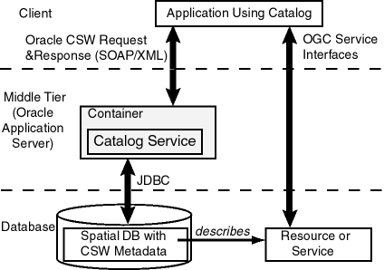

## 18  Catalog Services for the Web (CSW) Support

Oracle Spatial and Graph provides an implementation of the Open GIS Consortium specification for catalog services.

**Note:**

You can deploy Oracle Spatial Web Services from Oracle Cloud Marketplace. This packaged application allows you to install Oracle Spatial web services (such as Web Feature Service (WFS), Web Coverage Services (WCS), and Catalog Services for the Web (CSW)) that are deployed in an Apache Tomcat web server instance on Oracle Cloud Infrastructure (OCI).

According to this specification: "Catalogue services support the ability to publish and search collections of descriptive information (metadata) for data, services, and related information objects. Metadata in catalogues represent resource characteristics that can be queried and presented for evaluation and further processing by both humans and software. Catalogue services are required to support the discovery and binding to registered information resources within an information community."

The Oracle Spatial and Graph implementation will be referred to as Catalog Services for the Web, or CSW.

**Note:**

Effective with Release 18.1, the Oracle Spatial and Graph implementation of CSW supports CSW data that uses either of the following record types (metadata profiles):

- [DCMI](http://dublincore.org/specifications/) (Dublin Core Metadata Initiative)

- [ISO](https://www.iso.org/standard/32557.html) (ISO standard 19139)

You specify the record type for your CSW data in the `csw_xsd_id` parameter value (`1` for DCMI, `2` for ISO) in the call to the [SDO_CSW.INITIALIZE_CSW](SDO_CSW-reference.md) procedure.

For more information about using each record type, see CSW Major Operations (DCMI Profile) and CSW Major Operations (ISO Profile).

Before you use CSW, be sure that you understand the concepts described in [Introduction to Spatial Web Services](introduction-spatial-web-services.md), and that you have performed any necessary configuration work as described in that chapter.

- CSW Engine and Architecture
  This topic describes CSW, including its relationship to clients and to the database server.
- Database Schema and Objects for CSW
  A CSW schema is any user schema that is used to store CSW records. In some examples used in this document, the schema of a database user named SCOTT or MDMETT is a CSW schema.
- Configuring and Deploying the CSW Engine
  This topic focuses on configuring and deploying Catalog Services for the Web, specifically CSW 2.0.2.
- Capabilities Documents (CSW)
  A client can get information about the server’s capabilities.
- CSW Major Operations (DCMI Profile)
  This topic covers loading and querying CSW data, and provides examples of requests and responses for various operations. It applies to using CSW data using the DCMI record type.
- CSW Major Operations (ISO Profile)
  This topic covers loading and querying CSW data, and provides examples of requests and responses for various operations. It applies to using CSW data using the ISO record type.
- CSW Administration Console
  The Oracle Spatial Web Services administration console includes a CSW administration screen.
- Diagnosing CSW Issues
  The CSW log files provide diagnostic information.

**Parent topic:** [Spatial Web Services](spatial-web-services.md)

### 18.1 CSW Engine and Architecture

This topic describes CSW, including its relationship to clients and to the database server.

CSW is implemented as a Java web application and can be deployed in WebLogic 12.1.3 or later. The required Java version is JDK 1.8 or later.

CSW has a metadata layer, which stores in the database the metadata needed to reply to catalog requests. The metadata includes spatial columns, which can be queried and processed using Oracle Spatial and Graph interfaces. The metadata also stores the association of nonspatial and spatial attributes of records, as well as the services that the catalog service provides to its clients.

Figure 18-1 shows the CSW architecture.

Figure 18-1 CSW Architecture

[Description of "Figure 18-1 CSW Architecture"](img_text/csw_architecture.md)

As shown in Figure 18-1:

- CSW is part of a container in the middle tier.

- CSW can communicate with a web service client using CSW requests and responses in SOAP/XML/KVP format.

- CSW performs spatial data and metadata access through JDBC calls to the database.

- The database includes Oracle Spatial and Graph with CSW metadata and data.

**Parent topic:** Catalog Services for the Web (CSW) Support

### 18.2 Database Schema and Objects for CSW

A CSW schema is any user schema that is used to store CSW records. In some examples used in this document, the schema of a database user named SCOTT or MDMETT is a CSW schema.

A CSW database instance stores CSW catalog records in a CSW schema. The CSW web service instance requires one or more CSW schemas configured as a JDBC data source in the application container, with each CSW schema corresponding to one data source in WebLogic Server. Normally, only one CSW schema is configured for a specific database, but many CSW web services can be configured for use with the same database using different CSW schemas.

Oracle Spatial and Graph provides the view USER_SDO_CSW_SERVICE_INFO, which contains CSW metadata for the supported CSW `recordType`. The USER_SDO_CSW_SERVICE_INFO view contains the following columns:

    CSW_VERSION     VARCHAR2(20),
    CSW_XSD_ID      NUMBER,
    CSW_TABLE_NAME  VARCHAR2(80)

You can examine the CSW_XSD_ID column value in this view to find out the CSW `recordType` used by your CSW schema: `1` for DCMI or `2` for ISO. (For more information about using each record type, see CSW Major Operations (DCMI Profile) and CSW Major Operations (ISO Profile).)

The SDO_CSW PL/SQL package enables you to perform CSW instance creation and other operations. It includes CSW initialization, and allows you to create and maintain Spatial and XQFT indexes. For reference information about the subprograms, see [SDO_CSW Package (Catalog Services for the Web)](SDO_CSW-reference.md).

**Parent topic:** Catalog Services for the Web (CSW) Support

### 18.3 Configuring and Deploying the CSW Engine

This topic focuses on configuring and deploying Catalog Services for the Web, specifically CSW 2.0.2.

Be sure that you have previously performed any necessary operations described in [Deploying and Configuring Spatial Web Services](introduction-spatial-web-services.md).

The CSW APIs enable you to perform operations that include:

- Specifying information about record type domains and record view transformations

- Populating the USER_SDO_CSW_SERVICE_INFO table for DCMI (Dublin Core Metadata Initiative) or ISO records

- Unpublishing record types by dropping them from the USER_SDO_CSW_SERVICE_INFO table

- Granting to users and revoking from users privileges on CSW record types and on the XML query full text context index

Configuring the CSW engine involves the following:

- Initializing CSW

- Setting Up CSW Data Sources

- Editing the CSWConfig.xml File

- Loading Data for CSW

- Testing the CSW Deployment

- Creating and Maintaining Spatial and XQFT Indexes

#### Initializing CSW

Before initializing CSW, the following privileges should be granted to the CSW schema. Here, the schema of a database user named MDMETT is a CSW schema.

    GRANT CONNECT, RESOURCE, UNLIMITED TABLESPACE, CTXAPP TO MDMETT;
    GRANT EXECUTE ON CTXSYS.CTX_DDL TO MDMETT;
    GRANT SELECT ON MDSYS.SDO_XSD_TABLE TO MDMETT;
    GRANT SELECT,ALTER ON MDSYS.md_identifier_sq$ TO MDMETT;

To use Catalog Services for the Web in Oracle Spatial and Graph, you must call the [SDO_CSW.INITIALIZE_CSW](SDO_CSW-reference.md) procedure to initialize the CSW 2.0.2 service. This procedure creates the user table if it does not already exist, and prepares the indexes. For example:

    DECLARE
    BEGIN
    sdo_csw.initialize_csw(
      'MDMETT',
      '2.0.2', -- must be 2.0.2
      1, -- for DCMI
      'MY_CSW_CATALOG_TABLE',
      4326,
      1
      );
      END;
      /

If the CSW database instance is not instantiated, you can call the [SDO_CSW.INITIALIZE_CSW](SDO_CSW-reference.md) procedure, which initializes a CSW schema and creates the CSW catalog table and appropriate indexes if they do not exist. For example, the preceding example will enable the MDMETT schema as the CSW schema, create the MY_CSW_CATALOG_TABLE table as the CSW catalog table, and create (spatial and XML Query Full Text) indexes on it.

The [SDO_CSW.INITIALIZE_CSW](SDO_CSW-reference.md) procedure can also be used to just register the CSW schema and catalog table if the CSW catalog table and necessary indexes already exist. For details and examples, see the [SDO_CSW.INITIALIZE_CSW](SDO_CSW-reference.md) reference topic.

#### Setting Up CSW Data Sources

After the CSW schema is created, set up a data source for the CSW engine in WebLogic Server, as follows.

1.  Log into the WebLogic Server console.

2.  In the left Pane; under Domain Structure, select Data Sources.

3.  Click New, then Generic Data Source.

4.  On Create a New JDBC Data Source page, specify:

    1.  Name:` CSW_ADMIN_CONN` (or any name of your choice)

    2.  JNDI Name: `jdbc/csw_admin_ds`

    3.  Database Type: `Oracle`

5.  For Database Driver select `Oracle Driver (Thin) for Instance Connections`; Versions: `Any`.

6.  Skip Supports Global Transactions

7.  On the Connection Properties page, specify:

    1.  Database Name

    2.  Host Name

    3.  Port

    4.  Database User Name (that is, the CSW schema name)

    5.  Password

8.  On the next page, test this connection.

9.  If the connection is successful, choose the appropriate server name for this deployment: either `AdminServer` or Your Managed Server name.

10. Restart WLS, or at least restart the `sdows` application to recognize the data source that was created.

**Note:**

Each database can have multiple CSW schemas, each of which corresponds to one data source in WebLogic Server. You can also have multiple data sources configured for CSW in WebLogic Server. Each data source can be accessed through a different URL, where the last part of the URL correspond to the data source name configured in WebLogic Server. The following is an example link with a CSW data source named `cswdata1`:

    http://localhost:80/oraclespatial/csw/cswdata1?service=CSW& version=2.0.2&request=GetCapabilities

#### Editing the CSWConfig.xml File

You may need to modify some or all of the following settings using the CSW Administration Console:

- `log_level`, which accepts the following values (reflecting increasing amounts of information to be stored in the log file): `OFF`, `SEVERE`, `WARNING`, `INFO` (the default), `CONFIG`, `FINE`, `FINER`, `FINEST`, and `ALL`.

- `size_limit`, an integer that specifies an approximate maximum amount of megabytes to write to any log file before creating a new file for log rotation. If `size_limit` is 0 (zero), there is no limit. The default value is 10.

- `file_count`, which specifies how many output files to cycle through. Older log files will be deleted to limit the disk space taken by log files. The default value is 10.

- `ServiceIdentification` and `ServiceProvider`, which provide appropriate content to deliver in CSW GetCapabilities responses. If these two values are required to be different than the default values provided by the Oracle Spatial and Graph CSW service, then they must be uncommented and edited as required in order to have the correct information returned in CSW GetCapabilities responses. If this section remains commented, default content will be delivered on the client side.

#### Loading Data for CSW

A client-side Java loader, provided by Oracle Spatial and Graph, is in the following .jar file (assuming the default Spatial and Graph installation directory of `$ORACLE_HOME/md`):

    $ORACLE_HOME/md/jlib/sdocswloader.jar

After the CSW schema is initialized, you can use the `sdocswloader.jar` Java package to load CSW 2.0.2 data. This package takes a large file containing CSW XML records and loads them into the user CSW table. For information about how to use this package, see Loading CSW 2.0.2 Data (DCMI) for the DCMI profile and Loading CSW 2.0.2 Data (ISO) for the ISO profile.

#### Testing the CSW Deployment

After the CSW engine is deployed and the data source is created, you can test the deployment with a set of CSW engine test queries. The following example is a GetCapabilities query for CSW 2.0.2:

    http://machine-name:port/oraclespatial/csw/<data source name>?request=GetCapabilities&service=CSW&version=2.0.2

#### Creating and Maintaining Spatial and XQFT Indexes

In some cases you may need to manually create or maintain spatial and XML Query Full Text (XQFT) indexes. These indexes are created automatically (if they do not already exist) by the first format of the [SDO_CSW.INITIALIZE_CSW](SDO_CSW-reference.md) procedure, in which you do not need to create them. However, in some scenarios you may need to drop and re-create the index, and/or to synchronize the index, such as the following:

- Scenario 1: The spatial index creation did not complete successfully when you used the [SDO_CSW.INITIALIZE_CSW](SDO_CSW-reference.md) procedure.

- Scenario 2: The spatial index creation did not complete successfully when you called the [SDO_CSW.CREATE_SPATIAL_IDX](SDO_CSW-reference.md) procedure.

- Scenario 3: The spatial index becomes invalid for any reason, such as mentioned in [Exchanging Partitions Including Indexes](indexing-querying-spatial-data.md)

- Scenario 4: There have been significant insert, update, or delete operations on the CSW user data table.

If you need to re-create or rebuild the spatial index due to scenario 1, 2, or 3, then you must drop the spatial index first (by using SQL statement `DROP INDEX <index_name> [FORCE]`), and then re-create the spatial index using the [SDO_CSW.CREATE_SPATIAL_IDX](SDO_CSW-reference.md) procedure.

For scenario 4, it is faster to call [SDO_CSW.SYNC_INDEX](SDO_CSW-reference.md) for the XQFT index, in which case the existing XQFT index is automatically updated. However, if you need to re-create the XQFT index, then you can call the [SDO_CSW.CREATE_XQFT_IDX](SDO_CSW-reference.md) procedure to drop the existing XQFT index and then create a new one.

**Parent topic:** Catalog Services for the Web (CSW) Support

### 18.4 Capabilities Documents (CSW)

A client can get information about the server’s capabilities.

A capabilities document is generated by the CSW server in response to a GetCapabilities request. The capabilities document contains information extracted from CSW metadata stored in an Oracle database, including a record type and the type of operations supported.

The client can use HTTP GET, POST, and SOAP protocols to access this capabilities document. The following example uses the HTTP protocol:

    http:///<machine-name:port>/oraclespatial/csw?request=GetCapabilities&service=CSW&acceptversion=2.0.0&outputFormat=text/xml

In the preceding formats:

- machine-name is the name of the system where the application server is running.

- port is the port number where the application server is running.

- oraclespatial is the default root where the Oracle Spatial and Graph web services application is mounted.

**Parent topic:** Catalog Services for the Web (CSW) Support

### 18.5 CSW Major Operations (DCMI Profile)

This topic covers loading and querying CSW data, and provides examples of requests and responses for various operations. It applies to using CSW data using the DCMI record type.

If your CSW data uses the DCMI (Dublin Core Metadata Initiative) profile, the `recordType` attribute for each record will contain the value `1`.

When you call the [SDO_CSW.INITIALIZE_CSW](SDO_CSW-reference.md) procedure, you specify the record type for your CSW data in the `csw_xsd_id` parameter value (`1` for DCMI, `2` for ISO).

The view USER_SDO_CSW_SERVICE_INFO contains CSW metadata for the supported CSW `recordType`, as explained in Database Schema and Objects for CSW.

- Loading CSW 2.0.2 Data (DCMI)
  After the CSW table is created when you initialize the CSW schema, you can start loading your CSW 2.0.2 data (DCMI records) into this table.
- Querying CSW 2.0.2 Data (DCMI)
  For querying CSW data, the GetCapabilities, DescribeRercord, and GetRecords CSW requests are supported, using the queryable elements described in this topic.
- CSW Operations: Requests and Responses with XML Examples (DCMI)
  This topic presents some requests to the CSW engine, and usually the responses to requests, for the following operations.

**Parent topic:** Catalog Services for the Web (CSW) Support

#### 18.5.1 Loading CSW 2.0.2 Data (DCMI)

After the CSW table is created when you initialize the CSW schema, you can start loading your CSW 2.0.2 data (DCMI records) into this table.

Oracle Spatial and Graph provides a client-side loader for this purpose: `$ORACLE_HOME/md/jlib/sdocswloader.jar` (assuming the default Spatial and Graph installation directory of `$ORACLE_HOME/md`):

The `sdocswloader.jar` package can take large files containing CSW XML records and load them into the CSW table. For example, assume that you have three XML files, csw_records1.txt, csw_records2.txt, and csw_records3.txt, which contain many DCMI records. Follow these steps to load them into the CSW table.

1.  Create an XML configuration file named `sdo_csw_demo.xml` (or any other name as you wish), as in in the following example.

        <?xml version='1.0' encoding='windows-1252'?>
        <Connection>
          <Driver>Thin</Driver>
          <Hostname>localhost</Hostname>
          <Port>52504</Port>
          <ServiceName>SERVICENAME </ServiceName>
          <ServerMode>DEDICATED</ServerMode>
          <Schema>MDMETT</Schema>
          <Password>MDMETT</Password>
          <!-- Requires access to V$MYSTAT and V$SESS_TIME_MODEL -->
          <logServerStats>true</logServerStats>
          <clientSideEncoding>true</clientSideEncoding>
          <!-- SAX : for Splitting Large XML Files into smaller Files -->
          <!-- FOLDER : for walking a client side directory tree loading Files -->
          <mode>SAX</mode>
          <Pool>false</Pool>
          <Namespaces
                        xmlns:xsi="http://www.w3.org/2001/XMLSchema-instance"
                        xmlns:csw="http://www.opengis.net/cat/csw/2.0.2"
                        xmlns:dc="http://purl.org/dc/elements/1.1/"
                        xmlns:dct="http://purl.org/dc/terms/"
                        xmlns:gml="http://www.opengis.net/gml"
                        xmlns:ogc="http://www.opengis.net/ogc"
                        xmlns:ows="http://www.opengis.net/ows"
                        xmlns:xi="http://www.w3.org/2001/XInclude"
                        xmlns:xlink="http://www.w3.org/1999/xlink"
                        xmlns:xs="http://www.w3.org/2001/XMLSchema"
                        xmlns:xsd="http://www.w3.org/2001/XMLSchema"/>
          <!-- List of Files to be processed -->
          <FileList>
            <!-- replace the following with full file path names for the records -->
            <File>csw_records1.txt</File>
            <File>csw_records2.txt</File>
            <File>csw_records3.txt</File>
          </FileList>
          <Tables>
            <Table name=”CSW CATALOG TABLE_NAME” path="/root/csw:Record">
                <Column name="XML_COLUMN" path="/root/csw:Record” type="xml"/>
                <Column name="METADATA_ID" path="/root/csw:Record/dc:identifier" type="string"/>
            </Table>
          </Tables>
            <!-- Each Writer process will commit its workload after this number of inserts -->
          <CommitCharge>100</CommitCharge>
          <!-- Number of Concurrent Writer Threads -->
          <ThreadCount>10</ThreadCount>
          <!—replace the following with full file path name for the logger -->
          <LogFileName>csw_records.log</LogFileName>
          <ErrorTable>CSW_ERROR_TABLE_NAME</ErrorTable>
          <schemaInstancePrefix>xsi</schemaInstancePrefix>
          <schemaLocation/>
          <noNamespaceSchemaLocation/>
        </Connection>

    This configuration file allows the loader to process the DCMI records with DCMI namespaces.

    The `username` parameter in this file refers to the CSW schema name.

    The `Table` name is the CSW table that you would like to populate; the first `Column` name is the column where you have the records to be stored as Oracle XMLType objects in the CSW table, and the second `Column` name is the column where you want the record ID values to be stored in the CSW table.

    **Note:**

    If the table and the log directory do not exist, do the following before running XMLLoader (in the next major step):

    1.  Create a CSW_ERROR_TABLE_NAME in the CSW schema, to contain a log of errors. For example: `CREATE TABLE CSW_ERROR_TABLE of XMLTYPE;`

    2.  Create a directory named `log` where the `csw_records.log` file will be created.

2.  Create a `runXMLLoader.sh` (for Linux) or `runXMLLoader.bat` (for Windows) file, as shown in the following examples:

    - Linux: `runXMLLoader.sh`

          PATH=$ORACLE_HOME/jdk/bin:$PATH
          java -Xmx2048M -classpath "$ORACLE_HOME/md/jlib/sdocswloader.jar:$ORACLE_HOME/lib/xmlparserv2.jar:$ORACLE_HOME/jdbc/lib/ojdbc8.jar:$ORACLE_HOME/rdbms/jlib/xdb8.jar" -Doracle.spatial.xmlloader.ConnectionParameters= /mydir/sdo_csw_demo.xml oracle.spatial.xmlloader.saxLoader.XMLLoader

    - Windows:`runXMLLoader.bat`

          set ORACLE_HOME=e:\app\oracle\product\12.2.0\dbhome_1
          set PATH=%ORACLE_HOME%\jdk\bin;%PATH%
          java -cp %CD%\XMLLoader.jar;%ORACLE_HOME%\lib\xmlparserv2.jar;%ORACLE_HOME%\jdbc\lib\ojdbc8.jar;%ORACLE_HOME%\jdbc\lib\ojdbc8dms.jar;%ORACLE_HOME%\rdbms\jlib\xdb8.jar -Doracle.spatial.xmlloader.ConnectionParameters=%1 oracle.spatial.xmlloader.saxLoader.XMLLoader

    These files use the `sdo_csw_demo.xml` file, and they assume JDK 1.8. You may need to modify the files if you have another Java environment, and you may need to make other changes to the configuration file and related script files for your system environment.

In this example scenario, the CSW table is populated with the records in the three CSW 2.0.2 data files when `runXMLLoader.sh` or `runXMLLoader.bat` is run.

**Parent topic:** CSW Major Operations (DCMI Profile)

#### 18.5.2 Querying CSW 2.0.2 Data (DCMI)

For querying CSW data, the GetCapabilities, DescribeRercord, and GetRecords CSW requests are supported, using the queryable elements described in this topic.

The following table lists the queryable elements for querying CSW data that is in DCMI format. For each query element, the DCMI name of the element it listed along with a brief description.

Table 18-1 Queryable Elements for DCMI

| DCMI Name       | Description                                                                                                                                         |
|:----------------|:----------------------------------------------------------------------------------------------------------------------------------------------------|
| csw:AnyText     | A target for full-text search of character data types in a catalogue                                                                                |
| dc:contributor  | An entity responsible for making contributions to the content of the resource.                                                                      |
| dc:coverage     | The spatial or temporal topic of the resource, the spatial applicability of the resource, or the jurisdiction under which the resource is relevant. |
| dc:creator      | An entity primarily responsible for making the content of the resource.                                                                             |
| dc:date         | A date of a creation or update event of the metadata resource.                                                                                      |
| dc:description  | An account of the resource.                                                                                                                         |
| dc:format       | The physical or digital manifestation of the resource.                                                                                              |
| dc:identifier   | An unambiguous reference to the resource within a given context.                                                                                    |
| dc:language     | A language of the intellectual content of the resource.                                                                                             |
| dc:publisher    | An entity responsible for making the resource available. This would equate to the Distributor in ISO and FGDC metadata.                             |
| dc:relation     | A reference to a related resource.                                                                                                                  |
| dc:rights       | Information about rights held in and over the resource                                                                                              |
| dc:source       | A reference to a resource from which the present resource is derived.                                                                               |
| dc:subject      | A topic of the content of the resource. This is a place where a Topic Category or other taxonomy could be applied.                                  |
| dc:title        | A name given to the resource. Also known as “Name”.                                                                                                 |
| dc:type         | The nature or genre of the content of the resource.                                                                                                 |
| dct:abstract    | An account of the content of the resource. This is also known as the “Abstract” in other aspects of OGC, FGDC, and ISO metadata.                    |
| dct:modified    | Date on which the resource was last changed                                                                                                         |
| dct:spatial     | The spatial extent or scope of the content of the resource.                                                                                         |
| ows:BoundingBox | Bounding Box                                                                                                                                        |

The queryable elements that can be used in a csw:Constraint element with a cws:ElementName or csw:ElementSetName element can be grouped into the following modes:

- Brief (Brief mode as specified in the OGC CSW 2.0.2 specification)

- Summary (Summary mode as specified in the OGC CSW 2.0.2 specification)

- Full (Always returns the full original DCMI record)

The csw:ElementySetName element specifies a mode (`brief`, `summary`, or `full`); the csw:ElementName element does not specify a mode, but just the name of a queryable element.

The Brief mode queryable elements are the following:

    dc:identifier
    dc:title
    dc:type
    ows:BoundingBox

The Summary mode queryable elements are the following:

    dc:format
    dc:identifier
    dc:relation
    dc:subject
    dc:title
    dc:type
    dct:abstract
    dct:modified
    ows:BoundingBox

The Full mode queryable elements are any supported in the OGC specification and in the Brief and Summary modes. What distinguishes Full mode is that the query always returns the full original DCMI record, whereas the other modes return only the elements specified in the csw:Constraint element.

The Full mode queryable elements are the following:

    csw:AnyText
    dc:contributor
    dc:coverage
    dc:creator
    dc:date
    dc:description
    dc:format
    dc:identifier
    dc:language
    dc:publisher
    dc:relation
    dc:rights
    dc:source
    dc:subject
    dc:title
    dc:type
    dct:abstract
    dct:modified
    dct:spatial
    ows:BoundingBox

Usage notes about ISO Queryables and some special cases:

- gmd:date queryable is the same as gmd:modified queryable. Use either one in CSW request. gmd:date.

- gmd:format and gmd:formatVersion: ElementName mode considers the path with distributionFormat node. Summary, Comprehensive, and Full ElementSetName mode considers also the distributorFormat node. Brief mode does not have these queryables.

- gmd:hasSecurityConstraints queryable can only have the following values (it is also strongly recommended to use these values because data is not supposed to have values other than these): unclassified, restricted, confidential, secret, topSecret.

- gmd:keywordType queryable can only have the following values (it is also strongly recommended to use these values because data is not supposed to have values other than these): discipline, place, stratum, temporal, theme.

- gmd:referenceSystem: This is a union set queryable with referenceSystem, code, codeSpace, and version queryables. Use one of referenceSystem (also alias for code queryable), code, codeSpace, or version queryable in the csw:ElementName element of the CSW request, then all of these will appear in the response if they exist in the result set of ISO records (thus, the “related to” explanations). The csw:Constraint element can have any of these queryables.

- gmd:spatialResolution: This is also a union set queryable with spatialResolution, denominator, distance, and distanceUOM queryables. Use one of spatialResolution (also alias for denominator queryable), denominator, distance, or distanceUOM in the csw:ElementName element of the CSW request, then all of these will appear in the response if they exist in the results of ISO records (thus, the “related to” explanations). The csw:Constraint element can have any of these queryables.

- gmd:topicCategory queryable can only have the following values (it is also strongly recommended to use these values because data is not supposed to have values other than these): farming, biota, boundaries, climatologyMeteorologyAtmosphere, economy, elevation, environment, geoscientificInformation, health, imageryBaseMapsEarthCover, intelligenceMilitary, inlandWaters, location, oceans, planningCadastre, society, structure, transportation, and utilitiesCommunication.

- ogc:Not logic is only supported for csw:Constraint/ogc:Filter/ogc:Not/ogc:PropertyIsLike.

- PropertyIsNull is not supported for revisionDate, publicationDate, creationDate, contributor, creator, or publisher queryables.

- srv:operatesOnData: This is also union set queryable with operatesOn, operatesOnIdentifier, operatesOnName queryables. This is a bit different than the above union sets described: operatesOn is processed different and independent than operatesOnIdentifier and operatesOnName queryables. When operatesOnIndetifier is in csw:ElementSet element of CSW request, then the operatesOnName will appear in the response if it exists in the results of ISO records. Similar argument for operatesOnIdentifier queryable but not operatesOn queryable. Thus, Table 1 shows “related to” explanation. The csw:Constraint can have any of these queryables.

- srv:serviceOperation: This is also a union set queryable with serviceOperation, operation, DCP, and linkage queryables. Use one of serviceOperation (also alias for operation queryable), operation, DCP, linkage in the csw:ElementName element of the CSW request, then all of these will appear in the response if they exist in the result set of ISO records (thus, the “related to” explanations). The csw:Constraint element can have any of these queryables.

**Parent topic:** CSW Major Operations (DCMI Profile)

#### 18.5.3 CSW Operations: Requests and Responses with XML Examples (DCMI)

This topic presents some requests to the CSW engine, and usually the responses to requests, for the following operations.

- GetCapabilities Operation (CSW, DCMI)
- DescribeRecord Operation (CSW, DCMI)
- GetRecords Operation (CSW, DCMI)
- GetRecordById Operation (CSW, DCMI)

**Parent topic:** CSW Major Operations (DCMI Profile)

##### 18.5.3.1 GetCapabilities Operation (CSW, DCMI)

The GetCapabilities operation allows CSW clients to retrieve Catalog service metadata from the CSW engine (server). The response to a GetCapabilities request is an XML document containing Catalog service metadata document about the server. This operation specifies the XML document that a CSW instance will return to describe its capabilities.

The CSW server accepts the service, Sections, AcceptVersions, and AcceptFormats request parameters, and may implement the updateSequenceparameter. All CSW servers must implement the HTTP GET (that is, GET KVP) protocol for GetCapabilities operation. This service also supports POST XML and SOAP protocols.

The service metadata document (the CSW GetCapabilities response) contains the following sections:

- Service Identification: Metadata about a specified CSW implementation.

- Service Provider: Metadata about the organization offering the CSW service.

- Operations Metadata: Metadata about the CSW operations offered by a specific CSW implementation, including the URLs for operation requests. This section also lists which record types are allowed for each operation supported.

- Filter_Capabilities: Metadata about the filter capabilities of the server if the server implements the Filter predicate encoding as defined in \[OGC 04-095\].

Depending on the values in the Sections parameter of the GetCapabilities operation request, any combination of these sections can be requested to reduce response size. If the Sections parameter is not specified, then all sections will be returned

Example 18-1 GetCapabilities Request

The following is a request to get the capabilities of the CSW server named CSW at a specified namespace URL. This request will return a capabilities document, as explained in Capabilities Documents (CSW).

    <csw:GetCapabilities service="CSW" xmlns:csw="http://www.opengis.net/cat/csw/2.0.2" xmlns:ows="http://www.opengis.net/ows/2.0">
      <ows:AcceptVersions>
        <ows:Version>2.0.2</ows:Version>
        <ows:Version>0.7.2</ows:Version>
      </ows:AcceptVersions>
      <ows:AcceptFormats>
        <ows:OutputFormat>text/xml</ows:OutputFormat>
      </ows:AcceptFormats>
    </csw:GetCapabilities>

**Parent topic:** CSW Operations: Requests and Responses with XML Examples (DCMI)

##### 18.5.3.2 DescribeRecord Operation (CSW, DCMI)

The DescribeRecord operation allows a client to discover elements of the information model supported by the catalog service. The operation allows some or all of the information model to be described. The Oracle Spatial and Graph catalog service supports HTTP GET, POST XML and SOAP protocols.

For XML encoded DescribeRecord requests, the namespace declarations are specified using standard XML conventions (`xmlns` attributes) and described in the document "Namespaces in XML" \[<https://www.w3.org/TR/1999/REC-xml-names-19990114/>\].

For KVP encoding, namespace declarations are specified using the `NAMESPACE` parameter, which is a comma-separated list of namespace declarations of the form xmlns(\[prefix=\]namespace-url).

The `TypeName` parameter specifies a list of type names that are to be described by the catalog service. A type name is the name of a queryable entity from the information model of the catalog. The Oracle Spatial and Graph catalog service allows only `csw:Record` for the `TypeName` parameter.

The `outputFormat` parameter specifies the MIME type of the response document. The default output format attribute is the MIME type application/xml. All supported output formats should be declared in the Capabilities document. The Oracle Spatial and Graph catalog service supports by default `application/xml`.

The `schemaLanguage` parameter is used to specify the schema language that should be used to describe the specified types. The default value is `XMLSCHEMA`, which indicates that the XML-Schema schema description language should be used. The Oracle Spatial and Graph catalog service supports `XMLSCHEMA` for this parameter if it is present in the request.

An example HTTP GET request is:

    http://<host:port>/oraclespatial/csw/<data source name>?service=CSW&request=DescribeRecord&version=2.0.2&outputFormat=application/xml&schemaLanguage=XMLSCHEMA&typeName=csw:Record&namespace=xmlns(csw=http://www.opengis.org/cat/csw)

The DescribeRecord operation response is an XML document with a `DescribeRecordResponse` element that includes zero or more `SchemaComponent` subelements, each of which contains the description of one or more type names in the requested schema language. The Oracle Spatial and Graph catalog service DescribeRecord response for the DCMI profile has only one `SchemaComponent` because the `TypeName` value is `csw:Record`.

Example 18-2 DescribeRecord Request

The following is a request to describe the record with the type name `Record` for a specified namespace..

    <csw:DescribeRecord xmlns:csw="http://www.opengis.net/cat/csw/2.0.2"
                        xmlns:xsd="http://www.w3.org/2001/XMLSchema"
                        xsd:schemaLanguage="http://www.w3.org/XML/Schema"
                        service="CSW"
                        version="2.0.2">
      <csw:TypeName>csw:Record</csw:TypeName>
    </csw:DescribeRecord>

Example 18-3 DescribeRecord Response

The following is the response from the preceding request. The response is an XML schema definition (XSD). See the `<xsd:documentation>` elements in the response for explanatory comments.

    <csw:DescribeRecordResponse xmlns:csw="http://www.opengis.net/cat/csw/2.0.2" xmlns:dc="http://purl.org/dc/elements/1.1/" xmlns:dct="http://purl.org/dc/terms/" xmlns:gmd="http://www.isotc211.org/2005/gmd" xmlns:gml="http://www.opengis.net/gml/3.2" xmlns:ogc="http://www.opengis.net/ogc" xmlns:ows="http://www.opengis.net/ows" xmlns:xs="http://www.w3.org/2001/XMLSchema" xmlns:xsi="http://www.w3.org/2001/XMLSchema-instance" xmlns:xlink="http://www.w3.org/1999/xlink" xsi:schemaLocation="http://www.opengis.net/cat/csw/2.0.2 http://schemas.opengis.net/csw/2.0.2/CSW-discovery.xsd">
      <csw:SchemaComponent schemaLanguage="http://www.w3.org/XML/Schema" targetNamespace="http://www.opengis.net/cat/csw/2.0.2">    <xsd:schema id="csw-record"
           targetNamespace="http://www.opengis.net/cat/csw/2.0.2"
           xmlns:csw="http://www.opengis.net/cat/csw/2.0.2"
           xmlns:xsd="http://www.w3.org/2001/XMLSchema"
           xmlns:dc="http://purl.org/dc/elements/1.1/"
           xmlns:dct="http://purl.org/dc/terms/" xmlns:ows="http://www.opengis.net/ows"
           elementFormDefault="qualified" version="2.0.2.2">
           <xsd:annotation>
              <xsd:appinfo>
                 <dc:identifier xmlns:dc="http://purl.org/dc/elements/1.1/">http://schemas.opengis.net/csw/2.0.2/record.xsd</dc:identifier>
              </xsd:appinfo>
              <xsd:documentation xml:lang="en">
                 This schema defines the basic record types that must be supported
                 by all CSW implementations. These correspond to full, summary, and
                 brief views based on DCMI metadata terms.

                 CSW is an OGC Standard.
                 Copyright (c) 2004,2010 Open Geospatial Consortium.
                 To obtain additional rights of use, visit http://www.opengeospatial.org/legal/ .
              </xsd:documentation>
           </xsd:annotation>

           <xsd:include schemaLocation="csw.xsd"/>
           <xsd:import namespace="http://purl.org/dc/terms/" schemaLocation="http://schemas.opengis.net/csw/2.0.2/rec-dcterms.xsd"/>
           <xsd:import namespace="http://purl.org/dc/elements/1.1/" schemaLocation="http://schemas.opengis.net/csw/2.0.2/rec-dcmes.xsd"/>
           <xsd:import namespace="http://www.opengis.net/ows" schemaLocation="http://schemas.opengis.net/ows/1.0.0/owsAll.xsd"/>

           <xsd:element name="AbstractRecord" id="AbstractRecord"
                        type="csw:AbstractRecordType" abstract="true" />
           <xsd:complexType name="AbstractRecordType" id="AbstractRecordType"
                            abstract="true"/>

           <xsd:element name="DCMIRecord" type="csw:DCMIRecordType"
                        substitutionGroup="csw:AbstractRecord"/>
           <xsd:complexType name="DCMIRecordType">
              <xsd:annotation>
                 <xsd:documentation xml:lang="en">
                    This type encapsulates all of the standard DCMI metadata terms,
                    including the Dublin Core refinements; these terms may be mapped
                    to the profile-specific information model.
                 </xsd:documentation>
              </xsd:annotation>
              <xsd:complexContent>
                 <xsd:extension base="csw:AbstractRecordType">
                    <xsd:sequence>
                       <xsd:group ref="dct:DCMI-terms"/>
                    </xsd:sequence>
                 </xsd:extension>
              </xsd:complexContent>
           </xsd:complexType>

           <xsd:element name="BriefRecord" type="csw:BriefRecordType"
                        substitutionGroup="csw:AbstractRecord"/>
           <xsd:complexType name="BriefRecordType" final="#all">
              <xsd:annotation>
                 <xsd:documentation xml:lang="en">
                    This type defines a brief representation of the common record
                    format.  It extends AbstractRecordType to include only the
                     dc:identifier and dc:type properties.
                 </xsd:documentation>
              </xsd:annotation>
              <xsd:complexContent>
                 <xsd:extension base="csw:AbstractRecordType">
                    <xsd:sequence>
                       <xsd:element ref="dc:identifier"
                                    minOccurs="1" maxOccurs="unbounded"/>
                       <xsd:element ref="dc:title"
                                    minOccurs="1" maxOccurs="unbounded"/>
                       <xsd:element ref="dc:type"
                                    minOccurs="0"/>
                       <xsd:element ref="ows:BoundingBox"
                                    minOccurs="0" maxOccurs="unbounded"/>
                    </xsd:sequence>
                 </xsd:extension>
              </xsd:complexContent>
           </xsd:complexType>

           <xsd:element name="SummaryRecord" type="csw:SummaryRecordType"
                        substitutionGroup="csw:AbstractRecord"/>
           <xsd:complexType name="SummaryRecordType" final="#all">
              <xsd:annotation>
                 <xsd:documentation xml:lang="en">
                    This type defines a summary representation of the common record
                    format.  It extends AbstractRecordType to include the core
                    properties.
                 </xsd:documentation>
              </xsd:annotation>
              <xsd:complexContent>
                 <xsd:extension base="csw:AbstractRecordType">
                    <xsd:sequence>
                       <xsd:element ref="dc:identifier"
                                    minOccurs="1" maxOccurs="unbounded"/>
                       <xsd:element ref="dc:title"
                                    minOccurs="1" maxOccurs="unbounded"/>
                       <xsd:element ref="dc:type"
                                    minOccurs="0"/>
                       <xsd:element ref="dc:subject"
                                    minOccurs="0" maxOccurs="unbounded"/>
                       <xsd:element ref="dc:format"
                                    minOccurs="0" maxOccurs="unbounded"/>
                       <xsd:element ref="dc:relation"
                                    minOccurs="0" maxOccurs="unbounded"/>
                       <xsd:element ref="dct:modified"
                                    minOccurs="0" maxOccurs="unbounded"/>
                       <xsd:element ref="dct:abstract"
                                    minOccurs="0" maxOccurs="unbounded"/>
                       <xsd:element ref="dct:spatial"
                                    minOccurs="0" maxOccurs="unbounded"/>
                       <xsd:element ref="ows:BoundingBox"
                                    minOccurs="0" maxOccurs="unbounded"/>
                    </xsd:sequence>
                 </xsd:extension>
              </xsd:complexContent>
           </xsd:complexType>
           <xsd:element name="Record" type="csw:RecordType"
                        substitutionGroup="csw:AbstractRecord"/>
           <xsd:complexType name="RecordType" final="#all">
              <xsd:annotation>
                 <xsd:documentation xml:lang="en">
                    This type extends DCMIRecordType to add ows:BoundingBox;
                    it may be used to specify a spatial envelope for the
                    catalogued resource.
                 </xsd:documentation>
              </xsd:annotation>
              <xsd:complexContent>
                 <xsd:extension base="csw:DCMIRecordType">
                    <xsd:sequence>
                       <xsd:element name="AnyText" type="csw:EmptyType"
                                    minOccurs="0" maxOccurs="unbounded"/>
                       <xsd:element ref="ows:BoundingBox"
                                    minOccurs="0" maxOccurs="unbounded"/>
                    </xsd:sequence>
                 </xsd:extension>
              </xsd:complexContent>
           </xsd:complexType>
           <xsd:complexType name="EmptyType" />
        </xsd:schema>
    </csw:SchemaComponent>
    </csw:DescribeRecordResponse>

**Parent topic:** CSW Operations: Requests and Responses with XML Examples (DCMI)

##### 18.5.3.3 GetRecords Operation (CSW, DCMI)

The primary tools for resource discovery in CSW are the two operations: search and present. In the HTTP protocol binding these are combined in the form of the GetRecords operation, which performs a search and present.

The “search” portion of the GetRecords operation is encoded using the `Query` element, which includes the parameters parameters `typeName` and `Constraint`.

- The `typeName` parameter is used to specify which entities (record Types) of the catalog service will be queried.

- The Constraint parameter is used to specify which query constraints will be applied to identify the request set.

The “present” portion of the GetRecords operation is encoded using the `outputSchema` parameter and the `ElementName`/`ElementSetName` parameter(s).

- The `outputSchema` parameter indicates which XSD schema (that is, `http://www.opengis.net/cat/csw/2.0.2`) will be used to generate the response to the GetRecords operation.

- The `ElementName` or `ElementSetName` parameter is used to specify which properties of the `outputSchema` to include in each record in the GetRecords response.

(The following description does not repeat some parameters also used with DescribeRecord, such as `namespace` and `outputFormat`.)

The `resultType` parameter may have the value `hits`, `results`, or `validate`. The value determines whether the catalog service returns just a summary of the result set (`hits`), includes one or more records from the result set (`results`), or validates the request message (`validate`).

The `startPosition` parameter is used to indicate at which record position the catalog should start generating output. The default value is 1, meaning that it starts at the first record in the result set.

The `maxRecords` parameter is used to define the maximum number of records that should be returned from the result set of a query. If it is not specified, then 10 records will be returned. If its value is set to zero, then the behavior is identical to setting `resultType` to `hits`.

The `typeNames` parameter is a list of one or more names of queryable entities in the catalog's information model that may be constrained in the predicate of the query. (`csw:Record` indicates the DCMI profile.)

The `ElementName` parameter is used to specify one or more metadata record elements, from the output schema specified using the `outputSchema` parameter, so that the query will present in the response to the a GetRecords operation.

The `ElementSetName` parameter can be brief, summary or full, to indicate which named set the service will present to the client.

The `ElementName` and `ElementSetName` parameters are mutually exclusive. Either an `ElementSetName` parameter or one or more `ElementSetName` parameters should be specified in a query.

The `ConstraintLanguage` parameter must be `Filter` for the Oracle Spatial and Graph CSW service. `CQL` is not supported.

The `constraint` parameter specifies which filtering capabilities are used to get certain records. The following filtering capabilities are supported by the Oracle Spatial and Graph CSW service:

- Logical operators: And, Or, Not

- Comparison operators: PropertyIsEqualTo, PropertyIsNotEqualTo, PropertyIsLessThan, PropertyIsGreaterThan, PropertyIsLessThanOrEqualTo, PropertyIsGreaterThanOrEqualTo, PropertyIsLike, PropertyIsNull, csw:AnyText

- Spatial operators: BBOX

- Simple arithmetic: add, sub, div, mul, function

The `GetRecordsResponse` element is a container for the response to the GetRecords request.

The `SearchStatus` element indicates the status of the response. The search status consists of a timestamp attribute indicating when the result set was created.

The `SearchResults` element contains the `SearchResults` element, which is the set of records returned by the GetRecords operation. The following attributes can be used with the `SearchResults` element: `ElementSet(brief/summary/full)`, `numberOfRecordaMatched`, `numberOfRecordsReturned`, `nextRecord`.

Oracle Spatial and Graph Catalog Service supports HTTP GET, POST XML and SOAP protocols for the GetRecords operation.

Example 18-4 GetRecords Request with PropertyIsEqualTo and PropertyIsLike

The following is a request to GetRecords with `PropertyIsEqualTo` and `PropertyIsLike` specified. It finds the result set of records where the type is equal to the URL `http://purl.org/dc/dcmitype/Image` or where the format is a String value containing anything between and including “application/” and “xml” tokens. (The following characters are flexible: `escapeChar`, `singleChar`, and `wildcard`.)

    <csw:GetRecords xmlns:csw="http://www.opengis.net/cat/csw/2.0.2"
                    xmlns:dc="http://purl.org/dc/elements/1.1/"
                    xmlns:dct="http://purl.org/dc/terms/"
                    xmlns:gml="http://www.opengis.net/gml"
                    xmlns:ogc="http://www.opengis.net/ogc"
                    xmlns:ows="http://www.opengis.net/ows"
                    xmlns:xs="http://www.w3.org/2001/XMLSchema"
                    xmlns:xsd="http://www.w3.org/2001/XMLSchema"
                    resultType="results"
                    service="CSW"
                    version="2.0.2">
       <csw:Query typeNames="csw:Record">
          <csw:ElementSetName>summary</csw:ElementSetName>
          <csw:Constraint version="1.1.0">
             <ogc:Filter>
                <ogc:Or>
                   <ogc:PropertyIsLike escapeChar="\" singleChar="?" wildCard="*">
                      <ogc:PropertyName>dc:format</ogc:PropertyName>
                      <ogc:Literal>application/*xml</ogc:Literal>
                   </ogc:PropertyIsLike>
                   <ogc:PropertyIsEqualTo>
                      <ogc:PropertyName>dc:type</ogc:PropertyName>
                      <ogc:Literal>http://purl.org/dc/dcmitype/Image</ogc:Literal>
                   </ogc:PropertyIsEqualTo>
                </ogc:Or>
             </ogc:Filter>
          </csw:Constraint>
       </csw:Query>
    </csw:GetRecords>

For GetRecords Requests, `ElementSetName` can be `summary`, `full`, or `brief`.

The CSW 2.0.2 specification allows either `ElementSetName` (only 1) or `ElementName` (can be more than 1) in the GetRecords Request.

The Spatial and Graph catalog service supports only synchronous processing of GetRecords requests.

Example 18-5 GetRecords Response with PropertyIsEqualTo and PropertyIsLike

The following is the response from the preceding request.

    <csw:GetRecordsResponse xmlns:xsi="http://www.w3.org/2001/XMLSchema-instance" xmlns:ns9="http://www.opengis.net/ows" xmlns:ns8="http://purl.org/dc/terms/" xmlns:ns7="http://purl.org/dc/elements/1.1/" xmlns:gml="http://www.opengis.net/gml/3.2" xmlns:ows="http://www.opengis.net/ows/2.0" xmlns:ogc="http://www.opengis.net/ogc" xmlns:csw="http://www.opengis.net/cat/csw/2.0.2" xmlns:xlink="http://www.w3.org/1999/xlink" xmlns:swe="http://www.opengis.net/swe/2.0" version="2.0.2" xsi:schemaLocation="http://www.opengis.net/cat/csw/2.0.2 ../../cswAll.xsd">
      <csw:SearchStatus timestamp="2016-06-09T02:16:36Z"></csw:SearchStatus>
      <csw:SearchResults elementSet="summary" recordSchema="http://www.opengis.net/cat/csw/2.0.2" numberOfRecordsMatched="4" numberOfRecordsReturned="4" nextRecord="0">
        <csw:SummaryRecord>
          <ns7:identifier>urn:uuid:19887a8a-f6b0-4a63-ae56-7fba0e17801f</ns7:identifier>
          <ns7:title>Lorem ipsum</ns7:title>
          <ns7:type>http://purl.org/dc/dcmitype/Image</ns7:type>
          <ns7:subject>Tourism--Greece</ns7:subject>
          <ns7:format>image/svg+xml</ns7:format>
          <ns8:abstract>Quisque lacus diam, placerat mollis, pharetra in, commodo sed, augue. Duis iaculis arcu vel arcu.</ns8:abstract>
          <ns9:BoundingBox></ns9:BoundingBox>
        </csw:SummaryRecord>
        <csw:SummaryRecord>
          <ns7:identifier>urn:uuid:66ae76b7-54ba-489b-a582-0f0633d96493</ns7:identifier>
          <ns7:title>Maecenas enim</ns7:title>
          <ns7:type>http://purl.org/dc/dcmitype/Text</ns7:type>
          <ns7:subject>Marine sediments</ns7:subject>
          <ns7:format>application/xhtml+xml</ns7:format>
          <ns8:abstract>Pellentesque tempus magna non sapien fringilla blandit.</ns8:abstract>
          <ns9:BoundingBox></ns9:BoundingBox>
        </csw:SummaryRecord>
        <csw:SummaryRecord>
          <ns7:identifier>urn:uuid:829babb0-b2f1-49e1-8cd5-7b489fe71a1e</ns7:identifier>
          <ns7:title>Vestibulum massa purus</ns7:title>
          <ns7:type>http://purl.org/dc/dcmitype/Image</ns7:type>
          <ns7:format>image/jp2</ns7:format>
          <ns7:relation>urn:uuid:9a669547-b69b-469f-a11f-2d875366bbdc</ns7:relation>
          <ns9:BoundingBox></ns9:BoundingBox>
        </csw:SummaryRecord>
        <csw:SummaryRecord>
          <ns7:identifier>urn:uuid:a06af396-3105-442d-8b40-22b57a90d2f2</ns7:identifier>
          <ns7:title>Lorem ipsum dolor sit amet</ns7:title>
          <ns7:type>http://purl.org/dc/dcmitype/Image</ns7:type>
          <ns7:format>image/jpeg</ns7:format>
          <ns9:BoundingBox></ns9:BoundingBox>
        </csw:SummaryRecord>
      </csw:SearchResults>
    </csw:GetRecordsResponse>

Example 18-6 GetRecords Request with PropertyIsLike

The following is a request to GetRecords with `PropertyIsLike` where the client wants to fetch records whose property title is like “Lorem ipsum\*”. (The following characters are flexible: `escapeChar`, `singleChar`, and `wildcard`.)

    <csw:GetRecords xmlns:csw="http://www.opengis.net/cat/csw/2.0.2"
                    xmlns:dc="http://purl.org/dc/elements/1.1/"
                    xmlns:dct="http://purl.org/dc/terms/"
                    xmlns:gml="http://www.opengis.net/gml"
                    xmlns:ogc="http://www.opengis.net/ogc"
                    xmlns:ows="http://www.opengis.net/ows"
                    xmlns:xi="http://www.w3.org/2001/XInclude"
                    xmlns:xlink="http://www.w3.org/1999/xlink"
                    xmlns:xs="http://www.w3.org/2001/XMLSchema"
                    xmlns:xsd="http://www.w3.org/2001/XMLSchema"
                    maxRecords="20"
                    resultType="results"
                    service="CSW"
                    version="2.0.2">
       <csw:Query typeNames="csw:Record">
          <csw:ElementSetName>summary</csw:ElementSetName>
          <csw:Constraint version="1.1.0">
             <ogc:Filter>
                <ogc:PropertyIsLike escapeChar="\" singleChar="?" wildCard="*">
                   <ogc:PropertyName>dc:title</ogc:PropertyName>
                   <ogc:Literal>Lorem ipsum*</ogc:Literal>
                </ogc:PropertyIsLike>
             </ogc:Filter>
          </csw:Constraint>
       </csw:Query>
    </csw:GetRecords>

Example 18-7 GetRecords Response with PropertyIsLike

The following is the response from the preceding request.

    <csw:GetRecordsResponse xmlns:xsi="http://www.w3.org/2001/XMLSchema-instance" xmlns:ns9="http://www.opengis.net/ows" xmlns:ns8="http://purl.org/dc/terms/" xmlns:ns7="http://purl.org/dc/elements/1.1/" xmlns:gml="http://www.opengis.net/gml/3.2" xmlns:ows="http://www.opengis.net/ows/2.0" xmlns:ogc="http://www.opengis.net/ogc" xmlns:csw="http://www.opengis.net/cat/csw/2.0.2" xmlns:xlink="http://www.w3.org/1999/xlink" xmlns:swe="http://www.opengis.net/swe/2.0" version="2.0.2" xsi:schemaLocation="http://www.opengis.net/cat/csw/2.0.2 ../../cswAll.xsd">
      <csw:SearchStatus timestamp="2016-06-10T01:38:22Z"></csw:SearchStatus>
      <csw:SearchResults elementSet="summary" recordSchema="http://www.opengis.net/cat/csw/2.0.2" numberOfRecordsMatched="2" numberOfRecordsReturned="2" nextRecord="0">
        <csw:SummaryRecord>
          <ns7:identifier>urn:uuid:19887a8a-f6b0-4a63-ae56-7fba0e17801f</ns7:identifier>
          <ns7:title>Lorem ipsum</ns7:title>
          <ns7:type>http://purl.org/dc/dcmitype/Image</ns7:type>
          <ns7:subject>Tourism--Greece</ns7:subject>
          <ns7:format>image/svg+xml</ns7:format>
          <ns8:abstract>Quisque lacus diam, placerat mollis, pharetra in, commodo sed, augue. Duis iaculis arcu vel arcu.</ns8:abstract>
          <ns9:BoundingBox></ns9:BoundingBox>
        </csw:SummaryRecord>
        <csw:SummaryRecord>
          <ns7:identifier>urn:uuid:a06af396-3105-442d-8b40-22b57a90d2f2</ns7:identifier>
          <ns7:title>Lorem ipsum dolor sit amet</ns7:title>
          <ns7:type>http://purl.org/dc/dcmitype/Image</ns7:type>
          <ns7:format>image/jpeg</ns7:format>
          <ns9:BoundingBox></ns9:BoundingBox>
        </csw:SummaryRecord>
      </csw:SearchResults>
    </csw:GetRecordsResponse>

Example 18-8 GetRecords Request with PropertyIsGreaterThan

The following is a request to GetRecords with PropertyIsGreaterThan where the client would like to fetch records where their dates are later than the date value 2004-01-01.

    <csw:GetRecords xmlns:csw="http://www.opengis.net/cat/csw/2.0.2"
                    xmlns:dc="http://purl.org/dc/elements/1.1/"
                    xmlns:dct="http://purl.org/dc/terms/"
                    xmlns:gml="http://www.opengis.net/gml"
                    xmlns:ogc="http://www.opengis.net/ogc"
                    xmlns:ows="http://www.opengis.net/ows"
                    xmlns:xi="http://www.w3.org/2001/XInclude"
                    xmlns:xlink="http://www.w3.org/1999/xlink"
                    xmlns:xs="http://www.w3.org/2001/XMLSchema"
                    xmlns:xsd="http://www.w3.org/2001/XMLSchema"
                    resultType="results"
                    service="CSW"
                    version="2.0.2">
       <csw:Query typeNames="csw:Record">
          <csw:ElementName>dc:identifier</csw:ElementName>
          <csw:ElementName>dc:type</csw:ElementName>
          <csw:ElementName>dc:date</csw:ElementName>
          <csw:Constraint version="1.1.0">
             <ogc:Filter>
                <ogc:PropertyIsGreaterThan>
                   <ogc:PropertyName>dc:date</ogc:PropertyName>
                   <ogc:Literal>2004-01-01Z</ogc:Literal>
                </ogc:PropertyIsGreaterThan>
             </ogc:Filter>
          </csw:Constraint>
       </csw:Query>
    </csw:GetRecords>

Example 18-9 GetRecords Response with PropertyIsGreaterThan

The following is the response from the preceding request.

    <csw:GetRecordsResponse xmlns:xsi="http://www.w3.org/2001/XMLSchema-instance" xmlns:ns9="http://www.opengis.net/ows" xmlns:ns8="http://purl.org/dc/terms/" xmlns:ns7="http://purl.org/dc/elements/1.1/" xmlns:gml="http://www.opengis.net/gml/3.2" xmlns:ows="http://www.opengis.net/ows/2.0" xmlns:ogc="http://www.opengis.net/ogc" xmlns:csw="http://www.opengis.net/cat/csw/2.0.2" xmlns:xlink="http://www.w3.org/1999/xlink" xmlns:swe="http://www.opengis.net/swe/2.0" version="2.0.2" xsi:schemaLocation="http://www.opengis.net/cat/csw/2.0.2 ../../cswAll.xsd">
      <csw:SearchStatus timestamp="2015-06-29T05:50:16Z"></csw:SearchStatus>
      <csw:SearchResults elementSet="" recordSchema="http://www.opengis.net/cat/csw/2.0.2" numberOfRecordsMatched="3" numberOfRecordsReturned="3" nextRecord="0">
        <csw:Record>
          <ns7:identifier>urn:uuid:784e2afd-a9fd-44a6-9a92-a3848371c8ec</ns7:identifier>
          <ns7:type>http://purl.org/dc/dcmitype/Text</ns7:type>
          <ns7:date>2006-05-12Z</ns7:date>
        </csw:Record>
        <csw:Record>
          <ns7:identifier>urn:uuid:94bc9c83-97f6-4b40-9eb8-a8e8787a5c63</ns7:identifier>
          <ns7:type>http://purl.org/dc/dcmitype/Dataset</ns7:type>
          <ns7:date>2006-03-26Z</ns7:date>
        </csw:Record>
        <csw:Record>
          <ns7:identifier>urn:uuid:9a669547-b69b-469f-a11f-2d875366bbdc</ns7:identifier>
          <ns7:type>http://purl.org/dc/dcmitype/Dataset</ns7:type>
          <ns7:date>2005-10-24Z</ns7:date>
        </csw:Record>
      </csw:SearchResults>
    </csw:GetRecordsResponse>

Example 18-10 GetRecords Request with BoundingBox (BBOX)

The following is a request to GetRecords with `BoundingBox` (BBOX) where the client wants to fetch records whose geometry does not fall into the Bounding Box of (40,-9;50, -5) and where the type is equal to the case-insensitive String URL value `HTTP://purl.org/dc/dcmitype/dataset`. This means that type could be `http://purl.org/dc/dcmitype/dataset` or anything starting with that. This request benefits from both spatial and XQFT indexes.

    <csw:GetRecords xmlns:csw="http://www.opengis.net/cat/csw/2.0.2"
                    xmlns:dc="http://purl.org/dc/elements/1.1/"
                    xmlns:dct="http://purl.org/dc/terms/"
                    xmlns:gml="http://www.opengis.net/gml"
                    xmlns:ogc="http://www.opengis.net/ogc"
                    xmlns:ows="http://www.opengis.net/ows"
                    xmlns:xi="http://www.w3.org/2001/XInclude"
                    xmlns:xlink="http://www.w3.org/1999/xlink"
                    xmlns:xs="http://www.w3.org/2001/XMLSchema"
                    xmlns:xsd="http://www.w3.org/2001/XMLSchema"
                    resultType="results"
                    service="CSW"
                    version="2.0.2">
       <csw:Query typeNames="csw:Record">
          <csw:ElementName>dc:identifier</csw:ElementName>
          <csw:ElementName>dc:type</csw:ElementName>
          <csw:ElementName>ows:BoundingBox</csw:ElementName>
          <csw:Constraint version="1.1.0">
             <ogc:Filter>
                <ogc:And>
                   <ogc:Not>
                      <ogc:BBOX>
                         <ogc:PropertyName>ows:BoundingBox</ogc:PropertyName>
                         <gml:Envelope srsName="urn:x-ogc:def:crs:EPSG:6.11:4326">
                            <gml:lowerCorner>40.0 -9.0</gml:lowerCorner>
                            <gml:upperCorner>50.0 -5.0</gml:upperCorner>
                         </gml:Envelope>
                      </ogc:BBOX>
                   </ogc:Not>
                   <ogc:PropertyIsEqualTo matchCase="false">
                      <ogc:PropertyName>dc:type</ogc:PropertyName>
                      <ogc:Literal>HTTP://purl.org/dc/dcmitype/dataset</ogc:Literal>
                   </ogc:PropertyIsEqualTo>
                </ogc:And>
             </ogc:Filter>
          </csw:Constraint>
       </csw:Query>
    </csw:GetRecords>

Example 18-11 GetRecords Response with BoundingBox (BBOX)

The following is the response from the preceding request.

    <csw:GetRecordsResponse xmlns:xsi="http://www.w3.org/2001/XMLSchema-instance" xmlns:ns9="http://www.opengis.net/ows" xmlns:ns8="http://purl.org/dc/terms/" xmlns:ns7="http://purl.org/dc/elements/1.1/" xmlns:gml="http://www.opengis.net/gml/3.2" xmlns:ows="http://www.opengis.net/ows/2.0" xmlns:ogc="http://www.opengis.net/ogc" xmlns:csw="http://www.opengis.net/cat/csw/2.0.2" xmlns:xlink="http://www.w3.org/1999/xlink" xmlns:swe="http://www.opengis.net/swe/2.0" version="2.0.2" xsi:schemaLocation="http://www.opengis.net/cat/csw/2.0.2 ../../cswAll.xsd">
      <csw:SearchStatus timestamp="2015-06-29T05:50:16Z"></csw:SearchStatus>
      <csw:SearchResults elementSet="" recordSchema="http://www.opengis.net/cat/csw/2.0.2" numberOfRecordsMatched="2" numberOfRecordsReturned="2" nextRecord="0">
        <csw:Record>
          <ns7:identifier>urn:uuid:88247b56-4cbc-4df9-9860-db3f8042e357</ns7:identifier>
          <ns7:type>http://purl.org/dc/dcmitype/Dataset</ns7:type>
          <ns9:BoundingBox></ns9:BoundingBox>
        </csw:Record>
        <csw:Record>
          <ns7:identifier>urn:uuid:94bc9c83-97f6-4b40-9eb8-a8e8787a5c63</ns7:identifier>
          <ns7:type>http://purl.org/dc/dcmitype/Dataset</ns7:type>
          <ns9:BoundingBox crs="urn:x-ogc:def:crs:EPSG:6.11:4326" dimensions="2">
            <ns9:LowerCorner>47.595 -4.097</ns9:LowerCorner>
            <ns9:UpperCorner>51.217 0.889</ns9:UpperCorner>
          </ns9:BoundingBox>
        </csw:Record>
      </csw:SearchResults>
    </csw:GetRecordsResponse>

**Parent topic:** CSW Operations: Requests and Responses with XML Examples (DCMI)

##### 18.5.3.4 GetRecordById Operation (CSW, DCMI)

The GetRecordById operation is a subset of the GetRecords operation, and is included as a convenient short form for retrieving and linking to records in the CSW service. The GetRecordById request retrieves catalog records using their identifier.

The GetRecordById operation is an implementation of the "present" operation as described in GetRecords Operation (CSW, DCMI). The parameters are `ElementSetName`, `outputFormat`, `outputSchema`, and `Id`.

The GetRecordById response is the list of requested records with matched `Id` values.

Oracle Spatial and Graph CSW supports HTTP GET, POST XML, and SOAP protocols for this request.

Example 18-12 GetRecordById Request

The following is a request to get the records with the record ID values `urn:uuid:a06af396-3105-442d-8b40-22b57a90d2f2`, `urn:uuid:19887a8a-f6b0-4a63-ae56-7fba0e17801f`, and `urn:uuid:ab42a8c4-95e8-4630-bf79-33e59241605a`.

    <csw:GetRecordById xmlns:csw="http://www.opengis.net/cat/csw/2.0.2"
                       xmlns:dc="http://purl.org/dc/elements/1.1/"
                       xmlns:dct="http://purl.org/dc/terms/"
                       xmlns:gml="http://www.opengis.net/gml"
                       xmlns:ogc="http://www.opengis.net/ogc"
                       xmlns:ows="http://www.opengis.net/ows"
                       xmlns:xi="http://www.w3.org/2001/XInclude"
                       xmlns:xlink="http://www.w3.org/1999/xlink"
                       xmlns:xs="http://www.w3.org/2001/XMLSchema"
                       xmlns:xsd="http://www.w3.org/2001/XMLSchema"
                       outputFormat="application/xml"
                       service="CSW"
                       version="2.0.2">
      <csw:Id>urn:uuid:a06af396-3105-442d-8b40-22b57a90d2f2</csw:Id>
      <csw:Id>urn:uuid:19887a8a-f6b0-4a63-ae56-7fba0e17801f</csw:Id>
      <csw:Id>urn:uuid:ab42a8c4-95e8-4630-bf79-33e59241605a</csw:Id>
      <csw:ElementSetName>brief</csw:ElementSetName>
    </csw:GetRecordById>

Example 18-13 GetRecordById Response

The following is the response from the preceding request.

    <csw:GetRecordByIdResponse xmlns:xsi="http://www.w3.org/2001/XMLSchema-instance" xmlns:ns9="http://www.opengis.net/ows" xmlns:ns8="http://purl.org/dc/terms/" xmlns:ns7="http://purl.org/dc/elements/1.1/" xmlns:gml="http://www.opengis.net/gml/3.2" xmlns:ows="http://www.opengis.net/ows/2.0" xmlns:ogc="http://www.opengis.net/ogc" xmlns:csw="http://www.opengis.net/cat/csw/2.0.2" xmlns:xlink="http://www.w3.org/1999/xlink" xmlns:swe="http://www.opengis.net/swe/2.0" xsi:schemaLocation="http://www.opengis.net/cat/csw/2.0.2 ../../cswAll.xsd">
      <BriefRecord>
        <ns7:identifier>urn:uuid:19887a8a-f6b0-4a63-ae56-7fba0e17801f</ns7:identifier>
        <ns7:type>http://purl.org/dc/dcmitype/Image</ns7:type>
        <ns7:title>Lorem ipsum</ns7:title>
        <ns9:BoundingBox></ns9:BoundingBox>
      </BriefRecord>
      <BriefRecord>
        <ns7:identifier>urn:uuid:a06af396-3105-442d-8b40-22b57a90d2f2</ns7:identifier>
        <ns7:type>http://purl.org/dc/dcmitype/Image</ns7:type>
        <ns7:title>Lorem ipsum dolor sit amet</ns7:title>
        <ns9:BoundingBox></ns9:BoundingBox>
      </BriefRecord>
      <BriefRecord>
        <ns7:identifier>urn:uuid:ab42a8c4-95e8-4630-bf79-33e59241605a</ns7:identifier>
        <ns7:type>http://purl.org/dc/dcmitype/Service</ns7:type>
        <ns9:BoundingBox></ns9:BoundingBox>
      </BriefRecord>
    </csw:GetRecordByIdResponse>

**Parent topic:** CSW Operations: Requests and Responses with XML Examples (DCMI)

### 18.6 CSW Major Operations (ISO Profile)

This topic covers loading and querying CSW data, and provides examples of requests and responses for various operations. It applies to using CSW data using the ISO record type.

If your CSW data uses the ISO profile, the `recordType` attribute for each record will contain the value `2`.

When you call the [SDO_CSW.INITIALIZE_CSW](SDO_CSW-reference.md) procedure, you specify the record type for your CSW data in the `csw_xsd_id` parameter value (`1` for DCMI, `2` for ISO).

The view USER_SDO_CSW_SERVICE_INFO contains CSW metadata for the supported CSW `recordType`, as explained in Database Schema and Objects for CSW.

- Loading CSW 2.0.2 Data (ISO)
  After the CSW ISO Profile table is created when you initialize the CSW ISO Profile schema, you can start loading your CSW 2.0.2 data (ISO 19139 records) into this table.
- Querying CSW 2.0.2 Data (ISO)
  For querying CSW ISO Profile data, the GetCapabilities, DescribeRercord, and GetRecords CSW requests are supported, using the queryable elements described in this topic.
- CSW Operations: Requests and Responses with XML Examples (ISO)
  This topic presents some requests to the CSW engine, and usually the responses to requests, for the following operations.

**Parent topic:** Catalog Services for the Web (CSW) Support

#### 18.6.1 Loading CSW 2.0.2 Data (ISO)

After the CSW ISO Profile table is created when you initialize the CSW ISO Profile schema, you can start loading your CSW 2.0.2 data (ISO 19139 records) into this table.

Oracle Spatial and Graph provides a client-side loader for this purpose: `$ORACLE_HOME/md/jlib/sdocswloader.jar` (assuming the default Spatial and Graph installation directory of `$ORACLE_HOME/md`):

The `sdocswloader.jar` package can take large files containing CSW ISO Profile XML records and load them into the CSW ISO Profile table. For example, assume that you have three XML files, `csw_records1.txt`, `csw_records2.txt`, and `csw_records3.txt`, which contain many ISO records. Follow these steps to load them into the CSW ISO Profile table.

1.  Create an XML configuration file named `sdo_csw_demo.xml` (or any other name as you wish), as in the following example.

        <?xml version='1.0' encoding='windows-1252'?>
        <Connection>
           <Driver>Thin</Driver>
           <Hostname>localhost</Hostname>
           <Port>52504</Port>
           <ServiceName>SERVICENAME </ServiceName>
           <ServerMode>DEDICATED</ServerMode>
           <Schema>MDMETT</Schema>
           <Password>MDMETT</Password>
           <!-- Requires access to V$MYSTAT and V$SESS_TIME_MODEL -->
           <logServerStats>true</logServerStats>
           <clientSideEncoding>true</clientSideEncoding>
           <!-- SAX : for Splitting Large XML Files into smaller Files -->
           <!-- FOLDER : for walking a client side directory tree loading Files -->
           <mode>SAX</mode>
           <Pool>false</Pool>
           <Namespaces
                xmlns:xsi="http://www.w3.org/2001/XMLSchema-instance"
                xmlns:csw="http://www.opengis.net/cat/csw/2.0.2"
                xmlns:dc="http://purl.org/dc/elements/1.1/"
                xmlns:dct="http://purl.org/dc/terms/"
                xmlns:gml="http://www.opengis.net/gml"
                xmlns:ogc="http://www.opengis.net/ogc"
                xmlns:ows="http://www.opengis.net/ows"
                xmlns:xi="http://www.w3.org/2001/XInclude"
                xmlns:xlink="http://www.w3.org/1999/xlink"
                xmlns:xs="http://www.w3.org/2001/XMLSchema"
                xmlns:xsd=“http://www.w3.org/2001/XMLSchema"
                xmlns:gmi="http://www.isotc211.org/2005/gmi"
                xmlns:gco="http://www.isotc211.org/2005/gco"
                xmlns:gmx="http://www.isotc211.org/2005/gmx"
                xmlns:apiso="http://www.opengis.net/cat/csw/apiso/1.0"
                xmlns:gmd="http://www.isotc211.org/2005/gmd"
                xmlns:srv="http://www.isotc211.org/2005/srv"
           />
           <!-- List of Files to be processed -->
           <FileList>
           <!-- replace the following with full file path names for the records -->
              <File>csw_records1.txt</File>
              <File>csw_records2.txt</File>
              <File>csw_records3.txt</File>
           </FileList>
           <Tables>
              <Table name="SDO_CSW_DEMO_TABLE" path="/root/gmd:MD_Metadata">
                 <Column name="XML_COLUMN" path="/root/gmd:MD_Metadata" type="xml"/>
                 <Column name="METADATA_ID" path="/root/gmd:MD_Metadata/gmd:fileIdentifier/gco:CharacterString" type="string"/>
              </Table>
           </Tables>
           <!-- Each Writer process will commit its workload after this number of inserts -->
           <CommitCharge>100</CommitCharge>
           <!-- Number of Concurrent Writer Threads -->
           <ThreadCount>10</ThreadCount>
           <!—replace the following with full file path name for the logger -->
           <LogFileName>csw_records.log</LogFileName>
           <ErrorTable>CSW_ERROR_TABLE_NAME</ErrorTable>
           <schemaInstancePrefix>xsi</schemaInstancePrefix>
           <schemaLocation/>
           <noNamespaceSchemaLocation/>
        </Connection>

    This configuration file allows the loader to process the ISO19139 records with ISO19139 namespaces.

    The `username` parameter in this file refers to the CSW ISO Profile schema name.

    The `Table` name is the CSW ISO Profile table that you would like to populate; the first `Column` name is the column where you have the records to be stored as Oracle XMLType objects in the CSW ISO Profile table, and the second `Column` name is the column where you want the record ID values to be stored in the CSW ISO Profile table.

    **Note:**

    If the table and the log directory do not exist, do the following before running XMLLoader (in the next major step):

    1.  Create a CSW_ERROR_TABLE_NAME table in the CSW ISO Profile schema, to contain a log of errors. For example: `CREATE TABLE CSW_ERROR_TABLE of XMLTYPE;`

    2.  Create a directory named `log` where the `csw_records.log` file will be created.

2.  Create a `runXMLLoader.sh` (for Linux) or `runXMLLoader.bat` (for Windows) file, as shown in the following examples:

    - Linux: `runXMLLoader.sh`

          PATH=$ORACLE_HOME/jdk/bin:$PATH
          java -Xmx2048M -classpath "$ORACLE_HOME/md/jlib/sdocswloader.jar:$ORACLE_HOME/lib/xmlparserv2.jar:$ORACLE_HOME/jdbc/lib/ojdbc8.jar:$ORACLE_HOME/rdbms/jlib/xdb8.jar" -Doracle.spatial.xmlloader.ConnectionParameters= /mydir/sdo_csw_demo.xml oracle.spatial.xmlloader.saxLoader.XMLLoader

    - Windows:`runXMLLoader.bat`

          set ORACLE_HOME=e:\app\oracle\product\12.2.0\dbhome_1
          set PATH=%ORACLE_HOME%\jdk\bin;%PATH%
          java -cp %CD%\XMLLoader.jar;%ORACLE_HOME%\lib\xmlparserv2.jar;%ORACLE_HOME%\jdbc\lib\ojdbc8.jar;%ORACLE_HOME%\jdbc\lib\ojdbc8dms.jar;%ORACLE_HOME%\rdbms\jlib\xdb8.jar -Doracle.spatial.xmlloader.ConnectionParameters=%1 oracle.spatial.xmlloader.saxLoader.XMLLoader

    These files use the `sdo_csw_demo.xml` file, and they assume JDK 1.8. You may need to modify the files if you have another Java environment, and you may need to make other changes to the configuration file and related script files for your system environment.

In this example scenario, the CSW table is populated with the records in the three CSW 2.0.2 ISO Profile data files when `runXMLLoader.sh` or `runXMLLoader.bat` is run.

**Parent topic:** CSW Major Operations (ISO Profile)

#### 18.6.2 Querying CSW 2.0.2 Data (ISO)

For querying CSW ISO Profile data, the GetCapabilities, DescribeRercord, and GetRecords CSW requests are supported, using the queryable elements described in this topic.

The following sample queries are POST requests, the first using csw:ElementName elements and the second using the csw:ElementSetName element. In each case the ogc:PropertyName element is used to specify a property to query within an ogc:Filter element within a csw:Constraint element.

Sample Request 1: Specifying ElementName elements in the query

    <csw:GetRecords xmlns:apiso="http://www.opengis.net/cat/csw/apiso/1.0"
                    xmlns:gmd="http://www.isotc211.org/2005/gmd"
                    xmlns:srv="http://www.isotc211.org/2005/srv"
                    xmlns:csw="http://www.opengis.net/cat/csw/2.0.2"
                    xmlns:dc="http://purl.org/dc/elements/1.1/"
                    xmlns:dct="http://purl.org/dc/terms/"
                    xmlns:gml="http://www.opengis.net/gml"
                    xmlns:ogc="http://www.opengis.net/ogc"
                    xmlns:ows="http://www.opengis.net/ows"
                    xmlns:xi="http://www.w3.org/2001/XInclude"
                    xmlns:xlink="http://www.w3.org/1999/xlink"
                    xmlns:xs="http://www.w3.org/2001/XMLSchema"
                    xmlns:xsd="http://www.w3.org/2001/XMLSchema"
                    resultType="results"
                    service="CSW"
                    version="2.0.2">
       <csw:Query typeNames="gmd:MD_Metadata">
          <csw:ElementName>gmd:identifier</csw:ElementName>
          <csw:ElementName>gmd:type</csw:ElementName>
          <csw:ElementName>gmd:date</csw:ElementName>
          <csw:ElementName>gmd:abstract</csw:ElementName>
          <csw:Constraint version="1.1.0">
             <ogc:Filter>
                <ogc:PropertyIsLike escapeChar="\" singleChar="?" wildCard="*">
                   <ogc:PropertyName>gmd:abstract</ogc:PropertyName>
                   <ogc:Literal>*Oracle CSW*</ogc:Literal>
                </ogc:PropertyIsLike>
             </ogc:Filter>
          </csw:Constraint>
       </csw:Query>
    </csw:GetRecords>

Sample Request 2: Specifying an ElementSetName element in the query

    <csw:GetRecords xmlns:apiso="http://www.opengis.net/cat/csw/apiso/1.0"
                    xmlns:gmd="http://www.isotc211.org/2005/gmd"
                    xmlns:srv="http://www.isotc211.org/2005/srv"
                   xmlns:csw="http://www.opengis.net/cat/csw/2.0.2"
                    xmlns:dc="http://purl.org/dc/elements/1.1/"
                    xmlns:dct="http://purl.org/dc/terms/"
                    xmlns:gml="http://www.opengis.net/gml"
                    xmlns:ogc="http://www.opengis.net/ogc"
                    xmlns:ows="http://www.opengis.net/ows"
                    xmlns:xi="http://www.w3.org/2001/XInclude"
                    xmlns:xlink="http://www.w3.org/1999/xlink"
                    xmlns:xs="http://www.w3.org/2001/XMLSchema"
                    xmlns:xsd="http://www.w3.org/2001/XMLSchema"
                    resultType="results"
                    outputFormat="application/xml"
                    outputSchema="http://www.isotc211.org/2005/gmd"
                    service="CSW"
                    version="2.0.2">
       <csw:Query typeNames="gmd:MD_Metadata">
          <csw:ElementSetName>brief</csw:ElementSetName>
          <csw:Constraint version="1.1.0">
             <ogc:Filter>
                <ogc:PropertyIsEqualTo>
                   <ogc:PropertyName>gmd:title</ogc:PropertyName>
                   <ogc:Literal>Oracle CSW 2.0.2 Service Record</ogc:Literal>
                </ogc:PropertyIsEqualTo>
             </ogc:Filter>
          </csw:Constraint>
       </csw:Query>
    </csw:GetRecords>

The preceding sample requests showed simple queries using queryable elements. Note that the csw:Constraint element can have a more complex structure, such as with with ogc:And connectors. See OGC CSW 2.0.2 Specification OGC 07-045 for more details.

The queryable elements that can be used in a csw:Constraint element with a cws:ElementName or csw:ElementSetName element can be grouped into the following modes:

- Brief (Brief mode as specified in the OGC CSW 2.0.2 specification)

- Summary (Summary mode as specified in the OGC CSW 2.0.2 specification)

- Comprehensive (An Oracle-specific mode that includes Summary, plus other elements. Comprehensive mode applies to the ISO profile only, not to the DCMI profile.))

- Full (Always returns the full original ISO record)

The csw:ElementySetName element specifies a mode (`brief`, `summary`, `comprehensive`, or `full`); the csw:ElementName element does not specify a mode, but just the name of a queryable element. In Sample Request 2, the ElementSetName element specifies the brief mode (`<csw:ElementSetName>``brief``</csw:ElementSetName>`).

The Brief mode queryable elements are the following:

    gmd:title
    gmd:graphicOverview
    gmd:identifier
    gmd:type
    ows:BoundingBox
    srv:serviceType
    srv:serviceTypeVersion

The Summary mode queryable elements are the following:

    gmd:abstract
    gmd:characterSet
    gmd:creator
    gmd:contributor
    srv:couplingType
    ows:BoundingBox
    gmd:format
    gmd:formatVersion
    gmd:graphicOverview
    gmd:hierarchyLevelName
    gmd:fileIdentifier (or identifier)
    gmd:language
    gmd:lineage
    gmd:metadataCharacterSet
    gmd:metadataStandardName
    gmd:metadataStandardVersion
    gmd:modified
    gmd:onlineResource
    gmd:parentIdentifier
    gmd:publisher
    gmd:resourceIdentifier
    gmd:resourceLanguage
    gmd:referenceSystem)
    gmd:revisionDate
    gmd:rights
    gmd:spatialResolution
    gmd:spatialRepresentationType
    gmd:title
    gmd:topicCategory (Certain values allowed)
    gmd:type (same as hierarchyLevel)
    srv:serviceOperation
    srv:serviceType
    srv:serviceTypeVersion

The Oracle-specific Comprehensive mode queryable elements include all of the Summary mode elements, plus the following elements:

    gmd:alternateTitle
    gmd:code (related to gmd:referenceSystem)
    gmd:codeSpace (related to gmd:referenceSystem)
    gmd:creationDate (related to gmd:revisionDate)
    gmd:crs (related to gmd:referenceSystem)
    gmd:date (or gmd:modified)
    gmd:denominator (related to gmd:spatialResolution)
    gmd:distance (related to gmd:spatialResolution)
    gmd:distanceUOM (related to gmd:spatialResolution)
    gmd:hasSecurityConstraints
    gmd:keyword
    gmd:keywordType
    gmd:organisationName
    gmd:publicationDate (related to gmd:revisionDate)
    gmd:relation
    gmd:version (related to gmd:referenceSystem)
    srv:DCP (related to srv:serviceOperation)
    srv:linkage (related to srv:serviceOperation)
    srv:operatesOn (related to Union set srv:OperatesOnData but processed independently than related others)
    srv:operatesOnIdentifier (related to srv:OperatesOnData)
    srv:operatesOnName (related to srv:OperatesOnData)
    srv:operation (related to srv:serviceOperation)

The Full mode queryable elements are any supported in the OGC specification and in the Brief, Summary, and Comprehensive modes (indicated in the csw:ElementSetName element of CSW ISO Profile request). What distinguishes Full mode is that the query always returns the full original ISO record, whereas the other modes return only the elements specified in the csw:ElementSeName element or specifically in the csw:ElementName elements of the CSW ISO Profile request.

Usage notes about ISO Queryables and some special cases:

- gmd:date queryable is the same as gmd:modified queryable. Use either one in CSW ISO Profile request. gmd:date.

- gmd:format and gmd:formatVersion: ElementName mode considers the path with distributionFormat node. Summary, Comprehensive, and Full ElementSetName mode considers also the distributorFormat node. Brief mode does not have these queryables.

- gmd:hasSecurityConstraints queryable can only have the following values (it is also strongly recommended to use these values because data is not supposed to have values other than these): unclassified, restricted, confidential, secret, topSecret.

- gmd:keywordType queryable can only have the following values (it is also strongly recommended to use these values because data is not supposed to have values other than these): discipline, place, stratum, temporal, theme.

- gmd:referenceSystem: This is a union set queryable with referenceSystem, crs, code, codeSpace, and version queryables. Use one of referenceSystem (also aliases for cars and code queryables), crs, code, codeSpace, or version queryable in the csw:ElementName element of the CSW ISO Profile request, then all of these will appear in the response if they exist in the result set of ISO records (thus, the “related to” explanations). The csw:Constraint element in the CSW ISO Profile request can have any of these queryables.

- gmd:spatialResolution: This is also a union set queryable with spatialResolution, denominator, distance, and distanceUOM queryables. Use one of spatialResolution (also alias for denominator queryable), denominator, distance, or distanceUOM in the csw:ElementName element of the CSW request, then all of these will appear in the response if they exist in the results of ISO records (thus, the “related to” explanations). The csw:Constraint element can have any of these queryables.

- gmd:topicCategory queryable can only have the following values (it is also strongly recommended to use these values because data is not supposed to have values other than these): farming, biota, boundaries, climatologyMeteorologyAtmosphere, economy, elevation, environment, geoscientificInformation, health, imageryBaseMapsEarthCover, intelligenceMilitary, inlandWaters, location, oceans, planningCadastre, society, structure, transportation, and utilitiesCommunication.

- ogc:Not logic is only supported for csw:Constraint/ogc:Filter/ogc:Not/ogc:PropertyIsLike.

- PropertyIsNull is not supported for revisionDate, publicationDate, creationDate, contributor, creator, or publisher queryables.

- srv:operatesOnData: This is also union set queryable with operatesOn, operatesOnIdentifier, operatesOnName queryables. This is a bit different than the above union sets described: operatesOn is processed different and independent than operatesOnIdentifier and operatesOnName queryables. When operatesOnIndetifier is in csw:ElementSet element of CSW request, then the operatesOnName will appear in the response if it exists in the results of ISO records. Similar argument for operatesOnIdentifier queryable but not operatesOn queryable. Thus, Table 1 shows “related to” explanation. The csw:Constraint can have any of these queryables.

- srv:serviceOperation: This is also a union set queryable with serviceOperation, operation, DCP, and linkage queryables. Use one of serviceOperation (also alias for operation queryable), operation, DCP, linkage in the csw:ElementName element of the CSW request, then all of these will appear in the response if they exist in the result set of ISO records (thus, the “related to” explanations). The csw:Constraint element can have any of these queryables.

The following table identifies the text search path (starting with `gmd:MD_Metadata/`) for a csw:Constraint element of a CSW ISO Profiole request. In other words, when a queryable in first column in this table is placed into a csw:Constraint element, the second column shows what the CSW service is looking for in the ISO records data for filtering purposes.

Table 18-2 Queryable Elements and Text Search Paths (ISO)

| Queryable Element                                                                                        | Text Search Path: Starts with gmd:MD_Metadata/                                                                                                                                                           |
|:---------------------------------------------------------------------------------------------------------|:---------------------------------------------------------------------------------------------------------------------------------------------------------------------------------------------------------|
| gmd:abstract                                                                                             | gmd:identificationInfo/gmd:MD_DataIdentification/gmd:abstract/gco:CharacterString                                                                                                                        |
| gmd:alternateTitle                                                                                       | gmd:identificationInfo/gmd:MD_DataIdentification/gmd:citation/gmd:CI_Citation/gmd:alternateTitle/gco:CharacterString                                                                                     |
| gmd:characterSet                                                                                         | gmd:identificationInfo/gmd:MD_DataIdentification/gmd:characterSet/gmd:MD_CharacterSetCode\[@codeListValue                                                                                                |
| gmd:code (related to gmd:referenceSystem)                                                                | gmd:MD_Metadata/gmd:referenceSystemInfo/gmd:MD_ReferenceSystem/gmd:referenceSystemIdentifier/gmd:RS_Identifier/gmd:code/gco:CharacterString                                                              |
| gmd:codeSpace (related to gmd:referenceSystem)                                                           | gmd:referenceSystemInfo/gmd:MD_ReferenceSystem/gmd:referenceSystemIdentifier/gmd:RS_Identifier/gmd:codeSpace/gco:CharacterString                                                                         |
| gmd:contributor                                                                                          | gmd:identificationInfo/gmd:MD_DataIdentification/gmd:pointOfContact/gmd:CI_ResponsibleParty\[gmd:organisationName (where.\[gmd:role/gmd:CI_RoleCode/@codeListValue=”author”\])                           |
| gmd:creationDate (related to gmd:revisionDate)                                                           | gmd:identificationInfo/gmd:MD_DataIdentification/gmd:citation/gmd:CI_Citation/gmd:date/gmd:CI_Date\[gmd:date/xs:date(gco:Date) (where \[gmd:dateType/gmd:CI_DateTypeCode/@codeListValue=“creation”\])    |
| gmd:creator                                                                                              | gmd:identificationInfo/gmd:MD_DataIdentification/gmd:pointOfContact/gmd:CI_ResponsibleParty\[gmd:organisationName (where \[gmd:role/gmd:CI_RoleCode/@codeListValue=”originator”\])                       |
| gmd:date (or gmd:modified)                                                                               | gmd:dateStamp/xs:date(gco:Date)                                                                                                                                                                          |
| gmd:denominator (related to gmd:spatialResolution)                                                       | gmd:identificationInfo/gmd:MD_DataIdentification/gmd:spatialResolution/gmd:MD_Resolution/gmd:equivalentScale/gmd:MD_RepresentativeFraction/gmd:denominator                                               |
| gmd:distance (related to gmd:spatialResolution)                                                          | gmd:identificationInfo/gmd:MD_DataIdentification/gmd:spatialResolution/gmd:MD_Resolution/gmd:distance/gco:Distance                                                                                       |
| gmd:distanceUOM (related to gmd:spatialResolution)                                                       | gmd:identificationInfo/gmd:MD_DataIdentification/gmd:spatialResolution/gmd:MD_Resolution/gmd:distance/gco:Distance\[@uom                                                                                 |
| gmd:fileIdentifier (or identifier)                                                                       | gmd:fileIdentifier/gco:CharacterString                                                                                                                                                                   |
| gmd:format                                                                                               | gmd:distributionInfo/gmd:MD_Distribution/gmd:distributionFormat/gmd:MD_Format/gmd:version/gco:CharacterString                                                                                            |
| gmd:formatVersion                                                                                        | gmd:distributionInfo/gmd:MD_Distribution/gmd:distributionFormat/gmd:MD_Format/gmd:version/gco:CharacterString                                                                                            |
| gmd:graphicOverview                                                                                      | gmd:identificationInfo/gmd:MD_DataIdentification/gmd:graphicOverview/gmd:MD_BrowseGraphic/gmd:fileName/gco:CharacterString                                                                               |
| gmd:hasSecurityConstraints                                                                               | gmd:identificationInfo/gmd:MD_DataIdentification/gmd:resourceConstraints/gmd:MD_SecurityConstraints/gmd:classification/gmd:MD_ClassificationCode\[@codeListValue                                         |
| gmd:hierarchyLevelName                                                                                   | gmd:hierarchyLevelName/gco:CharacterString                                                                                                                                                               |
| gmd:keyword                                                                                              | gmd:identificationInfo/gmd:MD_DataIdentification/gmd:descriptiveKeywords/gmd:MD_Keywords/gmd:keyword/gco:CharacterString                                                                                 |
| gmd:keywordType                                                                                          | gmd:identificationInfo/gmd:MD_DataIdentification/gmd:descriptiveKeywords/gmd:MD_Keywords/gmd:type/gmd:MD_KeywordTypeCode\[@codeListValu                                                                  |
| gmd:language                                                                                             | gmd:language/gco:CharacterString                                                                                                                                                                         |
| gmd:lineage                                                                                              | gmd:dataQualityInfo/gmd:DQ_DataQuality/gmd:lineage/gmd:LI_Lineage/gmd:statement/gco:CharacterString                                                                                                      |
| gmd:metadataCharacterSet                                                                                 | gmd:characterSet/gmd:MD_CharacterSetCode\[@codeListValue                                                                                                                                                 |
| gmd:metadataStandardName                                                                                 | gmd:metadataStandardName/gco:CharacterString                                                                                                                                                             |
| gmd:metadataStandardVersion                                                                              | gmd:metadataStandardVersion/gco:CharacterString                                                                                                                                                          |
| gmd:modified                                                                                             | gmd:dateStamp/xs:date(gco:Date)                                                                                                                                                                          |
| gmd:onlineResource                                                                                       | gmd:distributionInfo/gmd:MD_Distribution/gmd:transferOptions/gmd:MD_DigitalTransferOptions/gmd:onLine/gmd:CI_OnlineResource/gmd:linkage/gmd:URL                                                          |
| gmd:organisationName                                                                                     | gmd:identificationInfo/gmd:MD_DataIdentification/gmd:pointOfContact/gmd:CI_ResponsibleParty/gmd:organisationName/gco:CharacterString                                                                     |
| gmd:parentIdentifier                                                                                     | gmd:parentIdentifier/gco:CharacterString                                                                                                                                                                 |
| gmd:publicationDate (related to gmd:revisionDate)                                                        | gmd:identificationInfo/gmd:MD_DataIdentification/gmd:citation/gmd:CI_Citation/gmd:date/gmd:CI_Date\[gmd:date/xs:date(gco:Date) (where \[gmd:dateType/gmd:CI_DateTypeCode/@codeListValue=“publication"\]) |
| gmd:publisher                                                                                            | gmd:identificationInfo/gmd:MD_DataIdentification/gmd:pointOfContact/gmd:CI_ResponsibleParty\[gmd:organisationName (where \[gmd:role/gmd:CI_RoleCode/@codeListValue=“publisher”\])                        |
| gmd:referenceSystem                                                                                      | gmd:referenceSystemInfo/gmd:MD_ReferenceSystem/gmd:referenceSystemIdentifier/gmd:RS_Identifier/gmd:code/gco:CharacterString                                                                              |
| gmd:relation                                                                                             | gmd:identificationInfo/gmd:MD_DataIdentification/gmd:aggregationInfo/gmd:MD_AggregateInformation/gmd:associationType/gmd:DS_AssociationTypeCode\[@codeListValue                                          |
| gmd:resourceIdentifier                                                                                   | gmd:identificationInfo/gmd:MD_DataIdentification/gmd:citation/gmd:CI_Citation/gmd:identifier/gmd:MD_Identifier/gmd:code/gco:CharacterString                                                              |
| gmd:resourceLanguage                                                                                     | gmd:identificationInfo/gmd:MD_DataIdentification/gmd:language/gco:CharacterString                                                                                                                        |
| gmd:revisionDate                                                                                         | gmd:identificationInfo/gmd:MD_DataIdentification/gmd:citation/gmd:CI_Citation/gmd:date/gmd:CI_Date\[gmd:date/xs:date(gco:Date) (where \[gmd:dateType/gmd:CI_DateTypeCode/@codeListValue=“revision”\])    |
| gmd:rights                                                                                               | gmd:identificationInfo/gmd:MD_DataIdentification/gmd:resourceConstraints/gmd:MD_LegalConstraints/gmd:accessConstraints/gmd:MD_RestrictionCode\[@codeListValue                                            |
| gmd:spatialRepresentationType                                                                            | gmd:identificationInfo/gmd:MD_DataIdentification/gmd:spatialRepresentationType/gmd:MD_SpatialRepresentationTypeCode\[@codeListValue                                                                      |
| gmd:spatialResolution                                                                                    | gmd:identificationInfo/gmd:MD_DataIdentification/gmd:spatialResolution/gmd:MD_Resolution/gmd:equivalentScale/gmd:MD_RepresentativeFraction/gmd:denominator                                               |
| gmd:title                                                                                                | gmd:identificationInfo/gmd:MD_DataIdentification/gmd:citation/gmd:CI_Citation/gmd:title/gco:CharacterStrin                                                                                               |
| gmd:topicCategory                                                                                        | gmd:identificationInfo/gmd:MD_DataIdentification/gmd:topicCategory/gmd:MD_TopicCategoryCode                                                                                                              |
| gmd:type (same as hierarchyLevel)                                                                        | gmd:hierarchyLevel/gmd:MD_ScopeCode\[@codeListValue                                                                                                                                                      |
| gmd:version (related to gmd:referenceSystem)                                                             | gmd:MD_Metadata/gmd:referenceSystemInfo/gmd:MD_ReferenceSystem/gmd:referenceSystemIdentifier/gmd:RS_Identifier/gmd:version/gco:CharacterString                                                           |
| ows:BoundingBox                                                                                          | gmd:identificationInfo/gmd:MD_DataIdentification/gmd:extent/gmd:EX_Extent/gmd:geographicElement                                                                                                          |
| srv:couplingType                                                                                         | gmd:identificationInfo/srv:SV_ServiceIdentification/srv:couplingType/srv:SV_CouplingType\[@codeListValue                                                                                                 |
| srv:DCP (related to srv:serviceOperation)                                                                | gmd:identificationInfo/srv:SV_ServiceIdentification/srv:containsOperations/srv:SV_OperationMetadata/srv:DCP/srv:DCPList\[@codeListValue                                                                  |
| srv:linkage (related to srv:serviceOperation)                                                            | gmd:identificationInfo/srv:SV_ServiceIdentification/srv:containsOperations/srv:SV_OperationMetadata/srv:connectPoint/gmd:CI_OnlineResource/gmd:linkage/gmd:URL                                           |
| srv:operatesOn (related to Union set srv:OperatesOnData but processed independently than related others) | gmd:identificationInfo/srv:SV_ServiceIdentification/srv:operatesOn\[@uuidref                                                                                                                             |
| srv:operatesOnIdentifier (related to srv:OperatesOnData)                                                 | gmd:identificationInfo/srv:SV_ServiceIdentification/srv:coupledResource/srv:SV_CoupledResource/srv:identifier/gco:CharacterString                                                                        |
| srv:operatesOnName (related to srv:OperatesOnData)                                                       | gmd:identificationInfo/srv:SV_ServiceIdentification/srv:coupledResource/srv:SV_CoupledResource/srv:operationName/gco:CharacterString                                                                     |
| srv:operation (related to srv:serviceOperation)                                                          | gmd:identificationInfo/srv:SV_ServiceIdentification/srv:containsOperations/srv:SV_OperationMetadata/srv:operationName/gco:CharacterString                                                                |
| srv:serviceOperation                                                                                     | gmd:identificationInfo/srv:SV_ServiceIdentification/srv:containsOperations/srv:SV_OperationMetadata/srv:operationName/gco:CharacterString                                                                |
| srv:serviceType                                                                                          | gmd:identificationInfo/srv:SV_ServiceIdentification/srv:serviceType/gco:LocalName                                                                                                                        |
| srv:serviceTypeVersion                                                                                   | gmd:identificationInfo/srv:SV_ServiceIdentification/srv:serviceTypeVersion/gco:CharacterString                                                                                                           |

**Parent topic:** CSW Major Operations (ISO Profile)

#### 18.6.3 CSW Operations: Requests and Responses with XML Examples (ISO)

This topic presents some requests to the CSW engine, and usually the responses to requests, for the following operations.

- GetCapabilities Operation (CSW, ISO)
- DescribeRecord Operation (CSW, ISO)
- GetRecords Operation (CSW, ISO)

**Parent topic:** CSW Major Operations (ISO Profile)

##### 18.6.3.1 GetCapabilities Operation (CSW, ISO)

The GetCapabilities operation allows CSW clients to retrieve Catalog service metadata from the CSW engine (server). The response to a GetCapabilities request is an XML document containing Catalog service metadata document about the server. This operation specifies the XML document that a CSW instance will return to describe its capabilities.

The CSW server accepts the service, Sections, AcceptVersions, and AcceptFormats request parameters, and may implement the updateSequenceparameter. All CSW servers must implement the HTTP GET (that is, GET KVP) protocol for GetCapabilities operation. This service also supports POST XML and SOAP protocols.

The service metadata document (the CSW GetCapabilities response) contains the following sections:

- Service Identification: Metadata about a specified CSW implementation.

- Service Provider: Metadata about the organization offering the CSW service.

- Operations Metadata: Metadata about the CSW operations offered by a specific CSW implementation, including the URLs for operation requests. This section also lists which record types are allowed for each operation supported.

- Filter_Capabilities: Metadata about the filter capabilities of the server if the server implements the Filter predicate encoding as defined in \[OGC 04-095\].

Depending on the values in the Sections parameter of the GetCapabilities operation request, any combination of these sections can be requested to reduce response size. If the Sections parameter is not specified, then all sections will be returned

Example 18-14 GetCapabilities Request

The following is a request to get the capabilities of the CSW server named CSW at a specified namespace URL. This request will return a capabilities document, as explained in Capabilities Documents (CSW).

    <csw:GetCapabilities service="CSW" xmlns:csw="http://www.opengis.net/cat/csw/2.0.2" xmlns:ows="http://www.opengis.net/ows/2.0">
      <ows:AcceptVersions>
        <ows:Version>2.0.2</ows:Version>
        <ows:Version>0.7.2</ows:Version>
      </ows:AcceptVersions>
      <ows:AcceptFormats>
        <ows:OutputFormat>text/xml</ows:OutputFormat>
      </ows:AcceptFormats>
    </csw:GetCapabilities>

**Parent topic:** CSW Operations: Requests and Responses with XML Examples (ISO)

##### 18.6.3.2 DescribeRecord Operation (CSW, ISO)

The DescribeRecord operation allows a client to discover elements of the information model supported by the catalog service. The operation allows some or all of the information model to be described. The Oracle Spatial and Graph catalog service supports HTTP GET, POST XML and SOAP protocols.

The only difference between the DCMI and ISO profile DescribeRecord operation is in the TypeName parameter value, where for ISO the value is `<csw:TypeName>``gmd:MD_Metadata``</csw:TypeName>`. whereas for DCMI it is `<csw:TypeName>``csw:Record``</csw:TypeName>`. For example:

    http://<host:port>/oraclespatial/csw/<data source name>?service=CSW&request=DescribeRecord&version=2.0.2&outputFormat=application/xml&schemaLanguage=XMLSCHEMA&typeName=gmd:MD_Metadata&namespace=xmlns(csw=http://www.opengis.org/cat/csw)

For XML encoded DescribeRecord requests, the namespace declarations are specified using standard XML conventions (`xmlns` attributes) and described in the document "Namespaces in XML" \[<https://www.w3.org/TR/1999/REC-xml-names-19990114/>\].

For KVP encoding, namespace declarations are specified using the `NAMESPACE` parameter, which is a comma-separated list of namespace declarations of the form xmlns(\[prefix=\]namespace-url).

The `TypeName` parameter specifies a list of type names that are to be described by the catalog service. A type name is the name of a queryable entity from the information model of the catalog. The Oracle Spatial and Graph catalog service allows only `gmd:Metadata` for the `TypeName` parameter.

The `outputFormat` parameter specifies the MIME type of the response document. The default output format attribute is the MIME type application/xml. All supported output formats should be declared in the Capabilities document. The Oracle Spatial and Graph catalog service supports by default `application/xml`.

The `schemaLanguage` parameter is used to specify the schema language that should be used to describe the specified types. The default value is `XMLSCHEMA`, which indicates that the XML-Schema schema description language should be used. The Oracle Spatial and Graph catalog service supports `XMLSCHEMA` for this parameter if it is present in the request.

An example HTTP GET request is:

    http://<host:port>/oraclespatial/csw/<data source name>?service=CSW&request=DescribeRecord&version=2.0.2&outputFormat=application/xml&schemaLanguage=XMLSCHEMA&typeName=csw:Record&namespace=xmlns(csw=http://www.opengis.org/cat/csw)

The DescribeRecord operation response is an XML document with a `DescribeRecordResponse` element that includes zero or more `SchemaComponent` subelements, each of which contains the description of one or more type names in the requested schema language.

Example 18-15 DescribeRecord Request

The following is a request to describe the record with the type name `MD_Metadata` for a specified namespace..

    <csw:DescribeRecord
                        xmlns:csw=“http://www.opengis.net/cat/csw/2.0.2"
                        xmlns:apiso="http://www.opengis.net/cat/csw/apiso/1.0"
                        xmlns:gmd="http://www.isotc211.org/2005/gmd"
                        xmlns:srv="http://www.isotc211.org/2005/srv"
                        xmlns:dc="http://purl.org/dc/elements/1.1/"
                        xmlns:dct="http://purl.org/dc/terms/"
                        xmlns:ows="http://www.opengis.net/ows"
                        xmlns:xi="http://www.w3.org/2001/XInclude"
                        xmlns:xlink="http://www.w3.org/1999/xlink"
                        xmlns:xs="http://www.w3.org/2001/XMLSchema"
                        xmlns:xsd="http://www.w3.org/2001/XMLSchema"
                        service="CSW"
                        version="2.0.2">
      <csw:TypeName>gmd:MD_Metadata</csw:TypeName>
    </csw:DescribeRecord>

Example 18-16 DescribeRecord Response

The following is the response from the preceding request. The response is an XML schema definition (XSD). See the `<xsd:documentation>` elements in the response for explanatory comments.

    <?xml version='1.0' encoding='UTF-8'?>
    <csw:DescribeRecordResponse xmlns:csw="http://www.opengis.net/cat/csw/2.0.2" xmlns:dc="http://purl.org/dc/elements/1.1/" xmlns:dct="http://purl.org/dc/terms/" xmlns:gmd="http://www.isotc211.org/2005/gmd" xmlns:gml="http://www.opengis.net/gml/3.2" xmlns:ogc="http://www.opengis.net/ogc" xmlns:ows="http://www.opengis.net/ows" xmlns:xs="http://www.w3.org/2001/XMLSchema" xmlns:xsi="http://www.w3.org/2001/XMLSchema-instance" xmlns:xlink="http://www.w3.org/1999/xlink" xsi:schemaLocation="http://www.opengis.net/cat/csw/2.0.2 http://schemas.opengis.net/csw/2.0.2/CSW-discovery.xsd">
      <csw:SchemaComponent schemaLanguage="http://www.w3.org/XML/Schema" targetNamespace="http://www.isotc211.org/2005/gmd">
            <xs:schema xmlns:xs="http://www.w3.org/2001/XMLSchema" xmlns:xlink="http://www.w3.org/1999/xlink" xmlns:gco="http://www.isotc211.org/2005/gco" xmlns:gmd="http://www.isotc211.org/2005/gmd" targetNamespace="http://www.isotc211.org/2005/gmd" elementFormDefault="qualified" version="2012-07-13">
                <!-- ================================= Annotation ================================ -->
                <xs:annotation>
                    <xs:documentation>Geographic MetaData (GMD) extensible markup language is a component of the XML Schema Implementation of Geographic Information Metadata documented in ISO/TS 19139:2007. GMD includes all the definitions of http://www.isotc211.org/2005/gmd namespace. The root document of this namespace is the file gmd.xsd. This metadataEntity.xsd schema implements the UML conceptual schema defined in A.2.1 of ISO 19115:2003. It contains the implementation of the class MD_Metadata.</xs:documentation>
                </xs:annotation>
                <!-- ================================== Imports ================================== -->
                <xs:import namespace="http://www.isotc211.org/2005/gco" schemaLocation="http://schemas.opengis.net/iso/19139/20070417/gco/gco.xsd"/>
                <xs:include schemaLocation="http://schemas.opengis.net/iso/19139/20070417/gmd/gmd.xsd"/>
                <xs:include schemaLocation="http://schemas.opengis.net/iso/19139/20070417/gmd/spatialrepresentation.xsd"/>
                <xs:include schemaLocation="http://schemas.opengis.net/iso/19139/20070417/gmd/metadataextension.xsd"/>
                <xs:include schemaLocation="http://schemas.opengis.net/iso/19139/20070417/gmd/content.xsd"/>
                <xs:include schemaLocation="http://schemas.opengis.net/iso/19139/20070417/gmd/metadataapplication.xsd"/>
                <xs:include schemaLocation="http://schemas.opengis.net/iso/19139/20070417/gmd/applicationschema.xsd"/>
                <xs:include schemaLocation="http://schemas.opengis.net/iso/19139/20070417/gmd/portrayalcatalogue.xsd"/>
                <xs:include schemaLocation="http://schemas.opengis.net/iso/19139/20070417/gmd/dataquality.xsd"/>
                <xs:include schemaLocation="http://schemas.opengis.net/iso/19139/20070417/gmd/freetext.xsd"/>
                <!-- ########################################################################### -->
                <!-- ########################################################################### -->
                <!-- ================================== Classes ================================= -->
                <xs:complexType name="MD_Metadata_Type">
                    <xs:annotation>
                        <xs:documentation>Information about the metadata</xs:documentation>
                    </xs:annotation>
                    <xs:complexContent>
                        <xs:extension base="gco:AbstractObject_Type">
                            <xs:sequence>
                                <xs:element name="fileIdentifier" type="gco:CharacterString_PropertyType" minOccurs="0"/>
                                <xs:element name="language" type="gco:CharacterString_PropertyType" minOccurs="0"/>
                                <xs:element name="characterSet" type="gmd:MD_CharacterSetCode_PropertyType" minOccurs="0"/>
                                <xs:element name="parentIdentifier" type="gco:CharacterString_PropertyType" minOccurs="0"/>
                                <xs:element name="hierarchyLevel" type="gmd:MD_ScopeCode_PropertyType" minOccurs="0" maxOccurs="unbounded"/>
                                <xs:element name="hierarchyLevelName" type="gco:CharacterString_PropertyType" minOccurs="0" maxOccurs="unbounded"/>
                                <xs:element name="contact" type="gmd:CI_ResponsibleParty_PropertyType" maxOccurs="unbounded"/>
                                <xs:element name="dateStamp" type="gco:Date_PropertyType"/>
                                <xs:element name="metadataStandardName" type="gco:CharacterString_PropertyType" minOccurs="0"/>
                                <xs:element name="metadataStandardVersion" type="gco:CharacterString_PropertyType" minOccurs="0"/>
                                <xs:element name="dataSetURI" type="gco:CharacterString_PropertyType" minOccurs="0"/>
                                <xs:element name="locale" type="gmd:PT_Locale_PropertyType" minOccurs="0" maxOccurs="unbounded"/>
                                <xs:element name="spatialRepresentationInfo" type="gmd:MD_SpatialRepresentation_PropertyType" minOccurs="0" maxOccurs="unbounded"/>
                                <xs:element name="referenceSystemInfo" type="gmd:MD_ReferenceSystem_PropertyType" minOccurs="0" maxOccurs="unbounded"/>
                                <xs:element name="metadataExtensionInfo" type="gmd:MD_MetadataExtensionInformation_PropertyType" minOccurs="0" maxOccurs="unbounded"/>
                                <xs:element name="identificationInfo" type="gmd:MD_Identification_PropertyType" maxOccurs="unbounded"/>
                                <xs:element name="contentInfo" type="gmd:MD_ContentInformation_PropertyType" minOccurs="0" maxOccurs="unbounded"/>
                                <xs:element name="distributionInfo" type="gmd:MD_Distribution_PropertyType" minOccurs="0"/>
                                <xs:element name="dataQualityInfo" type="gmd:DQ_DataQuality_PropertyType" minOccurs="0" maxOccurs="unbounded"/>
                                <xs:element name="portrayalCatalogueInfo" type="gmd:MD_PortrayalCatalogueReference_PropertyType" minOccurs="0" maxOccurs="unbounded"/>
                                <xs:element name="metadataConstraints" type="gmd:MD_Constraints_PropertyType" minOccurs="0" maxOccurs="unbounded"/>
                                <xs:element name="applicationSchemaInfo" type="gmd:MD_ApplicationSchemaInformation_PropertyType" minOccurs="0" maxOccurs="unbounded"/>
                                <xs:element name="metadataMaintenance" type="gmd:MD_MaintenanceInformation_PropertyType" minOccurs="0"/>
                                <xs:element name="series" type="gmd:DS_Aggregate_PropertyType" minOccurs="0" maxOccurs="unbounded"/>
                                <xs:element name="describes" type="gmd:DS_DataSet_PropertyType" minOccurs="0" maxOccurs="unbounded"/>
                                <xs:element name="propertyType" type="gco:ObjectReference_PropertyType" minOccurs="0" maxOccurs="unbounded"/>
                                <xs:element name="featureType" type="gco:ObjectReference_PropertyType" minOccurs="0" maxOccurs="unbounded"/>
                                <xs:element name="featureAttribute" type="gco:ObjectReference_PropertyType" minOccurs="0" maxOccurs="unbounded"/>
                            </xs:sequence>
                        </xs:extension>
                    </xs:complexContent>
                </xs:complexType>
                <!-- ........................................................................ -->
                <xs:element name="MD_Metadata" type="gmd:MD_Metadata_Type"/>
                <!-- ........................................................................ -->
                <xs:complexType name="MD_Metadata_PropertyType">
                    <xs:sequence minOccurs="0">
                        <xs:element ref="gmd:MD_Metadata"/>
                    </xs:sequence>
                    <xs:attributeGroup ref="gco:ObjectReference"/>
                    <xs:attribute ref="gco:nilReason"/>
                </xs:complexType>
                <!-- =========================================================================== -->
            </xs:schema>
      </csw:SchemaComponent>
    </csw:DescribeRecordResponse>

**Parent topic:** CSW Operations: Requests and Responses with XML Examples (ISO)

##### 18.6.3.3 GetRecords Operation (CSW, ISO)

The primary tools for resource discovery in CSW are the two operations: search and present. In the HTTP protocol binding these are combined in the form of the GetRecords operation, which performs a search and present.

The “search” portion of the GetRecords operation is encoded using the `Query` element, which includes the parameters parameters `typeName` and `Constraint`.

- The `typeName` parameter is used to specify which entities (record Types) of the catalog service will be queried.

- The Constraint parameter is used to specify which query constraints will be applied to identify the request set.

The “present” portion of the GetRecords operation is encoded using the `outputSchema` parameter and the `ElementName`/`ElementSetName` parameter(s).

- The `outputSchema` parameter indicates which XSD schema (that is, `http://www.opengis.net/cat/csw/2.0.2`) will be used to generate the response to the GetRecords operation.

- The `ElementName` or `ElementSetName` parameter is used to specify which properties of the `outputSchema` to include in each record in the GetRecords response.

(The following description does not repeat some parameters also used with DescribeRecord, such as `namespace` and `outputFormat`.)

The `resultType` parameter may have the value `hits`, `results`, or `validate`. The value determines whether the catalog service returns just a summary of the result set (`hits`), includes one or more records from the result set (`results`), or validates the request message (`validate`).

The `startPosition` parameter is used to indicate at which record position the catalog should start generating output. The default value is 1, meaning that it starts at the first record in the result set.

The `maxRecords` parameter is used to define the maximum number of records that should be returned from the result set of a query. If it is not specified, then 10 records will be returned. If its value is set to zero, then the behavior is identical to setting `resultType` to `hits`.

The `typeNames` parameter is a list of one or more names of queryable entities in the catalog's information model that may be constrained in the predicate of the query. (`god:MD_Metadata` indicates the ISO profile.)

The `ElementName` parameter is used to specify one or more metadata record elements, from the output schema specified using the `outputSchema` parameter, so that the query will be present in the response to a GetRecords operation.

The `ElementSetName` parameter can be brief, summary, comprehensive, or full, to indicate which named set the service will present to the client.

The `ElementName` and `ElementSetName` parameters are mutually exclusive. Either an `ElementSetName` parameter or one or more `ElementSetName` parameters should be specified in a query.

The `ConstraintLanguage` parameter must be `Filter` for the Oracle Spatial and Graph CSW service. (`CQL` is not supported for the ISO profile.)

The `constraint` parameter specifies which filtering capabilities are used to get certain records. The following filtering capabilities are supported by the Oracle Spatial and Graph CSW service:

- Logical operators: And, Or, Not

- Comparison operators: PropertyIsEqualTo, PropertyIsNotEqualTo, PropertyIsLessThan, PropertyIsGreaterThan, PropertyIsLessThanOrEqualTo, PropertyIsGreaterThanOrEqualTo, PropertyIsLike, PropertyIsNull, csw:AnyText

- Spatial operators: BBOX

- Simple arithmetic: add, sub, div, mul, function

The `GetRecordsResponse` element is a container for the response to the GetRecords request.

The `SearchStatus` element indicates the status of the response. The search status consists of a timestamp attribute indicating when the result set was created.

The `SearchResults` element contains the `SearchResults` element, which is the set of records returned by the GetRecords operation. The following attributes can be used with the `SearchResults` element: `ElementSet(brief/summary/full)`, `numberOfRecordaMatched`, `numberOfRecordsReturned`, `nextRecord`.

Oracle Spatial and Graph Catalog Service supports HTTP GET, POST XML and SOAP protocols for the GetRecords operation.

Example 18-17 GetRecords Request with PropertyIsEqualTo and PropertyIsLike

The following is a request to GetRecords with `PropertyIsEqualTo` and `PropertyIsLike` specified. It finds the result set of records where the type is equal to the string data set  or where the format is a String value containing the “WAR” token. (The following characters are flexible: `escapeChar`, `singleChar`, and `wildcard`.)

    <csw:GetRecords
                    xmlns:apiso="http://www.opengis.net/cat/csw/apiso/1.0"
                    xmlns:gmd="http://www.isotc211.org/2005/gmd"
                    xmlns:srv="http://www.isotc211.org/2005/srv"
                    xmlns:csw="http://www.opengis.net/cat/csw/2.0.2"
                    xmlns:dc="http://purl.org/dc/elements/1.1/"
                    xmlns:dct="http://purl.org/dc/terms/"
                    xmlns:gml="http://www.opengis.net/gml"
                    xmlns:ogc="http://www.opengis.net/ogc"
                    xmlns:ows="http://www.opengis.net/ows"
                    xmlns:xi="http://www.w3.org/2001/XInclude"
                    xmlns:xlink="http://www.w3.org/1999/xlink"
                    xmlns:xs="http://www.w3.org/2001/XMLSchema"
                    xmlns:xsd="http://www.w3.org/2001/XMLSchema"
                    resultType="results"
                    service="CSW"
                    version="2.0.2">
       <csw:Query typeNames="gmd:MD_Metadata">
          <csw:ElementSetName>summary</csw:ElementSetName>
          <csw:Constraint version="1.1.0">
             <ogc:Filter>
                <ogc:Or>
                   <ogc:PropertyIsLike escapeChar="\" singleChar="?" wildCard="*">
                      <ogc:PropertyName>apiso:format</ogc:PropertyName>
                      <ogc:Literal>WAR</ogc:Literal>
                   </ogc:PropertyIsLike>
                   <ogc:PropertyIsEqualTo>
                      <ogc:PropertyName>apiso:type</ogc:PropertyName>
                      <ogc:Literal>dataset</ogc:Literal>
                   </ogc:PropertyIsEqualTo>
                </ogc:Or>
             </ogc:Filter>
          </csw:Constraint>
       </csw:Query>
    </csw:GetRecords>

For GetRecords Requests, `ElementSetName` can be `summary`, `full`, or `brief`, or `comprehensive`.

The CSW 2.0.2 specification allows either `ElementSetName` (only 1) or `ElementName` (can be more than 1) in the GetRecords Request.

The Spatial and Graph catalog service supports only synchronous processing of GetRecords requests.

Example 18-18 GetRecords Response with PropertyIsEqualTo and PropertyIsLike

The following is the response from the preceding request.

    <csw:GetRecordsResponse xmlns:xsi="http://www.w3.org/2001/XMLSchema-instance" xmlns:dc="http://purl.org/dc/elements/1.1/" xmlns:gml="http://www.opengis.net/gml/3.2" xmlns:gmd="http://www.isotc211.org/2005/gmd" xmlns:srv="http://www.isotc211.org/2005/srv" xmlns:dct="http://purl.org/dc/terms/" xmlns:ns7="http://www.opengis.net/ows/2.0" xmlns:ogc="http://www.opengis.net/ogc" xmlns:ows="http://www.opengis.net/ows" xmlns:csw="http://www.opengis.net/cat/csw/2.0.2" xmlns:xlink="http://www.w3.org/1999/xlink" xmlns:swe="http://www.opengis.net/swe/2.0" xmlns:gco="http://www.isotc211.org/2005/gco" version="2.0.2" xsi:schemaLocation="http://www.opengis.net/cat/csw/2.0.2 ../../cswAll.xsd">
      <csw:SearchStatus timestamp="2017-09-28T02:26:48Z"></csw:SearchStatus>
      <csw:SearchResults elementSet="summary" recordSchema="http://www.isotc211.org/2005/gmd" numberOfRecordsMatched="2" numberOfRecordsReturned="2" nextRecord="0">
        <csw:SummaryRecordISO>
          <gmd:abstract>This feature class is Test Data for Oracle CSW 2.0.2 Service.</gmd:abstract>
          <gmd:creator>Jane Doe</gmd:creator>
          <gmd:EX_GeographicBoundingBox dimensions="2">
            <gmd:WestBoundLongitude>-109.047013285</gmd:WestBoundLongitude>
            <gmd:SouthBoundLatitude>34.2585812994</gmd:SouthBoundLatitude>
            <gmd:EastBoundLongitude>-106.876969333</gmd:EastBoundLongitude>
            <gmd:NorthBoundLatitude>37.0002329277</gmd:NorthBoundLatitude>
          </gmd:EX_GeographicBoundingBox>
          <gmd:format>WAR</gmd:format>
          <gmd:format>ZIP</gmd:format>
          <gmd:formatVersion>12.2.0.2</gmd:formatVersion>
          <gmd:formatVersion>Unknown Format Version</gmd:formatVersion>
          <gmd:graphicOverview>
            <gmd:MD_BrowseGraphic>
              <gmd:fileName>webservice_catalog_services.png</gmd:fileName>
              <gmd:fileDescription>large_thumbnail</gmd:fileDescription>
              <gmd:fileType>png</gmd:fileType>
            </gmd:MD_BrowseGraphic>
          </gmd:graphicOverview>
          <gmd:hierarchyLevelName>UTI</gmd:hierarchyLevelName>
          <gmd:fileIdentifier>210553_L400_S0005K_00000000_00002b2b-26c0-4aa1-a444-c7e1eee8cccc</gmd:fileIdentifier>
          <gmd:language>eng</gmd:language>
          <gmd:lineage>
            <gmd:LI_Lineage>
              <gmd:statement>DATA FROM TNRIS</gmd:statement>
              <gmd:processStep>
                <gmd:LI_ProcessStep>
                  <gmd:description>The data was downloaded from TNRIS</gmd:description>
                  <gmd:rationale>No rationale</gmd:rationale>
                  <gmd:dateTime>
                    <gco:DateTime>1998-01-01T00:00:00.000Z</gco:DateTime>
                  </gmd:dateTime>
                  <gmd:processor>
                    <gmd:CI_ResponsibleParty>
                      <gmd:individualName>No individualName</gmd:individualName>
                      <gmd:organisationName>Oracle Spatial and Graph Labs</gmd:organisationName>
                      <gmd:positionName>Technical Member</gmd:positionName>
                      <gmd:contactInfo>
                        <gmd:CI_Contact>
                          <gmd:phone>
                            <gmd:CI_Telephone>
                              <csw:voice>603-897-8888</csw:voice>
                              <csw:facsimile>603-897-4444</csw:facsimile>
                            </gmd:CI_Telephone>
                         </gmd:phone>
                          <gmd:address>
                            <gmd:CI_Address>
                              <gmd:deliveryPoint>ABC03 3330</gmd:deliveryPoint>
                              <gmd:deliveryPoint>3 Oracle Drive</gmd:deliveryPoint>
                              <gmd:city>Nashua</gmd:city>
                              <gmd:administrativeArea>NH</gmd:administrativeArea>
                              <gmd:postalCode>03062-0003</gmd:postalCode>
                              <gmd:country>USA</gmd:country>
                              <gmd:electronicMailAddress>baris.kazar@oracle.com</gmd:electronicMailAddress>
                            </gmd:CI_Address>
                          </gmd:address>
                          <gmd:onlineResource>
                            <gmd:CI_OnlineResource>
                              <gmd:linkage>http://www.myoracle.com/</gmd:linkage>
                              <gmd:protocol>HTTP</gmd:protocol>
                              <gmd:applicationProfile>The web browser</gmd:applicationProfile>
                              <gmd:name>The Data Dictionary</gmd:name>
                              <gmd:description>This http link contains the data dictionary for the resource.</gmd:description>
                              <gmd:function>
                                <gmd:CI_OnLineFunctionCode codeList="http://www.isotc211.org/2005/resources/Codelist/gmxCodelists.xml#CI_OnLineFunctionCode" codeListValue="information" codeSpace="002">information</gmd:CI_OnLineFunctionCode>
                              </gmd:function>
                            </gmd:CI_OnlineResource>
                          </gmd:onlineResource>
                          <gmd:hoursOfService>8AM - 7PM Eastern Time</gmd:hoursOfService>
                          <gmd:contactInstructions>No contactInstructions</gmd:contactInstructions>
                        </gmd:CI_Contact>
                      </gmd:contactInfo>
                      <gmd:role>
                        <gmd:CI_RoleCode codeList="http://www.isotc211.org/2005/resources/Codelist/gmxCodelists.xml#CI_RoleCode" codeListValue="processor" codeSpace="No value"></gmd:CI_RoleCode>
                      </gmd:role>
                    </gmd:CI_ResponsibleParty>
                  </gmd:processor>
                </gmd:LI_ProcessStep>
              </gmd:processStep>
            </gmd:LI_Lineage>
          </gmd:lineage>
          <gmd:metadataCharacterSet>utf8</gmd:metadataCharacterSet>
          <gmd:metadataStandardName>ISO19115</gmd:metadataStandardName>
          <gmd:metadataStandardVersion>2003/Cor.1:2008</gmd:metadataStandardVersion>
          <gmd:modified>2015-10-22</gmd:modified>
          <gmd:onlineResource>http://www.oracle.com/oraclespatial/mycsw1/</gmd:onlineResource>
          <gmd:parentIdentifier>CSW-WEB-SERVICES</gmd:parentIdentifier>
          <gmd:publisher>Ali Ali</gmd:publisher>
          <gmd:resourceIdentifier>Downloadable Data</gmd:resourceIdentifier>
          <gmd:resourceIdentifier>GHRSST &gt; Group for High Resolution Sea Surface Temperature</gmd:resourceIdentifier>
          <gmd:resourceLanguage>eng; USA</gmd:resourceLanguage>
          <gmd:referenceSystem>
            <gmd:code> urn:ogc:def:crs:EPSG:4957</gmd:code>
            <gmd:codeSpace>http://someurl</gmd:codeSpace>
            <gmd:version>6.18.3</gmd:version>
          </gmd:referenceSystem>
          <gmd:revisionDate>2017-03-21</gmd:revisionDate>
          <gmd:rights>otherRestrictions</gmd:rights>
          <gmd:spatialResolution>
            <gmd:denominator>25000</gmd:denominator>
          </gmd:spatialResolution>
          <gmd:spatialResolution>
            <gmd:denominator>50000</gmd:denominator>
          </gmd:spatialResolution>
          <gmd:spatialResolution uom="http://standards.iso.org/ittf/PubliclyAvailableStandards/ISO_19139_Schemas/resources/uom/gmxUom.xml#m">
            <gmd:distance>3.0</gmd:distance>
          </gmd:spatialResolution>
          <gmd:spatialResolution uom="http://standards.iso.org/ittf/PubliclyAvailableStandards/ISO_19139_Schemas/resources/uom/gmxUom.xml#m">
            <gmd:distance>2.0</gmd:distance>
          </gmd:spatialResolution>
          <gmd:spatialRepresentationType>vector</gmd:spatialRepresentationType>
          <gmd:title>European Petroleum Survey Group (EPSG) Geodetic Parameter Registry</gmd:title>
          <gmd:title>Oracle CSW 2.0.2 Service Record</gmd:title>
          <gmd:topicCategory>planningCadastre</gmd:topicCategory>
          <gmd:type>dataset</gmd:type>
        </csw:SummaryRecordISO>
        <csw:SummaryRecordISO>
          <gmd:abstract>This feature class is Test Data for Oracle CSW 2.0.2 Service.</gmd:abstract>
          <gmd:characterSet>utf16</gmd:characterSet>
          <gmd:contributor>John Doe</gmd:contributor>
          <gmd:EX_GeographicBoundingBox dimensions="2">
            <gmd:WestBoundLongitude>-119.047013285</gmd:WestBoundLongitude>
            <gmd:SouthBoundLatitude>24.2585812994</gmd:SouthBoundLatitude>
            <gmd:EastBoundLongitude>-116.876969333</gmd:EastBoundLongitude>
            <gmd:NorthBoundLatitude>27.0002329277</gmd:NorthBoundLatitude>
          </gmd:EX_GeographicBoundingBox>
          <gmd:format>ZIP</gmd:format>
          <gmd:formatVersion>Unknown Format Version</gmd:formatVersion>
          <gmd:graphicOverview>
            <gmd:MD_BrowseGraphic>
              <gmd:fileName>webservice_catalog_services2.jpeg</gmd:fileName>
              <gmd:fileDescription>medium_thumbnail</gmd:fileDescription>
              <gmd:fileType>jpeg</gmd:fileType>
            </gmd:MD_BrowseGraphic>
          </gmd:graphicOverview>
          <gmd:hierarchyLevelName>UTI</gmd:hierarchyLevelName>
          <gmd:fileIdentifier>210553_L400_S0005K_00000000_00002b2b-26c0-4aa1-a444-c7e1eee8dddd</gmd:fileIdentifier>
          <gmd:language>eng</gmd:language>
          <gmd:lineage>
            <gmd:LI_Lineage>
              <gmd:statement>No statement</gmd:statement>
              <gmd:processStep>
                <gmd:LI_ProcessStep>
                  <gmd:description>The data was downloaded from TNRIS</gmd:description>
                  <gmd:rationale>No rationale</gmd:rationale>
                  <gmd:dateTime>
                    <gco:DateTime>1999-01-01T00:00:00.000Z</gco:DateTime>
                  </gmd:dateTime>
                  <gmd:processor>
                    <gmd:CI_ResponsibleParty>
                      <gmd:individualName>No individualName</gmd:individualName>
                      <gmd:organisationName>Oracle Spatial and Graph Labs</gmd:organisationName>
                      <gmd:positionName>Manager</gmd:positionName>
                      <gmd:contactInfo>
                        <gmd:CI_Contact>
                          <gmd:phone>
                            <gmd:CI_Telephone>
                              <csw:voice>603-897-7777</csw:voice>
                              <csw:facsimile>603-897-5555</csw:facsimile>
                            </gmd:CI_Telephone>
                          </gmd:phone>
                          <gmd:address>
                            <gmd:CI_Address>
                              <gmd:deliveryPoint>ABC03 3330</gmd:deliveryPoint>
                              <gmd:deliveryPoint>3 Oracle Drive</gmd:deliveryPoint>
                              <gmd:city>Nashua</gmd:city>
                              <gmd:administrativeArea>NH</gmd:administrativeArea>
                              <gmd:postalCode>03062-0003</gmd:postalCode>
                              <gmd:country>USA</gmd:country>
                              <gmd:electronicMailAddress>qingyun.xie@oracle.com</gmd:electronicMailAddress>
                            </gmd:CI_Address>
                          </gmd:address>
                          <gmd:hoursOfService>8AM - 7PM Eastern Time</gmd:hoursOfService>
                          <gmd:contactInstructions>No contactInstructions</gmd:contactInstructions>
                        </gmd:CI_Contact>
                      </gmd:contactInfo>
                      <gmd:role>
                        <gmd:CI_RoleCode codeList="http://www.isotc211.org/2005/resources/Codelist/gmxCodelists.xml#CI_RoleCode" codeListValue="processor" codeSpace="No value">processor</gmd:CI_RoleCode>
                      </gmd:role>
                    </gmd:CI_ResponsibleParty>
                  </gmd:processor>
                </gmd:LI_ProcessStep>
              </gmd:processStep>
            </gmd:LI_Lineage>
          </gmd:lineage>
          <gmd:metadataCharacterSet>utf8</gmd:metadataCharacterSet>
          <gmd:metadataStandardName>ISO19139</gmd:metadataStandardName>
          <gmd:metadataStandardVersion>2003/Cor.1:2006</gmd:metadataStandardVersion>
          <gmd:modified>2015-10-21</gmd:modified>
          <gmd:onlineResource>http://www.oracle.com/oraclespatial/mycsw2/</gmd:onlineResource>
          <gmd:parentIdentifier>CSW-WEB-SERVICES</gmd:parentIdentifier>
          <gmd:resourceIdentifier>Downloadable Data</gmd:resourceIdentifier>
          <gmd:resourceIdentifier>urn:de.pangaea:project:IODP</gmd:resourceIdentifier>
          <gmd:resourceIdentifier>urn:org.iodp:exp:302</gmd:resourceIdentifier>
          <gmd:resourceIdentifier>urn:org.iodp:exp:302:site:M0001</gmd:resourceIdentifier>
          <gmd:resourceIdentifier>urn:org.iodp:exp:302:site:M0001:hole:A</gmd:resourceIdentifier>
          <gmd:resourceLanguage>eng; USA</gmd:resourceLanguage>
          <gmd:referenceSystem>
            <gmd:code> urn:ogc:def:crs:EPSG:4957</gmd:code>
            <gmd:codeSpace>No codeSpace value for ReferenceSystem</gmd:codeSpace>
            <gmd:version>6.18.3</gmd:version>
          </gmd:referenceSystem>
          <gmd:revisionDate>2015-11-23T14:44:00</gmd:revisionDate>
          <gmd:rights>license</gmd:rights>
          <gmd:spatialResolution>
            <gmd:denominator>60000</gmd:denominator>
          </gmd:spatialResolution>
          <gmd:spatialResolution uom="http://standards.iso.org/ittf2/PubliclyAvailableStandards/ISO_19139_Schemas/resources/uom/gmxUom.xml#m">
            <gmd:distance>2.8</gmd:distance>
          </gmd:spatialResolution>
          <gmd:spatialRepresentationType>vector</gmd:spatialRepresentationType>
          <gmd:title>European Petroleum Survey Group (EPSG) Geodetic Parameter Registry</gmd:title>
          <gmd:title>Oracle CSW 2.0.2 Service Record</gmd:title>
          <gmd:topicCategory>planningCadastre</gmd:topicCategory>
          <gmd:type>dataset</gmd:type>
        </csw:SummaryRecordISO>
      </csw:SearchResults>
    </csw:GetRecordsResponse>

Example 18-19 GetRecords Request with PropertyIsLike

The following is a request to GetRecords with `PropertyIsLike` where the client wants to fetch records whose property title is like “Oracle CSW\*Service”. (The following characters are flexible: `escapeChar`, `singleChar`, and `wildcard`.)

    <csw:GetRecords
                    xmlns:gmd="http://www.isotc211.org/2005/gmd"
                    xmlns:apiso="http://www.opengis.net/cat/csw/apiso/1.0"
                    xmlns:srv="http://www.isotc211.org/2005/srv"
                    xmlns:csw="http://www.opengis.net/cat/csw/2.0.2"
                    xmlns:dc="http://purl.org/dc/elements/1.1/"
                    xmlns:dct="http://purl.org/dc/terms/"
                    xmlns:gml="http://www.opengis.net/gml"
                    xmlns:ogc="http://www.opengis.net/ogc"
                    xmlns:ows="http://www.opengis.net/ows"
                    xmlns:xi="http://www.w3.org/2001/XInclude"
                    xmlns:xlink="http://www.w3.org/1999/xlink"
                    xmlns:xs="http://www.w3.org/2001/XMLSchema"
                    xmlns:xsd="http://www.w3.org/2001/XMLSchema"
                    resultType="results"
                    service="CSW"
                    version="2.0.2">
       <csw:Query typeNames="gmd:MD_Metadata">
          <csw:ElementSetName>summary</csw:ElementSetName>
          <csw:Constraint version="1.1.0">
             <ogc:Filter>
                <ogc:PropertyIsLike escapeChar="\" singleChar="?" wildCard="*">
                   <ogc:PropertyName>apiso:title</ogc:PropertyName>
                   <ogc:Literal>Oracle CSW*Service*</ogc:Literal>
                </ogc:PropertyIsLike>
             </ogc:Filter>
          </csw:Constraint>
       </csw:Query>
    </csw:GetRecords>

Example 18-20 GetRecords Response with PropertyIsLike

The following is the response from the preceding request.

    <csw:GetRecordsResponse xmlns:xsi="http://www.w3.org/2001/XMLSchema-instance" xmlns:dc="http://purl.org/dc/elements/1.1/" xmlns:gml="http://www.opengis.net/gml/3.2" xmlns:gmd="http://www.isotc211.org/2005/gmd" xmlns:srv="http://www.isotc211.org/2005/srv" xmlns:dct="http://purl.org/dc/terms/" xmlns:ns7="http://www.opengis.net/ows/2.0" xmlns:ogc="http://www.opengis.net/ogc" xmlns:ows="http://www.opengis.net/ows" xmlns:csw="http://www.opengis.net/cat/csw/2.0.2" xmlns:xlink="http://www.w3.org/1999/xlink" xmlns:swe="http://www.opengis.net/swe/2.0" xmlns:gco="http://www.isotc211.org/2005/gco" version="2.0.2" xsi:schemaLocation="http://www.opengis.net/cat/csw/2.0.2 ../../cswAll.xsd">
      <csw:SearchStatus timestamp="2017-09-14T01:32:01Z"></csw:SearchStatus>
      <csw:SearchResults elementSet="summary" recordSchema="http://www.isotc211.org/2005/gmd" numberOfRecordsMatched="2" numberOfRecordsReturned="2" nextRecord="0">
        <csw:SummaryRecordISO>
          <gmd:abstract>This feature class is Test Data for Oracle CSW 2.0.2 Service.</gmd:abstract>
          <gmd:creator>Jane Doe</gmd:creator>
          <gmd:EX_GeographicBoundingBox dimensions="2">
            <gmd:WestBoundLongitude>-109.047013285</gmd:WestBoundLongitude>
            <gmd:SouthBoundLatitude>34.2585812994</gmd:SouthBoundLatitude>
            <gmd:EastBoundLongitude>-106.876969333</gmd:EastBoundLongitude>
            <gmd:NorthBoundLatitude>37.0002329277</gmd:NorthBoundLatitude>
          </gmd:EX_GeographicBoundingBox>
          <gmd:format>WAR</gmd:format>
          <gmd:format>ZIP</gmd:format>
          <gmd:formatVersion>12.2.0.2</gmd:formatVersion>
          <gmd:formatVersion>Unknown Format Version</gmd:formatVersion>
          <gmd:graphicOverview>
            <gmd:MD_BrowseGraphic>
              <gmd:fileName>webservice_catalog_services.png</gmd:fileName>
              <gmd:fileDescription>large_thumbnail</gmd:fileDescription>
              <gmd:fileType>png</gmd:fileType>
            </gmd:MD_BrowseGraphic>
          </gmd:graphicOverview>
          <gmd:hierarchyLevelName>UTI</gmd:hierarchyLevelName>
          <gmd:fileIdentifier>210553_L400_S0005K_00000000_00002b2b-26c0-4aa1-a444-c7e1eee8cccc</gmd:fileIdentifier>
          <gmd:language>eng</gmd:language>
          <gmd:lineage>
            <gmd:LI_Lineage>
              <gmd:statement>DATA FROM TNRIS</gmd:statement>
              <gmd:processStep>
                <gmd:LI_ProcessStep>
                  <gmd:description>The data was downloaded from TNRIS</gmd:description>
                  <gmd:rationale>No rationale</gmd:rationale>
                  <gmd:dateTime>
                    <gco:DateTime>1998-01-01T00:00:00.000-08:00</gco:DateTime>
                  </gmd:dateTime>
                  <gmd:processor>
                    <gmd:CI_ResponsibleParty>
                      <gmd:individualName>No individualName</gmd:individualName>
                      <gmd:organisationName>Oracle Spatial and Graph Labs</gmd:organisationName>
                      <gmd:positionName>Technical Member</gmd:positionName>
                      <gmd:contactInfo>
                        <gmd:CI_Contact>
                          <gmd:phone>
                            <gmd:CI_Telephone>
                              <csw:voice>603-897-8888</csw:voice>
                              <csw:facsimile>603-897-4444</csw:facsimile>
                            </gmd:CI_Telephone>
                          </gmd:phone>
                          <gmd:address>
                            <gmd:CI_Address>
                              <gmd:deliveryPoint>ABC03 3330</gmd:deliveryPoint>
                              <gmd:deliveryPoint>3 Oracle Drive</gmd:deliveryPoint>
                              <gmd:city>Nashua</gmd:city>
                              <gmd:administrativeArea>NH</gmd:administrativeArea>
                              <gmd:postalCode>03062-0003</gmd:postalCode>
                              <gmd:country>USA</gmd:country>
                              <gmd:electronicMailAddress>baris.kazar@oracle.com</gmd:electronicMailAddress>
                            </gmd:CI_Address>
                          </gmd:address>
                          <gmd:onlineResource>
                            <gmd:CI_OnlineResource>
                              <gmd:linkage>http://www.myoracle.com/</gmd:linkage>
                              <gmd:protocol>HTTP</gmd:protocol>
                              <gmd:applicationProfile>The web browser</gmd:applicationProfile>
                              <gmd:name>The Data Dictionary</gmd:name>
                              <gmd:description>This http link contains the data dictionary for the resource.</gmd:description>
                              <gmd:function>
                                <gmd:CI_OnLineFunctionCode codeList="http://www.isotc211.org/2005/resources/Codelist/gmxCodelists.xml#CI_OnLineFunctionCode" codeListValue="information" codeSpace="002">information</gmd:CI_OnLineFunctionCode>
                              </gmd:function>
                            </gmd:CI_OnlineResource>
                          </gmd:onlineResource>
                          <gmd:hoursOfService>8AM - 7PM Eastern Time</gmd:hoursOfService>
                          <gmd:contactInstructions>No contactInstructions</gmd:contactInstructions>
                        </gmd:CI_Contact>
                      </gmd:contactInfo>
                      <gmd:role>
                        <gmd:CI_RoleCode codeList="http://www.isotc211.org/2005/resources/Codelist/gmxCodelists.xml#CI_RoleCode" codeListValue="processor" codeSpace="No value"></gmd:CI_RoleCode>
                      </gmd:role>
                    </gmd:CI_ResponsibleParty>
                  </gmd:processor>
                </gmd:LI_ProcessStep>
              </gmd:processStep>
            </gmd:LI_Lineage>
          </gmd:lineage>
          <gmd:metadataCharacterSet>utf8</gmd:metadataCharacterSet>
          <gmd:metadataStandardName>ISO19115</gmd:metadataStandardName>
          <gmd:metadataStandardVersion>2003/Cor.1:2008</gmd:metadataStandardVersion>
          <gmd:modified>2015-10-22</gmd:modified>
          <gmd:onlineResource>http://www.oracle.com/oraclespatial/mycsw1/</gmd:onlineResource>
          <gmd:parentIdentifier>CSW-WEB-SERVICES</gmd:parentIdentifier>
          <gmd:publisher>Ali Ali</gmd:publisher>
          <gmd:resourceIdentifier>Downloadable Data</gmd:resourceIdentifier>
          <gmd:resourceIdentifier>GHRSST &gt; Group for High Resolution Sea Surface Temperature</gmd:resourceIdentifier>
          <gmd:resourceLanguage>eng; USA</gmd:resourceLanguage>
          <gmd:referenceSystem>
            <gmd:code> urn:ogc:def:crs:EPSG:4957</gmd:code>
            <gmd:codeSpace>http://someurl</gmd:codeSpace>
            <gmd:version>6.18.3</gmd:version>
          </gmd:referenceSystem>
          <gmd:revisionDate>2017-03-21</gmd:revisionDate>
          <gmd:rights>otherRestrictions</gmd:rights>
          <gmd:spatialResolution>
            <gmd:denominator>25000</gmd:denominator>
          </gmd:spatialResolution>
          <gmd:spatialResolution>
            <gmd:denominator>50000</gmd:denominator>
          </gmd:spatialResolution>
          <gmd:spatialResolution uom="http://standards.iso.org/ittf/PubliclyAvailableStandards/ISO_19139_Schemas/resources/uom/gmxUom.xml#m">
            <gmd:distance>3.0</gmd:distance>
          </gmd:spatialResolution>
          <gmd:spatialResolution uom="http://standards.iso.org/ittf/PubliclyAvailableStandards/ISO_19139_Schemas/resources/uom/gmxUom.xml#m">
            <gmd:distance>2.0</gmd:distance>
          </gmd:spatialResolution>
          <gmd:spatialRepresentationType>vector</gmd:spatialRepresentationType>
          <gmd:title>European Petroleum Survey Group (EPSG) Geodetic Parameter Registry</gmd:title>
          <gmd:title>Oracle CSW 2.0.2 Service Record</gmd:title>
          <gmd:topicCategory>planningCadastre</gmd:topicCategory>
          <gmd:type>dataset</gmd:type>
        </csw:SummaryRecordISO>
        <csw:SummaryRecordISO>
          <gmd:abstract>This feature class is Test Data for Oracle CSW 2.0.2 Service.</gmd:abstract>
          <gmd:characterSet>utf16</gmd:characterSet>
          <gmd:contributor>John Doe</gmd:contributor>
          <gmd:EX_GeographicBoundingBox dimensions="2">
            <gmd:WestBoundLongitude>-119.047013285</gmd:WestBoundLongitude>
            <gmd:SouthBoundLatitude>24.2585812994</gmd:SouthBoundLatitude>
            <gmd:EastBoundLongitude>-116.876969333</gmd:EastBoundLongitude>
            <gmd:NorthBoundLatitude>27.0002329277</gmd:NorthBoundLatitude>
          </gmd:EX_GeographicBoundingBox>
          <gmd:format>ZIP</gmd:format>
          <gmd:formatVersion>Unknown Format Version</gmd:formatVersion>
          <gmd:graphicOverview>
            <gmd:MD_BrowseGraphic>
              <gmd:fileName>webservice_catalog_services2.jpeg</gmd:fileName>
              <gmd:fileDescription>medium_thumbnail</gmd:fileDescription>
              <gmd:fileType>jpeg</gmd:fileType>
            </gmd:MD_BrowseGraphic>
          </gmd:graphicOverview>
          <gmd:hierarchyLevelName>UTI</gmd:hierarchyLevelName>
          <gmd:fileIdentifier>210553_L400_S0005K_00000000_00002b2b-26c0-4aa1-a444-c7e1eee8dddd</gmd:fileIdentifier>
          <gmd:language>eng</gmd:language>
          <gmd:lineage>
            <gmd:LI_Lineage>
              <gmd:statement>No statement</gmd:statement>
              <gmd:processStep>
                <gmd:LI_ProcessStep>
                  <gmd:description>The data was downloaded from TNRIS</gmd:description>
                  <gmd:rationale>No rationale</gmd:rationale>
                  <gmd:dateTime>
                    <gco:DateTime>1999-01-01T00:00:00.000-08:00</gco:DateTime>
                  </gmd:dateTime>
                  <gmd:processor>
                    <gmd:CI_ResponsibleParty>
                      <gmd:individualName>No individualName</gmd:individualName>
                      <gmd:organisationName>Oracle Spatial and Graph Labs</gmd:organisationName>
                      <gmd:positionName>Manager</gmd:positionName>
                      <gmd:contactInfo>
                        <gmd:CI_Contact>
                          <gmd:phone>
                            <gmd:CI_Telephone>
                              <csw:voice>603-897-7777</csw:voice>
                              <csw:facsimile>603-897-5555</csw:facsimile>
                            </gmd:CI_Telephone>
                          </gmd:phone>
                          <gmd:address>
                            <gmd:CI_Address>
                              <gmd:deliveryPoint>ABC03 3330</gmd:deliveryPoint>
                              <gmd:deliveryPoint>3 Oracle Drive</gmd:deliveryPoint>
                              <gmd:city>Nashua</gmd:city>
                              <gmd:administrativeArea>NH</gmd:administrativeArea>
                              <gmd:postalCode>03062-0003</gmd:postalCode>
                              <gmd:country>USA</gmd:country>
                              <gmd:electronicMailAddress>qingyun.xie@oracle.com</gmd:electronicMailAddress>
                            </gmd:CI_Address>
                          </gmd:address>
                          <gmd:hoursOfService>8AM - 7PM Eastern Time</gmd:hoursOfService>
                          <gmd:contactInstructions>No contactInstructions</gmd:contactInstructions>
                        </gmd:CI_Contact>
                      </gmd:contactInfo>
                      <gmd:role>
                        <gmd:CI_RoleCode codeList="http://www.isotc211.org/2005/resources/Codelist/gmxCodelists.xml#CI_RoleCode" codeListValue="processor" codeSpace="No value">processor</gmd:CI_RoleCode>
                      </gmd:role>
                    </gmd:CI_ResponsibleParty>
                  </gmd:processor>
                </gmd:LI_ProcessStep>
              </gmd:processStep>
            </gmd:LI_Lineage>
          </gmd:lineage>
          <gmd:metadataCharacterSet>utf8</gmd:metadataCharacterSet>
          <gmd:metadataStandardName>ISO19139</gmd:metadataStandardName>
          <gmd:metadataStandardVersion>2003/Cor.1:2006</gmd:metadataStandardVersion>
          <gmd:modified>2015-10-21</gmd:modified>
          <gmd:onlineResource>http://www.oracle.com/oraclespatial/mycsw2/</gmd:onlineResource>
          <gmd:parentIdentifier>CSW-WEB-SERVICES</gmd:parentIdentifier>
          <gmd:resourceIdentifier>Downloadable Data</gmd:resourceIdentifier>
          <gmd:resourceIdentifier>urn:de.pangaea:project:IODP</gmd:resourceIdentifier>
          <gmd:resourceIdentifier>urn:org.iodp:exp:302</gmd:resourceIdentifier>
          <gmd:resourceIdentifier>urn:org.iodp:exp:302:site:M0001</gmd:resourceIdentifier>
          <gmd:resourceIdentifier>urn:org.iodp:exp:302:site:M0001:hole:A</gmd:resourceIdentifier>
          <gmd:resourceLanguage>eng; USA</gmd:resourceLanguage>
          <gmd:referenceSystem>
            <gmd:code> urn:ogc:def:crs:EPSG:4957</gmd:code>
            <gmd:codeSpace>No codeSpace value for ReferenceSystem</gmd:codeSpace>
            <gmd:version>6.18.3</gmd:version>
          </gmd:referenceSystem>
          <gmd:revisionDate>2015-11-23T14:44:00</gmd:revisionDate>
          <gmd:rights>license</gmd:rights>
          <gmd:spatialResolution>
            <gmd:denominator>60000</gmd:denominator>
          </gmd:spatialResolution>
          <gmd:spatialResolution uom="http://standards.iso.org/ittf2/PubliclyAvailableStandards/ISO_19139_Schemas/resources/uom/gmxUom.xml#m">
            <gmd:distance>2.8</gmd:distance>
          </gmd:spatialResolution>
          <gmd:spatialRepresentationType>vector</gmd:spatialRepresentationType>
          <gmd:title>European Petroleum Survey Group (EPSG) Geodetic Parameter Registry</gmd:title>
          <gmd:title>Oracle CSW 2.0.2 Service Record</gmd:title>
          <gmd:topicCategory>planningCadastre</gmd:topicCategory>
          <gmd:type>dataset</gmd:type>
        </csw:SummaryRecordISO>
      </csw:SearchResults>
    </csw:GetRecordsResponse>

Example 18-21 GetRecords Request with PropertyIsGreaterThan

The following is a request to GetRecords with PropertyIsGreaterThan where the client would like to fetch records where their dates are later than the date value 2004-01-01.

    <csw:GetRecords
                    xmlns:apiso="http://www.opengis.net/cat/csw/apiso/1.0"
                    xmlns:gmd="http://www.isotc211.org/2005/gmd"
                    xmlns:srv="http://www.isotc211.org/2005/srv"
                    xmlns:csw="http://www.opengis.net/cat/csw/2.0.2"
                    xmlns:dc="http://purl.org/dc/elements/1.1/"
                    xmlns:dct="http://purl.org/dc/terms/"
                    xmlns:gml="http://www.opengis.net/gml"
                    xmlns:ogc="http://www.opengis.net/ogc"
                    xmlns:ows="http://www.opengis.net/ows"
                    xmlns:xi="http://www.w3.org/2001/XInclude"
                    xmlns:xlink="http://www.w3.org/1999/xlink"
                    xmlns:xs="http://www.w3.org/2001/XMLSchema"
                    xmlns:xsd="http://www.w3.org/2001/XMLSchema"
                    resultType="results"
                    service="CSW"
                    version="2.0.2">
       <csw:Query typeNames="gmd:MD_Metadata">
          <csw:ElementName>apiso:identifier</csw:ElementName>
          <csw:ElementName>apiso:type</csw:ElementName>
          <csw:ElementName>apiso:modified</csw:ElementName>
          <csw:Constraint version="1.1.0">
             <ogc:Filter>
                <ogc:PropertyIsGreaterThan>
                   <ogc:PropertyName>apiso:modified</ogc:PropertyName>
                   <ogc:Literal>2004-01-01Z</ogc:Literal>
                </ogc:PropertyIsGreaterThan>
             </ogc:Filter>
          </csw:Constraint>
       </csw:Query>
    </csw:GetRecords>

Example 18-22 GetRecords Response with PropertyIsGreaterThan

The following is the response from the preceding request.

    <csw:GetRecordsResponse xmlns:xsi="http://www.w3.org/2001/XMLSchema-instance" xmlns:dc="http://purl.org/dc/elements/1.1/" xmlns:gml="http://www.opengis.net/gml/3.2" xmlns:gmd="http://www.isotc211.org/2005/gmd" xmlns:srv="http://www.isotc211.org/2005/srv" xmlns:dct="http://purl.org/dc/terms/" xmlns:ns7="http://www.opengis.net/ows/2.0" xmlns:ogc="http://www.opengis.net/ogc" xmlns:ows="http://www.opengis.net/ows" xmlns:csw="http://www.opengis.net/cat/csw/2.0.2" xmlns:xlink="http://www.w3.org/1999/xlink" xmlns:swe="http://www.opengis.net/swe/2.0" xmlns:gco="http://www.isotc211.org/2005/gco" version="2.0.2" xsi:schemaLocation="http://www.opengis.net/cat/csw/2.0.2 ../../cswAll.xsd">
      <csw:SearchStatus timestamp="2017-06-06T06:34:22Z"></csw:SearchStatus>
      <csw:SearchResults elementSet="" recordSchema="http://www.isotc211.org/2005/gmd" numberOfRecordsMatched="2" numberOfRecordsReturned="2" nextRecord="0">
        <csw:RecordISO>
          <gmd:fileIdentifier>210553_L400_S0005K_00000000_00002b2b-26c0-4aa1-a444-c7e1eee8cccc</gmd:fileIdentifier>
          <gmd:modified>2015-10-22</gmd:modified>
          <gmd:type>dataset</gmd:type>
        </csw:RecordISO>
        <csw:RecordISO>
          <gmd:fileIdentifier>210553_L400_S0005K_00000000_00002b2b-26c0-4aa1-a444-c7e1eee8dddd</gmd:fileIdentifier>
          <gmd:modified>2015-10-21</gmd:modified>
          <gmd:type>dataset</gmd:type>
        </csw:RecordISO>
      </csw:SearchResults>
    </csw:GetRecordsResponse>

Example 18-23 GetRecords Request with BoundingBox (BBOX)

The following is a request to GetRecords with `BoundingBox` (BBOX) where the client wants to fetch records whose geometry falls into the Bounding Box of (60,12;70, 20) This request benefits from both spatial and XQFT indexes.

    csw:GetRecords
                    xmlns:csw="http://www.opengis.net/cat/csw/2.0.2"
                    xmlns:apiso="http://www.opengis.net/cat/csw/apiso/1.0"
                    xmlns:gmd="http://www.isotc211.org/2005/gmd"
                    xmlns:srv="http://www.isotc211.org/2005/srv"
                    xmlns:dc="http://purl.org/dc/elements/1.1/"
                    xmlns:dct="http://purl.org/dc/terms/"
                    xmlns:gml="http://www.opengis.net/gml"
                    xmlns:ogc="http://www.opengis.net/ogc"
                    xmlns:ows="http://www.opengis.net/ows"
                    xmlns:xi="http://www.w3.org/2001/XInclude"
                    xmlns:xlink="http://www.w3.org/1999/xlink"
                    xmlns:xs="http://www.w3.org/2001/XMLSchema"
                    xmlns:xsd="http://www.w3.org/2001/XMLSchema"
                    maxRecords="0"
                    resultType="results"
                    service="CSW"
                    version="2.0.2">
       <csw:Query typeNames="gmd:MD_Metadata">
          <csw:ElementName>apiso:identifier</csw:ElementName>
          <csw:ElementName>ows:BoundingBox</csw:ElementName>
          <csw:Constraint version="1.1.0">
             <ogc:Filter>
                <ogc:Not>
                   <ogc:BBOX>
                      <ogc:PropertyName>ows:BoundingBox</ogc:PropertyName>
                      <gml:Envelope srsName="urn:x-ogc:def:crs:EPSG:6.11:4326">
                         <gml:lowerCorner>60.0 12.0</gml:lowerCorner>
                         <gml:upperCorner>70.0 20.0</gml:upperCorner>
                      </gml:Envelope>
                   </ogc:BBOX>
                </ogc:Not>
             </ogc:Filter>
          </csw:Constraint>
       </csw:Query>
    </csw:GetRecords>

Example 18-24 GetRecords Response with BoundingBox (BBOX)

The following is the response from the preceding request.

    <csw:GetRecordsResponse xmlns:xsi="http://www.w3.org/2001/XMLSchema-instance" xmlns:dc="http://purl.org/dc/elements/1.1/" xmlns:gml="http://www.opengis.net/gml/3.2" xmlns:gmd="http://www.isotc211.org/2005/gmd" xmlns:srv="http://www.isotc211.org/2005/srv" xmlns:dct="http://purl.org/dc/terms/" xmlns:ns7="http://www.opengis.net/ows/2.0" xmlns:ogc="http://www.opengis.net/ogc" xmlns:ows="http://www.opengis.net/ows" xmlns:csw="http://www.opengis.net/cat/csw/2.0.2" xmlns:xlink="http://www.w3.org/1999/xlink" xmlns:swe="http://www.opengis.net/swe/2.0" xmlns:gco="http://www.isotc211.org/2005/gco" version="2.0.2" xsi:schemaLocation="http://www.opengis.net/cat/csw/2.0.2 ../../cswAll.xsd">
      <csw:SearchStatus timestamp="2017-08-16T09:46:09Z"></csw:SearchStatus>
      <csw:SearchResults elementSet="" recordSchema="http://www.isotc211.org/2005/gmd" numberOfRecordsMatched="1" numberOfRecordsReturned="1" nextRecord="0">
        <csw:RecordISO>
          <gmd:EX_GeographicBoundingBox dimensions="2">
            <gmd:WestBoundLongitude>-109.047013285</gmd:WestBoundLongitude>
            <gmd:SouthBoundLatitude>34.2585812994</gmd:SouthBoundLatitude>
            <gmd:EastBoundLongitude>-106.876969333</gmd:EastBoundLongitude>
            <gmd:NorthBoundLatitude>37.0002329277</gmd:NorthBoundLatitude>
          </gmd:EX_GeographicBoundingBox>
          <gmd:fileIdentifier>210553_L400_S0005K_00000000_00002b2b-26c0-4aa1-a444-c7e1eee8cccc</gmd:fileIdentifier>
        </csw:RecordISO>
      </csw:SearchResults>
    </csw:GetRecordsResponse>

**Parent topic:** CSW Operations: Requests and Responses with XML Examples (ISO)

### 18.7 CSW Administration Console

The Oracle Spatial Web Services administration console includes a CSW administration screen.

Before you can use any administration console page, select a CSW data source from the list of all available data source names. (The currently selected data source is shown in the upper-right corner, and you can change it there at any time.)

You can access the CSW administration console by going to a URL in the following format:

    http://<system-name>:<port>/oraclespatial/

The CSW administration console provides screens to configure, test, and diagnose problems. It has the following tabs:

- Configuration File

  The Configuration File tab lets you edit and update the `CSWConfig.xml` file.

- Test

  The Test tab enables you quickly generate and invoke `getCapabilities`, `describeRecord`, `getRecords`, and `getRecordByID` operations to test and query the CSW service and catalog data. You can edit the query statements based on spatial and nonspatial constraints.

- Log

  The Log tab shows any errors generated during CSW operations processing, which can help you diagnose any possible problems.

**Parent topic:** Catalog Services for the Web (CSW) Support

### 18.8 Diagnosing CSW Issues

The CSW log files provide diagnostic information.

In the CSW Administration Console, you can use the Log tab see and download the CSW log files.

This topic explains some types of log messages and how to deal with them.

#### “DataSource jdbc/csw_admin_ds not found” — GetCapabilities response error message

The response may be similar to the following (reformatted for readability):

    <?xml version='1.0' encoding='UTF-8'?>
    <ows:ExceptionReport
      xmlns:ows="http://www.opengis.net/ows/2.0" xmlns:xsi="http://www.w3.org/2001/XMLSchema-instance"
      xsi:schemaLocation="http://www.opengis.net/ows/2.0 http://schemas.opengis.net/ows/2.0/owsExceptionReport.xsd" version="2.0.1">
      <ows:Exception exceptionCode="NoApplicableCode" locator="DataSource jdbc/csw_admin_ds not found"/>
    </ows:ExceptionReport>

This means that a CSW data source is not configured or that WebLogic Server cannot connect to the database. See Setting Up CSW Data Sources in Configuring and Deploying the CSW Engine for information about configuring CSW data sources.

#### MDSYS.SDO_XSD_TABLE does not exist or the specified XSD ID is incorrect

This means that the XML schema could not be found. Ensure that Oracle Spatial is installed properly, and check the XSD_ID column of the SDO_XSD_TABLE table and the USER_SDO_CSW_SERVICE_INFO view.

#### CSW catalog table issues

Ensure that the Catalog Services for the Web catalog table, the SRID parameter, the metadata ID, and the XML schema definition (XSD) type are correctly specified.

#### The XQFT index cannot be dropped or created for the CSW catalog table

The XQuery Full Text (XQFT) index could not be dropped or created for the Catalog Services for the Web catalog table. Ensure that the CSW catalog table is ready for dropping or building an XQFT index.

#### A Catalog Services for the Web (CSW) server-side error occurred

Ensure that the CSW metadata is correct and the CSW catalog table is properly defined.

#### A Catalog Services for the Web (CSW) client-side error occurred

Ensure that the CSW record types are properly published, and that the `sdows.ear` file and WebLogic Server (WLS) are properly configured.

#### Database connection error

The following message in the CSW log means that the database is not running:

    SEVERE: Error discovering coverages
    java.sql.SQLRecoverableException: No more data to read from socket

#### “Error reading log file” message on CSW administration console Log tab

If an authenticated user does not interact with the CSW server administration console for a given period of time, the user session in the browser might have timed out. In this case, refresh the browser display, and re-authenticate to get a new session.

#### Document received does not conform with protocol syntax

An error message like the following indicates that the request contains XML elements or character elements that are not defined in any OGC specification:

    <?xml version='1.0' encoding='UTF-8'?>
    <ows:ExceptionReport xmlns:ows="http://www.opengis.net/ows/2.0" version="2.0.2" language="">
      <ows:Exception exceptionCode="InvalidEncodingSyntax" locator="request">
        <ows:ExceptionText>Document received does not conform with protocol syntax.</ows:ExceptionText>
      </ows:Exception>
    </ows:ExceptionReport>

**Parent topic:** Catalog Services for the Web (CSW) Support
