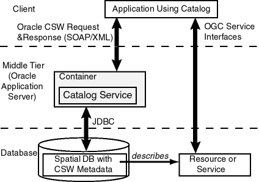

## E Catalog Services for the Web (CSW) Support \[deprecated implementation\]

This implementation of Catalog Services for the Web support is deprecated.

**Note:**

You are encouraged not to use this implementation, and instead to use the CSW support described in [Catalog Services for the Web (CSW) Support](catalog-services-web-csw-concepts.md).

The text in this appendix was published as a chapter in previous versions of this book, and is provided here only in case you need to continue using the now-deprecated implementation

This chapter describes the Oracle Spatial and Graph implementation of the Open GIS Consortium specification for catalog services. According to this specification: "Catalogue services support the ability to publish and search collections of descriptive information (metadata) for data, services, and related information objects. Metadata in catalogues represent resource characteristics that can be queried and presented for evaluation and further processing by both humans and software. Catalogue services are required to support the discovery and binding to registered information resources within an information community."

The Oracle Spatial and Graph implementation will be referred to as Catalog Services for the Web, or CSW

**Note:**

Before you use CSW, be sure that you understand the concepts described in [Introduction to Spatial Web Services](introduction-spatial-web-services.md), and that you have performed any necessary configuration work as described in that chapter.

If you have data from a previous release that was indexed using one or more SYS.XMLTABLEINDEX indexes, you must drop the associated indexes before the upgrade and re-create the indexes after the upgrade, as described in [Index Maintenance Before and After an Upgrade (WFS and CSW)](spatial-install-migrate-upgrade.md).

- CSW Engine and Architecture \[deprecated implementation\]
- CSW APIs and Configuration \[deprecated implementation\]
- Request and Response XML Examples \[deprecated implementation\]
- Java API for CSW Administration \[deprecated implementation\]

**Parent topic:** [Supplementary Information](spatial-supplementary-information.md)

### E.1 CSW Engine and Architecture \[deprecated implementation\]

This section describes CSW, including its relationship to clients and to the database server. CSW is implemented as a web service and can be deployed in a WebLogic Server environment.

CSW has a metadata layer, which stores in the database the metadata needed to reply to catalog requests. The metadata includes spatial columns, which can be queried and processed using Oracle Spatial and Graph interfaces. The metadata also stores the association of nonspatial and spatial attributes of records, as well as the services that the catalog service provides to its clients.

[Figure 18-1](catalog-services-web-csw-concepts.md) shows the CSW architecture.

Figure E-1 CSW Architecture

[Description of "Figure E-1 CSW Architecture"](img_text/csw_architecture.md)

As shown in [Figure 18-1](catalog-services-web-csw-concepts.md):

- CSW is part of a container in the middle tier.

- CSW can communicate with a web service client using CSW requests and responses in SOAP/XML format.

- CSW performs spatial data and metadata access through JDBC calls to the database.

- The database includes Oracle Spatial and Graph with CSW metadata and data.

CSW security is implemented using secure transport. User identities and user labels are managed in LDAP, and the middle tier and CSW security combine to perform authentication. Oracle label-based security is used for managing user privileges at the record level.

**Parent topic:** Catalog Services for the Web (CSW) Support \[deprecated implementation\]

### E.2 CSW APIs and Configuration \[deprecated implementation\]

The CSW APIs enable you to perform operations that include:

- Specifying information about record type domains and record view transformations

- Publishing record types

- Dropping (unpublishing) record types

- Granting to users and revoking from users privileges on CSW record types

<!-- -->

- Capabilities Documents \[deprecated implementation\]
- Spatial Path Extractor Function (extractSDO) \[deprecated implementation\]

**Parent topic:** Catalog Services for the Web (CSW) Support \[deprecated implementation\]

#### E.2.1 Capabilities Documents \[deprecated implementation\]

A capabilities document describes an instance of a capability. The document specifies a record type and the type of operations supported (such as insert and delete).

A capabilities document is generated by the CSW server in response to a GetCapabilities request. The CSW server uses a capabilities template, and adds information about the record type and operations to this template to create the capabilities document.

The client can use the HTTP GET method to access this capabilities document using either the SOAP interface or the XML interface:

- For the SOAP interface, use `oracle.spatial.ws.servlet.CSWServlet,` which can be accessed at an address in the following format:

      http:///machine-name:port/SpatialWS-SpatialWS-context-root/cswservlet?request=GetCapabilities&service=CSW&acceptversion=2.0.0&outputFormat=text/xml

- For the XML interface, use `oracle.spatial.ws.servlet.CSWXMLServlet`, which can be accessed at an address in the following format:

      http:///machine-name:port/SpatialWS-SpatialWS-context-root/xmlcswservlet?request=GetCapabilities&service=CSW&acceptversion=2.0.0&outputFormat=text/xml

In the preceding formats:

- machine-name is the name of the system where the application server is running.

- port is the port number where the application server is running.

- SpatialWS-SpatialWS-context-root is the default root where the Spatial and Graph web services application is mounted.

- cswservlet is the `servlet-mapping url-pattern` for `oracle.spatial.ws.servlet.CSWServlet`, as specified by default in the `web.xml` file.

- xmlcswservlet is the `servlet-mapping url-pattern` for `oracle.spatial.ws.servlet.CSWXMLServlet`, as specified by default in the `web.xml` file.

**Parent topic:** CSW APIs and Configuration \[deprecated implementation\]

#### E.2.2 Spatial Path Extractor Function (extractSDO) \[deprecated implementation\]

If you need CSW to process any spatial content that is not in GML format, you must create a user-defined function named `extractSDO` to extract the spatial path information. This function must be implemented for each record type that has spatial content in non-GML format and on which you want to create a spatial index. (This function is not needed if all spatial content for a record type is in GML format.)

This function must be registered, as explained in Registering and Unregistering the extractSDO Function \[deprecated implementation\], so that the Oracle Spatial and Graph CSW server can find and invoke this function when it needs to extract spatial path content that is not in GML format.

The `extractSDO` function has the following format:

    extractSDO(
      xmlData          IN XMLType,
      srsNs            IN VARCHAR2,
      spPathsSRSNSList IN MDSYS.STRINGLISTLIST
    ) RETURN MDSYS.SDO_GEOM_PATH_INFO;

##### Parameters

xmlData
Data of the record instance from which spatial path information needs to be extracted.

srsNs
User-defined namespace of the spatial reference system (coordinate system) associated with the spatial data for the feature type. This namespace (if specified) is also used to generate the `srsName` attribute in the `<boundedBy>` element of the FeatureCollection result generated for the GetFeature request.

spPathsSRSNSList
If a record type has multiple user-defined spatial reference system namespaces associated with different spatial paths, this parameter specifies the list of spatial reference system namespace information corresponding to the different spatial paths specified during type registration. It is an object of type MDSYS.STRINGLISTLIST, which is defined as `VARRAY(1000000) OF MDSYS.STRINGLIST`, and where MDSYS.STRINGLIST is defined as `VARRAY(1000000) OF VARCHAR2(4000)`. If a record type does not have multiple user-defined spatial reference system namespaces associated with different spatial columns, this parameter should be null.

In each MDSYS.STRINGLIST object, the first element is the spatial reference system namespace, and second element is the spatial reference system namespace alias (if any).

##### Usage Notes

This function parses the non-GML spatial content and returns an object of type MDSYS.SDO_GEOM_PATH_INFO, which is defined as follows:

    (path     MDSYS.STRINGLIST,
     geom     SDO_GEOMETRY,
     arrindex NUMBER)

The `path` attribute specifies path to the spatial content that is to be extracted and stored in the `geom` attribute. It is an object of MDSYS.STRINGLIST, which is defined as: `VARRAY(1000000) OF VARCHAR2(4000)`. The path attribute has the following pattern: `MDSYS.STRINGLIST('pe_namespace1','pe_name1', 'pe_namespace2','pe_name2',...);` where:

- `pe_namespace1` is the namespace of the first path element.

- `pe_name1` is the name of the first path element.

- `pe_namespace2` is the namespace of the second path element.

- `pe_name2` is the name of the second path element.

- and so on, for any remaining namespace and name pairs.

In the path, `/typeNameNSAlias:typeName/pe_namespace1_Alias:pe_name1/pe_namespace2_Alias:pe_name2...` is an XPath representation of spatial content, in non-GML format, that will be extracted by the user-defined function `extractSDO`:

- `typeNameNSAlias` is an alias to record type name namespace.

- `typeName` is the type name of the record type.

- `pe_namespace1_Alias` is a namespace alias for namespace `pe_namespace1`

- `pe_namespace2_Alias` is a namespace alias for namespace `pe_namespace2`.

The `geom` attribute is the spatial content (corresponding to the `path` parameter) extracted as an SDO_GEOMETRY object. The extracted geometry can then be indexed using a spatial index.

The `arrindex` attribute is not currently used, and should be set to 1. (It is reserved for future use as an array index of paths.)

- Registering and Unregistering the extractSDO Function \[deprecated implementation\]

**Parent topic:** CSW APIs and Configuration \[deprecated implementation\]

##### E.2.2.1 Registering and Unregistering the extractSDO Function \[deprecated implementation\]

After you create the `extractSDO` function, you must register it to enable it to be used for processing spatial path content in record types that is not in GML format. To register the function, call the [SDO_CSW_PROCESS.InsertPluginMap](SDO_CSW_PROCESS-reference.md) procedure. For example:

    BEGIN
      SDO_CSW_PROCESS.insertPluginMap('http://www.opengis.net/cat/csw',
        'Record', 'csw_admin_usr.csw_RT_1_package');
    END;
    /

If you no longer want the `extractSDO` function to be used for processing spatial path content that is not in GML format, you can unregister the function by calling the [SDO_CSW_PROCESS.DeletePluginMap](SDO_CSW_PROCESS-reference.md) procedure. For example:

    BEGIN
      SDO_CSW_PROCESS.deletePluginMap('http://www.opengis.net/cat/csw',
        'Record');
    END;
    /

**Parent topic:** Spatial Path Extractor Function (extractSDO) \[deprecated implementation\]

### E.3 Request and Response XML Examples \[deprecated implementation\]

This section presents some record requests to the CSW engine, and the response to each request, for each of the following operations:

- GetCapabilities

- DescribeRecord

- GetRecords

- GetDomain

- GetRecordById

- Transaction, with a subelement specifying the transaction type:

  - Insert

  - Update

  - Delete

Example E-1 GetCapabilities Request

The following is a request to get the capabilities of the CSW server named CSW at a specified namespace URL. This request will return a capabilities document.

    <csw:GetCapabilities service="CSW" xmlns:csw="http://www.opengis.net/cat/csw" xmlns:ows="http://www.opengis.net/ows">
        <ows:AcceptVersions>
          <ows:Version>2.0.0</ows:Version>
        </ows:AcceptVersions>
        <ows:AcceptFormats>
          <ows:OutputFormat>text/xml</ows:OutputFormat>
        </ows:AcceptFormats>
    </csw:GetCapabilities>

Example E-2 GetCapabilities Response

The following is an excerpt of the response from the preceding request.

    <Capabilities xmlns="http://www.opengis.net/cat/csw" version="2.0.0" updateSequence="0" xmlns:ows="http://www.opengis.net/ows" xmlns:ogc="http://www.opengis.net/ogc" xmlns:csw="http://www.opengis.net/cat/csw" xmlns:xlink="http://www.w3.org/1999/xlink" xmlns:ns0="http://www.opengis.net/cat/csw" xmlns:ns1="http://www.opengis.net/cat/csw">
      <ows:ServiceIdentification xmlns:ows="http://www.opengis.net/ows">
        <ows:ServiceType>CSW</ows:ServiceType>
        <ows:ServiceTypeVersion>2.0.0</ows:ServiceTypeVersion>
        <ows:Title>Company CSW</ows:Title>
        <ows:Abstract>
             A catalogue service that conforms to the HTTP protocol
             binding of the OpenGIS Catalogue Service specification
             version 2.0.0.
          </ows:Abstract>
        <ows:Keywords>
          <ows:Keyword>CSW</ows:Keyword>
          <ows:Keyword>Company Name</ows:Keyword>
          <ows:Keyword>geospatial</ows:Keyword>
          <ows:Keyword>catalogue</ows:Keyword>
        </ows:Keywords>
        <ows:Fees>NONE</ows:Fees>
        <ows:AccessConstraints>NONE</ows:AccessConstraints>
      </ows:ServiceIdentification>
      <ows:ServiceProvider xmlns:ows="http://www.opengis.net/ows">
        <ows:ProviderName>Company Name</ows:ProviderName>
        <ows:ProviderSite ans1:href="http://www.oracle.com" xmlns:ans1="http://www.w3.org/1999/xlink"/>
        <ows:ServiceContact>
          <ows:IndividualName> Contact Person Name</ows:IndividualName>
          <ows:PositionName>Staff</ows:PositionName>
          <ows:ContactInfo>
            <ows:Phone>
              <ows:Voice>999-999-9999</ows:Voice>
              <ows:Facsimile>999-999-9999</ows:Facsimile>
            </ows:Phone>
            <ows:Address>
              <ows:DeliveryPoint>1 Street Name</ows:DeliveryPoint>
              <ows:City>CityName</ows:City>
              <ows:AdministrativeArea>StateName</ows:AdministrativeArea>
              <ows:PostalCode>09999</ows:PostalCode>
              <ows:Country>USA</ows:Country>
              <ows:ElectronicMailAddress>
                   contact.person@example.com
                   </ows:ElectronicMailAddress>
            </ows:Address>
            <ows:OnlineResource ans1:href="mailto:contact.person@example.com" xmlns:ans1="http://www.w3.org/1999/xlink"/>
          </ows:ContactInfo>
        </ows:ServiceContact>
      </ows:ServiceProvider>
      <ows:OperationsMetadata xmlns:ows="http://www.opengis.net/ows">
        <ows:Operation name="GetCapabilities">
          <ows:DCP>
            <ows:HTTP>
              <ows:Get ans1:href="http://localhost:8888/SpatialWS-SpatialWS-context-root/cswservlet" xmlns:ans1="http://www.w3.org/1999/xlink"/>
              <ows:Post ans1:href="http://localhost:8888/SpatialWS-SpatialWS-context-root/SpatialWSSoapHttpPort" xmlns:ans1="http://www.w3.org/1999/xlink"/>
            </ows:HTTP>
          </ows:DCP>
        </ows:Operation>
        <ows:Operation name="DescribeRecord">
          <ows:DCP>
            <ows:HTTP>
              <ows:Post ans1:href="http://localhost:8888/SpatialWS-SpatialWS-context-root/SpatialWSSoapHttpPort" xmlns:ans1="http://www.w3.org/1999/xlink"/>
            </ows:HTTP>
          </ows:DCP>
          <ows:Parameter name="typeName"><ows:Value>ns0:SampleRecord</ows:Value><ows:Value>ns1:Record</ows:Value></ows:Parameter>
          <ows:Parameter name="outputFormat">
            <ows:Value>text/xml</ows:Value>
          </ows:Parameter>
          <ows:Parameter name="schemaLanguage">
            <ows:Value>XMLSCHEMA</ows:Value>
          </ows:Parameter>
        </ows:Operation>
        <ows:Operation name="GetRecords">
          <ows:DCP>
            <ows:HTTP>
              <ows:Post ans1:href="http://localhost:8888/SpatialWS-SpatialWS-context-root/SpatialWSSoapHttpPort" xmlns:ans1="http://www.w3.org/1999/xlink"/>
            </ows:HTTP>
          </ows:DCP>
          <ows:Parameter name="TypeName"><ows:Value>ns0:SampleRecord</ows:Value><ows:Value>ns1:Record</ows:Value></ows:Parameter>
          <ows:Parameter name="outputFormat">
            <ows:Value>text/xml </ows:Value>
          </ows:Parameter>
          <ows:Parameter name="outputSchema">
            <ows:Value>OGCCORE</ows:Value>
          </ows:Parameter>
          <ows:Parameter name="resultType">
            <ows:Value>hits</ows:Value>
            <ows:Value>results</ows:Value>
            <ows:Value>validate</ows:Value>
          </ows:Parameter>
          <ows:Parameter name="ElementSetName">
            <ows:Value>brief</ows:Value>
            <ows:Value>summary</ows:Value>
            <ows:Value>full</ows:Value>
          </ows:Parameter>
          <ows:Parameter name="CONSTRAINTLANGUAGE">
            <ows:Value>Filter</ows:Value>
          </ows:Parameter>
        </ows:Operation>
        <ows:Operation name="GetRecordById">
          <ows:DCP>
            <ows:HTTP>
              <ows:Post ans1:href="http://localhost:8888/SpatialWS-SpatialWS-context-root/SpatialWSSoapHttpPort" xmlns:ans1="http://www.w3.org/1999/xlink"/>
            </ows:HTTP>
          </ows:DCP>
          <ows:Parameter name="ElementSetName">
            <ows:Value>brief</ows:Value>
            <ows:Value>summary</ows:Value>
            <ows:Value>full</ows:Value>
          </ows:Parameter>
        </ows:Operation>
        <ows:Operation name="GetDomain">
          <ows:DCP>
            <ows:HTTP>
              <ows:Post ans1:href="http://localhost:8888/SpatialWS-SpatialWS-context-root/SpatialWSSoapHttpPort" xmlns:ans1="http://www.w3.org/1999/xlink"/>
            </ows:HTTP>
          </ows:DCP>
          <ows:Parameter name="ParameterName">
            <ows:Value>GetRecords.resultType</ows:Value>
            <ows:Value>GetRecords.outputFormat</ows:Value>
            <ows:Value>GetRecords.outputRecType</ows:Value>
            <ows:Value>GetRecords.typeNames</ows:Value>
            <ows:Value>GetRecords.ElementSetName</ows:Value>
            <ows:Value>GetRecords.ElementName</ows:Value>
            <ows:Value>GetRecords.CONSTRAINTLANGUAGE</ows:Value>
            <ows:Value>GetRecordById.ElementSetName</ows:Value>
            <ows:Value>DescribeRecord.typeName</ows:Value>
            <ows:Value>DescribeRecord.schemaLanguage</ows:Value>
          </ows:Parameter>
        </ows:Operation>
        <ows:Operation name="Transaction">
          <ows:DCP>
            <ows:HTTP>
              <ows:Post ans1:href="http://localhost:8888/SpatialWS-SpatialWS-context-root/SpatialWSSoapHttpPort" xmlns:ans1="http://www.w3.org/1999/xlink"/>
            </ows:HTTP>
          </ows:DCP>
        </ows:Operation>
        <ows:Parameter name="service">
          <ows:Value>CSW</ows:Value>
        </ows:Parameter>
        <ows:Parameter name="version">
          <ows:Value>2.0.0</ows:Value>
        </ows:Parameter>
        <ows:ExtendedCapabilities>
          <ogc:Filter_Capabilities xmlns:ogc="http://www.opengis.net/ogc">
            <ogc:Spatial_Capabilities>
              <ogc:Spatial_Operators>
                <ogc:BBOX/>
                <ogc:Equals/>
                <ogc:Disjoint/>
                <ogc:Intersect/>
                <ogc:Touches/>
                <ogc:Crosses/>
                <ogc:Within/>
                <ogc:Contains/>
                <ogc:Overlaps/>
                <ogc:Beyond/>
                <ogc:DWithin/>
              </ogc:Spatial_Operators>
            </ogc:Spatial_Capabilities>
            <ogc:Scalar_Capabilities>
              <ogc:Logical_Operators/>
              <ogc:Comparison_Operators>
                <ogc:Simple_Comparisons/>
                <ogc:Like/>
                <ogc:Between/>
                <ogc:NullCheck/>
              </ogc:Comparison_Operators>
              <ogc:Arithmetic_Operators>
                <ogc:Simple_Arithmetic/>
              </ogc:Arithmetic_Operators>
            </ogc:Scalar_Capabilities>
          </ogc:Filter_Capabilities>
        </ows:ExtendedCapabilities>
      </ows:OperationsMetadata>
    </Capabilities>

Example E-3 DescribeRecord Request

The following is a request to describe the record with the type name `Record` for a specified namespace.

    <csw:DescribeRecord service="CSW"
      version="2.0.0"
      xmlns:csw="http://www.opengis.net/cat/csw" >
      <csw:TypeName targetNamespace="http://www.opengis.net/cat/csw">Record</csw:TypeName>
    </csw:DescribeRecord>

Example E-4 DescribeRecord Response

The following is the response from the preceding request. The response is an XML schema definition (XSD). See the `<documentation>` elements in the response for explanatory comments.

    <xsd:schema targetNamespace="http://www.opengis.net/cat/csw" elementFormDefault="qualified" version="2.0.0" id="csw-record" xmlns:csw="http://www.opengis.net/cat/csw" xmlns:dc="http://www.purl.org/dc/elements/1.1/" xmlns:dct="http://www.purl.org/dc/terms/" xmlns:ows="http://www.opengis.net/ows" xmlns:xsd="http://www.w3.org/2001/XMLSchema">
      <xsd:annotation>
        <xsd:appinfo>
          <dc:identifier xmlns:dc="http://www.purl.org/dc/elements/1.1/">
          http://schemas.opengis.net/csw/2.0.0/record
          </dc:identifier>
        </xsd:appinfo>
        <xsd:documentation xml:lang="en">
        This schema defines the basic record types that are common to all CSW
        implementations. An application profile may extend AbstractRecordType to
        represent model-specific content.
        </xsd:documentation>
      </xsd:annotation>
      <xsd:import namespace="http://www.purl.org/dc/terms/" schemaLocation="./recdcterms.xsd"/>
      <xsd:import namespace="http://www.purl.org/dc/elements/1.1/" schemaLocation="./recdcmes.xsd"/>
      <xsd:import namespace="http://www.opengis.net/ows" schemaLocation="./owsboundingbox.xsd"/>
      <xsd:element name="AbstractRecord" type="csw:AbstractRecordType" abstract="true" id="AbstractRecord"/>
      <xsd:complexType name="AbstractRecordType" abstract="true" id="AbstractRecordType"/>
      <xsd:element name="DCMIRecord" type="csw:DCMIRecordType" substitutionGroup="csw:AbstractRecord"/>
      <xsd:complexType name="DCMIRecordType">
        <xsd:annotation>
          <xsd:documentation xml:lang="en">
          This type encapsulates all of the standard DCMI metadata terms,
          including the Dublin Core refinements; these terms may be mapped to the
          profile-specific information model.
          </xsd:documentation>
        </xsd:annotation>
        <xsd:complexContent>
          <xsd:extension base="csw:AbstractRecordType">
            <xsd:sequence>
              <xsd:group ref="dct:DCMI-terms"/>
            </xsd:sequence>
          </xsd:extension>
        </xsd:complexContent>
      </xsd:complexType>
      <xsd:element name="BriefRecord" type="csw:BriefRecordType" substitutionGroup="csw:AbstractRecord"/>
      <xsd:complexType name="BriefRecordType">
        <xsd:annotation>
          <xsd:documentation xml:lang="en">
          This type defines a brief representation of the common record format.
          It extends AbstractRecordType to include only the dc:identifier and
          dc:type properties.
          </xsd:documentation>
        </xsd:annotation>
        <xsd:complexContent>
          <xsd:extension base="csw:AbstractRecordType">
            <xsd:sequence>
              <xsd:element ref="dc:identifier"/>
              <xsd:element ref="dc:type" minOccurs="0"/>
            </xsd:sequence>
          </xsd:extension>
        </xsd:complexContent>
      </xsd:complexType>
      <xsd:element name="SummaryRecord" type="csw:SummaryRecordType" substitutionGroup="csw:AbstractRecord"/>
      <xsd:complexType name="SummaryRecordType">
        <xsd:annotation>
          <xsd:documentation xml:lang="en">
          This type defines a summary representation of the common record format.
          It extends AbstractRecordType to include the core properties.
          </xsd:documentation>
        </xsd:annotation>
        <xsd:complexContent>
          <xsd:extension base="csw:AbstractRecordType">
            <xsd:sequence>
              <xsd:choice maxOccurs="unbounded">
                <xsd:element ref="dc:identifier"/>
                <xsd:element ref="dc:type"/>
                <xsd:element ref="dc:title"/>
                <xsd:element ref="dc:subject"/>
                <xsd:element ref="dc:format"/>
                <xsd:element ref="dc:relation"/>
                <xsd:element ref="dct:modified"/>
                <xsd:element ref="dct:abstract"/>
                <xsd:element ref="dct:spatial"/>
              </xsd:choice>
            </xsd:sequence>
          </xsd:extension>
        </xsd:complexContent>
      </xsd:complexType>
      <xsd:element name="Record" type="csw:RecordType" substitutionGroup="csw:AbstractRecord"/>
      <xsd:complexType name="RecordType">
        <xsd:annotation>
          <xsd:documentation xml:lang="en">
          This type extends DCMIRecordType to add ows:BoundingBox; it may be used
          to specify a bounding envelope for the catalogued resource.
          </xsd:documentation>
        </xsd:annotation>
        <xsd:complexContent>
          <xsd:extension base="csw:DCMIRecordType">
            <xsd:sequence>
              <xsd:element ref="ows:BoundingBox" minOccurs="0"/>
            </xsd:sequence>
          </xsd:extension>
        </xsd:complexContent>
      </xsd:complexType>
    </xsd:schema>

Example E-5 GetRecords Request

The following is a request to get records where the contributor is equal to `Raja`.

Note that Spatial Catalog Service supports only synchronous processing of GetRecords requests.

    <?xml version="1.0" ?>
    <csw:GetRecords
       service="CSW"
       version="2.0.0"
       xmlns:csw="http://www.opengis.net/cat/csw"
       xmlns:ogc="http://www.opengis.net/ogc"
       xmlns:dc="http://www.purl.org/dc/elements/1.1/"
       xmlns:dct="http://www.purl.org/dc/terms/"
       outputFormat="text/xml"
       resultType="results"
       outputSchema="csw:Record">
    <csw:Query typeNames="csw:Record">
    <csw:ElementName>/csw:Record/dc:identifier</csw:ElementName>
    <csw:ElementName>/csw:Record/dc:contributor</csw:ElementName>
    <csw:Constraint version="2.0.0" >
       <ogc:Filter>
      <ogc:PropertyIsEqualTo>
        <ogc:PropertyName>/csw:Record/dc:contributor</ogc:PropertyName>
        <ogc:Literal>Raja</ogc:Literal>
      </ogc:PropertyIsEqualTo>
       </ogc:Filter>
    </csw:Constraint>
    </csw:Query>
    </csw:GetRecords>

Example E-6 GetRecords Response

The following is the response from the preceding request.

    <csw:GetRecordsResponse xmlns:csw="http://www.opengis.net/cat/csw" xmlns:dc="http://www.purl.org/dc/elements/1.1/" xmlns:dct="http://www.purl.org/dc/terms/" xsi:schemaLocation="http://www.opengis.net/cat/csw http://localhost:8888/SpatialWS-SpatialWS-context-root/cswservlet?recordTypeId=1 " version="2.0.0" xmlns:xsi="http://www.w3.org/2001/XMLSchema-instance">
       <csw:RequestId>4</csw:RequestId>
       <csw:SearchStatus status="complete"/>
       <csw:SearchResults recordSchema="http://www.opengis.net/cat/csw" numberOfRecordsMatched="1" numberOfRecordsReturned="1" nextRecord="0" expires="2007-02-09T16:32:35.29Z">
          <csw:Record xmlns:dc="http://www.purl.org/dc/elements/1.1/" xmlns:ows="http://www.opengis.net/ows" xmlns:dct="http://www.purl.org/dc/terms/">
             <dc:contributor xmlns:dc="http://www.purl.org/dc/elements/1.1/" scheme="http://www.example.com">Raja</dc:contributor>
             <dc:identifier xmlns:dc="http://www.purl.org/dc/elements/1.1/">REC-1</dc:identifier>
          </csw:Record>
       </csw:SearchResults>
    </csw:GetRecordsResponse>

Example E-7 GetDomain Request

The following is a request to get domain information related to a record type.

    <csw:GetDomain service="CSW"
       version="2.0.0"
       xmlns:csw="http://www.opengis.net/cat/csw" >
       <csw:ParameterName>GetRecords.resultType</csw:ParameterName>
    </csw:GetDomain>

Example E-8 GetDomain Response

The following is the response from the preceding request.

    <csw:GetDomainResponse xmlns:csw="http://www.opengis.net/cat/csw" xmlns:dc="http://www.purl.org/dc/elements/1.1/" xmlns:dct="http://www.purl.org/dc/terms/">
       <csw:DomainValues type="csw:SampleRecord">
          <csw:ParameterName>GetRecords.resultType</csw:ParameterName>
          <csw:ListOfValues>
             <csw:Value>hits</csw:Value>
             <csw:Value>results</csw:Value>
             <csw:Value>validate</csw:Value>
          </csw:ListOfValues>
       </csw:DomainValues>
       <csw:DomainValues type="csw:Record">
          <csw:ParameterName>GetRecords.resultType</csw:ParameterName>
          <csw:ListOfValues>
             <csw:Value>hits</csw:Value>
             <csw:Value>results</csw:Value>
             <csw:Value>validate</csw:Value>
          </csw:ListOfValues>
       </csw:DomainValues>
    </csw:GetDomainResponse>

Example E-9 GetRecordById Request

The following is a request to get the record with the record ID value `REC-1`.

    <?xml version="1.0" ?>
    <csw:GetRecordById
       service="CSW"
       version="2.0.0"
       xmlns:csw="http://www.opengis.net/cat/csw"
       xmlns:ogc="http://www.opengis.net/ogc" >
    <csw:Id> REC-1 </csw:Id>
    <csw:ElementSetName>brief</csw:ElementSetName>
    </csw:GetRecordById>

Example E-10 GetRecordById Response

The following is the response from the preceding request.

    <csw:GetRecordByIdResponse xmlns:csw="http://www.opengis.net/cat/csw" xmlns:dc="http://www.purl.org/dc/elements/1.1/" xmlns:dct="http://www.purl.org/dc/terms/" xsi:schemaLocation="http://www.opengis.net/cat/csw http://localhost:8888/SpatialWS-SpatialWS-context-root/cswservlet?recordTypeId=2 http://www.opengis.net/cat/csw http://localhost:8888/SpatialWS-SpatialWS-context-root/cswservlet?recordTypeId=1 " xmlns:xsi="http://www.w3.org/2001/XMLSchema-instance">
       <csw:BriefRecord xmlns:dc="http://www.purl.org/dc/elements/1.1/" xmlns:ows="http://www.opengis.net/ows" xmlns:dct="http://www.purl.org/dc/terms/">
          <dc:identifier xmlns:dc="http://www.purl.org/dc/elements/1.1/">REC-1</dc:identifier>
       </csw:BriefRecord>
    </csw:GetRecordByIdResponse>

Example E-11 Insert Request

The following is a request to insert a record for contributor `John`. The record has an ID value of `REC-2`, and has the spatial attribute of the specified bounding box (optimized rectangle: lower-left and upper-right coordinates).

    <csw:Transaction service="CSW"
       version="2.0.0"
       xmlns:csw="http://www.opengis.net/cat/csw" >
      <csw:Insert>
        <Record xmlns="http://www.opengis.net/cat/csw" xmlns:dc="http://www.purl.org/dc/elements/1.1/" xmlns:dct="http://www.purl.org/dc/terms/" xmlns:ows="http://www.opengis.net/ows" >
           <dc:contributor scheme="http://www.example.com">John</dc:contributor>
           <dc:identifier >REC-2</dc:identifier>
           <ows:WGS84BoundingBox crs="urn:opengis:crs:OGC:2:84" dimensions="2">
                   <ows:LowerCorner>12 12</ows:LowerCorner>
                   <ows:UpperCorner>102 102</ows:UpperCorner>
           </ows:WGS84BoundingBox>
        </Record>
      </csw:Insert>
    </csw:Transaction>

Example E-12 Insert Response

The following is the response from the preceding request.

    <csw:TransactionResponse xmlns:csw="http://www.opengis.net/cat/csw" xmlns:dc="http://www.purl.org/dc/elements/1.1/" xmlns:dct="http://www.purl.org/dc/terms/" xsi:schemaLocation="http://www.opengis.net/cat/csw http://localhost:8888/SpatialWS-SpatialWS-context-root/cswservlet?recordTypeId=1 " xmlns:xsi="http://www.w3.org/2001/XMLSchema-instance">
       <csw:TransactionSummary>
          <csw:totalInserted>1</csw:totalInserted>
       </csw:TransactionSummary>
    </csw:TransactionResponse>

Example E-13 Update Request

The following is a request to update the contributor value to `Jane` in the record where the current contributor value is `John` (that is, change the value from `John` to `Jane`).

    <csw:Transaction service="CSW"
       version="2.0.0"
       xmlns:csw="http://www.opengis.net/cat/csw"
       xmlns:ogc="http://www.opengis.net/ogc"
       xmlns:dc="http://www.purl.org/dc/elements/1.1/">
      <csw:Update>
        <csw:RecordProperty>
          <csw:Name>/csw:Record/dc:contributor</csw:Name>
          <csw:Value>Jane</csw:Value>
        </csw:RecordProperty>

        <csw:Constraint version="2.0.0">
          <ogc:Filter>
            <ogc:PropertyIsEqualTo>
              <ogc:PropertyName>/csw:Record/dc:contributor</ogc:PropertyName>
              <ogc:Literal>John</ogc:Literal>
            </ogc:PropertyIsEqualTo>
          </ogc:Filter>
        </csw:Constraint>

      </csw:Update>
    </csw:Transaction>

Example E-14 Update Response

The following is the response from the preceding request.

    <csw:TransactionResponse xmlns:csw="http://www.opengis.net/cat/csw" xmlns:dc="http://www.purl.org/dc/elements/1.1/" xmlns:dct="http://www.purl.org/dc/terms/">
       <csw:TransactionSummary>
          <csw:totalUpdated>1</csw:totalUpdated>
       </csw:TransactionSummary>
    </csw:TransactionResponse>

Example E-15 Delete Request

The following is a request to delete the record where the contributor value is equal to `Jane`.

    <csw:Transaction service="CSW"
       version="2.0.0"
       xmlns:csw="http://www.opengis.net/cat/csw"
       xmlns:dc="http://www.purl.org/dc/elements/1.1/"
       xmlns:ogc="http://www.opengis.net/ogc">
      <csw:Delete typeName="csw:Record">
        <csw:Constraint version="2.0.0">
          <ogc:Filter>
            <ogc:PropertyIsEqualTo>
                <ogc:PropertyName>/csw:Record/dc:contributor</ogc:PropertyName>
                <ogc:Literal>Jane</ogc:Literal>
            </ogc:PropertyIsEqualTo>
          </ogc:Filter>
        </csw:Constraint>
      </csw:Delete>
    </csw:Transaction>

Example E-16 Delete Response

The following is the response from the preceding request.

    <csw:TransactionResponse xmlns:csw="http://www.opengis.net/cat/csw" xmlns:dc="http://www.purl.org/dc/elements/1.1/" xmlns:dct="http://www.purl.org/dc/terms/">
       <csw:TransactionSummary>
          <csw:totalDeleted>1</csw:totalDeleted>
       </csw:TransactionSummary>
    </csw:TransactionResponse>

**Parent topic:** Catalog Services for the Web (CSW) Support \[deprecated implementation\]

### E.4 Java API for CSW Administration \[deprecated implementation\]

In addition to the PL/SQL APIs in the SDO_CSW_PROCESS package, you can use a Java API to publish and drop record types, and to grant and revoke access to record types and CSW metadata tables.

This section provides basic reference information about the methods in the `oracle.spatial.csw.CSWAdmin` class. The methods are presented in alphabetical order.

- createXMLTableIndex method
- deleteDomainInfo method
- deleteRecordViewMap method
- disableVersioning method
- dropRecordType method
- dropXMLTableIndex method
- enableVersioning method
- getIsXMLTableIndexCreated method
- getRecordTypeId method
- grantMDAccessToUser method
- grantRecordTypeToUser method
- publishRecordType method
- registerTypePluginMap method
- revokeMDAccessFromUser method
- revokeRecordTypeFromUser method
- setCapabilitiesInfo method
- setDomainInfo method
- setRecordViewMap method
- setXMLTableIndexInfo method

**Parent topic:** Catalog Services for the Web (CSW) Support \[deprecated implementation\]

#### E.4.1 createXMLTableIndex method

The `createXMLTableIndex` method creates an index of XDB.XMLINDEX on record type instances. This method has the following format:

    public static void createXMLTableIndex(
        OracleConnection conn,
        String typeNS,
        String typeName) throws SQLException;

`conn` is an Oracle Database connection for a user that has been granted the DBA role.

`typeNS` is the URL of the namespace of the record type.

`typeName` is the name of the record type.

**Parent topic:** Java API for CSW Administration \[deprecated implementation\]

#### E.4.2 deleteDomainInfo method

The `deleteDomainInfo` method deletes domain information related to the record type. This method has the following format:

    public static void deleteDomainInfo(
        OracleConnection conn,
        int recordTypeId,
        String parameterName) throws SQLException;

`conn` is an Oracle Database connection for a user that has been granted the DBA role.

`recordTypeId` is the ID of the record type.

`parameterName` is the name of the domain parameter to be deleted.

**Parent topic:** Java API for CSW Administration \[deprecated implementation\]

#### E.4.3 deleteRecordViewMap method

The `deleteRecordViewMap` method deletes information related to record view transformation. This method has the following format:

    public static void deleteRecordViewMap(
        OracleConnection conn,
        String recordTypeNS,
        String viewSrcName,
        String targetTypeName,
        String  mapType) throws SQLException;

`conn` is an Oracle Database connection for a user that has been granted the DBA role.

`recordTypeNS` is the URL of the namespace of the record type.

`viewSrcName` is the name of the source of the record type.

`targetTypeName` is the name of the destination of the record type.

`mapType` is the map type (brief, summary, and so on).

**Parent topic:** Java API for CSW Administration \[deprecated implementation\]

#### E.4.4 disableVersioning method

The `disableVersioning` method disables versioning for a record type. This method has the following format:

    public static void disableVersioning(
        OracleConnection conn,
        String rtNSUrl,
        String rtName) throws SQLException;

`conn` is an Oracle Database connection for a user that has been granted the DBA role.

`rtNSUrl` is the URL of the namespace of the record type.

`rtName` is the name of the record type.

**Parent topic:** Java API for CSW Administration \[deprecated implementation\]

#### E.4.5 dropRecordType method

The `dropRecordType` method deletes a record type from the CSW repository. This method has the following format:

    public static void dropRecordType(
        OracleConnection conn,
        String rtNSUrl,
        String rtName) throws SQLException;

`conn` is an Oracle Database connection for a user that has been granted the DBA role.

`rtNSUrl` is the URL of the namespace of the record type.

`rtName` is the name of the record type.

**Parent topic:** Java API for CSW Administration \[deprecated implementation\]

#### E.4.6 dropXMLTableIndex method

The `dropXMLTableIndex` method drops an index of type XDB.XMLINDEX that was created on record type instances. This method has the following format:

    public static void dropXMLTableIndex(
        OracleConnection conn,
        String typeNS,
        String typeName) throws SQLException;

`conn` is an Oracle Database connection for a user that has been granted the DBA role.

`typeNS` is the URL of the namespace of the record type.

`typeName` is the name of the record type.

**Parent topic:** Java API for CSW Administration \[deprecated implementation\]

#### E.4.7 enableVersioning method

The `enableVersioning` method enables versioning for a record type. This method has the following format:

    public static void enableVersioning(
        OracleConnection conn,
        String rtNSUrl,
        String rtName) throws SQLException;

`conn` is an Oracle Database connection for a user that has been granted the DBA role.

`rtNSUrl` is the URL of the namespace of the record type.

`rtName` is the name of the record type.

**Parent topic:** Java API for CSW Administration \[deprecated implementation\]

#### E.4.8 getIsXMLTableIndexCreated method

The `getIsXMLTableIndexCreated` method returns a Boolean `TRUE` if an index of type XDB.XMLINDEX has been created on a record type, or a Boolean `FALSE` if such an index has not been created. This method has the following format:

    public static boolean getIsXMLTableIndexCreated(
        OracleConnection conn,
        String typeNS,
        String typeName) throws SQLException;

`conn` is an Oracle Database connection for a user that has been granted the DBA role.

`typeNS` is the URL of the namespace of the record type.

`typeName` is the name of the record type.

**Parent topic:** Java API for CSW Administration \[deprecated implementation\]

#### E.4.9 getRecordTypeId method

The `getRecordTypeId` method returns the record type ID for a specified combination of namespace and record type. This method has the following format:

    public static boolean getIRecordTypeId(
        OracleConnection conn,
        String typeNamespace,
        String typeName) throws SQLException;

`conn` is an Oracle Database connection for a user that has been granted the DBA role.

`typeNamespace` is the URL of the namespace of the record type.

`typeName` is the name of the record type.

**Parent topic:** Java API for CSW Administration \[deprecated implementation\]

#### E.4.10 grantMDAccessToUser method

The `grantMDAccessToUser` method grants access to the CSW metadata to a database user. This method has the following format:

    public static void grantMDAccessToUser(
        OracleConnection conn,
        String usrName)  throws SQLException;

`conn` is an Oracle Database connection for a user that has been granted the DBA role.

`usrName` is the name of the database user.

**Parent topic:** Java API for CSW Administration \[deprecated implementation\]

#### E.4.11 grantRecordTypeToUser method

The `grantRecordTypeToUser` method grants access to a record type to a database user. This method has the following format:

    public static void grantRecordTypeToUser(
        OracleConnection conn,
        String typeNS,
        String typeName,
        String usrName)  throws SQLException;

`conn` is an Oracle Database connection for a user that has been granted the DBA role.

`typeNS` is the URL of the namespace of the record type.

`typeName` is the name of the record type.

`usrName` is the name of the database user.

**Parent topic:** Java API for CSW Administration \[deprecated implementation\]

#### E.4.12 publishRecordType method

The `publishRecordType` method publishes a record type; that is, it registers metadata related to the record type. This method has the following formats:

    public static void publishRecordType(OracleConnection conn,
         XMLType recordTypeMD) throws SQLException , CSWException;

    public static void publishRecordType(OracleConnection conn,
         String typeNS,
         String typeName,
         ArrayList<String> idPaths,
         ArrayList<PathInfo> spatialPaths,
         ArrayList<PathInfo> tsPaths,
         XMLType schemaDoc,
         XMLType briefXSLPattern,
         XMLType summaryXSLPattern,
         XMLType dcmiXSLPattern,
         ArrayList<String> srsPaths,
         String idExtractorType,
         ArrayList<GeomMetaInfo> sdoMetaInfo,
         String srsNS, String srsNSAlias) throws SQLException ;

    public static void publishRecordType(OracleConnection conn,
         String typeNS,
         String typeName,
         ArrayList<String> idPaths,
         ArrayList<PathInfo> spatialPaths,
         ArrayList<PathInfo> tsPaths,
         XMLType schemaDoc,
         XMLType briefXSLPattern,
         XMLType summaryXSLPattern,
         XMLType dcmiXSLPattern,
         ArrayList<String> srsPaths,
         String idExtractorType,
         ArrayList<GeomMetaInfo> sdoMetaInfo,
         String srsNS, String srsNSAlias,
         String rtXSDRefId,
         boolean genSpatialIndex,
         boolean setDomainInfo,
         Hashtable<String, ArrayList<String>> domainInfo,
         boolean setRecordViewMap,
         ArrayList<ArrayList<Object>> recordViewMap) throws SQLException ;

    public static void publishRecordType(OracleConnection conn,
         String typeNS,
         String typeName,
         ArrayList<String> idPaths,
         ArrayList<PathInfo> spatialPaths,
         ArrayList<PathInfo> tsPaths,
         XMLType schemaDoc,
         XMLType briefXSLPattern,
         XMLType summaryXSLPattern,
         XMLType dcmiXSLPattern,
         ArrayList<String> srsPaths,
         String idExtractorType,
         ArrayList<GeomMetaInfo> sdoMetaInfo,
         String srsNS, String srsNSAlias,
         String rtXSDRefId,
         boolean genSpatialIndex,
         boolean setDomainInfo,
         Hashtable<String, ArrayList<String>> domainInfo,
         boolean setRecordViewMap,
         ArrayList<ArrayList<Object>> recordViewMap,
         ArrayList<PathInfo> numPaths,
         ArrayList<PathInfo> idxPaths,
         ArrayList<String[]> idxPathTypes,
         boolean genXMLIndex) throws SQLException ;

    public static void publishRecordType(OracleConnection conn,
         String typeNS,
         String typeName,
         ArrayList<String> idPaths,
         ArrayList<PathInfo> spatialPaths,
         ArrayList<PathInfo> tsPaths,
         XMLType schemaDoc,
         XMLType briefXSLPattern,
         XMLType summaryXSLPattern,
         XMLType dcmiXSLPattern,
         ArrayList<String> srsPaths,
         String idExtractorType, ArrayList<GeomMetaInfo> sdoMetaInfo,
         String srsNS, String srsNSAlias,
         String rtXSDRefId,
         boolean genSpatialIndex,
         boolean setDomainInfo,
         Hashtable<String, ArrayList<String>> domainInfo,
         boolean setRecordViewMap,
         ArrayList<ArrayList<Object>> recordViewMap,
         ArrayList<PathInfo> numPaths,
         ArrayList<PathInfo> idxPaths,
         ArrayList<String[]> idxPathTypes,
         boolean genXMLIndex,
         boolean isGML3) throws SQLException ;

    public static void publishRecordType(OracleConnection conn,
         String typeNS,
         String typeName,
         ArrayList<String> idPaths,
         ArrayList<PathInfo> spatialPaths,
         ArrayList<PathInfo> tsPaths,
         XMLType schemaDoc,
         XMLType briefXSLPattern,
         XMLType summaryXSLPattern,
         XMLType dcmiXSLPattern,
         ArrayList<String> srsPaths,
         String idExtractorType,
         ArrayList<GeomMetaInfo> sdoMetaInfo,
         String srsNS, String srsNSAlias,
         String rtXSDRefId,
         boolean genSpatialIndex,
         boolean setDomainInfo,
         Hashtable<String, ArrayList<String>> domainInfo,
         boolean setRecordViewMap,
         ArrayList<ArrayList<Object>> recordViewMap,
         ArrayList<PathInfo> numPaths,
         ArrayList<PathInfo> idxPaths,
         ArrayList<String[]> idxPathTypes,
         boolean genXMLIndex,
         boolean isGML3,
         CollectionPathInfo collPathInfo) throws SQLException;

    public static void publishRecordType(OracleConnection conn,
         String typeNS,
         String typeName,
         ArrayList<String> idPaths,
         ArrayList<PathInfo> spatialPaths,
         ArrayList<PathInfo> tsPaths,
         XMLType schemaDoc,
         XMLType briefXSLPattern,
         XMLType summaryXSLPattern,
         XMLType dcmiXSLPattern,
         ArrayList<String> srsPaths,
         String idExtractorType,
         ArrayList<GeomMetaInfo> sdoMetaInfo,
         String srsNS, String srsNSAlias,
         String rtXSDRefId,
         boolean genSpatialIndex,
         boolean setDomainInfo,
         Hashtable<String, ArrayList<String>> domainInfo,
         boolean setRecordViewMap,
         ArrayList<ArrayList<Object>> recordViewMap,
         ArrayList<PathInfo> numPaths,
         ArrayList<PathInfo> idxPaths,
         ArrayList<String[]> idxPathTypes,
         boolean genXMLIndex,
         boolean isGML3,
         CollectionPathInfo collPathInfo,
         boolean hasMultipleSRSNS) throws SQLException;

`conn` is an Oracle Database connection for a user that has been granted the DBA role.

`recordTypeMD` is the record type registration metadata. This metadata must conform to the `recordTypeMd` element definition as specified in the `wstype_md.xsd` file. Examples of record type path registration metadata XML are provided in `rt_metadata1.xml` and `rt_metadata2.xml`. These files are included in the `ws_client.jar` demo file under the `src/data/` path. For information about using the examples to publish record types, see the `Readme.txt` file, which is included in `ws_client.jar` under the `src/` path.

`typeNS` is the URL of the namespace of the record type.

`typeName` is the name of the record type.

`idPaths` is a list of record ID path elements where each element is a String.

`spatialPaths` is a list of spatial paths in the record type. It is an `ArrayList` of class `oracle.spatial.ws.PathInfo`, which is described in Related Classes for publishRecordType.

`tsPaths` is a list of time-related paths in the record type (for example, `date`, `dateTime`, `gYear`, `gMonth`, `gDay`, `gMonthDay`, and `gYearMonth`). It is an `ArrayList` of class `oracle.spatial.ws.PathInfo`, which is described in Related Classes for publishRecordType.

`schemaDoc` is the XML schema definition (XSD) of the record type.

`briefXSLPattern` is the XSLT mapping for transforming the record structure from full to brief format.

`summaryXSLPattern` is the XSLT mapping for transforming the record structure from summary to brief format.

`dcmiXSLPattern` is the XSLT mapping for transforming the record structure from dcmi to brief format.

`srsPaths` is a list of paths representing spatial reference system information.

`idExtractorType` is Identifier extractor method information (`XPATH`, `USER_FUNC`, or `NONE`). `XPATH` means that the record identifier will be extracted using an XPath as specified in the `idPaths` parameter. `USER_FUNC` means that the record identifier will be extracted by a user-defined function invocation, as specified in the `idPaths` parameter, to which the entire record document instance will be passed. `NONE` means that the record identifier will be a system-generated identifier.

`sdoMetaInfo` is the spatial metadata information for spatial paths. It is an `ArrayList` of class `oracle.spatial.ws.GeomMetaInfo`, which is described in Related Classes for publishRecordType.

`srsNS` is the user-defined namespace of the spatial reference system (coordinate system) associated with the data in the spatial paths.

`srsNSAlias` is the namespace alias of the spatial reference system (coordinate system) associated with the data in the spatial paths.

`rtXSDRefId` is the group record type XML schema definition file name (as a string), for cases where multiple record types are defined in a single XSD file. This parameter is used to store the group XSD definition once in the CSW metadata, and then refer to it from multiple record types whose schema definitions are present in the group record type XSD file.

`genSpatialIndex` is a Boolean value: `TRUE` causes a spatial index to be created on the record type at type creation time; `FALSE` does not cause a spatial index to be created.

`setDomainInfo` is a Boolean value: `TRUE` causes domain information for this record type to be set at type creation time; `FALSE` does not cause domain information for this record type to be set.

`domainInfo` is domain information.

`setRecordViewMap` is a Boolean value: `TRUE` causes the record view transformation map to be set at type creation time; `FALSE` does not cause the record view transformation map to be set.

`recordViewMap` is the record view transformation map information (brief to full, summary to full, and dcmi to full). It is of type `ArrayList<ArrayList<Object>>` where the content of each `ArrayList<Object>` is: `Object[0] = (String) recordTypeNS`, `Object[1] = (String) viewSrcName`, `Object[2] = (String) targetTypeName`, `Object[3]= (oracle.xdb.XMLType) mapInfo`, `Object[4] = (String) mapType`

`numPaths` is a list of numeric (NUMBER, INTEGER, and so on) related paths in the record type. It is an `ArrayList` of class `oracle.spatial.ws.PathInfo`, which is described in Related Classes for publishRecordType.

`idxPaths` is the index path list. It is list of paths on which to create an index of type XDB.XMLINDEX when that index is created. It is an `ArrayList` of class `oracle.spatial.ws.PathInfo`, which is described in Related Classes for publishRecordType.

`idxPathTypes` specifies information about each index path, where each element of string\[3\] contains the following: string\[0\] is the type name, string\[1\] is the type format (such as the type length), and string\[2\] specifies whether a Btree or unique index, or no index, should be created (`CSWAdmin.BTREE`, `CSWAdmin.UNIQUE`, or null).

`genXMLIndex` is a Boolean value: `TRUE` causes an index of type XDB.XMLINDEX to be created on the document-based record type; `FALSE` does not cause an index of type XDB.XMLINDEX to be created on the document-based record type. If you choose not to create the index now, you can create it later using the `createXMLTableIndex` method (described in createXMLTableIndex method).

`isGML3` is a Boolean value: `TRUE` means that the geometries inside instances of this record type are GML3.1.1 compliant; `FALSE` means that the geometries inside instances of this record type are GML 2.1.2 compliant.

`collPathInfo` is spatial collection path information.

`hasMultipleSRSNS` is a Boolean value: `TRUE` means that this record type refers to multiple user-defined spatial reference system namespaces; `FALSE` means that this record type does not refer to multiple user-defined spatial reference system namespaces.

- Related Classes for publishRecordType

**Parent topic:** Java API for CSW Administration \[deprecated implementation\]

##### E.4.12.1 Related Classes for publishRecordType

This section describes some classes used in the definition of parameters of the publishRecordType method.

`oracle.spatial.ws.PathElement` is a Java class that contains a pair of String objects: the `PathElement` namespace am the `PathElement` name. This class includes the `getValue()` method, which returns a string format of the `PathElement` object. This class has the following format:

    public class PathElement {
    // Set namespace and name information for a PathElement.
            public void set(String ns, String name);
     //Get a string value for the PathElement object.
            public String getValue() ;
    }

`oracle.spatial.ws.Path` is a Java class that contains an ordered list of `PathElement` objects that constitute the path. For example, if an XPath is `myns:A/myns:B`, then `myns:A` and `myns:B` are `PathElement` objects. This class includes the `getValue()` method, which returns a string format of the `Path` object. This class has the following format:

    public class Path {
    //Add a PathElement.
            public void add(PathElement p) ;
    //Get a string Value for the Path object.
            public String getValue() ;
    }

`oracle.spatial.ws.PathInfo` is a container class that contains information about a path or list of paths, including their association and metadata information. This class has the following format:

    public class PathInfo {

     // Set number of occurrences for the Path. Default value is 1. Number of
     // occurrences > 1 in case of arrays.
            public void setNumOfOccurrences(int i) ;

     // Get number of occurrences for the Path.
            public int getNumOfOccurrences();

     // Add a path, in case PathInfo has multiple paths associated via a
     // choice association
            public void addPath(Path p) ;

      // Add path type information. This is relevant for time-related Paths
      // (for example, date, dateTime, gDay, gMonth, gYear, gMonthDay,
      // gYearMonth, duration, or time).
            public void addPathType(String t) ;

      // Add a PathInfo type. This can be PathInfo.CHOICE or
      // PathInfo.DEFAULT or PathInfo.COLLECTION.
      // PathInfo.CHOICE - means that the list of paths  in this PathInfo are
      // related to each other via choice association. For example, we may have
      // a list of Spatial Paths, which are associated with one another via choice.
      // So, only one of these path can occur in a feature instance/document.
      // PathInfo.COLLECTION - means the list of paths in this PathInfo are part
      // of a collection (currently spatial collections are
      // supported) which will be indexed.
      // Default value is PathInfo.DEFAULT for one Path or a finite array Paths.
      //  @param t PathInfo type information. PathInfo.CHOICE or
      // PathInfo.DEFAULT or PathInfo.COLLECTION
            public void addPathInfoType(int t) ;

     //  Returns a  string representation for PathInfo content.
            public String getPathContent() ;

     // Returns Path type information (for example, date, dateTime, gDay, gMonth,
     // gYear, gMonthDay, gYearMonth, duration, or time).
            public String getPathType() ;

     // Returns a  string representation for PathInfo path content.
     // param i The index of the path in the PathInfo whose path content needs to
     // be returned
     // @return a  string representation for PathInfo path content
            public String getCollectionPathContent(int i);

     // Returns number of paths in the PathInfo.
     // @return number of paths in the PathInfo which is of type PathInfo.COLLECTION
     // if PathInfo is not of type PathInfo.COLLECTION returns -1
            public int getCollectionPathContentSize();
    }

`oracle.spatial.ws.CollectionPathInfo` is a container class that contains information about a collection of PathInfo objects. Each PathInfo object in this collection, represents a group of spatial paths that will be indexed and searched on. This class will be used to register paths referring to spatial collection-based content in feature and record types. This class has the following format:

    public class CollectionPathInfo {

      /**
       * Add a PathInfo.
       * @param p PathInfo to be added
       * @param g geometry related metadata for PathInfo to be added
       */
      public void addPathInfo(PathInfo p, GeomMetaInfo g) ;

      /**
       * Get a PathInfo.
       * @param i index of the PathInfo to be retrieved
       */
      public PathInfo getPathInfo(int i) ;
      /**
       * Get geometry related metadata for a certain PathInfo.
       * @param i index of the PathInfo whose geomMetaInfo is to be retrieved
      */
            public GeomMetaInfo getGeomMetaInfo(int i) ;

      /**
       * Get all PathInfo objects in this CollectionPathInfo.
       */
            public ArrayList<PathInfo> getPathInfos() ;
    }

`oracle.spatial.ws.GeomMetaInfo` is a class that contains dimension-related information corresponding to a spatial path in a record type. This information includes the dimension name, the lower and upper bounds, the tolerance, and the coordinate system (SRID). This class has the following format:

    public class GeomMetaInfo {

      // Default constructor. Creates a GeomMetaInfo object with number of
      // dimensions equal to 2.
            public GeomMetaInfo() ;

      // Creates a GeomMetaInfo object of a specified number of dimensions.
      // Parameter numOfDimensions is the number of dimensions represented
      // in the GeomMetaInfo object.
      // Note: max number of dimensions supported is 4.
            public GeomMetaInfo(int numOfDimensions)  throws
            ArrayIndexOutOfBoundsException ;

      //Set Dimension Name.
      // Parameter index represents the dimension index which needs to be set.
      // Parameter val is dimension name value.
            public void setDimName(int index, String val) throws
            ArrayIndexOutOfBoundsException ;

      // Set Dimension Lower Bound.
      // Parameter index represents the dimension index which needs to be set.
      // Parameter val is dimension lower bound value.
            public void setLB(int index, double val) throws
            ArrayIndexOutOfBoundsException ;

      // Set Dimension Upper Bound
      // Parameter index represents the dimension index which needs to be set.
      // Parameter val is dimension upper bound value
            public void setUB(int index, double val) throws
            ArrayIndexOutOfBoundsException ;

      // Set Dimension tolerance value.
      // Parameter index represents the dimension index which needs to be set.
      // Parameter  val is dimension tolerance value.
            public void setTolerance(int index, double val) throws
            ArrayIndexOutOfBoundsException ;

      // Set Coordinate Reference System Identifier
            public void setSRID (int val) ;

      // Get dimension Name.
      // Parameter index represents the dimension index whose name needs to be
      // returned. This method returns the dimension name for the given index.
            public String getDimName(int index) throws
            ArrayIndexOutOfBoundsException ;

      // Get dimension lower bound.
      // Parameter index represents the dimension index whose lower bound needs
      //  to be returned.
      // This method returns the lower bound for the given index.
            public double getLB(int index) throws ArrayIndexOutOfBoundsException ;

      // Get dimension upper bound.
      // Parameter index represents the dimension index whose upper bound needs
      // to be returned.
      // This method returns the upper bound for the given index.
            public double getUB(int index) throws ArrayIndexOutOfBoundsException ;

      // Get dimension tolerance.
      // Parameter index represents the dimension index whose tolerance needs
      // to be returned.
      // This method returns the tolerance value for the given index.
            public double getTolerance(int index) throws
            ArrayIndexOutOfBoundsException ;

      // Get coordinate system (spatial reference system) identifier.
            public int getSRID () ;

      // Get number of dimensions represented by this GeomMetaInfo object.
            public int getNumOfDimensions() ;

      // Sets the spatial index dimension parameter. By default it is 2.
      // return  Coordinate Reference System Identifier value
            public int setSpatialIndexDimension(int d) ;

      // Get the spatial index dimension parameter.
      // return  number of dimensions
            public int getSpatialIndexDimension() ;

      // Sets the user spatial srs namespace referred to by this GeomMetaInfo object.
      // Needs to be specified if multiple srs namespace are referred to within
      // the same feature or record type.
            public void setSRSNS(String s) ;

      // Gets the user defined spatial srs namespace referred to by
      // this GeomMetaInfo object.
            public String getSRSNS() ;

      // Sets the user defined spatial srs namespace alias referred to
      // by this GeomMetaInfo object.
            public void setSRSNSAlias (String s) ;

      // Gets the user defined spatial srs namespace  alias
      // referred to by this  GeomMetaInfo object.
            public String getSRSNSAlias () ;
    }

**Parent topic:** publishRecordType method

#### E.4.13 registerTypePluginMap method

The `registerTypePluginMap` method registers a plugin for processing and extracting spatial content for a record type. This method has the following format:

    public static boolean registerTypePluginMap(
        OracleConnection conn,
        String typeNamespace,
        String typeName,
        String packageName) throws SQLException;

`conn` is an Oracle Database connection for a user that has been granted the DBA role.

`typeNS` is the URL of the namespace of the record type.

`typeName` is the name of the record type.

`packageName` is the name of the PL/SQL package object for the plugin (for example, `scott.my_plugin_pkg`).

**Parent topic:** Java API for CSW Administration \[deprecated implementation\]

#### E.4.14 revokeMDAccessFromUser method

The `revokeMDAccessFromUser` method revokes access to the CSW metadata from a database user. This method has the following format:

    public static void revokeMDAccessFromUser(
        OracleConnection conn,
        String usrName)  throws SQLException;

`conn` is an Oracle Database connection for a user that has been granted the DBA role.

`usrName` is the name of the database user.

**Parent topic:** Java API for CSW Administration \[deprecated implementation\]

#### E.4.15 revokeRecordTypeFromUser method

The `revokeRecordTypeFromUser` method revokes access to a record type from a database user. This method has the following format:

    public static void revokeRecordTypeFromUser(
        OracleConnection conn,
        String typeNS,
        String typeName,
        String usrName)  throws SQLException;

`conn` is an Oracle Database connection for a user that has been granted the DBA role.

`typeNS` is the URL of the namespace of the record type.

`typeName` is the name of the record type.

`usrName` is the name of the database user.

**Parent topic:** Java API for CSW Administration \[deprecated implementation\]

#### E.4.16 setCapabilitiesInfo method

The `setCapabilitiesInfo` method populates the capabilities related information. (For information about capabilities documents, see [Capabilities Documents](catalog-services-web-csw-concepts.md).) This method has the following format:

    public static void setCapabilitiesInfo(OracleConnection conn,
       XMLType capabilitiesTemplate) throws SQLException;

`conn` is an Oracle Database connection for a user that has been granted the DBA role.

`capabilitiesTemplate` is the Catalog services capabilities document.

**Parent topic:** Java API for CSW Administration \[deprecated implementation\]

#### E.4.17 setDomainInfo method

The `setDomainInfo` method sets domain information related to the record type. This method has the following format:

    public static void setDomainInfo(OracleConnection conn,
       int recordTypeId,
       String propertyName,
       String parameterName,
       ArrayList<String> values) throws SQLException;

`conn` is an Oracle Database connection for a user that has been granted the DBA role.

`recordTypeId` is the ID of the record type.

`propertyName` is the name of a domain property.

`parameterName` is the name of a domain parameter.

`values` specifies values for the domain parameter.

**Parent topic:** Java API for CSW Administration \[deprecated implementation\]

#### E.4.18 setRecordViewMap method

The `setRecordViewMap` method populates information related to record view transformation (for example, from `BriefRecord` to `Record`). This method has the following format:

    public static void setRecordViewMap(OracleConnection conn,
       String recordTypeNS,
       String viewSrcName,
       String targetTypeName,
       oracle.xdb.XMLType mapInfo,
       String  mapType) throws SQLException;

`conn` is an Oracle Database connection for a user that has been granted the DBA role.

`recordTypeNS` is the URL of the namespace of the record type.

`viewSrcName` is the name of the source of the record type.

`targetTypeName` is the name of the destination of the record type.

`mapInfo` is the XSLT definition of the mapping.

`mapType` is the map type (brief, summary, and so on).

**Parent topic:** Java API for CSW Administration \[deprecated implementation\]

#### E.4.19 setXMLTableIndexInfo method

The `setXMLTableIndexInfo` method updates the XMLTableIndex index information for a record type, with the option of creating the index. This method has the following format:

**Note:**

If the XMLTableIndex index already exists, you must drop it (using the dropRecordType method) before you call the `setXMLTableIndexInfo` method.

    public static void setXMLTableIndexInfo(OracleConnection conn,
       String typeNS,
       String ftName,
       ArrayList<PathInfo> idxPaths,
       ArrayList<String[]> idxPathTypes,
       boolean genXMLIndex) throws SQLException , CSWException;

`conn` is an Oracle Database connection for a user that has been granted the DBA role.

`typeNS` is the URL of the namespace of the record type.

`ftName` is the name of the record type.

`idxPaths` is the index path list. It is list of paths on which to create an index of type XMLTABLEINDEX when that index is created. It is an `ArrayList` of class `oracle.spatial.ws.PathInfo`, which is described in Related Classes for publishRecordType.

`idxPathTypes` specifies information about each index path, where each element of string\[3\] contains the following: string\[0\] is the type name, string\[1\] is the type format (such as the type length), and string\[2\] specifies whether a Btree or unique index, or no index, should be created (`CSWAdmin.BTREE`, `CSWAdmin.UNIQUE`, or null).

`genXMLIndex` is a Boolean value: `TRUE` causes an index of type XDB.XMLINDEX to be created on the record type; `FALSE` does not cause an index of type XDB.XMLINDEX to be created on the record type. If you choose not to create the index now, you can create it later using the `createXMLTableIndex` method (described in createXMLTableIndex method).

**Parent topic:** Java API for CSW Administration \[deprecated implementation\]
