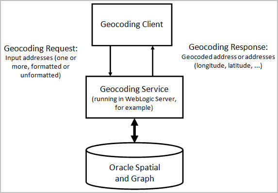

## 12  Geocoding Address Data

Geocoding is the process of associating spatial locations (longitude and latitude coordinates) with postal addresses.

**Note:**

Geocoding using SQL that accesses an Oracle managed service is available on Oracle Autonomous Database. See [SDO_GCDR.ELOC_GEOCODE](SDO_GCDR-reference.md) and [SDO_GCDR.ELOC_GEOCODE_AS_GEOM](SDO_GCDR-reference.md) for more information.

- Concepts for Geocoding
  This topic describes concepts that you must understand before you use the Spatial and Graph geocoding capabilities.
- Data Types for Geocoding
  This topic describes the data types specific to geocoding functions and procedures.
- Using the Geocoding Capabilities
  To use the Oracle Spatial and Graph geocoding capabilities, you must use data provided by a geocoding vendor, and the data must be in the format supported by the Oracle Spatial and Graph geocoding feature.
- Geocoding from a Place Name
  If you know a place name (point of interest) but not its locality details, you can create a PL/SQL function to construct an SDO_GEO_ADDR object from `placename` and `country` input parameters.
- Data Structures for Geocoding
  Oracle uses the following tables for geocoding.
- Installing the Profile Tables
  The Oracle Geocoder profile tables are typically supplied by a data provider.
- Using the Geocoding Service (XML API)
  In addition to the SQL API, Oracle Spatial and Graph also provides an XML API for a geocoding service that enables you to geocode addresses.

**Parent topic:** [Spatial Web Services](spatial-web-services.md)

### 12.1 Concepts for Geocoding

This topic describes concepts that you must understand before you use the Spatial and Graph geocoding capabilities.

- Address Representation
- Match Modes
- Match Codes
- Error Messages for Output Geocoded Addresses
- Match Vector for Output Geocoded Addresses

**Parent topic:** Geocoding Address Data

#### 12.1.1 Address Representation

Addresses to be geocoded can be represented either as formatted addresses or unformatted addresses.

A formatted address is described by a set of attributes for various parts of the address, which can include some or all of those shown in Table 12-1.

Table 12-1 Attributes for Formal Address Representation

| Address Attribute   | Description                                                                                                                                                                                                                                                                                                             |
|:--------------------|:------------------------------------------------------------------------------------------------------------------------------------------------------------------------------------------------------------------------------------------------------------------------------------------------------------------------|
| Name                | Place name (optional).                                                                                                                                                                                                                                                                                                  |
| Intersecting street | Intersecting street name (optional).                                                                                                                                                                                                                                                                                    |
| Street              | Street address, including the house or building number, street name, street type (Street, Road, Blvd, and so on), and possibly other information. In the current release, the first four characters of the street name must match a street name in the geocoding data for there to be a potential street name match. |
| Settlement          | The lowest-level administrative area to which the address belongs. In most cases it is the city. In some European countries, the settlement can be an area within a large city, in which case the large city is the municipality.                                                                                       |
| Municipality        | The administrative area above settlement. Municipality is not used for United States addresses. In European countries where cities contain settlements, the municipality is the city.                                                                                                                                   |
| Region              | The administrative area above municipality (if applicable), or above settlement if municipality does not apply. In the United States, the region is the state; in some other countries, the region is the province.                                                                                                     |
| Postal code         | Postal code (optional if administrative area information is provided). In the United States, the postal code is the 5-digit ZIP code.                                                                                                                                                                                   |
| Postal add-on code  | String appended to the postal code. In the United States, the postal add-on code is typically the last four numbers of a 9-digit ZIP code specified in "5-4" format.                                                                                                                                                    |
| Country             | The country name or ISO country code.                                                                                                                                                                                                                                                                                   |

Formatted addresses are specified using the SDO_GEO_ADDR data type, which is described in SDO_GEO_ADDR Type.

An unformatted address is described using lines with information in the postal address format for the relevant country. The address lines must contain information essential for geocoding, and they might also contain information that is not needed for geocoding (something that is common in unprocessed postal addresses). An unformatted address is stored as an array of strings. For example, an address might consist of the following strings: '22 Monument Square' and 'Concord, MA 01742'.

Unformatted addresses are specified using the SDO_KEYWORDARRAY data type, which is described in SDO_KEYWORDARRAY Type.

**Parent topic:** Concepts for Geocoding

#### 12.1.2 Match Modes

The match mode for a geocoding operation determines how closely the attributes of an input address must match the data being used for the geocoding. Input addresses can include different ways of representing the same thing (such as Street and the abbreviation St), and they can include minor errors (such as the wrong postal code, even though the street address and city are correct and the street address is unique within the city).

You can require an exact match between the input address and the data used for geocoding, or you can relax the requirements for some attributes so that geocoding can be performed despite certain discrepancies or errors in the input addresses. Table 12-2 lists the match modes and their meanings. Use a value from this table with the `MatchMode` attribute of the SDO_GEO_ADDR data type (described in SDO_GEO_ADDR Type) and for the `match_mode` parameter of a geocoding function or procedure.

Table 12-2 Match Modes for Geocoding Operations

| Match Mode         | Description                                                                                                                                                                                                                                                                                                                                                                                                                                                                                           |
|:-------------------|:------------------------------------------------------------------------------------------------------------------------------------------------------------------------------------------------------------------------------------------------------------------------------------------------------------------------------------------------------------------------------------------------------------------------------------------------------------------------------------------------------|
| EXACT              | All attributes of the input address must match the data used for geocoding. However, if the house or building number, base name (street name), street type, street prefix, and street suffix do not all match the geocoding data, a location in the first match found in the following is returned: postal code, city or town (settlement) within the state, and state. For example, if the street name is incorrect but a valid postal code is specified, a location in the postal code is returned. |
| RELAX_STREET_TYPE  | The street type can be different from the data used for geocoding. For example, if Main St is in the data used for geocoding, Main Street would also match that, as would Main Blvd if there was no Main Blvd and no other street type named Main in the relevant area.                                                                                                                                                                                                                               |
| RELAX_POI_NAME     | The name of the point of interest does not have to match the data used for geocoding. For example, if Jones State Park is in the data used for geocoding, Jones State Pk and Jones Park would also match as long as there were no ambiguities or other matches in the data.                                                                                                                                                                                                                           |
| RELAX_HOUSE_NUMBER | The house or building number and street type can be different from the data used for geocoding. For example, if 123 Main St is in the data used for geocoding, 123 Main Lane and 124 Main St would also match as long as there were no ambiguities or other matches in the data.                                                                                                                                                                                                                      |
| RELAX_BASE_NAME    | The base name of the street, the house or building number, and the street type can be different from the data used for geocoding. For example, if Pleasant Valley is the base name of a street in the data used for geocoding, Pleasant Vale would also match as long as there were no ambiguities or other matches in the data.                                                                                                                                                                      |
| RELAX_POSTAL_CODE  | The postal code (if provided), base name, house or building number, and street type can be different from the data used for geocoding.                                                                                                                                                                                                                                                                                                                                                                |
| RELAX_BUILTUP_AREA | The address can be outside the city specified as long as it is within the same county. Also includes the characteristics of RELAX_POSTAL_CODE.                                                                                                                                                                                                                                                                                                                                                        |
| RELAX_ALL          | Equivalent to RELAX_BUILTUP_AREA.                                                                                                                                                                                                                                                                                                                                                                                                                                                                     |
| DEFAULT            | Equivalent to RELAX_POSTAL_CODE.                                                                                                                                                                                                                                                                                                                                                                                                                                                                      |

**Parent topic:** Concepts for Geocoding

#### 12.1.3 Match Codes

The match code is a number indicating which input address attributes matched the data used for geocoding. The match code is stored in the `MatchCode` attribute of the output SDO_GEO_ADDR object (described in SDO_GEO_ADDR Type).

Table 12-3 lists the possible match code values.

Table 12-3 Match Codes for Geocoding Operations

| Match Code | Description                                                                                                                                                                           |
|:-----------|:--------------------------------------------------------------------------------------------------------------------------------------------------------------------------------------|
| 1          | Exact match: the city name, postal code, street base name, street type (and suffix or prefix or both, if applicable), and house or building number match the data used for geocoding. |
| 2          | The city name, postal code, street base name, and house or building number match the data used for geocoding, but the street type, suffix, or prefix does not match.                  |
| 3          | The city name, postal code, and street base name match the data used for geocoding, but the house or building number does not match.                                                  |
| 4          | The city name and postal code match the data used for geocoding, but the street address does not match.                                                                               |
| 10         | The city name matches the data used for geocoding, but the postal code does not match.                                                                                                |
| 11         | The postal code matches the data used for geocoding, but the city name does not match.                                                                                                |
| 12         | The region matches the data in the geocoder schema, but the city name and postal code do not match.                                                                                   |

**Parent topic:** Concepts for Geocoding

#### 12.1.4 Error Messages for Output Geocoded Addresses

**Note:**

You are encouraged to use the `MatchVector` attribute (see Match Vector for Output Geocoded Addresses) instead of the `ErrorMessage` attribute, which is described in this section.

For an output geocoded address, the `ErrorMessage` attribute of the SDO_GEO_ADDR object (described in SDO_GEO_ADDR Type) contains a string that indicates which address attributes have been matched against the data used for geocoding. Before the geocoding operation begins, the string is set to the value `???????????281C??`; and the value is modified to reflect which attributes have been matched.

Table 12-4 lists the character positions in the string and the address attribute corresponding to each position. It also lists the character value that the position is set to if the attribute is matched.

Table 12-4 Geocoded Address Error Message Interpretation

| Position | Attribute                 | Value If Matched                        |
|:---------|:--------------------------|:----------------------------------------|
| 1-2      | (Reserved for future use) | ??                                      |
| 3        | Address point             | X                                       |
| 4        | POI name                  | O                                       |
| 5        | House or building number  | \#                                      |
| 6        | Street prefix             | E                                       |
| 7        | Street base name          | N                                       |
| 8        | Street suffix             | U                                       |
| 9        | Street type               | T                                       |
| 10       | Secondary unit            | S                                       |
| 11       | Built-up area or city     | B                                       |
| 12-13    | (Reserved)                | (Ignore any values in these positions.) |
| 14       | Region                    | 1                                       |
| 15       | Country                   | C                                       |
| 16       | Postal code               | P                                       |
| 17       | Postal add-on code        | A                                       |

**Parent topic:** Concepts for Geocoding

#### 12.1.5 Match Vector for Output Geocoded Addresses

For an output geocoded address, the `MatchVector` attribute of the SDO_GEO_ADDR object (described in SDO_GEO_ADDR Type) contains a string that indicates how each address attribute has been matched against the data used for geocoding. It gives more accurate and detailed information about the match status of each address attribute than the `ErrorMessage` attribute (described in Error Messages for Output Geocoded Addresses). Before the geocoding operation begins, the string is set to the value `?????????????????`. Each character of this string indicates the match status of an address attribute.

Table 12-5 lists the character positions in the string and the address attribute corresponding to each position. Following the table is an explanation of what the value in each character position represents.

Table 12-5 Geocoded Address Match Vector Interpretation

| Position | Attribute                 |
|:---------|:--------------------------|
| 1-2      | (Reserved for future use) |
| 3        | Address point             |
| 4        | POI name                  |
| 5        | House or building number  |
| 6        | Street prefix             |
| 7        | Street base name          |
| 8        | Street suffix             |
| 9        | Street type               |
| 10       | Secondary unit            |
| 11       | Built-up area or city     |
| 14       | Region                    |
| 15       | Country                   |
| 16       | Postal code               |
| 17       | Postal add-on code        |

Each character position in Table 12-5 can have one of the following possible numeric values:

- 0: The input attribute is not null and is matched with a non-null value.

- 1: The input attribute is null and is matched with a null value.

- 2: The input attribute is not null and is replaced by a different non-null value.

- 3: The input attribute is not null and is replaced by a null value.

- 4: The input attribute is null and is replaced by a non-null value.

**Parent topic:** Concepts for Geocoding

### 12.2 Data Types for Geocoding

This topic describes the data types specific to geocoding functions and procedures.

- SDO_GEO_ADDR Type
- SDO_ADDR_ARRAY Type
- SDO_KEYWORDARRAY Type

**Parent topic:** Geocoding Address Data

#### 12.2.1 SDO_GEO_ADDR Type

The SDO_GEO_ADDR object type is used to describe an address. When a geocoded address is output by an SDO_GCDR function or procedure, it is stored as an object of type SDO_GEO_ADDR.

Table 12-6 lists the attributes of the SDO_GEO_ADDR type. Not all attributes will be relevant in any given case. The attributes used for a returned geocoded address depend on the geographical context of the input address, especially the country.

Table 12-6 SDO_GEO_ADDR Type Attributes

| Attribute          | Data Type        | Description                                                                                                                                                                                                                                            |
|:-------------------|:-----------------|:-------------------------------------------------------------------------------------------------------------------------------------------------------------------------------------------------------------------------------------------------------|
| Id                 | NUMBER           | (Not used.)                                                                                                                                                                                                                                            |
| AddressLines       | SDO_KEYWORDARRAY | Address lines. (The SDO_KEYWORDARRAY type is described in SDO_KEYWORDARRAY Type.)                                                                                                                                                                      |
| PlaceName          | VARCHAR2(200)    | Point of interest (POI) name. Example: CALIFORNIA PACIFIC MEDICAL CTR                                                                                                                                                                                  |
| StreetName         | VARCHAR2(200)    | Street name, including street type. Example: MAIN ST                                                                                                                                                                                                   |
| IntersectStreet    | VARCHAR2(200)    | Intersecting street.                                                                                                                                                                                                                                   |
| SecUnit            | VARCHAR2(200)    | Secondary unit, such as an apartment number or building number.                                                                                                                                                                                        |
| Settlement         | VARCHAR2(200)    | Lowest-level administrative area to which the address belongs. (See Table 12-1.)                                                                                                                                                                       |
| Municipality       | VARCHAR2(200)    | Administrative area above settlement. (See Table 12-1.)                                                                                                                                                                                                |
| Region             | VARCHAR2(200)    | Administrative area above municipality (if applicable), or above settlement if municipality does not apply. (See Table 12-1.)                                                                                                                          |
| Country            | VARCHAR2(100)    | Country name or ISO country code.                                                                                                                                                                                                                      |
| PostalCode         | VARCHAR2(20)     | Postal code (optional if administrative area information is provided). In the United States, the postal code is the 5-digit ZIP code.                                                                                                                  |
| PostalAddOnCode    | VARCHAR2(20)     | String appended to the postal code. In the United States, the postal add-on code is typically the last four numbers of a 9-digit ZIP code specified in "5-4" format.                                                                                   |
| FullPostalCode     | VARCHAR2(20)     | Full postal code, including the postal code and postal add-on code.                                                                                                                                                                                    |
| POBox              | VARCHAR2(100)    | Post Office box number.                                                                                                                                                                                                                                |
| HouseNumber        | VARCHAR2(100)    | House or building number. Example: 123 in 123 MAIN ST                                                                                                                                                                                                  |
| BaseName           | VARCHAR2(200)    | Base name of the street. Example: MAIN in 123 MAIN ST                                                                                                                                                                                                  |
| StreetType         | VARCHAR2(20)     | Type of the street. Example: ST in 123 MAIN ST                                                                                                                                                                                                         |
| StreetTypeBefore   | VARCHAR2(1)      | (Not used.)                                                                                                                                                                                                                                            |
| StreetTypeAttached | VARCHAR2(1)      | (Not used.)                                                                                                                                                                                                                                            |
| StreetPrefix       | VARCHAR2(20)     | Prefix for the street. Example: S in 123 S MAIN ST                                                                                                                                                                                                     |
| StreetSuffix       | VARCHAR2(20)     | Suffix for the street. Example: NE in 123 MAIN ST NE                                                                                                                                                                                                   |
| Side               | VARCHAR2(1)      | Side of the street (`L` for left or `R` for right) that the house is on when you are traveling along the road segment following its orientation (that is, from its start node toward its end node). The house numbers may be increasing or decreasing. |
| Percent            | NUMBER           | Number from 0 to 1 (multiply by 100 to get a percentage value) indicating how far along the street you are when traveling following the road segment orientation.                                                                                      |
| EdgeID             | NUMBER           | Edge ID of the road segment.                                                                                                                                                                                                                           |
| ErrorMessage       | VARCHAR2(20)     | Error message (see Error Messages for Output Geocoded Addresses). Note: You are encouraged to use the `MatchVector` attribute instead of the `ErrorMessage` attribute.                                                                                 |
| MatchCode          | NUMBER           | Match code (see Match Codes).                                                                                                                                                                                                                          |
| MatchMode          | VARCHAR2(30)     | Match mode (see Match Modes).                                                                                                                                                                                                                          |
| Longitude          | NUMBER           | Longitude coordinate value.                                                                                                                                                                                                                            |
| Latitude           | NUMBER           | Latitude coordinate value.                                                                                                                                                                                                                             |
| MatchVector        | VARCHAR2(20)     | A string that indicates how each address attribute has been matched against the data used for geocoding (see Match Vector for Output Geocoded Addresses).                                                                                              |

You can return the entire SDO_GEO_ADDR object, or you can specify an attribute using standard "dot" notation. Example 12-1 contains statements that geocode the address of the San Francisco City Hall; the first statement returns the entire SDO_GEO_ADDR object, and the remaining statements return some specific attributes.

Example 12-1 Geocoding, Returning Address Object and Specific Attributes

    SELECT SDO_GCDR.GEOCODE('SCOTT',
      SDO_KEYWORDARRAY('1 Carlton B Goodlett Pl', 'San Francisco, CA  94102'),
        'US', 'RELAX_BASE_NAME') FROM DUAL;

    SDO_GCDR.GEOCODE('SCOTT',SDO_KEYWORDARRAY('1CARLTONBGOODLETTPL','SANFRANCISCO
    --------------------------------------------------------------------------------
    SDO_GEO_ADDR(0, SDO_KEYWORDARRAY(), NULL, 'CARLTON B GOODLETT PL', NULL, NULL, '
    SAN FRANCISCO', NULL, 'CA', 'US', '94102', NULL, '94102', NULL, '1', 'CARLTON B
    GOODLETT', 'PL', 'F', 'F', NULL, NULL, 'L', .01, 23614360, '????#ENUT?B281CP?',
    1, 'RELAX_BASE_NAME', -122.41815, 37.7784183, '????0101010??000?')

    SELECT SDO_GCDR.GEOCODE('SCOTT',
      SDO_KEYWORDARRAY('1 Carlton B Goodlett Pl', 'San Francisco, CA  94102'),
      'US', 'RELAX_BASE_NAME').StreetType  FROM DUAL;

    SDO_GCDR.GEOCODE('SCOTT',SDO_KEYWORDARRAY('1CARLTONBGOODLETTPL','SANFRANCISCO
    --------------------------------------------------------------------------------
    PL

    SELECT SDO_GCDR.GEOCODE('SCOTT',
      SDO_KEYWORDARRAY('1 Carlton B Goodlett Pl', 'San Francisco, CA  94102'),
      'US', 'RELAX_BASE_NAME').Side  RROM DUAL;

    S
    -
    L

    SELECT SDO_GCDR.GEOCODE('SCOTT',
      SDO_KEYWORDARRAY('1 Carlton B Goodlett Pl', 'San Francisco, CA  94102'),
      'US', 'RELAX_BASE_NAME').Percent  FROM DUAL;

    SDO_GCDR.GEOCODE('SCOTT',SDO_KEYWORDARRAY('1CARLTONBGOODLETTPL','SANFRANCISCO
    --------------------------------------------------------------------------------
                                                                                 .01

    SELECT SDO_GCDR.GEOCODE('SCOTT',
      SDO_KEYWORDARRAY('1 Carlton B Goodlett Pl', 'San Francisco, CA  94102'),
      'US', 'RELAX_BASE_NAME').EdgeID  FROM DUAL;

    SDO_GCDR.GEOCODE('SCOTT',SDO_KEYWORDARRAY('1CARLTONBGOODLETTPL','SANFRANCISCO
    --------------------------------------------------------------------------------
                                                                            23614360

    SELECT SDO_GCDR.GEOCODE('SCOTT',
      SDO_KEYWORDARRAY('1 Carlton B Goodlett Pl', 'San Francisco, CA  94102'),
      'US', 'RELAX_BASE_NAME').MatchCode  FROM DUAL;

    SDO_GCDR.GEOCODE('SCOTT',SDO_KEYWORDARRAY('1CARLTONBGOODLETTPL','SANFRANCISCO
    --------------------------------------------------------------------------------
                                                                                   1

    SELECT SDO_GCDR.GEOCODE('SCOTT',
      SDO_KEYWORDARRAY('1 Carlton B Goodlett Pl', 'San Francisco, CA  94102'),
      'US', 'RELAX_BASE_NAME').MatchVector  FROM DUAL;

    SDO_GCDR.GEOCODE('SC
    --------------------
    ????0101010??000?

**Parent topic:** Data Types for Geocoding

#### 12.2.2 SDO_ADDR_ARRAY Type

The SDO_ADDR_ARRAY type is a VARRAY of SDO_GEO_ADDR objects (described in SDO_GEO_ADDR Type) used to store geocoded address results. Multiple address objects can be returned when multiple addresses are matched as a result of a geocoding operation.

The SDO_ADDR_ARRAY type is defined as follows:

    CREATE TYPE sdo_addr_array AS VARRAY(1000) OF sdo_geo_addr;

**Parent topic:** Data Types for Geocoding

#### 12.2.3 SDO_KEYWORDARRAY Type

The SDO_KEYWORDARRAY type is a VARRAY of VARCHAR2 strings used to store address lines for unformatted addresses. (Formatted and unformatted addresses are described in Address Representation.)

The SDO_KEYWORDARRAY type is defined as follows:

    CREATE TYPE sdo_keywordarray AS VARRAY(10000) OF VARCHAR2(9000);

**Parent topic:** Data Types for Geocoding

### 12.3 Using the Geocoding Capabilities

To use the Oracle Spatial and Graph geocoding capabilities, you must use data provided by a geocoding vendor, and the data must be in the format supported by the Oracle Spatial and Graph geocoding feature.

To geocode an address using the geocoding data, use the SDO_GCDR PL/SQL package subprograms, which are documented in [SDO_GCDR Package (Geocoding)](SDO_GCDR-reference.md) :

- The [SDO_GCDR.ELOC_GEOCODE](SDO_GCDR-reference.md) function applies only if you are working on Oracle Autonomous Database. Depending on the input parameters, the function performs one of the following actions:

  - Geocodes a formatted (address parts in separate fields) address
  - Geocodes an unformatted (complete address in a single string field) address
  - Reverse geocodes the specified location

  The function returns the output address in JSON format.

- The [SDO_GCDR.ELOC_GEOCODE_AS_GEOM](SDO_GCDR-reference.md) function applies only if you are working on Oracle Autonomous Database. Depending on the input parameters, the function geocodes a formatted (address parts in separate fields) or an unformatted (complete address in a single string field) address and returns the output address as an SDO_GEOMETRY object.

- The [SDO_GCDR.GEOCODE](SDO_GCDR-reference.md) function geocodes an unformatted address to return an SDO_GEO_ADDR object.

- The [SDO_GCDR.GEOCODE_ADDR](SDO_GCDR-reference.md) function geocodes an input address using attributes in an SDO_GEO_ADDR object, and returns the first matched address as an SDO_GEO_ADDR object.

- The [SDO_GCDR.GEOCODE_ADDR_ALL](SDO_GCDR-reference.md) function geocodes an input address using attributes in an SDO_GEO_ADDR object, and returns matching addresses as an SDO_ADDR_ARRAY object.

- The [SDO_GCDR.GEOCODE_AS_GEOMETRY](SDO_GCDR-reference.md) function geocodes an unformatted address to return an SDO_GEOMETRY object.

- The [SDO_GCDR.GEOCODE_ALL](SDO_GCDR-reference.md) function geocodes all addresses associated with an unformatted address and returns the result as an SDO_ADDR_ARRAY object (an array of address objects).

- The [SDO_GCDR.REVERSE_GEOCODE](SDO_GCDR-reference.md) function reverse geocodes a location, specified by its spatial geometry object and country, and returns the result as an SDO_GEO_ADDR object.

**Parent topic:** Geocoding Address Data

### 12.4 Geocoding from a Place Name

If you know a place name (point of interest) but not its locality details, you can create a PL/SQL function to construct an SDO_GEO_ADDR object from `placename` and `country` input parameters.

This is shown in Example 12-2, which creates a function named `create_addr_from_placename`. The SELECT statement in this example uses the [SDO_GCDR.GEOCODE_ADDR](SDO_GCDR-reference.md) function to geocode the address constructed using the `create_addr_from_placename` function.

Example 12-2 Geocoding from a Place Name and Country

    create or replace function create_addr_from_placename(
    placename varchar2,
    country varchar2)
    return sdo_geo_addr
    deterministic
    as
      addr sdo_geo_addr ;
      begin
      addr := sdo_geo_addr() ;
      addr.country := country ;
      addr.placename := placename ;
      addr.matchmode := 'default' ;
      return addr ;
      end;
      /

    SELECT sdo_gcdr.geocode_addr('SCOTT',
      create_addr_from_placename('CALIFORNIA PACIFIC MEDICAL CTR', 'US'))
    FROM DUAL;

Example 12-3 Geocoding from a Place Name, Country, and Other Fields

If you know at least some of the locality information, such as settlement, region, and postal code, you can get better performance if you can provide such information. Example 12-3 provides an alternate version of the `create_addr_from_placename` function that accepts additional parameters. To call this version of the function, specify actual values for the placename and country parameters, and specify an actual value or a null value for each of the other input parameters.

    create or replace function create_addr_from_placename(
    placename varchar2,
    city varchar2,
    state varchar2,
    postalcode varchar2,
    country varchar2)
    return sdo_geo_addr
    deterministic
    as
      addr sdo_geo_addr ;
      begin
      addr := sdo_geo_addr() ;
      addr.settlement := city ;
      addr.region := state ;
      addr.postalcode := postalcode ;
      addr.country := country ;
      addr.placename := placename ;
      addr.matchmode := 'default' ;
      return addr ;
      end;
      /

    SELECT sdo_gcdr.geocode_addr('SCOTT',
      create_addr_from_placename('CALIFORNIA PACIFIC MEDICAL CTR',
        'san francisco', 'ca', null, 'US')) FROM DUAL;

**Parent topic:** Geocoding Address Data

### 12.5 Data Structures for Geocoding

Oracle uses the following tables for geocoding.

- GC_PARSER_PROFILES

- GC_PARSER_PROFILEAFS

- GC_COUNTRY_PROFILE

- GC_AREA\_\<suffix\>

- GC_POSTAL_CODE\_\<suffix\>

- GC_ROAD_SEGMENT\_\<suffix\>

- GC_ROAD\_\<suffix\>

- GC_POI\_\<suffix\>

- GC_INTERSECTION\_\<suffix\>

The GC_PARSER_PROFILES and GC_PARSER_PROFILEAFS tables store address format definitions of all supported counties. These tables are used by the internal address parser in parsing postal addresses into addressing fields. The data for these two tables is provided by your data provider or by Oracle. (If these tables are not supplied by your data provider, you will need to install and populate them as explained in Installing the Profile Tables.) The remaining tables store geocoding data provided by data vendors.

Each user that owns the tables containing geocoding data (that is, each user that can be specified with the `username` parameter in a call to an SDO_GCDR subprogram) must have one GC_PARSER_PROFILES table, one GC_PARSER_PROFILEAFS table, and one GC_COUNTRY_PROFILE table. Each such user can have multiple sets of the other tables (GC\_xxx\_\<suffix\>). Each set of tables whose names end with the same suffix stores geocoding data of a country. For example, the following set of tables can be used to store geocoding data of the United States:

- GC_AREA_US

- GC_POSTAL_CODE_US

- GC_ROAD_SEGMENT_US

- GC_ROAD_US

- GC_POI_US

- GC_INTERSECTION_US

Geocoding data of one country cannot be stored in more than one set of those tables. The table suffix is defined by data venders and is specified in the GC_TABLE_SUFFIX column in the GC_COUNTRY_PROFILE table (described in GC_COUNTRY_PROFILE Table).

The following sections describe the vendor-supplied tables that store geocoding data, in alphabetical order by table name.

Indexes on Tables for Geocoding describes the indexes that you must create in order to use these tables for geocoding.

- GC_ADDRESS_POINT\_\<suffix\> Table and Index
- GC_AREA\_\<suffix\> Table
- GC_COUNTRY_PROFILE Table
- GC_INTERSECTION\_\<suffix\> Table
- GC_PARSER_PROFILES Table
- GC_PARSER_PROFILEAFS Table
- GC_POI\_\<suffix\> Table
- GC_POSTAL_CODE\_\<suffix\> Table
- GC_ROAD\_\<suffix\> Table
- GC_ROAD_SEGMENT\_\<suffix\> Table
- Indexes on Tables for Geocoding

**Parent topic:** Geocoding Address Data

#### 12.5.1 GC_ADDRESS_POINT\_\<suffix\> Table and Index

The GC_ADDRESS_POINT\_\<suffix\> table (for example, GC_ADDRESS_POINT_US) stores the geographic (latitude, longitude) coordinates for addresses in the country or group of countries associated with the table-name suffix. This table is not required for geocoding (although it is required for point-based geocoding); however, it enables the geocoder to provide more accurate location results. It is automatically used when present in the schema. This table contains one row for each address stored in the table, and it contains the columns shown in Table 12-7.

Table 12-7 GC_ADDRESS_POINT\_\<suffix\> Table

| Column Name      | Data Type          | Description                                                                                                                                                                                                                        |
|:-----------------|:-------------------|:-----------------------------------------------------------------------------------------------------------------------------------------------------------------------------------------------------------------------------------|
| ADDRESS_POINT_ID | NUMBER(10)         | ID number of the address point. (Required)                                                                                                                                                                                         |
| ROAD_ID          | NUMBER             | ID number of the road on which the address point is located. (Required)                                                                                                                                                            |
| ROAD_SEGMENT_ID  | NUMBER(10)         | ID number of the road segment on the road on which the address point is located. (Required)                                                                                                                                        |
| SIDE             | VARCHAR2(1)        | Side of the road on which the address point is located. Possible values: `L` (left) or `R` (right). (Required)                                                                                                                     |
| LANG_CODE        | VARCHAR2(3)        | 3-letter ISO national language code for the language associated with the address point. (Required) point                                                                                                                           |
| HOUSE_NUMBER     | VARCHAR2(600 CHAR) | House number of the address point; may contain non-numeric characters. (Required)                                                                                                                                                  |
| PERCENT          | NUMBER             | Decimal fraction of the length of the road segment on which the address point is located. It is computed by dividing the distance from the segment start point to the address point by the length of the road segment. (Required). |
| ADDR_LONG        | NUMBER(10)         | Longitude coordinate value of the address point. (Required)                                                                                                                                                                        |
| ADDR_LAT         | NUMBER(10)         | Latitude coordinate value of the address point. (Required)                                                                                                                                                                         |
| COUNTRY_CODE_2   | VARCHAR2(2)        | 2- letter ISO country code of the country to which the address point belongs. (Required)                                                                                                                                           |
| PARTITION_ID     | NUMBER             | Partition key used for partitioning geocoder data by geographic boundaries. If the data is not partitioned, set the value to 1. (Required)                                                                                         |

If you use the GC_ADDRESS_POINT\_\<suffix\> table, you must create an index on the table using a statement in the following form:

    CREATE INDEX idx_<suffix>_addrpt_addr ON gc_address_point_<suffix> (road_segment_id, road_id, house_number, side);

**Parent topic:** Data Structures for Geocoding

#### 12.5.2 GC_AREA\_\<suffix\> Table

The GC_AREA\_\<suffix\> table (for example, CG_AREA_US) stores administration area information for the country associated with the table name suffix. This table contains one row for each administration area, and it contains the columns shown in Table 12-8.

Table 12-8 GC_AREA\_\<suffix\> Table

| Column Name     | Data Type    | Description                                                                                                                                                                                                                                                                                                                                                                                                                                                                                                                                            |
|:----------------|:-------------|:-------------------------------------------------------------------------------------------------------------------------------------------------------------------------------------------------------------------------------------------------------------------------------------------------------------------------------------------------------------------------------------------------------------------------------------------------------------------------------------------------------------------------------------------------------|
| AREA_ID         | NUMBER(10)   | Area ID number. (Required)                                                                                                                                                                                                                                                                                                                                                                                                                                                                                                                             |
| AREA_NAME       | VARCHAR2(64) | Area name. (Required)                                                                                                                                                                                                                                                                                                                                                                                                                                                                                                                                  |
| LANG_CODE       | VARCHAR2(3)  | 3-letter ISO national language code for the language associated with the area. (Required)                                                                                                                                                                                                                                                                                                                                                                                                                                                              |
| ADMIN_LEVEL     | NUMBER(1)    | Administration hierarchy level for the area. (Required)                                                                                                                                                                                                                                                                                                                                                                                                                                                                                                |
| LEVEL1_AREA_ID  | NUMBER(10)   | ID of the level-1 area to which the area belongs. In the administration hierarchy, the level-1 area is the country. (Required)                                                                                                                                                                                                                                                                                                                                                                                                                         |
| LEVEL2_AREA_ID  | NUMBER(10)   | ID of the level-2 area to which the area belongs, if applicable. You must specify an area ID for each level in the administration hierarchy to which this area belongs. (Optional)                                                                                                                                                                                                                                                                                                                                                                     |
| LEVEL3_AREA_ID  | NUMBER(10)   | ID of the level-3 area to which the area belongs, if applicable. You must specify an area ID for each level in the administration hierarchy to which this area belongs. (Optional)                                                                                                                                                                                                                                                                                                                                                                     |
| LEVEL4_AREA_ID  | NUMBER(10)   | ID of the level-4 area to which the area belongs, if applicable. You must specify an area ID for each level in the administration hierarchy to which this area belongs. (Optional)                                                                                                                                                                                                                                                                                                                                                                     |
| LEVEL5_AREA_ID  | NUMBER(10)   | ID of the level-5 area to which the area belongs, if applicable. You must specify an area ID for each level in the administration hierarchy to which this area belongs. (Optional)                                                                                                                                                                                                                                                                                                                                                                     |
| LEVEL6_AREA_ID  | NUMBER(10)   | ID of the level-6 area to which the area belongs, if applicable. You must specify an area ID for each level in the administration hierarchy to which this area belongs. (Optional)                                                                                                                                                                                                                                                                                                                                                                     |
| LEVEL7_AREA_ID  | NUMBER(10)   | ID of the level-7 area to which the area belongs, if applicable. You must specify an area ID for each level in the administration hierarchy to which this area belongs. (Optional)                                                                                                                                                                                                                                                                                                                                                                     |
| CENTER_LONG     | NUMBER       | Longitude value of the center of the area. The center is set to the closest road segment to the center longitude and latitude values. Oracle recommends that these two attributes be set properly. If these values are not set, the longitude and latitude coordinates of the geocoded result of an area will be (0,0). (Optional)                                                                                                                                                                                                                     |
| CENTER_LAT      | NUMBER       | Latitude value of the center of the area. (See the explanation for the CENTER_LONG column.) (Optional)                                                                                                                                                                                                                                                                                                                                                                                                                                                 |
| ROAD_SEGMENT_ID | NUMBER(10)   | ID of the road segment to which the area center is set. This value must be set correctly if the geocoder is intended to work with the Oracle Spatial and Graph routing engine (described in [Routing Engine](routing-engine-concepts.md)); otherwise, it can be set to any nonzero value, but it cannot be null. (Required)                                                                                                                                                                                                                            |
| POSTAL_CODE     | VARCHAR2(16) | Postal code for the center of the area. Oracle recommends that this attribute be set correctly. If this value is null, the postal code attribute of the geocoded result of an area will be null. (Optional)                                                                                                                                                                                                                                                                                                                                            |
| COUNTRY_CODE_2  | VARCHAR2(2)  | 2- letter ISO country code of the country to which the area belongs. (Required)                                                                                                                                                                                                                                                                                                                                                                                                                                                                        |
| PARTITION_ID    | NUMBER       | Partition key used for partitioning geocoder data by geographic boundaries. If the data is not partitioned, set the value to 1. (Required)                                                                                                                                                                                                                                                                                                                                                                                                             |
| REAL_NAME       | VARCHAR2(64) | The real name of the area, as spelled using the local language. This column is useful for area names that are not in English. For example, the German name of city `MUNICH` is `MÜNCHEN`. It is allowed to be spelled as `MUNCHEN`, but its REAL_NAME value should be `MÜNCHEN`. In the area table for Germany, areas with name `MÜNCHEN` and `MUNCHEN` both refer to the same area, and they both have the same real name `MÜNCHEN`. If the area name does not have any non-English characters, set REAL_NAME to be the same as AREA_NAME. (Required) |
| IS_ALIAS        | VARCHAR2(1)  | Contains `T` if this area is an alias of another area that is an officially recognized administrative area; contains `F` if this area is not an alias of another area that is an officially recognized administrative area. For example, Manhattan is not an officially recognized administrative area, but it is used by the public to refer to a part of New York City. In this case, `Manhattan` is an alias of `New York City`. (Required)                                                                                                         |
| NUM_STREETS     | NUMBER       | The number of streets inside this area. (Optional)                                                                                                                                                                                                                                                                                                                                                                                                                                                                                                     |

**Parent topic:** Data Structures for Geocoding

#### 12.5.3 GC_COUNTRY_PROFILE Table

The GC_COUNTRY_PROFILE table stores country profile information used by the geocoder. This information includes administrative-area hierarchy definitions, the national languages, and the table-name suffix used by the data tables and their indexes. This table contains one row for each supported country, and it contains the columns shown in Table 12-9.

Table 12-9 GC_COUNTRY_PROFILE Table

| Column Name              | Data Type    | Description                                                                                                                                                                                                                                                                                                                                                                                                        |
|:-------------------------|:-------------|:-------------------------------------------------------------------------------------------------------------------------------------------------------------------------------------------------------------------------------------------------------------------------------------------------------------------------------------------------------------------------------------------------------------------|
| COUNTRY_NAME             | VARCHAR2(60) | Country name. (Required)                                                                                                                                                                                                                                                                                                                                                                                           |
| COUNTRY_CODE_3           | VARCHAR2(3)  | 3- letter ISO country code. (Required)                                                                                                                                                                                                                                                                                                                                                                             |
| COUNTRY_CODE_2           | VARCHAR2(2)  | 2- letter ISO country code. (Required)                                                                                                                                                                                                                                                                                                                                                                             |
| LANG_CODE_1              | VARCHAR2(3)  | 3-letter ISO national language code. Some countries might have multiple national languages, in which case LANG_CODE_2 and perhaps other LANG_CODE\_n columns should contain values. (Required)                                                                                                                                                                                                                     |
| LANG_CODE_2              | VARCHAR2(3)  | 3-letter ISO national language code. (Optional)                                                                                                                                                                                                                                                                                                                                                                    |
| LANG_CODE_3              | VARCHAR2(3)  | 3-letter ISO national language code. (Optional)                                                                                                                                                                                                                                                                                                                                                                    |
| LANG_CODE_4              | VARCHAR2(3)  | 3-letter ISO national language code. (Optional)                                                                                                                                                                                                                                                                                                                                                                    |
| NUMBER_ADMIN_LEVELS      | NUMBER(1)    | Number of administration hierarchy levels. A country can have up to 7 administration area levels, numbered from 1 to 7 (largest to smallest). The top level area (country) is level 1. For the United States, the administration hierarchy is as follows: level 1 = country, level 2 = state, level 3 = county, level 4 = city. (Required)                                                                         |
| SETTLEMENT_LEVEL         | NUMBER(1)    | Administration hierarchy level for a settlement, which is the lowest area level used in addressing. In the United States, this is the city level; in Europe, this is generally a subdivision of a city (level 5). (Required)                                                                                                                                                                                       |
| MUNICIPALITY_LEVEL       | NUMBER(1)    | Administration hierarchy level for a municipality, which is the second-lowest area level used in addressing. In the United States, this is the county (level 3); in Europe, this is generally a city (level 4). (Optional)                                                                                                                                                                                         |
| REGION_LEVEL             | NUMBER(1)    | Administrative level for the region, which is above the municipality level. In the United States, this is the state or third-lowest area level used in addressing (level 2); in Europe, this is a recognized subdivision of the country (level 2 or level 3). (Optional)                                                                                                                                           |
| SETTLEMENT_IS_OPTIONAL   | VARCHAR2(1)  | Contains `T` if settlement information is optional in the address data; contains `F` if settlement information is not optional (that is, is required) in the address data. (Required)                                                                                                                                                                                                                              |
| MUNICIPALITY_IS_OPTIONAL | VARCHAR2(1)  | Contains `T` if municipality information is optional in the address data; contains `F` if municipality information is not optional (that is, is required) in the address data. (Required)                                                                                                                                                                                                                          |
| REGION_IS_OPTIONAL       | VARCHAR2(1)  | Contains `T` if region information is optional in the address data; contains `F` if region information is not optional (that is, is required) in the address data. (Required)                                                                                                                                                                                                                                      |
| POSTCODE_IN_SETTLEMENT   | VARCHAR(1)   | Contains `T` if each postal code must be completely within a settlement area; contains `F` if a postal code can include areas from multiple settlements. (Required)                                                                                                                                                                                                                                                |
| SETTLEMENT_AS_CITY       | VARCHAR(1)   | Contains `T` if a city name can identify both a municipality and a settlement; contains `F` if a city name can identify only a settlement. For example, in the United Kingdom, London can be both the name of a municipality area and the name of a settlement area, which is inside the municipality of London. This is common in large cities in some European countries, such as the UK and Belgium. (Required) |
| CACHED_ADMIN_AREA_LEVEL  | NUMBER       | (Reserved for future use.)                                                                                                                                                                                                                                                                                                                                                                                         |
| GC_TABLE_SUFFIX          | VARCHAR2(5)  | Table name suffix identifying the country for the GC\_\* data tables. For example, if the value of GC_TABLE_SUFFIX is `US`, the names of tables with geocoding data for this country end with `_US` (for example, CG_AREA_US). (Required)                                                                                                                                                                          |
| CENTER_LONG              | NUMBER       | Longitude value of the center of the area. (Optional)                                                                                                                                                                                                                                                                                                                                                              |
| CENTER_LAT               | NUMBER       | Latitude value of the center of the area. (Optional)                                                                                                                                                                                                                                                                                                                                                               |
| SEPARATE_PREFIX          | VARCHAR2(1)  | Contains `T` if the street name prefix is a separate word from the street name; contains `F` if the street name prefix is in the same word with the street name. For example, in an American street address of `123 N Main St`, the prefix is `N`, and it is separate from the street name, which is `Main`. (Optional; not currently used by Oracle)                                                              |
| SEPARATE_SUFFIX          | VARCHAR2(1)  | Contains `T` if the street name suffix is a separate word from the street name; contains `F` if the street name suffix is in the same word with the street name. For example, in an American street address of `123 Main St NW`, the suffix is `NW`, and it is separate from the street name, which is `Main`, and from the street type, which is `St`. (Optional; not currently used by Oracle)                   |
| SEPARATE_STYPE           | VARCHAR2(1)  | Contains `T` if the street type is a separate word from the street name; contains `F` if the street type is in the same word with the street name. For example, in a German street address of `123 Beethovenstrass`, the type is `strass`, and it is in the same word with the street name, which is `Beethoven`. (Optional; not currently used by Oracle)                                                         |
| AREA_ID                  | NUMBER       | Not currently used by Oracle. (Optional)                                                                                                                                                                                                                                                                                                                                                                           |
| VERSION                  | VARCHAR2(10) | Version of the data. The first version should be `1.0`. (Required)                                                                                                                                                                                                                                                                                                                                                 |

**Parent topic:** Data Structures for Geocoding

#### 12.5.4 GC_INTERSECTION\_\<suffix\> Table

The GC_INTERSECTION\_\<suffix\> table (for example, GC_INTERSECTION_US) stores information on road intersections for the country or group of countries associated with the table-name suffix. An intersection occurs when roads meet or cross each other. This table contains the columns shown in Table 12-10.

Table 12-10 GC_INTERSECTION\_\<suffix\> Table

| Column Name       | Data Type    | Description                                                                                                                                                                   |
|:------------------|:-------------|:------------------------------------------------------------------------------------------------------------------------------------------------------------------------------|
| ROAD_ID_1         | NUMBER       | ID number of the first road on which the intersection is located. (Required)                                                                                                  |
| ROAD_SEGMENT_ID_1 | NUMBER       | ID number of the road segment on the first road on which the intersection is located. (Required)                                                                              |
| ROAD_ID_2         | NUMBER       | ID number of the second road on which the intersection is located. (Required)                                                                                                 |
| ROAD_SEGMENT_ID_2 | NUMBER       | ID number of the road segment on the second road on which the intersection is located. (Required)                                                                             |
| INTS_LONG         | NUMBER       | Longitude coordinate value of the intersection. (Required)                                                                                                                    |
| INTS_LAT          | NUMBER       | Latitude coordinate value of the intersection. (Required)                                                                                                                     |
| HOUSE_NUMBER      | NUMBER       | The leading numerical part of the house number at the intersection. (See the explanation of house numbers after Table 12-16 in GC_ROAD_SEGMENT\_\<suffix\> Table.) (Required) |
| HOUSE_NUMBER_2    | VARCHAR2(10) | The second part of the house number at the intersection. (See the explanation of house numbers after Table 12-16 in GC_ROAD_SEGMENT\_\<suffix\> Table.) (Required)            |
| SIDE              | VARCHAR2(1)  | Side of the street on which the house at the intersection is located. Possible values: `L` (left) or `R` (right). (Required)                                                  |
| COUNTRY_CODE_2    | VARCHAR2(2)  | 2- letter ISO country code of the country to which the house at the intersection belongs. (Required)                                                                          |
| PARTITION_ID      | NUMBER       | Partition key used for partitioning geocoder data by geographic boundaries. If the data is not partitioned, set the value to 1. (Required)                                    |

**Parent topic:** Data Structures for Geocoding

#### 12.5.5 GC_PARSER_PROFILES Table

The GC_PARSER_PROFILES table stores information about keywords typically found in postal addresses. The geocoder uses keywords to identify address fields, such as house number, road name, city name, state name, and postal code. A keyword can be the type of street (such as road, street, drive, or avenue) or the prefix or suffix of a street (such as north, south, east, or west). This table contains the columns shown in Table 12-11.

Table 12-11 GC_PARSER_PROFILES Table

| Column Name    | Data Type        | Description                                                                                                                                                                                                                                                                                                                                                                                                                                                                                                                                                                                                                                                                                                                                                                                                                                                                                                                                                                                                                                                                                                                                                                                                                                                                                                                                                                                                                                                                                                                                                                                                                                                                                                                                                                                                       |
|:---------------|:-----------------|:------------------------------------------------------------------------------------------------------------------------------------------------------------------------------------------------------------------------------------------------------------------------------------------------------------------------------------------------------------------------------------------------------------------------------------------------------------------------------------------------------------------------------------------------------------------------------------------------------------------------------------------------------------------------------------------------------------------------------------------------------------------------------------------------------------------------------------------------------------------------------------------------------------------------------------------------------------------------------------------------------------------------------------------------------------------------------------------------------------------------------------------------------------------------------------------------------------------------------------------------------------------------------------------------------------------------------------------------------------------------------------------------------------------------------------------------------------------------------------------------------------------------------------------------------------------------------------------------------------------------------------------------------------------------------------------------------------------------------------------------------------------------------------------------------------------|
| COUNTRY_CODE   | VARCHAR2(2)      | 2- letter ISO country code of the country for the keyword. (Required)                                                                                                                                                                                                                                                                                                                                                                                                                                                                                                                                                                                                                                                                                                                                                                                                                                                                                                                                                                                                                                                                                                                                                                                                                                                                                                                                                                                                                                                                                                                                                                                                                                                                                                                                             |
| KEYWORDS       | SDO_KEYWORDARRAY | A single array of keywords for a specific address field. The array may contain a single word, or a group of words and abbreviations that can be used with the same meaning; for example, United States of America, USA, and United States all refer to the US. The first word of this array should be the official full name of the keyword, if there is any. The US uses over 400 keywords in parsing addresses. The following are some examples of keyword arrays and keywords from the US data set; however, only a single SDO_KEYWORDARRAY object is stored in each row: SDO_KEYWORDARRAY( 'UNITED STATES OF AMERICA','US', 'USA', 'UNITED STATES', 'U.S.A.', 'U.S.') SDO_KEYWORDARRAY('AVENUE','AV', 'AVE', 'AVEN', 'AVENU', 'AVN', 'AVNUE', 'AV.','AVE.') SDO_KEYWORDARRAY('40TH', 'FORTIETH') SDO_KEYWORDARRAY('NEW YORK','NY') SDO_KEYWORDARRAY('LIBRARY')                                                                                                                                                                                                                                                                                                                                                                                                                                                                                                                                                                                                                                                                                                                                                                                                                                                                                                                                 |
| OUTPUT_KEYWORD | VARCHAR2(2000)   | A keyword used in the geocoder data to represent an address field. It must be the same as one of the keywords used in the keyword array. The output keyword is used to match the addresses stored in the geocoding data tables to the user's input, for example, if the output keyword `AV` is used for street type `Avenue` in the GC_ROAD_US table, wherever a user enters an address containing any of the keywords (AVENUE, AV, AVE, AVEN, AVENU, AVN, AVNUE, AV., AVE.), the keyword will be interpreted and matched to the output keyword `AV` to help find the address in the database The following are some examples of output keywords; however, only a single output keyword is stored in each row: `US` `AV` `40TH` `NY` `LIBRARY`                                                                                                                                                                                                                                                                                                                                                                                                                                                                                                                                                                                                                                                                                                                                                                                                                                                                                                                                                                                                                                                     |
| SECTION_LABEL  | VARCHAR2(30)     | A label used to identify the type of keyword represented in the KEYWORDS and OUTPUT_KEYWORD columns. There are the multiple different section labels; however, only a single section label for each row is used in identifying the type of keywords: COUNTRY_NAME: Identifies keywords that are used to represent country names. LOCALITY_KEYWORD_DICTIONARY: Identifies keywords that are used to replace words in a locality (city, state, province, and so on) with a standardized form of the word. For example, Saint is replaced by St; and by doing so, the city names Saint Thomas and St. Thomas will be standardized to St Thomas, which is stored in the database. PLACE_NAME_KEYWORD: Identifies a point of interest (POI) name keyword, such as for a restaurant or a hotel. REGION_LIST: Identifies keywords that are known names of regions, such as NY, New York, NH, and New Hampshire. The regions identified must be administrative areas that belong to the third-lowest area level or third-smallest area used in addressing. In the US this is the state level (the lowest area level or smallest area is the city level). SECOND_UNIT_KEYWORD: Identifies keywords used in second-unit descriptions, such as Floor, \#, Suite, and Apartment. STREET_KEYWORD_DICTIONARY: Identifies keywords used to replace non-street-type keywords in street names (such as 40TH and Fortieth) with a standardized form. STREET_PREFIX_KEYWORD: Identifies street name prefix keywords, such as South, North, West, and East. STREET_TYPE_KEYWORD: Identifies street type keywords, such as Road, Street, and Drive. IN_LINE_STREET_TYPE_KEYWORD: Identifies street type keywords that are attached to street names, such as strasse in the German street name Steinstrasse. |
| POSITION       | VARCHAR2(1)      | The position of the keyword relative to a street name. It indicates whether the keyword can precede (`P`) or follow (`F`) the actual street name, or both (`B`). Thus, `P`, `F`, and `B` are the only valid entries. In the US, most street type keywords follow the street names, for example, the street type `Blvd` in Hollywood Blvd. In France, however, street type keywords usually precede the street names, for example, the street type `Avenue` in Avenue De Paris.                                                                                                                                                                                                                                                                                                                                                                                                                                                                                                                                                                                                                                                                                                                                                                                                                                                                                                                                                                                                                                                                                                                                                                                                                                                                                                                                    |
| SEPARATENESS   | VARCHAR2(1)      | Indicates whether the keyword is separate from a street name. Keywords are either separable (`S`) or non-separable (`N`). Thus, `S` and `N` are the only valid entries. In the US, all street-type keywords are separate words from the street name, for example, the street type `Blvd` in Hollywood Blvd. In Germany, however, the street-type keywords are not separate from the street name, for example, the street type `strasse` in Augustenstrasse.                                                                                                                                                                                                                                                                                                                                                                                                                                                                                                                                                                                                                                                                                                                                                                                                                                                                                                                                                                                                                                                                                                                                                                                                                                                                                                                                                       |

**Parent topic:** Data Structures for Geocoding

#### 12.5.6 GC_PARSER_PROFILEAFS Table

The GC_PARSER_PROFILEAFS table stores the XML definition of postal-address formats. An XML string describes each address format for a specific country. In the Oracle Geocoder 10g and earlier, the J2EE geocoder uses a country_name.ppr file instead of this table. The content of the country_name.ppr file is equivalent to the content of the ADDRESS_FORMAT_STRING attribute. This table contains the columns shown in Table 12-12.

Table 12-12 GC_PARSER_PROFILEAFS Table

| Column Name           | Data Type   | Description                                                                                                                                                                                                                                                              |
|:----------------------|:------------|:-------------------------------------------------------------------------------------------------------------------------------------------------------------------------------------------------------------------------------------------------------------------------|
| COUNTRY_CODE          | VARCHAR2(2) | 2- letter ISO country code of the country. (Required)                                                                                                                                                                                                                    |
| ADDRESS_FORMAT_STRING | CLOB        | XML string describing the address format for the country specified in the COUNTRY_CODE column. (Example 12-4 shows the XML definition for the US address format, and ADDRESS_FORMAT_STRING Description explains the elements used in the US address format definition.). |

Example 12-4 shows the ADDRESS_FORMAT_STRING definition for the US address format.

Example 12-4 XML Definition for the US Address Format

    <address_format unit_separator="," replace_hyphen="true">
     <address_line>
       <place_name />
     </address_line>
     <address_line>
       <street_address>
         <house_number>
           <format form="0*" effective="0-1" output="$" />
           <format form="0*1*" effective="0-1" output="$">
             <exception form="0*TH" />
             <exception form="0*ST" />
             <exception form="0*2ND" />
             <exception form="0*3RD" />
           </format>
           <format form="0*10*" effective="0-1" output="$" />
           <format form="0*-0*" effective="0-1" output="$" />
           <format form="0*.0*" effective="0-1" output="$" />
           <format form="0* 0*/0*" effective="0-1" output="$" />
         </house_number>
         <street_name>
           <prefix />
           <base_name />
            <suffix />
           <street_type />
           <special_format>
       <format form="1* HWY 0*" effective="7-8" addon_effective="0-1" addon_output="$ HWY"/>
       <format form="1* HIGHWAY 0*" effective="11-12" addon_effective="0-1" addon_output="$ HWY"/>
       <format form="1* HWY-0*" effective="7-8" addon_effective="0-1" addon_output="$ HWY"/>
       <format form="1* HIGHWAY-0*" effective="11-12" addon_effective="0-1" addon_output="$ HWY"/>
             <format form="HWY 0*" effective="4-5" addon_output="HWY" />
             <format form="HIGHWAY 0*" effective="8-9" addon_output="HWY" />
             <format form="ROUTE 0*" effective="6-7" addon_output="RT" />
             <format form="I 0*" effective="2-3" addon_output="I" />
             <format form="11 0*" effective="3-4" addon_effective="0-1" />
             <format form="I0*" effective="1-2" addon_output="I" />
             <format form="I-0*" effective="2-3" addon_output="I" />
             <format form="11-0*" effective="3-4" addon_effective="0-1" />
             <format form="ROUTE-0*" effective="6-7" addon_output="RT" />
             <format form="US0*" effective="2-3" addon_output="US" />
             <format form="HWY-0*" effective="2-3" addon_output="US" />
             <format form="HIGHWAY-0*" effective="8-9" addon_output="HWY" />
           </special_format>
         </street_name>
         <second_unit>
           <special_format>
             <format form="# 0*" effective="2-3" output="APT $" />
             <format form="#0*" effective="1-2" output="APT $" />
           </special_format>
         </second_unit>
       </street_address>
     </address_line>
     <address_line>
       <po_box>
         <format form="PO BOX 0*" effective="7-8" />
         <format form="P.O. BOX 0*" effective="9-10" />
         <format form="PO 0*" effective="3-4" />
         <format form="P.O. 0*" effective="5-6" />
         <format form="POBOX 0*" effective="6-7" />
       </po_box>
     </address_line>
     <address_line>
       <city optional="no" />
       <region optional="no" order="1" />
       <postal_code>
         <format form="00000" effective="0-4" />
         <format form="00000-0000" effective="0-4" addon_effective="6-9" />
         <format form="00000 0000" effective="0-4" addon_effective="6-9" />
       </postal_code>
     </address_line>
    </address_format>

- ADDRESS_FORMAT_STRING Description

**Parent topic:** Data Structures for Geocoding

##### 12.5.6.1 ADDRESS_FORMAT_STRING Description

The ADDRESS_FORMAT_STRING column of the GC_PARSER_PROFILEAFS table describes the format of address fields and their positioning in valid postal addresses. The address format string is organized by address lines, because postal addresses are typically written in multiple address lines.

The address parser uses the format description defined in the XML address format, combined with the keyword definition for each address field defined in the GC_PARSER_PROFILES table, to parse the input address and identify individual address fields.

##### \<address_format\> Element

The `<address_format>` element includes the `unit_separator` and `replace_hyphen` attributes. The `unit_separator` attribute is used to separate fields in the stored data. By default it is a comma (`unit_separator=","`). The `replace_hyphen` attribute specifies whether to replace all hyphens in the user's input with a space. By default it is set to true (`replace_hyphen="true"`), that is, it is expected that all names in the data tables will contain a space instead of a hyphen.

If `replace_hyphen="true"`, administrative-area names in the data tables containing hyphens will not be matched during geocoding if `replace_hyphen="true"`; however, these area names with hyphens can be placed in the REAL_NAME column of the GC_AREA table to be returned as the administrative-area name in the geocoded result. Road names in the NAME column of the GC_ROAD table containing hyphens will, however, be matched during geocoding, but the matching performance will be degraded

##### \<address_line\> Elements

Each `<address_line>` element in the XML address format string describes the format of an address line. Each `<address_line>` element can have one or more child elements describing the individual address fields, such as street address, city, state (region or province), and postal code. These address field elements are listed in the order that the address fields appear in valid postal addresses. The `optional` attribute of the address field element is set to `"no"` if the address field is mandatory. By default, address field elements are optional.

##### \<format\> Elements

The format descriptions for house number, special street name, post box, and postal code elements are specified with a single or multiple `<format>` elements. Each `<format>` element specifies a valid layout and range of values for a particular address field. The following example illustrates the format used to define a special street name:

    <format
         form="1* HWY 0*"
         effective="7-8"
         output="$"
         addon_effective="0-1"
         addon_output="$ HIGHWAY" />

The `form` attribute uses a regular expression-like string to describe the format: `1` stands for any alphabetic letter; `0` stands for any numerical digit; `2` stands for any alphabetic letter or any numerical digit; `1*` specifies a sting consisting of all alphabetic letters; `0*` specifies a string consisting of all numerical digits; `2*` specifies a string consisting of any combination of numerical digits and alphabetic letters. All other symbols represent themselves.

Any string matching the pattern specified by the `form` attribute is considered to be a valid string for its (parent) address field. A valid string can then be broken down into segments specified by the attributes `effective` and `addon_effective`. The effective attribute specifies the more important, primary piece of the address string; the addon_effective attribute specifies the secondary piece of the address string.

- The `effective` attribute specifies a substring of the full pattern using the start and end positions for the end descriptor of the `form` attribute. In the preceding example, `effective="7-8"` retrieves the substring (counting from position 0) starting at position 7 and ending at position 8, which is the substring defined by `0*`, at the end of the `form` attribute.

- The `addon_effective` attribute specifies a substring of the full pattern using the start and end positions for the start descriptor of the `form` attribute. In the preceding example, `addon_effective="0-1"` retrieves the substring, (counting from position 0) starting at position 0 and ending at position 1, which is the substring defined by `1*`, at the beginning of the `form` attribute.

The `output` and `addon_output` attributes specify the output form of the address string for segments specified by the `effective` and `addon_effective` attributes, respectively. These output forms are used during address matching. The symbol `$` stands for the matched string, and other symbols represent themselves. In the preceding example:

- In `output="$"`, the `$` stands for the substring that was matched in the `effective` attribute.

- In `addon_output="$ HIGHWAY"`, the `$ HIGHWAY` stands for the substring that was matched in the `addon_effective` attribute, followed by a space, followed by the word HIGHWAY.

Using the `<format>` element in the preceding example, with `form="1* HWY 0*"`, the input string 'STATE HWY 580' will have `effective=580`, `output=580`, `addon_effective=STATE`, and `addon_output=STATE HIGHWAY`.

The `<format>` element may also contain an `<exception>` element. The `<exception>` element specifies a string that has a valid form, but must be excluded from the address field. For example, in a `<house_number>` element with valid numbers `0*1*` (that is, any numeric digits followed by any alphabetic letters), specifying `<exception form="0*TH" />` means that any house number with (or without) numeric digits and ending with "TH" must be excluded.

**Parent topic:** GC_PARSER_PROFILEAFS Table

#### 12.5.7 GC_POI\_\<suffix\> Table

The GC_POI\_\<suffix\> table (for example, GC_POI_US) stores point of interest (POI) information for the country or group of countries associated with the table name suffix. POIs include features such as airports, monuments, and parks. This table contains one or more rows for each point of interest. (For example, it can contain multiple rows for a POI if the POI is associated with multiple settlements.) The GC_POI\_\<suffix\> table contains the columns shown in Table 12-13.

Table 12-13 GC_POI\_\<suffix\> Table

| Column Name       | Data Type    | Description                                                                                                                                                                                                                                                                                                                                                 |
|:------------------|:-------------|:------------------------------------------------------------------------------------------------------------------------------------------------------------------------------------------------------------------------------------------------------------------------------------------------------------------------------------------------------------|
| POI_ID            | NUMBER       | ID number of the POI. (Required)                                                                                                                                                                                                                                                                                                                            |
| NAME              | VARCHAR2(64) | Name of the POI. (Required)                                                                                                                                                                                                                                                                                                                                 |
| LANG_CODE         | VARCHAR2(3)  | 3-letter ISO national language code for the language for the POI name. (Required)                                                                                                                                                                                                                                                                           |
| FEATURE_CODE      | NUMBER       | Feature code for the POI, if the data vendor classifies POIs by category. (Optional)                                                                                                                                                                                                                                                                        |
| HOUSE_NUMBER      | VARCHAR2(10) | House number of the POI; may contain non-numeric characters. (Required)                                                                                                                                                                                                                                                                                     |
| STREET_NAME       | VARCHAR2(80) | Road name of the POI. (Required)                                                                                                                                                                                                                                                                                                                            |
| SETTLEMENT_ID     | NUMBER(10)   | ID number of the settlement to which the POI belongs. (Required if the POI is associated with a settlement)                                                                                                                                                                                                                                                 |
| MUNICIPALITY_ID   | NUMBER(10)   | ID number of the municipality to which the POI belongs. (Required if the POI is associated with a municipality)                                                                                                                                                                                                                                             |
| REGION_ID         | NUMBER(10)   | ID number of the region to which the POI belongs. (Required if the POI is associated with a region)                                                                                                                                                                                                                                                         |
| SETTLEMENT_NAME   | VARCHAR2(64) | Name of the settlement to which the POI belongs. (Required if the POI is associated with a settlement)                                                                                                                                                                                                                                                      |
| MUNICIPALITY_NAME | VARCHAR2(64) | Name of the municipality to which the POI belongs. (Required if the POI is associated with a municipality)                                                                                                                                                                                                                                                  |
| REGION_NAME       | VARCHAR2(64) | Name of the region to which the POI belongs. (Required if the POI is associated with a region)                                                                                                                                                                                                                                                              |
| POSTAL_CODE       | VARCHAR2(16) | Postal code of the POI. (Required)                                                                                                                                                                                                                                                                                                                          |
| VANITY_CITY       | VARCHAR2(35) | Name of the city popularly associated with the POI, if it is different from the actual city containing the POI. For example, the London Heathrow Airport is actually located in a town named Hayes, which is part of greater London, but people tend to associate the airport only with London. In this case, the VANITY_CITY value is `London`. (Optional) |
| ROAD_SEGMENT_ID   | NUMBER       | ID of the road segment on which the POI is located. (Required)                                                                                                                                                                                                                                                                                              |
| SIDE              | VARCHAR2(1)  | Side of the street on which the POI is located. Possible values: `L` (left) or `R` (right). (Required)                                                                                                                                                                                                                                                      |
| PERCENT           | NUMBER       | Percentage value at which the POI is located on the road. It is computed by dividing the distance from the street segment start point to the POI by the length of the street segment. (Required)                                                                                                                                                            |
| TELEPHONE_NUMBER  | VARCHAR2(20) | Telephone number of the POI. (Optional)                                                                                                                                                                                                                                                                                                                     |
| LOC_LONG          | NUMBER       | Longitude coordinate value of the POI. (Required)                                                                                                                                                                                                                                                                                                           |
| LOC_LAT           | NUMBER       | Latitude coordinate value of the POI. (Required)                                                                                                                                                                                                                                                                                                            |
| COUNTRY_CODE_2    | VARCHAR2(2)  | 2- letter ISO country code of the country to which the POI belongs. (Required)                                                                                                                                                                                                                                                                              |
| PARTITION_ID      | NUMBER       | Partition key used for partitioning geocoder data by geographic boundaries. If the data is not partitioned, set the value to 1. (Required)                                                                                                                                                                                                                  |

**Parent topic:** Data Structures for Geocoding

#### 12.5.8 GC_POSTAL_CODE\_\<suffix\> Table

The GC_POSTAL_CODE\_\<suffix\> table (for example, GC_POSTAL_CODE_US) stores postal code information for the country or group of countries associated with the table-name suffix, if postal codes are used in the address format. This table contains one or more rows for each postal code; it may contain multiple rows for a postal code when the postal code is associated with multiple settlements. The GC_POSTAL_CODE\_\<suffix\> table contains the columns shown in Table 12-14.

Table 12-14 GC_POSTAL_CODE\_\<suffix\> Table

| Column Name       | Data Type    | Description                                                                                                                                                                                                                                                                                                                                                                                                            |
|:------------------|:-------------|:-----------------------------------------------------------------------------------------------------------------------------------------------------------------------------------------------------------------------------------------------------------------------------------------------------------------------------------------------------------------------------------------------------------------------|
| POSTAL_CODE       | VARCHAR2(16) | Postal code for the postal code area. (Required)                                                                                                                                                                                                                                                                                                                                                                       |
| SETTLEMENT_NAME   | VARCHAR2(64) | Name of the settlement to which the postal code belongs. (Required if the postal code is associated with a settlement)                                                                                                                                                                                                                                                                                                 |
| MUNICIPALITY_NAME | VARCHAR2(64) | Name of the municipality to which the postal code belongs. (Required if the postal code is associated with a municipality)                                                                                                                                                                                                                                                                                             |
| REGION_NAME       | VARCHAR2(64) | Name of the region to which the postal code belongs. (Required if the postal code is associated with a region)                                                                                                                                                                                                                                                                                                         |
| LANG_CODE         | VARCHAR2(3)  | 3-letter ISO national language code for the language associated with the area. (Required)                                                                                                                                                                                                                                                                                                                              |
| SETTLEMENT_ID     | NUMBER(10)   | ID number of the settlement to which the postal code belongs. (Required if the postal code is associated with a settlement)                                                                                                                                                                                                                                                                                            |
| MUNICIPALITY_ID   | NUMBER(10)   | ID number of the municipality to which the postal code belongs. (Required if the postal code is associated with a municipality)                                                                                                                                                                                                                                                                                        |
| REGION_ID         | NUMBER(10)   | ID number of the region to which the postal code belongs. (Required if the postal code is associated with a region)                                                                                                                                                                                                                                                                                                    |
| CENTER_LONG       | NUMBER       | Longitude value of the center of the postal-code area. The center (longitude, latitude) value is set to the start- or end-point of the closest road segment to the center, depending on which point is closer. Oracle recommends that the CENTER_LONG and CENTER_LAT values be correctly set. If these values are not set, the longitude, latitude values of the geocoded result for an area will be (0,0). (Optional) |
| CENTER_LAT        | NUMBER       | Latitude value of the center of the area. (See the explanation for the CENTER_LONG column.) (Optional)                                                                                                                                                                                                                                                                                                                 |
| ROAD_SEGMENT_ID   | NUMBER(10)   | ID of the road segment to which the area center is set. This value must be set correctly if the geocoder is intended to work with the Oracle Spatial and Graph routing engine (described in [Routing Engine](routing-engine-concepts.md)); otherwise, it can be set to any nonzero value, but it cannot be null. (Required)                                                                                            |
| COUNTRY_CODE_2    | VARCHAR2(2)  | 2- letter ISO country code of the country to which the area belongs. (Required)                                                                                                                                                                                                                                                                                                                                        |
| PARTITION_ID      | NUMBER       | Partition key used for partitioning geocoder data by geographic boundaries. If the data is not partitioned, set the value to 1. (Required)                                                                                                                                                                                                                                                                             |
| NUM_STREETS       | NUMBER       | The number of streets inside this postal code area. (Optional)                                                                                                                                                                                                                                                                                                                                                         |

**Parent topic:** Data Structures for Geocoding

#### 12.5.9 GC_ROAD\_\<suffix\> Table

The GC_ROAD\_\<suffix\> table (for example, GC_ROAD_US) stores road information for the country associated with the table name suffix. A road is a collection of road segments with the same name in the same settlement area; a road segment is defined in GC_ROAD_SEGMENT\_\<suffix\> Table. The GC_ROAD\_\<suffix\> table contains one or more rows for each road. (For example, it can contain multiple rows for a road if the road is associated with multiple settlements.) The GC_ROAD\_\<suffix\> table contains the columns shown in Table 12-15.

Table 12-15 GC_ROAD\_\<suffix\> Table

| Column Name        | Data Type    | Description                                                                                                                                                                                                                                                                                                                                                                               |
|:-------------------|:-------------|:------------------------------------------------------------------------------------------------------------------------------------------------------------------------------------------------------------------------------------------------------------------------------------------------------------------------------------------------------------------------------------------|
| ROAD_ID            | NUMBER       | ID number of the road. (Required)                                                                                                                                                                                                                                                                                                                                                         |
| SETTLEMENT_ID      | NUMBER(10)   | ID number of the settlement to which the road belongs. (Required if the road is associated with a settlement)                                                                                                                                                                                                                                                                             |
| MUNICIPALITY_ID    | NUMBER(10)   | ID number of the municipality to which the road belongs. (Required if the road is associated with a municipality)                                                                                                                                                                                                                                                                         |
| PARENT_AREA_ID     | NUMBER(10)   | ID number of the parent area of the municipality to which the road belongs. (Required if the road is associated with a parent area)                                                                                                                                                                                                                                                       |
| LANG_CODE          | VARCHAR2(3)  | 3-letter ISO national language code for the language for the road name. (Required)                                                                                                                                                                                                                                                                                                        |
| NAME               | VARCHAR2(64) | Name of the road, including the type (if any), the prefix (if any), and the suffix (if any). For example, `N Main St` as NAME. (Required)                                                                                                                                                                                                                                                 |
| BASE_NAME          | VARCHAR2(64) | Name of the road, excluding the type (if any), the prefix (if any), and the suffix (if any). For example, `N Main St` as NAME, with `Main` as BASE_NAME. (Required)                                                                                                                                                                                                                       |
| PREFIX             | VARCHAR2(32) | Prefix of the road name. For example, `N Main St` as NAME, with `N` as PREFIX. (Required if the road name has a prefix)                                                                                                                                                                                                                                                                   |
| SUFFIX             | VARCHAR2(32) | Suffix of the road name. For example, `Main St NW` as NAME, with `NW` as SUFFIX. (Required if the road name has a suffix)                                                                                                                                                                                                                                                                 |
| STYPE_BEFORE       | VARCHAR2(32) | Street type that precedes the base name. For example, `Avenue Victor Hugo` as NAME, with `Avenue` as STYPE_BEFORE and `Victor Hugo` as BASE_NAME. (Required if the road type precedes the base name)                                                                                                                                                                                      |
| STYPE_AFTER        | VARCHAR2(32) | Street type that follows the base name. For example, `Main St` as NAME, with `St` as STYPE_AFTER and `Main` as BASE_NAME. (Required if the road type follows the base name)                                                                                                                                                                                                               |
| STYPE_ATTACHED     | VARCHAR2(1)  | Contains `T` if the street type is in the same word with the street name; contains `F` if the street type is a separate word from the street name. For example, in a German street address of `123 Beethovenstrass`, the street type is `strass`, and it is in the same word with the street name, which is `Beethoven`. (Required)                                                       |
| START_HN           | NUMBER(5)    | The lowest house number on the road. It is returned when a specified house number is lower than this value.                                                                                                                                                                                                                                                                               |
| CENTER_HN          | NUMBER(5)    | Leading numerical part of the center house number. The center house number is the left side house number at the start point of the center road segment, which is located in the center of the whole road. (See the explanation of house numbers after Table 12-16 in GC_ROAD_SEGMENT\_\<suffix\> Table.) It is returned when no house number is specified in an input address. (Required) |
| END_HN             | NUMBER(5)    | The highest house number on the road. It is returned when a specified house number is higher than this value.                                                                                                                                                                                                                                                                             |
| START_HN_SIDE      | VARCHAR2(1)  | Side of the road of the lowest house number: `L` for left or `R` for right.                                                                                                                                                                                                                                                                                                               |
| CENTER_HN_SIDE     | VARCHAR2(1)  | Side of the road of the center house number: `L` for left or `R` for right. The center house number is the left side house number at the start point of the center road segment, which is located in the center of the whole road. (See the explanation of house numbers after Table 12-16 in GC_ROAD_SEGMENT\_\<suffix\> Table.) (Required if there are houses on the road)              |
| END_HN_SIDE        | VARCHAR2(1)  | Side of the road of the highest house number: `L` for left or `R` for right.                                                                                                                                                                                                                                                                                                              |
| START_LONG         | NUMBER       | Longitude value of the lowest house number.                                                                                                                                                                                                                                                                                                                                               |
| START_LAT          | NUMBER       | Latitude value of the lowest house number.                                                                                                                                                                                                                                                                                                                                                |
| CENTER_LONG        | NUMBER       | Longitude value of the center house number. The center house number is the left side house number at the start point of the center road segment, which is located in the center of the whole road. (See the explanation of house numbers after Table 12-16 in GC_ROAD_SEGMENT\_\<suffix\> Table.) (Required)                                                                              |
| CENTER_LAT         | NUMBER       | Latitude value of the center house number. (See also the explanation of the CENTER_LONG column.) (Required)                                                                                                                                                                                                                                                                               |
| END_LONG           | NUMBER       | Longitude value of the highest house number.                                                                                                                                                                                                                                                                                                                                              |
| END_LAT            | NUMBER       | Latitude value of the highest house number.                                                                                                                                                                                                                                                                                                                                               |
| START_ROAD_SEG_ID  | NUMBER(5)    | ID number of the road segment at the start of the road.                                                                                                                                                                                                                                                                                                                                   |
| CENTER_ROAD_SEG_ID | NUMBER(5)    | ID number of the road segment at the center point of the road. (Required)                                                                                                                                                                                                                                                                                                                 |
| END_ROAD_SEG_ID    | NUMBER(5)    | ID number of the road segment at the end of the road.                                                                                                                                                                                                                                                                                                                                     |
| POSTAL_CODE        | VARCHAR2(16) | Postal code for the road. (Required)                                                                                                                                                                                                                                                                                                                                                      |
| COUNTRY_CODE_2     | VARCHAR2(2)  | 2- letter ISO country code of the country to which the road belongs. (Required)                                                                                                                                                                                                                                                                                                           |
| PARTITION_ID       | NUMBER       | Partition key used for partitioning geocoder data by geographic boundaries. If the data is not partitioned, set the value to 1. (Required)                                                                                                                                                                                                                                                |
| CENTER_HN2         | VARCHAR2(10) | The second part of the center house number. (See the explanation of house numbers after Table 12-16 in GC_ROAD_SEGMENT\_\<suffix\> Table.) (Required)                                                                                                                                                                                                                                     |

**Parent topic:** Data Structures for Geocoding

#### 12.5.10 GC_ROAD_SEGMENT\_\<suffix\> Table

The GC_ROAD_SEGMENT\_\<suffix\> table (for example, GC_ROAD_SEGMENT_US) stores road segment information for the country associated with the table name suffix. A road segment is the portion of a road between two continuous intersections along the road; an intersection occurs when roads meet or cross each other. A road segment can also be the portion of a road between the start (or end) of the road and its closest intersection along the road, or it can be the entire length of a road if there are no intersections along the road. The GC_ROAD_SEGMENT\_\<suffix\> table contains one row for each road segment, and it contains the columns shown in Table 12-16.

Table 12-16 GC_ROAD_SEGMENT\_\<suffix\> Table

| Column Name     | Data Type    | Description                                                                                                                                                                                                                              |
|:----------------|:-------------|:-----------------------------------------------------------------------------------------------------------------------------------------------------------------------------------------------------------------------------------------|
| ROAD_SEGMENT_ID | NUMBER       | ID number of the road segment. A positive value, as explained in [Relationship between Routing Engine and Geocoder](routing-engine-concepts.md). (Required)                                                                              |
| ROAD_ID         | NUMBER       | ID number of the road containing this road segment. (Required)                                                                                                                                                                           |
| L_ADDR_FORMAT   | VARCHAR2(1)  | Left side address format. Specify `N` if there are one or more house numbers on the left side of the road segment; leave null if there is no house number on the left side of the road segment. (Required)                               |
| R_ADDR_FORMAT   | VARCHAR2(1)  | Right side address format. Specify `N` if there are one or more house numbers on the right side of the road segment; leave null if there is no house number on the right side of the road segment. (Required)                            |
| L_ADDR_SCHEME   | VARCHAR2(1)  | Numbering scheme for house numbers on the left side of the road segment: `O` (all odd numbers), `E` (all even numbers), or `M` (mixture of odd and even numbers). (Required)                                                             |
| R_ADDR_SCHEME   | VARCHAR2(1)  | Numbering scheme for house numbers on the right side of the road segment: `O` (all odd numbers), `E` (all even numbers), or `M` (mixture of odd and even numbers). (Required)                                                            |
| START_HN        | NUMBER(5)    | The lowest house number on this road segment. (Required)                                                                                                                                                                                 |
| END_HN          | NUMBER(5)    | The highest house number on this road segment. (Required)                                                                                                                                                                                |
| L_START_HN      | NUMBER(5)    | The leading numerical part of the left side starting house number. (See the explanation of house numbers after this table.) (Required)                                                                                                   |
| L_END_HN        | NUMBER(5)    | The leading numerical part of the left side ending house number. (See the explanation of house numbers after this table.) (Required)                                                                                                     |
| R_START_HN      | NUMBER(5)    | The leading numerical part of the right side starting house number. (See the explanation of house numbers after this table.) (Required)                                                                                                  |
| R_END_HN        | NUMBER(5)    | The leading numerical part of the right side ending house number. (See the explanation of house numbers after this table.) (Required)                                                                                                    |
| POSTAL_CODE     | VARCHAR2(16) | Postal code for the road segment. If the left side and right side of the road segment belong to two different postal codes, create two rows for the road segment with identical values in all columns except for POSTAL_CODE. (Required) |
| GEOMETRY        | SDO_GEOMETRY | Spatial geometry object representing the road segment. (Required)                                                                                                                                                                        |
| COUNTRY_CODE_2  | VARCHAR2(2)  | 2- letter ISO country code of the country to which the road segment belongs. (Required)                                                                                                                                                  |
| PARTITION_ID    | NUMBER       | Partition key used for partitioning geocoder data by geographic boundaries. If the data is not partitioned, set the value to 1. (Required)                                                                                               |
| L_START_HN2     | VARCHAR2(10) | The second part of the left side starting house number. (See the explanation of house numbers after this table.) (Required if the left side starting house number has a second part)                                                     |
| L_END_HN2       | VARCHAR2(10) | The second part of the left side ending house number. (See the explanation of house numbers after this table.) (Required if the left side ending house number has a second part)                                                         |
| R_START_HN2     | VARCHAR2(10) | The second part of the right side starting house number. (See the explanation of house numbers after this table.) (Required if the right side starting house number has a second part)                                                   |
| R_END_HN2       | VARCHAR2(10) | The second part of the right side ending house number. (See the explanation of house numbers after this table.) (Required if the right side ending house number has a second part)                                                       |

A house number is a descriptive part of an address that helps identify the location of a establishment along a road segment. A house number is divided into two parts: the leading numerical part and the second part, which is the rest of the house number. The leading numerical part is the numerical part of the house number that starts from the beginning of the complete house number string and ends just before the first non-numeric character (if present). If the house number contains non-numeric characters, the second part of the house number is the portion from the first non-numeric character through the last character of the string. For example, if the house number is `123`, the leading numerical part is `123` and the second part is null; however, if the house number is `123A23`, the leading numerical part is `123` and the second part is `A23`.

The starting house number is the house number at the start point of a road segment; the start point of the road segment is the first shape point of the road segment geometry. The ending house number is the house number at the end point of a road segment; the end point of the road segment is the last shape point of the road segment geometry. The left and right side starting house numbers do not need to be lower than the left and right side ending house numbers. The house number attributes in the data tables follow these conventions in locating establishments along road segments.

**Parent topic:** Data Structures for Geocoding

#### 12.5.11 Indexes on Tables for Geocoding

To use the vendor-supplied tables for geocoding, indexes must be created on many of the tables, and the names of these indexes must follow certain requirements.

Example 12-5 lists the format of CREATE INDEX statements that create the required indexes. In each statement, you must use the index name, table name, column names, and (if multiple columns are indexed) sequence of column names as shown in Example 12-5, except that you must replace all occurrences of \<suffix\> with the appropriate string (for example, `US` for the United States). Note that the first index in the example is a spatial index. Optionally, you can also include other valid keywords and clauses in the CREATE INDEX statements.

Example 12-5 Required Indexes on Tables for Geocoding

    CREATE INDEX idx_<suffix>_road_geom ON gc_road_segment_<suffix> (geometry) INDEXTYPE IS mdsys.spatial_index_v2;
    CREATE INDEX idx_<suffix>_road_seg_rid ON gc_road_segment_<suffix> (road_id, start_hn, end_hn);
    CREATE INDEX idx_<suffix>_road_id ON gc_road_<suffix> (road_id);
    CREATE INDEX idx_<suffix>_road_setbn ON gc_road_<suffix> (settlement_id, base_name);
    CREATE INDEX idx_<suffix>_road_munbn ON gc_road_<suffix> (municipality_id, base_name);
    CREATE INDEX idx_<suffix>_road_parbn ON gc_road_<suffix> (parent_area_id, country_code_2, base_name);
    CREATE INDEX idx_<suffix>_road_setbnsd ON gc_road_<suffix> (settlement_id, soundex(base_name));
    CREATE INDEX idx_<suffix>_road_munbnsd ON gc_road_<suffix> (municipality_id, soundex(base_name));
    CREATE INDEX idx_<suffix>_road_parbnsd ON gc_road_<suffix> (parent_area_id, country_code_2, soundex(base_name));
    CREATE INDEX idx_<suffix>_inters ON gc_intersection_<suffix> (country_code_2, road_id_1, road_id_2);
    CREATE INDEX idx_<suffix>_area_name_id ON gc_area_<suffix> (country_code_2, area_name, admin_level);
    CREATE INDEX idx_<suffix>_area_id_name ON gc_area_<suffix> (area_id, area_name, country_code_2);
    CREATE INDEX idx_<suffix>_poi_name ON gc_poi_<suffix> (country_code_2, name);
    CREATE INDEX idx_<suffix>_poi_setnm ON gc_poi_<suffix> (country_code_2, settlement_id, name);
    CREATE INDEX idx_<suffix>_poi_ munnm ON gc_poi_<suffix> (country_code_2, municipality_id, name);
    CREATE INDEX idx_<suffix>_poi_ regnm ON gc_poi_<suffix> (country_code_2, region_id, name);
    CREATE INDEX idx_<suffix>_ postcode ON gc_postal_code_<suffix> (country_code_2, postal_code);
    CREATE INDEX idx_<suffix>_addrpt_addr ON gc_address_point_<suffix> (road_segment_id, road_id, house_number, side);

**Parent topic:** Data Structures for Geocoding

### 12.6 Installing the Profile Tables

The Oracle Geocoder profile tables are typically supplied by a data provider.

Use the data provider's profile tables for geocoding whenever they are available. For users building their own geocoder schema, Oracle provides sample GC_COUNTRY_PROFILE, GC_PARSER_PROFILES, and GC_PARSER_PROFILEAFS tables; however, you should install these Oracle-supplied profile tables only if profile tables are not supplied with the data tables.

The Oracle-supplied tables contain parser profiles for a limited number of countries. If profiles for your country or group of countries of interest are not included, you will need to manually add them; and for a quick start, you can copy the parser profiles of a country with a similar address format to your country of interest, and edit these profiles where necessary. If your parser profiles of interest are included in the Oracle-supplied tables, you can use them directly or update them if necessary. No sample country profiles are provided, so you will need to add your own

To install and query the Oracle-supplied profile tables, perform the following steps:

1.  Log on to your database as the geocoder user. The geocoder user is the user under whose schema the geocoder schema will be loaded.
2.  Create the GC_COUNTRY_PROFILE, GC_PARSER_PROFILES, and GC_PARSER_PROFILEAFS tables by executing the [SDO_GCDR.CREATE_PROFILE_TABLES](SDO_GCDR-reference.md) procedure:
        SQL> EXECUTE SDO_GCDR.CREATE_PROFILE_TABLES;
3.  Populate the GC_PARSER_PROFILES and GC_PARSER_PROFILEAFS tables by running the `sdogcprs.sql` script in the `$ORACLE_HOME/md/admin/` directory. For example:
        SQL> @$ORACLE_HOME/md/admin/sdogcprs.sql
4.  Query the profile tables to determine if parser profiles for your country of interest are supplied, by checking if its country code is included in the output of the following statements:
        SQL> SELECT DISTINCT(country_code) FROM gc_parser_profiles ORDER BY country_code;
        SQL> SELECT DISTINCT(country_code) FROM gc_parser_profileafs ORDER BY country_code;

**Parent topic:** Geocoding Address Data

### 12.7 Using the Geocoding Service (XML API)

In addition to the SQL API, Oracle Spatial and Graph also provides an XML API for a geocoding service that enables you to geocode addresses.

A Java geocoder application engine performs international address standardization, geocoding, and POI matching, by querying geocoder data stored in the Oracle database. The support for unparsed addresses adds flexibility and convenience to customer applications.

This geocoding service is implemented as a Java 2 Enterprise Edition (J2EE) Web application that you can deploy in a WebLogic Server environment.

Figure 12-1 shows the basic flow of action with the geocoding service: a client locates a remote geocoding service instance, sends a geocoding request, and processes the response returned by the geocoding service instance.

Figure 12-1 Basic Flow of Action with the Spatial Geocoding Service

[Description of "Figure 12-1 Basic Flow of Action with the Spatial Geocoding Service"](img_text/basic_flow_geocode1.md)

As shown in Figure 12-1:

1.  The client sends an XML geocoding request, containing one or more input addresses to be geocoded, to the geocoding service using the HTTP protocol.

2.  The geocoding service parses the input request and looks up the input address in the database.

3.  The geocoding service sends the geocoded result in XML format to the client using the HTTP protocol.

After you load the geocoder schema into the database, you must configure the J2EE geocoder before it can be used, as explained in Deploying and Configuring the J2EE Geocoder

- Deploying and Configuring the J2EE Geocoder
- Geocoding Request XML Schema Definition and Example
- Geocoding Response XML Schema Definition and Example

**Parent topic:** Geocoding Address Data

#### 12.7.1 Deploying and Configuring the J2EE Geocoder

The J2EE geocoder processes geocoding requests and generates responses. To enable this geocoding service, a `geocoder.ear.zip` file must be deployed using Oracle WebLogic Server. To deploy and configure the geocoding service, follow these steps.

1.  Deploy the geocoder using Oracle WebLogic Server:
    1.  Unzip the `geocoder.ear.zip` file found in your `$ORACLE_HOME/md/jlib` directory into a suitable directory. Your resulting directory structure should be: `$geocoder.ear/web.war/...`.

    2.  Log on to the WebLogic Server console (for example, `http://``<hostname>``:7001/console`); and from Deployments install the `geocoder.ear` file, accepting the Name `geocoder` for the deployment and choosing the Location option `Make the deployment accessible from the following location`.
2.  Launch the geocoder welcome page in a web browser using the URL `http://``<hostname>:<port>``/geocoder` . On the welcome page, select the Administration link and enter the administrator (`weblogic`) user name and password.
    **Note:**

    If you are not using the default WebLogic administrator user name (`weblogic`) , you will need to edit the `weblogic.xml` file located in the `$geocoder.ear/web.war/WEB-INF/` directory. Replace `<principal-name>weblogic</principal-name>` with your WebLogic Server administrator user name, for example, `<principal-name>my_weblogic_admin</principal-name>`.

    If the welcome page was not displayed, ensure that the newly deployed geocoding service was successfully started. (It is assumed that you are running WebLogic Server 12.1 or later with an Oracle Database 12.2 or later `geocoder.ear.zip` file.)
3.  Modify the geocoder configuration file (`geocodercfg.xml`). Uncomment at least one `<geocoder>` element, and change the `<database>` element attributes of that `<geocoder>` element to reflect the configuration of your database. For information about this file, see Configuring the geocodercfg.xml File.
4.  Save the changes to the file, and restart the geocoder.
5.  Test the database connection by going to the welcome page at URL `http://``<hostname>:<port>``/geocoder` and running the XML geocoding request page. (This demo requires geocoder data for the United States.)
    Examples are available to demonstrate various capabilities of the geocoding service. Reviewing the examples at URL `http://``<hostname>:<port>``/geocoder/gcxmlreq_exp_af.html` is a good way to learn the XML API, which is described in Geocoding Request XML Schema Definition and Example.

- Configuring the geocodercfg.xml File

**Parent topic:** Using the Geocoding Service (XML API)

##### 12.7.1.1 Configuring the geocodercfg.xml File

You will need to edit the `<database>` element in the `geocodercfg.xml` file to specify the database and schema where the geocoding data is loaded. The `geocodercfg.xml` file is accessed through the Administrator link on the geocoder welcome page, and is stored in the `$geocoder.ear/web.war/WEB-INF/config` directory of the geocoder application

In the `geocodercfg.xml` file, each `<geocoder>` element defines the geocoder for the database in which the geocoder schema resides. The `<database>` element defines the database connection for the geocoder. In Oracle Database 12.2, the database connection is defined by providing the JNDI name (`container_ds`) of a predefined container data source. See the WebLogic Server documentation, Configuring and Managing WebLogic JDBC: Creating a JDBC Data Source for information about defining data sources.

Example 12-6 illustrates how a `<database>` element can be defined. The definition uses the JNDI name of a predefined container data source.

Example 12-6 \<database\> Element Definition

    <database container_ds="jdbc/gc_usa"
              load_db_parser_profiles="true" />

The attributes of the `<database>` element are as follows

- `container_ds` specifies the JNDI name for a predefined data source.

- `load_db_parser_profiles` specifies whether to load the address parser profiles from the specified database connection. It is recommended that you set this parameter to `true` when parser profile tables are provided with the geocoder data. If the value is `true`, the address parser-profiles are loaded from the geocoder schema; otherwise, the parser profiles are loaded from the application at `../applications/geocoder/web/WEB-INF/parser_profiles/``<country-name>``.ppr` (for example, `usa.ppr`).

**Parent topic:** Deploying and Configuring the J2EE Geocoder

#### 12.7.2 Geocoding Request XML Schema Definition and Example

For a geocoding request (HTTP GET or POST method), it is assumed the request has a parameter named `xml_request` whose value is a string containing the XML document for the request. The input XML document describes the input addresses that need to be geocoded. One XML request can contain one or more input addresses. Several internationalized address formats are available for describing the input addresses. (The input XML API also supports reverse geocoding, that is, a longitude/latitude point to a street address.)

The XML schema definition (XSD) for a geocoding request is as follows:

    <?xml version="1.0" encoding="UTF-8"?>
    <!-- Schema for an XML geocoding request that takes one or more input_locations and supports reverse geocoding using the input_location's attributes -->
    <xsd:schema xmlns:xsd="http://www.w3.org/2001/XMLSchema" elementFormDefault="qualified">
      <xsd:complexType name="address_lineType">
        <xsd:attribute name="value" type="xsd:string" use="required"/>
      </xsd:complexType>
      <xsd:complexType name="address_listType">
        <xsd:sequence>
          <xsd:element name="input_location" type="input_locationType"
             maxOccurs="unbounded"/>
        </xsd:sequence>
      </xsd:complexType>
      <xsd:complexType name="gdf_formType">
        <xsd:attribute name="name" type="xsd:string"/>
        <xsd:attribute name="street" type="xsd:string"/>
        <xsd:attribute name="intersecting_street" type="xsd:string"/>
        <xsd:attribute name="builtup_area" type="xsd:string"/>
        <xsd:attribute name="order8_area" type="xsd:string"/>
        <xsd:attribute name="order2_area" type="xsd:string"/>
        <xsd:attribute name="order1_area" type="xsd:string"/>
        <xsd:attribute name="country" type="xsd:string"/>
        <xsd:attribute name="postal_code" type="xsd:string"/>
        <xsd:attribute name="postal_addon_code" type="xsd:string"/>
      </xsd:complexType>
      <xsd:complexType name="gen_formType">
        <xsd:attribute name="name" type="xsd:string"/>
        <xsd:attribute name="street" type="xsd:string"/>
        <xsd:attribute name="intersecting_street" type="xsd:string"/>
        <xsd:attribute name="sub_area" type="xsd:string"/>
        <xsd:attribute name="city" type="xsd:string"/>
        <xsd:attribute name="region" type="xsd:string"/>
        <xsd:attribute name="country" type="xsd:string"/>
        <xsd:attribute name="postal_code" type="xsd:string"/>
        <xsd:attribute name="postal_addon_code" type="xsd:string"/>
      </xsd:complexType>
      <xsd:element name="geocode_request">
        <xsd:complexType>
          <xsd:sequence>
            <xsd:element name="address_list" type="address_listType"/>
          </xsd:sequence>
          <xsd:attribute name="vendor" type="xsd:string"/>
        </xsd:complexType>
      </xsd:element>
      <xsd:complexType name="input_addressType">
        <xsd:choice>
          <xsd:element name="us_form1" type="us_form1Type"/>
          <xsd:element name="us_form2" type="us_form2Type"/>
          <xsd:element name="gdf_form" type="gdf_formType"/>
          <xsd:element name="gen_form" type="gen_formType"/>
          <xsd:element name="unformatted" type="unformattedType"/>
        </xsd:choice>
        <xsd:attribute name="match_mode" default="relax_postal_code">
          <xsd:simpleType>
            <xsd:restriction base="xsd:NMTOKEN">
              <xsd:enumeration value="exact"/>
              <xsd:enumeration value="relax_street_type"/>
              <xsd:enumeration value="relax_poi_name"/>
              <xsd:enumeration value="relax_house_number"/>
              <xsd:enumeration value="relax_base_name"/>
              <xsd:enumeration value="relax_postal_code"/>
              <xsd:enumeration value="relax_builtup_area"/>
              <xsd:enumeration value="relax_all"/>
              <xsd:enumeration value="DEFAULT"/>
            </xsd:restriction>
          </xsd:simpleType>
        </xsd:attribute>
      </xsd:complexType>
      <xsd:complexType name="input_locationType">
        <xsd:sequence>
          <xsd:element name="input_address" type="input_addressType"
             minOccurs="0"/>
        </xsd:sequence>
        <xsd:attribute name="id" type="xsd:string"/>
        <xsd:attribute name="country" type="xsd:string"/>
        <xsd:attribute name="longitude" type="xsd:string"/>
        <xsd:attribute name="latitude" type="xsd:string"/>
        <xsd:attribute name="x" type="xsd:string"/>
        <xsd:attribute name="y" type="xsd:string"/>
        <xsd:attribute name="srid" type="xsd:string"/>
        <xsd:attribute name="multimatch_number" type="xsd:string" default="1000"/>
      </xsd:complexType>
      <xsd:complexType name="unformattedType">
        <xsd:sequence>
          <xsd:element name="address_line" type="address_lineType"
             maxOccurs="unbounded"/>
        </xsd:sequence>
        <xsd:attribute name="country" type="xsd:string"/>
      </xsd:complexType>
      <xsd:complexType name="us_form1Type">
        <xsd:attribute name="name" type="xsd:string"/>
        <xsd:attribute name="street" type="xsd:string"/>
        <xsd:attribute name="intersecting_street" type="xsd:string"/>
        <xsd:attribute name="lastline" type="xsd:string"/>
      </xsd:complexType>
      <xsd:complexType name="us_form2Type">
        <xsd:attribute name="name" type="xsd:string"/>
        <xsd:attribute name="street" type="xsd:string"/>
        <xsd:attribute name="intersecting_street" type="xsd:string"/>
        <xsd:attribute name="city" type="xsd:string"/>
        <xsd:attribute name="state" type="xsd:string"/>
        <xsd:attribute name="zip_code" type="xsd:string"/>
      </xsd:complexType>
    </xsd:schema>

Example 12-7 is a request to geocode several three addresses (representing two different actual physical addresses), using different address formats and an unformatted address.

Example 12-7 Geocoding Request (XML API)

    <?xml version="1.0" encoding="UTF-8"?>
    <geocode_request xmlns:xsi="http://www.w3.org/2001/XMLSchema-instance" xsi:noNamespaceSchemaLocation="../geocode_request.xsd">
      <address_list>
        <input_location id="1">
          <input_address>
            <us_form2 name="Oracle" street="500 Oracle Parkway" city="Redwood City"
               state="CA" zip_code="94021"/>
          </input_address>
        </input_location>
        <input_location id="2">
          <input_address>
     <gdf_form street="1 Oracle Drive" builtup_area="Nashua" order1_area="NH"
            postal_code="03062" country="US"/>
          </input_address>
        </input_location>
        <input_location id="3">
          <input_address>
    <gen_form street="1 Oracle Drive" city="Nashua" region="NH" postal_code="03062" country="US"/>
          </input_address>
        </input_location>
        <input_location id="4">
          <input_address>
            <unformatted country="UNITED STATES">
              <address_line value="Oracle NEDC"/>
              <address_line value="1 Oracle drive "/>
              <address_line value="Nashua "/>
              <address_line value="NH"/>
            </unformatted>
          </input_address>
        </input_location>
      </address_list>
    </geocode_request>

**Parent topic:** Using the Geocoding Service (XML API)

#### 12.7.3 Geocoding Response XML Schema Definition and Example

A geocoding response contains one or more standardized addresses including longitude/latitude points, the matching code, and possibly multiple match and no match indication and an error message.

The XML schema definition (XSD) for a geocoding response is as follows:

    <?xml version="1.0" encoding="UTF-8"?>
    <!-- Schema for an XML geocoding response -->
    <xsd:schema xmlns:xsd="http://www.w3.org/2001/XMLSchema" elementFormDefault="qualified">
      <xsd:complexType name="geocodeType">
        <xsd:sequence>
          <xsd:element name="match" type="matchType" minOccurs="0"
             maxOccurs="unbounded"/>
        </xsd:sequence>
        <xsd:attribute name="id" type="xsd:string" use="required"/>
        <xsd:attribute name="match_count" type="xsd:string"/>
      </xsd:complexType>
      <xsd:element name="geocode_response">
        <xsd:complexType>
          <xsd:sequence>
            <xsd:element name="geocode" type="geocodeType" maxOccurs="unbounded"/>
          </xsd:sequence>
        </xsd:complexType>
      </xsd:element>
      <xsd:complexType name="matchType">
        <xsd:sequence>
          <xsd:element name="output_address" type="output_addressType"/>
        </xsd:sequence>
        <xsd:attribute name="sequence" type="xsd:string" use="required"/>
        <xsd:attribute name="longitude" type="xsd:string" use="required"/>
        <xsd:attribute name="latitude" type="xsd:string" use="required"/>
        <xsd:attribute name="match_code" use="required">
          <xsd:simpleType>
            <xsd:restriction base="xsd:NMTOKEN">
              <xsd:enumeration value="0"/>
              <xsd:enumeration value="1"/>
              <xsd:enumeration value="2"/>
              <xsd:enumeration value="3"/>
              <xsd:enumeration value="4"/>
              <xsd:enumeration value="10"/>
              <xsd:enumeration value="11"/>
            </xsd:restriction>
          </xsd:simpleType>
        </xsd:attribute>
        <xsd:attribute name="error_message" type="xsd:string"/>
      </xsd:complexType>
      <xsd:complexType name="output_addressType">
        <xsd:attribute name="name" type="xsd:string"/>
        <xsd:attribute name="house_number" type="xsd:string"/>
        <xsd:attribute name="street" type="xsd:string"/>
        <xsd:attribute name="builtup_area" type="xsd:string"/>
        <xsd:attribute name="order1_area" type="xsd:string"/>
        <xsd:attribute name="order8_area" type="xsd:string"/>
        <xsd:attribute name="country" type="xsd:string"/>
        <xsd:attribute name="postal_code" type="xsd:string"/>
        <xsd:attribute name="postal_addon_code" type="xsd:string"/>
        <xsd:attribute name="side" type="xsd:string"/>
        <xsd:attribute name="percent" type="xsd:string"/>
        <xsd:attribute name="edge_id" type="xsd:string"/>
      </xsd:complexType>
    </xsd:schema>

Example 12-8 is the response to the request in Example 12-7 in Geocoding Request XML Schema Definition and Example.

Example 12-8 Geocoding Response (XML API)

    <?xml version="1.0" encoding="UTF-8"?>
    <geocode_response xmlns:xsi="http://www.w3.org/2001/XMLSchema-instance"
         xsi:noNamespaceSchemaLocation="../geocode_response.xsd">
     <geocode id="1" match_count="1">
        <match sequence="0"
             longitude="-122.26193971893862" latitude="37.53195483966782"
             match_code="10" error_message="????#ENUT?B281C??">
          <output_address name="" house_number="500" street="ORACLE PKY"
               builtup_area="REDWOOD CITY" order1_area="CA" order8_area=""
               country="US" postal_code="94065" postal_addon_code="" side="L"
               percent="0.33166666666666667" edge_id="28503563"/>
        </match>
     </geocode>
     <geocode id="2" match_count="1">
       <match sequence="0"
            longitude="-71.45937299307225" latitude="42.70784494226865"
            match_code="1" error_message="????#ENUT?B281CP?">
          <output_address name="" house_number="1" street="ORACLE DR"
                builtup_area="NASHUA" order1_area="NH" order8_area=""
                country="US" postal_code="03062" postal_addon_code="" side="L"
                percent="0.01" edge_id="22325991"/>
       </match>
     </geocode>
     <geocode id="3" match_count="1">
       <match sequence="0"
             longitude="-71.45937299307225" latitude="42.70784494226865"
             match_code="1" error_message="????#ENUT?B281CP?">
          <output_address name="" house_number="1" street="ORACLE DR"
                builtup_area="NASHUA" order1_area="NH" order8_area=""
                country="US" postal_code="03062" postal_addon_code="" side="L"
                percent="0.01" edge_id="22325991"/>
       </match>
     </geocode>
     <geocode id="4" match_count="1">
       <match sequence="0"
             longitude="-71.45937299307225" latitude="42.70784494226865"
             match_code="1" error_message="????#ENUT?B281CP?">
         <output_address name="" house_number="1" street="ORACLE DR"
               builtup_area="NASHUA" order1_area="NH" order8_area=""
               country="US" postal_code="03062" postal_addon_code="" side="L"
               percent="0.01" edge_id="22325991"/>
       </match>
     </geocode>
    </geocode_response>

**Parent topic:** Using the Geocoding Service (XML API)
