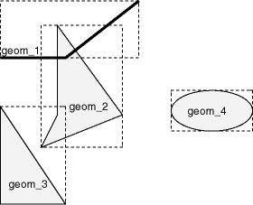
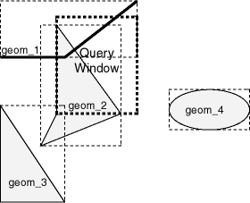

## 5  Indexing and Querying Spatial Data

After you have loaded spatial data, you should create a spatial index on it to enable efficient query performance using the data.

- Creating a Spatial Index
  Once data has been loaded into the spatial tables through either bulk or transactional loading, a spatial index (that is, a spatial R-tree index) should be created on each geometry column in the tables for the most efficient access to the data.
- Querying Spatial Data
  The structures of a spatial layer are used to resolve spatial queries and spatial joins.

**Related Topics**

- [Loading Spatial Data](loading-spatial-data.md)

**Parent topic:** [Conceptual and Usage Information](spatial-concepts-usage.md)

### 5.1 Creating a Spatial Index

Once data has been loaded into the spatial tables through either bulk or transactional loading, a spatial index (that is, a spatial R-tree index) should be created on each geometry column in the tables for the most efficient access to the data.

For example, the following statement creates a spatial index named `territory_idx` using default values for all parameters:

    CREATE INDEX territory_idx ON territories (territory_geom)
       INDEXTYPE IS MDSYS.SPATIAL_INDEX_V2;

**Note:**

For an explanation of the “\_V2” in INDEXTYPE IS MDSYS.SPATIAL_INDEX_V2, see Using System-Managed Spatial Indexes

For detailed information about options for creating a spatial index, see the documentation for the [CREATE INDEX](sql-indexing-spatial-data.md) statement.

If the index creation does not complete for any reason, the index is invalid and must be deleted with the [DROP INDEX](sql-indexing-spatial-data.md) \<index_name\> \[FORCE\] statement.

Within each geometry column to be indexed, all the geometries must have the same SDO_SRID value.

Spatial indexes can be built on two, three, or four dimensions of data. The default number of dimensions is two, but if the data has more than two dimensions, you can use the `sdo_indx_dims` parameter keyword to specify the number of dimensions on which to build the index. (For information about support for three-dimensional geometries, see [Three-Dimensional Spatial Objects](spatial-concepts.md). For an explanation of support for various combinations of dimensionality in query elements, see Data and Index Dimensionality, and Spatial Queries.)

If you are not using the automatic undo management feature or the PGA memory management feature, or both, of Oracle Database, see Rollback Segments and Sort Area Size for information about initialization parameter values that you may need to set. Both automatic undo management and PGA memory management are enabled by default, and their use is highly recommended.

The tablespace specified with the `tablespace` keyword in the [CREATE INDEX](sql-indexing-spatial-data.md) statement (or the default tablespace if the `tablespace` keyword is not specified) is used to hold both the index data table and some transient tables that are created for internal computations. If you specify WORK_TABLESPACE as the tablespace, the transient tables are stored in the work tablespace.

For large tables (over 1 million rows), a temporary tablespace may be needed to perform internal sorting operations. The recommended size for this temporary tablespace is 100\*n bytes, where n is the number of rows in the table, up to a maximum requirement of 1 gigabyte of temporary tablespace.

To estimate the space that will be needed to create a spatial index, use the [SDO_TUNE.ESTIMATE_RTREE_INDEX_SIZE](SDO_TUNE-reference.md) function.

Spatial indexes are not supported on nested tables.

This section also contains the following topics.

- Using System-Managed Spatial Indexes
- Constraining Data to a Geometry Type
- Creating a Composite B-tree Spatial Index on Points
- Creating a Cross-Schema Index
- Using Partitioned Spatial Indexes
- Exchanging Partitions Including Indexes
- Export and Import Considerations with Spatial Indexes and Data
- Distributed and Oracle XA Transactions Supported with R-Tree Spatial Indexes
- Enabling Access to Spatial Index Statistics
- Rollback Segments and Sort Area Size

**Parent topic:** Indexing and Querying Spatial Data

#### 5.1.1 Using System-Managed Spatial Indexes

Effective with Release 12.2, spatial indexes can be system-managed by specifying INDEXTYPE=MDSYS.SPATIAL_INDEX\_V2 at index creation. You are strongly encouraged to use this index type for all new spatial indexes you create, regardless of whether the spatial table or the spatial index is partitioned, and you may also want to use it if you decide to re-create legacy spatial indexes.

The main benefit is simplified spatial index management. This is most beneficial in cases of partitioning, because this new index type eliminates the need for most, if not all, index partitioning management operations. Full support is provided for almost all Oracle Database base table partitioning models, including:

- Single-level partitioning: range, hash, list

- Composite partitioning: range-range, range-hash, range-list, list-range, list-hash, list-list, hash-hash, hash-list, hash-range

- Partitioning extensions: interval (but not interval-based composite partitions), reference, virtual column-based partitioning

The old INDEXTYPE=MDSYS.SPATIAL_INDEX (without the “\_V2”) is still available for use. It may provide slightly better index creation performance, especially with small data sets and no partitioning involved. You might also want to use the old type if you need to drop a legacy spatial index and then want to re-create it in exactly the same form as it was before. However, in all or almost all cases you will want to specify INDEXTYPE=MDSYS.SPATIAL_INDEX_V2 when creating any spatial index.

The following topics provide examples of using INDEXTYPE=MDSYS.SPATIAL_INDEX_V2.

- Spatial Indexing Example: Interval Partitioning
- Spatial Indexing Example: Virtual Column Partitioning

**Parent topic:** Creating a Spatial Index

##### 5.1.1.1 Spatial Indexing Example: Interval Partitioning

Interval partitioning is a partitioning method where Oracle Database automatically creates base table partitions when the inserted value does not match any existing partition ranges.

The following restrictions apply:

- You can only specify one base table partitioning key column, and it must be of type NUMBER or DATE.

- Interval partitioning is not supported for index-organized tables.

Consider the following example of a base table named DEST_TABLE, partitioned based on the month of the “currently last seen” column:

    CREATE TABLE dest_table
    PARTITION BY RANGE ("CURR_LAST_SEEN_AT")
    INTERVAL(NUMTOYMINTERVAL(1, 'MONTH'))
      (PARTITION "YEAR_1999"
         VALUES LESS THAN (TIMESTAMP' 2000-01-01 00:00:00'),
       PARTITION "YEAR_2000"
         VALUES LESS THAN (TIMESTAMP' 2001-01-01 00:00:00'))
    PARALLEL
    AS SELECT imo_num,
              last_seen_at           curr_last_seen_at,
              a.geometry.sdo_point.x curr_longitude,
              a.geometry.sdo_point.y curr_latitude,
    LAG(last_seen_at)
      OVER (partition by imo_num ORDER BY last_seen_at) prev_last_seen_at,
    LEAD(last_seen_at)
      OVER (partition by imo_num ORDER BY last_seen_at) next_last_seen_at,
    LAG(a.geometry.sdo_point.x)
      OVER (partition by imo_num ORDER BY last_seen_at) prev_longitude,
    LAG(a.geometry.sdo_point.y)
      OVER (partition by imo_num ORDER BY last_seen_at) prev_latitude,
    LEAD(a.geometry.sdo_point.x)
      OVER (partition by imo_num ORDER BY last_seen_at) next_longitude,
    LEAD(a.geometry.sdo_point.y)
      OVER (partition by imo_num ORDER BY last_seen_at) next_latitude
    FROM source_table a;

As data is selected from the source table (source_table) into this DEST_TABLE table, Oracle Database automatically partitions the data by the month of the CURR_LAST_SEEN_AT column. If the corresponding partition does not exist, Oracle Database will automatically create a new partition without any action required on your part.

The preceding example created two explicit partitions. To see what our actual data looks like, use a query such as for following to the database dictionary to see what partitions were created:

    SQL> select partition_name, high_value
      2  from user_tab_partitions
      3  where table_name = 'DEST_TABLE'
      4  order by partition_name;

    PARTITION_NAME
    --------------------------------------------------------------------------------
    HIGH_VALUE
    --------------------------------------------------------------------------------
    SYS_P2881
    TIMESTAMP' 2014-08-01 00:00:00'

    SYS_P2882
    TIMESTAMP' 2014-09-01 00:00:00'

    SYS_P2883
    TIMESTAMP' 2014-10-01 00:00:00'

    SYS_P2884
    TIMESTAMP' 2014-11-01 00:00:00'

    YEAR_1999
    TIMESTAMP' 2000-01-01 00:00:00'

    YEAR_2000
    TIMESTAMP' 2001-01-01 00:00:00'

    6 rows selected.

Now create the spatial index. The following example uses function-based index; the function will convert the base table scalar longitude and latitude columns into a virtual spatial geometry, which will be the index “key value”:

    CREATE OR REPLACE FUNCTION get_geometry(in_longitude NUMBER,
                                            in_latitude  NUMBER)
      return SDO_GEOMETRY DETERMINISTIC PARALLEL_ENABLE IS
    BEGIN
      RETURN sdo_geometry(2001,
                          4326,
                          sdo_point_type(in_longitude, in_latitude, NULL),
                          NULL,
                          NULL);
    END;
    /

    INSERT INTO user_sdo_geom_metadata VALUES (
      'DEST_TABLE','SCOTT.GET_GEOMETRY(CURR_LONGITUDE,CURR_LATITUDE)',
       SDO_DIM_ARRAY(SDO_DIM_ELEMENT('Longitude', '-180', '180', '.05'),
                     SDO_DIM_ELEMENT('Latitude',   '-90',  '90', '.05')),
       4326);
    COMMIT;

    CREATE INDEX geom_idx1
    ON dest_table(GET_GEOMETRY(CURR_LONGITUDE, CURR_LATITUDE))
    INDEXTYPE IS MDSYS.SPATIAL_INDEX_V2 LOCAL PARALLEL;

Notice that no partitioning information was specified for the spatial index. To see the partitions that were automatically created, use a query such as for following:

    SQL> select partition_name, high_value
      2  from user_ind_partitions
      3  where index_name = 'PRECOMPUTE_GEOM_IDX1'
      4  order by partition_name;

    PARTITION_NAME
    --------------------------------------------------------------------------------
    HIGH_VALUE
    --------------------------------------------------------------------------------
    SYS_P2921
    TIMESTAMP' 2014-08-01 00:00:00'
    SYS_P2922
    TIMESTAMP' 2014-09-01 00:00:00'
    SYS_P2923
    TIMESTAMP' 2014-10-01 00:00:00'
    SYS_P2924
    TIMESTAMP' 2014-11-01 00:00:00'
    YEAR_1999
    TIMESTAMP' 2000-01-01 00:00:00'
    YEAR_2000
    TIMESTAMP' 2001-01-01 00:00:00'
    6 rows selected.

Notice that the number of index partitions is the same as were created for the base table, including two partitions with the same name as those explicitly specified in the CREATE TABLE statement. However, the system-generated index partition names are different from the base table name.

**Parent topic:** Using System-Managed Spatial Indexes

##### 5.1.1.2 Spatial Indexing Example: Virtual Column Partitioning

A virtual column is an expression based on one or more existing columns in the base table. While a virtual column is only stored as metadata and does not consume physical space, it can be indexed and also contain optimizer statistics and histograms. Partitioning is supported for a table using a partitioning key on a virtual column

If system-managed spatial indexing is not used, then to partition a table by using a derived value, a DBA must create and populate an additional physical column in order to achieve the same result. The derived value then must be populated by the application or by a trigger that evaluates the expression before insertion. In either case, achieving this goal without system-managed indexing requires additional overhead and increased disk space for the physical column.

If system-managed indexing is used, the ability to use an expression as a partitioning key provides a more efficient way to meet comprehensive business requirements without incurring unnecessary overhead. This can be very useful when a table cannot be partitioned by the existing data columns.

Consider the following example of a base table named ACCOUNTS that contains a virtual column named REGION:

    create table accounts_v
    ( account_number varchar2(30),
      account_name varchar2(30),
      contact_person varchar2(30),
      region AS (case
                 when substr(account_name,1,1) = 'N' then 'NORTH'
                 when substr(account_name,1,1) = 'E' then 'EAST'
                 when substr(account_name,1,1) = 'S' then 'SOUTH'
                 when substr(account_name,1,1) = 'W' then 'WEST'
                 end),
      shape mdsys.sdo_geometry
    )
    partition by list (region)
    ( partition pN values ('NORTH'),
      partition pE values ('EAST'),
      partition pS values ('SOUTH'),
      partition pW values ('WEST')
    );

Now create a system-managed local domain spatial index on the SHAPE column:

    insert into user_sdo_geom_metadata
    values('ACCOUNTS_V',
           'SHAPE',
           mdsys.sdo_dim_array(
             mdsys.sdo_dim_element('Longitude', -180, 180, 0.05),
             mdsys.sdo_dim_element('Latitude',   -90,  90, 0.05)),
           NULL);
    commit;
    create index shape_v_idx on accounts_v(shape)
    indextype is mdsys.spatial_index_v2 LOCAL;

Notice that no spatial index partition information was specified. However, a full set of spatial index partitions was created automatically and without user intervention.

To verify the placement of records in the appropriate partitions, query a specific partition. The following query is for the accounts in the East region (:

    SQL> select * from accounts_v partition(PE)
      2  order by account_number;

    ACCOUNT_NUMBER                 ACCOUNT_NAME
    ------------------------------ ------------------------------
    CONTACT_PERSON                 REGIO
    ------------------------------ -----
    SHAPE(SDO_GTYPE, SDO_SRID, SDO_POINT(X, Y, Z), SDO_ELEM_INFO, SDO_ORDINATES)
    --------------------------------------------------------------------------------
    8778-5435-5345-5223            E-HORIZON-AUTOMOTIVE
    RICK                           EAST
    SDO_GEOMETRY(2001, NULL, SDO_POINT_TYPE(2, 2, NULL), NULL, NULL)

    1 row selected.

**Parent topic:** Using System-Managed Spatial Indexes

#### 5.1.2 Constraining Data to a Geometry Type

When you create or rebuild a spatial index, you can ensure that all geometries that are in the table or that are inserted later are of a specified geometry type. To constrain the data to a geometry type in this way, use the `layer_gtype` keyword in the PARAMETERS clause of the [CREATE INDEX](sql-indexing-spatial-data.md) or [ALTER INDEX REBUILD](sql-indexing-spatial-data.md) statement, and specify a value from the Geometry Type column of the Valid SDO_GTYPE Values table described in [SDO_GTYPE](spatial-datatypes-metadata.md). For example, to constrain spatial data in a layer to polygons:

    CREATE INDEX cola_spatial_idx
    ON cola_markets(shape)
    INDEXTYPE IS MDSYS.SPATIAL_INDEX_V2
    PARAMETERS ('layer_gtype=POLYGON');

The geometry types in [SDO_GTYPE](spatial-datatypes-metadata.md) are considered as a hierarchy when data is checked:

- The MULTI forms include the regular form also. For example, specifying `'layer_gtype=``MULTIPOINT'` allows the layer to include both POINT and MULTIPOINT geometries.

- COLLECTION allows the layer to include all types of geometries.

**Parent topic:** Creating a Spatial Index

#### 5.1.3 Creating a Composite B-tree Spatial Index on Points

Effective with Release 12.2, you can create a composite B-tree index on point data by specifying the `cbtree_index=true` and `layer_gtype=POINT` keywords in the PARAMETERS clause of the [CREATE INDEX](sql-indexing-spatial-data.md) statement.

**Note:**

You can create a composite B-tree spatial index only when the point data is stored in the SDO_POINT attribute and the SDO_ORDINATES attribute of the geometry is NULL.

For example:

    CREATE INDEX pt_idx on PT_CB(c2) indextype is mdsys.spatial_index_v2
      PAREMETERS ('layer_gtype=POINT cbtree_index=true');

The preceding example creates a composite B-tree spatial index, not an R-tree spatial index. Using a composite B-tree spatial index for point data can:

- Improve the performance of spatial index creation.

- Improve DML performance when performing concurrent DML from many Oracle sessions.

However, while composite B-tree spatial query performance is very fast, optimal spatial query performance may be obtained by using an R-tree spatial index on that data (especially with SPATIAL_VECTOR_ACCELERATION set to the recommended value of `TRUE`).

The `cbtree_index=true` keyword can used only for spatial index creation (CREATE INDEX statement). It cannot be used with ALTER INDEX or ALTER INDEX REBUILD.

The [SDO_JOIN](spatial-operators-reference.md) operator is not supported when a composite B-tree spatial index is used.

**Parent topic:** Creating a Spatial Index

#### 5.1.4 Creating a Cross-Schema Index

You can create a spatial index on a table that is not in your schema. Assume that user B wants to create a spatial index on column GEOMETRY in table T1 under user A's schema. Follow these steps:

1.  Connect to the database as a privileged user (for example, as SYSTEM), and execute the following statements:
        GRANT create table, create sequence to A;
        GRANT create table, create sequence to B;
2.  Connect as a privileged user or as user A (or have user A connect), and execute the following statement:
        GRANT select, index on A.T1 to B;
3.  Connect as user B and execute a statement such as the following:
        CREATE INDEX t1_spatial_idx on A.T1(geometry)
          INDEXTYPE IS mdsys.spatial_index_v2;

**Parent topic:** Creating a Spatial Index

#### 5.1.5 Using Partitioned Spatial Indexes

You can create a partitioned spatial index on a partitioned table. This section describes usage considerations specific to Oracle Spatial and Graph. For a detailed explanation of partitioned tables and partitioned indexes, see [Oracle Database VLDB and Partitioning Guide](../vldbg/partition-concepts.md).

A partitioned spatial index can provide the following benefits:

- Reduced response times for long-running queries, because partitioning reduces disk I/O operations

- Reduced response times for concurrent queries, because I/O operations run concurrently on each partition

- Easier index maintenance, because of partition-level create and rebuild operations

  Indexes on partitions can be rebuilt without affecting the queries on other partitions, and storage parameters for each local index can be changed independent of other partitions.

- Parallel query on multiple partition searching

  The degree of parallelism is the value from the DEGREE column in the row for the index in the USER_INDEXES view (that is, the value specified or defaulted for the PARALLEL keyword with the [CREATE INDEX](sql-indexing-spatial-data.md), [ALTER INDEX](sql-indexing-spatial-data.md), or [ALTER INDEX REBUILD](sql-indexing-spatial-data.md) statement).

- Improved query processing in multiprocessor system environments

  In a multiprocessor system environment, if a spatial operator is invoked on a table with partitioned spatial index and if multiple partitions are involved in the query, multiple processors can be used to evaluate the query. The number of processors used is determined by the degree of parallelism and the number of partitions used in evaluating the query.

The following restrictions apply to spatial index partitioning:

- The partition key for spatial tables must be a scalar value, and must not be a spatial column.

- Only range partitioning is supported on the underlying table. All other kinds of partitioning are not currently supported for partitioned spatial indexes.

To create a partitioned spatial index, you must specify the LOCAL keyword. (If you do not specify the LOCAL keyword, a nonpartitioned spatial index is created on the data in all table partitions.) The following example creates a partitioned spatial index:

    CREATE INDEX counties_idx ON counties(geometry)
       INDEXTYPE IS MDSYS.SPATIAL_INDEX_V2 LOCAL;

In this example, the default values are used for the number and placement of index partitions, namely:

- Index partitioning is based on the underlying table partitioning. For each table partition, a corresponding index partition is created.

- Each index partition is placed in the default tablespace.

If you do specify parameters for individual partitions, the following considerations apply:

- The storage characteristics for each partition can be the same or different for each partition. If they are different, it may enable parallel I/O (if the tablespaces are on different disks) and may improve performance.

- The `sdo_indx_dims` value must be the same for all partitions.

- The `layer_gtype` parameter value (see Constraining Data to a Geometry Type) used for each partition may be different.

To override the default partitioning values, use a CREATE INDEX statement with the following general format:

    CREATE INDEX <indexname> ON <table>(<column>)
      INDEXTYPE IS MDSYS.SPATIAL_INDEX_V2
         [PARAMETERS ('<spatial-params>, <storage-params>')] LOCAL
         [( PARTITION <index_partition>
            PARAMETERS ('<spatial-params>, <storage-params>')
         [, PARTITION <index_partition>
            PARAMETERS ('<spatial-params>, <storage-params>')]
         )]

Queries can operate on partitioned tables to perform the query on only one partition. For example:

    SELECT * FROM counties PARTITION(p1)
        WHERE ...<some-spatial-predicate>;

Querying on a selected partition may speed up the query and also improve overall throughput when multiple queries operate on different partitions concurrently.

When queries use a partitioned spatial index, the semantics (meaning or behavior) of spatial operators and functions is the same with partitioned and nonpartitioned indexes, except in the case of [SDO_NN](spatial-operators-reference.md) (nearest neighbor). With [SDO_NN](spatial-operators-reference.md), the requested number of geometries is returned for each partition that is affected by the query. (See the description of the [SDO_NN](spatial-operators-reference.md) operator in [Spatial Operators](spatial-operators-reference.md) for more information.)

For example, if you request the 5 closest restaurants to a point and the spatial index has 4 partitions, [SDO_NN](spatial-operators-reference.md) returns up to 20 (5\*4) geometries. In this case, you must use the ROWNUM pseudocolumn (here, `WHERE ROWNUM <=5`) to return the 5 closest restaurants, and the ORDER BY clause to sort the results by distance in miles. Example 5-1 returns the 5 nearest restaurants from a partitioned spatial index.

**See Also:**

[SDO_NN Examples](complex-spatial-queries.md) for more examples of using the [SDO_NN](spatial-operators-reference.md) operator.

For a cross-schema query when a table has a partitioned spatial index, the user must be granted SELECT or READ privilege on both the spatial table and the index table (MDRT\_xxx) for the spatial index that was created on the spatial table. For more information and an example, see "[Cross-Schema Invocation of SDO_JOIN](spatial-operators-reference.md)" in the Usage Notes for the [SDO_JOIN](spatial-operators-reference.md) operator.

Example 5-1 SDO_NN Query with Partitioned Spatial Index

    SELECT * FROM
    (
    SELECT r.name, r.location, SDO_NN_DISTANCE(1) distance_in_miles
    FROM restaurants_part_table r
    WHERE SDO_NN(r.location,
          MDSYS.SDO_GEOMETRY(2001,8307,MDSYS.SDO_POINT_TYPE(-110,35,Null),Null,Null),
         'SDO_NUM_RES=5 distance=2  unit=MILE', 1) = 'TRUE'
    ORDER BY distance_in_miles
    )
    WHERE ROWNUM<=5;

- Creating a Local Partitioned Spatial Index

**Parent topic:** Creating a Spatial Index

##### 5.1.5.1 Creating a Local Partitioned Spatial Index

If you want to create a local partitioned spatial index, Oracle recommends that you use the procedure in this section instead of using the PARALLEL keyword, to avoid having to start over if the creation of any partition's index fails for any reason (for example, because the tablespace is full). Follow these steps:

1.  Create a local spatial index and specify the UNUSABLE keyword. For example:
        CREATE INDEX sp_idx ON my_table (location)
          INDEXTYPE IS mdsys.spatial_index_v2
          PARAMETERS ('tablespace=tb_name work_tablespace=work_tb_name')
          LOCAL UNUSABLE;

    This statement executes quickly and creates metadata associated with the index.
2.  Create scripts with ALTER INDEX REBUILD statements, but without the PARALLEL keyword. For example, if you have 100 partitions and 10 processors, create 10 scripts with 10 ALTER INDEX statements such as the following:
        ALTER INDEX sp_idx REBUILD PARTITION ip1;
        ALTER INDEX sp_idx REBUILD PARTITION ip2;
        . . .
        ALTER INDEX sp_idx REBUILD PARTITION ip10;
3.  Run all the scripts at the same time, so that each processor works on the index for a single partition, but all the processors are busy working on their own set of ALTER INDEX statements.

If any of the ALTER INDEX statements fails, you do not need to rebuild any partitions for which the operation has successfully completed.

**Parent topic:** Using Partitioned Spatial Indexes

#### 5.1.6 Exchanging Partitions Including Indexes

You can use the ALTER TABLE statement with the EXCHANGE PARTITION ... INCLUDING INDEXES clause to exchange a spatial table partition and its index partition with a corresponding table and its index. For information about exchanging partitions, see the description of the ALTER TABLE statement in [Oracle Database SQL Language Reference](../sqlrf/ALTER-TABLE.md).

This feature can help you to operate more efficiently in a number of situations, such as:

- Bringing data into a partitioned table and avoiding the cost of index re-creation.

- Managing and creating partitioned indexes. For example, the data could be divided into multiple tables. The index for each table could be built one after the other to minimize the memory and tablespace resources needed during index creation. Alternately, the indexes could be created in parallel in multiple sessions. The tables (along with the indexes) could then be exchanged with the partitions of the original data table.

- Managing offline insert operations. New data can be stored in a temporary table and periodically exchanged with a new partition (for example, in a database with historical data).

To exchange partitions including indexes with spatial data and indexes, the two spatial indexes (one on the partition, the other on the table) must have the same dimensionality (`sdo_indx_dims` value). If the indexes do not have the same dimensionality, an error is raised. The table data is exchanged, but the indexes are not exchanged and the indexes are marked as failed. To use the indexes, you must rebuild them

**Parent topic:** Creating a Spatial Index

#### 5.1.7 Export and Import Considerations with Spatial Indexes and Data

If you use the Export utility to export tables with spatial data, the behavior of the operation depends on whether or not the spatial data has been spatially indexed:

- If the spatial data has not been spatially indexed, the table data is exported. However, you must update the USER_SDO_GEOM_METADATA view with the appropriate information on the target system.

- If the spatial data has been spatially indexed, the table data is exported, the appropriate information is inserted into the USER_SDO_GEOM_METADATA view on the target system, and the spatial index is built on the target system. However, if the insertion into the USER_SDO_GEOM_METADATA view fails (for example, if there is already a USER_SDO_GEOM_METADATA entry for the spatial layer), the spatial index is not built.

If you use the Import utility to import data that has been spatially indexed, the following considerations apply:

- If the index on the exported data was created with a `TABLESPACE` clause and if the specified tablespace does not exist in the database at import time, the index is not built. (This is different from the behavior with other Oracle indexes, where the index is created in the user's default tablespace if the tablespace specified for the original index does not exist at import time.)

- If the import operation must be done by a privileged database user, and if the `FROMUSER` and `TOUSER` format is used, the `TOUSER` user must be granted the CREATE TABLE and CREATE SEQUENCE privileges before the import operation, as shown in the following example (and enter the password for the SYSTEM account when prompted):

      sqlplus system
      SQL> grant CREATE TABLE, CREATE SEQUENCE to CHRIS;
      SQL> exit;
      imp system file=spatl_data.dmp fromuser=SCOTT touser=CHRIS

For information about using the Export and Import utilities, see [Oracle Database Utilities](../sutil/oracle-data-pump-overview.md).

**Parent topic:** Creating a Spatial Index

#### 5.1.8 Distributed and Oracle XA Transactions Supported with R-Tree Spatial Indexes

The use of R-tree spatial indexes is supported in distributed and Oracle XA transactions.

However, spatial DML operations are not allowed in a serializable distributed transaction.

For more information about distributed transactions, see [Oracle Database Administrator's Guide](../admin/distributed-transactions-concepts.md).

**Parent topic:** Creating a Spatial Index

#### 5.1.9 Enabling Access to Spatial Index Statistics

The Oracle Database optimizer collects statistics that describe details about the database and its objects. Statistics are critical to the optimizer's ability to pick the best execution plan for a SQL statement. For more information about optimizer statistics, see [Oracle Database SQL Tuning Guide](../tgsql/optimizer-statistics.md).

To be able to use procedures such as [`DBMS_STATS.GATHER_INDEX_STATS`](../arpls/index.md) and [`DBMS_STATS.GATHER_SCHEMA_STATS`](../arpls/index.md) to gather index statistics related to spatial indexes, the CREATE TABLE privilege must be granted to all database users that will perform the statistics collection.

When you run ANALYZE INDEX on a spatial domain index for a different schema (user), the user performing the ANALYZE operation needs the following privileges:

- CREATE ANY TABLE to create missing temporary tables

- DROP ANY TABLE to truncate or remove existing temporary tables

**Parent topic:** Creating a Spatial Index

#### 5.1.10 Rollback Segments and Sort Area Size

This section applies only if you (or the database administrator) are not using the automatic undo management feature or the PGA memory management feature, or both, of Oracle Database. Automatic memory management and PGA memory management are enabled by default, and their use is highly recommended. For explanations of these features, see:

- The section about automatic undo management and undo segments in [Oracle Database Concepts](../cncpt/logical-storage-structures.md)

- The section about PGA memory management in [Oracle Database Concepts](../cncpt/memory-architecture.md)

If you are not using automatic undo management and if the rollback segment is not large enough, an attempt to create a spatial index will fail. The rollback segment should be 100\*n bytes, where n is the number of rows of data to be indexed. For example, if the table contains 1 million (1,000,000) rows, the rollback segment size should be 100,000,000 (100 million) bytes.

To ensure an adequate rollback segment, or if you have tried to create a spatial index and received an error that a rollback segment cannot be extended, review (or have a DBA review) the size and structure of the rollback segments. Create a public rollback segment of the appropriate size, and place that rollback segment online. In addition, ensure that any small inappropriate rollback segments are placed offline during large spatial index operations.

If you are not using the PGA memory management feature, the database parameter SORT_AREA_SIZE affects the amount of time required to create the index. The SORT_AREA_SIZE value is the maximum amount, in bytes, of memory to use for a sort operation. The optimal value depends on the database size, but a good guideline is to make it at least 1 million bytes when you create a spatial index. To change the SORT_AREA_SIZE value, use the ALTER SESSION statement. For example, to change the value to 20 million bytes:

    ALTER SESSION SET SORT_AREA_SIZE = 20000000;

**Parent topic:** Creating a Spatial Index

### 5.2 Querying Spatial Data

The structures of a spatial layer are used to resolve spatial queries and spatial joins.

Spatial and Graph uses a two-tier query model with primary and secondary filter operations to resolve spatial queries and spatial joins, as explained in [Query Model](spatial-concepts.md). The term two-tier indicates that two distinct operations are performed to resolve queries. If both operations are performed, the exact result set is returned.

You cannot append a database link (dblink) name to the name of a spatial table in a query if a spatial index is defined on that table.

This section also contains the following topics.

- Spatial Query
- Spatial Join
- Data and Index Dimensionality, and Spatial Queries
- Using Event 54700 to Require a Spatial Index for Spatial Queries

**Parent topic:** Indexing and Querying Spatial Data

#### 5.2.1 Spatial Query

In a spatial R-tree index, each geometry is represented by its minimum bounding rectangle (MBR), as explained in [R-Tree Indexing](spatial-concepts.md). Consider the following layer containing several objects in Figure 5-1. Each object is labeled with its geometry name (geom_1 for the line string, geom_2 for the four-sided polygon, geom_3 for the triangular polygon, and geom_4 for the ellipse), and the MBR around each object is represented by a dashed line.

Figure 5-1 Geometries with MBRs

[Description of "Figure 5-1 Geometries with MBRs"](img_text/query_mbrs.md)

A typical spatial query is to request all objects that lie within a query window, that is, a defined fence or window. A dynamic query window refers to a rectangular area that is not defined in the database, but that must be defined before it is used. Figure 5-2 shows the same geometries as in Figure 5-1, but adds a query window represented by the heavy dotted-line box.

Figure 5-2 Layer with a Query Window

[Description of "Figure 5-2 Layer with a Query Window"](img_text/query_window.md)

In Figure 5-2, the query window covers parts of geometries geom_1 and geom_2, as well as part of the MBR for geom_3 but none of the actual geom_3 geometry. The query window does not cover any part of the geom_4 geometry or its MBR.

- Primary Filter Operator
- Primary and Secondary Filter Operator
- Within-Distance Operator
- Nearest Neighbor Operator
- Spatial Functions

**Parent topic:** Querying Spatial Data

##### 5.2.1.1 Primary Filter Operator

The [SDO_FILTER](spatial-operators-reference.md) operator, described in [Spatial Operators](spatial-operators-reference.md) , implements the primary filter portion of the two-step process involved in the Oracle Spatial and Graph query processing model. The primary filter uses the index data to determine only if a set of candidate object pairs may interact. Specifically, the primary filter checks to see if the MBRs of the candidate objects interact, not whether the objects themselves interact. The [SDO_FILTER](spatial-operators-reference.md) operator syntax is as follows:

    SDO_FILTER(geometry1 SDO_GEOMETRY, geometry2 SDO_GEOMETRY, param VARCHAR2)

In the preceding syntax:

- `geometry1` is a column of type SDO_GEOMETRY in a table. This column must be spatially indexed.

- `geometry2` is an object of type SDO_GEOMETRY. This object may or may not come from a table. If it comes from a table, it may or may not be spatially indexed.

- `param` is an optional string of type VARCHAR2. It can specify either or both of the `min_resolution` and `max_resolution` keywords.

The following examples perform a primary filter operation only (with no secondary filter operation). They will return all the geometries shown in Figure 5-2 that have an MBR that interacts with the query window. The result of the following examples are geometries geom_1, geom_2, and geom_3.

Example 5-2 performs a primary filter operation without inserting the query window into a table. The window will be indexed in memory and performance will be very good.

Example 5-2 Primary Filter with a Temporary Query Window

    SELECT A.Feature_ID FROM TARGET A
     WHERE sdo_filter(A.shape, SDO_geometry(2003,NULL,NULL,
                                           SDO_elem_info_array(1,1003,3),
                                           SDO_ordinate_array(x1,y1, x2,y2))
                               ) = 'TRUE';

In Example 5-2, `(x1,y1)` and `(x2,y2)` are the lower-left and upper-right corners of the query window.

In Example 5-3, a transient instance of type SDO_GEOMETRY was constructed for the query window instead of specifying the window parameters in the query itself.

Example 5-3 Primary Filter with a Transient Instance of the Query Window

    SELECT A.Feature_ID FROM TARGET A
     WHERE sdo_filter(A.shape, :theWindow) = 'TRUE';

Example 5-4 assumes the query window was inserted into a table called WINDOWS, with an ID of WINS_1.

Example 5-4 Primary Filter with a Stored Query Window

    SELECT A.Feature_ID FROM TARGET A, WINDOWS B
     WHERE B.ID = 'WINS_1' AND
      sdo_filter(A.shape, B.shape) = 'TRUE';

If the B.SHAPE column is not spatially indexed, the [SDO_FILTER](spatial-operators-reference.md) operator indexes the query window in memory and performance is very good.

**Parent topic:** Spatial Query

##### 5.2.1.2 Primary and Secondary Filter Operator

The [SDO_RELATE](spatial-operators-reference.md) operator, described in [Spatial Operators](spatial-operators-reference.md) , performs both the primary and secondary filter stages when processing a query. The secondary filter ensures that only candidate objects that actually interact are selected. This operator can be used only if a spatial index has been created on two dimensions of data. The syntax of the [SDO_RELATE](spatial-operators-reference.md) operator is as follows:

    SDO_RELATE(geometry1  SDO_GEOMETRY,
               geometry2  SDO_GEOMETRY,
               param      VARCHAR2)

In the preceding syntax:

- `geometry1` is a column of type SDO_GEOMETRY in a table. This column must be spatially indexed.

- `geometry2` is an object of type SDO_GEOMETRY. This object may or may not come from a table. If it comes from a table, it may or may not be spatially indexed.

- `param` is a quoted string with the `mask` keyword and a valid mask value, and optionally either or both of the `min_resolution` and `max_resolution` keywords, as explained in the documentation for the [SDO_RELATE](spatial-operators-reference.md) operator in [Spatial Operators](spatial-operators-reference.md) .

The following examples perform both primary and secondary filter operations. They return all the geometries in Figure 5-2 that lie within or overlap the query window. The result of these examples is objects geom_1 and geom_2.

Example 5-5 performs both primary and secondary filter operations without inserting the query window into a table. The window will be indexed in memory and performance will be very good.

Example 5-5 Secondary Filter Using a Temporary Query Window

    SELECT A.Feature_ID FROM TARGET A
       WHERE sdo_relate(A.shape, SDO_geometry(2003,NULL,NULL,
                                           SDO_elem_info_array(1,1003,3),
                                          SDO_ordinate_array(x1,y1, x2,y2)),
                            'mask=anyinteract') = 'TRUE';

In Example 5-5, `(x1,y1)` and `(x2,y2)` are the lower-left and upper-right corners of the query window.

Example 5-6 assumes the query window was inserted into a table called WINDOWS, with an ID value of WINS_1.

Example 5-6 Secondary Filter Using a Stored Query Window

    SELECT A.Feature_ID FROM TARGET A, WINDOWS B
     WHERE B.ID = 'WINS_1' AND
            sdo_relate(A.shape, B.shape,
              'mask=anyinteract') = 'TRUE';

If the B.SHAPE column is not spatially indexed, the [SDO_RELATE](spatial-operators-reference.md) operator indexes the query window in memory and performance is very good.

**Parent topic:** Spatial Query

##### 5.2.1.3 Within-Distance Operator

The [SDO_WITHIN_DISTANCE](spatial-operators-reference.md) operator, described in [Spatial Operators](spatial-operators-reference.md) , is used to determine the set of objects in a table that are within n distance units from a reference object. This operator can be used only if a spatial index has been created on two dimensions of data. The reference object may be a transient or persistent instance of SDO_GEOMETRY, such as a temporary query window or a permanent geometry stored in the database. The syntax of the operator is as follows:

    SDO_WITHIN_DISTANCE(geometry1  SDO_GEOMETRY,
                        aGeom      SDO_GEOMETRY,
                        params     VARCHAR2);

In the preceding syntax:

- `geometry1` is a column of type SDO_GEOMETRY in a table. This column must be spatially indexed.

- `aGeom` is an instance of type SDO_GEOMETRY.

- `params` is a quoted string of keyword value pairs that determines the behavior of the operator. See the [SDO_WITHIN_DISTANCE](spatial-operators-reference.md) operator in [Spatial Operators](spatial-operators-reference.md) for a list of parameters.

The following example selects any objects within 1.35 distance units from the query window:

    SELECT A.Feature_ID
      FROM TARGET A
      WHERE SDO_WITHIN_DISTANCE( A.shape, :theWindow, 'distance=1.35') = 'TRUE';

The distance units are based on the geometry coordinate system in use. If you are using a geodetic coordinate system, the units are meters. If no coordinate system is used, the units are the same as for the stored data.

The [SDO_WITHIN_DISTANCE](spatial-operators-reference.md) operator is not suitable for performing spatial joins. That is, a query such as Find all parks that are within 10 distance units from coastlines will not be processed as an index-based spatial join of the COASTLINES and PARKS tables. Instead, it will be processed as a nested loop query in which each COASTLINES instance is in turn a reference object that is buffered, indexed, and evaluated against the PARKS table. Thus, the [SDO_WITHIN_DISTANCE](spatial-operators-reference.md) operation is performed n times if there are n rows in the COASTLINES table.

For non-geodetic data, there is an efficient way to accomplish a spatial join that involves buffering all geometries of a layer. This method does not use the [SDO_WITHIN_DISTANCE](spatial-operators-reference.md) operator. First, create a new table COSINE_BUFS as follows:

    CREATE TABLE cosine_bufs UNRECOVERABLE AS
       SELECT SDO_BUFFER (A.SHAPE, B.DIMINFO, 1.35)
         FROM COSINE A, USER_SDO_GEOM_METADATA B
         WHERE TABLE_NAME='COSINES' AND COLUMN_NAME='SHAPE';

Next, create a spatial index on the SHAPE column of COSINE_BUFS. Then you can perform the following query:

    SELECT /*+ ordered */ a.gid, b.gid
      FROM TABLE(SDO_JOIN('PARKS', 'SHAPE',
                          'COSINE_BUFS', 'SHAPE',
                          'mask=ANYINTERACT')) c,
           parks a,
           cosine_bufs b
      WHERE c.rowid1 = a.rowid AND c.rowid2 = b.rowid;

**Parent topic:** Spatial Query

##### 5.2.1.4 Nearest Neighbor Operator

The [SDO_NN](spatial-operators-reference.md) operator, described in [Spatial Operators](spatial-operators-reference.md) , is used to identify the nearest neighbors for a geometry. This operator can be used only if a spatial index has been created on two dimensions of data. The syntax of the operator is as follows:

    SDO_NN(geometry1  SDO_GEOMETRY,
           geometry2  SDO_GEOMETRY,
           param      VARCHAR2
           [, number  NUMBER]);

In the preceding syntax:

- `geometry1` is a column of type SDO_GEOMETRY in a table. This column must be spatially indexed.

- `geometry2` is an instance of type SDO_GEOMETRY.

- `param` is a quoted string of keyword-value pairs that can determine the behavior of the operator, such as how many nearest neighbor geometries are returned. See the [SDO_NN](spatial-operators-reference.md) operator in [Spatial Operators](spatial-operators-reference.md) for information about this parameter.

- `number` is the same number used in the call to [SDO_NN_DISTANCE](spatial-operators-reference.md). Use this only if the [SDO_NN_DISTANCE](spatial-operators-reference.md) ancillary operator is included in the call to [SDO_NN](spatial-operators-reference.md). See the [SDO_NN](spatial-operators-reference.md) operator in [Spatial Operators](spatial-operators-reference.md) for information about this parameter.

The following example finds the two objects from the SHAPE column in the COLA_MARKETS table that are closest to a specified point (10,7). (Note the use of the optimizer hint in the SELECT statement, as explained in the Usage Notes for the [SDO_NN](spatial-operators-reference.md) operator in [Spatial Operators](spatial-operators-reference.md) .)

    SELECT /*+ INDEX(cola_markets cola_spatial_idx) */
     c.mkt_id, c.name  FROM cola_markets c  WHERE SDO_NN(c.shape,
       SDO_geometry(2001, NULL, SDO_point_type(10,7,NULL), NULL,
       NULL),  'sdo_num_res=2') = 'TRUE';

**Parent topic:** Spatial Query

##### 5.2.1.5 Spatial Functions

Spatial and Graph also supplies functions for determining relationships between geometries, finding information about single geometries, changing geometries, and combining geometries. These functions all take into account two dimensions of source data. If the output value of these functions is a geometry, the resulting geometry will have the same dimensionality as the input geometry, but only the first two dimensions will accurately reflect the result of the operation.

**Parent topic:** Spatial Query

#### 5.2.2 Spatial Join

A spatial join is the same as a regular join except that the predicate involves a spatial operator. In Spatial and Graph, a spatial join takes place when you compare all geometries of one layer to all geometries of another layer. This is unlike a query window, which compares a single geometry to all geometries of a layer.

Spatial joins can be used to answer questions such as Which highways cross national parks?

The following table structures illustrate how the join would be accomplished for this example:

    PARKS(    GID VARCHAR2(32), SHAPE SDO_GEOMETRY)
    HIGHWAYS( GID VARCHAR2(32), SHAPE SDO_GEOMETRY)

To perform a spatial join, use the [SDO_JOIN](spatial-operators-reference.md) operator, which is described in [Spatial Operators](spatial-operators-reference.md) . The following spatial join query, to list the GID column values of highways and parks where a highway interacts with a park, performs a primary filter operation only (`'mask=FILTER'`), and thus it returns only approximate results:

    SELECT /*+ ordered */ a.gid, b.gid
      FROM TABLE(SDO_JOIN('PARKS', 'SHAPE',
                          'HIGHWAYS', 'SHAPE',
                          'mask=FILTER')) c,
           parks a,
           highways b
      WHERE c.rowid1 = a.rowid AND c.rowid2 = b.rowid;

**Note:**

The [SDO_JOIN](spatial-operators-reference.md) operator is not supported when a composite B-tree spatial index is used.

The following spatial join query requests the same information as in the preceding example, but it performs both primary and secondary filter operations (`'mask=ANYINTERACT'`), and thus it returns exact results:

    SELECT /*+ ordered */ a.gid, b.gid
      FROM TABLE(SDO_JOIN('PARKS', 'SHAPE',
                          'HIGHWAYS', 'SHAPE',
                          'mask=ANYINTERACT')) c,
           parks a,
           highways b
      WHERE c.rowid1 = a.rowid AND c.rowid2 = b.rowid;

**Parent topic:** Querying Spatial Data

#### 5.2.3 Data and Index Dimensionality, and Spatial Queries

The elements of a spatial query can, in theory, have the following dimensionality:

- The base table geometries (or `geometry1` in spatial operator formats) can have two, three, or more dimensions.

- The spatial index created on the base table (or `geometry1`) can be two-dimensional or three-dimensional.

- The query window (or `geometry2` in spatial operator formats) can have two, three, or more dimensions.

Some combinations of dimensionality among the three elements are supported and some are not. Table 5-1 explains what happens with the possible combinations involving two and three dimensions.

Table 5-1 Data and Index Dimensionality, and Query Support

| Base Table (geometry1) Dimensionality | Spatial Index Dimensionality | Query Window (geometry2) Dimensionality | Query Result                                                                                           |
|:--------------------------------------|:-----------------------------|:----------------------------------------|:-------------------------------------------------------------------------------------------------------|
| 2-dimensional                         | 2-dimensional                | 2-dimensional                           | Performs a two-dimensional query.                                                                      |
| 2-dimensional                         | 2-dimensional                | 3-dimensional                           | Supported if the query window has an appropriate SDO_GTYPE value less than 3008.                       |
| 2-dimensional                         | 3-dimensional                | 2-dimensional                           | Not supported: 3D index not permitted on 2D data.                                                      |
| 2-dimensional                         | 3-dimensional                | 3-dimensional                           | Not supported: 3D index not permitted on 2D data.                                                      |
| 3-dimensional                         | 2-dimensional                | 2-dimensional                           | Ignores the third (Z) dimension in each base geometry and performs a two-dimensional query.            |
| 3-dimensional                         | 2-dimensional                | 3-dimensional                           | Supported if the query window has an appropriate SDO_GTYPE value less than 3008.                       |
| 3-dimensional                         | 3-dimensional                | 2-dimensional                           | Converts the 2D query window to a 3D window with zero Z values and performs a three-dimensional query. |
| 3-dimensional                         | 3-dimensional                | 3-dimensional                           | Performs a three-dimensional query.                                                                    |

**Parent topic:** Querying Spatial Data

#### 5.2.4 Using Event 54700 to Require a Spatial Index for Spatial Queries

Although a spatial index is recommended for spatial queries, by default is it not required. However, you can require that a spatial index be defined and used for spatial queries by setting event 54700 to the `level` value `1`. You can reset the behavior to the default by setting event 54700 to the `level` value `0` (zero).

You can apply the event for the session or system by using the ALTER SESSION or ALTER SYSTEM statement, respectively. For example:

    ALTER SESSION set events '54700 trace name context forever, level 1';

The possible `level` values are:

- 0 (default): Indicates that spatial queries can be performed even when a spatial index is not present on the query candidate geometry column.

- 1: Indicates indicates that spatial queries must have a spatial index present on the query candidate geometry column.

**Parent topic:** Querying Spatial Data
