## 7  Linear Referencing System

Linear referencing is a natural and convenient means to associate attributes or events to locations or portions of a linear feature. It has been widely used in transportation applications (such as for highways, railroads, and transit routes) and utilities applications (such as for gas and oil pipelines).

The major advantage of linear referencing is its capability of locating attributes and events along a linear feature with only one parameter (usually known as measure) instead of two (such as longitude/latitude or x/y in Cartesian space). Sections of a linear feature can be referenced and created dynamically by indicating the start and end locations along the feature without explicitly storing them.

The linear referencing system (LRS) application programming interface (API) in Oracle Spatial and Graph provides server-side LRS capabilities at the cartographic level. The linear measure information is directly integrated into the Oracle Spatial and Graph geometry structure. The Oracle Spatial and Graph LRS API provides support for dynamic segmentation, and it serves as a groundwork for third-party or middle-tier application development for virtually any linear referencing methods and models in any coordinate system.

For an example of LRS, see Example of LRS Functions. However, you may want to read the rest of this chapter first, to understand the concepts that the example illustrates.

For reference information about LRS functions and procedures, see [SDO_LRS Package (Linear Referencing System)](SDO_LRS-reference.md) .

- LRS Terms and Concepts
  This topic explains important terms and concepts related to linear referencing support in Oracle Spatial and Graph.
- LRS Data Model
  The Oracle Spatial and Graph LRS data model incorporates measure information into its geometry representation at the point level.
- Indexing of LRS Data
  If LRS data has four dimensions (three plus the M dimension) and if you need to index all three non-measure dimensions, you must use a spatial R-tree index to index the data.
- 3D Formats of LRS Functions
  Most LRS functions have formats that end in \_3D: for example, DEFINE_GEOM_SEGMENT_3D, CLIP_GEOM_SEGMENT_3D, FIND_MEASURE_3D, and LOCATE_PT_3D. If a function has a 3D format, it is identified in the Usage Notes for the function’s reference topic.
- LRS Operations
  This topic describes several linear referencing operations supported by the Oracle Spatial and Graph LRS API.
- Tolerance Values with LRS Functions
  Many LRS functions require that you specify a tolerance value or one or more dimensional arrays.
- Example of LRS Functions
  This section presents a simplified example that uses LRS functions.

**Parent topic:** [Conceptual and Usage Information](spatial-concepts-usage.md)

### 7.1 LRS Terms and Concepts

This topic explains important terms and concepts related to linear referencing support in Oracle Spatial and Graph.

- Geometric Segments (LRS Segments)
- Shape Points
- Direction of a Geometric Segment
- Measure (Linear Measure)
- Offset
- Measure Populating
- Measure Range of a Geometric Segment
- Projection
- LRS Point
- Linear Features
- Measures with Multiline Strings and Polygons with Holes

**Parent topic:** Linear Referencing System

#### 7.1.1 Geometric Segments (LRS Segments)

Geometric segments are basic LRS elements in Oracle Spatial and Graph. A geometric segment can be any of the following:

- Line string: an ordered, nonbranching, and continuous geometry (for example, a simple road)

- Multiline string: nonconnected line strings (for example, a highway with a gap caused by a lake or a bypass road)

- Polygon (for example, a racetrack or a scenic tour route that starts and ends at the same point)

A geometric segment must contain at least start and end measures for its start and end points. Measures of points of interest (such as highway exits) on the geometric segments can also be assigned. These measures are either assigned by users or derived from existing geometric segments. Figure 7-1 shows a geometric segment with four line segments and one arc. Points on the geometric segment are represented by triplets (x, y, m), where x and y describe the location and m denotes the measure (with each measure value underlined in Figure 7-1).

Figure 7-1 Geometric Segment

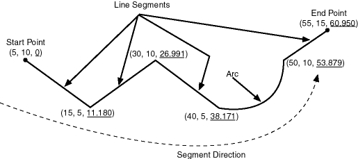
[Description of "Figure 7-1 Geometric Segment"](img_text/geoseg.md)

**Parent topic:** LRS Terms and Concepts

#### 7.1.2 Shape Points

Shape points are points that are specified when an LRS segment is constructed, and that are assigned measure information. In Oracle Spatial and Graph, a line segment is represented by its start and end points, and an arc is represented by three points: start, middle, and end points of the arc. You must specify these points as shape points, but you can also specify other points as shape points if you need measure information stored for these points (for example, an exit in the middle of a straight part of the highway).

Thus, shape points can serve one or both of the following purposes: to indicate the direction of the segment (for example, a turn or curve), and to identify a point of interest for which measure information is to be stored.

Shape points might not directly relate to mileposts or reference posts in LRS; they are used as internal reference points. The measure information of shape points is automatically populated when you define the LRS segment using the [SDO_LRS.DEFINE_GEOM_SEGMENT](SDO_LRS-reference.md) procedure, which is described in [SDO_LRS Package (Linear Referencing System)](SDO_LRS-reference.md) .

**Parent topic:** LRS Terms and Concepts

#### 7.1.3 Direction of a Geometric Segment

The direction of a geometric segment is indicated from the start point of the geometric segment to the end point. The direction is determined by the order of the vertices (from start point to end point) in the geometry definition. Measures of points on a geometric segment always either increase or decrease along the direction of the geometric segment.

**Parent topic:** LRS Terms and Concepts

#### 7.1.4 Measure (Linear Measure)

The measure of a point along a geometric segment is the linear distance (in the measure dimension) to the point measured from the start point (for increasing values) or end point (for decreasing values) of the geometric segment. The measure information does not necessarily have to be of the same scale as the distance. However, the linear mapping relationship between measure and distance is always preserved.

Some LRS functions use offset instead of measure to represent measured distance along linear features. Although some other linear referencing systems might use offset to mean what the Oracle Spatial and Graph LRS refers to as measure, offset has a different meaning in Oracle Spatial and Graph from measure, as explained in Offset.

**Parent topic:** LRS Terms and Concepts

#### 7.1.5 Offset

The offset of a point along a geometric segment is the perpendicular distance between the point and the geometric segment. Offsets are positive if the points are on the left side along the segment direction and are negative if they are on the right side. Points are on a geometric segment if their offsets to the segment are zero.

The unit of measurement for an offset is the same as for the coordinate system associated with the geometric segment. For geodetic data, the default unit of measurement is meters.

Figure 7-2 shows how a point can be located along a geometric segment with measure and offset information. By assigning an offset together with a measure, it is possible to locate not only points that are on the geometric segment, but also points that are perpendicular to the geometric segment.

Figure 7-2 Describing a Point Along a Segment with a Measure and an Offset

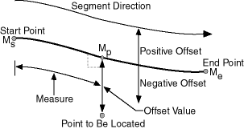
[Description of "Figure 7-2 Describing a Point Along a Segment with a Measure and an Offset"](img_text/point.md)

**Parent topic:** LRS Terms and Concepts

#### 7.1.6 Measure Populating

Any unassigned measures of a geometric segment are automatically populated based upon their distance distribution. This is done before any LRS operations for geometric segments with unknown measures (NULL in Oracle Spatial and Graph). The resulting geometric segments from any LRS operations return the measure information associated with geometric segments. The measure of a point on the geometric segment can be obtained based upon a linear mapping relationship between its previous and next known measures or locations. See the algorithm representation in Figure 7-3 and the example in Figure 7-4.

Figure 7-3 Measures, Distances, and Their Mapping Relationship

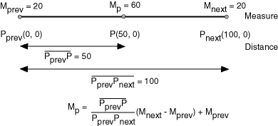
[Description of "Figure 7-3 Measures, Distances, and Their Mapping Relationship"](img_text/maprel.md)

Figure 7-4 Measure Populating of a Geometric Segment

[Description of "Figure 7-4 Measure Populating of a Geometric Segment"](img_text/measpop.md)

Measures are evenly spaced between assigned measures. However, the assigned measures for points of interest on a geometric segment do not need to be evenly spaced. This could eliminate the problem of error accumulation and account for inaccuracy of data source.

Moreover, the assigned measures do not even need to reflect actual distances (for example, they can reflect estimated driving time); they can be any valid values within the measure range. Figure 7-5 shows the measure population that results when assigned measure values are not proportional and reflect widely varying gaps.

Figure 7-5 Measure Populating with Disproportional Assigned Measures

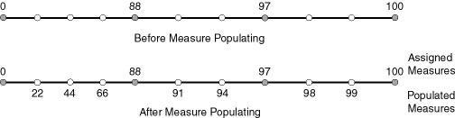
[Description of "Figure 7-5 Measure Populating with Disproportional Assigned Measures"](img_text/disprop.md)

In all cases, measure populating is done in an incremental fashion along the segment direction. This improves the performance of current and subsequent LRS operations.

**Parent topic:** LRS Terms and Concepts

#### 7.1.7 Measure Range of a Geometric Segment

The start and end measures of a geometric segment define the linear measure range of the geometric segment. Any valid LRS measures of a geometric segment must fall within its linear measure range.

**Parent topic:** LRS Terms and Concepts

#### 7.1.8 Projection

The projection of a point along a geometric segment is the point on the geometric segment with the minimum distance to the specified point. The measure information of the resulting point is also returned in the point geometry.

**Parent topic:** LRS Terms and Concepts

#### 7.1.9 LRS Point

LRS points are points with linear measure information along a geometric segment. A valid LRS point is a point geometry with measure information.

All LRS point data must be stored in the SDO_ELEM_INFO_ARRAY and SDO_ORDINATE_ARRAY, and cannot be stored in the SDO_POINT field in the SDO_GEOMETRY definition of the point.

**Parent topic:** LRS Terms and Concepts

#### 7.1.10 Linear Features

Linear features are any spatial objects that can be treated as a logical set of linear segments. Examples of linear features are highways in transportation applications and pipelines in utility industry applications. The relationship of linear features, geometric segments, and LRS points is shown in Figure 7-6, where a single linear feature consists of three geometric segments, and three LRS points are shown on the first segment.

Figure 7-6 Linear Feature, Geometric Segments, and LRS Points

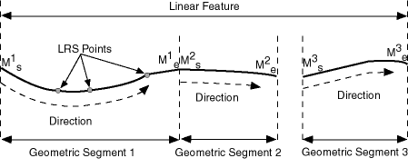
[Description of "Figure 7-6 Linear Feature, Geometric Segments, and LRS Points"](img_text/linear.md)

**Parent topic:** LRS Terms and Concepts

#### 7.1.11 Measures with Multiline Strings and Polygons with Holes

With a multiline string or polygon with hole LRS geometry, the [SDO_LRS.DEFINE_GEOM_SEGMENT](SDO_LRS-reference.md) procedure and [SDO_LRS.CONVERT_TO_LRS_GEOM](SDO_LRS-reference.md) function by default assign the same measure value to the end point of one segment and the start point (separated by a gap) of the next segment, although you can later assign different measure values to points. Thus, by default there will duplicate measure values in different segments for such geometries. In such cases, LRS subprograms use the first point with a specified measure, except when doing so would result in an invalid geometry.

For example, assume that in a multiline string LRS geometry, the first segment is from measures 0 through 100 and the second segment is from measures 100 through 150. If you use the [SDO_LRS.LOCATE_PT](SDO_LRS-reference.md) function to find the point at measure 100, the returned point will be at measure 100 in the first segment. If you use the [SDO_LRS.CLIP_GEOM_SEGMENT](SDO_LRS-reference.md), [SDO_LRS.DYNAMIC_SEGMENT](SDO_LRS-reference.md), or [SDO_LRS.OFFSET_GEOM_SEGMENT](SDO_LRS-reference.md) function to return the geometry object between measures 75 and 125, the result is a multiline string geometry consisting of two segments. If you use the same function to return the geometry object between measures 100 and 125, the point at measure 100 in the first segment is ignored, and the result is a line string along the second segment from measures 100 through 125.

**Parent topic:** LRS Terms and Concepts

### 7.2 LRS Data Model

The Oracle Spatial and Graph LRS data model incorporates measure information into its geometry representation at the point level.

The measure information is directly integrated into the Oracle Spatial and Graph model. To accomplish this, an additional measure dimension must be added to the Oracle Spatial and Graph metadata.

Oracle Spatial and Graph LRS support affects the spatial metadata and data (the geometries). Example 7-1 shows how a measure dimension can be added to two-dimensional geometries in the spatial metadata. The measure dimension must be the last element of the SDO_DIM_ARRAY in a spatial object definition (shown in bold in Example 7-1).

Figure 7-7 Creating a Geometric Segment

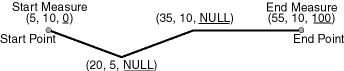
[Description of "Figure 7-7 Creating a Geometric Segment"](img_text/creating.md)

In Figure 7-7, the geometric segment has the following definition (with measure values underlined):

    SDO_GEOMETRY(3302, NULL, NULL,
         SDO_ELEM_INFO_ARRAY(1,2,1),
         SDO_ORDINATE_ARRAY(5,10,0, 20,5,NULL, 35,10,NULL, 55,10,100))

Whenever a geometric segment is defined, its start and end measures must be defined or derived from some existing geometric segment. The unsigned measures of all shape points on a geometric segment will be automatically populated.

The SDO_GTYPE of any point geometry used with an LRS function must be 3301.

Example 7-1 Including LRS Measure Dimension in Spatial Metadata

    INSERT INTO user_sdo_geom_metadata
        (TABLE_NAME,
         COLUMN_NAME,
         DIMINFO,
         SRID)
      VALUES(
      'LRS_ROUTES',
      'GEOMETRY',
      SDO_DIM_ARRAY (
        SDO_DIM_ELEMENT('X', 0, 20, 0.005),
        SDO_DIM_ELEMENT('Y', 0, 20, 0.005),
        SDO_DIM_ELEMENT('M', 0, 100, 0.005)),
      NULL);

After adding the new measure dimension, geometries with measure information such as geometric segments and LRS points can be represented. An example of creating a geometric segment with three line segments is shown in Figure 7-7.

**Parent topic:** Linear Referencing System

### 7.3 Indexing of LRS Data

If LRS data has four dimensions (three plus the M dimension) and if you need to index all three non-measure dimensions, you must use a spatial R-tree index to index the data.

You must also specify PARAMETERS('sdo_indx_dims=3') in the [CREATE INDEX](sql-indexing-spatial-data.md) statement to ensure that the first three dimensions are indexed. Note, however, that if you specify an `sdo_indx_dims` value of 3 or higher, only those operators listed in [Three-Dimensional Spatial Objects](spatial-concepts.md) as considering all three dimensions can be used on the indexed geometries; the other operators described in [Spatial Operators](spatial-operators-reference.md) cannot be used. (The default value for the `sdo_indx_dims` keyword is 2, which would cause only the first two dimensions to be indexed.) For example, if the dimensions are X, Y, Z, and M, specify `sdo_indx_dims=3` to index the X, Y, and Z dimensions, but not the measure (M) dimension. Do not include the measure dimension in a spatial index, because this causes additional processing overhead and produces no benefit.

Information about the [CREATE INDEX](sql-indexing-spatial-data.md) statement and its parameters and keywords is in [SQL Statements for Indexing Spatial Data](sql-indexing-spatial-data.md).

**Parent topic:** Linear Referencing System

### 7.4 3D Formats of LRS Functions

Most LRS functions have formats that end in \_3D: for example, DEFINE_GEOM_SEGMENT_3D, CLIP_GEOM_SEGMENT_3D, FIND_MEASURE_3D, and LOCATE_PT_3D. If a function has a 3D format, it is identified in the Usage Notes for the function’s reference topic.

The 3D formats are supported only for line string and multiline string geometries. (They are not supported for polygons, arcs, or circles.) The 3D formats should be used only when the geometry object has four dimensions and the fourth dimension is the measure (for example, X, Y, Z, and M), and only when you want the function to consider the first three dimensions (for example, X, Y, and Z). If the standard format of a function (that is, without the \_3D) is used on a geometry with four dimensions, the function considers only the first two dimensions (for example, X and Y).

For example, the following format considers the X, Y, and Z dimensions of the specified GEOM object in performing the clip operation:

    SELECT  SDO_LRS.CLIP_GEOM_SEGMENT_3D(a.geom, m.diminfo, 5, 10)
      FROM routes r, user_sdo_geom_metadata m
      WHERE m.table_name = 'ROUTES' AND m.column_name = 'GEOM'
        AND r.route_id = 1;

However, the following format considers only the X and Y dimensions, and ignores the Z dimension, of the specified GEOM object in performing the clip operation:

    SELECT  SDO_LRS.CLIP_GEOM_SEGMENT(a.geom, m.diminfo, 5, 10)
      FROM routes r, user_sdo_geom_metadata m
      WHERE m.table_name = 'ROUTES' AND m.column_name = 'GEOM'
        AND r.route_id = 1;

The parameters for the standard and 3D formats of any function are the same, and the Usage Notes apply to both formats.

If the parameters for an LRS function include both a line (or multiline) string and a point (LRS point), both the line string and the point must have the same number of dimensions. For example:

- For the [SDO_LRS.PROJECT_PT](SDO_LRS-reference.md) function, the input `geom_segment` (line) must have two dimensions (X.Y) plus the measure dimension, and the the input `point` point must be a two-dimensional LRS point geometry with a measure dimension (SDO_GTYPE = 3301). (This is the case in the example for that function.)

- For the SDO_LRS.PROJECT_PT_3D function. the input `geom_segment` must have three dimensions (X,Y,Z) plus the measure dimension, and the input `point` point must be a three-dimensional LRS point geometry with a measure dimension (SDO_GTYPE = 3401).

**Parent topic:** Linear Referencing System

### 7.5 LRS Operations

This topic describes several linear referencing operations supported by the Oracle Spatial and Graph LRS API.

- Defining a Geometric Segment
- Redefining a Geometric Segment
- Clipping a Geometric Segment (Dynamic Segmentation)
- Splitting a Geometric Segment
- Concatenating Geometric Segments
- Scaling a Geometric Segment
- Offsetting a Geometric Segment
- Locating a Point on a Geometric Segment
- Projecting a Point onto a Geometric Segment
- Converting LRS Geometries

**Parent topic:** Linear Referencing System

#### 7.5.1 Defining a Geometric Segment

There are two ways to create a geometric segment with measure information:

- Construct a geometric segment and assign measures explicitly.

- Define a geometric segment with specified start and end, and any other measures, in an ascending or descending order. Measures of shape points with unknown (unassigned) measures (null values) in the geometric segment will be automatically populated according to their locations and distance distribution.

Figure 7-8 shows different ways of defining a geometric segment:

Figure 7-8 Defining a Geometric Segment

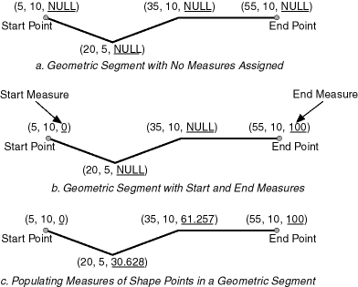
[Description of "Figure 7-8 Defining a Geometric Segment"](img_text/defining.md)

An LRS segment must be defined (or must already exist) before any LRS operations can proceed. That is, the start, end, and any other assigned measures must be present to derive the location from a specified measure. The measure information of intermediate shape points will automatically be populated if measure values are not assigned.

**Parent topic:** LRS Operations

#### 7.5.2 Redefining a Geometric Segment

You can redefine a geometric segment to replace the existing measures of all shape points between the start and end point with automatically calculated measures. Redefining a segment can be useful if errors have been made in one or more explicit measure assignments, and you want to start over with proportionally assigned measures.

Figure 7-9 shows the redefinition of a segment where the existing (before) assigned measure values are not proportional and reflect widely varying gaps.

Figure 7-9 Redefining a Geometric Segment

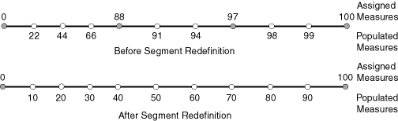
[Description of "Figure 7-9 Redefining a Geometric Segment"](img_text/redefining.md)

After the segment redefinition in Figure 7-9, the populated measures reflect proportional distances along the segment.

**Parent topic:** LRS Operations

#### 7.5.3 Clipping a Geometric Segment (Dynamic Segmentation)

You can clip a geometric segment to create a new geometric segment out of an existing geometric segment, as shown in Figure 7-10, part a.

Figure 7-10 Clipping, Splitting, and Concatenating Geometric Segments

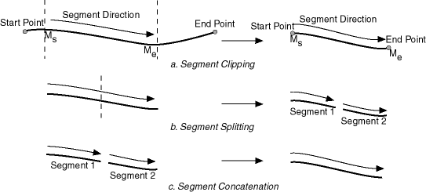
[Description of "Figure 7-10 Clipping, Splitting, and Concatenating Geometric Segments"](img_text/clipping.md)

In Figure 7-10, part a, a segment is created from part of a larger segment. The new segment has its own start and end points, and the direction is the same as in the original larger segment.

Clipping segments enables you to perform dynamic segmentation, where you clip the line at specific measure values. A scenario for such usage would be creating a table of road conditions, where for a given road, some segments are designated as in good condition and other segments are designated as in bad condition. For example, the segment between measures 100 and 120 might be in good condition, but the segment between measures 120 and 125 might be in poor condition. See the reference information for the synonymous functions [SDO_LRS.CLIP_GEOM_SEGMENT](SDO_LRS-reference.md) and [SDO_LRS.DYNAMIC_SEGMENT](SDO_LRS-reference.md).

**Parent topic:** LRS Operations

#### 7.5.4 Splitting a Geometric Segment

You can create two new geometric segments by splitting a geometric segment, as shown in the figure in Clipping a Geometric Segment (Dynamic Segmentation), part b. The direction of each new segment is the same as in the original segment.

**Note:**

In Clipping a Geometric Segment (Dynamic Segmentation) and other topics, small gaps between segments are used in illutrations of segment splitting and concatenation. Each gap simply reinforces the fact that two different segments are involved. However, the two segments (such as segment 1 and segment 2 in Clipping a Geometric Segment (Dynamic Segmentation), parts b and c) are actually connected. The tolerance (see [Tolerance](spatial-concepts.md)) is considered in determining whether or not segments are connected.

**Parent topic:** LRS Operations

#### 7.5.5 Concatenating Geometric Segments

You can create a new geometric segment by concatenating two geometric segments, as shown in part c of the figure in Clipping a Geometric Segment (Dynamic Segmentation). The geometric segments do not need to be spatially connected, although they are connected in the illustration in part c of that figure. (If the segments are not spatially connected, the concatenated result is a multiline string.) The measures of the second geometric segment are shifted so that the end measure of the first segment is the same as the start measure of the second segment. The direction of the segment resulting from the concatenation is the same as in the two original segments.

Measure assignments for the clipping, splitting, and concatenating operations in the figure in Clipping a Geometric Segment (Dynamic Segmentation) are shown in the following figure. Measure information and segment direction are preserved in a consistent manner. The assignment is done automatically when the operations have completed.

Figure 7-11 Measure Assignment in Geometric Segment Operations

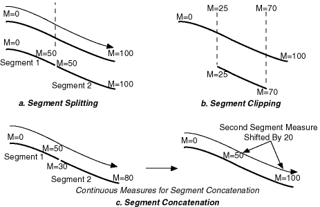
[Description of "Figure 7-11 Measure Assignment in Geometric Segment Operations"](img_text/geosegoper.md)

The direction of the geometric segment resulting from concatenation is always the direction of the first segment (`geom_segment1` in the call to the [SDO_LRS.CONCATENATE_GEOM_SEGMENTS](SDO_LRS-reference.md) function), as shown in the following figure.

Figure 7-12 Segment Direction with Concatenation

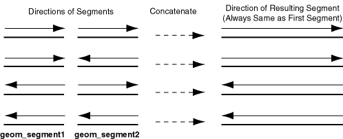
[Description of "Figure 7-12 Segment Direction with Concatenation"](img_text/concat.md)

In addition to explicitly concatenating two connected segments using the [SDO_LRS.CONCATENATE_GEOM_SEGMENTS](SDO_LRS-reference.md) function, you can perform aggregate concatenation: that is, you can concatenate all connected geometric segments in a column (layer) using the [SDO_AGGR_LRS_CONCAT](spatial-aggregate-functions.md) spatial aggregate function. (See the description and example of the [SDO_AGGR_LRS_CONCAT](spatial-aggregate-functions.md) spatial aggregate function in [Spatial Aggregate Functions](spatial-aggregate-functions.md).)

**Parent topic:** LRS Operations

#### 7.5.6 Scaling a Geometric Segment

You can create a new geometric segment by performing a linear scaling operation on a geometric segment. Figure 7-13 shows the mapping relationship for geometric segment scaling.

Figure 7-13 Scaling a Geometric Segment

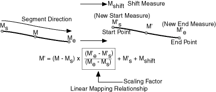
[Description of "Figure 7-13 Scaling a Geometric Segment"](img_text/scaling.md)

In general, scaling a geometric segment only involves rearranging measures of the newly created geometric segment. However, if the scaling factor is negative, the order of the shape points needs to be reversed so that measures will increase along the geometric segment's direction (which is defined by the order of the shape points).

A scale operation can perform any combination of the following operations:

- Translating (shifting) measure information. (For example, add the same value to Ms and Me to get M's and M'e.)

- Reversing measure information. (Let M's = Me, M'e = Ms, and Mshift = 0.)

- Performing simple scaling of measure information. (Let Mshift = 0.)

For examples of these operations, see the Usage Notes and Examples for the[SDO_LRS.SCALE_GEOM_SEGMENT](SDO_LRS-reference.md), [SDO_LRS.TRANSLATE_MEASURE](SDO_LRS-reference.md), [SDO_LRS.REVERSE_GEOMETRY](SDO_LRS-reference.md), and [SDO_LRS.REDEFINE_GEOM_SEGMENT](SDO_LRS-reference.md) subprograms in [SDO_LRS Package (Linear Referencing System)](SDO_LRS-reference.md) .

**Parent topic:** LRS Operations

#### 7.5.7 Offsetting a Geometric Segment

You can create a new geometric segment by performing an offsetting operation on a geometric segment. Figure 7-14 shows the mapping relationship for geometric segment offsetting.

Figure 7-14 Offsetting a Geometric Segment

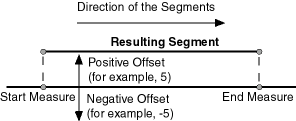
[Description of "Figure 7-14 Offsetting a Geometric Segment"](img_text/offsetting.md)

In the offsetting operation shown in Figure 7-14, the resulting geometric segment is offset by 5 units from the specified start and end measures of the original segment.

For more information, see the Usage Notes and Examples for the [SDO_LRS.OFFSET_GEOM_SEGMENT](SDO_LRS-reference.md) function in [SDO_LRS Package (Linear Referencing System)](SDO_LRS-reference.md) .

**Parent topic:** LRS Operations

#### 7.5.8 Locating a Point on a Geometric Segment

You can find the position of a point described by a measure and an offset on a geometric segment (see Figure 7-15).

Figure 7-15 Locating a Point Along a Segment with a Measure and an Offset

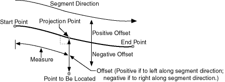
[Description of "Figure 7-15 Locating a Point Along a Segment with a Measure and an Offset"](img_text/point_offset.md)

There is always a unique location with a specific measure on a geometric segment. Ambiguity arises when offsets are given and the points described by the measures fall on shape points of the geometric segment (see Figure 7-16).

Figure 7-16 Ambiguity in Location Referencing with Offsets

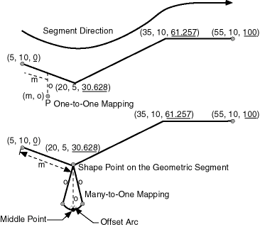
[Description of "Figure 7-16 Ambiguity in Location Referencing with Offsets"](img_text/ambiguity.md)

As shown in Figure 7-16, an offset arc of a shape point on a geometric segment is an arc on which all points have the same minimum distance to the shape point. As a result, all points on the offset arc are represented by the same (measure, offset) pair. To resolve this one-to-many mapping problem, the middle point on the offset arc is returned.

**Parent topic:** LRS Operations

#### 7.5.9 Projecting a Point onto a Geometric Segment

You can find the projection point of a point with respect to a geometric segment. The point to be projected can be on or off the segment. If the point is on the segment, the point and its projection point are the same.

Projection is a reverse operation of the point-locating operation shown in Figure 7-15. Similar to a point-locating operation, all points on the offset arc of a shape point will have the same projection point (that is, the shape point itself), measure, and offset (see Figure 7-16). If there are multiple projection points for a point, the first one from the start point is returned (Projection Point 1 in both illustrations in Figure 7-17).

Figure 7-17 Multiple Projection Points

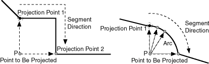
[Description of "Figure 7-17 Multiple Projection Points"](img_text/multiprojpts.md)

**Parent topic:** LRS Operations

#### 7.5.10 Converting LRS Geometries

You can convert geometries from standard line string format to LRS format, and the reverse. The main use of conversion functions will probably occur if you have a large amount of existing line string data, in which case conversion is a convenient alternative to creating all of the LRS segments manually. However, if you need to convert LRS segments to standard line strings for certain applications, that capability is provided also.

Functions are provided to convert:

- Individual line strings or points

  For conversion from standard format to LRS format, a measure dimension (named M by default) is added, and measure information is provided for each point. For conversion from LRS format to standard format, the measure dimension and information are removed. In both cases, the dimensional information (DIMINFO) metadata in the USER_SDO_GEOM_METADATA view is not affected.

- Layers (all geometries in a column)

  For conversion from standard format to LRS format, a measure dimension (named M by default) is added, but no measure information is provided for each point. For conversion from LRS format to standard format, the measure dimension and information are removed. In both cases, the dimensional information (DIMINFO) metadata in the USER_SDO_GEOM_METADATA view is modified as needed.

- Dimensional information (DIMINFO)

  The dimensional information (DIMINFO) metadata in the USER_SDO_GEOM_METADATA view is modified as needed. For example, converting a standard dimensional array with X and Y dimensions (SDO_DIM_ELEMENT) to an LRS dimensional array causes an M dimension (SDO_DIM_ELEMENT) to be added.

Figure 7-18 shows the addition of measure information when a standard line string is converted to an LRS line string (using the [SDO_LRS.CONVERT_TO_LRS_GEOM](SDO_LRS-reference.md) function). The measure dimension values are underlined in Figure 7-18.

Figure 7-18 Conversion from Standard to LRS Line String

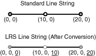
[Description of "Figure 7-18 Conversion from Standard to LRS Line String"](img_text/conversion.md)

For conversions of point geometries, the SDO_POINT attribute (described in [SDO_POINT](spatial-datatypes-metadata.md)) in the returned geometry is affected as follows:

- If a standard point is converted to an LRS point, the SDO_POINT attribute information in the input geometry is used to set the SDO_ELEM_INFO and SDO_ORDINATES attributes (described in [SDO_ELEM_INFO](spatial-datatypes-metadata.md) and [SDO_ORDINATES](spatial-datatypes-metadata.md)) in the resulting geometry, and the SDO_POINT attribute in the resulting geometry is set to null.

- If an LRS point is converted to a standard point, the information in the SDO_ELEM_INFO and SDO_ORDINATES attributes (described in [SDO_ELEM_INFO](spatial-datatypes-metadata.md) and [SDO_ORDINATES](spatial-datatypes-metadata.md)) in the input geometry is used to set the SDO_POINT attribute information in the resulting geometry, and the SDO_ELEM_INFO and SDO_ORDINATES attributes in the resulting geometry are set to null.

The conversion functions are listed in [SDO_LRS Package (Linear Referencing System)](SDO_LRS-reference.md) . See also the reference information in [SDO_LRS Package (Linear Referencing System)](SDO_LRS-reference.md) about each conversion function.

**Parent topic:** LRS Operations

### 7.6 Tolerance Values with LRS Functions

Many LRS functions require that you specify a tolerance value or one or more dimensional arrays.

Thus, you can control whether to specify a single tolerance value for all non-measure dimensions or to use the tolerance associated with each non-measure dimension in the dimensional array or arrays. The tolerance is applied only to the geometry portion of the data, not to the measure dimension. The tolerance value for geodetic data is in meters, and for non-geodetic data it is in the unit of measurement associated with the data. (For a detailed discussion of tolerance, see [Tolerance](spatial-concepts.md).)

Be sure that the tolerance value used is appropriate to the data and your purpose. If the results of LRS functions seem imprecise or incorrect, you may need to specify a smaller tolerance value.

For clip operations (see Clipping a Geometric Segment) and offset operations (see Offsetting a Geometric Segment), if the returned segment has any shape points within the tolerance value of the input geometric segment from what would otherwise be the start point or end point of the returned segment, the shape point is used as the start point or end point of the returned segment. This is done to ensure that the resulting geometry does not contain any redundant vertices, which would cause the geometry to be invalid. For example, assume that the tolerance associated with the geometric segment (non-geodetic data) in Figure 7-19 is 0.5.

Figure 7-19 Segment for Clip Operation Affected by Tolerance

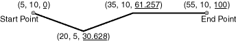
[Description of "Figure 7-19 Segment for Clip Operation Affected by Tolerance"](img_text/lrs_tol.md)

If you request a clip operation to return the segment between measure values 0 (the start point) and 61.5 in Figure 7-19, and if the distance between the points associated with measure values 61.5 and 61.257 is less than the 0.5 tolerance value, the end point of the returned segment is (35, 10, 61.257).

**Parent topic:** Linear Referencing System

### 7.7 Example of LRS Functions

This section presents a simplified example that uses LRS functions.

It refers to concepts that are explained in this chapter and uses functions documented in [SDO_LRS Package (Linear Referencing System)](SDO_LRS-reference.md) .

This example uses the road that is illustrated in Figure 7-20.

Figure 7-20 Simplified LRS Example: Highway

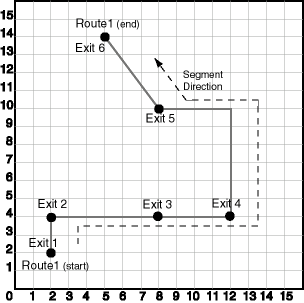
[Description of "Figure 7-20 Simplified LRS Example: Highway"](img_text/highway.md)

In Figure 7-20, the highway (Route 1) starts at point 2,2 and ends at point 5,14, follows the path shown, and has six entrance-exit points (Exit 1 through Exit 6). For simplicity, each unit on the graph represents one unit of measure, and thus the measure from start to end is 27 (the segment from Exit 5 to Exit 6 being the hypotenuse of a 3-4-5 right triangle).

Each row in Table 7-1 lists an actual highway-related feature and the LRS feature that corresponds to it or that can be used to represent it.

Table 7-1 Highway Features and LRS Counterparts

| Highway Feature                                                                                                          | LRS Feature                                                        |
|:-------------------------------------------------------------------------------------------------------------------------|:-------------------------------------------------------------------|
| Named route, road, or street                                                                                             | LRS segment, or linear feature (logical set of segments)           |
| Mile or kilometer marker                                                                                                 | Measure                                                            |
| Accident reporting and location tracking                                                                                 | [SDO_LRS.LOCATE_PT](SDO_LRS-reference.md) function                 |
| Construction zone (portion of a road)                                                                                    | [SDO_LRS.CLIP_GEOM_SEGMENT](SDO_LRS-reference.md) function         |
| Road extension (adding at the beginning or end) or combination (designating or renaming two roads that meet as one road) | [SDO_LRS.CONCATENATE_GEOM_SEGMENTS](SDO_LRS-reference.md) function |
| Road reconstruction or splitting (resulting in two named roads from one named road)                                      | [SDO_LRS.SPLIT_GEOM_SEGMENT](SDO_LRS-reference.md) procedure       |
| Finding the closest point on the road to a point off the road (such as a building)                                       | [SDO_LRS.PROJECT_PT](SDO_LRS-reference.md) function                |
| Guard rail or fence alongside a road                                                                                     | [SDO_LRS.OFFSET_GEOM_SEGMENT](SDO_LRS-reference.md) function       |

Example 7-2 does the following:

- Creates a table to hold the segment depicted in Figure 7-20

- Inserts the definition of the highway depicted in Figure 7-20 into the table

- Inserts the necessary metadata into the USER_SDO_GEOM_METADATA view

- Uses PL/SQL and SQL statements to define the segment and perform operations on it

Example 7-2 Simplified Example: Highway

    -- Create a table for routes (highways).
    CREATE TABLE lrs_routes (
      route_id  NUMBER PRIMARY KEY,
      route_name  VARCHAR2(32),
      route_geometry  SDO_GEOMETRY);

    -- Populate table with just one route for this example.
    INSERT INTO lrs_routes VALUES(
      1,
      'Route1',
      SDO_GEOMETRY(
        3302,  -- line string, 3 dimensions: X,Y,M
        NULL,
        NULL,
        SDO_ELEM_INFO_ARRAY(1,2,1), -- one line string, straight segments
        SDO_ORDINATE_ARRAY(
          2,2,0,   -- Start point - Exit1; 0 is measure from start.
          2,4,2,   -- Exit2; 2 is measure from start.
          8,4,8,   -- Exit3; 8 is measure from start.
          12,4,12,  -- Exit4; 12 is measure from start.
          12,10,NULL,  -- Not an exit; measure automatically calculated and filled.
          8,10,22,  -- Exit5; 22 is measure from start.
          5,14,27)  -- End point (Exit6); 27 is measure from start.
      )
    );

    -- Update the spatial metadata.
    INSERT INTO user_sdo_geom_metadata
        (TABLE_NAME,
         COLUMN_NAME,
         DIMINFO,
         SRID)
      VALUES (
      'lrs_routes',
      'route_geometry',
      SDO_DIM_ARRAY(   -- 20X20 grid
        SDO_DIM_ELEMENT('X', 0, 20, 0.005),
        SDO_DIM_ELEMENT('Y', 0, 20, 0.005),
        SDO_DIM_ELEMENT('M', 0, 20, 0.005) -- Measure dimension
         ),
      NULL   -- SRID
    );

    -- Create the spatial index.
    CREATE INDEX lrs_routes_idx ON lrs_routes(route_geometry)
      INDEXTYPE IS MDSYS.SPATIAL_INDEX_V2;

    -- Test the LRS procedures.
    DECLARE
    geom_segment SDO_GEOMETRY;
    line_string SDO_GEOMETRY;
    dim_array SDO_DIM_ARRAY;
    result_geom_1 SDO_GEOMETRY;
    result_geom_2 SDO_GEOMETRY;
    result_geom_3 SDO_GEOMETRY;

    BEGIN

    SELECT a.route_geometry into geom_segment FROM lrs_routes a
      WHERE a.route_name = 'Route1';
    SELECT m.diminfo into dim_array from
      user_sdo_geom_metadata m
      WHERE m.table_name = 'LRS_ROUTES' AND m.column_name = 'ROUTE_GEOMETRY';

    -- Define the LRS segment for Route1. This will populate any null measures.
    -- No need to specify start and end measures, because they are already defined
    -- in the geometry.
    SDO_LRS.DEFINE_GEOM_SEGMENT (geom_segment, dim_array);

    SELECT a.route_geometry INTO line_string FROM lrs_routes a
      WHERE a.route_name = 'Route1';

    -- Split Route1 into two segments.
    SDO_LRS.SPLIT_GEOM_SEGMENT(line_string,dim_array,5,result_geom_1,result_geom_2);

    -- Concatenate the segments that were just split.
    result_geom_3 := SDO_LRS.CONCATENATE_GEOM_SEGMENTS(result_geom_1, dim_array, result_geom_2, dim_array);

    -- Update and insert geometries into table, to display later.
    UPDATE lrs_routes a SET a.route_geometry = geom_segment
       WHERE a.route_id = 1;

    INSERT INTO lrs_routes VALUES(
      11,
      'result_geom_1',
      result_geom_1
    );
    INSERT INTO lrs_routes VALUES(
      12,
      'result_geom_2',
      result_geom_2
    );
    INSERT INTO lrs_routes VALUES(
      13,
      'result_geom_3',
      result_geom_3
    );

    END;
    /

    -- First, display the data in the LRS table.
    SELECT route_id, route_name, route_geometry FROM lrs_routes;

    -- Are result_geom_1 and result_geom2 connected?
    SELECT  SDO_LRS.CONNECTED_GEOM_SEGMENTS(a.route_geometry,
               b.route_geometry, 0.005)
      FROM lrs_routes a, lrs_routes b
      WHERE a.route_id = 11 AND b.route_id = 12;

    -- Is the Route1 segment valid?
    SELECT  SDO_LRS.VALID_GEOM_SEGMENT(route_geometry)
      FROM lrs_routes WHERE route_id = 1;

    -- Is 50 a valid measure on Route1? (Should return FALSE; highest Route1 measure is 27.)
    SELECT  SDO_LRS.VALID_MEASURE(route_geometry, 50)
      FROM lrs_routes WHERE route_id = 1;

    -- Is the Route1 segment defined?
    SELECT  SDO_LRS.IS_GEOM_SEGMENT_DEFINED(route_geometry)
      FROM lrs_routes WHERE route_id = 1;

    -- How long is Route1?
    SELECT  SDO_LRS.GEOM_SEGMENT_LENGTH(route_geometry)
      FROM lrs_routes WHERE route_id = 1;

    -- What is the start measure of Route1?
    SELECT  SDO_LRS.GEOM_SEGMENT_START_MEASURE(route_geometry)
      FROM lrs_routes WHERE route_id = 1;

    -- What is the end measure of Route1?
    SELECT  SDO_LRS.GEOM_SEGMENT_END_MEASURE(route_geometry)
      FROM lrs_routes WHERE route_id = 1;

    -- What is the start point of Route1?
    SELECT  SDO_LRS.GEOM_SEGMENT_START_PT(route_geometry)
      FROM lrs_routes WHERE route_id = 1;

    -- What is the end point of Route1?
    SELECT  SDO_LRS.GEOM_SEGMENT_END_PT(route_geometry)
      FROM lrs_routes WHERE route_id = 1;

    -- Translate (shift measure values) (+10).
    -- First, display the original segment; then, translate.
    SELECT a.route_geometry FROM lrs_routes a WHERE a.route_id = 1;
    SELECT SDO_LRS.TRANSLATE_MEASURE(a.route_geometry, m.diminfo, 10)
      FROM lrs_routes a, user_sdo_geom_metadata m
      WHERE m.table_name = 'LRS_ROUTES' AND m.column_name = 'ROUTE_GEOMETRY'
        AND a.route_id = 1;

    -- Redefine geometric segment to "convert" miles to kilometers
    DECLARE
    geom_segment SDO_GEOMETRY;
    dim_array SDO_DIM_ARRAY;

    BEGIN

    SELECT a.route_geometry into geom_segment FROM lrs_routes a
      WHERE a.route_name = 'Route1';
    SELECT m.diminfo into dim_array from
      user_sdo_geom_metadata m
      WHERE m.table_name = 'LRS_ROUTES' AND m.column_name = 'ROUTE_GEOMETRY';

    -- "Convert" mile measures to kilometers (27 * 1.609 = 43.443).
    SDO_LRS.REDEFINE_GEOM_SEGMENT (geom_segment,
      dim_array,
      0, -- Zero starting measure: LRS segment starts at start of route.
      43.443); -- End of LRS segment. 27 miles = 43.443 kilometers.

    -- Update and insert geometries into table, to display later.
    UPDATE lrs_routes a SET a.route_geometry = geom_segment
       WHERE a.route_id = 1;

    END;/
    -- Display the redefined segment, with all measures "converted."
    SELECT a.route_geometry FROM lrs_routes a WHERE a.route_id = 1;

    -- Clip a piece of Route1.
    SELECT  SDO_LRS.CLIP_GEOM_SEGMENT(route_geometry, 5, 10)
      FROM lrs_routes WHERE route_id = 1;

    -- Point (9,3,NULL) is off the road; should return (9,4,9).
    SELECT  SDO_LRS.PROJECT_PT(route_geometry,
      SDO_GEOMETRY(3301, NULL, NULL,
         SDO_ELEM_INFO_ARRAY(1, 1, 1),
         SDO_ORDINATE_ARRAY(9, 3, NULL)) )
      FROM lrs_routes WHERE route_id = 1;

    -- Return the measure of the projected point.
    SELECT  SDO_LRS.GET_MEASURE(
     SDO_LRS.PROJECT_PT(a.route_geometry, m.diminfo,
      SDO_GEOMETRY(3301, NULL, NULL,
         SDO_ELEM_INFO_ARRAY(1, 1, 1),
         SDO_ORDINATE_ARRAY(9, 3, NULL)) ),
     m.diminfo )
     FROM lrs_routes a, user_sdo_geom_metadata m
     WHERE m.table_name = 'LRS_ROUTES' AND m.column_name = 'ROUTE_GEOMETRY'
       AND a.route_id = 1;

    -- Is point (9,3,NULL) a valid LRS point? (Should return TRUE.)
    SELECT  SDO_LRS.VALID_LRS_PT(
      SDO_GEOMETRY(3301, NULL, NULL,
         SDO_ELEM_INFO_ARRAY(1, 1, 1),
         SDO_ORDINATE_ARRAY(9, 3, NULL)),
      m.diminfo)
      FROM lrs_routes a, user_sdo_geom_metadata m
      WHERE m.table_name = 'LRS_ROUTES' AND m.column_name = 'ROUTE_GEOMETRY'
        AND a.route_id = 1;

    -- Locate the point on Route1 at measure 9, offset 0.
    SELECT  SDO_LRS.LOCATE_PT(route_geometry, 9, 0)
      FROM lrs_routes WHERE route_id = 1;

Example 7-3 shows the output of the SELECT statements in Example 7-2.

Example 7-3 Simplified Example: Output of SELECT Statements

    SQL> -- First, display the data in the LRS table.
    SQL> SELECT route_id, route_name, route_geometry FROM lrs_routes;

      ROUTE_ID ROUTE_NAME
    ---------- --------------------------------
    ROUTE_GEOMETRY(SDO_GTYPE, SDO_SRID, SDO_POINT(X, Y, Z), SDO_ELEM_INFO, SDO_ORDIN
    --------------------------------------------------------------------------------
             1 Route1
    SDO_GEOMETRY(3302, NULL, NULL, SDO_ELEM_INFO_ARRAY(1, 2, 1), SDO_ORDINATE_ARRAY(
    2, 2, 0, 2, 4, 2, 8, 4, 8, 12, 4, 12, 12, 10, 18, 8, 10, 22, 5, 14, 27))

            11 result_geom_1
    SDO_GEOMETRY(3302, NULL, NULL, SDO_ELEM_INFO_ARRAY(1, 2, 1), SDO_ORDINATE_ARRAY(
    2, 2, 0, 2, 4, 2, 5, 4, 5))

            12 result_geom_2

      ROUTE_ID ROUTE_NAME
    ---------- --------------------------------
    ROUTE_GEOMETRY(SDO_GTYPE, SDO_SRID, SDO_POINT(X, Y, Z), SDO_ELEM_INFO, SDO_ORDIN
    --------------------------------------------------------------------------------
    SDO_GEOMETRY(3302, NULL, NULL, SDO_ELEM_INFO_ARRAY(1, 2, 1), SDO_ORDINATE_ARRAY(
    5, 4, 5, 8, 4, 8, 12, 4, 12, 12, 10, 18, 8, 10, 22, 5, 14, 27))

            13 result_geom_3
    SDO_GEOMETRY(3302, NULL, NULL, SDO_ELEM_INFO_ARRAY(1, 2, 1), SDO_ORDINATE_ARRAY(
    2, 2, 0, 2, 4, 2, 5, 4, 5, 8, 4, 8, 12, 4, 12, 12, 10, 18, 8, 10, 22, 5, 14, 27)
    )

    SQL> -- Are result_geom_1 and result_geom2 connected?
    SQL> SELECT  SDO_LRS.CONNECTED_GEOM_SEGMENTS(a.route_geometry,
      2         b.route_geometry, 0.005)
      3    FROM lrs_routes a, lrs_routes b
      4    WHERE a.route_id = 11 AND b.route_id = 12;

    SDO_LRS.CONNECTED_GEOM_SEGMENTS(A.ROUTE_GEOMETRY,B.ROUTE_GEOMETRY,0.005)
    --------------------------------------------------------------------------------
    TRUE

    SQL> -- Is the Route1 segment valid?
    SQL> SELECT  SDO_LRS.VALID_GEOM_SEGMENT(route_geometry)
      2    FROM lrs_routes WHERE route_id = 1;

    SDO_LRS.VALID_GEOM_SEGMENT(ROUTE_GEOMETRY)
    --------------------------------------------------------------------------------
    TRUE

    SQL> -- Is 50 a valid measure on Route1? (Should return FALSE; highest Route1 measure is 27.)
    SQL> SELECT  SDO_LRS.VALID_MEASURE(route_geometry, 50)
      2    FROM lrs_routes WHERE route_id = 1;

    SDO_LRS.VALID_MEASURE(ROUTE_GEOMETRY,50)
    --------------------------------------------------------------------------------
    FALSE

    SQL> -- Is the Route1 segment defined?
    SQL> SELECT  SDO_LRS.IS_GEOM_SEGMENT_DEFINED(route_geometry)
      2    FROM lrs_routes WHERE route_id = 1;

    SDO_LRS.IS_GEOM_SEGMENT_DEFINED(ROUTE_GEOMETRY)
    --------------------------------------------------------------------------------
    TRUE

    SQL> -- How long is Route1?
    SQL> SELECT  SDO_LRS.GEOM_SEGMENT_LENGTH(route_geometry)
      2    FROM lrs_routes WHERE route_id = 1;

    SDO_LRS.GEOM_SEGMENT_LENGTH(ROUTE_GEOMETRY)
    -------------------------------------------
                                             27

    SQL> -- What is the start measure of Route1?
    SQL> SELECT  SDO_LRS.GEOM_SEGMENT_START_MEASURE(route_geometry)
      2    FROM lrs_routes WHERE route_id = 1;

    SDO_LRS.GEOM_SEGMENT_START_MEASURE(ROUTE_GEOMETRY)
    --------------------------------------------------
                                                     0

    SQL> -- What is the end measure of Route1?
    SQL> SELECT  SDO_LRS.GEOM_SEGMENT_END_MEASURE(route_geometry)
      2    FROM lrs_routes WHERE route_id = 1;

    SDO_LRS.GEOM_SEGMENT_END_MEASURE(ROUTE_GEOMETRY)
    ------------------------------------------------
                                                  27

    SQL> -- What is the start point of Route1?
    SQL> SELECT  SDO_LRS.GEOM_SEGMENT_START_PT(route_geometry)
      2    FROM lrs_routes WHERE route_id = 1;

    SDO_LRS.GEOM_SEGMENT_START_PT(ROUTE_GEOMETRY)(SDO_GTYPE, SDO_SRID, SDO_POINT(X,
    --------------------------------------------------------------------------------
    SDO_GEOMETRY(3301, NULL, NULL, SDO_ELEM_INFO_ARRAY(1, 1, 1), SDO_ORDINATE_ARRAY(
    2, 2, 0))

    SQL> -- What is the end point of Route1?
    SQL> SELECT  SDO_LRS.GEOM_SEGMENT_END_PT(route_geometry)
      2    FROM lrs_routes WHERE route_id = 1;

    SDO_LRS.GEOM_SEGMENT_END_PT(ROUTE_GEOMETRY)(SDO_GTYPE, SDO_SRID, SDO_POINT(X, Y,
    --------------------------------------------------------------------------------
    SDO_GEOMETRY(3301, NULL, NULL, SDO_ELEM_INFO_ARRAY(1, 1, 1), SDO_ORDINATE_ARRAY(
    5, 14, 27))

    SQL> -- Translate (shift measure values) (+10).
    SQL> -- First, display the original segment; then, translate.
    SQL> SELECT a.route_geometry FROM lrs_routes a WHERE a.route_id = 1;

    ROUTE_GEOMETRY(SDO_GTYPE, SDO_SRID, SDO_POINT(X, Y, Z), SDO_ELEM_INFO, SDO_ORDIN
    --------------------------------------------------------------------------------
    SDO_GEOMETRY(3302, NULL, NULL, SDO_ELEM_INFO_ARRAY(1, 2, 1), SDO_ORDINATE_ARRAY(
    2, 2, 0, 2, 4, 2, 8, 4, 8, 12, 4, 12, 12, 10, 18, 8, 10, 22, 5, 14, 27))

    SQL> SELECT SDO_LRS.TRANSLATE_MEASURE(a.route_geometry, m.diminfo, 10)
      2    FROM lrs_routes a, user_sdo_geom_metadata m
      3    WHERE m.table_name = 'LRS_ROUTES' AND m.column_name = 'ROUTE_GEOMETRY'
      4   AND a.route_id = 1;

    SDO_LRS.TRANSLATE_MEASURE(A.ROUTE_GEOMETRY,M.DIMINFO,10)(SDO_GTYPE, SDO_SRID, SD
    --------------------------------------------------------------------------------
    SDO_GEOMETRY(3302, NULL, NULL, SDO_ELEM_INFO_ARRAY(1, 2, 1), SDO_ORDINATE_ARRAY(
    2, 2, 10, 2, 4, 12, 8, 4, 18, 12, 4, 22, 12, 10, 28, 8, 10, 32, 5, 14, 37))

    SQL> -- Redefine geometric segment to "convert" miles to kilometers
    SQL> DECLARE
      2  geom_segment SDO_GEOMETRY;
      3  dim_array SDO_DIM_ARRAY;
      4
      5  BEGIN
      6
      7  SELECT a.route_geometry into geom_segment FROM lrs_routes a
      8    WHERE a.route_name = 'Route1';
      9  SELECT m.diminfo into dim_array from
     10    user_sdo_geom_metadata m
     11    WHERE m.table_name = 'LRS_ROUTES' AND m.column_name = 'ROUTE_GEOMETRY';
     12
     13  -- "Convert" mile measures to kilometers (27 * 1.609 = 43.443).
     14  SDO_LRS.REDEFINE_GEOM_SEGMENT (geom_segment,
     15    dim_array,
     16    0, -- Zero starting measure: LRS segment starts at start of route.
     17    43.443); -- End of LRS segment. 27 miles = 43.443 kilometers.
     18
     19  -- Update and insert geometries into table, to display later.
     20  UPDATE lrs_routes a SET a.route_geometry = geom_segment
     21     WHERE a.route_id = 1;
     22
     23  END;
     24  /

    PL/SQL procedure successfully completed.

    SQL> -- Display the redefined segment, with all measures "converted."
    SQL> SELECT a.route_geometry FROM lrs_routes a WHERE a.route_id = 1;

    ROUTE_GEOMETRY(SDO_GTYPE, SDO_SRID, SDO_POINT(X, Y, Z), SDO_ELEM_INFO, SDO_ORDIN
    --------------------------------------------------------------------------------
    SDO_GEOMETRY(3302, NULL, NULL, SDO_ELEM_INFO_ARRAY(1, 2, 1), SDO_ORDINATE_ARRAY(
    2, 2, 0, 2, 4, 3.218, 8, 4, 12.872, 12, 4, 19.308, 12, 10, 28.962, 8, 10, 35.398
    , 5, 14, 43.443))

    SQL> -- Clip a piece of Route1.
    SQL> SELECT  SDO_LRS.CLIP_GEOM_SEGMENT(route_geometry, 5, 10)
      2    FROM lrs_routes WHERE route_id = 1;

    SDO_LRS.CLIP_GEOM_SEGMENT(ROUTE_GEOMETRY,5,10)(SDO_GTYPE, SDO_SRID, SDO_POINT(X,
    --------------------------------------------------------------------------------
    SDO_GEOMETRY(3302, NULL, NULL, SDO_ELEM_INFO_ARRAY(1, 2, 1), SDO_ORDINATE_ARRAY(
    5, 4, 5, 8, 4, 8, 10, 4, 10))

    SQL> -- Point (9,3,NULL) is off the road; should return (9,4,9).
    SQL> SELECT  SDO_LRS.PROJECT_PT(route_geometry,
      2    SDO_GEOMETRY(3301, NULL, NULL,
      3    SDO_ELEM_INFO_ARRAY(1, 1, 1),
      4    SDO_ORDINATE_ARRAY(9, 3, NULL)) )
      5    FROM lrs_routes WHERE route_id = 1;

    SDO_LRS.PROJECT_PT(ROUTE_GEOMETRY,SDO_GEOMETRY(3301,NULL,NULL,SDO_EL
    --------------------------------------------------------------------------------
    SDO_GEOMETRY(3301, NULL, NULL, SDO_ELEM_INFO_ARRAY(1, 1, 1), SDO_ORDINATE_ARRAY(
    9, 4, 9))

    SQL> -- Return the measure of the projected point.
    SQL> SELECT  SDO_LRS.GET_MEASURE(
      2   SDO_LRS.PROJECT_PT(a.route_geometry, m.diminfo,
      3    SDO_GEOMETRY(3301, NULL, NULL,
      4    SDO_ELEM_INFO_ARRAY(1, 1, 1),
      5    SDO_ORDINATE_ARRAY(9, 3, NULL)) ),
      6   m.diminfo )
      7   FROM lrs_routes a, user_sdo_geom_metadata m
      8   WHERE m.table_name = 'LRS_ROUTES' AND m.column_name = 'ROUTE_GEOMETRY'
      9      AND a.route_id = 1;

    SDO_LRS.GET_MEASURE(SDO_LRS.PROJECT_PT(A.ROUTE_GEOMETRY,M.DIMINFO,SDO_GEOM
    --------------------------------------------------------------------------------
                                                                                   9

    SQL> -- Is point (9,3,NULL) a valid LRS point? (Should return TRUE.)
    SQL> SELECT  SDO_LRS.VALID_LRS_PT(
      2    SDO_GEOMETRY(3301, NULL, NULL,
      3    SDO_ELEM_INFO_ARRAY(1, 1, 1),
      4    SDO_ORDINATE_ARRAY(9, 3, NULL)),
      5    m.diminfo)
      6    FROM lrs_routes a, user_sdo_geom_metadata m
      7    WHERE m.table_name = 'LRS_ROUTES' AND m.column_name = 'ROUTE_GEOMETRY'
      8    AND a.route_id = 1;

    SDO_LRS.VALID_LRS_PT(SDO_GEOMETRY(3301,NULL,NULL,SDO_ELEM_INFO_ARRAY
    ------------------------------------------------------------------------------
    TRUE

    SQL> -- Locate the point on Route1 at measure 9, offset 0.
    SQL> SELECT  SDO_LRS.LOCATE_PT(route_geometry, 9, 0)
      2    FROM lrs_routes WHERE route_id = 1;

    SDO_LRS.LOCATE_PT(ROUTE_GEOMETRY,9,0)(SDO_GTYPE, SDO_SRID, SDO_POINT(X, Y, Z), S
    --------------------------------------------------------------------------------
    SDO_GEOMETRY(3301, NULL, NULL, SDO_ELEM_INFO_ARRAY(1, 1, 1), SDO_ORDINATE_ARRAY(
    9, 4, 9))

**Parent topic:** Linear Referencing System
