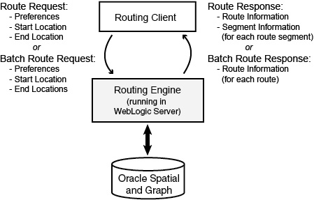

## 14  Routing Engine

The Spatial and Graph routing engine (often referred to as the routing engine) enables you to host an XML-based web service that provides the following features.

**Note:**

- Routing using SQL that accesses an Oracle managed service is available on Autonomous Database. Refer to the following subprograms for more information:
  - [SDO_GCDR.ELOC_DRIVE_TIME_POLYGON](SDO_GCDR-reference.md)
  - [SDO_GCDR.ELOC_ISO_POLYGON](SDO_GCDR-reference.md)
  - [SDO_GCDR.ELOC_ROUTE](SDO_GCDR-reference.md)
  - [SDO_GCDR.ELOC_ROUTE_DISTANCE](SDO_GCDR-reference.md)
  - [SDO_GCDR.ELOC_ROUTE_GEOM](SDO_GCDR-reference.md)
  - [SDO_GCDR.ELOC_ROUTE_TIME](SDO_GCDR-reference.md)

<!-- -->

- Simple route requests return route information between the two locations.

- Simple multi-address route requests return route information between three or more locations. The ordering of the locations in the response is user specified and is not optimized.

- Traveling salesperson (TSP) route requests are a form of multi-address route request and also return route information between three or more locations. The ordering of some or all of the locations in the response can be reordered to optimize the overall route.

- Batched route requests are a batch of one or more simple or multi-address route requests. This can be a mix of simple, simple multi-address and TSP requests. Each individual request looks like a single request but is encapsulated in a \<batch_route_request\> element. The routing engine differentiates batched requests from batch mode requests when it finds a \<route_request\> element embedded in the \<batch_route_request\> element.

- Batch mode route requests return multiple responses, each with the same start location but different end locations.

For all requests, the start, intermediate, and end locations are identified by addresses, pre-geocoded addresses, or longitude/latitude coordinates.

Multi-address routes are explained in Routing.

The Oracle Routing engine is implemented as a Java 2 Enterprise Edition (J2EE) Web application that can be deployed in an application server such as Oracle WebLogic Server.

Figure 14-1 shows the basic flow of action with the routing engine: a client locates a remote routing engine instance, sends a route request, and processes the route response returned by the routing engine instance.

Figure 14-1 Basic Flow of Action with the Spatial and Graph Routing Engine

[Description of "Figure 14-1 Basic Flow of Action with the Spatial and Graph Routing Engine"](img_text/basic_flow_rt1.md)

This chapter does not include information about administering the routing engine. That information, which is for advanced users with specialized needs, is in [Routing Engine Administration](routing-engine-administration.md).

- Routing
  Routes are computed between location elements.
- Deploying the Routing Engine
  This topioc provides an overview of deploying the routing engine.
- Routing Engine XML API
  This topic explains how to submit route requests in XML format to the routing engine, and it describes the XML Schema Definitions (XSDs) for the route requests (input) and responses (output).
- Location-Based Query Using the WSServlet XML API
  WSServlet is a routing engine servlet for performing lightweight location based queries related to speed limit and traffic speed.
- Data Structures Used by the Routing Engine
  Older versions of the routing engine (before Release 12.1) must have the following tables in their schema.
- User Data Structures Used by the Routing Engine
  The routing engine uses user data as well as routing engine data. Some user data, such as turn restriction user data, must be present in the routing engine schema. Other user data, such as trucking user data, is optional.

**Parent topic:** [Spatial Web Services](spatial-web-services.md)

### 14.1 Routing

Routes are computed between location elements.

There are three types of location elements: `<start_location>`, `<location>` (intermediate locations or waypoints), and `<end_location>`. A location element can be specified as an address that is geocoded; as a pre-geocoded address, edge id/percentage pair; or as a latitude/longitude pair that is reverse geocoded.

The routing engine can incorporate a start time in its computations. For example, in an urban area, the estimated total driving time from your home to the airport on a weekday can be very different if you start at 8 am as opposed to 7 pm. The time computations are based on historical traffic pattern data, not on any real-time data gathering (for example, they do not factor in any current accidents or severe weather).

To include this optional feature, in the route request specify `start_time` and optionally `start_date` values, set `return_route_time` to `true` (that is, include the total estimated route time in the response), and make time zone user data available. If `return_route_time` is `true` but a start time is not specified, it is assumed to be when the route request is issued. (The relevant attributes are explained in Routing Engine XML API.)

This optional feature does not apply to batched route requests and batch mode requests.

- Simple Route Request
- Simple Multi-address Route Request
- Traveling Salesperson (TSP) Route Request
- Batched Route Request
- Batch Mode Route Request
- Relationship between Routing Engine and Geocoder

**Parent topic:** Routing Engine

#### 14.1.1 Simple Route Request

Simple route requests must contain both a `<start_location>` and `<end_location>` element. The response for a simple route request is a single route from the start location to the end location.

Several attributes in a simple route request control how the route is computed and what is returned in the route response. These attributes are discussed in Routing Engine XML API.

**Parent topic:** Routing

#### 14.1.2 Simple Multi-address Route Request

Simple multi-address route requests must contain at least three locations, including a required `<start_location>` element. Multi-address route requests must also contain one or more `<location>` elements, and optionally an `<end_location>` element.

The result of a simple multi-address route request is a single route from the start location, through each intermediate location, to the end location. This single route consists of multiple subroutes. Subroutes are the routes between each of the individual locations.

In a simple multi-address route request, the `optimize_route` attribute must be absent or set to FALSE. In simple multi-address route requests, all locations are fixed. There is no attempt to optimize the order in which the locations are visited. The locations in the route are visited in the order in which they were specified in the request.

Simple multi-address route requests use the `route_type` attribute to classify the route as an open or closed tour:

- Open tour: The route ends at the final intermediate location or a specified end location.

- Closed tour: The route returns to the start location.

  If a simple multi-address closed tour route is requested, the `<start_location>` element specification also used as the end location during route computation. If an `<end_location>` element is specified in a simple multi-address closed tour route request, an error is returned.

##### Example: Simple Multi-address Open Tour Route Request

Assume you want to drive from your workplace to customer A, then to customer B, and then to customer C.

- The route request has your workplace as the start location, customers A and B as intermediate locations, and customer C as the end location.

- The returned route has three subroutes: (1) workplace to customer A, (2) customer A to customer B, and (3) customer B to customer C.

- Each subroute probably has multiple segments, each one associated with a specific driving direction step.

##### Example: Simple Multi-address Closed Tour Route Request

Assume you want to drive from your workplace to customer A, then to customer B, then to customer C, and then back to your workplace.

- The route request has your workplace as the start location, and customers A, B, and C as intermediate locations. Your workplace is also used as the end location. An `<end_location>` element .should not be specified in the route request. The routing engine adds the subroute from customer C to the workplace automatically when it sees a request for a closed tour.

- The returned route has four subroutes: (1) workplace to customer A, (2) customer A to customer B, (3) customer B to customer C, and (4) customer C back to the workplace.

- Each subroute probably has multiple segments, each one associated with a specific driving direction step.

Simple multi-address requests can contain several attributes specific to each subroute. These attributes include `return_subroutes`, `return_subroute_edge_ids`, and `return_subroute_geometry`. These attributes are explained in Route Request XML Schema Definition.

**Parent topic:** Routing

#### 14.1.3 Traveling Salesperson (TSP) Route Request

A traveling salesperson (TSP) route request must have at least three locations. Unlike simple multi-address route requests, the `<start_location>` element is optional.

TSP route requests are multi-address requests that have the `optimize_route` attribute present and set to TRUE. TSP route requests attempt to reorder the unfixed locations in the request to optimize the overall route.

All the locations in a TSP request are classified as unfixed or fixed:

- Unfixed location: If a location is specified with the `<location>` element, it is considered an unfixed location and is subject to reordering during route computation.

- Fixed location: If the location is specified with a `<start_location>` or `<end_location>` element, it is considered a fixed location and is not subject to reordering during route computation.

  If intermediate locations need to be fixed, a simple multi-address route request should be used instead of a TSP route request.

TSP route requests use the `route_type` attribute to classify the route as an open or closed tour.:

- Open tour: The route does not return to the start location.

- Closed tour: The route returns to the start location.

  If a TSP closed tour route is requested, the `<start_location>` element must be specified. This start location is also used as the end location during route computation. If an `<end_location>` element is specified in a TSP closed tour route request, an error is returned. By definition, TSP closed tour routes use a single fixed start and end location but the intermediate locations are still subject to reordering.

##### Example: TSP Open Tour Route Request

To drive from your workplace, visiting customers A, B, and C:

- The route has the workplace as a fixed start location.

- The route has customers A, B, and C as unfixed intermediate locations. These locations are reordered to optimize the overall route.

- The returned route is an optimized open tour route from the workplace to the first reordered location, through the second reordered location, to the final location.

##### Example: TSP Closed Tour Route Request

To drive from your workplace, visiting customers A, B, and C, and then returning to your workplace:

- The route has the workplace as a fixed start location. The workplace is also used as a fixed end location. An `<end_location>` element should not be specified in the route request. The routing engine adds the subroute from last unfixed location to the workplace automatically when it sees a request for a closed tour.

- The route has customers A, B, and C as unfixed intermediate locations. These locations are reordered to optimize the overall route.

- The returned route is an optimized closed tour route from the workplace to the first reordered location, through the second and third reordered locations, and finally back to the start location.

TSP route requests can contain several attributes specific to each subroute. These attributes include `return_subroutes`, `return_subroute_edge_ids`, and `return_subroute_geometry`. These attributes are explained in Route Request XML Schema Definition.

**Parent topic:** Routing

#### 14.1.4 Batched Route Request

Batched route requests are a hybrid of batch mode requests (explained in Batch Mode Route Request) and individual route requests. Batched route requests are a way to process multiple simple, simple multi-address, and TSP route requests in one request to the routing engine. Batching of batch mode requests is not allowed.

Like a batch mode request, the outermost element of a batched route request is `<batch_route_request>`. Unlike a batch mode request, batched route requests have one or more `<route_request>` elements nested inside the batch request.

In a batched route request, all attributes associated with the encompassing `<batch_route_request>` element are ignored. Instead, the attributes associated with the nested `<route_request>` elements are used when processing each individual route. This allows users to mix simple, simple multi-address, and TSP requests in a single batched individual route request.

The batched route request is useful for submitting multiple variations of a single route request with differing attributes and comparing the results, for example, for comparing the fastest route with the shortest route.

The individual route requests in a batched route request can use any of the attributes from simple route requests. They can also use any of the subroute-specific attributes of simple multi-address and TSP route requests.

All of the individual route requests in a batched route request are standalone; they have no effect on any other route request in the batch.

**Parent topic:** Routing

#### 14.1.5 Batch Mode Route Request

A batch mode route request contains one `<start_location>` element and one or more `<end_location>` elements.

The result of a batch mode route request contains multiple routes. Each route is from the start location to one of the end locations. Each route in a batch mode request is completely separate from all the other routes except for the shared start location.

Batch mode route requests may contain several batch mode specific attributes. These attributes include `cutoff_distance` and `sort_by_distance`. These attributes are explained in Route Request XML Schema Definition.

**Parent topic:** Routing

#### 14.1.6 Relationship between Routing Engine and Geocoder

The routing engine depends on the geocoder, and therefore the data used for routing and geocoding must be consistent (that is, must be of the same "vintage" from your data provider).

A geocoding request returns an [SDO_GEO_ADDR object](geocoding-address-data-concepts.md) that includes the following for each road segment: (1) Percent and EdgeID, and (2) Longitude and Latitude. The routing engine considers only the Percent and EdgeID.

The route server edge ID values can be positive or negative, reflecting the direction of the segment. (Geocoding edge IDs are always positive, because direction is irrelevant for geocoding.) The same road segment identifier in the routing and geocoding tables might be different only in the sign.

Consider the following example where an address is geocoded and will be used later for routing:

    SELECT SDO_GCDR.GEOCODE('ODF_NA_Q312',
      SDO_KEYWORDARRAY('5100 Geary Blvd', 'SAN FRANCISCO,CA 94118'),
      'US', 'RELAX_POSTAL_CODE')
      FROM dual;

The geocoder may return edgeid = 127806839 with percent = .86 (where EDGEID corresponds to the road_segment_id column of the geocoder [GC_ROAD_SEGMENT table](geocoding-address-data-concepts.md)). However, the EDGE table used by the routing engine may have that same segment with edge_id -127806839 (different only in the negative sign). If a positive road_segment_id (from GC_ROAD_SEGMENT) matches only negative edge_id (from EDGE), the percent returned by the geocoder should be subtracted from 1 to get the corresponding percent to apply to the reversed edge(edge_id). In this example, 1 - .86 = .14.

**Parent topic:** Routing

### 14.2 Deploying the Routing Engine

This topioc provides an overview of deploying the routing engine.

Before following steps in this topic, be sure you understand the information in [Deploying and Configuring Spatial Web Services](introduction-spatial-web-services.md) and performed any necessary operations.

Deploying the routing engine involves the following actions.

- Unpacking the routeserver.ear File
- Editing the web.xml File for Routing Engine Deployment
- Deploying the Routing Engine on WebLogic Server

**Parent topic:** Routing Engine

#### 14.2.1 Unpacking the routeserver.ear File

To unpack the routeserver.ear.zip file, follow these steps.

In examples in these steps, the following values are used:

- The WebLogic Server Home (\$WLS_HOME) is `/scratch/software/Oracle/Middleware/user_projects/domains/spatial/`.

- The application deployment directory is `$WLS_HOME/applications/`.

However, use the values appropriate for your environment if they are different.

1.  Copy `routeserver.ear.zip` to the application deployment directory:
        cp routeserver.ear.zip $WLS_HOME/applications/
2.  Unzip `routeserver.ear.zip`:
        cd $WLS_HOME/applications/
        unzip routeserver.ear.zip

**Parent topic:** Deploying the Routing Engine

#### 14.2.2 Editing the web.xml File for Routing Engine Deployment

This section describes changes to parameter values in the `web.xml` file that you must make for the routing engine to deploy properly. (There are also other parameters that you can change to alter how the routing engine operates.)

- Change the `container_ds` parameter to be the JNDI Name of the data source associated with the managed server. For example: `JNDI/NorthAmericanDS`

- Change the `routeserver_network_name` parameter to the name of the Network Data Model (NDM) network built on the routing engine road network data. For example: `NorthAmericanNetwork`

- If the WLS Managed Server has a Work Manager associated with it, change the `wl-dispatch-policy` parameter value to the name of the Work Manager. For example: `NorthAmericanWM`

- Check to be sure the `geocoder_type` parameter is set to `httpclient` or `None`. (`thinclient` is no longer supported.)

  - If set to httpclient, then also set `geocoder_http_url` to the URL of the Geocoder servlet. For example: `http://localhost:8888/geocoder/gcserver`

  - If an HTTP proxy is being used, then also specify `geocoder_http_proxy_host` and `geocoder_http_proxy_port`. If no proxy exists, these two parameters can be ignored

- If necessary, change the `logfile_name` parameter value. By default, the `logfile_name` parameter is set to `log/RouteServer.log`. This default relative path includes a subdirectory named `log`, relative to where the routing engine is installed. The `logfile_name` parameter can also be set to an absolute path, for example: `/scratch/logs/RouteServer.log`.

- If `start_time` and `start_date` are used in route requests, include the attributes `date_format`, `time_format`, and `output_time_format`. `date_format` and `time_format` must be ormats supported by `SimpleDateFormat` of Java. For example, `date_format` can be set to `dd-MMM-yyyy` and `time_format` can be set to `HH:mm`. The `start_time` in the route request will be parsed according to the format set by these parameters.

- If `return_route_time` or `return_subroute_time` is used in route requests, set `output_time_format` to a time format supported by `SimpleDateFormat` in Java. The start and end times in the router response are formatted according to the `output_time_format` value.

- Change the `partition_cache_size` parameter. The default value for this parameter is 70, but it will probably need to be changed depending on the amount of memory allocated to the heap on the managed server. The following formula can be used to get a good starting point for a cache size.

  `partition_cache_size = (NodesPerGigabyte/AvgNodesPartition)*UsableMemory`

  Where:

  - `NodesPerGigabyte` is the number of nodes per gigabyte. (This value should not change. In the data sets as of December 2013, this value is 15000000, that is, 1.5 million.)

  - `AvgNodesPartition` is the average number of nodes per local partition. This does not include the highway partition 0. The memory for the highway partition is accounted for in the 1 gigabyte subtracted from the allocated heap size. For the North American data set, the `AvgNodesPartition` value is around 26000. You can check the actual average nodes per partition by using the following query:

        SELECT AVG(COUNT(node_id))
             FROM node
             WHERE partition_id>0
             GROUP BY partition_id;

  - `UsableMemory` is the managed server allocated heap size in Gigabytes minus 1 Gigabyte.

  This formula generates a safe number for the `partition_cache_size` parameter. Depending on the types of user information being used and the average number of concurrent requests being processed, it may be possible to add another 15% to 20% to this number. Use the WLS console to monitor the heap usage before changing this number.

  The heap can then be monitored while the routing engine is running to tune this number up or down. However, setting this value too high may cause the managed server to run out of memory.

**Parent topic:** Deploying the Routing Engine

#### 14.2.3 Deploying the Routing Engine on WebLogic Server

To deploy the routing engine on WebLogic Server, follow the steps under “Deploying Spatial Web Services on WebLogic Server and Editing the web.xml File” in [Deploying and Configuring Spatial Web Services](introduction-spatial-web-services.md).

After the routing engine is deployed, you can test the deployment with a set of routing engine test queries. For example, if the managed server was set up to run on port 7003, the routing engine servlet can be tested from `http://localhost:7003/routeserver/`.

These queries can run a variety of different types of route requests. These queries contain North American addresses, but the addresses can easily be manipulated on the web page for other data sets.

**Parent topic:** Deploying the Routing Engine

### 14.3 Routing Engine XML API

This topic explains how to submit route requests in XML format to the routing engine, and it describes the XML Schema Definitions (XSDs) for the route requests (input) and responses (output).

XML is widely used for transmitting structured documents using the HTTP protocol. If an HTTP request (GET or POST method) is used, it is assumed the request has a parameter named `xml_request` whose value is a string containing the XML document for the request.

A request to the routing engine servlet has the following format:

    http://hostname:port/route-server-servlet-path?xml_request=xml-request

In this format:

- hostname is the network path of the server on which the routing engine is running.

- port is the port on which the application server listens.

- route-server-servlet-path is the routing engine servlet path (for example, `routeserver/servlet/RouteServerServlet`).

- xml-request is the URL-encoded XML request submitted using the HTML GET or POST method.

The input XML is required for all requests. The output will be an XML document.

In a simple route request, you must specify a route ID, and you can specify one or more of the following attributes:

- `route_preference`: `fastest`, `traffic`, or `shortest` (default)

- `traffic_sampling_id` (if `route_preference` is `traffic`): `1` (travel times are available at 15-minute intervals) or `2` (the default: travel times are available at 1–hour intervals).

- `road_preference`: `highway` (default) or `local`

- `return_route_time` (whether to return start and end times): `true` or `false` (default)

- `return_driving_directions` (whether to return driving directions): `true` or `false` (default)

- `return_hierarchical_directions` (whether to return hierarchical directions): `true` or `false` (default)

- `return_locations` (return geocoded results for the start and end locations of the route and any subroutes): `true` or `false` (default)

- `return_subroutes` (whether to return subroutes): `true` (default if a multi-address route, ignored for a single-address route) or `false`

- `return_route_geometry` (whether to return the line string coordinates for the route): `true` or `false` (default)

- `return_subroute_geometry` (whether to return the line string coordinates for each subroute): `true` or `false` (default for multi-address routes)

- `return_segment_geometry` (whether to return the line string coordinates for each maneuver in the route): `true` or `false` (default)

- `return_detailed_geometry`: `true` (default; returns detailed geometries) or `false` (returns generalized geometries)

- `start_date`: the starting date of the route. Example:`05-Aug-2016`. Default is the date of the request.

- `start_time`: the starting time of the route. Example: `10:30` for 10:30 am. Default is the time of the request.

- `date_format`: the format used to parse the start date for the `start_date` attribute. Example: `dd-MMM_yyyy`. This can be set to any format supported by `SimpleDateFormat` of Java

- `time_format`: the format used to parse the start time for the `start_time` attribute. Example: `HH:mm`. This can be set to any format supported by `SimpleDateFormat` of Java

- `output_time_format`: the format used to display the start and end times in the route response, if `return_route_time` or `return_subroute_time` is set to `true`

- `language`: language used to generate driving directions (`ENGLISH` (default), `FRENCH`, `GERMAN`, `ITALIAN`, `PORTUGUESE`, or `SPANISH`)

- `distance_unit`: `kilometer`, `mile` (default), or `meter`

- `length_unit`: `us` for feet (default) or `metric` for meters

- `time_unit`: `hour`, `minute` (default), or `second`

- `weight_unit`: `us` for tons (default) or `metric` for metric tons

- `pre_geocoded_locations` (whether the start and end locations are input locations (address specifications or points) or previously geocoded locations): `true` (previously geocoded locations) or `false` (default; input locations)

- `driving_directions_detail`: `high`, `medium` (default) or `low`

- `optimize_route`: `true` or `false` (default)

- `route_type`: `open` (default) or `closed`

- `vehicle_type`: `auto` (default) or `truck`

- `truck_type`: `delivery`, `public`, `resident`, or `trailer`; (no default)

- `truck_height`: floating-point number in `length_units`

- `truck_length`: floating-point number in `length_units`

- `truck_per_axle_weight`: floating-point number in `weight_units`

- `truck_weight`: floating-point number in `weight_units`

- `truck_width`: floating-point number in `length_units`

Batched route requests are groups of one or more simple (single, multi-address, or TSP) requests encapsulated in a `<batch_route_request>` element. All attributes associated with the `<batch_route_request>` element are ignored. Because all encapsulated requests are simple requests, they use the preceding listed attributes.

In a batch mode route request, you must specify a request ID, a start location, and one or more end locations. Each location must have an ID attribute. Most of the attributes used for simple requests have no meaning for batch mode. You can use one or more of the following attributes in a batch mode route request, but using an attribute not in this list will cause an exception to be raised.

- `route_preference`: `fastest` or `shortest` (default)

- `road_preference`: `highway` (default) or `local`

- `distance_unit`: `kilometer`, `km`, `mile` (default), or `meter`

- `time_unit`: `hour`, `minute` (default), or `second`

- `sort_by_distance` (whether to sort the returned routes in ascending order by distance of the end location from the start location): `true` or `false` (default)

- `cutoff_distance` (returning only routes where the end location is less than or equal to a specified number of distance units from the start location): (number; default = no limit)

- `pre_geocoded_locations` (whether the start and end locations are input locations (address specifications or points) or previously geocoded locations): `true` (previously geocoded locations) or `false` (default; input locations)

<!-- -->

- Route Request and Response Examples
- Route Request XML Schema Definition
- Route Response XML Schema Definition
- Batch Mode Route Request and Response Examples
- Batch Route Request XML Schema Definition
- Batch Route Response XML Schema

**Parent topic:** Routing Engine

#### 14.3.1 Route Request and Response Examples

This section contains XML examples of route requests and the responses generated by those requests. One request uses specified addresses, another uses points specified by longitude and latitude coordinates, and another uses previously geocoded locations. For reference information about the available elements and attributes, see Route Request XML Schema Definition for requests and Route Response XML Schema Definition for responses.

Example 14-1 Route Request with Specified Addresses

Example 14-1 shows a simple request for the fastest route, preferably using highways, between two offices at specified addresses (in Waltham, Massachusetts and Nashua, New Hampshire) in a 5.67 metric ton delivery truck. The response contains driving directions for each segment using kilometers for distances and minutes for times. This request also returns the geocode information for the start and end location.

    <?xml version="1.0" standalone="yes"?>
    <route_request
              id="8"
              route_preference="fastest"
              road_preference="highway"
              vehicle_type="truck"
              truck_type="delivery"
              truck_weight="5.67"
              return_driving_directions="true"
              return_locations="true"
              distance_unit="km"
              time_unit="minute"
              weight_unit="metric">
      <start_location>
        <input_location id="1">
          <input_address>
            <us_form1
              street="1000 Winter St"
              lastline="Waltham, MA" />
          </input_address>
        </input_location></start_location>
      <end_location>
        <input_location id="2">
          <input_address>
            <us_form1
              street="1 Oracle Dr"
              lastline="Nashua, NH" />
          </input_address>
        </input_location>
      </end_location>
    </route_request>

Example 14-2 Response for Route Request with Specified Addresses

Example 14-2 shows the response generated by the request in Example 14-1. (The output is reformatted for readability.)

    <!-- Oracle Routeserver version 12.1.0.1.0 (data version 11.1.0.7.1) -->
    <route_response>
      <route id="8" step_count="12"
        distance="46.07216796875" distance_unit="km"
        time="31.133371988932293" time_unit="minute"
        start_location="1" end_location="2">
      <start_location>
        <location id="1"
          longitude="-71.25962" latitude="42.39741"
          house_number="399" street="WINTER ST"
          city="WALTHAM" state="MA" country="US"
          driving_side="R"
          postal_code="02451"
          edge_id="906810462" percent="0.0"/>
      </start_location>
      <segment sequence="1"
        instruction="Start out on Winter St (Going Southwest)"
        distance="0.0" time="0.0"/>
      <segment sequence="2"
        instruction="Turn RIGHT onto Wyman St (Going North)"
        distance="0.3453199939727783" time="0.3597083270549774"/>
      <segment sequence="3"
        instruction="Take RAMP toward Peabody"
        distance="0.43125000953674314" time="0.3478285253047943"/>
      <segment sequence="4"
        instruction="Merge onto I-95 N/RT-128 N (Going North)"
        distance="9.598520091056823" time="6.1528975268205"/>
      <segment sequence="5"
        instruction="Continue on toward Burlington"
        distance="0.0" time="0.0"/>
      <segment sequence="6"
        instruction="Stay STRAIGHT to go onto RAMP (Going East)"
        distance="0.22952000427246094" time="0.23908333778381347"/>
      <segment sequence="7"
        instruction="Continue on toward Lowell"
        distance="0.5157099990844727" time="0.5371979157129924"/>
      <segment  sequence="8"
        instruction="Stay STRAIGHT to go onto US-3 N (Going Northwest)"
        distance="33.26371000862122" time="21.322891048093638"/>
      <segment sequence="9"
        instruction="Take EXIT 1 toward S. Nashua"
        distance="0.6134100036621094" time="0.5454034169514974"/>
      <segment sequence="10"
        instruction="Continue on toward So. Nashua"
        distance="0.27333999633789063" time="0.41415150960286456"/>
      <segment sequence="11"
        instruction="Turn LEFT onto Spit Brook Rd (Going West)"
        distance="0.8013799934387207" time="1.2142121195793152"/>
      <segment sequence="12"
        instruction="Turn RIGHT onto Oracle Dr (Going North)"
        distance="0.0" time="0.0"/>
      <end_location>
        <location id="2"
          longitude="-71.45937" latitude="42.70783"
          house_number="1" street="ORACLE DR"
          city="NASHUA" state="NH" country="US"
          driving_side="R"
          postal_code="03062"
          edge_id="22325991" percent="0.0"/>
      </end_location>
      </route>
    </route_response>

Example 14-3 Route Request with Locations Specified as Longitude/Latitude Points

Example 14-3 shows a request for a closed tour TSP shortest route, preferably using highways, between four locations specified as longitude/latitude points. (The points are associated with four locations in San Francisco, California: the World Trade Center, Golden Gate Park, 3001 Larkin Street, and 100 Flower Street.) The route starts and ends at a fixed location at the World Trade Center, but the other three locations are subject to reordering to produce an optimal route. The information from the geocoder is returned for all location in the route. The geometry is displayed at the subroute level, and edge IDs are displayed with the driving directions at the segment level.

    <?xml version="1.0" standalone="yes"?>
    <route_request id="8"
                   route_preference="shortest"
                   route_type="closed"
                   optimize_route="true"
                   road_preference="highway"
                   return_locations="true"
                   return_driving_directions="true"
                   return_subroutes="true"
                   return_route_geometry="false"
                   return_subroute_geometry="true"
                   return_segment_geometry= "false"
                   return_segment_edge_ids= "true"
              >
      <start_location>
        <input_location id="1" longitude="-122.39436" latitude="37.79579"/>
      </start_location>
      <location>
        <input_location id="2" longitude="-122.45412" latitude="37.7714" />;
      </location>
      <location>
        <input_location id="3" longitude="-122.422" latitude="37.80551" />
      </location>
      <location>
        <input_location id="4" longitude="-122.40459" latitude="37.74211" />
      </location>
    </route_request>

Example 14-4 Response for Route Request with Locations Specified as Longitude/Latitude Points

Example 14-4 shows the response generated by the request in Example 14-3. (The output is reformatted for readability.)

    <!-- Oracle Routeserver version 12.1.0.2.0 (data version 11.1.0.7.1) -->
    <route_response>
      <route id="8" step_count="88"
        distance="15.105344411681319" distance_unit="mile"
        time="35.63843688964844" time_unit="minute"
        start_location="1" end_location="1">
        <subroute id="1" step_count="5"
          distance="1.8589950065634127" distance_unit="mile"
          time="4.305604044596354" time_unit="minute"
          start_location="1" end_location="3">
          <subroute_geometry>
            <LineString><coordinates>
              -122.39436,37.79579 -122.39436,37.79579 -122.39454,37.79601
              -122.39467,37.79614 -122.39486,37.79633 -122.39499,37.79647
              -122.39529,37.79678 -122.39558,37.79709 -122.39592,37.79747
              -122.3963,37.7979 -122.39646,37.79808 -122.3969,37.79858
              -122.39741,37.79916 -122.39755,37.79929 -122.39776,37.79918
              -122.39793,37.79907 -122.39811,37.79899 -122.39821,37.79896
              -122.39836,37.79892 -122.39867,37.79889 -122.39986,37.79874
              -122.40104,37.7986 -122.40223,37.79845 -122.40302,37.79835
              -122.40308,37.79834 -122.40349,37.79828 -122.40384,37.79824
              -122.40466,37.79813 -122.40545,37.79802 -122.40549,37.79802
              -122.4062,37.79794 -122.40622,37.79794 -122.40664,37.79789
              -122.40707,37.79816 -122.40789,37.79872 -122.40846,37.7991
              -122.40898,37.7995 -122.41017,37.80031 -122.41038,37.80045
              -122.41078,37.80073 -122.41089,37.8008 -122.41094,37.80084
              -122.41136,37.80112 -122.41143,37.80118 -122.41248,37.80188
              -122.41254,37.80193 -122.41289,37.80218 -122.41367,37.80274
              -122.41488,37.80355 -122.41547,37.80396 -122.41607,37.80441
              -122.41657,37.80475 -122.41681,37.80492 -122.4172,37.80519
              -122.4178,37.8056 -122.41837,37.80598 -122.41873,37.80593
              -122.42035,37.80573 -122.422,37.80551
              -122.42199999992847,37.805509999663826
            </coordinates></LineString>
          </subroute_geometry>
          <start_location>
            <location id="1"
              longitude="-122.39436" latitude="37.79579"
              house_number="" street="HERB CAEN WAY"
              city="SAN FRANCISCO" state="CA" country="US"
              driving_side="R"
              postal_code="94111"
              edge_id="724791174" percent="1.0"/>
          </start_location>
          <segment sequence="1"
            instruction="Start out on The Embarcadero (Going Northwest)"
            distance="0.29822904401544625" time="0.49993750055631003">
            <segment_edge_ids><edge_ids>
              724791174, 724791175, 733049363, 915793201, 915793202, 830932896,
              112011102, 112011103, 830934259, 830934260, 726169597, 112011105,
              37830229
            </edge_ids></segment_edge_ids>
          </segment>
          <segment sequence="2"
            instruction="Turn LEFT onto Broadway (Going Southwest)"
            distance="0.5093705394140182" time="1.2420151789983114">
            <segment_edge_ids><edge_ids>
              -24571168, -724946174, -724946173, -23598782, -23621077, -23598783,
              -23598784, -23598786, -23598787, -23598788, -23598789, -23598791,
              -23598792
            </edge_ids></segment_edge_ids>
          </segment>
          <segment sequence="3"
            instruction="Turn SLIGHT RIGHT onto Columbus Ave (Going Northwest)"
            distance="0.8505250718279074" time="2.07386361459891">
            <segment_edge_ids><edge_ids>
              23601001, 23601002, 23601003, 23601004, 830239101, 830239102,
              799420615, 23601006, 23601007, 23601008, 23737804, 23601009,
              23601010, 23601011, 23737805, 23601012, 754219681, 754219682,
              23622414, 754224948, 754224949
            </edge_ids></segment_edge_ids>
          </segment>
          <segment sequence="4"
            instruction="Turn SLIGHT LEFT onto North Point St (Going West)"
            distance="0.20086994241069608" time="0.48978787660598755">
            <segment_edge_ids><edge_ids>
              -23612405, -23612406, -23612407
            </edge_ids></segment_edge_ids>
          </segment>
          <segment sequence="5"
            instruction="Turn LEFT onto Larkin St (Going South)"
            distance="2.3560371803568745E-8" time="5.744803956986288">
            <segment_edge_ids><edge_ids>
              -23609029
            </edge_ids></segment_edge_ids>
          </segment>
          <end_location>
            <location id="3"
              longitude="-122.42199999966279" latitude="37.80551000007165"
              house_number="2999" street="LARKIN ST" city="SAN FRANCISCO"
              state="CA" country="US"
              driving_side="R"
              postal_code="94109"
              edge_id="23609029" percent="0.9999996412873026"/>
          </end_location>
        </subroute>
        <subroute id="2" step_count="32"
          distance="4.0150478493172495" distance_unit="mile"
          time="9.790025838216145" time_unit="minute"
          start_location="3" end_location="2">
          <subroute_geometry>
            <LineString><coordinates>
              -122.42199999992847,37.805509999663826 -122.422,37.80551
              -122.42364,37.8053 -122.42345,37.80436 -122.42327,37.80342
              -122.42482,37.80322 -122.42496,37.8032 -122.42545,37.80314
              -122.42656,37.803 -122.42638,37.80207 -122.4262,37.80111
              -122.42782,37.8009 -122.42947,37.80069 -122.43111,37.80048
              -122.43276,37.80026 -122.43439,37.80006 -122.43605,37.79985
              -122.43597,37.79943 -122.43588,37.79896 -122.43751,37.79874
              -122.43742,37.79828 -122.43733,37.79781 -122.43895,37.79759
              -122.43877,37.79667 -122.44041,37.79645 -122.44025,37.79554
              -122.4419,37.7953 -122.44173,37.79439 -122.44153,37.79343
              -122.44308,37.79323 -122.44317,37.79322 -122.44328,37.79321
              -122.44476,37.79302 -122.44487,37.79301 -122.44496,37.793
              -122.44643,37.7928 -122.4463,37.79188 -122.44614,37.79099
              -122.44595,37.79011 -122.44577,37.78924 -122.44559,37.78836
              -122.44697,37.78818 -122.44688,37.78775 -122.44687,37.78769
              -122.44678,37.78726 -122.44676,37.78705 -122.44671,37.78679
              -122.44675,37.78651 -122.4468,37.78635 -122.44689,37.78618
              -122.44697,37.78603 -122.44749,37.7855 -122.44766,37.78538
              -122.44792,37.78513 -122.448,37.78507 -122.44814,37.78496
              -122.44929,37.78468 -122.45012,37.78448 -122.45015,37.78432
              -122.4502,37.78418 -122.45034,37.78396 -122.45041,37.78383
              -122.45043,37.78369 -122.45012,37.78218 -122.45112,37.78205
              -122.45109,37.78192 -122.45082,37.78064 -122.45186,37.78049
              -122.45287,37.78037 -122.45385,37.78023 -122.45374,37.77943
              -122.45367,37.77905 -122.45349,37.77817 -122.45339,37.77781
              -122.45332,37.77763 -122.45318,37.77685 -122.45303,37.77596
              -122.45299,37.77574 -122.45283,37.77499 -122.45297,37.77497
              -122.45287,37.77443 -122.45279,37.77404 -122.45262,37.7731
              -122.45241,37.77215 -122.45276,37.77206 -122.45301,37.77195
              -122.45346,37.77172 -122.45387,37.77153 -122.45398,37.77148
              -122.45412868777395,37.77142244344235
            </coordinates></LineString>
          </subroute_geometry>
          <start_location>
            <location id="3"
              longitude="-122.42199999966279" latitude="37.80551000007165"
              house_number="2999" street="LARKIN ST" city="SAN FRANCISCO"
              state="CA" country="US"
              driving_side="R"
              postal_code="94109"
              edge_id="23609029" percent="0.9999996412873026"/>
          </start_location>
          <segment sequence="1"
            instruction="Start out on Larkin St (Going North)"
            distance="2.3560371803568745E-8" time="5.7448039569862884E-8">
            <segment_edge_ids><edge_ids>
              23609029
            </edge_ids></segment_edge_ids>
          </segment>
          <segment sequence="2"
            instruction="Turn LEFT onto North Point St (Going West)"
            distance="0.09072267445473188" time="0.22121211687723796">
            <segment_edge_ids><edge_ids>
              -23612408
            </edge_ids></segment_edge_ids>
          </segment>
          <segment sequence="3"
            instruction="Turn LEFT onto Polk St (Going South)"
            distance="0.1314981638707435" time="0.3206363519032796">
            <segment_edge_ids><edge_ids>
              -23614397, -23614396
            </edge_ids></segment_edge_ids>
          </segment>
          <segment sequence="4"
            instruction="Turn RIGHT onto Francisco St (Going West)"
            distance="0.1819921735430389" time="0.443757571776708">
            <segment_edge_ids><edge_ids>
              -23604420, -120906034, -916007650, -916007649
            </edge_ids></segment_edge_ids>
          </segment>
          <segment sequence="5"
            instruction="Turn LEFT onto Franklin St (Going South)"
            distance="0.13209470069661014" time="0.32209091186523436">
            <segment_edge_ids><edge_ids>
              -23604500, -23604499
            </edge_ids></segment_edge_ids>
          </segment>
          <segment sequence="6"
            instruction="Turn RIGHT onto Lombard St (Going West)"
            distance="0.544926363604202"
            time="1.3287121295928954">
            <segment_edge_ids><edge_ids>
              -23609690, -23609691, -23609692, -23609693, -23609694,
              -23609695
            </edge_ids></segment_edge_ids>
          </segment>
          <segment sequence="7"
            instruction="Turn LEFT onto Fillmore St (Going South)"
            distance="0.06220717119887626"
            time="0.15168182055155435">
            <segment_edge_ids><edge_ids>
              -23604040, -23604039
            </edge_ids></segment_edge_ids>
          </segment>
          <segment sequence="8"
            instruction="Turn RIGHT onto Greenwich St (Going West)"
            distance="0.09030634551112576"
            time="0.22019697825113932">
            <segment_edge_ids><edge_ids>
              -23605619
            </edge_ids></segment_edge_ids>
          </segment>
          <segment sequence="9"
            instruction="Turn LEFT onto Steiner St (Going South)"
            distance="0.06502205890116725" t
            time="0.15854545434316">
            <segment_edge_ids><edge_ids>
              -23618095, -23618094
            </edge_ids></segment_edge_ids>
          </segment>
          <segment sequence="10"
            instruction="Turn RIGHT onto Filbert St (Going West)"
            distance="0.08977195129603127"
            time="0.21889394124348957">
            <segment_edge_ids><edge_ids>
              -23603994
            </edge_ids></segment_edge_ids>
          </segment>
          <segment sequence="11"
            instruction="Turn LEFT onto Pierce St (Going South)"
            distance="0.06433853285001388"
            time="0.15687878926595053">
            <segment_edge_ids><edge_ids>
              -23614117
            </edge_ids></segment_edge_ids>
          </segment>
          <segment sequence="12"
            instruction="Turn RIGHT onto Union St (Going West)"
            distance="0.09084695019464499"
            time="0.22151514689127605">
            <segment_edge_ids><edge_ids>
              -23619255
            </edge_ids></segment_edge_ids>
          </segment>
          <segment sequence="13"
            instruction="Turn LEFT onto Scott St (Going South)"
            distance="0.06349965975356134"
            time="0.15483333269755045">
            <segment_edge_ids><edge_ids>
              -23616716
            </edge_ids></segment_edge_ids>
          </segment>
          <segment sequence="14"
            instruction="Turn RIGHT onto Green St (Going West)"
            distance="0.09162990537119692"
            time="0.2234242598215739">
            <segment_edge_ids><edge_ids>
              -23605539
            </edge_ids></segment_edge_ids>
          </segment>
          <segment sequence="15"
            instruction="Turn LEFT onto Divisadero St (Going South)"
            distance="0.13081463781959013"
            time="0.3189696947733561">
            <segment_edge_ids><edge_ids>
              -23602190, -23602189
            </edge_ids></segment_edge_ids>
         </segment>
          <segment sequence="16"
            instruction="Turn RIGHT onto Broadway (Going West)"
            distance="0.2711613656927398"
            time="0.6611817995707194">
            <segment_edge_ids><edge_ids>
              -829713884, -829713883, -829713879, -829713878,
              -829713874, -829713887,-829713886
            </edge_ids></segment_edge_ids>
          </segment>
          <segment sequence="17"
            instruction="Turn LEFT onto Lyon St (Going South)"
            distance="0.3103461147339876"
          <segment sequence="16"
            instruction="Turn RIGHT onto Broadway (Going West)"
            distance="0.2711613656927398"
            time="0.6611817995707194">
            <segment_edge_ids><edge_ids>
              -829713884, -829713883, -829713879, -829713878,
              -829713874, -829713887,-829713886
            </edge_ids></segment_edge_ids>
          </segment>
          <segment sequence="17"
            instruction="Turn LEFT onto Lyon St (Going South)"
            distance="0.3103461147339876"
            time="0.7567272663116456">
            <segment_edge_ids><edge_ids>
              -28479560, -23609965, -23609964, -23609963, -23609962
            </edge_ids></segment_edge_ids>
          </segment>
          <segment sequence="18"
            instruction="Turn RIGHT onto Sacramento St (Going West)"
            distance="0.07639346451339481"
            time="0.18627273241678874">
            <segment_edge_ids><edge_ids>
              -23615823
            </edge_ids></segment_edge_ids>
          </segment>
          <segment sequence="19"
            instruction="Turn LEFT onto Presidio Ave (Going South)"
            distance="0.09716025402078811"
            time="0.23690908749898273">
            <segment_edge_ids><edge_ids>
              -754763527, -754763526,-23747787
            </edge_ids></segment_edge_ids>
          </segment>
          <segment sequence="20"
            instruction="Turn SLIGHT RIGHT onto RAMP (Going South)"
            distance="0.054849932668282114"
            time="0.1337424119313558">
            <segment_edge_ids><edge_ids>
              -23747788
            </edge_ids></segment_edge_ids>
          </segment>
          <segment sequence="21"
            instruction="Turn SLIGHT RIGHT onto Masonic Ave (Going Southwest)"
            distance="0.09798048860074304"
            time="0.23890908559163412">
            <segment_edge_ids><edge_ids>
              -723450070, -723450073
            </edge_ids></segment_edge_ids>
          </segment>
            time="0.7567272663116456">
            <segment_edge_ids><edge_ids>
              -28479560, -23609965, -23609964, -23609963, -23609962
            </edge_ids></segment_edge_ids>
          </segment>
          <segment sequence="18"
            instruction="Turn RIGHT onto Sacramento St (Going West)"
            distance="0.07639346451339481"
            time="0.18627273241678874">
            <segment_edge_ids><edge_ids>
              -23615823
            </edge_ids></segment_edge_ids>
          </segment>
          <segment sequence="19"
            instruction="Turn LEFT onto Presidio Ave (Going South)"
            distance="0.09716025402078811"
            time="0.23690908749898273">
            <segment_edge_ids><edge_ids>
              -754763527, -754763526,-23747787
            </edge_ids></segment_edge_ids>
          </segment>
          <segment sequence="20"
            instruction="Turn SLIGHT RIGHT onto RAMP (Going South)"
            distance="0.054849932668282114"
            time="0.1337424119313558">
            <segment_edge_ids><edge_ids>
              -23747788
            </edge_ids></segment_edge_ids>
          </segment>
          <segment sequence="21"
            instruction="Turn SLIGHT RIGHT onto Masonic Ave (Going Southwest)"
            distance="0.09798048860074304"
            time="0.23890908559163412">
            <segment_edge_ids><edge_ids>
              -723450070, -723450073
            </edge_ids></segment_edge_ids>
          </segment>
          <end_location>
            <location id="2"
              longitude="-122.45412868707837" latitude="37.771422441619094"
              house_number="" street="JOHN F KENNEDY DR"
              city="SAN FRANCISCO" state="CA" country="US"
              driving_side="R"
              postal_code="94118"
              edge_id="728011751" percent="0.5203619908971352"/>
          </end_location>
        </subroute>
        <subroute id="3" step_count="36"
          distance="4.848880093441248" distance_unit="mile"
          time="11.788133748372395" time_unit="minute"
          start_location="2" end_location="4">
          <subroute_geometry>
            <LineString><coordinates>
              -122.45412868777395,37.77142244344235 -122.45429,37.77136
              -122.4546,37.77123 -122.45483,37.77114 -122.4551,37.77103
              -122.4552,37.77097 -122.45533,37.77086 -122.45501,37.77098
              -122.4547,37.77107 -122.45447,37.77116 -122.45424,37.77124
              -122.45396,37.77135 -122.45384,37.7714 -122.45382,37.77141
              -122.45369,37.77143 -122.45358,37.77144 -122.45347,37.77143
              -122.4529,37.77133 -122.45222,37.77123 -122.45205,37.77031
              -122.45043,37.77051 -122.45021,37.76958 -122.44967,37.76964
              -122.44945,37.76872 -122.44839,37.76885 -122.44756,37.76895
              -122.44672,37.76907 -122.44593,37.76917 -122.44555,37.76733
              -122.44473,37.76743 -122.44467,37.76702 -122.44456,37.76645
              -122.44451,37.76631 -122.44418,37.76596 -122.44361,37.76539
              -122.44347,37.76536 -122.44273,37.76532 -122.44246,37.7653
              -122.44232,37.76529 -122.44192,37.76527 -122.44202,37.76513
              -122.44229,37.76511 -122.44232,37.76508 -122.44232,37.765
              -122.44219,37.76499 -122.44209,37.76496 -122.44107,37.76443
              -122.43976,37.76376 -122.4392,37.76348 -122.43908,37.76344
              -122.43795,37.76329 -122.43781,37.7633 -122.43709,37.76333
              -122.43528,37.76346 -122.43523,37.76312 -122.43519,37.76283
              -122.43516,37.76264 -122.43515,37.76258 -122.43511,37.76207
              -122.43504,37.76128 -122.435,37.76089 -122.43388,37.76095
              -122.43278,37.76101 -122.43057,37.76115 -122.43048,37.76036
              -122.43039,37.75958 -122.42824,37.75972 -122.42816,37.7589
              -122.42805,37.75806 -122.42789,37.75807 -122.42583,37.75821
              -122.42566,37.75822 -122.42347,37.75836 -122.42126,37.75851
              -122.42047,37.75854 -122.42028,37.75695 -122.41999,37.75696
              -122.4197,37.75698 -122.41892,37.75702 -122.41874,37.75545
              -122.41766,37.75553 -122.41659,37.75557 -122.41549,37.75563
              -122.41533,37.75405 -122.41425,37.75412 -122.41385,37.75414
              -122.41312,37.75417 -122.41204,37.75424 -122.41109,37.75428
              -122.4102,37.75433 -122.41004,37.75276 -122.40913,37.75282
              -122.40818,37.75287 -122.40733,37.75292 -122.40713,37.75133
              -122.40617,37.75138 -122.40614,37.75103 -122.40613,37.75096
              -122.40611,37.75088 -122.40602,37.75067 -122.40599,37.75051
              -122.40578,37.75013 -122.40565,37.74987 -122.40529,37.74937
              -122.40518,37.74924 -122.40506,37.74913 -122.40483,37.74896
              -122.4045,37.74873 -122.40441,37.74867 -122.40437,37.74864
              -122.4041,37.74845 -122.40393,37.74827 -122.40384,37.74815
              -122.40378,37.74801 -122.40375,37.74785 -122.40381,37.74762
              -122.40397,37.74719 -122.4043,37.74633 -122.40434,37.74618
              -122.40434,37.74603 -122.40431,37.74594 -122.4042,37.74554
              -122.40416,37.7453 -122.40417,37.74515 -122.40431,37.74464
              -122.40445,37.74427 -122.40461,37.74393 -122.40479,37.74362
              -122.40522,37.74304 -122.40538,37.74284 -122.40565,37.7425
              -122.40517,37.74233 -122.40459,37.74211
            </coordinates></LineString>
          </subroute_geometry>
          <start_location>
            <location id="2"
              longitude="-122.45412868707837" latitude="37.771422441619094"
              house_number="" street="JOHN F KENNEDY DR"
              city="SAN FRANCISCO" state="CA" country="US"
              driving_side="R"
              postal_code="94118"
              edge_id="728011751" percent="0.5203619908971352"/>
          </start_location>
          <segment sequence="1"
            instruction="Start out on John F Kennedy Dr (Going West)"
            distance="0.02898340160626114"
            time="0.07067119280497233">
            <segment_edge_ids><edge_ids>
              -728011751, -728011750
            </edge_ids></segment_edge_ids>
          </segment>
          <segment sequence="2"
            instruction="Stay STRAIGHT to go onto Kezar Dr (Going Southwest)"
            distance="0.04787796125753919"
            time="0.11674242814381917">
            <segment_edge_ids><edge_ids>
              -23747756
            </edge_ids></segment_edge_ids>
          </segment>
          <segment sequence="3"
            instruction="Turn SHARP LEFT onto John F Kennedy Dr (Going East)"
            distance="0.08222829797036355"
            time="0.20049999952316283">
            <segment_edge_ids><edge_ids>
              23747762, 728012586, 724789094
            </edge_ids></segment_edge_ids>
          </segment>
          <segment sequence="4"
            instruction="Stay STRAIGHT to go onto Oak St (Going Northeast)"
            distance="0.09773193475050901"
            time="0.2383030315240224">
            <segment_edge_ids><edge_ids>
              724764533, 724764534, -23738012
            </edge_ids></segment_edge_ids>
          </segment>
          <segment sequence="5"
            instruction="Turn RIGHT onto Shrader St (Going South)"
            distance="0.06425775409315192"
            time="0.15668182373046874">
            <segment_edge_ids><edge_ids>
              -23617167
            </edge_ids></segment_edge_ids>
          </segment>
          <segment sequence="6"
            instruction="Turn LEFT onto Page St (Going East)"
            distance="0.08957932247692126"
            time="0.21842424074808756">
            <segment_edge_ids><edge_ids>
              23613434
            </edge_ids></segment_edge_ids>
          </segment>
          <segment sequence="7"
            instruction="Turn RIGHT onto Cole St (Going South)"
            distance="0.06538868039329745"
            time="0.1594394048055013">
            <segment_edge_ids><edge_ids>
              -23600911
            </edge_ids></segment_edge_ids>
          </segment>
          <segment sequence="8"
            instruction="Turn LEFT onto Haight St (Going East)"
            distance="0.02978934855322748"
            time="0.07263635794321696">
            <segment_edge_ids><edge_ids>
              23605814
            </edge_ids></segment_edge_ids>
          </segment>
          <segment sequence="9"
            instruction="Turn RIGHT onto Belvedere St (Going South)"
            distance="0.06471136481056884"
            time="0.1577878793080648">
            <segment_edge_ids><edge_ids>
              -23598189
            </edge_ids></segment_edge_ids>
          </segment>
          <segment sequence="10"
            instruction="Turn LEFT onto Waller St (Going East)"
            distance="0.1948176204828599"
            time="0.4750302950541178">
            <segment_edge_ids><edge_ids>
              23620205, 23620204, 23620203, 23620202
            </edge_ids></segment_edge_ids>
          </segment>
          <segment sequence="11"
            instruction="Turn RIGHT onto Delmar St (Going South)"
            distance="0.12885726410065712"
            time="0.3141969680786133">
            <segment_edge_ids><edge_ids>
              -23602039
            </edge_ids></segment_edge_ids>
          </segment>
          <segment sequence="12"
            instruction="Turn LEFT onto Frederick St (Going East)"
            distance="0.04533026592197986"
            time="0.11053029696146648">
            <segment_edge_ids><edge_ids>
              23604508
            </edge_ids></segment_edge_ids>
          </segment>
          <segment sequence="13"
            instruction="Turn RIGHT onto Masonic Ave (Going South)"
            distance="0.2072702425733493"
            time="0.5053939501444499">
            <segment_edge_ids><edge_ids>
              -932510459, -932510458, -23610757, -23610758,
              -814886921
            </edge_ids></segment_edge_ids>
          </segment>
          <segment sequence="14"
            instruction="Stay STRAIGHT to go onto Roosevelt Way (Going East)"
            distance="0.04439197258915798"
            time="0.1082424263159434">
            <segment_edge_ids><edge_ids>
              -814886920, -799371986, -799371985
            </edge_ids></segment_edge_ids>
          </segment>
          <segment sequence="15"
            instruction="Turn RIGHT onto Levant St (Going Southwest)"
            distance="0.03410178286259032"
            time="0.0831515113512675">
            <segment_edge_ids><edge_ids>
              -799371984, -799371983
            </edge_ids></segment_edge_ids>
          </segment>
          <segment sequence="16"
            instruction="Turn LEFT onto States St (Going Southeast)"
            distance="0.4172186714314114"
            time="1.0173182010650634">
            <segment_edge_ids><edge_ids>
              -829568337, -936352352, -936352351, -932495104,
              932495103, 799475779
            </edge_ids></segment_edge_ids>
          </segment>
          <segment sequence="17"
            instruction="Turn RIGHT onto Castro St (Going South)"
            distance="0.1783259826221157"
            time="0.4348181843757629">
            <segment_edge_ids><edge_ids>
              -754012004, -833349280, -833349279, -905543898,
              -905543897, -753950604, -753950603
            </edge_ids></segment_edge_ids>
          </segment>
          <segment sequence="18"
            instruction="Turn LEFT onto 18th St (Going East)"
            distance="0.24272664830496957"
            time="0.5918484846750895">
            <segment_edge_ids><edge_ids>
              23594648, 23594647, 23594646
            </edge_ids></segment_edge_ids>
          </segment>
          <segment sequence="19"
            instruction="Turn RIGHT onto Sanchez St (Going South)"
            distance="0.10895420615626991"
            time="0.26566667556762696">
            <segment_edge_ids><edge_ids>
              -23616290, -23616291
            </edge_ids></segment_edge_ids>
          </segment>
          <segment sequence="20"
            instruction="Turn LEFT onto 19th St (Going East)"
            distance="0.11787733607670552"
            time="0.2874242464701335">
            <segment_edge_ids><edge_ids>
              23594737
            </edge_ids></segment_edge_ids>
          </segment>
          <segment sequence="21"
            instruction="Turn RIGHT onto Church St (Going South)"
            distance="0.115211584951289"
            time="0.2809242566426595">
            <segment_edge_ids><edge_ids>
              -23600503, -23600504
            </edge_ids></segment_edge_ids>
          </segment>
          <segment sequence="22"
            instruction="Turn LEFT onto 20th St (Going East)"
            distance="0.4155409305719238"
            time="1.0132273137569427">
            <segment_edge_ids><edge_ids>
              732180611, 732180612, 23747712, 23594835,
              23594834, 23594833
            </edge_ids></segment_edge_ids>
          </segment>
          <segment sequence="23"
            instruction="Turn RIGHT onto Lexington St (Going South)"
            distance="0.11038339612853318"
            time="0.5921333312988282">
            <segment_edge_ids><edge_ids>
              -23609398
            </edge_ids></segment_edge_ids>
          </segment>
          <segment sequence="24"
            instruction="Turn LEFT onto 21st St (Going East)"
            distance="0.07448580061634548"
            time="0.18162120978037516">
            <segment_edge_ids><edge_ids>
              23594883, 23594882, 23594881
            </edge_ids></segment_edge_ids>
          </segment>
          <segment sequence="25"
            instruction="Turn RIGHT onto Mission St (Going South)"
            distance="0.10895420141545431"
            time="0.26566665967305503">
            <segment_edge_ids><edge_ids>
              -23611414
            </edge_ids></segment_edge_ids>
          </segment>
          <segment sequence="26"
            instruction="Turn LEFT onto 22nd St (Going East)"
            distance="0.17805878047745186"
            time="0.4341666539510091">
            <segment_edge_ids><edge_ids>
              23594956, 23594955, 23594954
            </edge_ids></segment_edge_ids>
          </segment>
          <segment sequence="27"
            instruction="Turn RIGHT onto Shotwell St (Going South)"
            distance="0.10955073824132096"
            time="0.2671212196350098">
            <segment_edge_ids><edge_ids>
              -23617156
            </edge_ids></segment_edge_ids>
          </segment>
          <segment sequence="28"
            instruction="Turn LEFT onto 23rd St (Going East)"
            distance="0.28101037926858485"
            time="0.6851969718933105">
            <segment_edge_ids><edge_ids>
              23595024, 799561724, 799561725, 23595022,
              23595021, 23595020
            </edge_ids></segment_edge_ids>
          </segment>
          <segment sequence="29"
            instruction="Turn RIGHT onto Florida St (Going South)"
            distance="0.10886099698092727"
            time="0.26543939908345543">
            <segment_edge_ids><edge_ids>
              -23604143
            </edge_ids></segment_edge_ids>
          </segment>
          <segment sequence="30"
            instruction="Turn LEFT onto 24th St (Going East)"
            distance="0.14851177530603368"
            time="0.3621212085088094">
            <segment_edge_ids><edge_ids>
              23595090, 23595089, 23595088
            </edge_ids></segment_edge_ids>
          </segment>
          <segment sequence="31"
            instruction="Turn RIGHT onto Hampshire St (Going South)"
            distance="0.11043310832082466"
            time="0.26927274068196616">
            <segment_edge_ids><edge_ids>
              -23605909
            </edge_ids></segment_edge_ids>
          </segment>
          <segment sequence="32"
            instruction="Turn LEFT onto 25th St (Going East)"
            distance="0.05257565439032596"
            time="0.1281969706217448">
            <segment_edge_ids><edge_ids>
              23595179
            </edge_ids></segment_edge_ids>
          </segment>
          <segment sequence="33"
            instruction="Turn RIGHT onto Potrero Ave (Going South)"
            distance="0.050077673617465915"
            time="0.1221060593922933">
            <segment_edge_ids><edge_ids>
              -724773368, -724773367
            </edge_ids></segment_edge_ids>
          </segment>
          <segment sequence="34"
            instruction="Take RAMP toward Bayshore Blvd"
            distance="0.03984341188503202"
            time="0.09715151786804199">
            <segment_edge_ids><edge_ids>
              -915517048
            </edge_ids></segment_edge_ids>
          </segment>
          <segment sequence="35"
            instruction="Stay STRAIGHT to go onto Bayshore Blvd(Going Southeast)"
            distance="0.5910582184784158"
            time="1.0831619163354238">
            <segment_edge_ids><edge_ids>
              -915517047, -120885637, -830210066, -776735343,
              -776735342, -756632225, -756632224, -127815508,
              -23621037, -23621038, -23621034, -756635722,
              -756635721, -23597820, -756635724, -756635723
            </edge_ids></segment_edge_ids>
          </segment>
          <segment sequence="36"
            instruction="Turn LEFT onto Flower St (Going East)"
            distance="0.06390356064909457"
            time="0.15581818421681723">
            <segment_edge_ids><edge_ids>
              -23604154, -23604155
            </edge_ids></segment_edge_ids>
          </segment>
          <end_location>
            <location id="4"
              longitude="-122.40459" latitude="37.74211"
              house_number="99" street="FLOWER ST" city="SAN FRANCISCO"
              state="CA" country="US"
              driving_side="R"
              postal_code="94124"
              edge_id="23604155" percent="0.0"/>
          </end_location>
        </subroute>
        <subroute id="4" step_count="15"
          distance="4.382421462359411" distance_unit="mile"
          time="9.754673258463542" time_unit="minute"
          start_location="4" end_location="1">
          <subroute_geometry>
            <LineString><coordinates>
              -122.40459,37.74211 -122.40459,37.74211 -122.40431,37.74253
              -122.40366,37.74342 -122.40322,37.74381 -122.40289,37.74515
              -122.40268,37.74635 -122.40295,37.74675 -122.40311,37.747
              -122.40327,37.74723 -122.40332,37.74737 -122.40342,37.74753
              -122.40348,37.74767 -122.40354,37.74787 -122.40365,37.74821
              -122.40367,37.74839 -122.40366,37.74857 -122.40358,37.74883
              -122.40353,37.74897 -122.40343,37.74916 -122.40336,37.74926
              -122.40329,37.74932 -122.4032,37.74936 -122.40306,37.7494
              -122.40283,37.74944 -122.40283,37.74994 -122.40281,37.75019
              -122.4028,37.75044 -122.40276,37.7505 -122.40266,37.75057
              -122.40221,37.7506 -122.40231,37.75197 -122.40242,37.75326
              -122.40254,37.75452 -122.40163,37.75458 -122.40178,37.75614
              -122.40187,37.75714 -122.40198,37.75826 -122.40199,37.75842
              -122.4021,37.75969 -122.40222,37.76095 -122.40235,37.76223
              -122.40248,37.76352 -122.40254,37.76478 -122.40268,37.7661
              -122.40282,37.76738 -122.40295,37.76865 -122.40306,37.76983
              -122.40351,37.76981 -122.40363,37.76989 -122.40378,37.76999
              -122.40382,37.77002 -122.40386,37.77004 -122.4036,37.77025
              -122.40285,37.77086 -122.40226,37.77134 -122.40203,37.77153
              -122.40166,37.77183 -122.40131,37.77211 -122.40113,37.77226
              -122.39968,37.7734 -122.39956,37.7735 -122.39943,37.77361
              -122.39723,37.77535 -122.39539,37.77679 -122.39499,37.77711
              -122.39457,37.77743 -122.3943,37.77764 -122.3939,37.77795
              -122.39356,37.77823 -122.39344,37.77832 -122.3933,37.77843
              -122.39275,37.77886 -122.39259,37.77899 -122.39256,37.77902
              -122.39239,37.77915 -122.39222,37.77929 -122.39203,37.77944
              -122.39141,37.77994 -122.39108,37.7802 -122.39052,37.78062
              -122.38974,37.78123 -122.38923,37.78161 -122.38911,37.78166
              -122.38896,37.78173 -122.38863,37.78179 -122.38841,37.78181
              -122.38814,37.7818 -122.38813,37.78195 -122.38811,37.7823
              -122.38811,37.78254 -122.3881,37.78266 -122.38806,37.78316
              -122.38802,37.78335 -122.38791,37.78477 -122.38789,37.78504
              -122.3878,37.7861 -122.3878,37.78615 -122.38771,37.78707
              -122.3877,37.78722 -122.38769,37.78747 -122.3877,37.78766
              -122.38772,37.78791 -122.38779,37.78835 -122.38788,37.7888
              -122.38794,37.78896 -122.38816,37.78937 -122.38838,37.78965
              -122.38859,37.78984 -122.38935,37.79047 -122.38978,37.79082
              -122.38992,37.79095 -122.39013,37.7912 -122.39028,37.79141
              -122.39041,37.79166 -122.39049,37.79181 -122.39061,37.79205
              -122.39071,37.79226 -122.39093,37.79252 -122.39117,37.79276
              -122.3915,37.79303 -122.392,37.79344 -122.39233,37.79374
              -122.39246,37.79387 -122.39257,37.79397 -122.39275,37.79414
              -122.39303,37.7944 -122.39319,37.79455 -122.39335,37.79471
              -122.39357,37.79494 -122.39374,37.79511 -122.39382,37.79518
              -122.39407,37.79546 -122.39436,37.79579
            </coordinates></LineString>
          </subroute_geometry>
          <start_location>
            <location id="4"
              longitude="-122.40459" latitude="37.74211"
              house_number="99" street="FLOWER ST" city="SAN FRANCISCO"
              state="CA" country="US"
              driving_side="R"
              postal_code="94124"
              edge_id="23604155" percent="0.0"/>
          </start_location>
          <segment sequence="1"
            instruction="Start out on Flower St (Going East)"
            distance="0.0"
            time="0.0">
            <segment_edge_ids><edge_ids>
              -23604155
            </edge_ids></segment_edge_ids>
          </segment>
          <segment sequence="2"
            instruction="Turn LEFT onto Loomis St (Going Northeast)"
            distance="0.1399739006534103"
            time="0.341303030649821">
            <segment_edge_ids><edge_ids>
              23609757, 23609756
            </edge_ids></segment_edge_ids>
          </segment>
          <segment sequence="3"
            instruction="Turn SLIGHT LEFT onto Barneveld Ave (Going North)"
            distance="0.1780836365735976"
            time="0.43422727584838866">
            <segment_edge_ids><edge_ids>
              23597607
            </edge_ids></segment_edge_ids>
          </segment>
          <segment sequence="4"
            instruction="Turn SLIGHT LEFT onto Jerrold Ave (Going Northwest)"
            distance="0.06884359716369064"
            time="0.16786363919576008">
            <segment_edge_ids><edge_ids>
              127821131
            </edge_ids></segment_edge_ids>
          </segment>
          <segment sequence="5"
            instruction="Stay STRAIGHT to go onto RAMP (Going Northwest)"
            distance="0.04681538329577495"
            time="0.11415150960286459">
            <segment_edge_ids><edge_ids>
              127821133
            </edge_ids></segment_edge_ids>
          </segment>
          <segment sequence="6"
            instruction="Stay STRAIGHT to go onto Cesar Chavez (Going North)"
            distance="0.1321568397517706"
            time="0.22154166897137959">
            <segment_edge_ids><edge_ids>
              23621025, 830210057, 830210058, 120885622
            </edge_ids></segment_edge_ids>
          </segment>
          <segment sequence="7"
            instruction="Turn LEFT onto Vermont St (Going North)"
            distance="0.06916050646352936"
            time="0.16863636970520018">
            <segment_edge_ids><edge_ids>
              754243248, 754243249
            </edge_ids></segment_edge_ids>
          </segment>
          <segment sequence="8"
            instruction="Turn SLIGHT RIGHT onto 26th St (Going East)"
            distance="0.036668115529443365"
            time="0.08940908908843995">
            <segment_edge_ids><edge_ids>
              23595258
            </edge_ids></segment_edge_ids>
          </segment>
          <segment sequence="9"
            instruction="Turn LEFT onto Kansas St (Going North)"
            distance="0.27153420476451817"
            time="0.6620909055074056">
            <segment_edge_ids><edge_ids>
              23608261, 23608260, 23608259
            </edge_ids></segment_edge_ids>
          </segment>
          <segment sequence="10"
            instruction="Turn RIGHT onto 23rd St (Going East)"
            distance="0.049897472846428766"
            time="0.12166666984558105">
            <segment_edge_ids><edge_ids>
              23595010
            </edge_ids></segment_edge_ids>
          </segment>
          <segment sequence="11"
            instruction="Turn LEFT onto Rhode Island St (Going North)"
            distance="1.0569688657972653"
            time="2.5772424399852754">
            <segment_edge_ids><edge_ids>
              933038005, 933038006, 933038001, 933038002,
              23615271, 23615270, 23615269, 23615268,
              23615267, 23615266, 23615265, 23615264,
              23615263
            </edge_ids></segment_edge_ids>
          </segment>
          <segment sequence="12"
            instruction="Turn LEFT onto Division St (Going West)"
            distance="0.043919717429223945"
            time="0.10709091226259868">
            <segment_edge_ids><edge_ids>
              -23602204, 829577422, 829577423
            </edge_ids></segment_edge_ids>
          </segment>
          <segment sequence="13"
            instruction="Stay STRAIGHT to go onto RAMP (Going Northwest)"
            distance="0.0055987076548075785"
            time="0.013651515046755472">
            <segment_edge_ids><edge_ids>
              24552756
            </edge_ids></segment_edge_ids>
          </segment>
          <segment sequence="14"
            instruction="Turn RIGHT onto Townsend St (Going Northeast)"
            distance="1.192965882328057"
            time="2.9088484485944113">
            <segment_edge_ids><edge_ids>
              916742043, 916742044, 916742041, 916742042,
              916637669, 916637670, 916637671, 916637672,
              23618959, 724706739, 724706740, 915025718,
              915025719, 915025717, 23618956, 915025720,
              915025721, 23618954, 916135978, 916135979,
              916135980, 916135981, 916135982, 799424055,
              23618951, 23618950, 799362044, 799362045,
              724686775, -23841533
            </edge_ids></segment_edge_ids>
          </segment>
          <segment sequence="15"
            instruction="Turn LEFT onto The Embarcadero (Going North)"
            distance="1.0898340975809355"
            time="1.8269479304552079">
            <segment_edge_ids><edge_ids>
              807424014, 807424015, 733049265, 830425790,
              830425791, 112011086, 799424653, 799424654,
              724665449, 830416191, 830416192, 120886507,
              120886508, 112011094, 112011097, 725001298,
              830434313, 830434314, 724945050, 724945051,
              830222369, 830222370, 23841522, 825450115,
              825450116, 127810052, 724791171, 724791172,
              799417573, 799417574, 724791173, 724791174
            </edge_ids></segment_edge_ids>
          </segment>
          <end_location>
            <location id="1"
              longitude="-122.39436" latitude="37.79579"
              house_number="" street="HERB CAEN WAY" city="SAN FRANCISCO"
              state="CA" country="US"
              driving_side="R" postal_code="94111"
              edge_id="724791174"percent="1.0"/>
          </end_location>
        </subroute>
      </route>
    </route_response>

Example 14-5 Batched Route Request with Locations Specified as Addresses, Pre-geocoded Locations, and Longitude/Latitude Points

Example 14-5 shows a batched request for the a route between the same two points as an auto requesting the fastest route, an auto requesting the shortest route, a truck requesting the fastest route, and a truck requesting the shortest route. The locations in all the requests are the same, but they are specified in a mix of input addresses, pre-geocoded locations, and longitude/latitude points.

    <?xml version="1.0" standalone="yes"?>
    <batch_route_request id="1">
    <route_request id="1"
            route_preference="fastest"
            road_preference="highway"
            return_locations="true"
            return_driving_directions="true"
            vehicle_type="auto"
            distance_unit="mile"
            time_unit="minute"
            >
      <start_location>
        <input_location id="1">
          <input_address>
            <us_form1
              street="875 ALMA ST"
              lastline="94301"/>
          </input_address>
        </input_location>
      </start_location>
      <end_location>
        <input_location id="2">
          <input_address>
            <us_form1
              street="660 BLOSSOM HILL RD"
              lastline="95123" />
          </input_address>
        </input_location>
      </end_location>
    </route_request>
    <route_request id="2"
            route_preference="shortest"
            road_preference="highway"
            pre_geocoded_locations="true"
            return_locations="true"
            return_driving_directions="true"
            vehicle_type="auto"
            distance_unit="mile"
            time_unit="minute"
            >
      <start_location>
        <pre_geocoded_location id="1">
          <edge_id>23694266</edge_id>
          <percent>0.0</percent>
          <side>R</side>
        </pre_geocoded_location>
      </start_location>
      <end_location>
        <pre_geocoded_location id="2">
          <edge_id>812218080</edge_id>
          <percent>0.0</percent>
          <side>R</side>
        </pre_geocoded_location>
      </end_location>
    </route_request>
    <route_request id="3"
            route_preference="fastest"
            road_preference="highway"
            return_locations="true"
            return_driving_directions="true"
            vehicle_type="truck"
            truck_height="13.6"
            truck_length="75"
            truck_weight="30"
            distance_unit="mile"
            time_unit="minute"
            >
      <start_location>
         <input_location id="1"
           longitude="-122.15901"
           latitude="37.4403" />
      </start_location>
      <end_location>
         <input_location id="2"
           longitude="-121.83459"
           latitude="37.25125" />
      </end_location>
    </route_request>
    <route_request id="4"
         route_preference="shortest"
         road_preference="highway"
         pre_geocoded_locations="true"
         vehicle_type="truck"
         truck_height="13.6"
         truck_length="75"
         truck_weight="30"
         return_driving_directions="true"
         distance_unit="mile"
         time_unit="minute"
         >
      <start_location>
        <pre_geocoded_location id="1">
          <edge_id>23694266</edge_id>
          <percent>0.0</percent>
          <side>R</side>
          </pre_geocoded_location>
      </start_location>
      <end_location>
        <pre_geocoded_location id="2">
          <edge_id>812218080</edge_id>
          <percent>0.0</percent>
          <side>R</side>
        </pre_geocoded_location>
      </end_location>
    </route_request>
    </batch_route_request>

Example 14-6 Response for Batched Route Request with Locations Specified as Addresses, Pre-geocoded Locations, and Longitude/Latitude Points

Example 14-6 shows the response to the request in Example 14-5. (The output is reformatted for readability.)

    <!-- Oracle Routeserver version 12.1.0.2.0 (data version 11.1.0.7.1) -->
    <batch_route_response>
    <route_response>
      <route id="1" step_count="15"
        distance="26.103862121729946" distance_unit="mile"
        time="26.6184814453125" time_unit="minute"
        start_location="1" end_location="2">
        <start_location>
          <location id="1"
            longitude="-122.15901" latitude="37.4403"
            house_number="898" street="ALMA ST" city="PALO ALTO"
            state="CA" country="US"
            driving_side="R"
            postal_code="94301"
            edge_id="23694266" percent="0.0"/>
        </start_location>
        <segment sequence="1"
          instruction="Start out on Alma St (Going Southeast)"
          distance="1.3587211956625542"
          time="2.504421416918437"/>
        <segment sequence="2"
          instruction="Take RAMP toward Oregon Expwy"
          distance="0.12862735113732848"
          time="0.215624996026357"/>
        <segment sequence="3"
          instruction="Stay STRAIGHT togo onto Oregon Expy (Going Northeast)"
          distance="1.3840054698278719"
          time="2.3200833360354105"/>
        <segment sequence="4"
          instruction="Take RAMP toward San Jose"
          distance="0.2647486517044605"
          time="0.44381250540415446"/>
        <segment sequence="5"
          instruction="Stay STRAIGHT to go onto US-101 S (Going Southeast)"
          distance="11.747225529883993"
          time="10.16387637803952"/>
        <segment sequence="6"
          instruction="Take RAMP toward Guadalupe Pkwy"
          distance="0.40232399596959373"
          time="0.6744375069936116"/>
        <segment sequence="7"
          instruction="Stay STRAIGHT to go onto CA-87 S (Going Southeast)"
          distance="2.6388802347934055"
          time="2.2831989218791326"/>
        <segment sequence="8"
          instruction="Stay STRAIGHT to go onto CA-87 S (Going Southeast)"
          distance="5.839967669586142"
          time="5.052827918032805"/>
        <segment sequence="9"
          instruction="Stay STRAIGHT to go onto RAMP (Going South)"
          distance="0.1527496425121632"
          time="0.15757692654927571"/>
        <segment sequence="10"
          instruction="Continue on toward Gilroy"
          distance="0.8405766344600814"
          time="0.8671410039067269"/>
        <segment sequence="11"
          instruction="Stay STRAIGHT to go onto CA-85 S (Going East)"
          distance="0.3956813619067624"
          time="0.34234946966171265"/>
        <segment sequence="12"
          instruction="Take RAMP toward Blossom Hill Road"
          distance="0.22891319287702547"
          time="0.38373958468437197"/>
        <segment sequence="13"
          instruction="Turn LEFT onto Blossom Hill Rd (Going East)"
          distance="0.49810476095097306"
          time="0.8349999914566676"/>
        <segment sequence="14"
          instruction="Turn LEFT onto Snell Ave (Going North)"
          distance="0.011060709151221367"
          time="0.01854166587193807"/>
        <segment sequence="15"
          instruction="Turn LEFT onto Blossom Hill Rd (Going West)"
          distance="0.21227241518009607"
          time="0.35584374765555066"/>
        <end_location>
          <location id="2"
            longitude="-121.83459" latitude="37.25125"
            house_number="499" street="BLOSSOM HILL RD" city="SAN JOSE"
            state="CA" country="US"
            driving_side="R"
            postal_code="95123"
            edge_id="812218080" percent="0.0"/>
        </end_location>
      </route>
    </route_response>
    <route_response>
      <route id="2" step_count="18"
        distance="24.879477393121235" distance_unit="mile"
        time="39.014546712239586" time_unit="minute"
        start_location="1" end_location="2">
        <start_location>
          <location id="1"
            longitude="" latitude=""
            house_number="" street="" city=""
            state="" country=""
            driving_side="N"
            postal_code=""
            edge_id="23694266" percent="0.0"/>
        </start_location>
        <segment sequence="1"
          instruction="Start out on Alma St (Going Southeast)"
          distance="0.2592928618616754"
          time="0.6322424242893855"/>
        <segment sequence="2"
          instruction="Turn LEFT onto Kingsley Ave (Going Northeast)"
          distance="0.08879637204118493"
          time="0.2165151596069336"/>
        <segment sequence="3"
          instruction="Turn SLIGHT RIGHT onto Embarcadero Rd (Going East)"
          distance="0.6481327160471586"
          time="1.5803636133670806"/>
        <segment sequence="4"
          instruction="Turn RIGHT onto Middlefield Rd (Going Southeast)"
          distance="2.96746411421623"
          time="7.235666685303053"/>
        <segment sequence="5"
          instruction="Stay STRAIGHT to go onto Old Middlefield Way (Going East)"
          distance="0.8495432761786168"
          time="1.789845637480418"/>
        <segment sequence="6"
          instruction="Stay STRAIGHT to go onto RAMP (Going East)"
          distance="0.22642142849860966"
          time="0.37956250508626305"/>
        <segment sequence="7"
          instruction="Stay STRAIGHT to go onto US-101 S (Going Southeast)"
          distance="9.176685525492026"
          time="7.939806487659613"/>
        <segment sequence="8"
          instruction="Take RAMP toward Brokaw Road"
          distance="0.20942024511139234"
          time="0.3510625004768372"/>
        <segment sequence="9"
          instruction="Stay STRAIGHT to go onto Old Bayshore Hwy (Going East)"
          distance="0.1670850676627406"
          time="0.2800937493642171"/>
        <segment sequence="10"
          instruction="Turn SLIGHT RIGHT onto N 1st St (Going Southeast)"
          distance="1.9476604686858663"
          time="3.9989981204271317"/>
        <segment sequence="11"
          instruction="Turn LEFT onto Jackson St (Going Northeast)"
          distance="0.07099981550357595"
          time="0.17312120993932087"/>
        <segment sequence="12"
          instruction="Turn RIGHT onto 2nd St (Going Southeast)"
          distance="2.3224258991749434"
          time="5.6628484646479285"/>
        <segment sequence="13"
          instruction="Stay STRAIGHT to go onto S 1st St (Going Southeast)"
          distance="0.18884608205270126"
          time="0.31657291650772096"/>
        <segment sequence="14"
          instruction="Stay STRAIGHT to go onto Monterey Rd (Going Southeast)"
          distance="3.887951286200716"
          time="5.287046383817991"/>
        <segment sequence="15"
          instruction="Turn SLIGHT RIGHT onto RAMP (Going South)"
          distance="0.0414465897894999"
          time="0.1010606050491333"/>
        <segment sequence="16"
          instruction="Turn RIGHT onto Skyway Dr (Going Southwest)"
          distance="0.34504443027423093"
          time="0.5849081456661225"/>
        <segment sequence="17"
          instruction="Turn LEFT onto Snell Ave (Going East)"
          distance="1.279357478030909"
          time="2.1446562389532726"/>
        <segment sequence="18"
          instruction="Turn RIGHT onto Blossom Hill Rd (Going West)"
          distance="0.20292052293456395"
          time="0.34016666412353513"/>
        <end_location>
          <location id="2"
            longitude="" latitude=""
            house_number="" street="" city=""
            state="" country=""
            driving_side="N"
            postal_code=""
            edge_id="812218080" percent="0.0"/>
        </end_location>
      </route>
    </route_response>
    <route_response>
      <route id="3" step_count="14"
        distance="25.906590792580626" distance_unit="mile"
        time="29.140561930338542" time_unit="minute"
        start_location="1" end_location="2">
        <start_location>
          <location id="1"
            longitude="-122.15901" latitude="37.4403"
            house_number="900" street="ALMA ST" city="PALO ALTO"
            state="CA" country="US"
            driving_side="R"
            postal_code="94301"
            edge_id="23694267" percent="1.0"/>
        </start_location>
        <segment sequence="1"
          instruction="Start out on Alma St (Going Northwest)"
          distance="0.0"
          time="0.0"/>
        <segment sequence="2"
          instruction="Turn RIGHT onto Channing Ave(Going Northeast)"
          distance="2.1771018293093087"
          time="5.30849996805191"/>
        <segment sequence="3"
          instruction="Turn RIGHT onto W Bayshore Rd (Going Southwest)"
          distance="0.12998197519156232"
          time="0.31693938573201497"/>
        <segment sequence="4"
          instruction="Turn LEFT onto Embarcadero Rd (Going Northeast)"
          distance="0.006878766976215882"
          time="0.016772727171579998"/>
        <segment sequence="5"
          instruction="Take RAMP toward San Jose"
          distance="0.4222705568230516"
          time="0.707875007390976"/>
        <segment sequence="6"
          instruction="Stay STRAIGHT to go onto US-101 S (Going Southeast)"
          distance="11.747225529883993"
          time="10.16387637803952"/>
        <segment sequence="7"
          instruction="Take RAMP toward Guadalupe Pkwy"
          distance="0.40232399596959373"
          time="0.6744375069936116"/>
        <segment sequence="8"
          instruction="Stay STRAIGHT to go onto CA-87 S (Going Southeast)"
          distance="2.6388802347934055"
          time="2.2831989218791326"/>
        <segment sequence="9"
          instruction="Stay STRAIGHT to go onto CA-87 S (Going Southeast)"
          distance="4.708519202974121"
          time="4.073881677289804"/>
        <segment sequence="10"
          instruction="Take EXIT 1D toward Capitol Expwy Auto Mall"
          distance="0.23860684637032842"
          time="0.3948361724615097"/>
        <segment sequence="11"
          instruction="Turn LEFT onto W Capitol Expy (Going East)"
          distance="1.2198347095111897"
          time="1.4871818164984385"/>
        <segment sequence="12"
          instruction="Turn SLIGHT RIGHT onto RAMP (Going East)"
          distance="0.029621573459855412"
          time="0.049656248092651366"/>
        <segment sequence="13"
          instruction="Turn SLIGHT RIGHT onto Snell Ave (Going Southeast)"
          distance="1.9824209209108623"
          time="3.3232395708560944"/>
        <segment sequence="14"
          instruction="Turn RIGHT onto Blossom Hill Rd (Going West)"
          distance="0.20292052293456395"
          time="0.34016666412353513"/>
        <end_location>
          <location id="2"
            longitude="-121.83459" latitude="37.25125"
            house_number="499" street="BLOSSOM HILL RD" city="SAN JOSE"
            state="CA" country="US"
            driving_side="R"
            postal_code="95123"
            edge_id="812218080" percent="0.0"/>
        </end_location>
      </route>
    </route_response>
    <route_response>
      <route id="4" step_count="28"
        distance="25.43010499518424" distance_unit="mile"
        time="41.812373860677084" time_unit="minute"
        start_location="1" end_location="2">
        <segment sequence="1"
        instruction="Start out on Alma St (Going Southeast)"
        distance="2.512197865475656"
        time="4.438056838512421"/>
        <segment sequence="2"
          instruction="Turn RIGHT onto W Meadow Dr (Going Southwest)"
          distance="0.259249367249032"
          time="0.6321363727251689"/>
        <segment sequence="3"
          instruction="Turn LEFT onto El Camino Way (Going Southeast)"
          distance="0.19732181646496028"
          time="0.48113636175791424"/>
        <segment sequence="4"
          instruction="Stay STRAIGHT to go onto RAMP (Going Southwest)"
          distance="0.009935996875112263"
          time="0.02422727147738139"/>
        <segment sequence="5"
          instruction="Turn LEFT onto El Camino Real (Going Southeast)"
          distance="0.7259305251035061"
          time="1.2169166604677837"/>
        <segment sequence="6"
          instruction="Stay STRAIGHT to go onto El Camino Real (Going Southeast)"
          distance="10.18052570327847"
          time="17.06616668154796"/>
        <segment sequence="7"
          instruction="Turn RIGHT onto Madison St (Going Southeast)"
          distance="0.1341639244777912"
          time="0.32713637351989744"/>
        <segment sequence="8"
          instruction="Turn LEFT onto Harrison St (Going East)"
          distance="0.06893059350020074"
          time="0.16807576020558676"/>
        <segment sequence="9"
          instruction="Turn RIGHT onto Monroe St (Going Southeast)"
          distance="0.0705648403396469"
          time="0.1720606009165446"/>
        <segment sequence="10"
          instruction="Turn LEFT onto Fremont St (Going East)"
          distance="0.07203753203577691"
          time="0.17565151850382488"/>
        <segment sequence="11"
          instruction="Turn RIGHT onto Jackson St (Going Southeast)"
          distance="0.2098303612161659"
          time="0.5116363684336345"/>
        <segment sequence="12"
          instruction="Turn LEFT onto Homestead Rd (Going East)"
          distance="0.13950164667868017"
          time="0.3401515007019043"/>
        <segment sequence="13"
          instruction="Turn RIGHT onto Washington St (Going Southeast)"
          distance="0.14307462872056173"
          time="0.3488636334737142"/>
        <segment sequence="14"
          instruction="Turn LEFT onto Santa Clara St (Going East)"
          distance="0.06947120055412777"
          time="0.16939393679300943"/>
        <segment sequence="15"
          instruction="Turn RIGHT onto Lafayette St (Going Southeast)"
          distance="0.06759460559205673"
          time="0.16481818358103434"/>
        <segment sequence="16"
          instruction="Turn LEFT onto Market St (Going East)"
          distance="0.17456658015544202"
          time="0.4256515165170034"/>
        <segment sequence="17"
          instruction="Turn RIGHT onto The Alameda (Going Southeast)"
          distance="2.317572876182314"
          time="4.207776539524397"/>
        <segment sequence="18"
          instruction="Stay STRAIGHT to go onto W Santa Clara St (Going East)"
          distance="0.03303921082684557"
          time="0.05538541873296102"/>
        <segment sequence="19"
          instruction="Stay STRAIGHT to go onto CA-82 (Going East)"
          distance="0.05555210434715647"
          time="0.09312500158945719"/>
        <segment sequence="20"
          instruction="Stay STRAIGHT to go onto W Santa Clara St (Going East)"
          distance="0.17006772690279195"
          time="0.33163256843884786"/>
        <segment sequence="21"
          instruction="Turn RIGHT onto Delmas Ave (Going Southeast)"
          distance="0.49640216162493195"
          time="1.2103939274946849"/>
        <segment sequence="22"
          instruction="Take CA-87 RAMP toward Guadalupe Pky"
          distance="0.1178586975602079"
          time="0.197572918732961"/>
        <segment sequence="23"
          instruction="Stay STRAIGHT to go onto CA-87 S (Going Southeast)"
          distance="3.628403629205081"
          time="3.139349430302779"/>
        <segment sequence="24"
          instruction="Take EXIT 1D toward Capitol Expwy Auto Mall"
          distance="0.23860684637032842"
          time="0.3948361724615097"/>
        <segment sequence="25"
          instruction="Turn LEFT onto W Capitol Expy (Going East)"
          distance="0.9895544609762458"
          time="1.2064318120479585"/>
        <segment sequence="26"
          instruction="Turn SLIGHT RIGHT onto Rosenbaum Ave (Going East)"
          distance="0.49535202237807563"
          time="1.2078333616256713"/>
        <segment sequence="27"
          instruction="Turn RIGHT onto Snell Ave (Going Southeast)"
          distance="1.649872606747162"
          time="2.7657708187898"/>
        <segment sequence="28"
          instruction="Turn RIGHT onto Blossom Hill Rd (Going West)"
          distance="0.20292052293456395"
          time="0.34016666412353513"/>
      </route>
    </route_response>
    </batch_route_response>

Example 14-7 Route Request with Route Preference as Traffic

This example shows a route request with `route_preference` set to `traffic` and `return_route_time` set to `‘true’`. The former instructs the router to use traffic, and the latter instructs the router to include the start and end times in the response.

    <?xml version="1.0" standalone="yes"?>
    <route_request id="2"
                   route_preference="traffic"
                   return_route_time="true"
                   road_preference="highway"
                   return_driving_directions="true"
                   distance_unit="mile"
                   time_unit="minute"
                   return_route_geometry="false">
      <start_location>
         <input_location id="1">
           <input_address>
             <us_form1 street="1 Oracle Drive" lastline="Nashua, NH" />
           </input_address>
         </input_location>
      </start_location>
      <end_location>
         <input_location id="2">
           <input_address>
             <us_form1 street="77 Massachusetts Ave" lastline="cambridge, ma" />
           </input_address>
         </input_location>
      </end_location>
    </route_request>

Example 14-8 Response for Route Request with Route Preference as Traffic

The following is the response to the preceding request.

    <!--
     Oracle Routeserver version 12.2.0.1.2 (data version 12.1.0.2.0)
    -->
    <route_response>
    <route id="2" step_count="24" distance="40.08" distance_unit="mile" time="44.92" time_unit="minute" start_location="1" end_location="2" start_time="17-Aug-2016 11:04 EDT" end_time="17-Aug-2016 11:48 EDT">
    <segment sequence="1" instruction="Start out on Oracle Dr (Going South)" distance="0.16" time="0.79"/>
    <segment sequence="2" instruction="Turn LEFT onto Spit Brook Rd (Going East)" distance="0.38" time="1.01"/>
    <segment sequence="3" instruction="Take RAMP toward Boston" distance="0.31" time="0.35"/>
    <segment sequence="4" instruction="Stay STRAIGHT to go onto US-3 S (Going South)" distance="9.28" time="9.58"/>
    <segment sequence="5" instruction="Take EXIT 31-30B-A toward Lawrence" distance="1.38" time="1.42"/>
    <segment sequence="6" instruction="Stay STRAIGHT to go onto US-3 S (Going Southeast)" distance="9.85" time="10.16"/>
    <segment sequence="7" instruction="Continue on toward Boston" distance="0.35" time="0.36"/>
    <segment sequence="8" instruction="Stay STRAIGHT to go onto RAMP (Going West)" distance="0.95" time="0.98"/>
    <segment sequence="9" instruction="Merge onto I-95 N/RT-128 N (Going East)" distance="4.82" time="4.97"/>
    <segment sequence="10" instruction="Take EXIT 37A toward Boston" distance="0.44" time="0.45"/>
    <segment sequence="11" instruction="Stay STRAIGHT to go onto I-93 S (Going South)" distance="8.64" time="8.21"/>
    <segment sequence="12" instruction="Take EXIT 26 toward N. Station" distance="0.18" time="0.19"/>
    <segment sequence="13" instruction="Turn SLIGHT LEFT onto Leverett Circle Conn (Going South)" distance="1.45" time="1.91"/>
    <segment sequence="14" instruction="Take RAMP toward Leverett Cir" distance="0.03" time="0.07"/>
    <segment sequence="15" instruction="Turn LEFT onto Nashua St (Going Southwest)" distance="0.04" time="0.10"/>
    <segment sequence="16" instruction="Turn RIGHT onto Monsignor Obrien Hwy/RT-28 N (Going Northwest)" distance="0.31" time="0.75"/>
    <segment sequence="17" instruction="Turn LEFT onto RAMP (Going Southwest)" distance="0.01" time="0.02"/>
    <segment sequence="18" instruction="Stay STRAIGHT to go onto Edwin H Land Blvd (Going Southwest)" distance="0.53" time="1.29"/>
    <segment sequence="19" instruction="Stay STRAIGHT to go onto 1st St (Going South)" distance="0.05" time="0.11"/>
    <segment sequence="20" instruction="Stay STRAIGHT to go onto RT-3 N (Going South)" distance="0.03" time="0.08"/>
    <segment sequence="21" instruction="Take RAMP toward Boston" distance="0.07" time="0.17"/>
    <segment sequence="22" instruction="Stay STRAIGHT to go onto Memorial Dr (Going West)" distance="0.59" time="1.10"/>
    <segment sequence="23" instruction="Take RT-2A RAMP toward Mass. Ave. North" distance="0.12" time="0.19"/>
    <segment sequence="24" instruction="Turn RIGHT onto Massachusetts Ave/RT-2A (Going Northwest)" distance="0.12" time="0.66"/>
    </route>
    </route_response>

Example 14-9 Route Request with Route Preference as Traffic and with Specified Start Date and Time

This example shows a request with a start date and a start time,

    <?xml version="1.0" standalone="yes"?>
    <route_request id="2"
                   route_preference="traffic"
                   return_route_time="true"
                   start_time="16:30"
                   start_date="19-Aug-2016"
                   road_preference="highway"
                   return_driving_directions="true"
                   distance_unit="mile"
                   time_unit="minute"
                   return_route_geometry="false">
      <start_location>
         <input_location id="1">
           <input_address>
             <us_form1 street="1 Oracle Drive" lastline="Nashua, NH" />
           </input_address>
         </input_location>
      </start_location>
      <end_location>
         <input_location id="2">
           <input_address>
             <us_form1 street="77 Massachusetts Ave" lastline="cambridge, ma" />
           </input_address>
         </input_location>
      </end_location>
    </route_request>

Example 14-10 Response for Route Request with Route Preference as Traffic and with Specified Start Date and Time

The following is the response to the preceding request.

    <!--
     Oracle Routeserver version 12.2.0.1.2 (data version 12.1.0.2.0)
    -->
    <route_response>
    <route id="2" step_count="24" distance="40.08" distance_unit="mile" time="44.96" time_unit="minute" start_location="1" end_location="2" start_time="19-Aug-2016 16:30 EDT" end_time="19-Aug-2016 17:14 EDT">
    <segment sequence="1" instruction="Start out on Oracle Dr (Going South)" distance="0.16" time="0.79"/>
    <segment sequence="2" instruction="Turn LEFT onto Spit Brook Rd (Going East)" distance="0.38" time="1.03"/>
    <segment sequence="3" instruction="Take RAMP toward Boston" distance="0.31" time="0.34"/>
    <segment sequence="4" instruction="Stay STRAIGHT to go onto US-3 S (Going South)" distance="9.28" time="9.58"/>
    <segment sequence="5" instruction="Take EXIT 31-30B-A toward Lawrence" distance="1.38" time="1.42"/>
    <segment sequence="6" instruction="Stay STRAIGHT to go onto US-3 S (Going Southeast)" distance="9.85" time="10.16"/>
    <segment sequence="7" instruction="Continue on toward Boston" distance="0.35" time="0.36"/>
    <segment sequence="8" instruction="Stay STRAIGHT to go onto RAMP (Going West)" distance="0.95" time="0.98"/>
    <segment sequence="9" instruction="Merge onto I-95 N/RT-128 N (Going East)" distance="4.82" time="4.97"/>
    <segment sequence="10" instruction="Take EXIT 37A toward Boston" distance="0.44" time="0.45"/>
    <segment sequence="11" instruction="Stay STRAIGHT to go onto I-93 S (Going South)" distance="8.64" time="8.21"/>
    <segment sequence="12" instruction="Take EXIT 26 toward N. Station" distance="0.18" time="0.19"/>
    <segment sequence="13" instruction="Turn SLIGHT LEFT onto Leverett Circle Conn (Going South)" distance="1.45" time="1.91"/>
    <segment sequence="14" instruction="Take RAMP toward Leverett Cir" distance="0.03" time="0.07"/>
    <segment sequence="15" instruction="Turn LEFT onto Nashua St (Going Southwest)" distance="0.04" time="0.10"/>
    <segment sequence="16" instruction="Turn RIGHT onto Monsignor Obrien Hwy/RT-28 N (Going Northwest)" distance="0.31" time="0.75"/>
    <segment sequence="17" instruction="Turn LEFT onto RAMP (Going Southwest)" distance="0.01" time="0.02"/>
    <segment sequence="18" instruction="Stay STRAIGHT to go onto Edwin H Land Blvd (Going Southwest)" distance="0.53" time="1.29"/>
    <segment sequence="19" instruction="Stay STRAIGHT to go onto 1st St (Going South)" distance="0.05" time="0.11"/>
    <segment sequence="20" instruction="Stay STRAIGHT to go onto RT-3 N (Going South)" distance="0.03" time="0.08"/>
    <segment sequence="21" instruction="Take RAMP toward Boston" distance="0.07" time="0.17"/>
    <segment sequence="22" instruction="Stay STRAIGHT to go onto Memorial Dr (Going West)" distance="0.59" time="1.10"/>
    <segment sequence="23" instruction="Take RT-2A RAMP toward Mass. Ave. North" distance="0.12" time="0.19"/>
    <segment sequence="24" instruction="Turn RIGHT onto Massachusetts Ave/RT-2A (Going Northwest)" distance="0.12" time="0.67"/>
    </route>
    </route_response>

Example 14-11 Route Request with Route Preference as Traffic and with Specified Start Date and Time (Non-Default Format)

This example shows a request with the input and output date and time formats different than the preceding request.

    <?xml version="1.0" standalone="yes"?>
    <route_request id="2"
                   route_preference="traffic"
                   return_route_time="true"
                   date_format="yy/MM/dd"
                   time_format="hh:mm a"
                   output_time_format="yyyy-MM-dd hh:mm:ss a"
                   start_time="4:30 pm"
                   start_date="16/08/19"
                   road_preference="highway"
                   return_driving_directions="true"
                   distance_unit="mile"
                   time_unit="minute"
                   return_route_geometry="false">
      <start_location>
         <input_location id="1">
           <input_address>
             <us_form1 street="1 Oracle Drive" lastline="Nashua, NH" />
           </input_address>
         </input_location>
      </start_location>
      <end_location>
         <input_location id="2">
           <input_address>
             <us_form1 street="77 Massachusetts Ave" lastline="cambridge, ma" />
           </input_address>
         </input_location>
      </end_location>
    </route_request>

Example 14-12 Response for Route Request with Route Preference as Traffic and with Specified Start Date and Time (Non-Default Format)

The following is the response to the preceding request.

    <!--
     Oracle Routeserver version 12.2.0.1.2 (data version 12.1.0.2.0)
    -->
    <route_response>
    <route id="2" step_count="24" distance="40.08" distance_unit="mile" time="44.96" time_unit="minute" start_location="1" end_location="2" start_time="2016-08-19 04:30:00 PM" end_time="2016-08-19 05:14:57 PM">
    <segment sequence="1" instruction="Start out on Oracle Dr (Going South)" distance="0.16" time="0.79"/>
    <segment sequence="2" instruction="Turn LEFT onto Spit Brook Rd (Going East)" distance="0.38" time="1.03"/>
    <segment sequence="3" instruction="Take RAMP toward Boston" distance="0.31" time="0.34"/>
    <segment sequence="4" instruction="Stay STRAIGHT to go onto US-3 S (Going South)" distance="9.28" time="9.58"/>
    <segment sequence="5" instruction="Take EXIT 31-30B-A toward Lawrence" distance="1.38" time="1.42"/>
    <segment sequence="6" instruction="Stay STRAIGHT to go onto US-3 S (Going Southeast)" distance="9.85" time="10.16"/>
    <segment sequence="7" instruction="Continue on toward Boston" distance="0.35" time="0.36"/>
    <segment sequence="8" instruction="Stay STRAIGHT to go onto RAMP (Going West)" distance="0.95" time="0.98"/>
    <segment sequence="9" instruction="Merge onto I-95 N/RT-128 N (Going East)" distance="4.82" time="4.97"/>
    <segment sequence="10" instruction="Take EXIT 37A toward Boston" distance="0.44" time="0.45"/>
    <segment sequence="11" instruction="Stay STRAIGHT to go onto I-93 S (Going South)" distance="8.64" time="8.21"/>
    <segment sequence="12" instruction="Take EXIT 26 toward N. Station" distance="0.18" time="0.19"/>
    <segment sequence="13" instruction="Turn SLIGHT LEFT onto Leverett Circle Conn (Going South)" distance="1.45" time="1.91"/>
    <segment sequence="14" instruction="Take RAMP toward Leverett Cir" distance="0.03" time="0.07"/>
    <segment sequence="15" instruction="Turn LEFT onto Nashua St (Going Southwest)" distance="0.04" time="0.10"/>
    <segment sequence="16" instruction="Turn RIGHT onto Monsignor Obrien Hwy/RT-28 N (Going Northwest)" distance="0.31" time="0.75"/>
    <segment sequence="17" instruction="Turn LEFT onto RAMP (Going Southwest)" distance="0.01" time="0.02"/>
    <segment sequence="18" instruction="Stay STRAIGHT to go onto Edwin H Land Blvd (Going Southwest)" distance="0.53" time="1.29"/>
    <segment sequence="19" instruction="Stay STRAIGHT to go onto 1st St (Going South)" distance="0.05" time="0.11"/>
    <segment sequence="20" instruction="Stay STRAIGHT to go onto RT-3 N (Going South)" distance="0.03" time="0.08"/>
    <segment sequence="21" instruction="Take RAMP toward Boston" distance="0.07" time="0.17"/>
    <segment sequence="22" instruction="Stay STRAIGHT to go onto Memorial Dr (Going West)" distance="0.59" time="1.10"/>
    <segment sequence="23" instruction="Take RT-2A RAMP toward Mass. Ave. North" distance="0.12" time="0.19"/>
    <segment sequence="24" instruction="Turn RIGHT onto Massachusetts Ave/RT-2A (Going Northwest)" distance="0.12" time="0.67"/>
    </route>
    </route_response>

Example 14-13 Route Request with Route Preference for Shortest Path and Incorporating Time (return_route_time as true)

This example shows a request with `route_preference` as `shortest` (not `traffic`), and with `return_route_time` set to `true`,

    <?xml version="1.0" standalone="yes"?>
    <route_request id="1"
                   route_preference="shortest"
                   return_route_time="true"
                   road_preference="highway"
                   return_driving_directions="true"
                   distance_unit="mile"
                   time_unit="minute"
                   return_route_geometry="false"
              >
      <start_location>
         <input_location id="1" country="us" longitude="-86.49826" latitude="41.464588" />
      </start_location>
      <end_location>
         <input_location id="2" country="us" longitude="-86.562759" latitude="41.476311" />
      </end_location>
    </route_request>

Example 14-14 Response for Route Request with Route Preference for Shortest Path and Incorporating Time (return_route_time as true)

The following is the response to the preceding request. It illustrates a time zone change between the start location and the end location, and consequentially an arrival time at the end before the departure time at the start location

    <!--
     Oracle Routeserver version 12.2.0.1.2 (data version 12.1.0.2.0)
    -->
    <route_response>
    <route id="1" step_count="4" distance="4.11" distance_unit="mile" time="5.01" time_unit="minute" start_location="1" end_location="2" start_time="17-Aug-2016 11:13 EDT" end_time="17-Aug-2016 10:18 CDT">
    <segment sequence="1" instruction="Start out on Industrial Park Dr (Going East)" distance="0.52" time="1.27"/>
    <segment sequence="2" instruction="Turn LEFT onto US-6 (Going West)" distance="0.61" time="0.67"/>
    <segment sequence="3" instruction="Stay STRAIGHT to go onto Zietler Trl/US-6 (Going Northwest)" distance="0.49" time="0.51"/>
    <segment sequence="4" instruction="Stay STRAIGHT to go onto US-6 (Going West)" distance="2.49" time="2.56"/>
    </route>
    </route_response>

Example 14-15 Multistop Route Request with Traffic Preference, Default Date and Time Formats, and Specified Time Format

This example shows a request for a multistop route that uses the default time and date format for input but a changed the output time format. By setting `return_subroute_time` to `true`, it instructs the router to display the time taken for each step in the route.

    <?xml version="1.0" standalone="yes"?>
    <route_request id="3"
                  route_preference="traffic"
                  return_route_time="true"
                  return_subroute_time="true"
                  output_time_format="yyyy-MM-dd hh:mm:ss a"
                  start_time="23:40"
                  start_date="25-Aug-2016"
                  road_preference="highway"
                  optimize_route="false"
                  route_type="open"
                  return_driving_directions="true"
                  return_locations="true"
                  return_subroutes="true"
                  distance_unit="mile"
                  time_unit="minute"
                  return_route_geometry="false"
                  return_subroute_geometry="false"
                  return_segment_geometry="false">
     <start_location>
        <input_location id="1">
          <input_address>
            <us_form1 street="world trade center " lastline="san francisco, ca" />
          </input_address>
        </input_location>
     </start_location>
     <location>
        <input_location id="2">
          <input_address>
            <us_form1 street="golden gate park" lastline="san francisco, ca" />
          </input_address>
        </input_location>
     </location>
     <location>
        <input_location id="3">
          <input_address>
            <us_form1 street="3001 Larkin St" lastline="san francisco, ca" />
          </input_address>
        </input_location>
     </location>
     <end_location>
        <input_location id="4">
          <input_address>
            <us_form1 street="100 flower st" lastline="san francisco, ca" />
          </input_address>
        </input_location>
     </end_location>
    </route_request>

Example 14-16 Response for Multistop Route Request with Traffic Preference, Default Date and Time Formats, and Specified Time Format

The following is the response to the preceding request. The response shows a date change because it goes past midnight during the route.

    <!--
     Oracle Routeserver version 12.2.0.1.2 (data version 12.1.0.2.0)
    -->
    <route_response>
    <route id="3" step_count="42" distance="15.25" distance_unit="mile" time="33.69" time_unit="minute" start_location="1" end_location="4" start_time="2016-08-25 11:40:00 PM" end_time="2016-08-26 12:13:42 AM">
    <start_location>
    <location id="1" longitude="-122.39436" latitude="37.79579" house_number="161" street="WORLD TRADE CTR" city="SAN FRANCISCO" state="CA" country="US" driving_side="R" postal_code="94111" edge_id="724791175"percent="0.0"/>
    </start_location>
    <end_location>
    <location id="4" longitude="-122.40459" latitude="37.74211" house_number="99" street="FLOWER ST" city="SAN FRANCISCO BAY AREA" state="CA" country="US" driving_side="R" postal_code="94124" edge_id="23604155"percent="0.0"/>
    </end_location>
    <subroute id="1" step_count="13" distance="5.42" distance_unit="mile" time="11.23" time_unit="minute" start_location="1" end_location="2" start_time="2016-08-25 11:40:00 PM" end_time="2016-08-25 11:51:14 PM">
    <start_location>
    <location id="1" longitude="-122.39436" latitude="37.79579" house_number="161" street="WORLD TRADE CTR" city="SAN FRANCISCO" state="CA" country="US" driving_side="R" postal_code="94111"edge_id="724791175" percent="0.0"/>
    </start_location>
    <segment sequence="1" instruction="Start out on The Embarcadero (Going Northwest)" distance="0.02" time="0.04"/>
    <segment sequence="2" instruction="Turn SLIGHT LEFT onto RAMP (Going West)" distance="0.03" time="0.08"/>
    <segment sequence="3" instruction="Turn SLIGHT LEFT onto The Embarcadero (Going Southeast)" distance="0.31" time="0.77"/>
    <segment sequence="4" instruction="Turn RIGHT onto Howard St (Going Southwest)" distance="0.89" time="2.61"/>
    <segment sequence="5" instruction="Turn LEFT onto 4th St (Going Southeast)" distance="0.24" time="0.59"/>
    <segment sequence="6" instruction="Turn RIGHT onto RAMP (Going South)" distance="0.18" time="0.21"/>
    <segment sequence="7" instruction="Stay STRAIGHT to go onto I-80 W (Going Southwest)" distance="0.70" time="0.85"/>
    <segment sequence="8" instruction="Take EXIT 1B toward Golden Gate Bridge" distance="0.35" time="0.43"/>
    <segment sequence="9" instruction="Stay STRAIGHT to go onto Central Fwy/US-101 N (Going West)" distance="0.76" time="0.93"/>
    <segment sequence="10" instruction="Stay STRAIGHT to go onto Octavia Blvd (Going Northwest)" distance="0.27" time="0.64"/>
    <segment sequence="11" instruction="Turn LEFT onto Fell St (Going West)" distance="1.65" time="4.01"/>
    <segment sequence="12" instruction="Stay STRAIGHT to go onto Kezar Dr (Going Southwest)" distance="0.01" time="0.02"/>
    <segment sequence="13" instruction="Stay STRAIGHT to go onto John F Kennedy Dr (Going West)" distance="0.02" time="0.05"/>
    <end_location>
    <location id="2" longitude="-122.45414" latitude="37.77144" house_number="7" street="JOHN F KENNEDY DR" city="SAN FRANCISCO BAY AREA" state="CA" country="US" driving_side="R" postal_code="94118"edge_id="728011751" percent="0.0"/>
    </end_location>
    </subroute>
    <subroute id="2" step_count="13" distance="4.46" distance_unit="mile" time="10.61" time_unit="minute" start_location="2" end_location="3" start_time="2016-08-25 11:51:14 PM" end_time="2016-08-26 12:01:51 AM">
    <start_location>
    <location id="2" longitude="-122.45414" latitude="37.77144" house_number="7" street="JOHN F KENNEDY DR" city="SAN FRANCISCO BAY AREA" state="CA" country="US" driving_side="R" postal_code="94118"edge_id="728011751" percent="0.0"/>
    </start_location>
    <segment sequence="1" instruction="Start out on John F Kennedy Dr (Going West)" distance="0.02" time="0.05"/>
    <segment sequence="2" instruction="Stay STRAIGHT to go onto Kezar Dr (Going Southwest)" distance="0.15" time="0.38"/>
    <segment sequence="3" instruction="Stay STRAIGHT to go onto John F Kennedy Dr (Going East)" distance="0.04" time="0.11"/>
    <segment sequence="4" instruction="Stay STRAIGHT to go onto Oak St (Going Northeast)" distance="0.46" time="1.11"/>
    <segment sequence="5" instruction="Turn LEFT onto Masonic Ave (Going North)" distance="0.71" time="2.27"/>
    <segment sequence="6" instruction="Turn RIGHT onto Geary Blvd (Going East)" distance="1.26" time="2.12"/>
    <segment sequence="7" instruction="Stay STRAIGHT to go onto Starr King Way (Going East)" distance="0.10" time="0.23"/>
    <segment sequence="8" instruction="Stay STRAIGHT to go onto O'Farrell St (Going East)" distance="0.02" time="0.06"/>
    <segment sequence="9" instruction="Turn LEFT onto Franklin St (Going North)" distance="0.13" time="0.32"/>
    <segment sequence="10" instruction="Turn RIGHT onto Post St (Going East)" distance="0.09" time="0.23"/>
    <segment sequence="11" instruction="Turn LEFT onto Van Ness Ave (Going North)" distance="1.29" time="3.15"/>
    <segment sequence="12" instruction="Turn RIGHT onto North Point St (Going East)" distance="0.18" time="0.61"/>
    <segment sequence="13" instruction="Turn LEFT onto Larkin St (Going North)" distance="0.00" time="0.00"/>
    <end_location>
    <location id="3" longitude="-122.422" latitude="37.80551" house_number="3001" street="LARKIN ST" city="SAN FRANCISCO" state="CA" country="US" driving_side="R" postal_code="94109" edge_id="23609030"percent="0.0"/>
    </end_location>
    </subroute>
    <subroute id="3" step_count="16" distance="5.38" distance_unit="mile" time="11.85" time_unit="minute" start_location="3" end_location="4" start_time="2016-08-26 12:01:51 AM" end_time="2016-08-26 12:13:42 AM">
    <start_location>
    <location id="3" longitude="-122.422" latitude="37.80551" house_number="3001" street="LARKIN ST" city="SAN FRANCISCO" state="CA" country="US" driving_side="R" postal_code="94109" edge_id="23609030"percent="0.0"/>
    </start_location>
    <segment sequence="1" instruction="Start out on Larkin St (Going South)" distance="0.00" time="0.00"/>
    <segment sequence="2" instruction="Turn RIGHT onto North Point St (Going West)" distance="0.19" time="0.66"/>
    <segment sequence="3" instruction="Turn LEFT onto Van Ness Ave (Going South)" distance="1.88" time="4.58"/>
    <segment sequence="4" instruction="Turn LEFT onto Grove St (Going East)" distance="0.10" time="0.56"/>
    <segment sequence="5" instruction="Turn RIGHT onto Polk St (Going South)" distance="0.15" time="0.35"/>
    <segment sequence="6" instruction="Stay STRAIGHT to go onto 10th St (Going Southeast)" distance="0.60" time="1.47"/>
    <segment sequence="7" instruction="Take RAMP toward San Jose" distance="0.28" time="0.34"/>
    <segment sequence="8" instruction="Stay STRAIGHT to go onto US-101 S (Going Southeast)" distance="1.14" time="1.39"/>
    <segment sequence="9" instruction="Take EXIT 432 toward C Chavez St" distance="0.30" time="0.37"/>
    <segment sequence="10" instruction="Stay STRAIGHT to go onto Bayshore Blvd (Going Southeast)" distance="0.21" time="0.45"/>
    <segment sequence="11" instruction="Turn SLIGHT LEFT onto RAMP (Going East)" distance="0.03" time="0.05"/>
    <segment sequence="12" instruction="Turn LEFT onto Bayshore Blvd (Going North)" distance="0.10" time="0.17"/>
    <segment sequence="13" instruction="Turn RIGHT onto Jerrold Ave (Going Southeast)" distance="0.09" time="0.33"/>
    <segment sequence="14" instruction="Turn SLIGHT RIGHT onto Barneveld Ave (Going South)" distance="0.18" time="0.61"/>
    <segment sequence="15" instruction="Turn SLIGHT RIGHT onto Loomis St (Going Southwest)" distance="0.14" time="0.53"/>
    <segment sequence="16" instruction="Turn RIGHT onto Flower St (Going West)" distance="0.00" time="0.00"/>
    <end_location>
    <location id="4" longitude="-122.40459" latitude="37.74211" house_number="99" street="FLOWER ST" city="SAN FRANCISCO BAY AREA" state="CA" country="US" driving_side="R" postal_code="94124"edge_id="23604155" percent="0.0"/>
    </end_location>
    </subroute>
    </route>
    </route_response>

**Parent topic:** Routing Engine XML API

#### 14.3.2 Route Request XML Schema Definition

The following is the XML Schema Definition for a route request. The main elements and attributes of the Schema Definition are explained in sections that follow.

    <xsd:schema xmlns:xsd="http://www.w3.org/2001/XMLSchema"
         elementFormDefault="qualified">
    <xsd:include schemaLocation="geocoder_request.xsd"/>
    <xsd:simpleType name="positiveDecimal">
      <xsd:restriction base="xsd:decimal">
        <xsd:minExclusive value="0"/>
      </xsd:restriction>
    </xsd:simpleType>

    <xsd:simpleType name="distanceUnit">
      <xsd:restriction base="xsd:string">
        <xsd:enumeration value="mile"/>
        <xsd:enumeration value="km"/>
        <xsd:enumeration value="kilometer"/>
        <xsd:enumeration value="meter"/>
      </xsd:restriction>
    </xsd:simpleType>

    <xsd:simpleType name="timeUnit">
      <xsd:restriction base="xsd:string">
        <xsd:enumeration value="minute"/>
        <xsd:enumeration value="hour"/>
        <xsd:enumeration value="second"/>
      </xsd:restriction>
    </xsd:simpleType>

    <xsd:simpleType name="unitType">
      <xsd:restriction base="xsd:string">
        <xsd:enumeration value="us"/>
        <xsd:enumeration value="metric"/>
      </xsd:restriction>
    </xsd:simpleType>

    <xsd:simpleType name="edgePercentage">
      <xsd:restriction base="xsd:decimal">
        <xsd:minInclusive value="0.0"/>
        <xsd:maxInclusive value="1.0"/>
      </xsd:restriction>
    </xsd:simpleType>

    <xsd:simpleType name="roadPreference">
      <xsd:restriction base="xsd:string">
        <xsd:enumeration value="highway"/>
        <xsd:enumeration value="local"/>
      </xsd:restriction>
    </xsd:simpleType>

    <xsd:simpleType name="routePreference">
      <xsd:restriction base="xsd:string">
        <xsd:enumeration value="shortest"/>
        <xsd:enumeration value="fastest"/>
        <xsd:enumeration value=”traffic”/>
      </xsd:restriction>
    </xsd:simpleType>
    <xsd:simpleType name="truckType">
      <xsd:restriction base="xsd:string">
        <xsd:enumeration value="delivery"/>
        <xsd:enumeration value="public"/>
        <xsd:enumeration value="resident"/>
        <xsd:enumeration value="trailer"/>
      </xsd:restriction>
    </xsd:simpleType>

    <xsd:simpleType name="vehicleType">
      <xsd:restriction base="xsd:string">
        <xsd:enumeration value="auto"/>
        <xsd:enumeration value="truck"/>
      </xsd:restriction>
    </xsd:simpleType>
    <xsd:complexType name="pregeocodedType">
      <xsd:all>
        <xsd:element name="edge_id" type="xsd:long" />
        <xsd:element name="percent" type="edgePercentage"/>
        <xsd:element name="side">
          <xsd:simpleType>
            <xsd:restriction base="xsd:string">
              <xsd:enumeration value="L"/>
              <xsd:enumeration value="R"/>
            </xsd:restriction>
          </xsd:simpleType>
        </xsd:element>
      </xsd:all>
    </xsd:complexType>

    <xsd:complexType name="routerInputLocation">
      <xsd:choice>
        <xsd:element name="router_input_location"  type="input_locationType"/>
        <xsd:element name="router_pregeocoded_location" type="pregeocodedType"/>
      </xsd:choice>
    </xsd:complexType>
    <xsd:element name="batch_route_request" type="batchRouteRequest" />
    <xsd:complexType name="batchRouteRequest">
      <xsd:sequence>
        <xsd:element name="route_request" type="routeRequest"
                     minOccurs="1" maxOccurs="unbounded"/>
      </xsd:sequence>
      <xsd:attribute name="id" type="xsd:nonNegativeInteger" use="required"/>
    </xsd:complexType>

    <xsd:element name="route_request" type="routeRequest" />
    <xsd:complexType name="routeRequest">
      <xsd:sequence>
        <xsd:element name="start_location" type="routerInputLocation"
                     minOccurs="0" maxOccurs="1"/>
        <xsd:element name="location" type="routerInputLocation"
                     minOccurs="0" maxOccurs="unbounded"/>
        <xsd:element name="end_location" type="routerInputLocation"
                     minOccurs="0" maxOccurs="1"/>
      </xsd:sequence>
      <xsd:attribute name="id" type="xsd:nonNegativeInteger" use="required"/>
      <xsd:attribute name="pre_geocoded_locations" type="xsd:boolean"
                     use="optional"/>
      <xsd:attribute name="route_preference" type="routePreference"
                     use="optional"/>
      <xsd:attribute name="road_preference" type="roadPreference"
                     use="optional"/>
      <xsd:attribute name="start_date" type="xsd:date"
                     use="optional"/>
      <xsd:attribute name="start_time" type="xsd:time"
                     use="optional"/>
      <xsd:attribute name="date_format" type="xsd:date"
                     use="optional"/>
      <xsd:attribute name="time_format" type="xsd:time"
                     use="optional"/>
      <xsd:attribute name="output_time_format" type="xsd:date"
                     use="optional"/>

      <xsd:attribute name="optimize_route" type="xsd:boolean" use="optional"/>
      <xsd:attribute name="route_type" use="optional">
        <xsd:simpleType>
          <xsd:restriction base="xsd:string">
            <xsd:enumeration value="open"/>
            <xsd:enumeration value="closed"/>
          </xsd:restriction>
        </xsd:simpleType>
      </xsd:attribute>
      <xsd:attribute name="driving_directions_detail" use="optional">
        <xsd:simpleType>
          <xsd:restriction base="xsd:string">
            <xsd:enumeration value="medium"/>
            <xsd:enumeration value="high"/>
            <xsd:enumeration value="low"/>
          </xsd:restriction>
        </xsd:simpleType>
      </xsd:attribute>
      <xsd:attribute name="language" use="optional">
        <xsd:simpleType>
          <xsd:restriction base="xsd:string">
            <xsd:enumeration value="English"/>
            <xsd:enumeration value="French"/>
            <xsd:enumeration value="German"/>
            <xsd:enumeration value="Italian"/>
            <xsd:enumeration value=”Portuguese”/>
            <xsd:enumeration value="Spanish"/>
                  </xsd:restriction>
        </xsd:simpleType>
      </xsd:attribute>
      <xsd:attribute name="distance_unit" type="distanceUnit" use="optional"/>
      <xsd:attribute name="length_unit" type="unitType" use="optional"/>
      <xsd:attribute name="time_unit" type="timeUnit" use="optional"/>
      <xsd:attribute name="weight_unit" type="unitType" use="optional"/>
      <xsd:attribute name="return_locations" type="xsd:boolean"
                     use="optional"/>
      <xsd:attribute name="return_subroutes" type="xsd:boolean"
                     use="optional"/>
      <xsd:attribute name="return_route_time" type="xsd:boolean"
                     use="optional"/>
      <xsd:attribute name="return_subroute_time" type="xsd:boolean"
                     use="optional"/>

      <xsd:attribute name="return_driving_directions" type="xsd:boolean"
                     use="optional"/>
      <xsd:attribute name="return_hierarchical_directions" type="xsd:boolean"
                     use="optional"/>
      <xsd:attribute name="return_route_geometry" type="xsd:boolean"
                     use="optional"/>
      <xsd:attribute name="return_subroute_geometry" type="xsd:boolean"
                     use="optional"/>
      <xsd:attribute name="return_segment_geometry" type="xsd:boolean"
                     use="optional"/>
      <xsd:attribute name="return_detailed_geometry" type="xsd:boolean"
                     use="optional"/>
      <xsd:attribute name="return_route_edge_ids" type="xsd:boolean"
                     use="optional"/>
      <xsd:attribute name="return_subroute_edge_ids" type="xsd:boolean"
                     use="optional"/>
      <xsd:attribute name="return_segment_edge_ids" type="xsd:boolean"
                     use="optional"/>
      <xsd:attribute name="vehicle_type" type="vehicleType" use="optional"/>
      <xsd:attribute name="truck_type" type="truckType" use="optional"/>
      <xsd:attribute name="truck_height" type="positiveDecimal"
                     use="optional"/>
      <xsd:attribute name="truck_length" type="positiveDecimal"
                     use="optional"/>
      <xsd:attribute name="truck_per_axle_weight" type="positiveDecimal"
                     use="optional"/>
      <xsd:attribute name="truck_weight" type="positiveDecimal"
                     use="optional"/>
      <xsd:attribute name="truck_width" type="positiveDecimal" use="optional"/>
    </xsd:complexType>

- route_request Element
- route_request Attributes
- input_location Element
- pre_geocoded_location Element

**Parent topic:** Routing Engine XML API

##### 14.3.2.1 route_request Element

The `<route_request>` element has the following definition:

    <xsd:element name="route_request" type="routeRequest" />

The root element of a route request is always named `route_request`.

The `<start_location>` child element specifies the start location for the route, as an address specification, a geocoded address, or longitude/latitude coordinates. Depending on the route request, there can be 0 or 1 `<start_location>` elements. A simple route request requires a `<start_location>` element, whereas an open tour TSP request does not.

The `<location>` child element specifies a location for a segment, as an address specification, a geocoded address, or longitude/latitude coordinates. In a simple route request there are no `<location>` elements; if there are one or more `<location>` elements, it is a multi-address route.

The `<end_location>` child element specifies the end location for the route, as an address specification, a geocoded address, or longitude/latitude coordinates. Depending on the route request, there can be 0 or 1 `<end_location>` elements. A simple route request requires an `<end_location>` element, whereas a closed tour multi-address or TSP tour must not contain an `<end_location>` element.

In a route request:

- If `<start_location>` is an address specification or longitude/latitude coordinates, each `<end_location>` and `<location`\> element can be either an address specification or longitude/latitude coordinate; however, it cannot be a pre-geocoded address.

- If `<start_location>` is a pre-geocoded address, `<end_location>` and any `<location>` specifications must also be pre-geocoded addresses.

In a batched route request, each of the individual route requests must follow the preceding rules. However, within the batch, because the individual requests are independent, you can mix address, pre-geocoded, and longitude/latitude locations, as long as they are consistent within an individual request.

**Parent topic:** Route Request XML Schema Definition

##### 14.3.2.2 route_request Attributes

The root element `<route_request>` has a number of attributes, most of them optional. The attributes are defined as follows.

`vendor` is an optional attribute whose default value identifies the routing provider as Oracle.

`id` is a required attribute that specifies an identification number to be associated with the request.

`route_preference` is an optional attribute that specifies whether you want the route with the lowest estimated driving time (`FASTEST`), the route that considers historical traffic patterns in its computations (`TRAFFIC`), or the route with the shortest driving distance (`SHORTEST`, the default).

`road_preference` is an optional attribute that allows the routing process to have a preference for highways (`HIGHWAY`, the default) or local roads (`LOCAL`).

`return_driving_directions` is an optional attribute that specifies whether driving directions for the route are returned. `TRUE` returns driving directions; `FALSE` (the default) does not return driving directions.

`return_hierarchical_driving_directions` is an optional attribute that specifies whether driving directions for the route are returned in an expandable and collapsible hierarchy. `TRUE` returns driving directions in an expandable and collapsible hierarchy; `FALSE` (the default) returns driving directions in a list with no hierarchy.

`return_route_time` is an optional attribute that specifies whether time is returned at the route level. If the parameter is set to `TRUE`, the routing engine adds the start and end times to the route response, if the time zone user data is available.

`return_subroute_time` is an optional attribute that specifies whether time is returned at the subroute level. If the parameter is set to `TRUE`, the routing engine adds the start and end times to each of the subroutes in a multroute or TSP (traveling salesperson) request.

`return_locations` is an optional attribute that specifies whether to return the geocode information for all the locations in the route. `TRUE` returns the geocode information; `FALSE` (the default) does not.

`return_subroutes` is an optional attribute that specifies whether to return the subroutes in a multi-address route. `TRUE` (the default for multi-address routes) returns subroutes; `FALSE` does not return subroutes. (This attributed is ignored for simple routes.)

`return_route_geometry` is an optional attribute that specifies whether to return the coordinates of the line string that represents the route. `TRUE` returns the coordinates; `FALSE` (the default) does not return the coordinates.

`return_subroute_geometry` is an optional attribute that specifies whether to return the coordinates of the line strings that represent the subroutes within a route. `TRUE` returns the coordinates; `FALSE` (the default for multi-address routes) does not return the coordinates. (This attributed is ignored for simple routes.)

`return_segment_geometry` is an optional attribute that specifies whether to return the coordinates of the line strings that represent maneuvers of a route. `TRUE` returns the coordinates; `FALSE` (the default) does not return the coordinates. If `return_segment_geometry` is `TRUE`, driving directions for the route are returned regardless of the value of the `return_driving_directions` attribute.

`return_detailed_geometry` is an optional attribute that indicates the level of detail to be included in returned geometries. `TRUE` (the default) returns detailed geometries; `FALSE` returns generalized geometries (usually with fewer coordinates).

`return_route_edge_ids` is an optional attribute that specifies whether to return the edge ID values of the edges in the route. `TRUE` returns the edge ID values; `FALSE` (the default) does not return the edge ID values.

`return_subroute_edge_ids` is an optional attribute that specifies whether to return the edge ID values of the edges in the subroutes. `TRUE` returns the edge ID values; `FALSE` (the default for multi-address routes) does not return the edge ID values. (This attributed is ignored for simple routes.)

`return_segment_edge_ids` is an optional attribute that specifies whether to return the edge ID values of the edges of all maneuvers in the route. `TRUE` returns the edge ID values; `FALSE` (the default) does not return the edge ID values. If `return_segment_edge_ids` is `TRUE`, driving directions for the route are returned regardless of the value of the `return_driving_directions` attribute.

`language` is an optional attribute that overrides the default language used to generate the driving directions. The default language for is set in the `web.xml` file; you can use this attribute to override the default on a per-request basis. The following attribute values are supported: `ENGLISH`, `FRENCH`, `GERMAN`, `ITALIAN`, `PORTUGUESE`, and `SPANISH`.

`distance_unit` is an optional attribute that specifies the unit of measure for distance values that are returned: `KILOMETER` or `KM` for kilometer, `MILE` (the default) for mile, or `METER` for meter.

`length_unit` is an optional attribute that specifies the length measurement system used for input length values: `US` for feet (the default) or `METRIC` for meters. This attribute is used to specify the height, length, and/or width of trucks.

`time_unit` is an optional attribute that specifies the unit for time values that are returned: `HOUR` for hour, `MINUTE` (the default) for minute, or `SECOND` for second.

`weight_unit` is an optional attribute that specifies the weight measurement system used for input weight values: `US` for tons (the default) or `METRIC` for metric tons. This attribute is used to specify the weight of trucks.

`pre_geocoded_locations` is an optional attribute that indicates how locations are specified. `TRUE` means that both are previously geocoded locations specified using the `<pre_geocoded_location>` element; `FALSE` (the default) means that both are addresses or longitude/latitude pairs specified using the `<input_location>` element.

`driving_directions_detail` is an optional attribute that influences the level of detail and the number of separate steps in driving instructions. The available values are `HIGH` (most details and steps), `MEDIUM` (the default), and `LOW` (fewest details and steps). For example, `LOW` might treat a segment as a single step even if it involves slight maneuvers to the right or left. The effect of a value for this attribute on the length of returned driving directions will vary, depending on the exact names of elements and maneuvers. This attribute is ignored if you do not specify `TRUE` for `return_driving_directions` or `return_hierarchical_driving_directions`.

`optimize_route` is an optional attribute that specifies whether a multi-address route request should have its unfixed locations reordered to optimize the overall route. `TRUE` reorders the locations to optimize the overall route (Traveling Salesperson); `FALSE` (the default) does not reorder the locations (multi-address). Since multi-address requests are not optimized, all locations are returned in the order specified in the request. In multi-address and TSP open tour requests, the START_LOCATION and END_LOCATION are optional. If they are specified they are fixed locations and are not subject to reordering in TSP requests. In multi-address and TSP requests, one or more intermediate locations (LOCATION) must be specified, and they are unfixed locations and are subject to reordering in a TSP request.

`route_type` is an optional attribute that specifies whether a multi-address route is an `OPEN` (the default) or `CLOSED` tour. An open tour routes from the START_LOCATION, or first LOCATION, to the END_LOCATION, or last LOCATION. In a closed tour the START_LOCATION is required and is used as both the starting and ending location. If an END_LOCATION is specified for a closed tour, an exception is raised.

`start_date` is an optional attribute that specifies the start date of the route request. If traffic patterns are included in route computations, the link costs vary with time, and this attribute is used to find the link cost at the time the link is traversed.

`start_time` is an optional attribute that specifies the start time of the route request, and is applicable when router includes traffic patterns in its computations. It uses historical traffic pattern data to fetch the travel time at the time the link is traversed.

`output_time_format` is an optional attribute that specifies the format in which the arrival times in the output route should be displayed. This format must be supported by `SimpleDateFormat` in Java.

`vehicle_type` is an optional attribute that specifies that the type of vehicle is an `AUTO` (the default) or a `TRUCK`. For the truck description subattributes to be used, the vehicle type must be set to `TRUCK`; if the vehicle type is `AUTO`, these subattributes are ignored.

`truck_type` is an optional attribute and a subattribute to `vehicle_type` being set to `TRUCK`. This attribute describes a specific type of truck, allowing it to potentially override more generalized truck rules. The following attribute values are supported: `DELIVERY`, `PUBLIC`, `RESIDENT`, and `TRAILER`. The `DELIVERY`, `PUBLIC`, and `RESIDENT` truck types provide exceptions to truck rules for trucks of these types. Garbage and public utility trucks are examples of `PUBLIC` trucks. The `RESIDENT` truck type describes trucks that are local to a neighborhood. The `TRAILER` truck type describes extra restrictions that semi-trailer trucks are subject to are that the other trucks are not.

`truck_height` is an optional attribute and a subattribute to `vehicle_type` being set to `TRUCK`. This attribute specifies, as a floating-point number, the height of a truck in `length_units`. This height is used to check against any height restrictions that may exist on an edge being considered as part of a route.

`truck_length` is an optional attribute and a subattribute to `vehicle_type` being set to `TRUCK`. This attribute specifies, as a floating-point number, the length of a truck in `length_units`. This length is used to check against any length restrictions that may exist on an edge being considered as part of a route.

`truck_per_axle_weight` is an optional attribute and a subattribute to `vehicle_type` being set to `TRUCK`. This attribute specifies, as a floating-point number, the per axle weight of a truck in `weight_units`. This weight is used to check against any per axle weight restrictions that may exist on an edge being considered as part of a route.

`truck_weight` is an optional attribute and a subattribute to `vehicle_type` being set to `TRUCK`. This attribute specifies, as a floating-point number, the weight of a truck in `weight_units`. This weight is used to check against weight restrictions that may exist on an edge being considered as part of a route.

`truck_width` is an optional attribute and a subattribute to `vehicle_type` being set to `TRUCK`. This attribute specifies, as a floating-point number, the width of a truck in `length_units`. This width is used to check against width restrictions that may exist on an edge being considered as part of a route.

**Parent topic:** Route Request XML Schema Definition

##### 14.3.2.3 input_location Element

The `<input_location>` element specifies an address in a format that satisfies the Oracle Spatial and Graph geocoding request XML Schema, which is described in [Geocoding Request XML Schema Definition and Example](geocoding-address-data-concepts.md). You can specify the input location using either a longitude/latitude pair or the `<input_address>` element. Example 14-1 in Route Request and Response Examples shows the start and end addresses specified using the `<input_location>` element and its child element `<input_address>`.

To use the `<input_location>` element, you must ensure that the value of the `pre_geocoded_locations` attribute is `FALSE` (the default) in the `<route_request>` element. You can use longitude/latitude pairs and `<input_address>` elements together in a request.

**Parent topic:** Route Request XML Schema Definition

##### 14.3.2.4 pre_geocoded_location Element

The `<pre_geocoded_location>` element specifies a geocoded location in terms of how far along a street (an edge) the address is and on which side of the street. Example 14-5 in Route Request and Response Examples shows the start and end addresses specified using the `<pre_geocoded_location>` element.

To use the `<pre_geocoded_location>` element, you must specify `pre_geocoded_locations="TRUE"` in the `<route_request>` element, and you must use the `<pre_geocoded_location>` element to specify all locations.

**Parent topic:** Route Request XML Schema Definition

#### 14.3.3 Route Response XML Schema Definition

The following is the XML Schema definition for a route response:

    <!-- XML Schema definition for Route Response from the routing engine -->
    <xsd:schema xmlns:xsd="http://www.w3.org/2001/XMLSchema"
         xmlns:gml="http://www.opengis.net/gml"
         elementFormDefault="qualified">

    <xsd:simpleType name="nonNegativeDecimal">
      <xsd:restriction base="xsd:decimal">
        <xsd:minInclusive value="0"/>
      </xsd:restriction>
    </xsd:simpleType>

    <xsd:simpleType name="positiveDecimal">
      <xsd:restriction base="xsd:decimal">
        <xsd:minExclusive value="0"/>
      </xsd:restriction>
    </xsd:simpleType>

    <xsd:simpleType name="distanceUnit">
      <xsd:restriction base="xsd:string">
        <xsd:enumeration value="mile"/>
        <xsd:enumeration value="km"/>
        <xsd:enumeration value="kilometer"/>
        <xsd:enumeration value="meter"/>
      </xsd:restriction>
    </xsd:simpleType>

    <xsd:simpleType name="timeUnit">
      <xsd:restriction base="xsd:string">
        <xsd:enumeration value="minute"/>
        <xsd:enumeration value="hour"/>
        <xsd:enumeration value="second"/>
      </xsd:restriction>
    </xsd:simpleType>

    <xsd:simpleType name="edgeIdElement">
      <xsd:restriction base="xsd:string">
        <xsd:pattern value="[-0-9,]+"/>
      </xsd:restriction>
    </xsd:simpleType>

    <xsd:simpleType name="edgeIdList">
      <xsd:list itemType="edgeIdElement"/>
    </xsd:simpleType>

    <xsd:simpleType name="emptyString">
      <xsd:restriction base="string">
        <xsd:maxLength value="0"/>
      </xsd:restriction>
    </xsd:simpleType>

    <xsd:simpleType name="latitude">
      <xsd:restriction base="decimal">
        <xsd:minInclusive value="-90.0" />
        <xsd:maxInclusive value="90.0" />
      </xsd:restriction>
    </xsd:simpleType>

    <xsd:simpleType name="longitude">
      <xsd:restriction base="decimal">
        <xsd:minInclusive value="-180.0"/>
        <xsd:maxInclusive value="180.0"/>
      </xsd:restriction>
    </xsd:simpleType>

    <xsd:complexType name="geometry">
      <xsd:sequence>
        <xsd:element ref="gml:LineString"/>
      </xsd:sequence>
    </xsd:complexType>

    <xsd:complexType name="outputLocation">
      <xsd:attribute name="id" type="xsd:positiveInteger" use="required"/>
      <xsd:attribute name="longitude" use="required">
        <xsd:simpleType>
          <xsd:union memberTypes="longitude emptyString" />
        </xsd:simpleType>
      </xsd:attribute>
      <xsd:attribute name="latitude" use="required">
        <xsd:simpleType>
          <xsd:union memberTypes="latitude emptyString" />
        </xsd:simpleType>
      </xsd:attribute>
      <xsd:attribute name="house_number" type="xsd:string" use="required"/>
      <xsd:attribute name="street" type="xsd:string" use="required"/>
      <xsd:attribute name="city" type="xsd:string" use="required"/>
      <xsd:attribute name="state" type="xsd:string" use="required"/>
      <xsd:attribute name="country" type="xsd:string" use="required"/>
      <xsd:attribute name="driving_side" use="required">
        <xsd:simpleType>
          <xsd:restriction base="xsd:string">
            <xsd:enumeration value="L"/>
            <xsd:enumeration value="N"/>
            <xsd:enumeration value="R"/>
          </xsd:restriction>
        </xsd:simpleType>
      </xsd:attribute>
      <xsd:attribute name="postal_code" type="xsd:string" use="required"/>
      <xsd:attribute name="edge_id" type="xsd:long" use="required"/>
      <xsd:attribute name="percent" type="edgePercentage" use="required"/>
    </xsd:complexType>

    <xsd:complexType name="segmentType">
      <xsd:sequence>
        <xsd:element name="segment_geometry" type="geometry"
                     minOccurs="0" maxOccurs="1"/>
        <xsd:element name="segment_edge_ids" type="edgeIdList"
                     minOccurs="0" maxOccurs="1"/>
      </xsd:sequence>
      <xsd:attribute name="sequence" type="xsd:positiveInteger" use="required"/>
      <xsd:attribute name="instruction" type="xsd:string" use="required"/>
      <xsd:attribute name="distance" type="nonNegativeDecimal" use="required"/>
      <xsd:attribute name="time" type="nonNegativeDecimal" use="required"/>
    </xsd:complexType>

     <xsd:element name="route_response">
      <xsd:complexType>
        <xsd:sequence>
          <xsd:element name="route" minOccurs="1" maxOccurs="1">
            <xsd:simpleType>
              <xsd:union memberTypes="multiRouteType routeType"/>
            </xsd:simpleType>
          </xsd:element>
        </xsd:sequence>
      </xsd:complexType>
    </xsd:element>

    <xsd:complexType name="multiRouteType">
      <xsd:sequence>
        <xsd:element name="route_geometry" type="geometry"
                     minOccurs="0" maxOccurs="1"/>
        <xsd:element name="route_edge_ids" type="edgeIdList"
                     minOccurs="0" maxOccurs="1"/>
        <xsd:element name="start_location" type="outputLocation"
                     minOccurs="0" maxOccurs="1"/>
        <xsd:element name="end_location" type="outputLocation"
                     minOccurs="0" maxOccurs="1"/>
        <xsd:element name="subroute" minOccurs="1" maxOccurs="unbounded">
          <xsd:complexType>
            <xsd:sequence>
              <xsd:element name="subroute_geometry" type="geometry"
                           minOccurs="0" maxOccurs="1"/>
              <xsd:element name="subroute_edge_ids" type="edgeIdList"
                           minOccurs="0" maxOccurs="1"/>
              <xsd:element name="start_location" type="outputLocation"
                           minOccurs="0" maxOccurs="1"/>
              <xsd:element name="segment" type="segmentType"
                          minOccurs="0" maxOccurs="unbounded"/>
              <xsd:element name="end_location" type="outputLocation"
                           minOccurs="0" maxOccurs="1"/>
            </xsd:sequence>
            <xsd:attribute name="id" type="xsd:nonNegativeInteger"
                           use="required"/>
            <xsd:attribute name="step_count" type="xsd:nonNegativeInteger"
                           use="required"/>
            <xsd:attribute name="distance" type="nonNegativeDecimal"
                           use="required"/>
            <xsd:attribute name="distance_unit" type="distanceUnit"
                           use="required"/>
            <xsd:attribute name="time" type="nonNegativeDecimal" use="required"/>
            <xsd:attribute name="time_unit" type="timeUnit" use="required"/>
            <xsd:attribute name="start_location" type="xsd:positiveInteger"
                           use="required"/>
            <xsd:attribute name="end_location" type="xsd:positiveInteger"
                           use="required"/>
          </xsd:complexType>
        </xsd:element>
      </xsd:sequence>
    </xsd:complexType>

    <xsd:complexType name="routeType">
      <xsd:sequence>
        <xsd:element name="route_geometry" type="geometry"
                     minOccurs="0" maxOccurs="1"/>
        <xsd:element name="route_edge_ids" type="edgeIdList"
                     minOccurs="0" maxOccurs="1"/>
        <xsd:element name="start_location" type="outputLocation"
                     minOccurs="0" maxOccurs="1"/>
        <xsd:element name="segment" type="segmentType"
                     minOccurs="0" maxOccurs="unbounded"/>
        <xsd:element name="end_location" type="outputLocation"
                     minOccurs="0" maxOccurs="1"/>
      </xsd:sequence>
      <xsd:attribute name="id" type="xsd:nonNegativeInteger" use="required"/>
      <xsd:attribute name="step_count" type="xsd:nonNegativeInteger"
                     use="required"/>
      <xsd:attribute name="distance" type="nonNegativeDecimal" use="required"/>
      <xsd:attribute name="distance_unit" type="distanceUnit" use="required"/>
      <xsd:attribute name="time" type="nonNegativeDecimal" use="required"/>
      <xsd:attribute name="time_unit" type="timeUnit" use="required"/>
      <xsd:attribute name="start_location" type="xsd:positiveInteger"
                     use="required"/>
      <xsd:attribute name="end_location" type="xsd:positiveInteger"
                     use="required"/>
    </xsd:complexType>
    </xsd:schema>

**Parent topic:** Routing Engine XML API

#### 14.3.4 Batch Mode Route Request and Response Examples

This section contains XML examples of batch mode route requests and the responses generated by those requests. One request uses specified addresses, and the other request uses previously geocoded locations. For reference information about the available elements and attributes, see Batch Route Request XML Schema Definition for requests and Batch Route Response XML Schema for responses.

Example 14-17 Batch Route Request with Specified Addresses

Example 14-17 shows a batch route request using specified addresses. The request is for the fastest routes, preferably using highways, between an office in Waltham, Massachusetts and three end locations (an Oracle office in Nashua, New Hampshire; the town offices in Concord, Massachusetts; and Boston City Hall), using miles for distances and minutes for times. The request calls for the returned routes to be sorted by distance between the start and end location, and for no routes over 35 miles to be returned.

    <?xml version="1.0" standalone="yes"?>
    <batch_route_request
              id="8"
              route_preference="fastest"
              road_preference="highway"
              return_driving_directions="false"
              sort_by_distance = "true"
              cutoff_distance="35"
              distance_unit="mile"
              time_unit="minute">
      <start_location>
        <input_location id="1">
          <input_address>
            <us_form1
              street="399 Winter St"
              lastline="Waltham, MA" />
          </input_address>
        </input_location>
      </start_location>
      <end_location>
        <input_location id="10">
          <input_address>
            <us_form1
              street="1 Oracle Dr"
              lastline="Nashua, NH" />
          </input_address>
        </input_location>
      </end_location>
      <end_location>
        <input_location id="11">
          <input_address>
            <us_form1
              street="2 Monument Sq"
              lastline="Concord, MA" />
          </input_address>
        </input_location>
      </end_location>
      <end_location>
        <input_location id="12">
          <input_address>
            <us_form1
              street="1 City Hall Plaza"
              lastline="Boston, MA" />
          </input_address>
        </input_location>
      </end_location>
    </batch_route_request>

Example 14-18 Batch Route Response with Specified Addresses

Example 14-18 shows the response generated by the request in Example 14-17. (The output is reformatted for readability.) Note that because `sort_by_distance = "true"` was specified in the request, the routes returned are not in order by route IDs (11, 12, 10), but instead by route distances.

    <!-- Oracle Routeserver version 12.1.0.2.0 (data version 11.1.0.7.1) -->
    <batch_route_response id="8">
      <route id="11" step_count="0"
             distance="7.796855460254458" distance_unit="mile"
             time="11.343014526367188" time_unit="minute"/>
      <route id="12" step_count="0"
             distance="17.201688768020258" distance_unit="mile"
             time="21.577909342447917" time_unit="minute"/>
      <route id="10" step_count="0"
              distance="28.628700657894736" distance_unit="mile"
              time="31.133371988932293" time_unit="minute"/>
    </batch_route_response>

Example 14-19 Batch Route Request with Previously Geocoded Locations

Example 14-19 shows a batch route request using previously geocoded locations. The request is for the fastest routes, preferably using highways, between one location and three other locations, using miles for distances and minutes for times. The request calls for the returned routes to be sorted by distance between the start and end location, and for no routes over 28.5 miles to be returned.

    <?xml version="1.0" standalone="yes"?>
    <batch_route_request id="8"
                         route_preference="fastest"
                         road_preference="highway"
                         return_driving_directions="false"
                         distance_unit="mile"
                         time_unit="minute"
                         pre_geocoded_locations="true"
                         cutoff_distance="28.5"
                         sort_by_distance="true">
        <start_location>
            <pre_geocoded_location id="1">
                <edge_id>906810462</edge_id>
                <percent>0.0</percent>
                <side>R</side>
            </pre_geocoded_location>
        </start_location>
        <end_location>
            <pre_geocoded_location id="11">
                <edge_id>22325991</edge_id>
                <percent>0.0</percent>
                <side>R</side>
            </pre_geocoded_location>
        </end_location>
        <end_location>
            <pre_geocoded_location id="12">
                <edge_id>22027853</edge_id>
                <percent>0.0</percent>
                <side>R</side>
            </pre_geocoded_location>
        </end_location>
        <end_location>
            <pre_geocoded_location id="13">
                <edge_id>31102851</edge_id>
                <percent>0.0</percent>
                <side>R</side>
            </pre_geocoded_location>
        </end_location>
    </batch_route_request>

Example 14-20 Batch Route Response with Previously Geocoded Locations

Example 14-20 shows the response to the request in Example 14-19. Only two routes are returned, because the third route is longer than the specified cutoff distance of 28.5 miles. (The output is reformatted for readability.)

    <!-- Oracle Routeserver version 12.1.0.2.0 (data version 11.1.0.7.1) -->
    <batch_route_response id="8">
      <route id="11" step_count="0"
              distance="7.796855460254458" distance_unit="mile"
              time="11.343014526367188" time_unit="minute"/>
      <route id="12" step_count="0"
             distance="17.201688768020258" distance_unit="mile"
             time="21.577909342447917" time_unit="minute"/>
    </batch_route_response>

**Parent topic:** Routing Engine XML API

#### 14.3.5 Batch Route Request XML Schema Definition

The following is the XML Schema definition for a batch route request. The main elements and attributes of the XML Schema Definition are explained in sections that follow.

    <?xml version="1.0" encoding="UTF-8"?>
    <!-- XML Schema definition for a Batch Route Request to the routing engine ->
    <xsd:schema xmlns:xsd="http://www.w3.org/2001/XMLSchema"
                elementFormDefault="qualified">
    <xsd:include schemaLocation "geocoder_request.xsd" />

    <xsd:simpleType name="positiveDecimal">
      <xsd:restriction base="xsd:decimal">
        <xsd:minExclusive value="0"/>
      </xsd:restriction>
    </xsd:simpleType>

    <xsd:simpleType name="distanceUnit">
      <xsd:restriction base="xsd:string">
        <xsd:enumeration value="mile"/>
        <xsd:enumeration value="km"/>
        <xsd:enumeration value="kilometer"/>
        <xsd:enumeration value="meter"/>
      </xsd:restriction>
    </xsd:simpleType>

    <xsd:simpleType name="timeUnit">
      <xsd:restriction base="xsd:string">
        <xsd:enumeration value="minute"/>
        <xsd:enumeration value="hour"/>
        <xsd:enumeration value="second"/>
      </xsd:restriction>
    </xsd:simpleType>

    <xsd:simpleType name="unitType">
      <xsd:restriction base="xsd:string">
        <xsd:enumeration value="us"/>
        <xsd:enumeration value="metric"/>
      </xsd:restriction>
    </xsd:simpleType>

    <xsd:simpleType name="roadPreference">
      <xsd:restriction base="xsd:string">
        <xsd:enumeration value="highway"/>
        <xsd:enumeration value="local"/>
      </xsd:restriction>
    </xsd:simpleType>

    <xsd:simpleType name="routePreference">
      <xsd:restriction base="xsd:string">
        <xsd:enumeration value="shortest"/>
        <xsd:enumeration value="fastest"/>
      </xsd:restriction>
    </xsd:simpleType>

    <xsd:simpleType name="truckType">
      <xsd:restriction base="xsd:string">
        <xsd:enumeration value="delivery"/>
        <xsd:enumeration value="public"/>
        <xsd:enumeration value="resident"/>
        <xsd:enumeration value="trailer"/>
      </xsd:restriction>
    </xsd:simpleType>

    <xsd:simpleType name="vehicleType">
      <xsd:restriction base="xsd:string">
        <xsd:enumeration value="auto"/>
        <xsd:enumeration value="truck"/>
      </xsd:restriction>
    </xsd:simpleType>

    <xsd:complexType name="routerInputLocation">
      <xsd:choice>
        <xsd:element name="router_input_location"  type="input_locationType"/>
        <xsd:element name="router_pregeocoded_location" type="pregeocodedType"/>
      </xsd:choice>
    </xsd:complexType>

    <xsd:element name="batch_route_request" type="batch_route_requestType" />

    <xsd:complexType name="batch_route_requestType">
      <xsd:sequence>
        <xsd:element name="start_location" type="routerInputLocation"
                     minOccurs="1" maxOccurs="1"/>
        <xsd:element name="end_location" type="routerInputLocation"
                     minOccurs="1" maxOccurs="unbounded"/>
      </xsd:sequence>
      <xsd:attribute name="id" type="xsd:nonNegativeInteger" use="required"/>
      <xsd:attribute name="pre_geocoded_locations" type="xsd:boolean"
                     use="optional"/>
      <xsd:attribute name="route_preference" type="routePreference"
                     use="optional"/>
      <xsd:attribute name="road_preference" type="roadPreference"
                     use="optional"/>
      <xsd:attribute name="distance_unit" type="distanceUnit" use="optional"/>
      <xsd:attribute name="length_unit" type="unitType" use="optional"/>
      <xsd:attribute name="time_unit" type="timeUnit" use="optional"/>
      <xsd:attribute name="weight_unit" type="unitType" use="optional"/>
      <xsd:attribute name="vehicle_type" type="vehicleType" use="optional">
      <xsd:attribute name="truck_type" type="truckType" use="optional"/>
      <xsd:attribute name="truck_height" type="positiveDecimal" use="optional"/>
      <xsd:attribute name="truck_length" type="positiveDecimal" use="optional"/>
      <xsd:attribute name="truck_per_axle_weight" type="positiveDecimal"
                     use="optional"/>
      <xsd:attribute name="truck_weight" type="positiveDecimal" use="optional"/>
      <xsd:attribute name="truck_width" type="positiveDecimal" use="optional"/>
      <xsd:attribute name="cutoff_distance" type="positiveDecimal"
                     use="optional"/>
      <xsd:attribute name="sort_by_distance" type="xsd:boolean" use="optional"/>
    </xsd:complexType>
    </xsd:schema>

- batch_route_request Element
- batch_route_request Attributes

**Parent topic:** Routing Engine XML API

##### 14.3.5.1 batch_route_request Element

The root element of a batch mode route request is always named `batch_route_request`.

The `<start_location>` child element specifies the start location for the route, as an address specification, a pre-geocoded address, or longitude/latitude point.

Each of the one or more `<end_location>` child elements specifies the end location for the route, as an address specification, a geocoded address, or longitude/latitude point.

The `<location>` child element is never used in batch mode route requests.

**Parent topic:** Batch Route Request XML Schema Definition

##### 14.3.5.2 batch_route_request Attributes

The root element `<batch_route_request>` has a number of attributes, most of them optional. The attributes are defined in this section.

The `<batch_route_request>` element shares a number of attributes with the `<route_request>` element. These attributes share the same meaning as their counterpart `<route_request>` attributes, which are explained in batch_route_request Attributes. In addition, the `sort_by_distance` and `cutoff_distance` attributes do not apply to single route requests.

`sort_by_distance` is an optional attribute that specifies whether you want the routes returned in ascending order by distance of the end location from the start location. `TRUE` sorts the returned routes by distance; `FALSE` (the default) does not sort the returned routes by distance.

`cutoff_distance` is an optional attribute that causes routes to be returned only where the end location is less than or equal to a specified distance from the start location. By default, all routes are returned.

**Note:**

If any route is within the batch generates a `<router_error>` element in the response (see Batch Route Response XML Schema), the route is removed from the response and not shown.

**Parent topic:** Batch Route Request XML Schema Definition

#### 14.3.6 Batch Route Response XML Schema

The following is the XML Schema definition for a batch route response:

    <?xml version="1.0" encoding="UTF-8"?>
    <!-- XML Schema definition for a Batch Mode Route Request -->
    <xsd:schema xmlns:xsd="http://www.w3.org/2001/XMLSchema"
         elementFormDefault="qualified">

    <xsd:simpleType name="nonNegativeDecimal">
      <xsd:restriction base="xsd:decimal">
        <xsd:minInclusive value="0"/>
      </xsd:restriction>
    </xsd:simpleType>

    <xsd:simpleType name="distanceUnit">
      <xsd:restriction base="xsd:string">
        <xsd:enumeration value="mile"/>
        <xsd:enumeration value="km"/>
        <xsd:enumeration value="kilometer"/>
        <xsd:enumeration value="meter"/>
      </xsd:restriction>
    </xsd:simpleType>

    <xsd:simpleType name="timeUnit">
      <xsd:restriction base="xsd:string">
        <xsd:enumeration value="minute"/>
        <xsd:enumeration value="hour"/>
        <xsd:enumeration value="second"/>
      </xsd:restriction>
    </xsd:simpleType>

    <xsd:element name="batch_route_response">
      <xsd:complexType>
        <xsd:sequence>
          <xsd:element name="route" maxOccurs="unbounded">
            <xsd:complexType>
              <xsd:attribute name="id" type="xsd:nonNegativeInteger"
                             use="required"/>
              <xsd:attribute name="step_count" type="xsd:nonNegativeInteger"
                             fixed="0" use="required"/>
              <xsd:attribute name="distance" type="nonNegativeDecimal"
                             use="required"/>
              <xsd:attribute name="distance_unit" type="distanceUnit"
                             use="required"/>
              <xsd:attribute name="time" type="nonNegativeDecimal"
                             use="required">
              <xsd:attribute name="time_unit" type="timeUnit" use="required"/>
            </xsd:complexType>
          </xsd:element>
        </xsd:sequence>
        <xsd:attribute name="id" type="xsd:nonNegativeInteger" use="required"/>
      </xsd:complexType>
    </xsd:element>
    </xsd:schema>

**Parent topic:** Routing Engine XML API

### 14.4 Location-Based Query Using the WSServlet XML API

WSServlet is a routing engine servlet for performing lightweight location based queries related to speed limit and traffic speed.

You submit requests in XML format using HTTP protocol. If an HTTP request (GET or POST method) is used, it is assumed the request has a parameter named xml_request whose value is a string containing the XML document for the request.

A request to the servlet has the following format:

    http://hostname:port/routeserver/ws/WSServlet?xml_request=xml-request

In this format:

- hostname is the network path of the server on which the routing engine is running.

- port is the port on which the application server listens.

- `routeserver/ws/WSServlet` is the directory of the servlet.

- xml-request is the URL-encoded XML request submitted using the HTML GET or POST method.

The input XML is required for all requests. The output will be an XML document.

WSServlet takes the following different requests:

- Speed Limit: return speed limit of the nearest edge of the location.

- Traffic Speed: return average traffic speed of the nearest edge of the location.

Requests and responses in related topics are formatted, as needed, for readability.

- Specifying One or More Locations
- Speed Limit Support in WSServlet
- Traffic Speed Support in WSServlet
- WSServlet Exception Handling

**Parent topic:** Routing Engine

#### 14.4.1 Specifying One or More Locations

A request to the WSServlet servlet can specify a single location or multiple locations. A request specifying a single location has one `<location>` element; a request specifying multiple locations has multiple `<location>` elements and is called a batch request.

A request to the WSServlet servlet references the `locationType` type, an XML schema definition type that is used for specifying a single location or multiple locations, plus other related attributes. This type is defined as follows:

    <?xml version="1.0" encoding="UTF-8"?>
    <xsd:schema xmlns:xsd="http://www.w3.org/2001/XMLSchema" elementFormDefault="qualified">
        <xsd:complexType name="locationType">
            <xsd:attribute name="id" type="xsd:string" use="required"/>
            <xsd:attribute name="longitude" type="xsd:string" use="required"/>
            <xsd:attribute name="latitude" type="xsd:string" use ="required"/>
            <xsd:attribute name="requestTime" type="xsd:string"/>
            <xsd:attribute name="timeFormat" type="xsd:string" default="dd MMM yyyy HH:mm"/>
        </xsd:complexType>
    </xsd:schema>

This type includes the following:

- `id`: a string containing the ID (identifier) value of the location (mandatory attribute).

- `longitude`: a string containing the longitude of the location (mandatory attribute).

- `latitude`: a string containing the latitude of the location (mandatory attribute).

- `requestTime`: a string containing the request time. It should be follow the default time format(`dd MMM yyyy HH:mm`) or a customized format.

- `timeFormat`: a string containing the request time format. The default value is`“dd MMM yyyy HH:mm”`; however, you can customize the time format, such as `“yyyy/mm/dd HH:mm”` or `“mm-dd-yyyy HH:mm”`.

**Parent topic:** Location-Based Query Using the WSServlet XML API

#### 14.4.2 Speed Limit Support in WSServlet

This topic provides examples of requests and responses related to speed limit, and schema definitions for the request and response. A request and its corresponding response can be for a single location or multiple locations.

- Speed Limit Request and Response Examples
- Speed Limit Request and Response Schema Definitions

**Parent topic:** Location-Based Query Using the WSServlet XML API

##### 14.4.2.1 Speed Limit Request and Response Examples

Example 14-21 Speed Limit Request (Single Location)

This example shows a speed limit request specifying a single location using a location ID (`location id="1291"`) and a longitude-latitude pair.

    <speedLimitRequest requestId="0001">
        <location id="1291" longitude="-93.2857" latitude="45.1705"/>
    </speedLimitRequest>

The response from this request might look like the following:

    <speedLimitResponse requestId="0001" unit="mph">
        <edgeResponse locationId="1291" edgeId="-20190321" speedLimit="24.9"/>
    </speedLimitResponse>

Because the request did not specify a speed unit, the servlet uses the default unit of miles per hour (mph). In this case, although the speed limit is actually posted as 40 kilometers per hour (kmph), the servlet converts it to mph (24.9) in the response. In order to have the response indicate kilometers per hour, the request must include `unit="kmph"`.

Example 14-22 Speed Limit Request (Multiple Locatons)

This example is a batch request for speed limits at three locations, each with its own location ID and each specified by a longitude-latitude pair. The request specifies a unit of kilometers per hour (kmph)..

    <speedLimitRequest requestId="0002" unit="kmph">
        <location id="1291" longitude="-93.2857" latitude="45.1705"/>
        <location id="211" longitude="-93.24049" latitude="46.69592"/>
        <location id="376" longitude="-71.46006" latitude="42.71004"/>
    </speedLimitRequest>

The response from this request might look like the following:

    <speedLimitResponse requestId="0002" unit="kmph">
        <edgeResponse locationId="1291" edgeId="-20190321" speedLimit="40.0"/>
        <edgeResponse locationId="211" edgeId="125949436" speedLimit="95.0"/>
        <edgeResponse locationId="376" edgeId="22325991" speedLimit="20.0"/>
    </speedLimitResponse>

The response includes an `<edgeResponse>` element for each requested location. That is, for each location, it returns the speed limit on the road or street at the point (longitude-latitude) associated with that location.

**Parent topic:** Speed Limit Support in WSServlet

##### 14.4.2.2 Speed Limit Request and Response Schema Definitions

The speed limit request XML schema definition (XSD) is as follows.

    <?xml version="1.0"  ?>
    <xs:schema xmlns:xs="http://www.w3.org/2001/XMLSchema">
        <xs:element name="speedLimitRequest">
            <xs:complexType>
                <xs:sequence>
                    <xs:element maxOccurs="unbounded" name="location" type="locationType"/>
                </xs:sequence>
                <xs:attribute name="requestId" type="xs:string" use="required"/>
                <xs:attribute name="requestType" type="xs:string" fixed="speedLimit"/>
                <xs:attribute name="unit" default="mph">
                    <xs:simpleType>
                        <xs:restriction base="xs:string">
                            <xs:enumeration value="mph"/>
                            <xs:enumeration value="kmph"/>
                        </xs:restriction>
                    </xs:simpleType>
                </xs:attribute>
            </xs:complexType>
        </xs:element>
    </xs:schema>

In this definition, `<speedLimitRequest>` includes:

- `requestId`: a string containing the ID of the request (mandatory attribute).

- `requestType`: a string that has a fixed value `“speedLimit”` (optional attribute). This attribute does not need to be specified in the request, and is intended for possible later use with JSON parsing.

- `unit`: a string containing the speed unit, optional attribute. Only “`mph`”(miles per hour) and “`kmph`”(kilometers per hour) are supported.

- `location` elements: Can be a single location or a list of locations, as explained in Specifying One or More Locations.

The speed limit response XML schema definition (XSD) is as follows.

    <?xml version="1.0"  ?>
    <xs:schema xmlns:xs="http://www.w3.org/2001/XMLSchema">
        <xs:element name="speedLimitResponse">
            <xs:complexType>
                <xs:sequence>
                    <xs:element maxOccurs="unbounded" name="edgeResponse">
                        <xs:complexType>
                            <xs:attribute name="locationId" type="xs:string"/>
                            <xs:attribute name="edgeId" type="xs:long"/>
                            <xs:attribute name="speedLimit" type="xs:double"/>
                            <xs:attribute name="error" type="xs:string"/>
                        </xs:complexType>
                    </xs:element>
                </xs:sequence>
                <xs:attribute name="requestId" use="required"/>
                <xs:attribute name="unit" default="mph">
                    <xs:simpleType>
                        <xs:restriction base="xs:string">
                            <xs:enumeration value="mph"/>
                            <xs:enumeration value="kmph"/>
                        </xs:restriction>
                    </xs:simpleType>
                </xs:attribute>
            </xs:complexType>
        </xs:element>
    </xs:schema>

In this definition, `<speedLimitResponse>` includes:

- `requestId`: a string containing the ID of the request (mandatory attribute).

- `unit`: a string containing the speed unit (optional attribute). Only `mph` (miles per hour) and `kmph` (kilometers per hour) are supported. The default is `mph`.

- `edgeResponse`: one or more elements. Can be a single edge or a list of edges. It includes the following attributes:

  - `locationId`: a string containing the ID of the location.

  - `edgeId`: a string containing the id of the nearest edge of the input location.

  - `speedLimit`: the speed limit.

- `error`: a string containing an error message when the request is incorrect.

**Parent topic:** Speed Limit Support in WSServlet

#### 14.4.3 Traffic Speed Support in WSServlet

This topic provides examples of requests and responses related to traffic speed, and schema definitions for the request and response. A request and its corresponding response can be for a single location or multiple locations.

The API for traffic speed is similar to that for speed limit, the main difference being that a time (`requestTime` attribute) is required in the input.

- Traffic Speed Request and Response Examples
- Traffic Speed Request and Response Schema Definitions

**Parent topic:** Location-Based Query Using the WSServlet XML API

##### 14.4.3.1 Traffic Speed Request and Response Examples

Example 14-23 Traffic Speed Request (Single Location)

This example shows a traffic speed request specifying a single location using a location ID (`locationId="1291"`), a longitude-latitude pair, and a time for which you want the average traffic speed (`requestTime="08 Feb 2017 15:00"`). Because the specified time uses the default format of `“dd MMM yyyy HH:mm”`, it is not necessary to specify the format in the request.

    <trafficSpeedRequest requestId="0005">
      <location id="1291" longitude="-93.2857" latitude="45.1705" requestTime="08 Feb 2017 15:00"/>
    </trafficSpeedRequest>

The response from this request might look like the following:

    <trafficSpeedResponse requestId="0005" unit="mph">
        <edgeResponse locationId="1291" edgeId="-20190321" speedLimit="24.9"
            requestTime="08 Feb 2017 15:00" trafficSpeed="16.0"/>
    </trafficSpeedResponse>

That is, on February 5, 2017 at 15:00 (3 pm), the average speed for that edge was 16.0 miles per hour.

Example 14-24 Traffic Speed Request (Multiple Locatons)

This example is a batch request for traffic speeds at three locations, each with its own location ID, each specified by a longitude-latitude pair, and each specifying a request time.

    <trafficSpeedRequest requestId="0006" unit="kmph">
        <location id="1291" longitude="-93.2857" latitude="45.1705" requestTime="08 Feb 2017 15:00"/>
        <location id="211" longitude="-93.24049" latitude="46.69592" requestTime="09 Feb 2017 10:00"/>
        <location id="42" longitude="-103.31349" latitude="20.6308" requestTime="10 Feb 2017 09:00"/>
    </trafficSpeedRequest>

The response from this request might look like the following:

    <trafficSpeedResponse requestId="0006" unit="kmph">
        <edgeResponse locationId="1291" edgeId="-20190321" speedLimit="40.0"
            requestTime="08 Feb 2017 15:00" trafficSpeed="26.0"/>
        <edgeResponse locationId="211" edgeId="125949436" speedLimit="95.0"
            requestTime="09 Feb 2017 10:00" trafficSpeed="79.0"/>
        <edgeResponse locationId="42" edgeId="-1073515692" speedLimit="20.0"
            requestTime="10 Feb 2017 09:00" trafficSpeed="9.0"/>
    </trafficSpeedResponse>

The response includes an `<edgeResponse>` element for each requested location. That is, for each location, it returns the average traffic speed at the specified date and time on the road or street at the point (longitude-latitude) associated with that location.

**Parent topic:** Traffic Speed Support in WSServlet

##### 14.4.3.2 Traffic Speed Request and Response Schema Definitions

The traffic speed request XML schema definition (XSD) is as follows.

    <?xml version="1.0"  ?>
    <xs:schema xmlns:xs="http://www.w3.org/2001/XMLSchema" >
        <xs:element name="trafficSpeedRequest">
            <xs:complexType>
                <xs:sequence>
                    <xs:element maxOccurs="unbounded" name="location" type="locationType" />
                </xs:sequence>
                <xs:attribute name="requestId" type="xs:string" use="required"/>
                <xs:attribute name="requestType" type="xs:string" fixed="trafficSpeed"/>
                <xs:attribute name="unit" default="mph">
                    <xs:simpleType>
                        <xs:restriction base="xs:string">
                            <xs:enumeration value="mph"/>
                            <xs:enumeration value="kmph"/>
                        </xs:restriction>
                    </xs:simpleType>
                </xs:attribute>
            </xs:complexType>
        </xs:element>
    </xs:schema>

In this definition, `<speedLimitRequest>` includes:

- `requestId`: a string containing the ID of the request (mandatory attribute).

- `requestType`: a string that has a fixed value `“trafficSpeed”` (optional attribute). This attribute does not need to be specified in the request, and is intended for possible later use with JSON parsing.

- `unit`: a string containing the speed unit, optional attribute. Only “`mph`”(miles per hour) and “`kmph`”(kilometers per hour) are supported.

- `location` elements: an be a single location or a list of locations, as explained in Specifying One or More Locations.

In addition, for each location, a traffic speed request must specify a time (requestTime). If you do not specify a format for the time, the default `“dd MMM yyyy HH:mm”` is used.

The traffic speed response XML schema definition (XSD) is as follows.

    <?xml version="1.0"  ?>
    <xs:schema xmlns:xs="http://www.w3.org/2001/XMLSchema">
        <xs:element name="trafficSpeedResponse">
            <xs:complexType>
                <xs:sequence>
                    <xs:element maxOccurs="unbounded" name="edgeResponse">
                        <xs:complexType>
                            <xs:attribute name="locationId" type="xs:string"/>
                            <xs:attribute name="edgeId" type="xs:long"/>
                            <xs:attribute name="speedLimit" type="xs:double"/>
                            <xs:attribute name="requestTime" type="xs:string"/>
                            <xs:attribute name="trafficSpeed" type="xs:double"/>
                            <xs:attribute name="error" type="xs:string"/>
                        </xs:complexType>
                    </xs:element>
                </xs:sequence>
                <xs:attribute name="requestId" use="required"/>
                <xs:attribute name="unit" default="mph">
                    <xs:simpleType>
                        <xs:restriction base="xs:string">
                            <xs:enumeration value="mph"/>
                            <xs:enumeration value="kmph"/>
                        </xs:restriction>
                    </xs:simpleType>
                </xs:attribute>
            </xs:complexType>
        </xs:element>
    </xs:schema>

In this definition, `<trafficSpeedResponse` includes:

- `requestId`: a string containing the ID of the request (mandatory attribute).

- `unit`: a string containing the speed unit (optional attribute). Only `mph` (miles per hour) and `kmph` (kilometers per hour) are supported. The default is `mph`.

- `edgeResponse`: one or more elements. Can be a single edge or a list of edges. It includes the following attributes:

  - `locationId`: a string containing the ID of the location.

  - `edgeId`: a string containing the id of the nearest edge of the input location.

  - `speedLimit`: the speed limit.

  - `requestTime`: a string containing the request time.

  - `trafficSpeed`: the traffic speed.

- `error`: a string containing an error message when the request is incorrect.

**Parent topic:** Traffic Speed Support in WSServlet

#### 14.4.4 WSServlet Exception Handling

When the input XML request is incorrect or missing necessary values, WSServlet will throw one or more exceptions in the XML response.

The exception response schema definition is as follows:

    <?xml version="1.0"  ?>
    <xs:schema xmlns:xs="http://www.w3.org/2001/XMLSchema">
        <xs:element name="RouteServerException"  type="xs:string"/>
    </xs:schema>

Throwing an exception breaks the processing flow, which decreases efficiency when handling batch requests.

##### WSServlet Exception List

The WSServlet servlet can throw the following exceptions.

    WSE-0001: Cannot parse your xml request
    WSE-0002: Cannot traverse xml request doc
    WSE-0003: WSServlet can only process speedLimitRequest and trafficSpeedRequest
    WSE-0004: Database is not connected
    WSE-0100: Speed Limit Request Proccessing Exception
    WSE-0101: Speed Limit requestId is null
    WSE-0102: Speed Limit requestId is empty
    WSE-0300: Traffic Speed Request Proccessing Exception
    WSE-0301: Traffic Speed requestId is null
    WSE-0302: Traffic Speed requestId is empty

##### WSServlet Error Case Examples

The following are some examples of error cases.

Example 14-25 Request Parsing Error

    <?xml version="1.0" encoding="UTF-8"?>
    <RouteServerException>[WSE-0001: Cannot parse your xml request]</RouteServerException>

Example 14-26 Missing Location ID

    <speedLimitRequest requestId="1" unit="mph">
        <location id="1291" longitude="-93.2857" latitude="45.1705"/>
        <location longitude="-93.24049" latitude="46.69592"/>
        <location id="376" longitude="-71.46006" latitude="42.71004"/>
    </speedLimitRequest>

This batch speed limit request specifies three different location. The second location element has no ID, which is required; however, this error does not affect the other locations in the request.

Example 14-27 Other Location Input Errors

    <speedLimitResponse requestId="1" unit="mph">
        <edgeResponse locationId="1291" edgeId="-20190321" speedLimit="24.85"/>
        <edgeResponse error="No location id."/>
        <edgeResponse locationId="376" edgeId="22325991" speedLimit="12.43"/>
    </speedLimitResponse>

Other errors includes invalid location input, result not existing in the database table, and no request time input in traffic speed request.

Example 14-28 Missing Edge

    <speedLimitResponse requestId="1" unit="mph">
        <edgeResponse locationId="1291" edgeId="-20190321" speedLimit="24.85"/>
        <edgeResponse locationId="211" edgeId="125949436" speedLimit="59.03"/>
        <edgeResponse locationId="376" error="Invalid location input."/>
    </speedLimitResponse>

In this batch speed limit response, the third `edgeResponse` has the error `“Invalid location input.”` This occurred because the database query did not fine the edge in the table, that is, the location input is not covered by the data set.

Example 14-29 Multiple Errors in Batch Response

    <trafficSpeedResponse requestId="1" unit="mph">
        <edgeResponse locationId="11" edgeId="-20190321" speedLimit="24.85"
            requestTime="08 Feb 2017 15:00" trafficSpeed="16.0"/>
        <edgeResponse locationId="92" error="Invalid location input."/>
        <edgeResponse locationId="42" edgeId="-1073515692" speedLimit="12.43" error="No request time."/>
        <edgeResponse locationId="561" edgeId="22325991" speedLimit="12.43" error="No traffic speed data."/>
    </trafficSpeedResponse>

This batch traffic speed response has several errors:

- The second `edgeResponse` for location 92 has the error `“Invalid location input”`.

- The third `edgeResponse` for location 42 has the error `"No request time"` because it does not have `requestTime` in the request.

- The fourth `edgeResponse` for location 561 has the error `“No traffic speed data”`, because either the `requestTime` is invalid or the traffic speed data did not exist in the table.

**Parent topic:** Location-Based Query Using the WSServlet XML API

### 14.5 Data Structures Used by the Routing Engine

Older versions of the routing engine (before Release 12.1) must have the following tables in their schema.

- EDGE

- NODE

- PARTITION

- SIGN_POST

The EDGE and NODE tables store edge and node information about the street network used by the routing engine. To understand how edges and nodes are used to represent street segments, intersections, and other entities in a street network, you must be familiar with the Oracle Spatial and Graph Network Data Model Graph, which is described in [Oracle Spatial and Graph Topology Data Model and Network Data Model Graph Developer's Guide](../topol/network-data-model-graph-overview.md).

The following sections describe the tables used by the routing engine, in alphabetical order by table name.

- EDGE Table
- NODE Table
- PARTITION Table
- SIGN_POST Table

**Parent topic:** Routing Engine

#### 14.5.1 EDGE Table

The EDGE table contains one row for each directed edge in a street network. Each street segment (a part of a road between two nodes) is an undirected edge that corresponds to one or more directed edges in the EDGE table. The EDGE table contains the columns shown in Table 14-1.

Table 14-1 EDGE Table

| Column Name   | Data Type     | Description                                                                                                                                                                                                                                                                                                                                                                                                                                                                                                                                                |
|:--------------|:--------------|:-----------------------------------------------------------------------------------------------------------------------------------------------------------------------------------------------------------------------------------------------------------------------------------------------------------------------------------------------------------------------------------------------------------------------------------------------------------------------------------------------------------------------------------------------------------|
| EDGE_ID       | NUMBER        | Edge ID number. Can be a positive or negative value, as explained in Relationship between Routing Engine and Geocoder. (Primary key.)                                                                                                                                                                                                                                                                                                                                                                                                                      |
| START_NODE_ID | NUMBER        | Node ID number of the start node of this edge.                                                                                                                                                                                                                                                                                                                                                                                                                                                                                                             |
| END_NODE_ID   | NUMBER        | Node ID number of the end node of this edge.                                                                                                                                                                                                                                                                                                                                                                                                                                                                                                               |
| PARTITION_ID  | NUMBER        | Partition ID number of the network partition that contains this edge.                                                                                                                                                                                                                                                                                                                                                                                                                                                                                      |
| FUNC_CLASS    | NUMBER        | Functional road class: a number from 1 through 5, with 1 indicating a large, high-speed, high-volume road, and each successive class generally smaller in size, speed, and volume. Class 2 roads have consistent speeds and are used to get traffic to and from class 1 roads. Class 3 roads have high volume and are used to connect class 2 roads. Class 4 roads move volumes of traffic between neighborhoods (for example, a busy main road in a city). Class 5 roads are all other roads (for example, a small, low-volume street in a neighborhood). |
| LENGTH        | NUMBER        | Length of this edge, in meters.                                                                                                                                                                                                                                                                                                                                                                                                                                                                                                                            |
| SPEED_LIMIT   | NUMBER        | Assigned speed limit for this edge, in meters per second.                                                                                                                                                                                                                                                                                                                                                                                                                                                                                                  |
| GEOMETRY      | SDO_GEOMETRY  | Line string geometry representing this edge, with the coordinates ordered from the start node to the end node.                                                                                                                                                                                                                                                                                                                                                                                                                                             |
| NAME          | VARCHAR2(128) | Name of this edge.                                                                                                                                                                                                                                                                                                                                                                                                                                                                                                                                         |
| DIVIDER       | VARCHAR2(1)   | A value of `N` indicates that the edge is not divided; other values indicate whether, where, and how turns are allowed on the divided edge. (The routing engine currently considers only whether the edge is divided or not.)                                                                                                                                                                                                                                                                                                                              |

**Parent topic:** Data Structures Used by the Routing Engine

#### 14.5.2 NODE Table

The NODE table contains one row for each node that is the start node or end node of one or more edges in the street network. A node often corresponds to an intersection (the intersection of two edges); however, a node can be independent of any intersection (for example, the end of a "dead end" or "no outlet" street). The NODE table contains the columns shown in Table 14-2.

Table 14-2 NODE Table

| Column Name  | Data Type    | Description                                                           |
|:-------------|:-------------|:----------------------------------------------------------------------|
| NODE_ID      | NUMBER       | Node ID number.(Primary key.)                                         |
| GEOMETRY     | SDO_GEOMETRY | Point geometry representing this node.                                |
| PARTITION_ID | NUMBER       | Partition ID number of the network partition that contains this node. |

**Parent topic:** Data Structures Used by the Routing Engine

#### 14.5.3 PARTITION Table

The PARTITION table is generated by the routing engine based on the contents of the EDGE and NODE tables. The PARTITION table contains the columns shown in Table 14-3.

Table 14-3 PARTITION Table

| Column Name                 | Data Type | Description                                                                                                                                                                                                                                                          |
|:----------------------------|:----------|:---------------------------------------------------------------------------------------------------------------------------------------------------------------------------------------------------------------------------------------------------------------------|
| PARTITION_ID                | NUMBER    | Partition ID number.(Primary key.)                                                                                                                                                                                                                                   |
| SUBNETWORK                  | BLOB      | Part of the network included in this partition.                                                                                                                                                                                                                      |
| NUM_NODES                   | NUMBER    | Number of nodes in this partition.                                                                                                                                                                                                                                   |
| NUM_NON_BOUNDARY_EDGES      | NUMBER    | Number of edges in this partition that are edges that are completely contained within the partition.                                                                                                                                                                 |
| NUM_OUTGOING_BOUNDARY_EDGES | NUMBER    | Number of edges in this partition that start in this partition and terminate in another partition. (An edge cannot be in more that two partitions; for example, an edge cannot start in one partition, go through a second partition, and end in a third partition.) |
| NUM_INCOMING_BOUNDARY_EDGES | NUMBER    | Number of edges in this partition that start in another partition and terminate in this partition. (An edge cannot be in more that two partitions; for example, an edge cannot start in one partition, go through a second partition, and end in a third partition.) |

**Parent topic:** Data Structures Used by the Routing Engine

#### 14.5.4 SIGN_POST Table

The SIGN_POST table stores sign information that is used to generate driving directions. For example, a sign might indicate that Exit 33A on US Route 3 South goes toward Winchester. A SIGN_POST row might correspond to a physical sign at an exit ramp on a highway, but it does not need to correspond to a physical sign. The SIGN_POST table contains the columns shown in Table 14-4.

Table 14-4 SIGN_POST Table

| Column Name   | Data Type     | Description                                                                                                                               |
|:--------------|:--------------|:------------------------------------------------------------------------------------------------------------------------------------------|
| FROM_EDGE_ID  | NUMBER        | Edge ID number of the edge to which this sign applies (for example, the street segment containing the exit ramp).(Primary key.)           |
| TO_EDGE_ID    | NUMBER        | Edge ID number of the edge to which this sign points (for example, the street segment to which the exit ramp leads).                      |
| RAMP          | VARCHAR2(64)  | Ramp text (for example, `US-3 SOUTH`).                                                                                                    |
| EXIT          | VARCHAR2(8)   | Exit number (for example, `33A`).                                                                                                         |
| TOWARD        | VARCHAR2(64)  | Text indicating where the exit is heading (for example, `WINCHESTER`).                                                                    |
| LANGUAGE_CODE | CHAR (3 CHAR) | A three-letter language code indicating the language used on the sign. Examples `ENG`, `FRE`, and `SPA` for English, French, and Spanish. |

**Parent topic:** Data Structures Used by the Routing Engine

### 14.6 User Data Structures Used by the Routing Engine

The routing engine uses user data as well as routing engine data. Some user data, such as turn restriction user data, must be present in the routing engine schema. Other user data, such as trucking user data, is optional.

**Note:**

Effective with Release 12.1, the routing engine running against Release 12.1 or later data expects turn restriction user data to be present. However, the routing engine can also be run against earlier data versions; but if this is done, a much more limited version of the turn restriction data from the PARTITION table is used.

This section explains tables used for the following types of user data.

- Turn Restriction User Data
- Trucking User Data
- Time Zone User Data
- Traffic User Data

**Parent topic:** Routing Engine

#### 14.6.1 Turn Restriction User Data

Turn restrictions are described in the following tables:

- ROUTER_CONDITION Table

- ROUTER_NAV_STRAND Table

- ROUTER_TURN_RESTRICTION_DATA Table

An edge (or a link) is an undirected edge that corresponds to one or more directed edges in the EDGE table (explained in EDGE Table). Turn restrictions are applied to a navigation strand (nav_strand) that is a group of two or more edges. A simple turn restriction would be applied to a two-edge nav_strand: the edge where the turn would have started and the edge where the turn would have ended. A nav_strand can have more than two edges to describe very complex restricted maneuvers.

- ROUTER_CONDITION Table
- ROUTER_NAV_STRAND Table
- ROUTER_TURN_RESTRICTION_DATA Table

**Parent topic:** User Data Structures Used by the Routing Engine

##### 14.6.1.1 ROUTER_CONDITION Table

The ROUTER_CONDITION table contains the raw data used to build the turn restriction user data for simple conditions. This table is not used during the routing process. Instead it is used to build the ROUTER_TURN_RESTRICTION_DATA user data table. It is part of routing engine data set so the turn restriction user data can be rebuilt if the routing engine data is repartitioned. The ROUTER_CONDITION table contains the columns shown in Table 14-5.

Table 14-5 ROUTER_CONDITION Table

| Column Name   | Data Type | Description                                                                     |
|:--------------|:----------|:--------------------------------------------------------------------------------|
| NAV_STRAND_ID | NUMBER    | A unique ID number for a nav_strand.                                            |
| APPLIES_TO    | NUMBER    | A number representing a list of vehicles to which the turn restriction applies. |

**Parent topic:** Turn Restriction User Data

##### 14.6.1.2 ROUTER_NAV_STRAND Table

The ROUTER_NAV_STRAND table contains the raw data used to build the turn restriction user data for complex maneuvers. This table is not used during the routing process. Instead, it is used to build the ROUTER_TURN_RESTRICTION_DATA user data table. It is part of routing engine data set, so the turn restriction user data can be rebuilt if the routing engine data is repartitioned. The ROUTER_NAV_STRAND table contains the columns shown in Table 14-6.

Table 14-6 ROUTER_NAV_STRAND Table

| Column Name   | Data Type | Description                                                                                                                           |
|:--------------|:----------|:--------------------------------------------------------------------------------------------------------------------------------------|
| NAV_STRAND_ID | NUMBER    | A unique ID number for a nav_strand that contains this edge.                                                                          |
| SEQ_NUM       | NUMBER    | The edge ID's position within the nav_strand.                                                                                         |
| LINK_ID       | NUMBER    | Link (edge) ID of an edge that is part of this nav_strand.                                                                            |
| NODE_ID       | NUMBER    | Node id of the node that connects the first and second link id in the nav_strand. This is zero for all other links in the nav_strand. |
| APPLIES_TO    | NUMBER    | A number representing a list of vehicles to which the turn restriction applies.                                                       |

**Parent topic:** Turn Restriction User Data

##### 14.6.1.3 ROUTER_TURN_RESTRICTION_DATA Table

The ROUTER_TURN_RESTRICTION_DATA table contains the user data that describes turn restrictions. This table is used to enforce turn restrictions during the routing process. This table is partitioned to match the partitioning of the EDGE table. When a particular routing engine data partition is brought into the cache, the turn restriction User Data partition of the same number is also brought into the cache.

The ROUTER_TURN_RESTRICTION_DATA table contains the columns shown in Table 14-7.

Table 14-7 ROUTER_TURN_RESTRICTION_DATA Table

| Column Name           | Data Type | Description                                                                                                                     |
|:----------------------|:----------|:--------------------------------------------------------------------------------------------------------------------------------|
| PARTITION_ID          | NUMBER    | The routing engine data partition ID with which this turn restriction user data is associated.                                  |
| NUM_EDGES             | NUMBER    | Number of edges with turn restrictions on them.                                                                                 |
| TURN_RESTRICTION_DATA | BLOB      | BLOB containing the nav_strand information describing the turn restriction and the edges to which the turn restriction applies. |

**Parent topic:** Turn Restriction User Data

#### 14.6.2 Trucking User Data

Trucking information is described in the following tables:

- ROUTER_TRANSPORT Table

- ROUTER_TRUCKING_DATA Table

<!-- -->

- ROUTER_TRANSPORT Table
- ROUTER_TRUCKING_DATA Table

**Parent topic:** User Data Structures Used by the Routing Engine

##### 14.6.2.1 ROUTER_TRANSPORT Table

The ROUTER_TRANSPORT table contains the raw data used to build the trucking user data. This table is not used during the routing process. Instead, it is used to build the ROUTER_TRUCKING_DATA Table (a user data table). It is part of routing engine data set so that the trucking user data can be rebuilt if the routing engine data is repartitioned.

When to ROUTER_TRANSPORT table is first imported into the routing engine schema, you must execute the SDO_ROUTER_PARTITION.CREATE_TRUCKING_DATA procedure (see [CREATE_TRUCKING_DATA Procedure](routing-engine-administration.md)) to produce the ROUTER_TRUCKING_DATA partitioned user data table.

The ROUTER_TRANSPORT table contains the columns shown in Table 14-8.

Table 14-8 ROUTER_TRANSPORT Table

| Column Name | Data Type   | Description                                                                                                                                                                                        |
|:------------|:------------|:---------------------------------------------------------------------------------------------------------------------------------------------------------------------------------------------------|
| EDGE_ID     | NUMBER      | Edge ID number of the edge to which the restriction applies.                                                                                                                                       |
| MAINTYPE    | NUMBER(2)   | Type of truck restriction: height, length, per axle weight, weight, width or legal.                                                                                                                |
| SUBTYPE     | NUMBER(2)   | Subtype used to extend or provide exceptions to the main type of restriction. For example, a delivery subtype might allow delivery trucks access where other trucks are forbidden.                 |
| VALUE       | NUMBER(6,2) | A value associated with the main type: for example a value of 20 associated with a weight main type to indicate that any truck in excess of 20 metric tons will not be allowed access to the edge. |

**Parent topic:** Trucking User Data

##### 14.6.2.2 ROUTER_TRUCKING_DATA Table

The ROUTER_TRUCKING_DATA contains the user data that describes truck restrictions. This table is used to enforce truck restrictions during the routing process. This table is partitioned to match the partitioning of the EDGE table. When a particular routing engine data partition is brought into the cache, the truck restriction User Data partition of the same number is also brought into the cache if the vehicle being routed is a truck.

The ROUTER_TRUCKING_DATA table contains the columns shown in Table 14-9.

Table 14-9 ROUTER_TRUCKING_DATA Table

| Column Name   | Data Type | Description                                                                          |
|:--------------|:----------|:-------------------------------------------------------------------------------------|
| PARTITION_ID  | NUMBER    | ID of the routing engine data partition with which this trucking data is associated. |
| NUM_EDGES     | NUMBER    | Number of edges in this partition with trucking restrictions.                        |
| TRUCKING_DATA | BLOB      | Trucking restrictions for this partition in BLOB format.                             |

**Parent topic:** Trucking User Data

#### 14.6.3 Time Zone User Data

The routing engine can track time in its route traversals, but it requires information about time zones. This data is stored in the following tables:

- ROUTER_TIMEZONES Table

- ROUTER_TIMEZONE_DATA Table

<!-- -->

- ROUTER_TIMEZONES Table
- ROUTER_TIMEZONE_DATA Table

**Parent topic:** User Data Structures Used by the Routing Engine

##### 14.6.3.1 ROUTER_TIMEZONES Table

The ROUTER_TIMEZONES table maps a time zone name to a unique numeric identifier. This table is used to build time zone user data table. It is not used in the route computation process.

It is part of routing engine data set, so the time zone user data can be rebuilt if the routing engine data is repartitioned. The [CREATE_TIMEZONE_DATA Procedure](routing-engine-administration.md) should be run to create the time zone user data table ROUTER_TIMEZONE_DATA, every time router data is repartitioned.

The ROUTER_TIMEZONES table contains the columns shown in the following table.

Table 14-10 ROUTER_TIMEZONES Table

| Column Name   | Data Type    | Description                         |
|:--------------|:-------------|:------------------------------------|
| TIMEZONE_ID   | NUMBER       | Unique identifier for a time zone.. |
| TIMEZONE_NAME | VARCHAR2(30) | Name of the time zone.              |

**Parent topic:** Time Zone User Data

##### 14.6.3.2 ROUTER_TIMEZONE_DATA Table

The ROUTER_TIMEZONE_DATA table contains the user data that associates each edge with its corresponding time zone. The table is partitioned so that when a routing engine data partition is brought into the cache, the corresponding time zone user data is brought in simultaneously.

The ROUTER_TIMEZONE_DATA table contains the columns shown in the following table.

Table 14-11 ROUTER_TIMEZONE_DATA Table

| Column Name   | Data Type | Description                                                                    |
|:--------------|:----------|:-------------------------------------------------------------------------------|
| PARTITION_ID  | NUMBER    | ID of the routing data partition with which this time zone data is associated. |
| NUM_EDGES     | NUMBER    | Number of edges in this partition.                                             |
| TIMEZONE_DATA | BLOB      | Time zone data for the edges in this partition.                                |

**Parent topic:** Time Zone User Data

#### 14.6.4 Traffic User Data

Effective with Release 12.2, the routing engine can include historic traffic pattern data in its computations, making them sensitive to changes in travel time over the course of day. To incorporate this optional feature , the routing engine requires the time zone user data and the traffic patterns data to be available. Traffic pattern user data is stored in the following table.

- TP_USER_DATA Table

<!-- -->

- TP_USER_DATA Table

**Parent topic:** User Data Structures Used by the Routing Engine

##### 14.6.4.1 TP_USER_DATA Table

The TP_USER_DATA table consists of user data that associates each edge with traffic pattern data. Traffic pattern for an edge consists of speeds along the edge, measured at regular intervals of time. Currently data is available at two granularities, namely, at 15-minute intervals and 1-hour intervals. The granularity is indicated by the SAMPLING_ID value: `1` indicates 15-minute intervals, and `2` indicates 1-hour intervals.

The TP_USER_DATA table contains the columns shown in the following table.

Table 14-12 TP_USER_DATA Table

| Column Name  | Data Type | Description                                                                                                                                                               |
|:-------------|:----------|:--------------------------------------------------------------------------------------------------------------------------------------------------------------------------|
| PARTITION_ID | NUMBER    | ID of the routing data partition with which this traffic data is associated.                                                                                              |
| SAMPLING_ID  | NUMBER    | Sampling ID that indicates the granularity for the traffic pattern data: `1` indicates that data was collected at 15-minute intervals, and `2` indicates 1-hour intervals |
| BLOB         | BLOG      | Traffic pattern data for the edges in this partition.                                                                                                                     |

**Parent topic:** Traffic User Data
