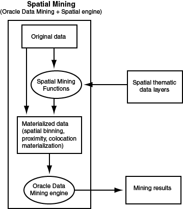

## 9  Spatial Analysis and Mining

This chapter describes the Oracle Spatial and Graph features that enable the use of spatial data in data mining applications.

**Note:**

To use the features described in this chapter, you must understand the main concepts and techniques explained in the documentation for Oracle Data Mining, a component of the Oracle Advanced Analytics Option.

For reference information about spatial analysis and mining functions and procedures in the SDO_SAM package, see [SDO_SAM Package (Spatial Analysis and Mining)](SDO_SAM-reference.md).

**Note:**

SDO_SAM subprograms are supported for two-dimensional geometries only. They are not supported for three-dimensional geometries.

- Spatial Information and Data Mining Applications
  Oracle Data Mining allows automatic discovery of knowledge from a database. Its techniques include discovering hidden associations between different data attributes, classification of data based on some samples, and clustering to identify intrinsic patterns. Spatial data can be materialized for inclusion in data mining applications.
- Spatial Binning for Detection of Regional Patterns
  Spatial binning (spatial discretization) discretizes the location values into a small number of groups associated with geographical areas.
- Materializing Spatial Correlation
  Spatial correlation (or, neighborhood influence) refers to the phenomenon of the location of a specific object in an area affecting some nonspatial attribute of the object. For example, the value (nonspatial attribute) of a house at a given address (geocoded to give a spatial attribute) is largely determined by the value of other houses in the neighborhood.
- Colocation Mining
  Colocation is the presence of two or more spatial objects at the same location or at significantly close distances from each other. Colocation patterns can indicate interesting associations among spatial data objects with respect to their nonspatial attributes.
- Spatial Clustering
  Spatial clustering returns cluster geometries for a layer of data. An example of spatial clustering is the clustering of crime location data.
- Location Prospecting
  Location prospecting can be performed by using thematic layers to compute aggregates for a layer, and choosing the locations that have the maximum values for computed aggregates.

**Parent topic:** [Conceptual and Usage Information](spatial-concepts-usage.md)

### 9.1 Spatial Information and Data Mining Applications

Oracle Data Mining allows automatic discovery of knowledge from a database. Its techniques include discovering hidden associations between different data attributes, classification of data based on some samples, and clustering to identify intrinsic patterns. Spatial data can be materialized for inclusion in data mining applications.

Thus, Oracle Data Mining might enable you to discover that sales prospects with addresses located in specific areas (neighborhoods, cities, or regions) are more likely to watch a particular television program or to respond favorably to a particular advertising solicitation. (The addresses are geocoded into longitude/latitude points and stored in an Oracle Spatial and Graph geometry object.)

In many applications, data at a specific location is influenced by data in the neighborhood. For example, the value of a house is largely determined by the value of other houses in the neighborhood. This phenomenon is called spatial correlation (or, neighborhood influence), and is discussed further in Materializing Spatial Correlation. The spatial analysis and mining features in Oracle Spatial and Graph let you exploit spatial correlation by using the location attributes of data items in several ways: for binning (discretizing) data into regions (such as categorizing data into northern, southern, eastern, and western regions), for materializing the influence of neighborhood (such as number of customers within a two-mile radius of each store), and for identifying colocated data items (such as video rental stores and pizza restaurants).

To perform spatial data mining, you materialize spatial predicates and relationships for a set of spatial data using thematic layers. Each layer contains data about a specific kind of spatial data (that is, having a specific "theme"), for example, parks and recreation areas, or demographic income data. The spatial materialization could be performed as a preprocessing step before the application of data mining techniques, or it could be performed as an intermediate step in spatial mining, as shown in Figure 9-1.

Figure 9-1 Spatial Mining and Oracle Data Mining

[Description of "Figure 9-1 Spatial Mining and Oracle Data Mining"](img_text/spatial_mining.md)

Notes on Figure 9-1:

- The original data, which included spatial and nonspatial data, is processed to produce materialized data.

- Spatial data in the original data is processed by spatial mining functions to produce materialized data. The processing includes such operations as spatial binning, proximity, and colocation materialization.

- The Oracle Data Mining engine processes materialized data (spatial and nonspatial) to generate mining results.

The following are examples of the kinds of data mining applications that could benefit from including spatial information in their processing:

- Business prospecting: Determine if colocation of a business with another franchise (such as colocation of a Pizza Hut restaurant with a Blockbuster video store) might improve its sales.

- Store prospecting: Find a good store location that is within 50 miles of a major city and inside a state with no sales tax. (Although 50 miles is probably too far to drive to avoid a sales tax, many customers may live near the edge of the 50-mile radius and thus be near the state with no sales tax.)

- Hospital prospecting: Identify the best locations for opening new hospitals based on the population of patients who live in each neighborhood.

- Spatial region-based classification or personalization: Determine if southeastern United States customers in a certain age or income category are more likely to prefer "soft" or "hard" rock music.

- Automobile insurance: Given a customer's home or work location, determine if it is in an area with high or low rates of accident claims or auto thefts.

- Property analysis: Use colocation rules to find hidden associations between proximity to a highway and either the price of a house or the sales volume of a store.

- Property assessment: In assessing the value of a house, examine the values of similar houses in a neighborhood, and derive an estimate based on variations and spatial correlation.

**Parent topic:** Spatial Analysis and Mining

### 9.2 Spatial Binning for Detection of Regional Patterns

Spatial binning (spatial discretization) discretizes the location values into a small number of groups associated with geographical areas.

The assignment of a location to a group can be done by any of the following methods:

- Reverse geocoding the longitude/latitude coordinates to obtain an address that specifies (for United States locations) the ZIP code, city, state, and country

- Checking a spatial bin table to determine which bin this specific location belongs in

You can then apply Oracle Data Mining techniques to the discretized locations to identify interesting regional patterns or association rules. For example, you might discover that customers in area A prefer regular soda, while customers in area B prefer diet soda.

The following functions and procedures, documented in [SDO_SAM Package (Spatial Analysis and Mining)](SDO_SAM-reference.md), perform operations related to spatial binning:

- [SDO_SAM.BIN_GEOMETRY](SDO_SAM-reference.md)

- [SDO_SAM.BIN_LAYER](SDO_SAM-reference.md)

**Parent topic:** Spatial Analysis and Mining

### 9.3 Materializing Spatial Correlation

Spatial correlation (or, neighborhood influence) refers to the phenomenon of the location of a specific object in an area affecting some nonspatial attribute of the object. For example, the value (nonspatial attribute) of a house at a given address (geocoded to give a spatial attribute) is largely determined by the value of other houses in the neighborhood.

To use spatial correlation in a data mining application, you materialize the spatial correlation by adding attributes (columns) in a data mining table. You use associated thematic tables to add the appropriate attributes. You then perform mining tasks on the data mining table using Oracle Data Mining functions.

The following functions and procedures, documented in [SDO_SAM Package (Spatial Analysis and Mining)](SDO_SAM-reference.md), perform operations related to materializing spatial correlation:

- [SDO_SAM.SIMPLIFY_GEOMETRY](SDO_SAM-reference.md)

- [SDO_SAM.SIMPLIFY_LAYER](SDO_SAM-reference.md)

- [SDO_SAM.AGGREGATES_FOR_GEOMETRY](SDO_SAM-reference.md)

- [SDO_SAM.AGGREGATES_FOR_LAYER](SDO_SAM-reference.md)

**Parent topic:** Spatial Analysis and Mining

### 9.4 Colocation Mining

Colocation is the presence of two or more spatial objects at the same location or at significantly close distances from each other. Colocation patterns can indicate interesting associations among spatial data objects with respect to their nonspatial attributes.

For example, a data mining application could discover that sales at franchises of a specific pizza restaurant chain were higher at restaurants colocated with video stores than at restaurants not colocated with video stores.

Two types of colocation mining are supported:

- Colocation of items in a data mining table. Given a data layer, this approach identifies the colocation of multiple features. For example, predator and prey species could be colocated in animal habitats, and high-sales pizza restaurants could be colocated with high-sales video stores. You can use a reference-feature approach (using one feature as a reference and the other features as thematic attributes, and materializing all neighbors for the reference feature) or a buffer-based approach (materializing all items that are within all windows of a specified size).

- Colocation with thematic layers. Given several data layers, this approach identifies colocation across the layers. For example, given a lakes layer and a vegetation layer, lakes could be colocated with areas of high vegetation. You materialize the data, add categorical and numerical spatial relationships to the data mining table, and apply the Oracle Data Mining Association-Rule mechanisms.

The following functions and procedures, documented in [SDO_SAM Package (Spatial Analysis and Mining)](SDO_SAM-reference.md), perform operations related to colocation mining:

- [SDO_SAM.COLOCATED_REFERENCE_FEATURES](SDO_SAM-reference.md)

- [SDO_SAM.BIN_GEOMETRY](SDO_SAM-reference.md)

**Parent topic:** Spatial Analysis and Mining

### 9.5 Spatial Clustering

Spatial clustering returns cluster geometries for a layer of data. An example of spatial clustering is the clustering of crime location data.

The [SDO_SAM.SPATIAL_CLUSTERS](SDO_SAM-reference.md) function, documented in [SDO_SAM Package (Spatial Analysis and Mining)](SDO_SAM-reference.md), performs spatial clustering. This function requires a spatial R-tree index on the geometry column of the layer, and it returns a set of SDO_REGION objects where the geometry column specifies the boundary of each cluster and the `geometry_key` value is set to null.

You can use the [SDO_SAM.BIN_GEOMETRY](SDO_SAM-reference.md) function, with the returned spatial clusters in the bin table, to identify the cluster to which a geometry belongs.

**Parent topic:** Spatial Analysis and Mining

### 9.6 Location Prospecting

Location prospecting can be performed by using thematic layers to compute aggregates for a layer, and choosing the locations that have the maximum values for computed aggregates.

The following functions, documented in [SDO_SAM Package (Spatial Analysis and Mining)](SDO_SAM-reference.md), perform operations related to location prospecting:

- [SDO_SAM.AGGREGATES_FOR_GEOMETRY](SDO_SAM-reference.md)

- [SDO_SAM.AGGREGATES_FOR_LAYER](SDO_SAM-reference.md)

- [SDO_SAM.TILED_AGGREGATES](SDO_SAM-reference.md)

**Parent topic:** Spatial Analysis and Mining
