## 1  Spatial Concepts

Oracle Spatial and Graph is an integrated set of functions, procedures, data types, and data models that support spatial and graph analytics. The spatial features enable spatial data to be stored, accessed, and analyzed quickly and efficiently in an Oracle database.

Spatial data represents the essential location characteristics of real or conceptual objects as those objects relate to the real or conceptual space in which they exist.

Major topics:

- What Is Oracle Spatial and Graph?
  Oracle Spatial and Graph, often referred to as Spatial and Graph, includes advanced features for spatial data and analysis and for physical, logical, network, and social and semantic graph applications.
- Object-Relational Model
  Spatial and Graph supports the object-relational model for representing geometries. This model stores an entire geometry in the Oracle native spatial data type for vector data, SDO_GEOMETRY.
- Introduction to Spatial Data
  Oracle Spatial and Graph is designed to make spatial data management easier and more natural to users of location-enabled applications and geographic information system (GIS) applications. Once spatial data is stored in an Oracle database, it can be easily manipulated, retrieved, and related to all other data stored in the database.
- Geometry Types
  A geometry is an ordered sequence of vertices that are connected by straight line segments or circular arcs.
- Data Model
  The spatial data model in Oracle Spatial and Graph is a hierarchical structure consisting of elements, geometries, and layers. Layers are composed of geometries, which in turn are made up of elements.
- Query Model
  Spatial and Graph uses a two-tier query model to resolve spatial queries and spatial joins.
- Indexing of Spatial Data
  The integration of spatial indexing capabilities into the Oracle Database engine is a key feature of the Spatial and Graph product.
- Spatial Relationships and Filtering
  Spatial and Graph uses secondary filters to determine the spatial relationship between entities in the database. The spatial relationship is based on geometry locations.
- Spatial Operators, Procedures, and Functions
  The Spatial and Graph PL/SQL application programming interface (API) includes several operators and many procedures and functions.
- Spatial Aggregate Functions
  SQL has long had aggregate functions, which are used to aggregate the results of a SQL query.
- Vector Tiles
  Oracle Spatial provides support for generating vector tiles from spatial data in database tables. The vector tile format is designed for highly efficient streaming of spatial data to map visualization clients.
- H3 Indexing
  Oracle Spatial provides support for hexagonal hierarchical spatial indexing (H3) in Oracle Database.
- Three-Dimensional Spatial Objects
  Oracle Spatial and Graph supports the storage and retrieval of three-dimensional spatial data, which can include points, point clouds (collections of points), lines, polygons, surfaces, and solids.
- Geocoding
  Geocoding is the process of converting tables of address data into standardized address, location, and possibly other data.
- Location Data Enrichment
  Oracle Spatial and Graph includes a place name data set, with hierarchical geographical data from HERE, that you can load into the database.
- JSON and GeoJSON Support in Oracle Spatial and Graph
  Spatial and Graph supports the use of JSON and GeoJSON objects to store, index, and manage geographic data that is in JSON (JavaScript Object Notation) format.
- NURBS Curve Support in Oracle Spatial and Graph
  Spatial and Graph supports non-uniform rational B-spline (NURBS) curve geometries.
- Sharded Database Support by Oracle Spatial and Graph
  Spatial and Graph supports the use of sharded database technology.
- Spatial and Graph Java Application Programming Interface
  Oracle Spatial and Graph provides a Java application programming interface (API) .
- Predefined User Accounts Created by Spatial and Graph
  During installation, Spatial and Graph creates user accounts that have the minimum privileges needed to perform their jobs.
- Performance and Tuning Information
  Many factors can affect the performance of Oracle Spatial and Graph applications, such as the use of optimizer hints to influence the plan for query execution.
- OGC and ISO Compliance
  Oracle Spatial and Graph is conformant with Open Geospatial Consortium (OGC) Simple Features Specification 1.1.1 (Document 99-049), starting with Oracle Database release 10g (version 10.1.0.4).
- Spatial and Graph Release (Version) Number
  To check which release of Spatial and Graph you are running, use the SDO_VERSION function.
- SPATIAL_VECTOR_ACCELERATION System Parameter
  To accelerate the performance of spatial operators, it is recommended that you enable the Vector Performance Accelerator (VPA) feature by setting the SPATIAL_VECTOR_ACCELERATION database system parameter to the value `TRUE`. (This feature and associated system parameter are authorized for use only by licensed Oracle Spatial and Graph users, and the default value for the parameter is `FALSE`.)
- Spatially Enabling a Table
  If you have a regular Oracle table without an SDO_GEOMETRY column, but containing location-related information (such as latitude/longitude values for points), you can spatially enable the table by adding an SDO_GEOMETRY column and using existing (and future) location-related information in records to populate the SDO_GEOMETRY column values.
- Moving Spatial Metadata (MDSYS.MOVE_SDO)
  Database administrators (DBAs) can use the MDSYS.MOVE_SDO procedure to move all Oracle Spatial and Graph metadata tables to a specified target tablespace.
- Spatial Application Hardware Requirement Considerations
  This topic discusses some general guidelines that affect the amount of disk storage space and CPU power needed for applications that use Oracle Spatial and Graph.
- Spatial and Graph Error Messages
  Spatial and Graph has a set of error messages.
- Spatial Examples
  Oracle Spatial and Graph provides examples that you can use to reinforce your learning and to create models for coding certain operations.
- README File for Spatial and Graph and Related Features
  A `README.txt` file supplements the information in several manuals.

**Parent topic:** [Conceptual and Usage Information](spatial-concepts-usage.md)

### 1.1 What Is Oracle Spatial and Graph?

Oracle Spatial and Graph, often referred to as Spatial and Graph, includes advanced features for spatial data and analysis and for physical, logical, network, and social and semantic graph applications.

The spatial features provide a schema and functions that facilitate the storage, retrieval, update, and query of collections of spatial features in an Oracle database. Spatial and Graph consists of the following:

- A schema (MDSYS) that prescribes the storage, syntax, and semantics of supported geometric data types

- A spatial indexing mechanism

- Operators, functions, and procedures for performing area-of-interest queries, spatial join queries, and other spatial analysis operations

- Functions and procedures for utility and tuning operations

- Topology data model for working with data about nodes, edges, and faces in a topology (described in [Oracle Spatial and Graph Topology Data Model and Network Data Model Graph Developer's Guide](../topol/topology-data-model-overview.md)).

- Network data model for representing capabilities or objects that are modeled as nodes and links (vertices and edges) in a graph (described in [Oracle Spatial and Graph Topology Data Model and Network Data Model Graph Developer's Guide](../topol/network-data-model-graph-overview.md)).

- GeoRaster, a feature that lets you store, index, query, analyze, and deliver GeoRaster data, that is, raster image and gridded data and its associated metadata (described in [Oracle Spatial and Graph GeoRaster Developer's Guide](../geors/georaster-overview-and-concepts.md)).

The spatial component of a spatial feature is the geometric representation of its shape in some coordinate space. This is referred to as its geometry.

**Note:**

Do not modify any packages, tables, or other objects under the MDSYS schema. (The only exception is if you need to create a user-defined coordinate reference system, as explained in [Creating a User-Defined Coordinate Reference System](coordinate-systems-concepts.md).)

**Parent topic:** Spatial Concepts

### 1.2 Object-Relational Model

Spatial and Graph supports the object-relational model for representing geometries. This model stores an entire geometry in the Oracle native spatial data type for vector data, SDO_GEOMETRY.

An Oracle table can contain one or more SDO_GEOMETRY columns. The object-relational model corresponds to a "SQL with Geometry Types" implementation of spatial feature tables in the Open GIS ODBC/SQL specification for geospatial features.

The benefits provided by the object-relational model include:

- Support for many geometry types, including arcs, circles, compound polygons, compound line strings, and optimized rectangles

- Ease of use in creating and maintaining indexes and in performing spatial queries

- Index maintenance by the Oracle database

- Geometries modeled in a single column

- Optimal performance

**Parent topic:** Spatial Concepts

### 1.3 Introduction to Spatial Data

Oracle Spatial and Graph is designed to make spatial data management easier and more natural to users of location-enabled applications and geographic information system (GIS) applications. Once spatial data is stored in an Oracle database, it can be easily manipulated, retrieved, and related to all other data stored in the database.

A common example of spatial data can be seen in a road map. A road map is a two-dimensional object that contains points, lines, and polygons that can represent cities, roads, and political boundaries such as states or provinces. A road map is a visualization of geographic information. The location of cities, roads, and political boundaries that exist on the surface of the Earth are projected onto a two-dimensional display or piece of paper, preserving the relative positions and relative distances of the rendered objects.

The data that indicates the Earth location (such as longitude and latitude) of these rendered objects is the spatial data. When the map is rendered, this spatial data is used to project the locations of the objects on a two-dimensional piece of paper. A GIS is often used to store, retrieve, and render this Earth-relative spatial data.

Types of spatial data (other than GIS data) that can be stored using Spatial and Graph include data from computer-aided design (CAD) and computer-aided manufacturing (CAM) systems. Instead of operating on objects on a geographic scale, CAD/CAM systems work on a smaller scale, such as for an automobile engine or printed circuit boards.

The differences among these systems are in the size and precision of the data, not the data's complexity. The systems might all involve the same number of data points. On a geographic scale, the location of a bridge can vary by a few tenths of an inch without causing any noticeable problems to the road builders, whereas if the diameter of an engine's pistons is off by a few tenths of an inch, the engine will not run.

In addition, the complexity of data is independent of the absolute scale of the area being represented. For example, a printed circuit board is likely to have many thousands of objects etched on its surface, containing in its small area information that may be more complex than the details shown on a road builder's blueprints.

These applications all store, retrieve, update, or query some collection of features that have both nonspatial and spatial attributes. Examples of nonspatial attributes are name, soil_type, landuse_classification, and part_number. The spatial attribute is a coordinate geometry, or vector-based representation of the shape of the feature.

**Parent topic:** Spatial Concepts

### 1.4 Geometry Types

A geometry is an ordered sequence of vertices that are connected by straight line segments or circular arcs.

The semantics of the geometry are determined by its type. Spatial and Graph supports several primitive types, and geometries composed of collections of these types, including two-dimensional:

- Points and point clusters

- Line strings

- n-point polygons

- Arc line strings (All arcs are generated as circular arcs.)

- Arc polygons

- Compound polygons

- Compound line strings

- Circles

- Optimized rectangles

Two-dimensional points are elements composed of two ordinates, X and Y, often corresponding to longitude and latitude. Line strings are composed of one or more pairs of points that define line segments. Polygons are composed of connected line strings that form a closed ring, and the area of the polygon is implied. For example, a point might represent a building location, a line string might represent a road or flight path, and a polygon might represent a state, city, zoning district, or city block.

Self-crossing polygons are not supported, although self-crossing line strings are supported. If a line string crosses itself, it does not become a polygon. A self-crossing line string does not have any implied area.

The following figure illustrates the geometric types.

Figure 1-1 Geometric Types

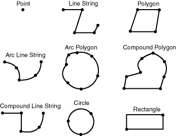
[Description of "Figure 1-1 Geometric Types"](img_text/geom_types.md)

Spatial and Graph also supports the storage and indexing of three-dimensional and four-dimensional geometric types, where three or four coordinates are used to define each vertex of the object being defined. For information about support for three-dimensional geometries, see Three-Dimensional Spatial Objects.

**Parent topic:** Spatial Concepts

### 1.5 Data Model

The spatial data model in Oracle Spatial and Graph is a hierarchical structure consisting of elements, geometries, and layers. Layers are composed of geometries, which in turn are made up of elements.

- Element
- Geometry
- Layer
- Coordinate System
- Tolerance

**Parent topic:** Spatial Concepts

#### 1.5.1 Element

An element is the basic building block of a geometry. The supported spatial element types are points, line strings, and polygons. For example, elements might model star constellations (point clusters), roads (line strings), and county boundaries (polygons). Each coordinate in an element is stored as an X,Y pair. The exterior ring and zero or more interior rings (holes) of a complex polygon are considered a single element.

Point data consists of one coordinate. Line data consists of two coordinates representing a line segment of the element. Polygon data consists of coordinate pair values, one vertex pair for each line segment of the polygon. Coordinates are defined in order around the polygon (counterclockwise for an exterior polygon ring, clockwise for an interior polygon ring).

**Parent topic:** Data Model

#### 1.5.2 Geometry

A geometry (or geometry object) is the representation of a spatial feature, modeled as an ordered set of primitive elements. A geometry can consist of a single element, which is an instance of one of the supported primitive types, or a homogeneous or heterogeneous collection of elements. A multipolygon, such as one used to represent a set of islands, is a homogeneous collection. A heterogeneous collection is one in which the elements are of different types, for example, a point and a polygon.

An example of a geometry might describe the buildable land in a town. This could be represented as a polygon with holes where water or zoning prevents construction.

**Parent topic:** Data Model

#### 1.5.3 Layer

A layer is a collection of geometries having the same attribute set. For example, one layer in a GIS might include topographical features, while another describes population density, and a third describes the network of roads and bridges in the area (lines and points). The geometries and associated spatial index for each layer are stored in the database in standard tables.

**Parent topic:** Data Model

#### 1.5.4 Coordinate System

A coordinate system (also called a spatial reference system) is a means of assigning coordinates to a location and establishing relationships between sets of such coordinates. It enables the interpretation of a set of coordinates as a representation of a position in a real world space.

Any spatial data has a coordinate system associated with it. The coordinate system can be georeferenced (related to a specific representation of the Earth) or not georeferenced (that is, Cartesian, and not related to a specific representation of the Earth). If the coordinate system is georeferenced, it has a default unit of measurement (such as meters) associated with it, but you can have Spatial and Graph automatically return results in another specified unit (such as miles).

Spatial data can be associated with a Cartesian, geodetic (geographical), projected, or local coordinate system:

- Cartesian coordinates are coordinates that measure the position of a point from a defined origin along axes that are perpendicular in the represented two-dimensional or three-dimensional space.

  If a coordinate system is not explicitly associated with a geometry, a Cartesian coordinate system is assumed.

- Geodetic coordinates (sometimes called geographic coordinates) are angular coordinates (longitude and latitude), closely related to spherical polar coordinates, and are defined relative to a particular Earth geodetic datum. (A geodetic datum is a means of representing the figure of the Earth and is the reference for the system of geodetic coordinates.)

- Projected coordinates are planar Cartesian coordinates that result from performing a mathematical mapping from a point on the Earth's surface to a plane. There are many such mathematical mappings, each used for a particular purpose.

- Local coordinates are Cartesian coordinates in a non-Earth (non-georeferenced) coordinate system. Local coordinate systems are often used for CAD applications and local surveys.

When performing operations on geometries, Spatial and Graph uses either a Cartesian or curvilinear computational model, as appropriate for the coordinate system associated with the spatial data.

**Related Topics**

- [Unit of Measurement Support](spatial-datatypes-metadata.md)
- [Coordinate Systems (Spatial Reference Systems)](coordinate-systems-concepts.md)

**Parent topic:** Data Model

#### 1.5.5 Tolerance

Tolerance is used to associate a level of precision with spatial data. Tolerance reflects the distance that two points can be apart and still be considered the same (for example, to accommodate rounding errors). The tolerance value must be a positive number greater than zero. The significance of the value depends on whether or not the spatial data is associated with a geodetic coordinate system. (Geodetic and other types of coordinate systems are described in Coordinate System.)

- For geodetic data (such as data identified by longitude and latitude coordinates), the tolerance value is expressed as number of meters. For example, a tolerance value of 10 indicates a tolerance of 10 meters. A tolerance of 0.001 is a millimeter, and 0.000001 is a micrometer. Note that specifying any tolerance of less than a millimeter for geodetic data can result in a loss of precision in the internal geodetic calculations, potentially leading to unexpected results.
- For non-geodetic data, the tolerance value is a number of the units that are associated with the coordinate system associated with the data. For example, if the unit of measurement is miles, a tolerance value of 0.005 indicates a tolerance of 0.005 (that is, 1/200) mile (approximately 26 feet or 7.9 meters), and a tolerance value of 2 indicates a tolerance of 2 miles.

In both cases, the smaller the tolerance value, the more precision is to be associated with the data.

For geodetic and projected data, the tolerance value should be less than 10. In addition, ensure that geometries are valid at the specified tolerance.

For geometries that have 16 or more digits of precision, Spatial and Graph boolean operations (such as [SDO_GEOM.SDO_UNION](SDO_GEOM-reference.md) and [SDO_GEOM.SDO_INTERSECTION](SDO_GEOM-reference.md)) and the [SDO_GEOM.RELATE](SDO_GEOM-reference.md) function might produce inconsistent results due to the loss of precision in floating point arithmetic. The number of digits of precision is calculated as in the following example: if the tolerance is set to 0.0000000005 and the coordinates have 6 digits to the left of decimal (for example, 123456.4321), the precision is 10 + 6 digits (16). In such cases, it is better to use a larger tolerance value (fewer leading zeros after the decimal) to get consistent results using spatial operations.

**Note:**

Floating point operations tend to lose precision when the number of digits used in the computation is more than 15, so make sure the number of digits specified for computations is less than 15. For example, if the number is 123456.789 and the tolerance is 10E-10, then this effectively means 16 (10+6) digits of precision, which is more than the recommended 15.

A tolerance value is specified in two cases:

- In the geometry metadata definition for a layer

- As an input parameter to certain functions

<!-- -->

- Tolerance in the Geometry Metadata for a Layer
- Tolerance as an Input Parameter

**Related Topics**

- [Tolerance Values with LRS Functions](lrs-linear-referencing-system-concepts.md)

**Parent topic:** Data Model

##### 1.5.5.1 Tolerance in the Geometry Metadata for a Layer

The dimensional information for a layer includes a tolerance value. Specifically, the DIMINFO column (described in [DIMINFO](spatial-datatypes-metadata.md)) of the xxx_SDO_GEOM_METADATA views includes an SDO_TOLERANCE value for each dimension, and the value should be the same for each dimension.

If a function accepts an optional `tolerance` parameter and this parameter is null or not specified, the SDO_TOLERANCE value of the layer is used. Using the non-geodetic data from the example in [Simple Example: Inserting, Indexing, and Querying Spatial Data](spatial-datatypes-metadata.md), the actual distance between geometries `cola_b` and `cola_d` is 0.846049894. If a query uses the [SDO_GEOM.SDO_DISTANCE](SDO_GEOM-reference.md) function to return the distance between `cola_b` and `cola_d` and does not specify a `tolerance` parameter value, the result depends on the SDO_TOLERANCE value of the layer. For example:

- If the SDO_TOLERANCE value of the layer is 0.005, this query returns .846049894.

- If the SDO_TOLERANCE value of the layer is 0.5, this query returns 0.

  The zero result occurs because Spatial and Graph first constructs an imaginary buffer of the tolerance value (0.5) around each geometry to be considered, and the buffers around `cola_b` and `cola_d` overlap in this case. (If the two geometries being considered have different tolerance values, the higher value is used for the imaginary buffer.)

You can, therefore, take either of two approaches in selecting an SDO_TOLERANCE value for a layer:

- The value can reflect the desired level of precision in queries for distances between objects. For example, if two non-geodetic geometries 0.8 units apart should be considered as separated, specify a small SDO_TOLERANCE value such as 0.05 or smaller.

- The value can reflect the precision of the values associated with geometries in the layer. For example, if all geometries in a non-geodetic layer are defined using integers and if two objects 0.8 units apart should not be considered as separated, an SDO_TOLERANCE value of 0.5 is appropriate. To have greater precision in any query, you must override the default by specifying the `tolerance` parameter.

With non-geodetic data, the guideline to follow for most instances of the second case (precision of the values of the geometries in the layer) is: take the highest level of precision in the geometry definitions, and use .5 at the next level as the SDO_TOLERANCE value. For example, if geometries are defined using integers (as in the simplified example in [Simple Example: Inserting, Indexing, and Querying Spatial Data](spatial-datatypes-metadata.md)), the appropriate value is 0.5; however, if geometries are defined using numbers up to four decimal positions (for example, 31.2587), the appropriate value is 0.00005.

**Note:**

This guideline should not be used if the geometries include any polygons that are so narrow at any point that the distance between facing sides is less than the proposed tolerance value. Be sure that the tolerance value is less than the shortest distance between any two sides in any polygon.

Moreover, if you encounter "invalid geometry" errors with inserted or updated geometries, and if the geometries are in fact valid, consider increasing the precision of the tolerance value (for example, changing 0.00005 to 0.000005).

**Parent topic:** Tolerance

##### 1.5.5.2 Tolerance as an Input Parameter

Many spatial functions accept a `tolerance` parameter, which (if specified) overrides the default tolerance value for the layer (explained in Tolerance in the Geometry Metadata for a Layer). If the distance between two points is less than or equal to the tolerance value, Spatial and Graph considers the two points to be a single point. Thus, tolerance is usually a reflection of how accurate or precise users perceive their spatial data to be.

For example, assume that you want to know which restaurants are within 5 kilometers of your house. Assume also that Maria's Pizzeria is 5.1 kilometers from your house. If the spatial data has a geodetic coordinate system and if you ask, Find all restaurants within 5 kilometers and use a tolerance of 100 (or greater, such as 500), Maria's Pizzeria will be included, because 5.1 kilometers (5100 meters) is within 100 meters of 5 kilometers (5000 meters). However, if you specify a tolerance less than 100 (such as 50), Maria's Pizzeria will not be included.

Tolerance values for spatial functions are typically very small, although the best value in each case depends on the kinds of applications that use or will use the data. See also the tolerance guidelines in Tolerance in the Geometry Metadata for a Layer, and ensure that all input geometries are valid. (Spatial functions may not work as expected if the geometry data is not valid.)

If you explicitly want to use the tolerance value from the dimensional information array for the geometry layer, and if a subprogram has separate formats with `tolerance` (or `tol`) and `dim` parameters, use the format with `dim`. In the following example, the first statement uses the tolerance value from the dimensional information array, and the second statement specifies a numeric tolerance value (0.005):

    -- Return the area of the cola_a geometry.

    SELECT c.name, SDO_GEOM.SDO_AREA(c.shape, m.diminfo)
      FROM cola_markets c, user_sdo_geom_metadata m
      WHERE m.table_name = 'COLA_MARKETS' AND m.column_name = 'SHAPE'
      AND c.name = 'cola_a';

    SELECT c.name, SDO_GEOM.SDO_AREA(c.shape, 0.005) FROM cola_markets c
       WHERE c.name = 'cola_a';

**Parent topic:** Tolerance

### 1.6 Query Model

Spatial and Graph uses a two-tier query model to resolve spatial queries and spatial joins.

The term is used to indicate that two distinct operations are performed to resolve queries. The output of the two combined operations yields the exact result set.

The two operations are referred to as primary and secondary filter operations.

- The primary filter permits fast selection of candidate records to pass along to the secondary filter. The primary filter compares geometry approximations to reduce computation complexity and is considered a lower-cost filter. Because the primary filter compares geometric approximations, it returns a superset of the exact result set.

- The secondary filter applies exact computations to geometries that result from the primary filter. The secondary filter yields an accurate answer to a spatial query. The secondary filter operation is computationally expensive, but it is only applied to the primary filter results, not the entire data set.

Figure 1-2 illustrates the relationship between the primary and secondary filters.

Figure 1-2 Query Model

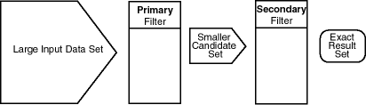
[Description of "Figure 1-2 Query Model"](img_text/query.md)

As shown in Figure 1-2, the primary filter operation on a large input data set produces a smaller candidate set, which contains at least the exact result set and may contain more records. The secondary filter operation on the smaller candidate set produces the exact result set.

Spatial and Graph uses a spatial index to implement the primary filter. Spatial and Graph does not require the use of both the primary and secondary filters. In some cases, just using the primary filter is sufficient. For example, a zoom feature in a mapping application queries for data that has any interaction with a rectangle representing visible boundaries. The primary filter very quickly returns a superset of the query. The mapping application can then apply clipping routines to display the target area.

The purpose of the primary filter is to quickly create a subset of the data and reduce the processing burden on the secondary filter. The primary filter, therefore, should be as efficient (that is, selective yet fast) as possible. This is determined by the characteristics of the spatial index on the data.

**Related Topics**

- [Querying Spatial Data](indexing-querying-spatial-data.md)

**Parent topic:** Spatial Concepts

### 1.7 Indexing of Spatial Data

The integration of spatial indexing capabilities into the Oracle Database engine is a key feature of the Spatial and Graph product.

A spatial index, like any other index, provides a mechanism to limit searches, but in this case the mechanism is based on spatial criteria such as intersection and containment. For example, a spatial index is used to:

- Find objects within an indexed data space that interact with a given point or area of interest (window query)

- Find pairs of objects from within two indexed data spaces that interact spatially with each other (spatial join)

Effective with Release 12.2 and later, creating and using a spatial index is not mandatory for the use of any Oracle Spatial and Graph features (except for the [SDO_NN](spatial-operators-reference.md) operator). However, spatial indexes are highly recommended, and not using them can negatively affect performance in some cases.

Testing of spatial indexes with many workloads and operators is ongoing, and further results and recommendations will be documented as they become available.

The following sections explain the concepts and options associated with R-tree indexing.

- R-Tree Indexing
- R-Tree Quality

**Parent topic:** Spatial Concepts

#### 1.7.1 R-Tree Indexing

A spatial R-tree index can index spatial data of up to four dimensions. An R-tree index approximates each geometry by a single rectangle that minimally encloses the geometry (called the minimum bounding rectangle, or MBR), as shown in Figure 1-3.

Figure 1-3 MBR Enclosing a Geometry

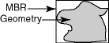
[Description of "Figure 1-3 MBR Enclosing a Geometry"](img_text/rt_mbr.md)

For a layer of geometries, an R-tree index consists of a hierarchical index on the MBRs of the geometries in the layer, as shown in Figure 1-4.

Figure 1-4 R-Tree Hierarchical Index on MBRs

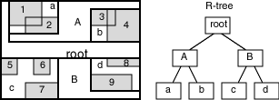
[Description of "Figure 1-4 R-Tree Hierarchical Index on MBRs"](img_text/rt_tree.md)

In Figure 1-4:

- 1 through 9 are geometries in a layer.

- a, b, c, and d are the leaf nodes of the R-tree index, and contain minimum bounding rectangles of geometries, along with pointers to the geometries. For example, a contains the MBR of geometries 1 and 2, b contains the MBR of geometries 3 and 4, and so on.

- A contains the MBR of a and b, and B contains the MBR of c and d.

- The root contains the MBR of A and B (that is, the entire area shown).

An R-tree index is stored in the spatial index table (SDO_INDEX_TABLE in the USER_SDO_INDEX_METADATA view, described in [Spatial Index-Related Structures](spatial-datatypes-metadata.md)). The R-tree index also maintains a sequence object (SDO_RTREE_SEQ_NAME in the USER_SDO_INDEX_METADATA view) to ensure that simultaneous updates by concurrent users can be made to the index.

**Parent topic:** Indexing of Spatial Data

#### 1.7.2 R-Tree Quality

A substantial number of insert and delete operations affecting an R-tree index may degrade the quality of the R-tree structure, which may adversely affect query performance.

The R-tree is a hierarchical tree structure with nodes at different heights of the tree. The performance of an R-tree index structure for queries is roughly proportional to the area and perimeter of the index nodes of the R-tree. The area covered at level 0 represents the area occupied by the minimum bounding rectangles of the data geometries, the area at level 1 indicates the area covered by leaf-level R-tree nodes, and so on. The original ratio of the area at the root (topmost level) to the area at level 0 can change over time based on updates to the table; and if there is a degradation in that ratio (that is, if it increases significantly), rebuilding the index may help the performance of queries.

If the performance of [SDO_FILTER](spatial-operators-reference.md) operations has degraded, and if there have been a large number of insert, update, or delete operations affecting geometries, the performance degradation may be due to a degradation in the quality of the associated R-tree index.

To rebuild an R-tree index, use the [ALTER INDEX REBUILD](sql-indexing-spatial-data.md) statement.

**Parent topic:** Indexing of Spatial Data

### 1.8 Spatial Relationships and Filtering

Spatial and Graph uses secondary filters to determine the spatial relationship between entities in the database. The spatial relationship is based on geometry locations.

The most common spatial relationships are based on topology and distance. For example, the boundary of an area consists of a set of curves that separates the area from the rest of the coordinate space. The interior of an area consists of all points in the area that are not on its boundary. Given this, two areas are said to be adjacent if they share part of a boundary but do not share any points in their interior.

The distance between two spatial objects is the minimum distance between any points in them. Two objects are said to be within a given distance of one another if their distance is less than the given distance.

To determine spatial relationships, Spatial and Graph has several secondary filter methods:

- The [SDO_RELATE](spatial-operators-reference.md) operator evaluates topological criteria.

- The [SDO_WITHIN_DISTANCE](spatial-operators-reference.md) operator determines if two spatial objects are within a specified distance of each other.

- The [SDO_NN](spatial-operators-reference.md) operator identifies the nearest neighbors for a spatial object.

The [SDO_RELATE](spatial-operators-reference.md) operator implements a nine-intersection model for categorizing binary topological relationships between points, lines, and polygons. Each spatial object has an interior, a boundary, and an exterior. The boundary consists of points or lines that separate the interior from the exterior. The boundary of a line string consists of its end points; however, if the end points overlap (that is, if they are the same point), the line string has no boundary. The boundaries of a multiline string are the end points of each of the component line strings; however, if the end points overlap, only the end points that overlap an odd number of times are boundaries. The boundary of a polygon is the line that describes its perimeter. The interior consists of points that are in the object but not on its boundary, and the exterior consists of those points that are not in the object and are not on its boundary.

Given that an object A has three components (a boundary Ab, an interior Ai, and an exterior Ae), any pair of objects has nine possible interactions between their components. Pairs of components have an empty (0) or not empty (1) set intersection. The set of interactions between two geometries is represented by a nine-intersection matrix that specifies which pairs of components intersect and which do not. Figure 1-5 shows the nine-intersection matrix for two polygons that are adjacent to one another. This matrix yields the following bit mask, generated in row-major form: "101001111".

Figure 1-5 The Nine-Intersection Model

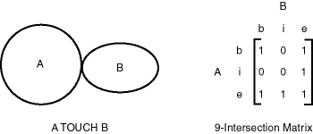
[Description of "Figure 1-5 The Nine-Intersection Model"](img_text/nine_inter.md)

Some of the topological relationships identified in the seminal work by Professor Max Egenhofer (University of Maine, Orono) and colleagues have names associated with them. Spatial and Graph uses the following names:

- DISJOINT: The boundaries and interiors do not intersect.

- TOUCH: The boundaries intersect but the interiors do not intersect.

- OVERLAPBDYDISJOINT: The interior of one object intersects the boundary and interior of the other object, but the two boundaries do not intersect. This relationship occurs, for example, when a line originates outside a polygon and ends inside that polygon.

- OVERLAPBDYINTERSECT: The boundaries and interiors of the two objects intersect.

- EQUAL: The two objects have the same boundary and interior.

- CONTAINS: The interior and boundary of one object is completely contained in the interior of the other object.

- COVERS: The boundary and interior of one object is completely contained in the interior or the boundary of the other object, their interiors intersect, and the boundary or the interior of one object and the boundary of the other object intersect.

- INSIDE: The opposite of CONTAINS. A INSIDE B implies B CONTAINS A.

- COVEREDBY: The opposite of COVERS. A COVEREDBY B implies B COVERS A.

- ON: The interior and boundary of one object is on the boundary of the other object. This relationship occurs, for example, when a line is on the boundary of a polygon.

- ANYINTERACT: The objects are non-disjoint.

Figure 1-6 illustrates these topological relationships.

Figure 1-6 Topological Relationships

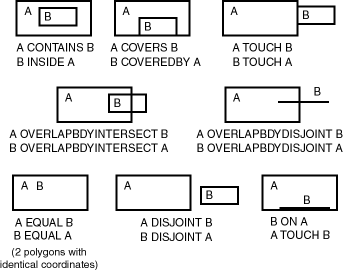
[Description of "Figure 1-6 Topological Relationships"](img_text/top_rel.md)

The [SDO_WITHIN_DISTANCE](spatial-operators-reference.md) operator determines if two spatial objects, A and B, are within a specified distance of one another. This operator first constructs a distance buffer, Db, around the reference object B. It then checks that A and Db are non-disjoint. The distance buffer of an object consists of all points within the given distance from that object. Figure 1-7 shows the distance buffers for a point, a line, and a polygon.

Figure 1-7 Distance Buffers for Points, Lines, and Polygons

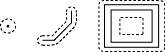
[Description of "Figure 1-7 Distance Buffers for Points, Lines, and Polygons"](img_text/buffers.md)

In the point, line, and polygon geometries shown in Figure 1-7:

- The dashed lines represent distance buffers. Notice how the buffer is rounded near the corners of the objects.

- The geometry on the right is a polygon with a hole: the large rectangle is the exterior polygon ring and the small rectangle is the interior polygon ring (the hole). The dashed line outside the large rectangle is the buffer for the exterior ring, and the dashed line inside the small rectangle is the buffer for the interior ring.

The [SDO_NN](spatial-operators-reference.md) operator returns a specified number of objects from a geometry column that are closest to a specified geometry (for example, the five closest restaurants to a city park). In determining how close two geometry objects are, the shortest possible distance between any two points on the surface of each object is used.

**Parent topic:** Spatial Concepts

### 1.9 Spatial Operators, Procedures, and Functions

The Spatial and Graph PL/SQL application programming interface (API) includes several operators and many procedures and functions.

Spatial operators, such as [SDO_FILTER](spatial-operators-reference.md) and [SDO_RELATE](spatial-operators-reference.md), provide optimum performance when they use a spatial index. (Spatial operators perform most efficiently when the geometry column in the first parameter has a spatial index defined on it.) Spatial operators must be used in the WHERE clause of a query. The first parameter of any operator specifies the geometry column to be searched, and the second parameter specifies a query window. If the query window does not have the same coordinate system as the geometry column, Spatial and Graph performs an implicit coordinate system transformation. For detailed information about the spatial operators, see [Spatial Operators](spatial-operators-reference.md) .

Spatial procedures and functions are provided as subprograms in PL/SQL packages, such as SDO_GEOM, SDO_CS, and SDO_LRS. These subprograms do not require that a spatial index be defined, and they do not use a spatial index if it is defined. These subprograms can be used in the WHERE clause or in a subquery. If two geometries are input parameters to a spatial procedure or function, both must have the same coordinate system.

**Note:**

For any numbers in string (VARCHAR2) parameters to Spatial and Graph operators and subprograms, the period (.) must be used for any decimal points regardless of the locale. Example: `'distance=3.7'`

The following performance-related guidelines apply to the use of spatial operators, procedures, and functions:

- If an operator and a procedure or function perform comparable operations, and if the operator satisfies your requirements, use the operator. For example, unless you need to do otherwise, use [SDO_RELATE](spatial-operators-reference.md) instead of [SDO_GEOM.RELATE](SDO_GEOM-reference.md), and use [SDO_WITHIN_DISTANCE](spatial-operators-reference.md) instead of [SDO_GEOM.WITHIN_DISTANCE](SDO_GEOM-reference.md).

- With operators, always specify `TRUE` in uppercase. That is, specify `= 'TRUE'`, and do not specify `<> 'FALSE'` or `= 'true'`.

- With operators, use the `/*+ ORDERED */` optimizer hint if the query window comes from a table. (You must use this hint if multiple windows come from a table.) See the Usage Notes and Examples for specific operators for more information.

For information about using operators with topologies, see [Oracle Spatial and Graph Topology Data Model and Network Data Model Graph Developer's Guide](../topol/topology-data-model-overview.md).

**Parent topic:** Spatial Concepts

### 1.10 Spatial Aggregate Functions

SQL has long had aggregate functions, which are used to aggregate the results of a SQL query.

The following example uses the SUM aggregate function to aggregate employee salaries by department:

    SELECT SUM(salary), dept
       FROM employees
       GROUP BY dept;

Spatial aggregate functions aggregate the results of SQL queries involving geometry objects. Spatial aggregate functions return a geometry object of type SDO_GEOMETRY. For example, the following statement returns the minimum bounding rectangle of all geometries in a table (using the definitions and data from [Simple Example: Inserting, Indexing, and Querying Spatial Data](spatial-datatypes-metadata.md)):

    SELECT SDO_AGGR_MBR(shape) FROM cola_markets;

The following example returns the union of all geometries except `cola_d`:

    SELECT SDO_AGGR_UNION(SDOAGGRTYPE(c.shape, 0.005))
      FROM cola_markets c WHERE c.name <> 'cola_d';

For reference information about the spatial aggregate functions and examples of their use, see the [Spatial Aggregate Functions](spatial-aggregate-functions.md) reference chapter.

**Note:**

Spatial aggregate functions are supported for two-dimensional geometries only, except for [SDO_AGGR_MBR](spatial-aggregate-functions.md), which is supported for both two-dimensional and three-dimensional geometries.

- SDOAGGRTYPE Object Type

**Parent topic:** Spatial Concepts

#### 1.10.1 SDOAGGRTYPE Object Type

Many spatial aggregate functions accept an input parameter of type SDOAGGRTYPE. Oracle Spatial and Graph defines the object type SDOAGGRTYPE as:

    CREATE TYPE sdoaggrtype AS OBJECT (
     geometry SDO_GEOMETRY,
     tolerance NUMBER);

**Note:**

Do not use SDOAGGRTYPE as the data type for a column in a table. Use this type only in calls to spatial aggregate functions.

The `tolerance` value in the SDOAGGRTYPE definition should be the same as the SDO_TOLERANCE value specified in the DIMINFO column in the xxx_SDO_GEOM_METADATA views for the geometries, unless you have a specific reason for wanting a different value. For more information about tolerance, see Tolerance; for information about the xxx_SDO_GEOM_METADATA views, see [Geometry Metadata Views](spatial-datatypes-metadata.md).

The `tolerance` value in the SDOAGGRTYPE definition can affect the result of a spatial aggregate function. Figure 1-8 shows a spatial aggregate union ([SDO_AGGR_UNION](spatial-aggregate-functions.md)) operation of two geometries using two different tolerance values: one smaller and one larger than the distance between the geometries.

Figure 1-8 Tolerance in an Aggregate Union Operation

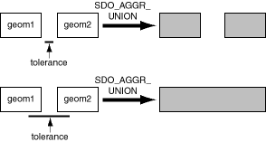
[Description of "Figure 1-8 Tolerance in an Aggregate Union Operation"](img_text/tol_union.md)

In the first aggregate union operation in Figure 1-8, where the tolerance is less than the distance between the rectangles, the result is a compound geometry consisting of two rectangles. In the second aggregate union operation, where the tolerance is greater than the distance between the rectangles, the result is a single geometry.

**Parent topic:** Spatial Aggregate Functions

### 1.11 Vector Tiles

Oracle Spatial provides support for generating vector tiles from spatial data in database tables. The vector tile format is designed for highly efficient streaming of spatial data to map visualization clients.

Vector tiles contain geometry and attribute data in a compressed binary format covering square areas defined by a tiling scheme. In a tiling scheme, the world is divided into square tiles identified by X and Y ordinates at each of a predefined set of zoom levels. Modern mapping clients are designed to consume spatial data from vector tiles and style information from style sheets. This affords tremendous flexibility and agility by allowing a single vector tile dataset to be leveraged for numerous map styles.

Oracle Spatial supports the generation of vector tiles from spatial data in tables with the [SDO_UTIL.GET_VECTORTILE](SDO_UTIL-reference.md) function. Vector tiles may be generated based on either the Google or TMS tiling scheme.

**Parent topic:** Spatial Concepts

### 1.12 H3 Indexing

Oracle Spatial provides support for hexagonal hierarchical spatial indexing (H3) in Oracle Database.

H3 is an open source indexing system developed by Uber that uses hexagons in a grid system to cover the earth’s surface. Data points are bucketed in hexagon cells, and attributes can be aggregated and summarized over these hexagons. For very large volumes of point data, H3 cells are very useful to visualize aggregated attribute data in thematic maps.

Oracle Spatial H3 support includes several functions in the database to generate H3 cells from point data. Additionally, functions are provided to directly generate vector tiles from the aggregated H3 data. These vector tiles can be shared with web clients to create map visualizations.

Hexagonal indexing is translating a point in geodetic (longitude, latitude) coordinate system to a space defined by sphere circumscribed Icosahedron (polygon with 20 faces) approximation of Earth, which essentially is a grid of hexagons (also a few pentagon special cases). H3 index comprises 16 such grids, arranged in a hierarchy. The level 0 grid contains 122 hexagons (110 hexagons, 12 pentagons).

The following functions in the SDO_UTIL package provides H3 indexing support for spatial data in Oracle Database:

- [SDO_UTIL.H3SUM_CREATE_TABLE](SDO_UTIL-reference.md)
- [SDO_UTIL.H3SUM_VECTORTILE](SDO_UTIL-reference.md)
- [SDO_UTIL.H3_KEY](SDO_UTIL-reference.md)
- [SDO_UTIL.H3SUM_AS_TABLE](SDO_UTIL-reference.md)
- [SDO_UTIL.H3SUM_ESTIMATE_RESOLUTION](SDO_UTIL-reference.md)
- [SDO_UTIL.H3_MBR](SDO_UTIL-reference.md)
- [SDO_UTIL.H3_PENTAGON_EDGELEN](SDO_UTIL-reference.md)
- [SDO_UTIL.H3_HEX_EDGELEN](SDO_UTIL-reference.md)
- [SDO_UTIL.H3_BASE_CELL](SDO_UTIL-reference.md)
- [SDO_UTIL.H3SUM_GET_CURSOR](SDO_UTIL-reference.md)
- [SDO_UTIL.H3SUM_LIST_TABLES](SDO_UTIL-reference.md)
- [SDO_UTIL.H3_RESOLUTION](SDO_UTIL-reference.md)
- [SDO_UTIL.H3_PARENT](SDO_UTIL-reference.md)
- [SDO_UTIL.H3_IS_CLASS3](SDO_UTIL-reference.md)
- [SDO_UTIL.H3_IS_PENTAGON](SDO_UTIL-reference.md)
- [SDO_UTIL.H3_IS_VALID_CELL](SDO_UTIL-reference.md)
- [SDO_UTIL.H3_PENTAGON_AREA](SDO_UTIL-reference.md)
- [SDO_UTIL.H3_NUM_CELLS](SDO_UTIL-reference.md)
- [SDO_UTIL.H3_HEX_AREA](SDO_UTIL-reference.md)
- [SDO_UTIL.H3_CENTER](SDO_UTIL-reference.md)
- [SDO_UTIL.H3_BOUNDARY](SDO_UTIL-reference.md)

**Parent topic:** Spatial Concepts

### 1.13 Three-Dimensional Spatial Objects

Oracle Spatial and Graph supports the storage and retrieval of three-dimensional spatial data, which can include points, point clouds (collections of points), lines, polygons, surfaces, and solids.

**Note:**

Three-dimensional spatial objects are supported only if Oracle JVM is enabled on your Oracle Autonomous Database Serverless deployments. To enable Oracle JVM, see [Use Oracle Java](https://docs.oracle.com/pls/topic/lookup?ctx=en/cloud/paas/autonomous-database&id=GUID-2516EE33-B38D-4270-BE52-30A4F9014E8B) in Using Oracle Autonomous Database Serverless for more information.

Table 1-1 shows the SDO_GTYPE and element-related attributes of the SDO_GEOMETRY type that are relevant to three-dimensional geometries. (The SDO_GEOMETRY type is explained in [SDO_GEOMETRY Object Type](spatial-datatypes-metadata.md).)

Table 1-1 SDO_GEOMETRY Attributes for Three-Dimensional Geometries

| Type of 3-D Data         | SDO_GTYPE | Element Type, Interpretation in SDO_ELEM_INFO                                                                                                                                                                                                                                                                                                                                                             |
|:-------------------------|:----------|:----------------------------------------------------------------------------------------------------------------------------------------------------------------------------------------------------------------------------------------------------------------------------------------------------------------------------------------------------------------------------------------------------------|
| Point                    | 3001      | Does not apply. Specify all 3 dimension values in the SDO_POINT_TYPE attribute.                                                                                                                                                                                                                                                                                                                           |
| Line                     | 3002      | 2, 1                                                                                                                                                                                                                                                                                                                                                                                                      |
| Polygon                  | 3003      | 1003, 1: planar exterior polygon 2003, 1: planar interior polygon 1003, 3: planar exterior rectangle 2003, 3: planar interior rectangle                                                                                                                                                                                                                                                          |
| Surface                  | 3003      | 1006, 1: surface (followed by element information for the polygons)                                                                                                                                                                                                                                                                                                                                       |
| Collection               | 3004      | Same considerations as for two-dimensional                                                                                                                                                                                                                                                                                                                                                                |
| Multipoint (point cloud) | 3005      | 1, n (where n is the number of points)                                                                                                                                                                                                                                                                                                                                                                    |
| Multiline                | 3006      | 2, 1 (same as for Line)                                                                                                                                                                                                                                                                                                                                                                                   |
| Multisurface             | 3007      | Element definitions for one or more surfaces                                                                                                                                                                                                                                                                                                                                                              |
| Solid                    | 3008      | Simple solid formed by a single closed surface: one element type 1007, followed by one element type 1006 (the external surface) and optionally one or more element type 2006 (internal surfaces) Composite solid formed by multiple adjacent simple solids: one element type 1008 (holding the count of simple solids), followed by any number of element type 1007 (each describing one simple solid) |
| Multisolid               | 3009      | Element definitions for one or more simple solids (element type 1007) or composite solids (element type 1008)                                                                                                                                                                                                                                                                                             |

The following spatial operators consider all three dimensions in their computations:

- [SDO_ANYINTERACT](spatial-operators-reference.md)

- [SDO_FILTER](spatial-operators-reference.md)

- [SDO_INSIDE](spatial-operators-reference.md) (for solid geometries only)

- [SDO_NN](spatial-operators-reference.md)

- [SDO_WITHIN_DISTANCE](spatial-operators-reference.md)

The other operators consider only the first two dimensions. For some of preceding operators the height information is ignored when dealing with geodetic data, as explained later in this section. (Spatial operators are described in [Spatial Operators](spatial-operators-reference.md) .)

The [SDO_GEOM.SDO_VOLUME](SDO_GEOM-reference.md) function applies only to solid geometries, which are by definition three-dimensional; however, this function cannot be used with geodetic data. For information about support for three-dimensional geometries with other SDO_GEOM subprograms, see the usage information in [SDO_GEOM Package (Geometry)](SDO_GEOM-reference.md).

For distance computations with three-dimensional geometries:

- If the data is geodetic (geographic 3D), the distance computations are done on the geodetic surface.

- If the data is non-geodetic (projected or local), the distance computations are valid only if the unit of measure is the same for all three dimensions.

To have any functions, procedures, or operators consider all three dimensions, you must specify `PARAMETERS ('sdo_indx_dims=3')` in the [CREATE INDEX](sql-indexing-spatial-data.md) statement when you create the spatial index on a spatial table containing Geographic3D data (longitude, latitude, ellipsoidal height). If you do not specify that parameter in the [CREATE INDEX](sql-indexing-spatial-data.md) statement, a two-dimensional index is created.

For spatial functions, procedures, and operators that consider all three dimensions, distance and length computations correctly factor in the height or elevation. For example, consider two three-dimensional points, one at the origin of a Cartesian space (0,0,0), and the other at X=3 on the Y axis and a height (Z) of 4 (3,0,4).

- If the operation considers all three dimensions, the distance between the two points is 5. (Think of the hypotenuse of a 3-4-5 right triangle.)

- If the operation considers only two dimensions, the distance between the two points is 3. (That is, the third dimension, or height, is ignored.)

However, for the following operators and subprograms, when dealing with geodetic data, the distances with three-dimensional geometries are computed between the "ground" representations (for example, the longitude/latitude extent of the footprint of a building), and the height information is approximated:

- [SDO_NN](spatial-operators-reference.md) operator

- [SDO_WITHIN_DISTANCE](spatial-operators-reference.md) operator

- [SDO_GEOM.SDO_DISTANCE](SDO_GEOM-reference.md) function

- [SDO_GEOM.WITHIN_DISTANCE](SDO_GEOM-reference.md) function

For a two-dimensional query window with three-dimensional data, you can use the [SDO_FILTER](spatial-operators-reference.md) operator, but not any other spatial operators.

For examples of creating different types of three-dimensional spatial geometries, see [Three-Dimensional Geometry Types](spatial-datatypes-metadata.md). That section also includes an example showing how to update the spatial metadata and create spatial indexes for three-dimensional geometries.

For information about support for three-dimensional coordinate reference systems, see [Three-Dimensional Coordinate Reference System Support](coordinate-systems-concepts.md).

Three-dimensional support does not apply to many spatial aggregate functions and PL/SQL packages and subprograms. The following are supported for two-dimensional geometries only:

- Spatial aggregate functions, except for [SDO_AGGR_MBR](spatial-aggregate-functions.md), which is supported for both two-dimensional and three-dimensional geometries.

- SDO_GEOM (geometry) subprograms, except for the following, which are supported for both two-dimensional and three-dimensional geometries:

  - [SDO_GEOM.RELATE](SDO_GEOM-reference.md) with the ANYINTERACT mask

  - [SDO_GEOM.SDO_AREA](SDO_GEOM-reference.md)

  - [SDO_GEOM.SDO_DISTANCE](SDO_GEOM-reference.md)

  - [SDO_GEOM.SDO_LENGTH](SDO_GEOM-reference.md)

  - [SDO_GEOM.SDO_MAX_MBR_ORDINATE](SDO_GEOM-reference.md)

  - [SDO_GEOM.SDO_MBR](SDO_GEOM-reference.md)

  - [SDO_GEOM.SDO_MIN_MBR_ORDINATE](SDO_GEOM-reference.md)

  - [SDO_GEOM.SDO_VOLUME](SDO_GEOM-reference.md)

  - [SDO_GEOM.VALIDATE_GEOMETRY_WITH_CONTEXT](SDO_GEOM-reference.md)

  - [SDO_GEOM.VALIDATE_LAYER_WITH_CONTEXT](SDO_GEOM-reference.md)

  - [SDO_GEOM.WITHIN_DISTANCE](SDO_GEOM-reference.md)

- SDO_SAM (spatial analysis and mining) subprograms

- [SDO_MIGRATE.TO_CURRENT](SDO_MIGRATE-reference.md) procedure

Table 1-2 describes how Oracle Spatial and Graph internally performs certain geodetic three-dimensional calculations.

Table 1-2 How Geodetic 3D Calculations Are Performed

| Type of Calculation | Internal Calculations Performed                                                                                                                                                              |
|:--------------------|:---------------------------------------------------------------------------------------------------------------------------------------------------------------------------------------------|
| ANYINTERACT         | The input geometries are transformed using Gnomonic transformation; then the ANYINTERACT relationship is computed with the resulting geometries.                                             |
| Area                | The input geometry is projected onto a local tangent plane; then the area is computed with the resulting input geometry.                                                                     |
| Distance or Length  | The 2D precise ellipsoidal distance is computed using the longitude/latitude of the two closest points of approach; then the height or length difference is included using an approximation. |
| Volume              | The input geometry is projected onto a local tangent plane; then the volume is computed with the resulting input geometry.                                                                   |

- Modeling Surfaces
- Modeling Solids
- Three-Dimensional Optimized Rectangles
- Using Texture Data
- Validation Checks for Three-Dimensional Geometries

**Parent topic:** Spatial Concepts

#### 1.13.1 Modeling Surfaces

A surface contains an area but not a volume, and it can have two or three dimensions. A surface is often constructed by a set of planar regions.

Surfaces can be modeled as surface-type SDO_GEOMETRY objects or, if they are very large, as SDO_TIN objects. The surface-type in SDO_GEOMETRY can be an arbitrary surface defining a contiguous area bounded by adjacent three-dimensional polygons. The number of polygons in the SDO_GEOMETRY is limited by the number of ordinates that can be in the SDO_ORDINATES_ARRAY. An SDO_TIN object, on the other hand, models the surface as a network of triangles with no explicit limit on the number of triangles.

Surfaces are stored as a network of triangles, called triangulated irregular networks, or TINs. The TIN model represents a surface as a set of contiguous, non-overlapping triangles. Within each triangle the surface is represented by a plane. The triangles are made from a set of points called mass points. If mass points are carefully selected, the TIN represents an accurate representation of the model of the surface. Well-placed mass points occur where there is a major change in the shape of the surface, for example, at the peak of a mountain, the floor of a valley, or at the edge (top and bottom) of cliffs.

TINs are generally computed from a set of three-dimensional points specifying coordinate values in the longitude (x), latitude (y), and elevation (z) dimensions. Oracle TIN generation software uses the Delaunay triangulation algorithm, but it is not required that TIN data be formed using only Delaunay triangulation techniques.

The general process for working with a TIN is as follows:

1.  Initialize the TIN, using the [SDO_TIN_PKG.INIT](SDO_TIN_PKG-reference.md) function.

2.  Create the TIN, using the [SDO_TIN_PKG.CREATE_TIN](SDO_TIN_PKG-reference.md) procedure.

3.  As needed for queries, clip the TIN, using the [SDO_TIN_PKG.CLIP_TIN](SDO_TIN_PKG-reference.md) function.

4.  If necessary, use the [SDO_TIN_PKG.TO_GEOMETRY](SDO_TIN_PKG-reference.md) function (for example, to convert the result of a clip operation into a single SDO_GEOMETRY object).

For a Java example of working with TINs, see the following files:

    $ORACLE_HOME/md/demo/TIN/examples/java/README.txt
    $ORACLE_HOME/md/demo/TIN/examples/java/readTIN.java

**Parent topic:** Three-Dimensional Spatial Objects

#### 1.13.2 Modeling Solids

The simplest types of solids can be represented as cuboids, such as a cube or a brick. A more complex solid is a frustum, which is a pyramid formed by cutting a larger pyramid (with three or more faces) by a plane parallel to the base of that pyramid. Frustums are sometimes used as query windows to spatial operators. Frustums and cubes are typically modeled as solid-type SDO_GEOMETRY objects. Figure 1-9 shows a frustum as a query window, with two spatial objects at different distances from the view point.

Figure 1-9 Frustum as Query Window for Spatial Objects

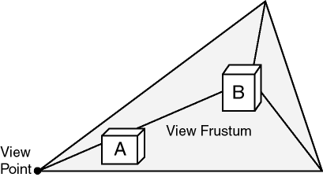
[Description of "Figure 1-9 Frustum as Query Window for Spatial Objects"](img_text/frustum_view.md)

Point clouds, which are large collections of points, can sometimes be used to model the shape or structure of solid and surface geometries. Most applications that use point cloud data contain queries based on location. Applications can also go outside Spatial and Graph to add visibility logic to perform queries based on both location and visibility.

Most applications that use point cloud data seek to minimize data transfer by retrieving objects based on their distance from a view point. For example, in Figure 1-9, object B is farther from the view point than object A, and therefore the application might retrieve object A in great detail (high resolution) and object B in less detail (low resolution). In most scenarios, the number of objects or points increases significantly as the distance from the view point increases; and if farther objects are retrieved at lower resolutions than nearer objects, the number of bytes returned by the query and the rendering time for the objects decrease significantly.

For storage of point cloud data, you can use either an SDO_PC object or is a flat table. The approach to use depends on your hardware environment and usage patterns. An advantage of the flat format is its efficient and dynamic nature, because updates to the point data do not require reblocking.

The general process for working with a point cloud is as follows, depending on whether the point cloud data will be stored in an SDO_PC object or in a flat table.

- To use point cloud data stored as an SDO_PC object:

  1.  Initialize the point cloud, using the [SDO_PC_PKG.INIT](SDO_PC_PKG-reference.md) function.

  2.  Create the point cloud, using the [SDO_PC_PKG.CREATE_PC](SDO_PC_PKG-reference.md) procedure.

  3.  As needed for queries, clip the point cloud, using the [SDO_PC_PKG.CLIP_PC](SDO_PC_PKG-reference.md) function.

  4.  If necessary, use the [SDO_PC_PKG.TO_GEOMETRY](SDO_PC_PKG-reference.md) function (for example, to convert the result of a clip operation into a single SDO_GEOMETRY object).

- To use point cloud data stored in a flat table:

  1.  Create the table (or a view based on an appropriate table) for the point cloud data.

      Each row will contain the values of the first three spatial dimensions of a point, and optionally values for nonspatial dimensions. The table or view definition must start with the following columns: VAL_D1 NUMBER, VAL_D2 NUMBER, VAL_D3 NUMBER. It can also contain columns for point cloud nonspatial dimensions.

  2.  Populate the table with point data.

  3.  As needed for queries, clip the point cloud, using the [SDO_PC_PKG.CLIP_PC_FLAT](SDO_PC_PKG-reference.md) function.

For a Java example of working with point clouds, see the following files:

    $ORACLE_HOME/md/demo/PointCloud/examples/java/README.txt
    $ORACLE_HOME/md/demo/PointCloud/examples/java/readPointCloud.java

**Parent topic:** Three-Dimensional Spatial Objects

#### 1.13.3 Three-Dimensional Optimized Rectangles

Instead of specifying all the vertices for a three-dimensional rectangle (a polygon in the shape of rectangle in three-dimensional space), you can represent the rectangle by specifying just the two corners corresponding to the minimum ordinate values (min-corner) and the maximum ordinate values (max-corner) for the X, Y, and Z dimensions.

The orientation of a three-dimensional rectangle defined in this way is as follows:

- If the rectangle is specified as \<min-corner, max-corner\>, the normal points in the positive direction of the perpendicular third dimension.

- If the rectangle is specified as \<max-corner, min-corner\>, the normal points in the negative direction of the perpendicular third dimension.

For example, if the rectangle is in the XY plane and the order of the vertices is \<min-corner, max-corner\>, the normal is along the positive Z-axis; but if the order is \<max-corner, min-corner\>, the normal is along the negative Z-axis.

Using these orientation rules for rectangles, you can specify the order of the min-corner and max-corner vertices for a rectangle appropriately so that the following requirements are met:

- The normal for each polygon in a solid always points outward from the solid when the rectangle is part of the solid.

- An inner rectangle polygon is oriented in the reverse direction as its outer when the rectangle is part of a surface.

**Parent topic:** Three-Dimensional Spatial Objects

#### 1.13.4 Using Texture Data

**Note:**

This section describes concepts that you will need to understand for using texture data with Spatial and Graph. However, the texture metadata is not yet fully implemented in Oracle Spatial and Graph, and a viewer is not yet supported. This section will be updated when texture support is released.

A texture is an image that represents one or more parts of a feature. Textures are commonly used with visualizer applications (viewers) that display objects stored as spatial geometries. For example, a viewer might display an office building (three-dimensional solid) using textures, to allow a more realistic visualization than using just colors. Textures can be used with two-dimensional and three-dimensional geometries.

In the simplest case, a rectangular geometry can be draped with a texture bitmap. However, often only a subregion of a texture bitmap is used, as in the following example cases:

- If the texture bitmap contains multiple sides of the same building, as well as the roof and roof gables. In this case, each bitmap portion is draped over one of the geometry faces.

- If the texture bitmap represents a single panel or window on the building surface, and a geometric face represents a wall with 15 such panels or windows (five on each of three floors). In this case, the single texture bitmap is tiled 15 times over the face.

- If the face is non-rectangular sub-faces, such as roof gables. In this case, only a portion (possible triangular) of the texture bitmap is used.

Figure 1-10 shows a large rectangular surface that, when viewed, appears to consist of three textures, each of which is repeated multiple times in various places on the surface.

Figure 1-10 Faces and Textures

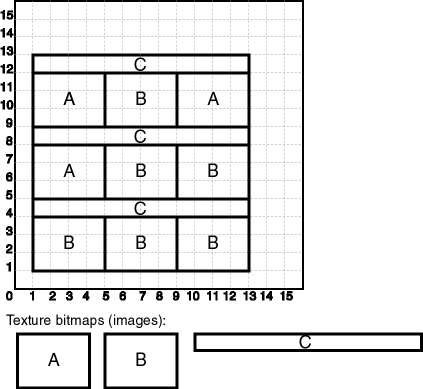
[Description of "Figure 1-10 Faces and Textures"](img_text/textures_2.md)

As shown in Figure 1-10:

- The entire image is a large surface that consists of 12 smaller rectangular faces (surface geometries), each of which can be represented by one of three images (labeled A, B, and C).

- Three texture bitmaps (labeled A, B, and C) can be used to visualize all of the faces. In this case, bitmap A is used 3 times, bitmap B is used 6 times, and bitmap C is used 3 times.

Figure 1-11 shows a texture bitmap mapped to a triangular face.

Figure 1-11 Texture Mapped to a Face

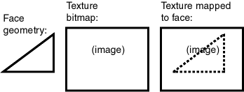
[Description of "Figure 1-11 Texture Mapped to a Face"](img_text/textures_3.md)

As shown in Figure 1-11:

- The face (surface geometry) is a triangle. (For example, a side or roof of a building may contain several occurrences of this face.)

- The texture bitmap (image) is a rectangle, shown in the box in the middle.

- A portion of the texture bitmap represents an image of the face. This portion is shown by a dashed line in the box on the right.

  In your application, you will need to specify coordinates within the texture bitmap to map the appropriate portion to the face geometry.

To minimize the storage requirements for image data representing surfaces, you should store images for only the distinct textures that will be needed. The data type for storing a texture is SDO_ORDINATE_ARRAY, which is used in the SDO_GEOMETRY type definition (explained in [SDO_GEOMETRY Object Type](spatial-datatypes-metadata.md)).

For example, assume that the large surface in Figure 1-10 has the following definition:

    SDO_GEOMETRY(
      2003,  -- two-dimensional polygon
      NULL,
      NULL,
      SDO_ELEM_INFO_ARRAY(1,1003,1), -- one polygon (exterior polygon ring)
      SDO_ORDINATE_ARRAY(1,1. 1,13, 13,13, 1,13, 1,1)
    )

Assume that you have a MY_TEXTURE_COORDINATES table with the following definition:

    CREATE TABLE my_texture_coordinates (
      texture_coord_id NUMBER PRIMARY KEY,
      texture_name VARCHAR2(32),
      texture_coordinates SDO_ORDINATE_ARRAY);

Example 1-1 inserts three texture coordinate definitions into this table. For each texture, its coordinates reflect one of the appropriate smaller rectangles shown in Figure 1-10; however, you can choose any one of the appropriate rectangles for each texture. In Example 1-1, the SDO_ORDINATE_ARRAY definitions for each texture reflect a polygon near the top of Figure 1-10.

Example 1-1 Inserting Texture Coordinate Definitions

    INSERT INTO my_texture_coordinates VALUES(
      1,
      'Texture_A',
       SDO_ORDINATE_ARRAY(1,9, 1,5, 5,12, 1,12, 1,9)
      );

    INSERT INTO my_texture_coordinates VALUES(
      2,
      'Texture_B',
      SDO_ORDINATE_ARRAY(5,9, 9,9, 9,12, 5,12, 5,9)
      );

    INSERT INTO my_texture_coordinates VALUES(
      3,
      'Texture_C',
      SDO_ORDINATE_ARRAY(1,12, 13,12, 13,13, 1,13, 1,12)
      );

- Schema Considerations with Texture Data

**Parent topic:** Three-Dimensional Spatial Objects

##### 1.13.4.1 Schema Considerations with Texture Data

Texture bitmaps (stored as BLOBs or as URLs in VARCHAR2 format) and texture coordinate arrays (stored using type SDO_ORDINATE_ARRAY) can be stored in the same table as the SDO_GEOMETRY column or in separate tables; however, especially for the texture bitmaps, it is usually better to use separate tables. Texture bitmaps are likely to be able to be shared among features (such as different office buildings), but texture coordinate definitions are less likely to be sharable among features. (For example, many office buildings may share the same general type of glass exterior, but few of the buildings have the same number of windows and floors. In designing your textures and applications, you must consider how many buildings use the same texture subregion or drape the texture in the same size of repetitive matrix.)

An exception is a texture coordinate array that drapes an entire texture bitmap over a rectangular geometric face. In this case, the texture coordinate array can be specified as (0,0, 1,0, 1,1, 0,1, 1,1), defined by vertices "lower left", "lower right", "upper right", "upper left", and closing with "lower left". Many data sets use this texture coordinate array extensively, because they have primarily rectangular faces and they store one facade for each texture bitmap.

If you used separate tables, you could link them to the surface geometries using foreign keys, as in Example 1-2.

Example 1-2 Creating Tables for Texture Coordinates, Textures, and Surfaces

    -- One row for each texture coordinates definition.
    CREATE TABLE my_texture_coordinates (
      texture_coord_id NUMBER PRIMARY KEY,
      texture_coordinates SDO_ORDINATE_ARRAY);

    -- One row for each texture.
    CREATE TABLE my_textures(
      texture_id NUMBER PRIMARY KEY,
      texture BLOB);

    -- One row for each surface (each individual "piece" of a
    -- potentially larger surface).
    CREATE TABLE my_surfaces(
      surface_id NUMBER PRIMARY KEY,
      surface_geometry SDO_GEOMETRY,
      texture_id NUMBER,
      texture_coord_id NUMBER,
      CONSTRAINT texture_id_fk
        FOREIGN KEY (texture_id) REFERENCES my_textures(texture_id),
      CONSTRAINT texture_coord_id_fk
        FOREIGN KEY (texture_coord_id) REFERENCES
          my_texture_coordinates(texture_coord_id));

**Parent topic:** Using Texture Data

#### 1.13.5 Validation Checks for Three-Dimensional Geometries

The [SDO_GEOM.VALIDATE_GEOMETRY_WITH_CONTEXT](SDO_GEOM-reference.md) and [SDO_GEOM.VALIDATE_LAYER_WITH_CONTEXT](SDO_GEOM-reference.md) subprograms can validate two-dimensional and three-dimensional geometries. For a three-dimensional geometry, these subprograms perform any necessary checks on any two-dimensional geometries (see the Usage Notes for [SDO_GEOM.VALIDATE_GEOMETRY_WITH_CONTEXT](SDO_GEOM-reference.md)) within the overall three-dimensional geometry, but also several checks specific to the three-dimensional nature of the overall object.

For a simple solid (one outer surface and any number of inner surfaces), these subprograms perform the following checks:

- Closedness: The solid must be closed.

- Reachability: Each face of a solid must have a full-edge intersection with its neighboring faces, and all faces must be reachable from any face. (However, inner shells are ignored, because inner shells can, by definition, be not connected to the other shells.)

- Inner-outer disjointedness: An inner surface must not intersect the outer surface at more than a point or a line; that is, there must be no overlapping areas with inner surfaces.

- No surface patch: No additional surfaces can be defined on the surfaces that make up the solid.

- Orientation: For all surfaces, the vertices must be aligned so that the normal vector (or surface normal, or "the normal") points to the outside of (away from) the outer solid. Thus, the volume of the outer solid must be greater than zero, and the volume of any inner solid must be less than zero.

For a composite solid (one or more solids connected to each other), these subprograms perform the following checks:

- Connectedness: All solids of a composite solid must share at least one face.

- Zero-volume intersections: Any intersections of the solids in a composite solid must have a volume of zero.

For a multisolid (one or more solids, each of which is a simple or composite solid), these subprograms perform the following check:

- Disjointedness: Any two solids of a multisolid can share points or lines, but must not intersect in any other manner.

**Parent topic:** Three-Dimensional Spatial Objects

### 1.14 Geocoding

Geocoding is the process of converting tables of address data into standardized address, location, and possibly other data.

The result of a geocoding operation includes the pair of longitude and latitude coordinates that correspond with the input address or location. For example, if the input address is 22 Monument Square, Concord, MA 01742, the longitude and latitude coordinates in the result of the geocoding operation may be (depending on the geocoding data provider) -71.34937 and 42.46101, respectively.

Given a geocoded address, you can perform proximity or location queries using a spatial engine, such as Oracle Spatial and Graph, or demographic analysis using tools and data from Oracle's business partners. In addition, you can use geocoded data with other spatial data such as block group, postal code, and county code for association with demographic information. Results of analyses or queries can be presented as maps, in addition to tabular formats, using third-party software integrated with Oracle Spatial and Graph.

For conceptual and usage information about the geocoding capabilities of Oracle Spatial and Graph, see [Geocoding Address Data](geocoding-address-data-concepts.md). For reference information about the MDSYS.SDO_GCDR PL/SQL package, see [SDO_GCDR Package (Geocoding)](SDO_GCDR-reference.md) .

**Parent topic:** Spatial Concepts

### 1.15 Location Data Enrichment

Oracle Spatial and Graph includes a place name data set, with hierarchical geographical data from HERE, that you can load into the database.

You can then then search this place name data set using the [SDO_UTIL.GEO_SEARCH](SDO_UTIL-reference.md) function. The data set includes commonly used textual location data such as place names, addresses and partial addresses, and latitude and longitude information.

Location tags are extracted from text data, and are matched with well known place names using Oracle Text and enhanced with other geographic information associated with the well known place names.

The results can be stored as additional attributes with the original data.

This feature enables you to process less structured geographic and location data so that the information can be categorized, compared, filtered, and associated with other data. For example, data with only partial names can be enriched to include city, county, state, and country, allowing it to be joined or analyzed with other data sets that may have state level information. This is especially useful when comparing Big Data results with structured information in operational systems and data warehouses.

#### Setting Up and Using Location Data Enrichment Support

To use the location data enrichment support, you just perform certain setup actions, such as editing scripts that will create the necessary database objects and load the data set into Oracle Database, and running those scripts.

1.  Go to `$ORACLE_HOME//md/demo/GeoSearch`, which contains all the required files.

2.  Read the `README` file, a text file containing an overview of the basic steps.

3.  Perform the actions indicated in the `README` file.

    These actions include reading the `LICENSES.TXT` file, creating a single zip file from split files, editing the `load_data.sql` and `create_index.sql` script files (which contain explanatory comments), and running those scripts.

The `create_index.sql` file includes some example queries using the [SDO_UTIL.GEO_SEARCH](SDO_UTIL-reference.md) function. You can use those examples, plus the [SDO_UTIL.GEO_SEARCH](SDO_UTIL-reference.md) reference and usage information, to develop your own uses of the location data enrichment support.

- ELOC_ADMIN_AREA_SEARCH Table
- Adding User Data to the Geographic Name Hierarchy

**Parent topic:** Spatial Concepts

#### 1.15.1 ELOC_ADMIN_AREA_SEARCH Table

The ELOC_ADMIN_AREA_SEARCH table is used to store the data for location data enrichment. It is created only if you have performed the required setup actions described in Location Data Enrichment, and it is created in the database schema that you chose.

This table is accessed by the [SDO_UTIL.GEO_SEARCH](SDO_UTIL-reference.md) procedure. The table has the following columns.

Table 1-3 LOC_ADMIN_AREA_SEARCH Table

| Column Name | Description                                                                                                                                                                                                                                                                                                                                                                                                                                                                                                                                                     |
|:------------|:----------------------------------------------------------------------------------------------------------------------------------------------------------------------------------------------------------------------------------------------------------------------------------------------------------------------------------------------------------------------------------------------------------------------------------------------------------------------------------------------------------------------------------------------------------------|
| AREA_ID     | Unique ID for the place name.                                                                                                                                                                                                                                                                                                                                                                                                                                                                                                                                   |
| FULL_NAME   | The name of the place as a searchable string. For example, “NASHUA,HILLSBOROUGH,NEW HAMPSHIRE,NH,UNITED STATES,USA” is the searchable name for the city of Nashua in NH, USA. This entry is a concatenated list of all possible names for each level of the name hierarchy. That is, for state it can have both the abbreviation and the full name. Similarly, for country it can have both the abbreviation and the full name. This enables the search to find this entry even when different search terms are used for each of these administrative areas. |
| AREA_NAME   | The actual area name of the administrative place.                                                                                                                                                                                                                                                                                                                                                                                                                                                                                                               |
| KEY         | A standardized text key that is returned from the search API. This is a normalized standard key that can be used for joining the search term with other terms.                                                                                                                                                                                                                                                                                                                                                                                                  |
| LANG_CODE   | 3- letter ISO code of the language used for this entry.                                                                                                                                                                                                                                                                                                                                                                                                                                                                                                         |
| PART_ID     | A number that is used when this table is partitioned (see the README for more details).                                                                                                                                                                                                                                                                                                                                                                                                                                                                         |
| CENTER_LONG | Longitude of the place name.                                                                                                                                                                                                                                                                                                                                                                                                                                                                                                                                    |
| CENTER_LAT  | Latitude of the place name.                                                                                                                                                                                                                                                                                                                                                                                                                                                                                                                                     |
| POPULATION  | A number that is used to order the results when multiple matches are found for a given search term. The intent is to return more populated areas first before retuning less populated areas where multiple matches are found for the same search term.                                                                                                                                                                                                                                                                                                          |

**Parent topic:** Location Data Enrichment

#### 1.15.2 Adding User Data to the Geographic Name Hierarchy

In some cases, users might want to add their own data to augment the data provided by Oracle. For example, if the users wants to create an entry for a park in the city (like Central Park in New York City) they can create an entry for it in this table.

For example, they can do :

    insert into ELOC_ADMIN_AREA_SEARCH values (1469286010, 'CENTRAL PARK,NEW YORK CITY,NEW YORK,NYC,RICHMOND,NEW YORK,NY,UNITED STATES,USA', 'CENTRAL PARK', 'CENTRAL PARK|NEW YORK|RICHMOND|NEW YORK|UNITED STATES', 'ENG', 7, 73.9654,40.7829, 0);
    commit;

The COMMIT statement after inserting new data is important, because the text index performs a synchronization only after the commit is issued.

In this example, the area_id is chosen to be some value that does not already exist in the table, and a random partition_id value is used (7 in this case). However, a suitable value should be chosen based on the partitioning scheme used for the table (see the README for more details).

Now a search for central park will result a match:

    select * from table(sdo_util.geo_search('central park,new york,NY,UNITED STATES'));
    CENTRAL PARK
    CENTRAL PARK|NEW YORK|RICHMOND|NEW YORK|UNITED STATES
    ENG 73.9654    40.7829    100

**Parent topic:** Location Data Enrichment

### 1.16 JSON and GeoJSON Support in Oracle Spatial and Graph

Spatial and Graph supports the use of JSON and GeoJSON objects to store, index, and manage geographic data that is in JSON (JavaScript Object Notation) format.

JSON support, introduced in Release 18.1, substantially expands the limited GeoJSON support available in the previous release, in that it supports a larger range of geometries, including 2D and 3D, solid, surface, and LRS geometries. While the Spatial and Graph GeoJSON-specific APIs are still supported, you are encouraged to use the more comprehensive JSON support.

- JSON Support in Oracle Spatial and Graph
  Spatial and Graph supports the use of JSON objects to store, index, and manage geographic data that is in JSON (JavaScript Object Notation) format.
- GeoJSON Support in Oracle Spatial and Graph
  Spatial and Graph supports the use of GeoJSON objects to store, index, and manage geographic data that is in JSON (JavaScript Object Notation) format.

**Parent topic:** Spatial Concepts

#### 1.16.1 JSON Support in Oracle Spatial and Graph

Spatial and Graph supports the use of JSON objects to store, index, and manage geographic data that is in JSON (JavaScript Object Notation) format.

You can convert any Oracle Spatial and Graph SDO_GEOMETRY object to a JSON geometry object, and geometry JSON object back to an SDO_GEOMETRY object.

JSON support in Spatial and Graph includes the following:

- [SDO_UTIL.TO_JSON](SDO_UTIL-reference.md) converts an SDO_GEOMETRY object to a JSON object in CLOB format.

- [SDO_UTIL.TO_JSON_VARCHAR](SDO_UTIL-reference.md) converts an SDO_GEOMETRY object to a JSON object in VARCHAR2 format.

- [SDO_UTIL.FROM_JSON](SDO_UTIL-reference.md) converts a JSON object (in CLOB or VARCHAR2 format) to an SDO_GEOMETRY object. This function can also convert a GeoJSON object to an SDO_GEOMETRY object.

Example 1-3 JSON Support in Spatial and Graph

This example shows some operations using the JSON support in Oracle Spatial and Graph. The example creates a simple table with a JSON column and an SDO_GEOMETRY column, inserts some sample data, performs some simple queries, creates a spatial index, and performs a query using the SDO_WITHIN_DISTANCE operator..

The example uses the following JSON-related feature of Oracle Database, which is documented in [Oracle Database JSON Developer's Guide](../adjsn/index.md):

- The IS JSON Oracle SQL condition in a check constraint in the CREATE TABLE statement to ensure that a column contains JSON data

The example includes descriptive comments and the output of the SQL statements. (The output has been reformatted for readability.)

    -- Some operations using JSON support in Spatial and Graph.
    -- Create a table with 3 columns: one JSONC (JSON CLOB), one JSONV (JSON VARCHAR2),
    -- and one SDO_GEOMETRY.
    CREATE TABLE JSON_TBL (
      jsonc CLOB, jsonv VARCHAR2(4000),
      geom SDO_GEOMETRY,
      CONSTRAINT json_tbl_json CHECK (jsonc IS JSON) );
    Table created.

    -- Test the constraint
    INSERT INTO json_tbl VALUES ('Not JSON', NULL, NULL);
    ORA-02290: check constraint (SCOTT.JSON_TBL_JSON) violated
    -- Insert some data (2 points).

    INSERT INTO JSON_TBL(jsonc)
      VALUES ('{"srid": 8307, "point": {"directposition": [123.4, -10.1]}}');
    1 row created.

    INSERT INTO JSON_TBL(jsonc)
      VALUES ('{"srid": 8307, "point": {"directposition": [123.5, -10.2]}}');
    1 row created.

    COMMIT;
    Commit complete.

    -- Update the table with the VARCHAR formatted JSON object and
    -- an SDO_GEOMETRY created from a JSON object
    UPDATE JSON_TBL SET
      jsonv=SDO_UTIL.TO_JSON_VARCHAR(SDO_UTIL.FROM_JSON(jsonc)),
      geom=SDO_UTIL.FROM_JSON(jsonc);
    2 rows updated.

    COMMIT;

    SELECT jsonc, jsonv, geom FROM json_tbl;

    JSONC
    -------
    JSONV
    -------
    GEOM(SDO_GTYPE, SDO_SRID, SDO_POINT(X, Y, Z), SDO_ELEM_INFO, SDO_ORDINATES)
    -----------------------------------------------------------------------

    {"srid": 8307, "point": {"directposition": [123.4, -10.1]}}
    {"srid": 8307, "point": {"directposition": [123.4, -10.1]}}
    SDO_GEOMETRY(2001, 8307, SDO_POINT_TYPE(123.4, -10.1, NULL), NULL, NULL)
    {"srid": 8307, "point": {"directposition": [123.5, -10.2]}}
    {"srid": 8307, "point": {"directposition": [123.5, -10.2]}}
    SDO_GEOMETRY(2001, 8307, SDO_POINT_TYPE(123.5, -10.2, NULL), NULL, NULL)

**Parent topic:** JSON and GeoJSON Support in Oracle Spatial and Graph

#### 1.16.2 GeoJSON Support in Oracle Spatial and Graph

Spatial and Graph supports the use of GeoJSON objects to store, index, and manage geographic data that is in JSON (JavaScript Object Notation) format.

You can convert Oracle Spatial and Graph SDO_GEOMETRY objects to GeoJSON objects, and GeoJSON objects to SDO_GEOMETRY objects. You can use spatial operators, functions, and a special SDO_GEOMETRY method to work with GeoJSON data.

GeoJSON support in Spatial and Graph includes the following:

- [SDO_UTIL.TO_GEOJSON](SDO_UTIL-reference.md) function to convert an SDO_GEOMETRY object to a GeoJSON object..

- [SDO_UTIL.FROM_GEOJSON](SDO_UTIL-reference.md) function to convert a GeoJSON object to an SDO_GEOMETRY object.

- Get_GeoJson method (member function) of the SDO_GEOMETRY type (see [SDO_GEOMETRY Methods](spatial-datatypes-metadata.md) for an explanation and an example).

Example 1-4 GeoJSON Support in Spatial and Graph

This example shows some operations using the GeoJSON support in Oracle Spatial and Graph. The example creates a simple table with a GeoJSON column and an SDO_GEOMETRY column, inserts some sample data, performs some simple queries, creates a spatial index, and performs a query using the SDO_WITHIN_DISTANCE operator.

The example uses the following JSON-related features of Oracle Database, which are documented in [Oracle Database JSON Developer's Guide](../adjsn/index.md):

- The JSON_VALUE Oracle SQL function with `RETURNING SDO_GEOMETRY` to return SDO_GEOMETRY objects reflecting GeoJSON objects

- The IS JSON Oracle SQL condition in a check constraint in the CREATE TABLE statement to ensure that a column contains JSON data

The example includes descriptive comments and the output of the SQL statements. (The output has been reformatted for readability.)

    -- Some operations using GeoJSON support in Spatial and Graph.
    -- Create a table with 2 columns: one GeoJSON, one SDO_GEOMETRY.
    CREATE TABLE GEO_TABLE (geojson_col VARCHAR2(4000), geom_col SDO_GEOMETRY,
                    CONSTRAINT CHECK (geojson_col IS JSON));

    Table created.

    -- Insert some data (2 points).
    INSERT INTO GEO_TABLE(geojson_col)
          values ('{"a":{"type":"Point","coordinates":[+123.4,+10.1]}}');

    1 row created.

    INSERT INTO GEO_TABLE(geojson_col)
          values ('{"a":{"type":"Point","coordinates":[+123.5,-10.1]}}');

    1 row created.

    commit;

    Commit complete.

    SQL> -- For each geojson_col value, return what its SDO_GEOMETRY equivalent would be.
    SQL> SELECT JSON_VALUE(geojson_col, '$.a' RETURNING SDO_GEOMETRY) from GEO_TABLE;

    JSON_VALUE(GEOJSON_COL,'$.A'RETURNINGSDO_GEOMETRY)(SDO_GTYPE, SDO_SRID, SDO_POIN
    --------------------------------------------------------------------------------
    SDO_GEOMETRY(2001, 4326, SDO_POINT_TYPE(123.4, 10.1, NULL), NULL, NULL)
    SDO_GEOMETRY(2001, 4326, SDO_POINT_TYPE(123.5, -10.1, NULL), NULL, NULL)

    -- For a specified GeoJSON object definition, return what its SDO_GEOMETRY
    -- equivalent would be.
    SELECT JSON_VALUE('{"type":"Point","coordinates":[+123.5,-10.1]}',
                   '$' RETURNING SDO_GEOMETRY) from DUAL;

    JSON_VALUE('{"TYPE":"POINT","COORDINATES":[+123.5,-10.1]}','$'RETURNINGSDO_GEOME
    --------------------------------------------------------------------------------
    SDO_GEOMETRY(2001, 4326, SDO_POINT_TYPE(123.5, -10.1, NULL), NULL, NULL)

    -- Update to populate geom_col with SDO_GEOMETRY objects reflecting the JSON data
    -- in the geojson_col column.
    UPDATE GEO_TABLE
        set geom_col = JSON_VALUE(geojson_col, '$.a' RETURNING SDO_GEOMETRY);

    2 rows updated.

    commit;

    Commit complete.

    -- Create spatial index on the returned SDO_GEOMETRY objects from the JSON data.
    CREATE INDEX GEO_TABLE_IX
             ON GEO_TABLE
              (
              JSON_VALUE(geojson_col, '$.a' RETURNING SDO_GEOMETRY)
              )
           INDEXTYPE IS MDSYS.SPATIAL_INDEX_V2;

    Index created.

    -- SDO_WITHIN_DISTANCE query: Are two grometries within 100 miles apart?
    SELECT 1
      FROM GEO_TABLE
     WHERE SDO_WITHIN_DISTANCE(
              JSON_VALUE(geojson_col, '$.a' RETURNING SDO_GEOMETRY),
              JSON_VALUE('{"type":"Point","coordinates":[+123.5,-10.1]}',
                 '$' RETURNING SDO_GEOMETRY),
           'distance=100 unit=mile') = 'TRUE';

             1
    ----------
             1

**Parent topic:** JSON and GeoJSON Support in Oracle Spatial and Graph

### 1.17 NURBS Curve Support in Oracle Spatial and Graph

Spatial and Graph supports non-uniform rational B-spline (NURBS) curve geometries.

NURBS curves allow representation of free-form shapes with arbitrary shapes. NURBS representation allows control over the shape of the curve because control points and knots guide the shape of the curve, and they allow complex shapes to be represented with little data.

Support for NURBS curves in Spatial and Graph includes the following:

- WKT/WKB and GML functions for loading and storing of NURBS curve geometries in Oracle Spatial and Graph.

- Validation of NURBS curve geometries.

- Spatial indexing of NURBS curve geometries along with the SDO_FILTER, SDO_RELATE, and other operators. Spatial operators use an approximation of the curve for computation.

A NURBS representation requires specification of the control points and the basis functions. The basis functions, in turn, are defined using the knot vector and the degree of the curve. The control points are used to determine the shape of the NURBS curve. The knot vector does not directly control the shape of the curve, but is used to control the exact placement of end points. The knot vector is also used to create curves with kinks and corners. Non-uniform knot vectors are used for manipulating the curve.

To represent a NURBS curve, the following data must be stored: the control points, the knot vector, and the degree of the curve. The set of control points can be represented in either the Euclidean form as `(x, y, z, w)` where `w` represents the weight of the control point or in the homogeneous form as `(wx, wy, wz, w)`. If `wi`=1 for all `i`, the curve is non-rational. The control points are specified in the weighted Euclidean form. Basis functions can be uniform or non-uniform based on the knot vector. A non-uniform knot vector is useful for placement of end points and creating kinks or corners. A normalized knot vector must be specified, that is, the first knot in the knot vector must be zero and the last knot in the knot vector must be one. It is also required that the knot vector is "clamped" at the end points. This requirement is enforced by ensuring that the first `d`+1 values in the knot vector are all zeros and the last `d`+1 values are all ones, where `d` represents the degree of the NURBS curve.

The implementation of NURBS curves in Oracle Spatial and Graph follows the SQL/MM standards. The SQL/MM standards for NURBS curves are used to represent splines, polynomial splines, cubic splines, B-splines, and Bezier curves. In Oracle Spatial and Graph, the SDO_GEOMETRY object type is used for NURBS representation. NURBS curves can be included in the Line, Multiline, and Collection type geometry objects. In these geometries, the simple line string and compound line string type elements can contain NURBS.

For compound line strings containing at least one NURBS segment, the last point of the previous segment is the same as the "clamped" first control point of a NURBS segment, and the last "clamped" control point of a NURBS segment is the same as the first point of the next segment. That is, the vertices will be repeated.

For geometry elements with element type value 2 representing a line string, the interpretation value of 3 is used to represent a NURBS curve; interpretation values of 1 and 2 represent linear segments and arcs. The SDO_ELEM_INFO_ARRAY for a NURBS curve is stored as (offset, 2, 3), which represents the offset, element type, and the interpretation value.

The SDO_ORDINATE_ARRAY stores the degree of the curve `d`, the set of `m` control points and a knot vector of size `n`. So, the ordinate array is stored as a sequence of values `(d, m, x1, y1, z1, w1…. xm, ym, zm, wm, n, k1….kn)`. The control points are stored in the Euclidean form as specified in the SQL/MM standards. Note that for a NURBS curve the number of knots is equal to the sum of the degree, the number of control points, and 1. Therefore,` n=d+m+1`, an equation which is useful for validating NURBS curve geometries.

The following considerations apply to defining a NURBS curve:

- The degree of the curve should be greater than 1, because a curve of degree 1 represents polylines.

- The number of control points must be greater than or equal to 3, and must be greater than the degree.

- The number of knots must be equal to the (number of control points + degree + 1).

- The weight component of each control point must be positive.

- Control points are represented in "weighted Euclidean" form `[wx, wy, (wz), w]`.

- Knot values should be specified in non-decreasing order, and the knot vector must be a normalized knot vector `[0, .. ……, 1]`.

- If `d` is the degree of the curve, there must be `d`+1 consecutive equal knots at the beginning of the curve (value 0) and `d`+1 consecutive equal knots at the end of the curve (value 1). This is to ensure that the curve is clamped at the end points.

- If `d` is the degree of the curve, there must not be more than `d` consecutive equal knots except at the beginning or end of the curve where `d`+1 knots must be present.

Be sure to validate geometries with NURBS segments before creating the spatial index or performing any spatial operations on them. (This recommendation applies to all geometry types, NURBS or otherwise.)

For examples that specify NURBS curve geometries, see [NURBS Curve](spatial-datatypes-metadata.md).

To get a line string geometry that is an approximation of an input NURBS curve geometry, use the [SDO_UTIL.GETNURBSAPPROX](SDO_UTIL-reference.md) function.

**Parent topic:** Spatial Concepts

### 1.18 Sharded Database Support by Oracle Spatial and Graph

Spatial and Graph supports the use of sharded database technology.

However, Partitioned Management Operations (PMO), such as MERGE PARTITION and SPLIT PARTITION, are not supported by Spatial and Graph.

For an overview of Oracle sharding, see [Oracle Database Administrator's Guide](../shard/sharding-overview.md).

**Parent topic:** Spatial Concepts

### 1.19 Spatial and Graph Java Application Programming Interface

Oracle Spatial and Graph provides a Java application programming interface (API) .

This API includes the following packages:

- `oracle.spatial.geometry` provides support for the Spatial and Graph SQL SDO_GEOMETRY data type, which is documented in this guide.

- `oracle.spatial.georaster` provides support for the core GeoRaster features, which are documented in [Oracle Spatial and Graph GeoRaster Developer's Guide](../geors/georaster-overview-and-concepts.md).

- `oracle.spatial.georaster.image` provides support for generating Java images from a GeoRaster object or subset of a GeoRaster object, and for processing the images. These features are documented in [Oracle Spatial and Graph GeoRaster Developer's Guide](../geors/georaster-overview-and-concepts.md).

- `oracle.spatial.georaster.sql` provides support for wrapping the GeoRaster PL/SQL API, which is documented in [Oracle Spatial and Graph GeoRaster Developer's Guide](../geors/georaster-overview-and-concepts.md).

- `oracle.spatial.network` provides support for the Oracle Spatial and Graph Network Data Model Graph, which is documented in [Oracle Spatial and Graph Topology Data Model and Network Data Model Graph Developer's Guide](../topol/network-data-model.md).

- `oracle.spatial.network.lod` provides support for the load-on-demand (LOD) approach of network analysis in the Oracle Spatial and Graph Network Data Model Graph, which is documented in [Oracle Spatial and Graph Topology Data Model and Network Data Model Graph Developer's Guide](../topol/network-data-model-graph-overview.md).

- `oracle.spatial.network.lod.config` provides support for the configuration of load-on-demand (LOD) network analysis in the Oracle Spatial and Graph Network Data Model Graph, which is documented in [Oracle Spatial and Graph Topology Data Model and Network Data Model Graph Developer's Guide](../topol/network-data-model-graph-overview.md).

- `oracle.spatial.topo` provides support for the Oracle Spatial and Graph topology data model, which is documented in [Oracle Spatial and Graph Topology Data Model and Network Data Model Graph Developer's Guide](../topol/topology-data-model.md).

- `oracle.spatial.util` provides classes that perform miscellaneous operations.

For detailed reference information about the classes and interfaces in these packages, see [Oracle Spatial and Graph Java API Reference](../spajv/index.md) (Javadoc).

The Spatial and Graph Java class libraries are in `.jar` files under the `<ORACLE_HOME>/md/jlib/` directory.

**Parent topic:** Spatial Concepts

### 1.20 Predefined User Accounts Created by Spatial and Graph

During installation, Spatial and Graph creates user accounts that have the minimum privileges needed to perform their jobs.

These accounts are created locked and expired; so if you need to use the accounts, you must unlock them. Table 1-4 lists the predefined user accounts created by Spatial and Graph.

Table 1-4 Predefined User Accounts Created by Spatial and Graph

| User Account | Description                                                                                                                                                                                       |
|:-------------|:--------------------------------------------------------------------------------------------------------------------------------------------------------------------------------------------------|
| MDSYS        | The schema used by Oracle Spatial and Graph for prescribing the storage, syntax, and semantics of supported geometric data types.                                                                 |
| MDDATA       | The schema used by Oracle Spatial and Graph for storing data used by geocoding and routing applications. This is the default schema for Oracle software that accesses geocoding and routing data. |

**Parent topic:** Spatial Concepts

### 1.21 Performance and Tuning Information

Many factors can affect the performance of Oracle Spatial and Graph applications, such as the use of optimizer hints to influence the plan for query execution.

This guide contains some information about performance and tuning where it is relevant to a particular topic. For example, R-Tree Quality discusses R-tree quality and its possible effect on query performance, and Spatial Operators\_ Procedures\_ and Functions explains why spatial operators provide better performance than procedures and functions.

In addition, more spatial performance and tuning information is available in one or more white papers through the Oracle Technology Network (OTN). That information is often more detailed than what is in this guide, and it is periodically updated as a result of internal testing and consultations with Spatial and Graph users. To find that information on the OTN, go to

[`http://www.oracle.com/technetwork/database/options/spatialandgraph/`](http://www.oracle.com/technetwork/database/options/spatialandgraph/)

Look for material relevant to spatial performance and tuning.

**Parent topic:** Spatial Concepts

### 1.22 OGC and ISO Compliance

Oracle Spatial and Graph is conformant with Open Geospatial Consortium (OGC) Simple Features Specification 1.1.1 (Document 99-049), starting with Oracle Database release 10g (version 10.1.0.4).

Conformance with the Geometry Types Implementation means that Oracle Spatial and Graph supports all the types, functions, and language constructs detailed in Section 3.2 of the specification.

Synonyms are created to match all OGC function names except for `X(p Point)` and `Y(p Point)`. For these functions, you must use the names `OGC_X` and `OGC_Y` instead of just `X` and `Y`.

Oracle Spatial and Graph is conformant with the following International Organization for Standardization (ISO) standards:

- ISO 13249-3 SQL Multimedia and Application Packages - Part 3: Spatial

- ISO 19101: Geographic information - Reference model (definition of terms and approach)

- ISO 19109: Geographic information - Rules for application schema (called the General Feature Model)

- ISO 19111: Geographic information - Spatial referencing by coordinates (also OGC Abstract specification for coordinate reference systems)

- ISO 19118: Geographic information - Encoding (GML 2.1 and GML 3.1.1)

- ISO 19107: Geographic information - Spatial schema (also OGC Abstract specification for Geometry)

However, standards compliance testing for Oracle Spatial and Graph is ongoing, and compliance with more recent versions of standards or with new standards might be announced at any time. For current information about compliance with standards, see [`http://www.oracle.com/technetwork/database/options/spatialandgraph/documentation/`](http://www.oracle.com/technetwork/database/options/spatialandgraph/documentation/).

**Parent topic:** Spatial Concepts

### 1.23 Spatial and Graph Release (Version) Number

To check which release of Spatial and Graph you are running, use the SDO_VERSION function.

For example:

    SELECT SDO_VERSION FROM DUAL;

    SDO_VERSION
    --------------------------------------------------------------------------------
    12.2.0.1.0

**Parent topic:** Spatial Concepts

### 1.24 SPATIAL_VECTOR_ACCELERATION System Parameter

To accelerate the performance of spatial operators, it is recommended that you enable the Vector Performance Accelerator (VPA) feature by setting the SPATIAL_VECTOR_ACCELERATION database system parameter to the value `TRUE`. (This feature and associated system parameter are authorized for use only by licensed Oracle Spatial and Graph users, and the default value for the parameter is `FALSE`.)

The benefits of setting the SPATIAL_VECTOR_ACCELERATION parameter to `TRUE` include:

- Improved spatial algorithms for spatial operators and functions

- Metadata caching for all spatial operators and functions, which improves their overall performance

- Metadata caching for all DML operations, which makes insert, update, and delete operations on spatial tables run faster

You can set this parameter for the whole system or for a single session. To set the value for the whole system, do either of the following:

- Enter the following statement from a suitably privileged account:

      ALTER SYSTEM SET SPATIAL_VECTOR_ACCELERATION = TRUE;

- Add the following to the database initialization file (xxxinit.ora):

      SPATIAL_VECTOR_ACCELERATION = TRUE;

To set the value for the current session, enter the following statement from a suitably privileged account:

    ALTER SESSION SET SPATIAL_VECTOR_ACCELERATION = TRUE;

**See Also:**

- [Oracle Database Reference](../refrn/SPATIAL_VECTOR_ACCELERATION.md) for reference and usage information about the `SPATIAL_VECTOR_ACCELERATION` database initialization parameter

**Parent topic:** Spatial Concepts

### 1.25 Spatially Enabling a Table

If you have a regular Oracle table without an SDO_GEOMETRY column, but containing location-related information (such as latitude/longitude values for points), you can spatially enable the table by adding an SDO_GEOMETRY column and using existing (and future) location-related information in records to populate the SDO_GEOMETRY column values.

The following are the basic steps for spatially enabling a regular table. They assume that the regular table has columns that contain location-related values associated with each record in the table.

1.  Alter the table to add a geometry (SDO_GEOMETRY) column.
2.  Update the table to populate the SDO_GEOMETRY objects using existing location-related data values.
3.  Update the spatial metadata (USER_SDO_GEOM_METADATA).
4.  Create the spatial index on the table.

Example 1-5 Spatially Enabling a Table

    -- Original table without a spatial geometry column.
    CREATE TABLE city_points (
      city_id NUMBER PRIMARY KEY,
      city_name VARCHAR2(25),
      latitude NUMBER,
      longitude NUMBER);

    -- Original data for the table.
    -- (The sample coordinates are for a random point in or near the city.)
    INSERT INTO city_points (city_id, city_name, latitude, longitude)
      VALUES (1, 'Boston', 42.207905, -71.015625);
    INSERT INTO city_points (city_id, city_name, latitude, longitude)
      VALUES (2, 'Raleigh', 35.634679, -78.618164);
    INSERT INTO city_points (city_id, city_name, latitude, longitude)
      VALUES (3, 'San Francisco', 37.661791, -122.453613);
    INSERT INTO city_points (city_id, city_name, latitude, longitude)
      VALUES (4, 'Memphis', 35.097140, -90.065918);

    -- Add a spatial geometry column.
    ALTER TABLE city_points ADD (shape SDO_GEOMETRY);

    -- Update the table to populate geometry objects using existing
    -- latutide and longitude coordinates.
    UPDATE city_points SET shape =
      SDO_GEOMETRY(
        2001,
        8307,
        SDO_POINT_TYPE(LONGITUDE, LATITUDE, NULL),
        NULL,
        NULL
       );

    -- Update the spatial metadata.
    INSERT INTO user_sdo_geom_metadata VALUES (
      'city_points',
      'SHAPE',
      SDO_DIM_ARRAY(
        SDO_DIM_ELEMENT('Longitude',-180,180,0.5),
        SDO_DIM_ELEMENT('Latitude',-90,90,0.5)
      ),
      8307
    );

    -- Create the spatial index.
    CREATE INDEX city_points_spatial_idx on city_points(SHAPE)
      INDEXTYPE IS MDSYS.SPATIAL_INDEX_V2;

    -- Later, add new records to the table, using original INSERT format
    -- (latitude and longitude, no spatial geometry object data).
    -- Then update to include spatial geometry object information.
    -- Tip: For efficiency, keep track of existing and new records, and use
    -- a WHERE clause to restrict the UPDATE to new records (not shown here).

    INSERT INTO city_points (city_id, city_name, latitude, longitude)
      VALUES (5, 'Chicago', 41.848832, -87.648926);
    INSERT INTO city_points (city_id, city_name, latitude, longitude)
      VALUES (6, 'Miami', 25.755043, -80.200195);

    UPDATE city_points SET shape =
      SDO_GEOMETRY(
        2001,
        8307,
        SDO_POINT_TYPE(LONGITUDE, LATITUDE, NULL),
        NULL,
        NULL
       );

Example 1-5 creates a table (CITY_POINTS) that initially does not contain an SDO_GEOMETRY column but does contain latitude and longitude values for each record (a point in or near a specified city). It spatially enables the table, updating the existing records to include the SDO_GEOMETRY information, and it also inserts new records and updates those.

Notes on Example 1-5:

- It does not matter that the original table has the LATITUDE and LONGITUDE values in that order, as long as the column names are specified in the correct order in the geometry constructor (SDO_POINT in this case) in the UPDATE statement. (SDO_GEOMETRY objects have longitude first, then latitude for points.)

- Geometry validation is not included in the example because validation is not relevant for points. However, if you spatially enable a table with other types of geometries, you should validate all initial and added geometries. (To perform validation, use [SDO_GEOM.VALIDATE_LAYER_WITH_CONTEXT](SDO_GEOM-reference.md) or [SDO_GEOM.VALIDATE_GEOMETRY_WITH_CONTEXT](SDO_GEOM-reference.md).)

**See Also:**

- [Spatial Data Types and Metadata](spatial-datatypes-metadata.md)

- [Indexing and Querying Spatial Data](indexing-querying-spatial-data.md)

**Parent topic:** Spatial Concepts

### 1.26 Moving Spatial Metadata (MDSYS.MOVE_SDO)

Database administrators (DBAs) can use the MDSYS.MOVE_SDO procedure to move all Oracle Spatial and Graph metadata tables to a specified target tablespace.

By default, the spatial metadata tables are created in the `SYSAUX` tablespace in Release 11.1 and later releases, and in the `SYSTEM` tablespace in releases before 11.1.

The MDSYS.MOVE_SDO procedure has the following syntax:

    MDSYS.MOVE_SDO(
       target_tablespace_name IN VARCHAR2);

The required `target_tablespace_name` parameter specifies the name of the tablespace to which to move the spatial metadata tables.

This procedure should be used only by DBAs.

During the move operation, all other Oracle Spatial and Graph capabilities are disabled.

The following example moves the spatial metadata tables to the `SYSAUX` tablespace.

    EXECUTE MDSYS.MOVE_SDO('SYSAUX');

**Parent topic:** Spatial Concepts

### 1.27 Spatial Application Hardware Requirement Considerations

This topic discusses some general guidelines that affect the amount of disk storage space and CPU power needed for applications that use Oracle Spatial and Graph.

These guidelines are intended to supplement, not replace, any other guidelines you use for general application sizing.

The following characteristics of spatial applications can affect the need for storage space and CPU power:

- Data volumes: The amount of storage space needed for spatial objects depends on their complexity (precision of representation and number of points for each object). For example, storing one million point objects takes less space than storing one million road segments or land parcels. Complex natural features such as coastlines, seismic fault lines, rivers, and land types can require significant storage space if they are stored at a high precision.

- Query complexity: The CPU requirements for simple mapping queries, such as Select all features in this rectangle, are lower than for more complex queries, such as Find all seismic fault lines that cross this coastline.

**Parent topic:** Spatial Concepts

### 1.28 Spatial and Graph Error Messages

Spatial and Graph has a set of error messages.

The Spatial and Graph error messages are documented in [Oracle Database Error Messages](../errmg/index.md).

Oracle error message documentation is only available in HTML. You can browse the error messages by range; and once you find the specific range, use your browser's "find in page" feature to locate the specific message. You can also search for a specific error message using the error message search feature of the Oracle online documentation.

**Parent topic:** Spatial Concepts

### 1.29 Spatial Examples

Oracle Spatial and Graph provides examples that you can use to reinforce your learning and to create models for coding certain operations.

If you installed the demo files from the Oracle Database Examples media (see [Oracle Database Examples Installation Guide](../exmpl/index.md)), several examples are provided in the following directory:

    $ORACLE_HOME/md/demo/examples

The following files in that directory are helpful for applications that use the Oracle Call Interface (OCI):

- `readgeom.c` and `readgeom.h`

- `writegeom.c` and `writegeom.h`

This guide also includes many examples in SQL and PL/SQL. One or more examples are usually provided with the reference information for each function or procedure, and several simplified examples are provided that illustrate table and index creation, combinations of functions and procedures, and advanced features:

- Inserting, indexing, and querying spatial data ([Simple Example: Inserting\_ Indexing\_ and Querying Spatial Data](spatial-datatypes-metadata.md))

- Coordinate systems (spatial reference systems) ([Example of Coordinate System Transformation](coordinate-systems-concepts.md))

- Linear referencing system (LRS) ([Example of LRS Functions](lrs-linear-referencing-system-concepts.md))

- SDO_GEOMETRY objects in function-based indexes ([SDO_GEOMETRY Objects in Function-Based Indexes](extending-spatial-indexing.md))

- Complex queries ( [Complex Spatial Queries: Examples](complex-spatial-queries.md))

**Parent topic:** Spatial Concepts

### 1.30 README File for Spatial and Graph and Related Features

A `README.txt` file supplements the information in several manuals.

These manuals are Oracle Spatial and Graph Developer's Guide (this manual), [Oracle Spatial and Graph GeoRaster Developer's Guide](../geors/index.md), and [Oracle Spatial and Graph Topology Data Model and Network Data Model Graph Developer's Guide](../topol/index.md). This file is located at:

    $ORACLE_HOME/md/doc/README.txt

**Parent topic:** Spatial Concepts
