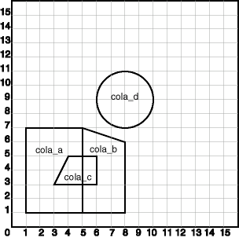
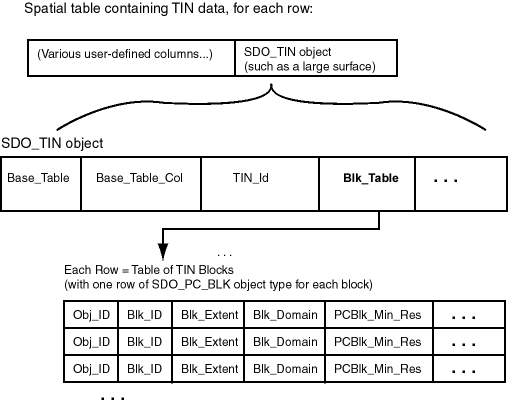
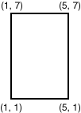
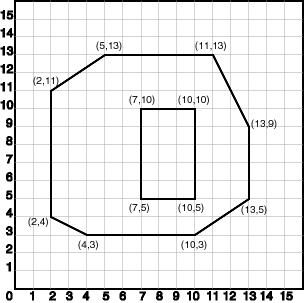
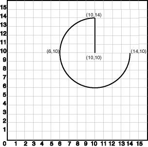
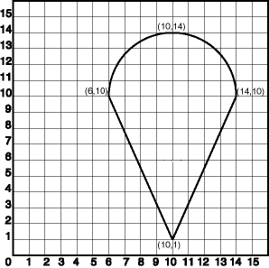
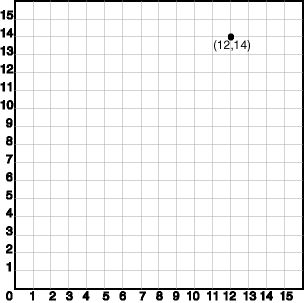
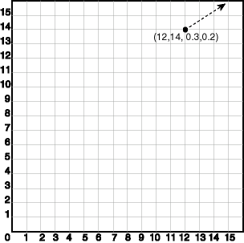
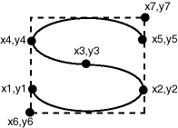

## 2  Spatial Data Types and Metadata

The spatial features in Oracle Spatial and Graph consist of a set of object data types, type methods, and operators, functions, and procedures that use these types. A geometry is stored as an object, in a single row, in a column of type SDO_GEOMETRY. Spatial index creation and maintenance is done using basic DDL (CREATE, ALTER, DROP) and DML (INSERT, UPDATE, DELETE) statements.

This chapter starts with a simple example that inserts, indexes, and queries spatial data. You may find it helpful to read this example quickly before you examine the detailed data type and metadata information later in the chapter.

- Simple Example: Inserting, Indexing, and Querying Spatial Data
  This topic presents a simple example of creating a spatial table, inserting data, creating the spatial index, and performing spatial queries
- SDO_GEOMETRY Object Type
  With Spatial and Graph, the geometric description of a spatial object is stored in a single row, in a single column of object type SDO_GEOMETRY in a user-defined table.
- SDO_GEOMETRY Methods
  The SDO_GEOMETRY object type has methods (member functions) that retrieve information about a geometry object.
- SDO_GEOMETRY Constructors
  The SDO_GEOMETRY object type has constructors that create a geometry object from a well-known text (WKT or EWKT) string in CLOB or VARCHAR2 format, or from a well-known binary (WKB or EWKB) object in BLOB format, optionally hex-encoded.
- TIN-Related Object Types
  This topic describes the object types related to support for triangulated irregular networks (TINs),
- Point Cloud-Related Object Types
  This topic describes the following object types related to support for point clouds.
- Geometry Examples
  This topic contains examples of many geometry types.
- Geometry Metadata Views
  The geometry metadata describing the dimensions, lower and upper bounds, and tolerance in each dimension is stored in a global table owned by MDSYS (which users should never directly update). Each Spatial and Graph user has the following views available in the schema associated with that user.
- Other Spatial Metadata Views
  Oracle Spatial and Graph uses the following other metadata views.
- Spatial Index-Related Structures
  This topic describes the structure of the tables containing the spatial index data and metadata.
- Unit of Measurement Support
  Geometry functions that involve measurement allow an optional `unit` parameter to specify the unit of measurement for a specified distance or area, if a georeferenced coordinate system (SDO_SRID value) is associated with the input geometry or geometries.

**Parent topic:** [Conceptual and Usage Information](spatial-concepts-usage.md)

### 2.1 Simple Example: Inserting, Indexing, and Querying Spatial Data

This topic presents a simple example of creating a spatial table, inserting data, creating the spatial index, and performing spatial queries

It refers to concepts that were explained in [Spatial Concepts](spatial-concepts.md) and that will be explained in other sections of this chapter.

The scenario is a soft drink manufacturer that has identified geographical areas of marketing interest for several products (colas). The colas could be those produced by the company or by its competitors, or some combination. Each area of interest could represent any user-defined criterion: for example, an area where that cola has the majority market share, or where the cola is under competitive pressure, or where the cola is believed to have significant growth potential. Each area could be a neighborhood in a city, or a part of a state, province, or country.

The following figure shows the areas of interest for four colas.

Figure 2-1 Areas of Interest for the Simple Example

[Description of "Figure 2-1 Areas of Interest for the Simple Example"](img_text/cola_mkt.md)

The example in this topic performs the following operations:

- Creates a table (COLA_MARKETS) to hold the spatial data

- Inserts rows for four areas of interest (`cola_a`, `cola_b`, `cola_c`, `cola_d`)

- Updates the USER_SDO_GEOM_METADATA view to reflect the dimensional information for the areas

- Creates a spatial index (COLA_SPATIAL_IDX)

- Performs some spatial queries

Many concepts and techniques in the following example are explained in detail in other sections of this chapter.

Example 2-1 Example: Inserting, Indexing, and Querying Spatial Data

    -- Create a table for cola (soft drink) markets in a
    -- given geography (such as city or state).
    -- Each row will be an area of interest for a specific
    -- cola (for example, where the cola is most preferred
    -- by residents, where the manufacturer believes the
    -- cola has growth potential, and so on).
    -- (For restrictions on spatial table and column names, see
    -- TABLE_NAME and COLUMN_NAME.)

    CREATE TABLE cola_markets (
      mkt_id NUMBER PRIMARY KEY,
      name VARCHAR2(32),
      shape SDO_GEOMETRY);

    -- The next INSERT statement creates an area of interest for
    -- Cola A. This area happens to be a rectangle.
    -- The area could represent any user-defined criterion: for
    -- example, where Cola A is the preferred drink, where
    -- Cola A is under competitive pressure, where Cola A
    -- has strong growth potential, and so on.

    INSERT INTO cola_markets VALUES(
      1,
      'cola_a',
      SDO_GEOMETRY(
        2003,  -- two-dimensional polygon
        NULL,
        NULL,
        SDO_ELEM_INFO_ARRAY(1,1003,3), -- one rectangle (1003 = exterior)
        SDO_ORDINATE_ARRAY(1,1, 5,7) -- only 2 points needed to
              -- define rectangle (lower left and upper right) with
              -- Cartesian-coordinate data
      )
    );

    -- The next two INSERT statements create areas of interest for
    -- Cola B and Cola C. These areas are simple polygons (but not
    -- rectangles).

    INSERT INTO cola_markets VALUES(
      2,
      'cola_b',
      SDO_GEOMETRY(
        2003,  -- two-dimensional polygon
        NULL,
        NULL,
        SDO_ELEM_INFO_ARRAY(1,1003,1), -- one polygon (exterior polygon ring)
        SDO_ORDINATE_ARRAY(5,1, 8,1, 8,6, 5,7, 5,1)
      )
    );

    INSERT INTO cola_markets VALUES(
      3,
      'cola_c',
      SDO_GEOMETRY(
        2003,  -- two-dimensional polygon
        NULL,
        NULL,
        SDO_ELEM_INFO_ARRAY(1,1003,1), -- one polygon (exterior polygon ring)
        SDO_ORDINATE_ARRAY(3,3, 6,3, 6,5, 4,5, 3,3)
      )
    );

    -- Now insert an area of interest for Cola D. This is a
    -- circle with a radius of 2. It is completely outside the
    -- first three areas of interest.

    INSERT INTO cola_markets VALUES(
      4,
      'cola_d',
      SDO_GEOMETRY(
        2003,  -- two-dimensional polygon
        NULL,
        NULL,
        SDO_ELEM_INFO_ARRAY(1,1003,4), -- one circle
        SDO_ORDINATE_ARRAY(8,7, 10,9, 8,11)
      )
    );

    ---------------------------------------------------------------------------
    -- UPDATE METADATA VIEW --
    ---------------------------------------------------------------------------
    -- Update the USER_SDO_GEOM_METADATA view. This is required
    -- before the spatial index can be created. Do this only once for each
    -- layer (that is, table-column combination; here: COLA_MARKETS and SHAPE).

    INSERT INTO user_sdo_geom_metadata
        (TABLE_NAME,
         COLUMN_NAME,
         DIMINFO,
         SRID)
      VALUES (
      'cola_markets',
      'shape',
      SDO_DIM_ARRAY(   -- 20X20 grid
        SDO_DIM_ELEMENT('X', 0, 20, 0.005),
        SDO_DIM_ELEMENT('Y', 0, 20, 0.005)
         ),
      NULL   -- SRID
    );

    -------------------------------------------------------------------
    -- CREATE THE SPATIAL INDEX --
    -------------------------------------------------------------------
    CREATE INDEX cola_spatial_idx
       ON cola_markets(shape)
       INDEXTYPE IS MDSYS.SPATIAL_INDEX_V2;
    -- Preceding statement created an R-tree index.

    -------------------------------------------------------------------
    -- PERFORM SOME SPATIAL QUERIES --
    -------------------------------------------------------------------
    -- Return the topological intersection of two geometries.
    SELECT SDO_GEOM.SDO_INTERSECTION(c_a.shape, c_c.shape, 0.005)
       FROM cola_markets c_a, cola_markets c_c
       WHERE c_a.name = 'cola_a' AND c_c.name = 'cola_c';

    -- Do two geometries have any spatial relationship?
    SELECT SDO_GEOM.RELATE(c_b.shape, 'anyinteract', c_d.shape, 0.005)
      FROM cola_markets c_b, cola_markets c_d
      WHERE c_b.name = 'cola_b' AND c_d.name = 'cola_d';

    -- Return the areas of all cola markets.
    SELECT name, SDO_GEOM.SDO_AREA(shape, 0.005) FROM cola_markets;

    -- Return the area of just cola_a.
    SELECT c.name, SDO_GEOM.SDO_AREA(c.shape, 0.005) FROM cola_markets c
       WHERE c.name = 'cola_a';

    -- Return the distance between two geometries.
    SELECT SDO_GEOM.SDO_DISTANCE(c_b.shape, c_d.shape, 0.005)
       FROM cola_markets c_b, cola_markets c_d
       WHERE c_b.name = 'cola_b' AND c_d.name = 'cola_d';

    -- Is a geometry valid?
    SELECT c.name, SDO_GEOM.VALIDATE_GEOMETRY_WITH_CONTEXT(c.shape, 0.005)
       FROM cola_markets c WHERE c.name = 'cola_c';

    -- Is a layer valid? (First, create the results table.)
    CREATE TABLE val_results (sdo_rowid ROWID, result VARCHAR2(2000));
    CALL SDO_GEOM.VALIDATE_LAYER_WITH_CONTEXT('COLA_MARKETS', 'SHAPE',
      'VAL_RESULTS', 2);
    SELECT * from val_results;

**Parent topic:** Spatial Data Types and Metadata

### 2.2 SDO_GEOMETRY Object Type

With Spatial and Graph, the geometric description of a spatial object is stored in a single row, in a single column of object type SDO_GEOMETRY in a user-defined table.

Any table that has a column of type SDO_GEOMETRY must have another column, or set of columns, that defines a unique primary key for that table. Tables of this sort are sometimes referred to as spatial tables or spatial geometry tables.

Oracle Spatial and Graph defines the object type SDO_GEOMETRY as:

    CREATE TYPE sdo_geometry AS OBJECT (
     SDO_GTYPE NUMBER,
     SDO_SRID NUMBER,
     SDO_POINT SDO_POINT_TYPE,
     SDO_ELEM_INFO SDO_ELEM_INFO_ARRAY,
     SDO_ORDINATES SDO_ORDINATE_ARRAY);

Oracle Spatial and Graph also defines the SDO_POINT_TYPE, SDO_ELEM_INFO_ARRAY, and SDO_ORDINATE_ARRAY types, which are used in the SDO_GEOMETRY type definition, as follows:

    CREATE TYPE sdo_point_type AS OBJECT (
       X NUMBER,
       Y NUMBER,
       Z NUMBER);
    CREATE TYPE sdo_elem_info_array AS VARRAY (1048576) of NUMBER;
    CREATE TYPE sdo_ordinate_array AS VARRAY (1048576) of NUMBER;

Because the maximum SDO_ORDINATE_ARRAY size is 1,048,576 numbers, the maximum number of vertices in an SDO_GEOMETRY object depends on the number of dimensions per vertex: 524,288 for two dimensions, 349,525 for three dimensions, and 262,144 for four dimensions.

The sections that follow describe the semantics of each SDO_GEOMETRY attribute, and then describe some usage considerations (Usage Considerations).

The SDO_GEOMETRY object type has methods that provide convenient access to some of the attributes. These methods are described in SDO_GEOMETRY Methods.

Some Spatial and Graph data types are described in locations other than this section:

- [Data Types for Geocoding](geocoding-address-data-concepts.md) describes data types for geocoding.

- [Oracle Spatial and Graph GeoRaster Developer's Guide](../geors/georaster-datatypes.md) describes data types for Oracle Spatial and Graph GeoRaster.

- [Oracle Spatial and Graph Topology Data Model and Network Data Model Graph Developer's Guide](../topol/topology-data-model-overview.md) describes data types for the Oracle Spatial and Graph topology data model.

<!-- -->

- SDO_GTYPE
- SDO_SRID
- SDO_POINT
- SDO_ELEM_INFO
- SDO_ORDINATES
- Usage Considerations

**Parent topic:** Spatial Data Types and Metadata

#### 2.2.1 SDO_GTYPE

The SDO_GTYPE attribute indicates the type of the geometry. Valid geometry types correspond to those specified in the Geometry Object Model for the OGIS Simple Features for SQL specification (with the exception of Surfaces). The numeric values differ from those given in the OGIS specification, but there is a direct correspondence between the names and semantics where applicable.

The SDO_GTYPE value is 4 digits in the format DLTT, where:

- D identifies the number of dimensions (2, 3, or 4)

- L identifies the linear referencing measure dimension for a three-dimensional linear referencing system (LRS) geometry, that is, which dimension (3 or 4) contains the measure value. For a non-LRS geometry, specify 0. For information about the linear referencing system (LRS), see [Linear Referencing System](lrs-linear-referencing-system-concepts.md).

- TT identifies the geometry type (00 through 09, with 10 through 99 reserved for future use).

Table 2-1 shows the valid SDO_GTYPE values. The Geometry Type and Description values reflect the OGIS specification.

Table 2-1 Valid SDO_GTYPE Values

| Value | Geometry Type                | Description                                                                                                                                                                                    |
|:------|:-----------------------------|:-----------------------------------------------------------------------------------------------------------------------------------------------------------------------------------------------|
| DL00  | UNKNOWN_GEOMETRY             | Spatial and Graph ignores this geometry.                                                                                                                                                       |
| DL01  | POINT                        | Geometry contains one point.                                                                                                                                                                   |
| DL02  | LINE or CURVE                | Geometry contains one line string that can contain straight or circular arc segments, or both. (LINE and CURVE are synonymous in this context.)                                                |
| DL03  | POLYGON or SURFACE           | Geometry contains one polygon with or without holes,Foot 1 or one surface consisting of one or more polygons. In a three-dimensional polygon, all points must be on the same plane. |
| DL04  | COLLECTION                   | Geometry is a heterogeneous collection of elements. COLLECTION is a superset that includes all other types.                                                                                    |
| DL05  | MULTIPOINT                   | Geometry has one or more points. (MULTIPOINT is a superset of POINT.)                                                                                                                          |
| DL06  | MULTILINE or MULTICURVE      | Geometry has one or more line strings. (MULTILINE and MULTICURVE are synonymous in this context, and each is a superset of both LINE and CURVE.)                                               |
| DL07  | MULTIPOLYGON or MULTISURFACE | Geometry can have multiple, disjoint polygons (more than one exterior boundary). or surfaces (MULTIPOLYGON is a superset of POLYGON, and MULTISURFACE is a superset of SURFACE.)               |
| DL08  | SOLID                        | Geometry consists of multiple surfaces and is completely enclosed in a three-dimensional space. Can be a cuboid or a frustum.                                                                  |
| DL09  | MULTISOLID                   | Geometry can have multiple, disjoint solids (more than one exterior boundary). (MULTISOLID is a superset of SOLID.)                                                                            |

Footnote 1

For a polygon with holes, enter the exterior boundary first, followed by any interior boundaries.

The D in the Value column of Table 2-1 is the number of dimensions: 2, 3, or 4. For example, an SDO_GTYPE value of 2003 indicates a two-dimensional polygon. The number of dimensions reflects the number of ordinates used to represent each vertex (for example, X,Y for two-dimensional objects).

In any given layer (column), all geometries must have the same number of dimensions. For example, you cannot mix two-dimensional and three-dimensional data in the same layer.

The following methods are available for returning the individual DLTT components of the SDO_GTYPE for a geometry object: Get_Dims, Get_LRS_Dim, and Get_Gtype. These methods are described in SDO_GEOMETRY Methods.

For more information about SDO_GTYPE values for three-dimensional geometries, see [Table 1-1](spatial-concepts.md) in [Three-Dimensional Spatial Objects](spatial-concepts.md).

**Parent topic:** SDO_GEOMETRY Object Type

#### 2.2.2 SDO_SRID

The SDO_SRID attribute can be used to identify a coordinate system (spatial reference system) to be associated with the geometry. If SDO_SRID is null, no coordinate system is associated with the geometry. If SDO_SRID is not null, it must contain a value from the SRID column of the SDO_COORD_REF_SYS table (described in [SDO_COORD_REF_SYS Table](coordinate-systems-concepts.md)), and this value must be inserted into the SRID column of the USER_SDO_GEOM_METADATA view (described in Geometry Metadata Views).

All geometries in a geometry column must have the same SDO_SRID value if a spatial index will be built on that column.

For information about coordinate systems, see [Coordinate Systems (Spatial Reference Systems)](coordinate-systems-concepts.md).

**Parent topic:** SDO_GEOMETRY Object Type

#### 2.2.3 SDO_POINT

The SDO_POINT attribute is defined using the SDO_POINT_TYPE object type, which has the attributes X, Y, and Z, all of type NUMBER. (The SDO_POINT_TYPE definition is shown in SDO_GEOMETRY Object Type.) If the SDO_ELEM_INFO and SDO_ORDINATES arrays are both null, and the SDO_POINT attribute is non-null, then the X, Y, and Z values are considered to be the coordinates for a point geometry. Otherwise, the SDO_POINT attribute is ignored by Spatial and Graph. You should store point geometries in the SDO_POINT attribute for optimal storage; and if you have only point geometries in a layer, it is strongly recommended that you store the point geometries in the SDO_POINT attribute.

Point illustrates a point geometry and provides examples of inserting and querying point geometries.

**Note:**

Do not use the SDO_POINT attribute in defining a linear referencing system (LRS) point or an oriented point. For information about LRS, see [Linear Referencing System](lrs-linear-referencing-system-concepts.md). For information about oriented points, see Oriented Point.

**Parent topic:** SDO_GEOMETRY Object Type

#### 2.2.4 SDO_ELEM_INFO

The SDO_ELEM_INFO attribute is defined using a varying length array of numbers. This attribute lets you know how to interpret the ordinates stored in the SDO_ORDINATES attribute (described in SDO_ORDINATES).

Each triplet set of numbers is interpreted as follows:

- SDO_STARTING_OFFSET -- Indicates the offset within the SDO_ORDINATES array where the first ordinate for this element is stored. Offset values start at 1 and not at 0. Thus, the first ordinate for the first element will be at SDO_GEOMETRY.SDO_ORDINATES(1). If there is a second element, its first ordinate will be at SDO_GEOMETRY.SDO_ORDINATES(n), where n reflects the position within the SDO_ORDINATE_ARRAY definition (for example, 19 for the 19th number, as in Figure 2-4 in Polygon with a Hole).

- SDO_ETYPE -- Indicates the type of the element. Valid values are shown in Table 2-2.

  SDO_ETYPE values 1, 2, 1003, and 2003 are considered simple elements. They are defined by a single triplet entry in the SDO_ELEM_INFO array. For SDO_ETYPE values 1003 and 2003, the first digit indicates exterior (1) or interior (2):

  1003: exterior polygon ring (must be specified in counterclockwise order)

  2003: interior polygon ring (must be specified in clockwise order)

  **Note:**

  The use of 3 as an SDO_ETYPE value for polygon ring elements in a single geometry is discouraged. You should specify 3 only if you do not know if the simple polygon is exterior or interior, and you should then upgrade the table or layer to the current format using the [SDO_MIGRATE.TO_CURRENT](SDO_MIGRATE-reference.md) procedure, described in [SDO_MIGRATE Package (Upgrading)](SDO_MIGRATE-reference.md) .

  You cannot mix 1-digit and 4-digit SDO_ETYPE values in a single geometry.

  SDO_ETYPE values 4, 1005, 2005, 1006, and 2006 are considered compound elements. They contain at least one header triplet with a series of triplet values that belong to the compound element. For 4-digit SDO_ETYPE values, the first digit indicates exterior (1) or interior (2):

  1005: exterior polygon ring (must be specified in counterclockwise order)

  2005: interior polygon ring (must be specified in clockwise order)

  1006: exterior surface consisting of one or more polygon rings

  2006: interior surface in a solid element

  1007: solid element

  The elements of a compound element are contiguous. The last point of a subelement in a compound element is the first point of the next subelement. The point is not repeated.

- SDO_INTERPRETATION -- Means one of two things, depending on whether or not SDO_ETYPE is a compound element.

  If SDO_ETYPE is a compound element (4, 1005, or 2005), this field specifies how many subsequent triplet values are part of the element.

  If the SDO_ETYPE is not a compound element (1, 2, 1003, or 2003), the interpretation attribute determines how the sequence of ordinates for this element is interpreted. For example, a line string or polygon boundary may be made up of a sequence of connected straight line segments or circular arcs.

  Descriptions of valid SDO_ETYPE and SDO_INTERPRETATION value pairs are given in Table 2-2.

If a geometry consists of more than one element, then the last ordinate for an element is always one less than the starting offset for the next element. The last element in the geometry is described by the ordinates from its starting offset to the end of the SDO_ORDINATES varying length array.

For compound elements (SDO_ETYPE values 4, 1005, or 2005), a set of n triplets (one for each subelement) is used to describe the element. It is important to remember that subelements of a compound element are contiguous. The last point of a subelement is the first point of the next subelement. For subelements 1 through n-1, the end point of one subelement is the same as the starting point of the next subelement. The starting point for subelements 2...n-2 is the same as the end point of subelement 1...n-1. The last ordinate of subelement n is either the starting offset minus 1 of the next element in the geometry, or the last ordinate in the SDO_ORDINATES varying length array.

The current size of a varying length array can be determined by using the function varray_variable.Count in PL/SQL or OCICollSize in the Oracle Call Interface (OCI).

The semantics of each SDO_ETYPE element and the relationship between the SDO_ELEM_INFO and SDO_ORDINATES varying length arrays for each of these SDO_ETYPE elements are given in Table 2-2.

Table 2-2 Values and Semantics in SDO_ELEM_INFO

| SDO_ETYPE    | SDO_INTERPRETATION  | Meaning                                                                                                                                                                                                                                                                                                                                                                                                                                                                                                                                                                                                                                                                                                                                                                                                                                                                                                                                                                                                                   |
|:-------------|:--------------------|:--------------------------------------------------------------------------------------------------------------------------------------------------------------------------------------------------------------------------------------------------------------------------------------------------------------------------------------------------------------------------------------------------------------------------------------------------------------------------------------------------------------------------------------------------------------------------------------------------------------------------------------------------------------------------------------------------------------------------------------------------------------------------------------------------------------------------------------------------------------------------------------------------------------------------------------------------------------------------------------------------------------------------|
| 0            | (any numeric value) | Type 0 (zero) element. Used to model geometry types not supported by Oracle Spatial and Graph. For more information, see Type 0 (Zero) Element.                                                                                                                                                                                                                                                                                                                                                                                                                                                                                                                                                                                                                                                                                                                                                                                                                                                                           |
| 1            | 1                   | Point type.                                                                                                                                                                                                                                                                                                                                                                                                                                                                                                                                                                                                                                                                                                                                                                                                                                                                                                                                                                                                               |
| 1            | 0                   | Orientation for an oriented point. For more information, see Oriented Point.                                                                                                                                                                                                                                                                                                                                                                                                                                                                                                                                                                                                                                                                                                                                                                                                                                                                                                                                              |
| 1            | n \> 1              | Point cluster with n points.                                                                                                                                                                                                                                                                                                                                                                                                                                                                                                                                                                                                                                                                                                                                                                                                                                                                                                                                                                                              |
| 2            | 1                   | Line string whose vertices are connected by straight line segments.                                                                                                                                                                                                                                                                                                                                                                                                                                                                                                                                                                                                                                                                                                                                                                                                                                                                                                                                                       |
| 2            | 2                   | Line string made up of a connected sequence of circular arcs. Each circular arc is described using three coordinates: the start point of the arc, any point on the arc, and the end point of the arc. The coordinates for a point designating the end of one arc and the start of the next arc are not repeated. For example, five coordinates are used to describe a line string made up of two connected circular arcs. Points 1, 2, and 3 define the first arc, and points 3, 4, and 5 define the second arc, where point 3 is only stored once.                                                                                                                                                                                                                                                                                                                                                                                                                                                                    |
| 2            | 3                   | NURBS (non-uniform rational B-spline) curve. For more information, see [NURBS Curve Support in Oracle Spatial and Graph](spatial-concepts.md).                                                                                                                                                                                                                                                                                                                                                                                                                                                                                                                                                                                                                                                                                                                                                                                                                                                                            |
| 1003 or 2003 | 1                   | Simple polygon whose vertices are connected by straight line segments. You must specify a point for each vertex; and the last point specified must be exactly the same point as the first (within the tolerance value), to close the polygon. For example, for a 4-sided polygon, specify 5 points, with point 5 the same as point 1.                                                                                                                                                                                                                                                                                                                                                                                                                                                                                                                                                                                                                                                                                     |
| 1003 or 2003 | 2                   | Polygon made up of a connected sequence of circular arcs that closes on itself. The end point of the last arc is the same as the start point of the first arc. Each circular arc is described using three coordinates: the start point of the arc, any point on the arc, and the end point of the arc. The coordinates for a point designating the end of one arc and the start of the next arc are not repeated. For example, five coordinates are used to describe a polygon made up of two connected circular arcs. Points 1, 2, and 3 define the first arc, and points 3, 4, and 5 define the second arc. The coordinates for points 1 and 5 must be the same (tolerance is not considered), and point 3 is not repeated.                                                                                                                                                                                                                                                                                          |
| 1003 or 2003 | 3                   | Rectangle type (sometimes called optimized rectangle). A bounding rectangle such that only two points, the lower-left and the upper-right, are required to describe it. The rectangle type can be used with geodetic or non-geodetic data. However, with geodetic data, use this type only to create a query window (not for storing objects in the database). For information about using this type with geodetic data, including examples, see [Geodetic MBRs](coordinate-systems-concepts.md). For information about creating three-dimensional optimized rectangles, see [Three-Dimensional Optimized Rectangles](spatial-concepts.md).                                                                                                                                                                                                                                                                                                                                                                            |
| 1003 or 2003 | 4                   | Circle type. Described by three distinct non-colinear points, all on the circumference of the circle.                                                                                                                                                                                                                                                                                                                                                                                                                                                                                                                                                                                                                                                                                                                                                                                                                                                                                                                     |
| 4            | n \> 1              | Compound line string with some vertices connected by straight line segments and some by circular arcs. The value n in the Interpretation column specifies the number of contiguous subelements that make up the line string. The next n triplets in the SDO_ELEM_INFO array describe each of these subelements. The subelements can only be of SDO_ETYPE 2. The last point of a subelement is the first point of the next subelement, and must not be repeated. See Compound Line String and Figure 2-5 for an example of a compound line string geometry.                                                                                                                                                                                                                                                                                                                                                                                                                                                          |
| 1005 or 2005 | n \> 1              | Compound polygon with some vertices connected by straight line segments and some by circular arcs. The value n in the Interpretation column specifies the number of contiguous subelements that make up the polygon. The next n triplets in the SDO_ELEM_INFO array describe each of these subelements. The subelements can only be of SDO_ETYPE 2. The end point of a subelement is the start point of the next subelement, and it must not be repeated. The start and end points of the polygon must be exactly the same point (tolerance is ignored). See Compound Polygon and Figure 2-6 for an example of a compound polygon geometry.                                                                                                                                                                                                                                                                                                                                                                         |
| 1006 or 2006 | n \> 1              | Surface consisting of one or more polygons, with each edge shared by no more than two polygons. A surface contains an area but not a volume. The value n in the Interpretation column specifies the number of polygons that make up the surface. The next n triplets in the SDO_ELEM_INFO array describe each of these polygon subelements. A surface must be three-dimensional. For an explanation of three-dimensional support in Spatial and Graph, see [Three-Dimensional Spatial Objects](spatial-concepts.md).                                                                                                                                                                                                                                                                                                                                                                                                                                                                                                |
| 1007         | n = 1 or 3          | Solid consisting of multiple surfaces that are completely enclosed in a three-dimensional space, so that the solid has an interior volume. A solid element can have one exterior surface defined by the 1006 elements and zero or more interior boundaries defined by the 2006 elements. The value n in the Interpretation column must be 1 or 3. Subsequent triplets in the SDO_ELEM_INFO array describe the exterior 1006 and optional interior 2006 surfaces that make up the solid element. If n is 3, the solid is an optimized box, such that only two three-dimensional points are required to define it: one with minimum values for the box in the X, Y, and Z dimensions and another with maximum values for the box in the X, Y, and Z dimensions. For example: `SDO_GEOMETRY(3008, NULL, NULL, SDO_ELEM_INFO_ARRAY(1,1007,3), SDO_ORDINATE_ARRAY(1,1,1, 3,3,3))` For an explanation of three-dimensional support in Spatial and Graph, see [Three-Dimensional Spatial Objects](spatial-concepts.md). |

**Parent topic:** SDO_GEOMETRY Object Type

#### 2.2.5 SDO_ORDINATES

The SDO_ORDINATES attribute is defined using a varying length array (1048576) of NUMBER type that stores the coordinate values that make up the boundary of a spatial object. This array must always be used in conjunction with the SDO_ELEM_INFO varying length array. The values in the array are ordered by dimension. For example, a polygon whose boundary has four two-dimensional points is stored as {X1, Y1, X2, Y2, X3, Y3, X4, Y4, X1, Y1}. If the points are three-dimensional, then they are stored as {X1, Y1, Z1, X2, Y2, Z2, X3, Y3, Z3, X4, Y4, Z4, X1, Y1, Z1}. The number of dimensions associated with each point is stored as metadata in the xxx_SDO_GEOM_METADATA views, described in Geometry Metadata Views.

The values in the SDO_ORDINATES array must all be valid and non-null. There are no special values used to delimit elements in a multielement geometry. The start and end points for the sequence describing a specific element are determined by the STARTING_OFFSET values for that element and the next element in the SDO_ELEM_INFO array, as explained in SDO_ELEM_INFO. The offset values start at 1. SDO_ORDINATES(1) is the first ordinate of the first point of the first element.

**Parent topic:** SDO_GEOMETRY Object Type

#### 2.2.6 Usage Considerations

You should use the SDO_GTYPE values as shown in Table 2-1; however, Spatial and Graph does not check or enforce all geometry consistency constraints. Spatial and Graph does check the following:

- For SDO_GTYPE values d001 and d005, any subelement not of SDO_ETYPE 1 is ignored.

- For SDO_GTYPE values d002 and d006, any subelement not of SDO_ETYPE 2 or 4 is ignored.

- For SDO_GTYPE values d003 and d007, any subelement not of SDO_ETYPE 3 or 5 is ignored. (This includes SDO_ETYPE variants 1003, 2003, 1005, and 2005, which are explained in SDO_ELEM_INFO).

The [SDO_GEOM.VALIDATE_GEOMETRY_WITH_CONTEXT](SDO_GEOM-reference.md) function can be used to evaluate the consistency of a single geometry object or of all geometry objects in a specified feature table.

**Parent topic:** SDO_GEOMETRY Object Type

### 2.3 SDO_GEOMETRY Methods

The SDO_GEOMETRY object type has methods (member functions) that retrieve information about a geometry object.

Table 2-3 lists these methods.

Table 2-3 SDO_GEOMETRY Methods

| Name        | Returns | Description                                                                                                                                                                                                                                                                                                                                                                                                                                                                                                                        |
|:------------|:--------|:-----------------------------------------------------------------------------------------------------------------------------------------------------------------------------------------------------------------------------------------------------------------------------------------------------------------------------------------------------------------------------------------------------------------------------------------------------------------------------------------------------------------------------------|
| Get_Dims    | NUMBER  | Returns the number of dimensions of a geometry object, as specified in its SDO_GTYPE value. In Oracle Spatial and Graph, the Get_Dims and ST_CoordDim methods return the same result.                                                                                                                                                                                                                                                                                                                                              |
| Get_GeoJson | CLOB    | Returns the GeoJSON representation of a geometry object.                                                                                                                                                                                                                                                                                                                                                                                                                                                                           |
| Get_GType   | NUMBER  | Returns the geometry type of a geometry object, as specified in its SDO_GTYPE value.                                                                                                                                                                                                                                                                                                                                                                                                                                               |
| Get_LRS_Dim | NUMBER  | Returns the measure dimension of an LRS geometry object, as specified in its SDO_GTYPE value. A return value of 0 indicates that the geometry is a standard (non-LRS) geometry, or is an LRS geometry in the format before release 9.0.1 and with measure as the default (last) dimension; 3 indicates that the third dimension contains the measure information; 4 indicates that the fourth dimension contains the measure information.                                                                                       |
| Get_WKB     | BLOB    | Returns the well-known binary (WKB) format of a geometry object. (The returned object does not include any SRID information.)                                                                                                                                                                                                                                                                                                                                                                                                      |
| Get_WKT     | CLOB    | Returns the well-known text (WKT) format (explained in [Well-Known Text (WKT)](coordinate-systems-concepts.md)) of a geometry object. (The returned object does not include any SRID information.)                                                                                                                                                                                                                                                                                                                                 |
| ST_CoordDim | NUMBER  | Returns the coordinate dimension (as defined by the ISO/IEC SQL Multimedia standard) of a geometry object. In Oracle Spatial and Graph, the Get_Dims and ST_CoordDim methods return the same result.                                                                                                                                                                                                                                                                                                                               |
| ST_IsValid  | NUMBER  | Returns 0 if a geometry object is invalid or 1 if it is valid. (The ISO/IEC SQL Multimedia standard uses the term well formed for valid in this context.) This method uses 0.001 as the tolerance value. (Tolerance is explained in [Tolerance](spatial-concepts.md).) To specify a different tolerance value or to learn more about why a geometry is invalid, use the [SDO_GEOM.VALIDATE_GEOMETRY_WITH_CONTEXT](SDO_GEOM-reference.md) function, which is documented in [SDO_GEOM Package (Geometry)](SDO_GEOM-reference.md). |

Example 2-2 shows most of the SDO_GEOMETRY methods. (The Get_WKB method is not included because its output cannot be displayed by SQL\*Plus.)

Example 2-2 SDO_GEOMETRY Methods

    SELECT c.shape.Get_Dims()
      FROM cola_markets c WHERE c.name = 'cola_b';

    C.SHAPE.GET_DIMS()
    ------------------
                     2

    SELECT c.shape.Get_GeoJson()
      FROM cola_markets c WHERE c.name = 'cola_b';

    C.SHAPE.GET_GEOJSON()
    --------------------------------------------------------------------------------
    { "type": "Polygon", "coordinates": [ [ [5, 1], [8, 1], [8, 6], [5, 7], [5, 1] ]

    SELECT c.shape.Get_GType()
      FROM cola_markets c WHERE c.name = 'cola_b';

    C.SHAPE.GET_GTYPE()
    -------------------
                      3

    SELECT a.route_geometry.Get_LRS_Dim()
      FROM lrs_routes a WHERE  a.route_id = 1;

    A.ROUTE_GEOMETRY.GET_LRS_DIM()
    ------------------------------
                                 3

    SELECT c.shape.Get_WKT()
      FROM cola_markets c WHERE c.name = 'cola_b';

    C.SHAPE.GET_WKT()
    --------------------------------------------------------------------------------
    POLYGON ((5.0 1.0, 8.0 1.0, 8.0 6.0, 5.0 7.0, 5.0 1.0))

    SELECT c.shape.ST_CoordDim()
      FROM cola_markets c WHERE c.name = 'cola_b';

    C.SHAPE.ST_COORDDIM()
    ---------------------
                        2

    SELECT c.shape.ST_IsValid()
      FROM cola_markets c WHERE c.name = 'cola_b';

    C.SHAPE.ST_ISVALID()
    --------------------
                       1

**Parent topic:** Spatial Data Types and Metadata

### 2.4 SDO_GEOMETRY Constructors

The SDO_GEOMETRY object type has constructors that create a geometry object from a well-known text (WKT or EWKT) string in CLOB or VARCHAR2 format, or from a well-known binary (WKB or EWKB) object in BLOB format, optionally hex-encoded.

The following constructor formats are available:

    SDO_GEOMETRY(wkt CLOB, srid NUMBER DEFAULT NULL);
    SDO_GEOMETRY(wkt VARCHAR2, srid NUMBER DEFAULT NULL);
    SDO_GEOMETRY(wkb BLOB, srid NUMBER DEFAULT NULL);

Note that the optional `srid` parameter is used to specify the coordinate system of the WKT or WKB data; it overrides any SRID specification in an EWKT or EWKB input (no transformation is done). If the created geometry is inserted into a table, the `srid` value used with the constructor must match the `SDO_SRID` value of the geometries in the table.

The following simple example constructs a point geometry using a well-known text string. (In a WKT, spaces separate ordinates of a vertex, and commas separate vertices.)

    SELECT SDO_GEOMETRY('POINT(-79 37)') FROM DUAL;

    SDO_GEOMETRY('POINT(-7937)')(SDO_GTYPE, SDO_SRID, SDO_POINT(X, Y, Z), SDO_ELEM_I
    --------------------------------------------------------------------------------
    SDO_GEOMETRY(2001, NULL, SDO_POINT_TYPE(-79, 37, NULL), NULL, NULL)

Example 2-3 shows SDO_GEOMETRY constructors that create geometry objects, insert the objects into a table, and display the objects that were added to the table.

Example 2-3 SDO_GEOMETRY Constructors to Create Geometries

    DECLARE
      cola_b_wkb  BLOB;
      cola_b_wkt_clob  CLOB;
      cola_b_wkt_varchar  VARCHAR2(255);
      cola_b_geom  SDO_GEOMETRY;

    BEGIN
    -- Get cola_b geometry into CLOB, VARCHAR2, and BLOB objects,
    -- for use by the constructor.
    SELECT c.shape.Get_WKT() INTO cola_b_wkt_clob
      FROM cola_markets c WHERE c.name = 'cola_b';
    cola_b_wkt_varchar := cola_b_wkt_clob;
    SELECT c.shape.Get_WKB() INTO cola_b_wkb
      FROM cola_markets c WHERE c.name = 'cola_b';

    -- Use some SDO_GEOMETRY constructors;
    -- insert 3 geometries into the table; display the geometries later.
    cola_b_geom := SDO_GEOMETRY(cola_b_wkt_clob);
    INSERT INTO cola_markets VALUES (101, 'cola_b_from_clob', cola_b_geom);
    cola_b_geom := SDO_GEOMETRY(cola_b_wkt_varchar);
    INSERT INTO cola_markets VALUES (102, 'cola_b_from_varchar', cola_b_geom);
    cola_b_geom := SDO_GEOMETRY(cola_b_wkb);
    INSERT INTO cola_markets VALUES (103, 'cola_b_from_wkb', cola_b_geom);
    END;
    /

    PL/SQL procedure successfully completed.

    -- Display the geometries created using SDO_GEOMETRY constructors.
    -- All three geometries are identical.
    SELECT name, shape FROM cola_markets WHERE mkt_id > 100;

    NAME
    --------------------------------
    SHAPE(SDO_GTYPE, SDO_SRID, SDO_POINT(X, Y, Z), SDO_ELEM_INFO, SDO_ORDINATES)
    --------------------------------------------------------------------------------
    cola_b_from_clob
    SDO_GEOMETRY(2003, NULL, NULL, SDO_ELEM_INFO_ARRAY(1, 1003, 1), SDO_ORDINATE_ARR
    AY(5, 1, 8, 1, 8, 6, 5, 7, 5, 1))

    cola_b_from_varchar
    SDO_GEOMETRY(2003, NULL, NULL, SDO_ELEM_INFO_ARRAY(1, 1003, 1), SDO_ORDINATE_ARR
    AY(5, 1, 8, 1, 8, 6, 5, 7, 5, 1))

    cola_b_from_wkb
    SDO_GEOMETRY(2003, NULL, NULL, SDO_ELEM_INFO_ARRAY(1, 1003, 1), SDO_ORDINATE_ARR
    AY(5, 1, 8, 1, 8, 6, 5, 7, 5, 1))

**Parent topic:** Spatial Data Types and Metadata

### 2.5 TIN-Related Object Types

This topic describes the object types related to support for triangulated irregular networks (TINs),

**Note:**

TIN object types are supported only if Oracle JVM is enabled on your Oracle Autonomous Database Serverless deployments. To enable Oracle JVM, see [Use Oracle Java](https://docs.oracle.com/pls/topic/lookup?ctx=en/cloud/paas/autonomous-database&id=GUID-2516EE33-B38D-4270-BE52-30A4F9014E8B) in Using Oracle Autonomous Database Serverless for more information.

- SDO_TIN Object Type
- SDO_TIN_BLK_TYPE and SDO_TIN_BLK Object Types

**Parent topic:** Spatial Data Types and Metadata

#### 2.5.1 SDO_TIN Object Type

The description of a TIN is stored in a single row, in a single column of object type SDO_TIN in a user-defined table. The object type SDO_TIN is defined as:

    CREATE TYPE sdo_tin AS OBJECT
      (base_table          VARCHAR2(70),
       base_table_col      VARCHAR2(1024),
       tin_id              NUMBER.
       blk_table           VARCHAR2(70),
       ptn_params          VARCHAR2(1024),
       tin_extent          SDO_GEOMETRY,
       tin_tol             NUMBER,
       tin_tot_dimensions  NUMBER,
       tin_domain          SDO_ORGSCL_TYPE,
       tin_break_lines     SDO_GEOMETRY,
       tin_stop_lines      SDO_GEOMETRY,
       tin_void_rgns       SDO_GEOMETRY,
       tin_val_attr_tables SDO_STRING_ARRAY,
       tin_other_attrs     XMLTYPE);

The SDO_TIN type has the attributes shown in Table 2-4.

Table 2-4 SDO_TIN Type Attributes

| Attribute           | Explanation                                                                                                                                                           |
|:--------------------|:----------------------------------------------------------------------------------------------------------------------------------------------------------------------|
| BASE_TABLE          | Name of the base table containing a column of type SDO_TIN                                                                                                            |
| BASE_TABLE_COL      | Name of the column of type SDO_TIN in the base table                                                                                                                  |
| TIN_ID              | ID number for the TIN. (This unique ID number is generated by Spatial and Graph. It is unique within the schema for base tables containing a column of type SDO_TIN.) |
| BLK_TABLE           | Name of the table that contains information about each block in the TIN. This table contains the columns shown in Table 2-5.                                          |
| PTN_PARAMS          | Parameters for partitioning the TIN                                                                                                                                   |
| TIN_EXTENT          | SDO_GEOMETRY object representing the spatial extent of the TIN (the minimum bounding object enclosing all objects in the TIN)                                         |
| TIN_TOL             | Tolerance value for objects in the TIN. (For information about spatial tolerance, see [Tolerance](spatial-concepts.md).)                                              |
| TIN_TOT_DIMENSIONS  | Total number of dimensions in the TIN. Includes spatial dimensions and any nonspatial dimensions, up to a maximum total of 9.                                         |
| TIN_DOMAIN          | (Not currently used.)                                                                                                                                                 |
| TIN_BREAK_LINES     | (Not currently used.)                                                                                                                                                 |
| TIN_STOP_LINES      | (Not currently used.)                                                                                                                                                 |
| TIN_VOID_RGNS       | (Not currently used.).                                                                                                                                                |
| TIN_VAL_ATTR_TABLES | SDO_STRING_ARRAY object specifying the names of any value attribute tables for the TIN. Type SDO_STRING_ARRAY is defined as `VARRAY(1048576) OF VARCHAR2(32)`.        |
| TIN_OTHER_ATTRS     | XMLTYPE object specifying any other attributes of the TIN. (For more information, see the Usage Notes for the [SDO_TIN_PKG.INIT](SDO_TIN_PKG-reference.md) function.) |

Figure 2-2 shows the storage model for TIN data, in which the TIN block table (specified in the BLK_TABLE attribute of the SDO_TIN type) stores the blocks associated with the SDO_TIN object.

Figure 2-2 Storage of TIN Data

[Description of "Figure 2-2 Storage of TIN Data"](img_text/tin_storage.md)

The TIN block table contains the columns shown in Table 2-5.

Table 2-5 Columns in the TIN Block Table

| Column Name         | Data Type       | Purpose                                                                                                                                                                                                                                                                                                                                                                                                                           |
|:--------------------|:----------------|:----------------------------------------------------------------------------------------------------------------------------------------------------------------------------------------------------------------------------------------------------------------------------------------------------------------------------------------------------------------------------------------------------------------------------------|
| BLK_ID              | NUMBER          | ID number of the block.                                                                                                                                                                                                                                                                                                                                                                                                           |
| BLK_EXTENT          | SDO_GEOMETRY    | Spatial extent of the block.                                                                                                                                                                                                                                                                                                                                                                                                      |
| BLK_DOMAIN          | SDO_ORGSCL_TYPE | (Not currently used.)                                                                                                                                                                                                                                                                                                                                                                                                             |
| PCBLK_MIN_RES       | NUMBER          | For point cloud data, the minimum resolution level at which the block is visible in a query. The block is retrieved only if the query window intersects the spatial extent of the block and if the minimum - maximum resolution interval of the block intersects the minimum - maximum resolution interval of the query. Usually, lower values mean farther from the view point, and higher values mean closer to the view point. |
| PCBLK_MAX_RES       | NUMBER          | For point cloud data, the maximum resolution level at which the block is visible in a query. The block is retrieved only if the query window intersects the spatial extent of the block and if the minimum - maximum resolution interval of the block intersects the minimum - maximum resolution interval of the query. Usually, lower values mean farther from the view point, and higher values mean closer to the view point. |
| NUM_POINTS          | NUMBER          | For point cloud data, the total number of points in the POINTS BLOB                                                                                                                                                                                                                                                                                                                                                               |
| NUM_UNSORTED_POINTS | NUMBER          | For point cloud data, the number of unsorted points in the POINTS BLOB                                                                                                                                                                                                                                                                                                                                                            |
| PT_SORT_DIM         | NUMBER          | For point cloud data, the number of spatial dimensions for the points (2 or 3)                                                                                                                                                                                                                                                                                                                                                    |
| POINTS              | BLOB            | For point cloud data, BLOB containing the points. Consists of an array of points, with the following information for each point: • d 8-byte IEEE doubles, where d is the point cloud total number of dimensions • 4-byte big-endian integer for the BLK_ID value • 4-byte big-endian integer for the PT_ID value                                                                                                         |
| TR_LVL              | NUMBER          | (Not currently used.)                                                                                                                                                                                                                                                                                                                                                                                                             |
| TR_RES              | NUMBER          | (Not currently used.)                                                                                                                                                                                                                                                                                                                                                                                                             |
| NUM_TRIANGLES       | NUMBER          | Number of triangles in the TRIANGLES BLOB.                                                                                                                                                                                                                                                                                                                                                                                        |
| TR_SORT_DIM         | NUMBER          | (Not currently used.)                                                                                                                                                                                                                                                                                                                                                                                                             |
| TRIANGLES           | BLOB            | BLOB containing the triangles. Consists of an array of triangles for the block: • Each triangle is specified by three vertices. • Each vertex is specified by the pair (BLK_ID, PT_ID), with each value being a 4-byte big-endian integer.                                                                                                                                                                                  |

For each BLOB in the POINTS column of the TIN block table:

- The total size is (tdim+1)\*8, where tdim is the total dimensionality of each block.

- The total size should be less than 5 MB for Oracle Database Release 11.1.0.6 or earlier; it should be less than 12 MB for Oracle Database Release 11.1.0.7 or later.

You can use an attribute name in a query on an object of SDO_TIN. Example 2-4 shows part of a SELECT statement that queries the TIN_EXTENT attribute of the TERRAIN column of a hypothetical LANDSCAPES table.

Example 2-4 SDO_TIN Attribute in a Query

    SELECT l.terrain.tin_extent FROM landscapes l WHERE ...;

**Parent topic:** TIN-Related Object Types

#### 2.5.2 SDO_TIN_BLK_TYPE and SDO_TIN_BLK Object Types

When you perform a clip operation using the [SDO_TIN_PKG.CLIP_TIN](SDO_TIN_PKG-reference.md) function, an object of SDO_TIN_BLK_TYPE is returned, which is defined as `TABLE OF SDO_TIN_BLK`.

The attributes of the SDO_TIN_BLK object type are the same as the columns in the TIN block table, which is described in Table 2-5 in SDO_TIN_BLK_TYPE and SDO_TIN_BLK Object Types.

**Parent topic:** TIN-Related Object Types

### 2.6 Point Cloud-Related Object Types

This topic describes the following object types related to support for point clouds.

**Note:**

Point cloud object types are supported only if Oracle JVM is enabled on your Oracle Autonomous Database Serverless deployments. To enable Oracle JVM, see [Use Oracle Java](https://docs.oracle.com/pls/topic/lookup?ctx=en/cloud/paas/autonomous-database&id=GUID-2516EE33-B38D-4270-BE52-30A4F9014E8B) in Using Oracle Autonomous Database Serverless for more information.

- SDO_PC Object Type
- SDO_PC_BLK_TYPE and SDO_PC_BLK Object Type

**Parent topic:** Spatial Data Types and Metadata

#### 2.6.1 SDO_PC Object Type

The description of a point cloud is stored in a single row, in a single column of object type SDO_PC in a user-defined table. The object type SDO_PC is defined as:

    CREATE TYPE sdo_pc AS OBJECT
      (base_table         VARCHAR2(70),
       base_table_col     VARCHAR2(1024),
       pc_id              NUMBER.
       blk_table          VARCHAR2(70),
       ptn_params         VARCHAR2(1024),
       pc_extent          SDO_GEOMETRY,
       pc_tol             NUMBER,
       pc_tot_dimensions  NUMBER,
       pc_domain          SDO_ORGSCL_TYPE,
       pc_val_attr_tables SDO_STRING_ARRAY,
       pc_other_attrs     XMLTYPE);

The SDO_PC type has the attributes shown in Table 2-6.

Table 2-6 SDO_PC Type Attributes

| Attribute          | Explanation                                                                                                                                                                  |
|:-------------------|:-----------------------------------------------------------------------------------------------------------------------------------------------------------------------------|
| BASE_TABLE         | Name of the base table containing a column of type SDO_PC                                                                                                                    |
| BASE_TABLE_COL     | Name of the column of type SDO_PC in the base table                                                                                                                          |
| PC_ID              | ID number for the point cloud. (This unique ID number is generated by Spatial and Graph. It is unique within the schema for base tables containing a column of type SDO_PC.) |
| BLK_TABLE          | Name of the table that contains information about each block in the point cloud. This table contains the columns shown in Table 2-7.                                         |
| PTN_PARAMS         | Parameters for partitioning the point cloud                                                                                                                                  |
| PC_EXTENT          | SDO_GEOMETRY object representing the spatial extent of the point cloud (the minimum bounding object enclosing all objects in the point cloud)                                |
| PC_TOL             | Tolerance value for points in the point cloud. (For information about spatial tolerance, see [Tolerance](spatial-concepts.md).)                                              |
| PC_TOT_DIMENSIONS  | Total number of dimensions in the point cloud. Includes spatial dimensions and any nonspatial dimensions, up to a maximum total of 9.                                        |
| PC_DOMAINS         | (Not currently used.)                                                                                                                                                        |
| PC_VAL_ATTR_TABLES | SDO_STRING_ARRAY object specifying the names of any value attribute tables for the point cloud. Type SDO_STRING_ARRAY is defined as `VARRAY(1048576) OF VARCHAR2(32)`.       |
| PC_OTHER_ATTRS     | XMLTYPE object specifying any other attributes of the point cloud. (For more information, see the Usage Notes for the [SDO_PC_PKG.INIT](SDO_PC_PKG-reference.md) function.)  |

The point cloud block table (specified in the BLK_TABLE attribute of the SDO_PC type) contains the columns shown in Table 2-7.

Table 2-7 Columns in the Point Cloud Block Table

| Column Name         | Data Type       | Purpose                                                                                                                                                                                                                                                                                                                                                                                                                           |
|:--------------------|:----------------|:----------------------------------------------------------------------------------------------------------------------------------------------------------------------------------------------------------------------------------------------------------------------------------------------------------------------------------------------------------------------------------------------------------------------------------|
| OBJ_ID              | NUMBER          | ID number of the point cloud object.                                                                                                                                                                                                                                                                                                                                                                                              |
| BLK_ID              | NUMBER          | ID number of the block.                                                                                                                                                                                                                                                                                                                                                                                                           |
| BLK_EXTENT          | SDO_GEOMETRY    | Spatial extent of the block.                                                                                                                                                                                                                                                                                                                                                                                                      |
| BLK_DOMAIN          | SDO_ORGSCL_TYPE | (Not currently used.)                                                                                                                                                                                                                                                                                                                                                                                                             |
| PCBLK_MIN_RES       | NUMBER          | For point cloud data, the minimum resolution level at which the block is visible in a query. The block is retrieved only if the query window intersects the spatial extent of the block and if the minimum - maximum resolution interval of the block intersects the minimum - maximum resolution interval of the query. Usually, lower values mean farther from the view point, and higher values mean closer to the view point. |
| PCBLK_MAX_RES       | NUMBER          | For point cloud data, the maximum resolution level at which the block is visible in a query. The block is retrieved only if the query window intersects the spatial extent of the block and if the minimum - maximum resolution interval of the block intersects the minimum - maximum resolution interval of the query. Usually, lower values mean farther from the view point, and higher values mean closer to the view point. |
| NUM_POINTS          | NUMBER          | For point cloud data, the total number of points in the POINTS BLOB                                                                                                                                                                                                                                                                                                                                                               |
| NUM_UNSORTED_POINTS | NUMBER          | For point cloud data, the number of unsorted points in the POINTS BLOB                                                                                                                                                                                                                                                                                                                                                            |
| PT_SORT_DIM         | NUMBER          | Number of the dimension (1 for the first dimension, 2 for the second dimension, and so on) on which the points are sorted.                                                                                                                                                                                                                                                                                                        |
| POINTS              | BLOB            | BLOB containing the points. Consists of an array of points, with the following information for each point: • d 8-byte IEEE doubles, where d is the PC_TOT_DIMENSIONS value • 4-byte big-endian integer for the BLK_ID value • 4-byte big-endian integer for the PT_ID value                                                                                                                                              |

You can use an attribute name in a query on an object of SDO_PC. Example 2-5 shows part of a SELECT statement that queries the PC_EXTENT attribute of the OCEAN_FLOOR column of a hypothetical OCEAN_FLOOR_MODEL table.

Example 2-5 SDO_PC Attribute in a Query

    SELECT o.ocean_floor.pc_extent FROM ocean_floor_model o WHERE ...;

**Parent topic:** Point Cloud-Related Object Types

#### 2.6.2 SDO_PC_BLK_TYPE and SDO_PC_BLK Object Type

When you perform a clip operation using the [SDO_PC_PKG.CLIP_PC](SDO_PC_PKG-reference.md) function, an object of SDO_PC_BLK_TYPE is returned, which is defined as `TABLE OF SDO_PC_BLK`.

The attributes of the SDO_PC_BLK object type are the same as the columns in the point cloud block table, which is described in Table 2-7 in SDO_PC Object Type.

**Parent topic:** Point Cloud-Related Object Types

### 2.7 Geometry Examples

This topic contains examples of many geometry types.

- Rectangle
- Polygon with a Hole
- Compound Line String
- Compound Polygon
- Point
- Oriented Point
- Type 0 (Zero) Element
- NURBS Curve
- Several Two-Dimensional Geometry Types
- Three-Dimensional Geometry Types

**Parent topic:** Spatial Data Types and Metadata

#### 2.7.1 Rectangle

Figure 2-3 illustrates the rectangle that represents `cola_a` in the example in Simple Example: Inserting, Indexing, and Querying Spatial Data.

Figure 2-3 Rectangle

[Description of "Figure 2-3 Rectangle"](img_text/rectangle.md)

In the SDO_GEOMETRY definition of the geometry illustrated in Figure 2-3:

- SDO_GTYPE = 2003. The 2 indicates two-dimensional, and the 3 indicates a polygon.

- SDO_SRID = NULL.

- SDO_POINT = NULL.

- SDO_ELEM_INFO = (1, 1003, 3). The final 3 in 1,1003,3 indicates that this is a rectangle. Because it is a rectangle, only two ordinates are specified in SDO_ORDINATES (lower-left and upper-right).

- SDO_ORDINATES = (1,1, 5,7). These identify the lower-left and upper-right ordinates of the rectangle.

Example 2-6 shows a SQL statement that inserts the geometry illustrated in Figure 2-3 into the database.

Example 2-6 SQL Statement to Insert a Rectangle

    INSERT INTO cola_markets VALUES(
      1,
      'cola_a',
      SDO_GEOMETRY(
        2003,  -- two-dimensional polygon
        NULL,
        NULL,
        SDO_ELEM_INFO_ARRAY(1,1003,3), -- one rectangle (1003 = exterior)
        SDO_ORDINATE_ARRAY(1,1, 5,7) -- only 2 points needed to
              -- define rectangle (lower left and upper right) with
              -- Cartesian-coordinate data
      )
    );

**Parent topic:** Geometry Examples

#### 2.7.2 Polygon with a Hole

Figure 2-4 illustrates a polygon consisting of two elements: an exterior polygon ring and an interior polygon ring. The inner element in this example is treated as a void (a hole).

Figure 2-4 Polygon with a Hole

[Description of "Figure 2-4 Polygon with a Hole"](img_text/poly_hole.md)

In the SDO_GEOMETRY definition of the geometry illustrated in Figure 2-4:

- SDO_GTYPE = 2003. The 2 indicates two-dimensional, and the 3 indicates a polygon.

- SDO_SRID = NULL.

- SDO_POINT = NULL.

- SDO_ELEM_INFO = (1,1003,1, 19,2003,1). There are two triplet elements: 1,1003,1 and 19,2003,1.

  1003 indicates that the element is an exterior polygon ring; 2003 indicates that the element is an interior polygon ring.

  19 indicates that the second element (the interior polygon ring) ordinate specification starts at the 19th number in the SDO_ORDINATES array (that is, 7, meaning that the first point is 7,5).

- SDO_ORDINATES = (2,4, 4,3, 10,3, 13,5, 13,9, 11,13, 5,13, 2,11, 2,4, 7,5, 7,10, 10,10, 10,5, 7,5).

- The area ([SDO_GEOM.SDO_AREA](SDO_GEOM-reference.md) function) of the polygon is the area of the exterior polygon minus the area of the interior polygon. In this example, the area is 84 (99 - 15).

- The perimeter ([SDO_GEOM.SDO_LENGTH](SDO_GEOM-reference.md) function) of the polygon is the perimeter of the exterior polygon plus the perimeter of the interior polygon. In this example, the perimeter is 52.9193065 (36.9193065 + 16).

Example 2-7 SQL Statement to Insert a Polygon with a Hole

Example 2-7 shows a SQL statement that inserts the geometry illustrated in Figure 2-4 into the database.

    INSERT INTO cola_markets VALUES(
      10,
      'polygon_with_hole',
      SDO_GEOMETRY(
        2003,  -- two-dimensional polygon
        NULL,
        NULL,
        SDO_ELEM_INFO_ARRAY(1,1003,1, 19,2003,1), -- polygon with hole
        SDO_ORDINATE_ARRAY(2,4, 4,3, 10,3, 13,5, 13,9, 11,13, 5,13, 2,11, 2,4,
            7,5, 7,10, 10,10, 10,5, 7,5)
      )
    );

An example of such a "polygon with a hole" might be a land mass (such as a country or an island) with a lake inside it. Of course, an actual land mass might have many such interior polygons: each one would require a triplet element in SDO_ELEM_INFO, plus the necessary ordinate specification.

Exterior and interior rings cannot be nested. For example, if a country has a lake and there is an island in the lake (and perhaps a lake on the island), a separate polygon must be defined for the island; the island cannot be defined as an interior polygon ring within the interior polygon ring of the lake.

In a multipolygon (polygon collection), rings must be grouped by polygon, and the first ring of each polygon must be the exterior ring. For example, consider a polygon collection that contains two polygons (A and B):

- Polygon A (one interior "hole"): exterior ring A0, interior ring A1

- Polygon B (two interior "holes"): exterior ring B0, interior ring B1, interior ring B2

The elements in SDO_ELEM_INFO and SDO_ORDINATES must be in one of the following orders (depending on whether you specify Polygon A or Polygon B first):

- A0, A1; B0, B1, B2

- B0, B1, B2; A0, A1

**Parent topic:** Geometry Examples

#### 2.7.3 Compound Line String

Figure 2-5 illustrates a crescent-shaped object represented as a compound line string made up of one straight line segment and one circular arc. Four points are required to represent this shape: points (10,10) and (10,14) describe the straight line segment, and points (10,14), (6,10), and (14,10) describe the circular arc.

Figure 2-5 Compound Line String

[Description of "Figure 2-5 Compound Line String"](img_text/compound_line_string.md)

In the SDO_GEOMETRY definition of the geometry illustrated in Figure 2-5:

- SDO_GTYPE = 2002. The first 2 indicates two-dimensional, and the second 2 indicates one or more line segments.

- SDO_SRID = NULL.

- SDO_POINT = NULL.

- SDO_ELEM_INFO = (1,4,2, 1,2,1, 3,2,2). There are three triplet elements: 1,4,2, 1,2,1, and 3,2,2.

  The first triplet indicates that this element is a compound line string made up of two subelement line strings, which are described with the next two triplets.

  The second triplet indicates that the line string is made up of straight line segments and that the ordinates for this line string start at offset 1. The end point of this line string is determined by the starting offset of the second line string, 3 in this instance.

  The third triplet indicates that the second line string is made up of circular arcs with ordinates starting at offset 3. The end point of this line string is determined by the starting offset of the next element or the current length of the SDO_ORDINATES array, if this is the last element.

- SDO_ORDINATES = (10,10, 10,14, 6,10, 14,10).

Example 2-8 shows a SQL statement that inserts the geometry illustrated in Figure 2-5 into the database.

Example 2-8 SQL Statement to Insert a Compound Line String

    INSERT INTO cola_markets VALUES(
      11,
      'compound_line_string',
      SDO_GEOMETRY(
        2002,
        NULL,
        NULL,
        SDO_ELEM_INFO_ARRAY(1,4,2, 1,2,1, 3,2,2), -- compound line string
        SDO_ORDINATE_ARRAY(10,10, 10,14, 6,10, 14,10)
      )
    );

**Parent topic:** Geometry Examples

#### 2.7.4 Compound Polygon

Figure 2-6 illustrates an ice cream cone-shaped object represented as a compound polygon made up of one straight line segment and one circular arc. Five points are required to represent this shape: points (6,10), (10,1), and (14,10) describe one acute angle-shaped line string, and points (14,10), (10,14), and (6,10) describe the circular arc. The starting point of the line string and the ending point of the circular arc are the same point (6,10). The SDO_ELEM_INFO array contains three triplets for this compound line string. These triplets are {(1,1005,2), (1,2,1), (5,2,2)}.

Figure 2-6 Compound Polygon

[Description of "Figure 2-6 Compound Polygon"](img_text/compound_polygon.md)

In the SDO_GEOMETRY definition of the geometry illustrated in Figure 2-6:

- SDO_GTYPE = 2003. The 2 indicates two-dimensional, and the 3 indicates a polygon.

- SDO_SRID = NULL.

- SDO_POINT = NULL.

- SDO_ELEM_INFO = (1,1005,2, 1,2,1, 5,2,2). There are three triplet elements: 1,1005,2, 1,2,1, and 5,2,2.

  The first triplet indicates that this element is a compound polygon made up of two subelement line strings, which are described using the next two triplets.

  The second triplet indicates that the first subelement line string is made up of straight line segments and that the ordinates for this line string start at offset 1. The end point of this line string is determined by the starting offset of the second line string, 5 in this instance. Because the vertices are two-dimensional, the coordinates for the end point of the first line string are at ordinates 5 and 6.

  The third triplet indicates that the second subelement line string is made up of a circular arc with ordinates starting at offset 5. The end point of this line string is determined by the starting offset of the next element or the current length of the SDO_ORDINATES array, if this is the last element.

- SDO_ORDINATES = (6,10, 10,1, 14,10, 10,14, 6,10).

Example 2-9 shows a SQL statement that inserts the geometry illustrated in Figure 2-6 into the database.

Example 2-9 SQL Statement to Insert a Compound Polygon

    INSERT INTO cola_markets VALUES(
      12,
      'compound_polygon',
      SDO_GEOMETRY(
        2003,  -- two-dimensional polygon
        NULL,
        NULL,
        SDO_ELEM_INFO_ARRAY(1,1005,2, 1,2,1, 5,2,2), -- compound polygon
        SDO_ORDINATE_ARRAY(6,10, 10,1, 14,10, 10,14, 6,10)
      )
    );

**Parent topic:** Geometry Examples

#### 2.7.5 Point

Figure 2-7 illustrates a point-only geometry at coordinates (12,14).

Figure 2-7 Point-Only Geometry

[Description of "Figure 2-7 Point-Only Geometry"](img_text/point_only.md)

In the SDO_GEOMETRY definition of the geometry illustrated in Figure 2-7:

- SDO_GTYPE = 2001. The 2 indicates two-dimensional, and the 1 indicates a single point.

- SDO_SRID = NULL.

- SDO_POINT = SDO_POINT_TYPE(12, 14, NULL). The SDO_POINT attribute is defined using the SDO_POINT_TYPE object type, because this is a point-only geometry.

  For more information about the SDO_POINT attribute, see SDO_POINT.

- SDO_ELEM_INFO and SDO_ORDINATES are both NULL, as required if the SDO_POINT attribute is specified.

Example 2-10 shows a SQL statement that inserts the geometry illustrated in Figure 2-7 into the database.

Example 2-10 SQL Statement to Insert a Point-Only Geometry

    INSERT INTO cola_markets VALUES(
       90,
       'point_only',
       SDO_GEOMETRY(
          2001,
          NULL,
          SDO_POINT_TYPE(12, 14, NULL),
          NULL,
          NULL));

You can search for point-only geometries based on the X, Y, and Z values in the SDO_POINT_TYPE specification. Example 2-11 is a query that asks for all points whose first coordinate (the X value) is 12, and it finds the point that was inserted in Example 2-10.

Example 2-11 Query for Point-Only Geometry Based on a Coordinate Value

    SELECT * from cola_markets c WHERE c.shape.SDO_POINT.X = 12;

        MKT_ID NAME
    ---------- --------------------------------
    SHAPE(SDO_GTYPE, SDO_SRID, SDO_POINT(X, Y, Z), SDO_ELEM_INFO, SDO_ORDINATES)
    --------------------------------------------------------------------------------
            90 point_only
    SDO_GEOMETRY(2001, NULL, SDO_POINT_TYPE(12, 14, NULL), NULL, NULL)

**Parent topic:** Geometry Examples

#### 2.7.6 Oriented Point

An oriented point is a special type of point geometry that includes coordinates representing the locations of the point and a virtual end point, to indicate an orientation vector that can be used for rotating a symbol at the point or extending a label from the point. The main use for an oriented point is in map visualization and display applications that include symbols, such as a shield symbol to indicate a highway.

To specify an oriented point:

- Use an SDO_GTYPE value (explained in SDO_GTYPE) for a point or multipoint geometry.

- Specify a null value for the SDO_POINT attribute.

- In the SDO_ELEM_INFO array (explained in SDO_ELEM_INFO), specify an additional triplet, with the second and third values (SDO_ETYPE and SDO_INTERPRETATION) as 1 and 0. For example, a triplet of 3,1,0 indicates that the point is an oriented point, with the third number in the SDO_ORDINATES array being the first coordinate, or x-axis value, of the end point reflecting the orientation vector for any symbol or label.

- In the SDO_ORDINATES array (explained in SDO_ORDINATES), specify the coordinates of the end point for the orientation vector from the point, with values between -1 and 1. The orientation start point is assumed to be (0,0), and it is translated to the location of the physical point to which it corresponds.

Figure 2-8 illustrates an oriented point geometry at coordinates (12,14), with an orientation vector of approximately 34 degrees (counterclockwise from the x-axis), reflecting the orientation coordinates 0.3,0.2. (To have an orientation that more precisely matches a specific angle, refer to the cotangent or tangent values in the tables in a trigonometry textbook.) The orientation vector in this example goes from (0,0) to (0.3,0.2) and extends onward. Assuming i=0.3 and j=0.2, the angle in radians can be calculated as follows: angle in radians = arctan (j/i). The angle is then applied to the physical point associated with the orientation vector.

Figure 2-8 Oriented Point Geometry

[Description of "Figure 2-8 Oriented Point Geometry"](img_text/oriented_pt.md)

In the SDO_GEOMETRY definition of the geometry illustrated in Figure 2-8:

- SDO_GTYPE = 2001. The 2 indicates two-dimensional, and the 1 indicates a single point.

- SDO_SRID = NULL.

- SDO_POINT = NULL.

- SDO_ELEM_INFO = (1,1,1, 3,1,0). The final 1,0 in 3,1,0 indicates that this is an oriented point.

- SDO_ORDINATES = (12,14, 0.3,0.2). The 12,14 identifies the physical coordinates of the point; and the 0.3,0.2 identifies the x and y coordinates (assuming 12,14 as the origin) of the end point of the orientation vector. The resulting orientation vector slopes upward at about a 34-degree angle.

Example 2-12 shows a SQL statement that inserts the geometry illustrated in Figure 2-8 into the database.

Example 2-12 SQL Statement to Insert an Oriented Point Geometry

    INSERT INTO cola_markets VALUES(
      91,
      'oriented_point',
      SDO_GEOMETRY(
        2001,
        NULL,
        NULL,
        SDO_ELEM_INFO_ARRAY(1,1,1, 3,1,0),
        SDO_ORDINATE_ARRAY(12,14, 0.3,0.2)));

The following guidelines apply to the definition of an oriented point:

- The numbers defining the orientation vector must be between -1 and 1. (In Example 2-12, these numbers are 0.3 and 0.2.)

- Multipoint oriented points are allowed (see Example 2-13), but the orientation information must follow the point being oriented.

The following considerations apply to the dimensionality of the orientation vector for an oriented point:

- A two-dimensional point has a two-dimensional orientation vector.

- A two-dimensional point with an LRS measure (SDO_GTYPE=3301) has a two-dimensional orientation vector.

- A three-dimensional point (SDO_GTYPE=3001) has a three-dimensional orientation vector.

- A three-dimensional point with an LRS measure (SDO_GTYPE=4401) has a three-dimensional orientation vector.

- A four-dimensional point (SDO_GTYPE=4001) has a three-dimensional orientation vector.

Example 2-13 SQL Statement to Insert an Oriented Multipoint Geometry

Example 2-13 shows a SQL statement that inserts an oriented multipoint geometry into the database. The multipoint geometry contains two points, at coordinates (12,14) and (12, 10), with the two points having different orientation vectors. The statement is similar to the one in Example 2-12, but in Example 2-13 the second point has an orientation vector pointing down and to the left at 45 degrees (or, 135 degrees clockwise from the x-axis), reflecting the orientation coordinates -1,-1.

    -- Oriented multipoint: 2 points, different orientations
    INSERT INTO cola_markets VALUES(
      92,
      'oriented_multipoint',
      SDO_GEOMETRY(
        2005, -- Multipoint
        NULL,
        NULL,
        SDO_ELEM_INFO_ARRAY(1,1,1, 3,1,0, 5,1,1, 7,1,0),
        SDO_ORDINATE_ARRAY(12,14, 0.3,0.2, 12,10, -1,-1)));

**Parent topic:** Geometry Examples

#### 2.7.7 Type 0 (Zero) Element

Type 0 (zero) elements are used to model geometry types that are not supported by Oracle Spatial and Graph, such as curves and splines. A type 0 element has an SDO_ETYPE value of 0. (See SDO_ELEM_INFO for information about the SDO_ETYPE.) Type 0 elements are not indexed by Oracle Spatial and Graph, and they are ignored by spatial functions and procedures.

Geometries with type 0 elements must contain at least one nonzero element, that is, an element with an SDO_ETYPE value that is not 0. The nonzero element should be an approximation of the unsupported geometry, and therefore it must have both:

- An SDO_ETYPE value associated with a geometry type supported by Spatial and Graph

- An SDO_INTERPRETATION value that is valid for the SDO_ETYPE value (see Table 2-2)

  (The SDO_INTERPRETATION value for the type 0 element can be any numeric value, and applications are responsible for determining the validity and significance of the value.)

The nonzero element is indexed by Spatial and Graph, and it will be returned by the spatial index.

The SDO_GTYPE value for a geometry containing a type 0 element must be set to the value for the geometry type of the nonzero element.

Figure 2-9 shows a geometry with two elements: a curve (unsupported geometry) and a rectangle (the nonzero element) that approximates the curve. The curve looks like the letter S, and the rectangle is represented by the dashed line.

Figure 2-9 Geometry with Type 0 (Zero) Element

[Description of "Figure 2-9 Geometry with Type 0 (Zero) Element"](img_text/type0.md)

In the example shown in Figure 2-9:

- The SDO_GTYPE value for the geometry is 2003 (for a two-dimensional polygon).

- The SDO_ELEM_INFO array contains two triplets for this compound line string. For example, the triplets might be {(1,0,57), (11,1003,3)}. That is:

  | Ordinate Starting Offset (SDO_STARTING_OFFSET) | Element Type (SDO_ETYPE) | Interpretation (SDO_INTERPRETATION) |
  |:-----------------------------------------------|:-------------------------|:------------------------------------|
  | 1                                              | 0                        | 57                                  |
  | 11                                             | 1003                     | 3                                   |

In this example:

- The type 0 element has an SDO_ETYPE value of 0.

- The nonzero element (rectangle) has an SDO_ETYPE value of 1003, indicating an exterior polygon ring.

- The nonzero element has an SDO_STARTING_OFFSET value of 11 because ordinate x6 is the eleventh ordinate in the geometry.

- The type 0 element has an SDO_INTERPRETATION value whose significance is application-specific. In this example, the SDO_INTERPRETATION value is 57.

- The nonzero element has an SDO_INTERPRETATION value that is valid for the SDO_ETYPE of 1003. In this example, the SDO_INTERPRETATION value is 3, indicating a rectangle defined by two points (lower-left and upper-right).

Example 2-14 shows a SQL statement that inserts the geometry with a type 0 element (similar to the geometry illustrated in Figure 2-9) into the database. In the SDO_ORDINATE_ARRAY structure, the curve is defined by points (6,6), (12,6), (9,8), (6,10), and (12,10), and the rectangle is defined by points (6,4) and (12,12).

Example 2-14 SQL Statement to Insert a Geometry with a Type 0 Element

    INSERT INTO cola_markets VALUES(
      13,
      'type_zero_element_geom',
      SDO_GEOMETRY(
        2003,  -- two-dimensional polygon
        NULL,
        NULL,
        SDO_ELEM_INFO_ARRAY(1,0,57, 11,1003,3), -- 1st is type 0 element
        SDO_ORDINATE_ARRAY(6,6, 12,6, 9,8, 6,10, 12,10, 6,4, 12,12)
      )
    );

**Parent topic:** Geometry Examples

#### 2.7.8 NURBS Curve

A NURBS (non-uniform rational B-spline) curve allows the representation of free-form shapes with arbitrary shapes. NURBS representation allows control over the shape of the curve because control points and knots guide the shape of the curve, and they allow complex shapes to be represented with little data. For an explanation of NURBS curves and the requirements for defining a NURBS curve geometry, see [NURBS Curve Support in Oracle Spatial and Graph](spatial-concepts.md).

Example 2-15 shows a SQL statement that inserts a NURBS curve geometry into the database.

In the SDO_GEOMETRY definition of the geometry illustrated in Example 2-15:

- SDO_GTYPE = 2002. The first 2 indicates two-dimensional, and the second `2` indicates a single line string.

- SDO_SRID = NULL. Note that geodetic NURBS curves are not permitted in Oracle Spatial and Graph.

- SDO_POINT = NULL.

- SDO_ELEM_INFO_ARRAY = (1,2,3). The SDO_INTERPRETATION value of 3 indicates a NURBS curve.

- In the SDO_ORDINATE_ARRAY, 3 is the degree of the NURBS curve, 7 is the number of weighted control points, and 11 in the number of knot values.

Example 2-15 SQL Statement to Insert a NURBS Curve Geometry

    CREATE TABLE nurbs_test (gid  integer, geom sdo_geometry);

    INSERT INTO nurbs_test values(
      1,
      SDO_GEOMETRY(
        2002,
        NULL,
        NULL,
        SDO_ELEM_INFO_ARRAY(1, 2, 3),  /* Element type 2 = SDO_ETYPE_CURVE and Interpretation value 3 = NURBS curve */
        SDO_ORDINATE_ARRAY
          (3,        /* Degree of the NURBS curve */
           7,        /* Number of weighted Control Points */
           0, 0, 1,  /* x1, y1, w1 where w1 denotes the weight of the control point and x1, y1 are weighted values. Implies the actual coordinate values have been multiplied by w1 */
           -0.5, 1, 1,
           0.2, 2, 1,
           0.5, 3.5, 1,
           0.8, 2, 1,
           0.9, 1, 1,
           0.3, 0, 1,
           11,     /* Number of knot values = Number of control points + degree + 1 */
           0, 0, 0, 0,  0.25, 0.5, 0.75, 1.0, 1.0, 1.0, 1.0)));  /* Normalized knot vector; values start at zero and end at 1. Clamped at end points as multiplicity of zero and one is 4, which is equal to the degree of the curve + 1 */

Example 2-16 SQL Statement to Insert a NURBS Compound Curve Geometry

Example 2-16 shows the insertion of a compound curve geometry that has a NURBS segment. It uses the same NURBS_TEST table created in Example 2-15 .

    INSERT INTO nurbs_test VALUES(
      1,
      SDO_GEOMETRY(2002, NULL, NULL,
        SDO_ELEM_INFO_ARRAY(1, 4, 2, 1, 2, 1, 5, 2, 3),
        SDO_ORDINATE_ARRAY(-1, -1, 0, 0, 3, 7, 0, 0, 1, -0.5, 1, 1,
          0.2, 2, 1, 0.5, 3.5, 1, 0.8, 2, 1, 0.9, 1, 1, 0.3,
          0, 1, 11, 0, 0, 0, 0, 0.25, 0.5, 0.75, 1.0, 1.0, 1.0, 1.0)
        ));

In the SDO_GEOMETRY definition of the geometry illustrated in Example 2-16:

- SDO_GTYPE = 2002. The first 2 indicates two-dimensional, and the second `2` indicates a single line string.

- SDO_SRID = NULL. Note that geodetic NURBS curves are not permitted in Oracle Spatial and Graph.

- SDO_POINT = NULL.

- SDO_ELEM_INFO_ARRAY = (1, 4, 2, 1, 2, 1, 5, 2, 3). The first triplet indicates a compound line string (interpretation = 4) with two elements. The next two triplets define the segments of the compound line string: the first segment is a line string beginning at offset 1; the second segment is a NURBS segment beginning at offset 5.

- In the SDO_ORDINATE_ARRAY, the first 4 values define the first segment, which is a simple line string. For compound line strings containing at least one NURBS segment, the common vertices will be repeated across segments. In this example, the last point of the line string (0,0) must be equal to the first "clamped" point of the NURBS curve (0,0). The NURBS segment is defined beginning at offset 5 and the first control point is (0,0), which follows the degree (3) and the number of control points (7). The NURBS segment has 11 knot values.

**Parent topic:** Geometry Examples

#### 2.7.9 Several Two-Dimensional Geometry Types

Example 2-17 creates a table and inserts various two-dimensional geometries, including multipoints (point clusters), multipolygons, and collections. At the end, it calls the [SDO_GEOM.VALIDATE_GEOMETRY_WITH_CONTEXT](SDO_GEOM-reference.md) function to validate the inserted geometries. Note that some geometries are deliberately invalid, and their descriptions include the string `INVALID`.

Example 2-17 SQL Statements to Insert Various Two-Dimensional Geometries

    CREATE TABLE t1 (
      i NUMBER,
      d VARCHAR2(50),
      g SDO_GEOMETRY
    );
    INSERT INTO t1 (i, d, g)
    VALUES (
      1,
      'Point',
      sdo_geometry (2001, null, null, sdo_elem_info_array (1,1,1),
        sdo_ordinate_array (10,5))
    );
    INSERT INTO t1 (i, d, g)
    VALUES (
      2,
      'Line segment',
      sdo_geometry (2002, null, null, sdo_elem_info_array (1,2,1),
        sdo_ordinate_array (10,10, 20,10))
    );
    INSERT INTO t1 (i, d, g)
    VALUES (
      3,
      'Arc segment',
      sdo_geometry (2002, null, null, sdo_elem_info_array (1,2,2),
        sdo_ordinate_array (10,15, 15,20, 20,15))
    );
    INSERT INTO t1 (i, d, g)
    VALUES (
      4,
      'Line string',
      sdo_geometry (2002, null, null, sdo_elem_info_array (1,2,1),
        sdo_ordinate_array (10,25, 20,30, 25,25, 30,30))
    );
    INSERT INTO t1 (i, d, g)
    VALUES (
      5,
      'Arc string',
      sdo_geometry (2002, null, null, sdo_elem_info_array (1,2,2),
        sdo_ordinate_array (10,35, 15,40, 20,35, 25,30, 30,35))
    );
    INSERT INTO t1 (i, d, g)
    VALUES (
      6,
      'Compound line string',
      sdo_geometry (2002, null, null,
        sdo_elem_info_array (1,4,3, 1,2,1, 3,2,2, 7,2,1),
        sdo_ordinate_array (10,45, 20,45, 23,48, 20,51, 10,51))
    );
    INSERT INTO t1 (i, d, g)
    VALUES (
      7,
      'Closed line string',
      sdo_geometry (2002, null, null, sdo_elem_info_array (1,2,1),
        sdo_ordinate_array (10,55, 15,55, 20,60, 10,60, 10,55))
    );
    INSERT INTO t1 (i, d, g)
    VALUES (
      8,
      'Closed arc string',
      sdo_geometry (2002, null, null, sdo_elem_info_array (1,2,2),
        sdo_ordinate_array (15,65, 10,68, 15,70, 20,68, 15,65))
    );
    INSERT INTO t1 (i, d, g)
    VALUES (
      9,
      'Closed mixed line',
      sdo_geometry (2002, null, null, sdo_elem_info_array (1,4,2, 1,2,1, 7,2,2),
        sdo_ordinate_array (10,78, 10,75, 20,75, 20,78, 15,80, 10,78))
    );
    INSERT INTO t1 (i, d, g)
    VALUES (
      10,
      'Self-crossing line',
      sdo_geometry (2002, null, null, sdo_elem_info_array (1,2,1),
        sdo_ordinate_array (10,85, 20,90, 20,85, 10,90, 10,85))
    );
    INSERT INTO t1 (i, d, g)
    VALUES (
      11,
      'Polygon',
      sdo_geometry (2003, null, null, sdo_elem_info_array (1,1003,1),
        sdo_ordinate_array (10,105, 15,105, 20,110, 10,110, 10,105))
    );
    INSERT INTO t1 (i, d, g)
    VALUES (
      12,
      'Arc polygon',
      sdo_geometry (2003, null, null, sdo_elem_info_array (1,1003,2),
        sdo_ordinate_array (15,115, 20,118, 15,120, 10,118, 15,115))
    );
    INSERT INTO t1 (i, d, g)
    VALUES (
      13,
      'Compound polygon',
      sdo_geometry (2003, null, null, sdo_elem_info_array (1,1005,2, 1,2,1, 7,2,2),
        sdo_ordinate_array (10,128, 10,125, 20,125, 20,128, 15,130, 10,128))
    );
    INSERT INTO t1 (i, d, g)
    VALUES (
      14,
      'Rectangle',
      sdo_geometry (2003, null, null, sdo_elem_info_array (1,1003,3),
        sdo_ordinate_array (10,135, 20,140))
    );
    INSERT INTO t1 (i, d, g)
    VALUES (
      15,
      'Circle',
      sdo_geometry (2003, null, null, sdo_elem_info_array (1,1003,4),
        sdo_ordinate_array (15,145, 10,150, 20,150))
    );
    INSERT INTO t1 (i, d, g)
    VALUES (
      16,
      'Point cluster',
      sdo_geometry (2005, null, null, sdo_elem_info_array (1,1,3),
        sdo_ordinate_array (50,5, 55,7, 60,5))
    );
    INSERT INTO t1 (i, d, g)
    VALUES (
      17,
      'Multipoint',
      sdo_geometry (2005, null, null, sdo_elem_info_array (1,1,1, 3,1,1, 5,1,1),
        sdo_ordinate_array (65,5, 70,7, 75,5))
    );
    INSERT INTO t1 (i, d, g)
    VALUES (
      18,
      'Multiline',
      sdo_geometry (2006, null, null, sdo_elem_info_array (1,2,1, 5,2,1),
        sdo_ordinate_array (50,15, 55,15, 60,15, 65,15))
    );
    INSERT INTO t1 (i, d, g)
    VALUES (
      19,
      'Multiline - crossing',
      sdo_geometry (2006, null, null, sdo_elem_info_array (1,2,1, 5,2,1),
        sdo_ordinate_array (50,22, 60,22, 55,20, 55,25))
    );
    INSERT INTO t1 (i, d, g)
    VALUES (
      20,
      'Multiarc',
      sdo_geometry (2006, null, null, sdo_elem_info_array (1,2,2, 7,2,2),
        sdo_ordinate_array (50,35, 55,40, 60,35, 65,35, 70,30, 75,35))
    );
    INSERT INTO t1 (i, d, g)
    VALUES (
      21,
      'Multiline - closed',
      sdo_geometry (2006, null, null, sdo_elem_info_array (1,2,1, 9,2,1),
        sdo_ordinate_array (50,55, 50,60, 55,58, 50,55, 56,58, 60,55, 60,60, 56,58))
    );
    INSERT INTO t1 (i, d, g)
    VALUES (
      22,
      'Multiarc - touching',
      sdo_geometry (2006, null, null, sdo_elem_info_array (1,2,2, 7,2,2),
        sdo_ordinate_array (50,65, 50,70, 55,68, 55,68, 60,65, 60,70))
    );
    INSERT INTO t1 (i, d, g)
    VALUES (
      23,
      'Multipolygon - disjoint',
      sdo_geometry (2007, null, null, sdo_elem_info_array (1,1003,1, 11,1003,3),
        sdo_ordinate_array (50,105, 55,105, 60,110, 50,110, 50,105, 62,108, 65,112))
    );
    INSERT INTO t1 (i, d, g)
    VALUES (
      24,
      'Multipolygon - touching',
      sdo_geometry (2007, null, null, sdo_elem_info_array (1,1003,3, 5,1003,3),
        sdo_ordinate_array (50,115, 55,120, 55,120, 58,122))
    );
    INSERT INTO t1 (i, d, g)
    VALUES (
      25,
      'Multipolygon - tangent * INVALID 13351',
      sdo_geometry (2007, null, null, sdo_elem_info_array (1,1003,3, 5,1003,3),
        sdo_ordinate_array (50,125, 55,130, 55,128, 60,132))
    );
    INSERT INTO t1 (i, d, g)
    VALUES (
      26,
      'Multipolygon - multi-touch',
      sdo_geometry (2007, null, null, sdo_elem_info_array (1,1003,1, 17,1003,1),
        sdo_ordinate_array (50,95, 55,95, 53,96, 55,97, 53,98, 55,99, 50,99, 50,95,
          55,100, 55,95, 60,95, 60,100, 55,100))
    );
    INSERT INTO t1 (i, d, g)
    VALUES (
      27,
      'Polygon with void',
      sdo_geometry (2003, null, null, sdo_elem_info_array (1,1003,3, 5,2003,3),
        sdo_ordinate_array (50,135, 60,140, 51,136, 59,139))
    );
    INSERT INTO t1 (i, d, g)
    VALUES (
      28,
      'Polygon with void - reverse',
      sdo_geometry (2003, null, null, sdo_elem_info_array (1,2003,3, 5,1003,3),
        sdo_ordinate_array (51,146, 59,149, 50,145, 60,150))
    );
    INSERT INTO t1 (i, d, g)
    VALUES (
      29,
      'Crescent (straight lines) * INVALID 13349',
      sdo_geometry (2003, null, null, sdo_elem_info_array (1,1003,1),
        sdo_ordinate_array (10,175, 10,165, 20,165, 15,170, 25,170, 20,165,
          30,165, 30,175, 10,175))
    );
    INSERT INTO t1 (i, d, g)
    VALUES (
      30,
      'Crescent (arcs) * INVALID 13349',
      sdo_geometry (2003, null, null, sdo_elem_info_array (1,1003,2),
        sdo_ordinate_array (14,180, 10,184, 14,188, 18,184, 14,180, 16,182,
          14,184, 12,182, 14,180))
    );
    INSERT INTO t1 (i, d, g)
    VALUES (
      31,
      'Heterogeneous collection',
      sdo_geometry (2004, null, null, sdo_elem_info_array (1,1,1, 3,2,1, 7,1003,1),
        sdo_ordinate_array (10,5, 10,10, 20,10, 10,105, 15,105, 20,110, 10,110,
          10,105))
    );
    INSERT INTO t1 (i, d, g)
    VALUES (
      32,
      'Polygon+void+island touch',
      sdo_geometry (2007, null, null,
        sdo_elem_info_array (1,1003,1, 11,2003,1, 31,1003,1),
        sdo_ordinate_array (50,168, 50,160, 55,160, 55,168, 50,168,  51,167,
          54,167, 54,161, 51,161, 51,162, 52,163, 51,164, 51,165, 51,166, 51,167,
          52,166, 52,162, 53,162, 53,166, 52,166))
    );
    COMMIT;
    SELECT i, d, SDO_GEOM.VALIDATE_GEOMETRY_WITH_CONTEXT (g, 0.5) FROM t1;

**Parent topic:** Geometry Examples

#### 2.7.10 Three-Dimensional Geometry Types

**Note:**

Three-dimensional geometry types are supported only if Oracle JVM is enabled on your Oracle Autonomous Database Serverless deployments. To enable Oracle JVM, see [Use Oracle Java](https://docs.oracle.com/pls/topic/lookup?ctx=en/cloud/paas/autonomous-database&id=GUID-2516EE33-B38D-4270-BE52-30A4F9014E8B) in Using Oracle Autonomous Database Serverless for more information.

Example 2-18 creates several tables (POINTS3D, LINES3D, and POLYGONS3D), and inserts three-dimensional objects into each table as appropriate (points into POINTS3D; lines into LINES3D; and polygons, surfaces, and solids into POLYGONS3D). Example 2-19 then creates the metadata and spatial indexes for the tables.

For information about support for three-dimensional geometries, see [Three-Dimensional Spatial Objects](spatial-concepts.md).

Example 2-18 SQL Statements to Insert Three-Dimensional Geometries

    create table points3d(id number, geometry sdo_geometry);
    insert into points3d values(1, sdo_geometry(3001,null,
                 sdo_point_type(0,0,0), null, null));
    insert into points3d values(2, sdo_geometry(3001,null,
                 sdo_point_type(1,1,1), null, null));
    insert into points3d values(3, sdo_geometry(3001,null,
                 sdo_point_type(0,1,1), null, null));
    insert into points3d values(4, sdo_geometry(3001,null,
                 sdo_point_type(0,0,1), null, null));
    insert into points3d values(5, sdo_geometry(3001,null,
                 sdo_point_type(1,1,0), null, null));
    insert into points3d values(6, sdo_geometry(3001,null,
                 sdo_point_type(1,0,1), null, null));
    insert into points3d values(7, sdo_geometry(3001,null,
                 sdo_point_type(1,0,0), null, null));
    insert into points3d values(8, sdo_geometry(3001,null,
                 sdo_point_type(0,1,0), null, null));
    insert into points3d values(9, sdo_geometry(3005,null, null,
                 sdo_elem_info_array(1,1,1, 4,1,1),
                 sdo_ordinate_array(1,1,1, 0,0,0)));

    create table lines3d(id number, geometry sdo_geometry);
    insert into lines3d values(1, sdo_geometry(3002,null, null,
                 sdo_elem_info_array(1,2,1),
                 sdo_ordinate_array(1,1,1, 0,0,0)));
    insert into lines3d values(2, sdo_geometry(3002,null, null,
                 sdo_elem_info_array(1,2,1),
                 sdo_ordinate_array(1,0,1, 0,1,0)));
    insert into lines3d values(2, sdo_geometry(3002,null, null,
                 sdo_elem_info_array(1,2,1),
                 sdo_ordinate_array(0,1,1, 1,0,0)));
    insert into lines3d values(3, sdo_geometry(3002,null, null,
                 sdo_elem_info_array(1,2,1),
                 sdo_ordinate_array(0,1,1, 1,0,0)));
    insert into lines3d values(4, sdo_geometry(3002,null, null,
                 sdo_elem_info_array(1,2,1),
                 sdo_ordinate_array(0,1,0, 1,0,1)));

    create table polygons3d(id number, geometry sdo_geometry);

    -- Simple Polygon
    -- All points have to be on the same plane.
    insert into polygons3d values(1,
    SDO_Geometry (3003,NULL,NULL ,
     SDO_Elem_Info_Array(1,1003,1),
     SDO_Ordinate_Array(0.5,0.0,0.0,
    0.5,1.0,0.0,
    0.0,1.0,1.0,
    0.0,0.0,1.0,
    0.5,0.0,0.0
    )));
    insert into polygons3d values(2,
    SDO_Geometry (3003,NULL,NULL ,
     SDO_Elem_Info_Array(1,1003,1),
     SDO_Ordinate_Array(6.0,6.0,6.0,
    5.0,6.0,10.0,
    3.0,4.0,8.0,
    4.0,4.0,4.0,
    6.0,6.0,6.0
    )));
    insert into polygons3d values(3,
    SDO_Geometry (3007,NULL,NULL ,
     SDO_Elem_Info_Array(1,1003,1,16,1003,1),
     SDO_Ordinate_Array(6.0,6.0,6.0,
    5.0,6.0,10.0,
    3.0,4.0,8.0,
    4.0,4.0,4.0,
    6.0,6.0,6.0,
    0.5,0.0,0.0,
    0.5,1.0,0.0,
    0.0,1.0,1.0,
    0.0,0.0,1.0,
    0.5,0.0,0.0
    )));
    -- Polygon with a Hole (same rules as 2D) plus all points on the same plane
    insert into polygons3d values(4,
    SDO_Geometry (3003,NULL,NULL ,
     SDO_Elem_Info_Array(1,1003,1,16,2003,1),
     SDO_Ordinate_Array(0.5,0.0,0.0,
    0.5,1.0,0.0,
    0.0,1.0,1.0,
    0.0,0.0,1.0,
    0.5,0.0,0.0,
    0.25,0.5,0.5,
    0.15,0.5,0.7,
    0.15,0.6,0.7,
    0.25,0.6,0.5,
    0.25,0.5,0.5
    )));
    -- Surface with 2 3D polygons (on same plane)
    insert into polygons3d values(5,
    SDO_Geometry (3003,NULL,NULL ,
     SDO_Elem_Info_Array(1,1006,2,1,1003,1,16,1003,1),
     SDO_Ordinate_Array(0.5,0.0,0.0,
    0.5,1.0,0.0,
    0.0,1.0,0.0,
    0.0,0.0,0.0,
    0.5,0.0,0.0,
    1.5,0.0,0.0,
    2.5,1.0,0.0,
    1.5,2.0,0.0,
    0.5,2.0,0.0,
    0.5,0.0,0.0,
    1.5,0.0,0.0
    )));
    -- Surface with 2 3D polygons (on two planes)
    insert into polygons3d values(5,
    SDO_Geometry(3003,NULL,NULL ,
     SDO_Elem_Info_Array(1,1006,2,1,1003,3,7,1003,3),
     SDO_Ordinate_Array(2,2,2,
    4,4,2,
    2,2,2,
    4,2,4
    )));
    -- Surface with 2 3D polygons
    -- First polygon has one ext and one int.
    insert into polygons3d values(6,
    SDO_Geometry (3003,NULL,NULL ,
     SDO_Elem_Info_Array(1,1006,2,1,1003,1,16,2003,1,31,1003,1),
     SDO_Ordinate_Array(0.5,0.0,0.0,
    0.5,1.0,0.0,
    0.0,1.0,1.0,
    0.0,0.0,1.0,
    0.5,0.0,0.0,
    0.25,0.5,0.5,
    0.15,0.5,0.7,
    0.15,0.6,0.7,
    0.25,0.6,0.5,
    0.25,0.5,0.5,
    1.5,0.0,0.0,
    2.5,1.0,0.0,
    1.5,2.0,0.0,
    0.5,2.0,0.0,
    0.5,0.0,0.0,
    1.5,0.0,0.0
    )));
    --3D Surface with 3 3D polygons
    insert into polygons3d values(7,
    SDO_Geometry (3003,NULL,NULL ,
     SDO_Elem_Info_Array(1,1006,3,1,1003,1,16,1003,1,34,1003,1),
     SDO_Ordinate_Array(0.5,0.0,0.0,
    0.5,1.0,0.0,
    0.0,1.0,1.0,
    0.0,0.0,1.0,
    0.5,0.0,0.0,
    1.5,0.0,0.0,
    2.5,1.0,0.0,
    1.5,2.0,0.0,
    0.5,2.0,0.0,
    0.5,0.0,0.0,
    1.5,0.0,0.0,
    1.5,0.0,0.0,
    2.5,0.0,0.0,
    2.5,1.0,0.0,
    1.5,0.0,0.0
    )));
    -- 3D surface with 3 3D polygons
    insert into polygons3d values(8,
    SDO_Geometry (3003,NULL,NULL ,
     SDO_Elem_Info_Array(1,1006,3,1,1003,1,16,2003,1,31,1003,1,49,1003,1),
     SDO_Ordinate_Array(0.5,0.0,0.0,
    0.5,1.0,0.0,
    0.0,1.0,1.0,
    0.0,0.0,1.0,
    0.5,0.0,0.0,
    0.25,0.5,0.5,
    0.15,0.5,0.7,
    0.15,0.6,0.7,
    0.25,0.6,0.5,
    0.25,0.5,0.5,
    1.5,0.0,0.0,
    2.5,1.0,0.0,
    1.5,2.0,0.0,
    0.5,2.0,0.0,
    0.5,0.0,0.0,
    1.5,0.0,0.0,
    0.5,1.0,0.0,
    0.5,2.0,0.0,
    0.0,2.0,0.0,
    0.0,1.0,0.0,
    0.5,1.0,0.0
    )));
    -- Simple 3D polygon
    insert into polygons3d values(9,
    SDO_Geometry (3003,NULL,NULL ,
     SDO_Elem_Info_Array(1,1003,1),
     SDO_Ordinate_Array(0.0,-4.0,1.0,
    4.0,-4.0,1.0,
    5.0,-3.0,1.0,
    5.0,0.0,1.0,
    3.0,1.0,1.0,
    -1.0,1.0,1.0,
    -3.0,0.5,1.0,
    0.0,0.0,1.0,
    -6.0,-2.0,1.0,
    -6.0,-3.5,1.0,
    -2.0,-3.5,1.0,
    0.0,-4.0,1.0
    )));
    -- SOLID with 6 polygons
    insert into polygons3d values(10,
    SDO_Geometry (3008,NULL,NULL ,
     SDO_Elem_Info_Array(1,1007,1,1,1006,6,1,1003,1,16,1003,1,31,1003,1,46,1003,1,61,1003,1,76,1003,1),
     SDO_Ordinate_Array(1.0,0.0,-1.0,
    1.0,1.0,-1.0,
    1.0,1.0,1.0,
    1.0,0.0,1.0,
    1.0,0.0,-1.0,
    1.0,0.0,1.0,
    0.0,0.0,1.0,
    0.0,0.0,-1.0,
    1.0,0.0,-1.0,
    1.0,0.0,1.0,
    0.0,1.0,1.0,
    0.0,1.0,-1.0,
    0.0,0.0,-1.0,
    0.0,0.0,1.0,
    0.0,1.0,1.0,
    1.0,1.0,-1.0,
    0.0,1.0,-1.0,
    0.0,1.0,1.0,
    1.0,1.0,1.0,
    1.0,1.0,-1.0,
    1.0,1.0,1.0,
    0.0,1.0,1.0,
    0.0,0.0,1.0,
    1.0,0.0,1.0,
    1.0,1.0,1.0,
    1.0,1.0,-1.0,
    1.0,0.0,-1.0,
    0.0,0.0,-1.0,
    0.0,1.0,-1.0,
    1.0,1.0,-1.0
    )));
    -- Simple SOLID with 6 polygons
    -- All polygons are described using the optimized rectangle representation.
    insert into polygons3d values(11,
    SDO_Geometry (3008,NULL,NULL , SDO_Elem_Info_Array(1,1007,1,1,1006,6,1,1003,3,7,1003,3,13,1003,3,19,1003,3,25,1003,3,31,1003,3),
    SDO_Ordinate_Array(1.0,0.0,-1.0,
    1.0,1.0,1.0,
    1.0,0.0,1.0,
    0.0,0.0,-1.0,
    0.0,1.0,1.0,
    0.0,0.0,-1.0,
    0.0,1.0,-1.0,
    1.0,1.0,1.0,
    0.0,0.0,1.0,
    1.0,1.0,1.0,
    1.0,1.0,-1.0,
    0.0,0.0,-1.0
    )));
    -- Multi-Solid
    -- Both solids use optimized representation.
    insert into polygons3d values(12,
    SDO_Geometry (3009,NULL,NULL ,
     SDO_Elem_Info_Array(1,1007,3,7,1007,3),
     SDO_Ordinate_Array(-2.0,1.0,3.0,
    -3.0,-1.0,0.0,
    0.0,0.0,0.0,
    1.0,1.0,1.0
    )));
    -- Multi-Solid - like multipolygon in 2D
    -- disjoint solids
    insert into polygons3d values(13,
    SDO_Geometry (3009,NULL,NULL , SDO_Elem_Info_Array(1,1007,1,1,1006,6,1,1003,1,16,1003,1,31,1003,1,46,1003,1,61,1003,1,76,1003,1,91,1007,1,91,1006,7,91,1003,1,106,1003,1,121,1003,1,136,1003,1,151,1003,1,166,1003,1,184,1003,1),
    SDO_Ordinate_Array(1.0,0.0,4.0,
    1.0,1.0,4.0,
    1.0,1.0,6.0,
    1.0,0.0,6.0,
    1.0,0.0,4.0,
    1.0,0.0,6.0,
    0.0,0.0,6.0,
    0.0,0.0,4.0,
    1.0,0.0,4.0,
    1.0,0.0,6.0,
    0.0,1.0,6.0,
    0.0,1.0,4.0,
    0.0,0.0,4.0,
    0.0,0.0,6.0,
    0.0,1.0,6.0,
    1.0,1.0,4.0,
    0.0,1.0,4.0,
    0.0,1.0,6.0,
    1.0,1.0,6.0,
    1.0,1.0,4.0,
    1.0,1.0,6.0,
    0.0,1.0,6.0,
    0.0,0.0,6.0,
    1.0,0.0,6.0,
    1.0,1.0,6.0,
    1.0,1.0,4.0,
    1.0,0.0,4.0,
    0.0,0.0,4.0,
    0.0,1.0,4.0,
    1.0,1.0,4.0,
    2.0,0.0,3.0,
    2.0,0.0,0.0,
    4.0,2.0,0.0,
    4.0,2.0,3.0,
    2.0,0.0,3.0,
    4.5,-2.0,3.0,
    4.5,-2.0,0.0,
    2.0,0.0,0.0,
    2.0,0.0,3.0,
    4.5,-2.0,3.0,
    4.5,-2.0,3.0,
    -2.0,-2.0,3.0,
    -2.0,-2.0,0.0,
    4.5,-2.0,0.0,
    4.5,-2.0,3.0,
    -2.0,-2.0,3.0,
    -2.0,2.0,3.0,
    -2.0,2.0,0.0,
    -2.0,-2.0,0.0,
    -2.0,-2.0,3.0,
    4.0,2.0,3.0,
    4.0,2.0,0.0,
    -2.0,2.0,0.0,
    -2.0,2.0,3.0,
    4.0,2.0,3.0,
    2.0,0.0,3.0,
    4.0,2.0,3.0,
    -2.0,2.0,3.0,
    -2.0,-2.0,3.0,
    4.5,-2.0,3.0,
    2.0,0.0,3.0,
    2.0,0.0,0.0,
    4.5,-2.0,0.0,
    -2.0,-2.0,0.0,
    -2.0,2.0,0.0,
    4.0,2.0,0.0,
    2.0,0.0,0.0
    )));

    -- SOLID with a hole
    -- etype = 1007 exterior solid
    -- etype = 2007 is interior solid
    -- All polygons of etype=2007 are described as 2003's.
    insert into polygons3d values(14,
    SDO_Geometry (3008,NULL,NULL ,
     SDO_Elem_Info_Array(1,1007,1,1,1006,7,1,1003,1,16,1003,1,31,1003,1,46,1003,1,61,1003,1,76,1003,1,94,1003,1,112,2006,6,112,2003,1,127,2003,1,142,2003,1,157,2003,1,172,2003,1,187,2003,1),
     SDO_Ordinate_Array(2.0,0.0,3.0,
    2.0,0.0,0.0,
    4.0,2.0,0.0,
    4.0,2.0,3.0,
    2.0,0.0,3.0,
    4.5,-2.0,3.0,
    4.5,-2.0,0.0,
    2.0,0.0,0.0,
    2.0,0.0,3.0,
    4.5,-2.0,3.0,
    4.5,-2.0,3.0,
    -2.0,-2.0,3.0,
    -2.0,-2.0,0.0,
    4.5,-2.0,0.0,
    4.5,-2.0,3.0,
    -2.0,-2.0,3.0,
    -2.0,2.0,3.0,
    -2.0,2.0,0.0,
    -2.0,-2.0,0.0,
    -2.0,-2.0,3.0,
    4.0,2.0,3.0,
    4.0,2.0,0.0,
    -2.0,2.0,0.0,
    -2.0,2.0,3.0,
    4.0,2.0,3.0,
    2.0,0.0,3.0,
    4.0,2.0,3.0,
    -2.0,2.0,3.0,
    -2.0,-2.0,3.0,
    4.5,-2.0,3.0,
    2.0,0.0,3.0,
    2.0,0.0,0.0,
    4.5,-2.0,0.0,
    -2.0,-2.0,0.0,
    -2.0,2.0,0.0,
    4.0,2.0,0.0,
    2.0,0.0,0.0,
    1.0,1.0,2.5,
    -1.0,1.0,2.5,
    -1.0,1.0,0.5,
    1.0,1.0,0.5,
    1.0,1.0,2.5,
    -1.0,1.0,2.5,
    -1.0,-1.0,2.5,
    -1.0,-1.0,0.5,
    -1.0,1.0,0.5,
    -1.0,1.0,2.5,
    -1.0,-1.0,2.5,
    1.0,-1.0,2.5,
    1.0,-1.0,0.5,
    -1.0,-1.0,0.5,
    -1.0,-1.0,2.5,
    1.0,-1.0,2.5,
    1.0,1.0,2.5,
    1.0,1.0,0.5,
    1.0,-1.0,0.5,
    1.0,-1.0,2.5,
    -1.0,-1.0,2.5,
    -1.0,1.0,2.5,
    1.0,1.0,2.5,
    1.0,-1.0,2.5,
    -1.0,-1.0,2.5,
    1.0,1.0,0.5,
    -1.0,1.0,0.5,
    -1.0,-1.0,0.5,
    1.0,-1.0,0.5,
    1.0,1.0,0.5
    )));
    -- Gtype = SOLID
    -- The elements make up one composite solid (non-disjoint solids) like a cube
    -- on a cube on a cube.
    -- This is made up of two solid elements.
    -- Each solid element here is a simple solid.
    insert into polygons3d values(15,
    SDO_Geometry (3008,NULL,NULL ,
     SDO_Elem_Info_Array(1,1008,2,1,1007,1,1,1006,6,1,1003,1,16,1003,1,31,1003,1,46,1003,1,61,1003,1,76,1003,1,91,1007,1,91,1006,7,91,1003,1,106,1003,1,121,1003,1,136,1003,1,151,1003,1,166,1003,1,184,1003,1),
     SDO_Ordinate_Array(-2.0,1.0,3.0,
    -2.0,1.0,0.0,
    -3.0,1.0,0.0,
    -3.0,1.0,3.0,
    -2.0,1.0,3.0,
    -3.0,1.0,3.0,
    -3.0,1.0,0.0,
    -3.0,-1.0,0.0,
    -3.0,-1.0,3.0,
    -3.0,1.0,3.0,
    -3.0,-1.0,3.0,
    -3.0,-1.0,0.0,
    -2.0,-1.0,0.0,
    -2.0,-1.0,3.0,
    -3.0,-1.0,3.0,
    -2.0,-1.0,3.0,
    -2.0,-1.0,0.0,
    -2.0,1.0,0.0,
    -2.0,1.0,3.0,
    -2.0,-1.0,3.0,
    -2.0,-1.0,3.0,
    -2.0,1.0,3.0,
    -3.0,1.0,3.0,
    -3.0,-1.0,3.0,
    -2.0,-1.0,3.0,
    -2.0,1.0,0.0,
    -2.0,-1.0,0.0,
    -3.0,-1.0,0.0,
    -3.0,1.0,0.0,
    -2.0,1.0,0.0,
    2.0,0.0,3.0,
    2.0,0.0,0.0,
    4.0,2.0,0.0,
    4.0,2.0,3.0,
    2.0,0.0,3.0,
    4.5,-2.0,3.0,
    4.5,-2.0,0.0,
    2.0,0.0,0.0,
    2.0,0.0,3.0,
    4.5,-2.0,3.0,
    4.5,-2.0,3.0,
    -2.0,-2.0,3.0,
    -2.0,-2.0,0.0,
    4.5,-2.0,0.0,
    4.5,-2.0,3.0,
    -2.0,-2.0,3.0,
    -2.0,2.0,3.0,
    -2.0,2.0,0.0,
    -2.0,-2.0,0.0,
    -2.0,-2.0,3.0,
    4.0,2.0,3.0,
    4.0,2.0,0.0,
    -2.0,2.0,0.0,
    -2.0,2.0,3.0,
    4.0,2.0,3.0,
    2.0,0.0,3.0,
    4.0,2.0,3.0,
    -2.0,2.0,3.0,
    -2.0,-2.0,3.0,
    4.5,-2.0,3.0,
    2.0,0.0,3.0,
    2.0,0.0,0.0,
    4.5,-2.0,0.0,
    -2.0,-2.0,0.0,
    -2.0,2.0,0.0,
    4.0,2.0,0.0,
    2.0,0.0,0.0
    )));

Example 2-19 Updating Metadata and Creating Indexes for 3-Dimensional Geometries

Example 2-19 updates the USER_SDO_GEOM_METADATA view with the necessary information about the tables created in Example 2-18 (POINTS3D, LINES3D, and POLYGONS3D), and it creates a spatial index on the geometry column (named GEOMETRY) in each table. The indexes are created with the `PARAMETERS ('sdo_indx_dims=3')` clause, to ensure that all three dimensions are considered in operations that are supported on three-dimensional geometries.

    INSERT INTO user_sdo_geom_metadata VALUES('POINTS3D', 'GEOMETRY',
      sdo_dim_array( sdo_dim_element('X', -100,100, 0.000005),
      sdo_dim_element('Y', -100,100, 0.000005),
      sdo_dim_element('Z', -100,100, 0.000005)), NULL);

    CREATE INDEX points3d_sidx on points3d(geometry)
      INDEXTYPE IS mdsys.spatial_index_v2
      PARAMETERS ('sdo_indx_dims=3');

    INSERT INTO user_sdo_geom_metadata VALUES('LINES3D', 'GEOMETRY',
      sdo_dim_array( sdo_dim_element('X', -100,100, 0.000005),
      sdo_dim_element('Y', -100,100, 0.000005),
      sdo_dim_element('Z', -100,100, 0.000005)), NULL);

    CREATE INDEX lines3d_sidx on lines3d(geometry)
      INDEXTYPE IS mdsys.spatial_index_v2
      PARAMETERS ('sdo_indx_dims=3');

    INSERT INTO user_sdo_geom_metadata VALUES('POLYGONS3D', 'GEOMETRY',
      sdo_dim_array( sdo_dim_element('X', -100,100, 0.000005),
      sdo_dim_element('Y', -100,100, 0.000005),
      sdo_dim_element('Z', -100,100, 0.000005)), NULL);

    CREATE INDEX polygons3d_sidx on polygons3d(geometry)
      INDEXTYPE IS mdsys.spatial_index_v2
      PARAMETERS ('sdo_indx_dims=3');

**Parent topic:** Geometry Examples

### 2.8 Geometry Metadata Views

The geometry metadata describing the dimensions, lower and upper bounds, and tolerance in each dimension is stored in a global table owned by MDSYS (which users should never directly update). Each Spatial and Graph user has the following views available in the schema associated with that user.

- USER_SDO_GEOM_METADATA contains metadata information for all spatial tables owned by the user (schema). This is the only view that you can update, and it is the one in which Spatial and Graph users must insert metadata related to spatial tables.

- ALL_SDO_GEOM_METADATA contains metadata information for all spatial tables on which the user has SELECT permission.

Spatial and Graph users are responsible for populating these views. For each spatial column, you must insert an appropriate row into the USER_SDO_GEOM_METADATA view. Oracle Spatial and Graph ensures that the ALL_SDO_GEOM_METADATA view is also updated to reflect the rows that you insert into USER_SDO_GEOM_METADATA.

Each metadata view has the following definition:

    (
      TABLE_NAME   VARCHAR2(32),
      COLUMN_NAME  VARCHAR2(32),
      DIMINFO      SDO_DIM_ARRAY,
      SRID         NUMBER
    );

In addition, the ALL_SDO_GEOM_METADATA view has an OWNER column identifying the schema that owns the table specified in TABLE_NAME.

The following considerations apply to schema, table, column, and index names, and to any SDO_DIMNAME values, that are stored in any Oracle Spatial and Graph metadata views:

- They must contain only letters, numbers, and underscores. For example, such a name cannot contain a space (` `), an apostrophe (`'`), a quotation mark (`"`), or a comma (`,`).

- All letters in the names are converted to uppercase before the names are stored in geometry metadata views or before the tables are accessed. This conversion also applies to any schema name specified with the table name.

  **Note:**

  Letter case conversion does not apply if you use mixed case (“CamelCase”) names enclosed in quotation marks. However, be aware that many experts [recommend against using mixed-case names](https://asktom.oracle.com/pls/apex/f?p=100:11:0::::P11_QUESTION_ID:9525305800346887676).

<!-- -->

- TABLE_NAME
- COLUMN_NAME
- DIMINFO
- SRID

**Parent topic:** Spatial Data Types and Metadata

#### 2.8.1 TABLE_NAME

The TABLE_NAME column contains the name of a feature table, such as COLA_MARKETS, that has a column of type SDO_GEOMETRY.

The table name is stored in the spatial metadata views in all uppercase characters.

The table name cannot contain spaces or mixed-case letters in a quoted string when inserted into the USER_SDO_GEOM_METADATA view, and it cannot be in a quoted string when used in a query (unless it is in all uppercase characters).

The spatial feature table cannot be an index-organized table if you plan to create a spatial index on the spatial column.

**Parent topic:** Geometry Metadata Views

#### 2.8.2 COLUMN_NAME

The COLUMN_NAME column contains the name of the column of type SDO_GEOMETRY. For the COLA_MARKETS table, this column is called SHAPE.

The column name is stored in the spatial metadata views in all uppercase characters.

The column name cannot contain spaces or mixed-case letters in a quoted string when inserted into the USER_SDO_GEOM_METADATA view, and it cannot be in a quoted string when used in a query (unless it is in all uppercase characters).

**Parent topic:** Geometry Metadata Views

#### 2.8.3 DIMINFO

The DIMINFO column is a varying length array of an object type, ordered by dimension, and has one entry for each dimension. The SDO_DIM_ARRAY type is defined as follows:

    Create Type SDO_DIM_ARRAY as VARRAY(4) of SDO_DIM_ELEMENT;

The SDO_DIM_ELEMENT type is defined as:

    Create Type SDO_DIM_ELEMENT as OBJECT (
      SDO_DIMNAME VARCHAR2(64),
      SDO_LB NUMBER,
      SDO_UB NUMBER,
      SDO_TOLERANCE NUMBER);

The SDO_DIM_ARRAY instance is of size n if there are n dimensions. That is, DIMINFO contains 2 SDO_DIM_ELEMENT instances for two-dimensional geometries, 3 instances for three-dimensional geometries, and 4 instances for four-dimensional geometries. Each SDO_DIM_ELEMENT instance in the array must have valid (not null) values for the SDO_LB, SDO_UB, and SDO_TOLERANCE attributes.

**Note:**

The number of dimensions reflected in the DIMINFO information must match the number of dimensions of each geometry object in the layer.

For an explanation of tolerance and how to determine the appropriate SDO_TOLERANCE value, see [Tolerance](spatial-concepts.md), especially [Tolerance in the Geometry Metadata for a Layer](spatial-concepts.md).

Spatial and Graph assumes that the varying length array is ordered by dimension. The DIMINFO varying length array must be ordered by dimension in the same way the ordinates for the points in SDO_ORDINATES varying length array are ordered. For example, if the SDO_ORDINATES varying length array contains {X1, Y1, ..., Xn, Yn}, then the first DIMINFO entry must define the X dimension and the second DIMINFO entry must define the Y dimension.

Simple Example: Inserting, Indexing, and Querying Spatial Data shows the use of the SDO_GEOMETRY and SDO_DIM_ARRAY types. That example demonstrates how geometry objects (hypothetical market areas for colas) are represented, and how the COLA_MARKETS feature table and the USER_SDO_GEOM_METADATA view are populated with the data for those objects.

**Parent topic:** Geometry Metadata Views

#### 2.8.4 SRID

The SRID column should contain either of the following: the SRID value for the coordinate system for all geometries in the column, or NULL if no specific coordinate system should be associated with the geometries.

**Related Topics**

- [Coordinate Systems (Spatial Reference Systems)](coordinate-systems-concepts.md)

**Parent topic:** Geometry Metadata Views

### 2.9 Other Spatial Metadata Views

Oracle Spatial and Graph uses the following other metadata views.

- USER_SDO_3DTHEMES and ALL_SDO_3DTHEMES contain information about three-dimensional themes.

- USER_SDO_SCENES and ALL_SDO_SCENES contain information about scenes.

- USER_SDO_VIEWFRAMES and ALL_SDO_VIEWFRAMES contain information about viewframes.

The USER_SDO_xxx views contain metadata information about objects owned by the user (schema), and the ALL_SDO_xxx views contain metadata information about objects on which the user has SELECT permission.

The ALL_SDO_xxx views include an OWNER column that identifies the schema of the owner of the object. The USER_SDO_xxx views do not include an OWNER column.

- xxx_SDO_3DTHEMES Views
- xxx_SDO_SCENES Views
- xxx_SDO_VIEWFRAMES Views

**Parent topic:** Spatial Data Types and Metadata

#### 2.9.1 xxx_SDO_3DTHEMES Views

The USER_SDO_3DTHEMES and ALL_SDO_3DTHEMES views have the columns listed in Table 2-8.

Table 2-8 xxx_SDO_3DTHEMES Views

| Column Name  | Data Type      | Description                                          |
|:-------------|:---------------|:-----------------------------------------------------|
| OWNER        | VARCHAR2(32)   | Schema that owns the theme (ALL_SDO_3DTHEMES only)   |
| NAME         | VARCHAR2(32)   | Unique name to be associated with the theme          |
| DESCRIPTION  | VARCHAR2(4000) | Optional descriptive text about the theme            |
| BASE_TABLE   | VARCHAR2(64)   | Table or view containing the spatial geometry column |
| THEME_COLUMN | VARCHAR2(2048) | Name of the theme column                             |
| STYLE_COLUMN | VARCHAR2(32)   | Name of the style column                             |
| THEME_TYPE   | VARCHAR2(32)   | Theme type                                           |
| DEFINITION   | CLOB           | XML definition of the theme                          |

**Parent topic:** Other Spatial Metadata Views

#### 2.9.2 xxx_SDO_SCENES Views

The USER_SDO_SCENES and ALL_SDO_SCENES views have the columns listed in Table 2-9.

Table 2-9 xxx_SDO_SCENES Views

| Column Name | Data Type      | Description                                      |
|:------------|:---------------|:-------------------------------------------------|
| OWNER       | VARCHAR2(32)   | Schema that owns the scene (ALL_SDO_SCENES only) |
| NAME        | VARCHAR2(32)   | Unique name to be associated with the scene      |
| DESCRIPTION | VARCHAR2(4000) | Optional descriptive text about the scene        |
| DEFINITION  | CLOB           | XML definition of the scene                      |

**Parent topic:** Other Spatial Metadata Views

#### 2.9.3 xxx_SDO_VIEWFRAMES Views

The USER_SDO_VIEWFRAMES and ALL_SDO_VIEWFRAMES views have the columns listed in Table 2-10.

Table 2-10 xxx_SDO_VIEWFRAMES Views

| Column Name | Data Type      | Description                                          |
|:------------|:---------------|:-----------------------------------------------------|
| OWNER       | VARCHAR2(32)   | Schema that owns the scene (ALL_SDO_VIEWFRAMES only) |
| NAME        | VARCHAR2(32)   | Unique name to be associated with the viewframe      |
| DESCRIPTION | VARCHAR2(4000) | Optional descriptive text about the viewframe        |
| SCENE_NAME  | VARCHAR2(32)   | Name of the scene associated with the viewframe      |
| DEFINITION  | CLOB           | XML definition of the viewframe                      |

**Parent topic:** Other Spatial Metadata Views

### 2.10 Spatial Index-Related Structures

This topic describes the structure of the tables containing the spatial index data and metadata.

Concepts and usage notes for spatial indexing are explained in [Indexing of Spatial Data](spatial-concepts.md). The spatial index data and metadata are stored in tables that are created and maintained by the Spatial and Graph indexing routines. These tables are created in the schema of the owner of the feature (underlying) table that has a spatial index created on a column of type SDO_GEOMETRY.

Spatial index names have the same restrictions and considerations as names for spatial tables and columns and for schemas containing them, as explained in Geometry Metadata Views.

- Spatial Index Views
- Spatial Index Table Definition
- R-Tree Index Sequence Object

**Parent topic:** Spatial Data Types and Metadata

#### 2.10.1 Spatial Index Views

There are two sets of spatial index metadata views for each schema (user): xxx\_SDO_INDEX_INFO and xxx\_SDO_INDEX_METADATA, where xxx can be USER or ALL. These views are read-only to users; they are created and maintained by the Spatial and Graph indexing routines.

- xxx_SDO_INDEX_INFO Views
- xxx_SDO_INDEX_METADATA Views

**Parent topic:** Spatial Index-Related Structures

##### 2.10.1.1 xxx_SDO_INDEX_INFO Views

The following views contain basic information about spatial indexes:

- USER_SDO_INDEX_INFO contains index information for all spatial tables owned by the user.

- ALL_SDO_INDEX_INFO contains index information for all spatial tables on which the user has SELECT permission.

The USER_SDO_INDEX_INFO and ALL_SDO_INDEX_INFO views contain the same columns, as shown Table 2-11, except that the USER_SDO_INDEX_INFO view does not contain the SDO_INDEX_OWNER column. (The columns are listed in their order in the view definition.)

Table 2-11 Columns in the xxx_SDO_INDEX_INFO Views

| Column Name      | Data Type | Purpose                                                                            |
|:-----------------|:----------|:-----------------------------------------------------------------------------------|
| SDO_INDEX_OWNER  | VARCHAR2  | Owner of the index (ALL_SDO_INDEX_INFO view only).                                 |
| INDEX_NAME       | VARCHAR2  | Name of the index.                                                                 |
| TABLE_OWNER      | VARCHAR2  | Name of the owner of the table containing the column on which this index is built. |
| TABLE_NAME       | VARCHAR2  | Name of the table containing the column on which this index is built.              |
| COLUMN_NAME      | VARCHAR2  | Name of the column on which this index is built.                                   |
| SDO_INDEX_TYPE   | VARCHAR2  | Contains RTREE (for an R-tree index).                                              |
| SDO_INDEX_TABLE  | VARCHAR2  | Name of the spatial index table (described in Spatial Index Table Definition).     |
| SDO_INDEX_STATUS | VARCHAR2  | (Reserved for Oracle use.)                                                         |

**Parent topic:** Spatial Index Views

##### 2.10.1.2 xxx_SDO_INDEX_METADATA Views

The following views contain detailed information about spatial index metadata:

- USER_SDO_INDEX_METADATA contains index information for all spatial tables owned by the user.

- ALL_SDO_INDEX_METADATA contains index information for all spatial tables on which the user has SELECT permission.

The USER_SDO_INDEX_METADATA and ALL_SDO_INDEX_METADATA views contain the same columns, as shown Table 2-12. (The columns are listed in their order in the view definition.)

Table 2-12 Columns in the xxx_SDO_INDEX_METADATA Views

| Column Name              | Data Type    | Purpose                                                                                                                                                                                                                                                                                                                                                                                                                                                                         |
|:-------------------------|:-------------|:--------------------------------------------------------------------------------------------------------------------------------------------------------------------------------------------------------------------------------------------------------------------------------------------------------------------------------------------------------------------------------------------------------------------------------------------------------------------------------|
| SDO_INDEX_OWNER          | VARCHAR2     | Owner of the index.                                                                                                                                                                                                                                                                                                                                                                                                                                                             |
| SDO_INDEX_TYPE           | VARCHAR2     | Contains RTREE (for an R-tree index).                                                                                                                                                                                                                                                                                                                                                                                                                                           |
| SDO_LEVEL                | NUMBER       | (No longer relevant; applies to a desupported feature.)                                                                                                                                                                                                                                                                                                                                                                                                                         |
| SDO_NUMTILES             | NUMBER       | (No longer relevant; applies to a desupported feature.)                                                                                                                                                                                                                                                                                                                                                                                                                         |
| SDO_MAXLEVEL             | NUMBER       | (No longer relevant; applies to a desupported feature.)                                                                                                                                                                                                                                                                                                                                                                                                                         |
| SDO_COMMIT_INTERVAL      | NUMBER       | (No longer relevant; applies to a desupported feature.)                                                                                                                                                                                                                                                                                                                                                                                                                         |
| SDO_INDEX_TABLE          | VARCHAR2     | Name of the spatial index table (described in Spatial Index Table Definition).                                                                                                                                                                                                                                                                                                                                                                                                  |
| SDO_INDEX_NAME           | VARCHAR2     | Name of the index.                                                                                                                                                                                                                                                                                                                                                                                                                                                              |
| SDO_INDEX_PRIMARY        | NUMBER       | Indicates if this is a primary or secondary index. 1 = primary, 2 = secondary.                                                                                                                                                                                                                                                                                                                                                                                                  |
| SDO_TSNAME               | VARCHAR2     | Schema name of the SDO_INDEX_TABLE.                                                                                                                                                                                                                                                                                                                                                                                                                                             |
| SDO_COLUMN_NAME          | VARCHAR2     | Name of the column on which this index is built.                                                                                                                                                                                                                                                                                                                                                                                                                                |
| SDO_RTREE_HEIGHT         | NUMBER       | Height of the R-tree.                                                                                                                                                                                                                                                                                                                                                                                                                                                           |
| SDO_RTREE_NUM_NODES      | NUMBER       | Number of nodes in the R-tree.                                                                                                                                                                                                                                                                                                                                                                                                                                                  |
| SDO_RTREE_DIMENSIONALITY | NUMBER       | Number of dimensions used internally by Spatial and Graph. This may be different from the number of dimensions indexed, which is controlled by the `sdo_indx_dims` keyword in the [CREATE INDEX](sql-indexing-spatial-data.md) or [ALTER INDEX](sql-indexing-spatial-data.md) statement, and which is stored in the SDO_INDEX_DIMS column in this view. For example, for an index on geodetic data, the SDO_RTREE_DIMENSIONALITY value is 3, but the SDO_INDEX_DIMS value is 2. |
| SDO_RTREE_FANOUT         | NUMBER       | Maximum number of children in each R-tree node.                                                                                                                                                                                                                                                                                                                                                                                                                                 |
| SDO_RTREE_ROOT           | VARCHAR2     | Rowid corresponding to the root node of the R-tree in the index table.                                                                                                                                                                                                                                                                                                                                                                                                          |
| SDO_RTREE_SEQ_NAME       | VARCHAR2     | Sequence name associated with the R-tree.                                                                                                                                                                                                                                                                                                                                                                                                                                       |
| SDO_FIXED_META           | RAW          | If applicable, this column contains the metadata portion of the SDO_GROUPCODE or SDO_CODE for a fixed-level index.                                                                                                                                                                                                                                                                                                                                                              |
| SDO_TABLESPACE           | VARCHAR2     | Same as in the SQL CREATE TABLE statement. Tablespace in which to create the SDOINDEX table.                                                                                                                                                                                                                                                                                                                                                                                    |
| SDO_INITIAL_EXTENT       | VARCHAR2     | Same as in the SQL CREATE TABLE statement.                                                                                                                                                                                                                                                                                                                                                                                                                                      |
| SDO_NEXT_EXTENT          | VARCHAR2     | Same as in the SQL CREATE TABLE statement.                                                                                                                                                                                                                                                                                                                                                                                                                                      |
| SDO_PCTINCREASE          | NUMBER       | Same as in the SQL CREATE TABLE statement.                                                                                                                                                                                                                                                                                                                                                                                                                                      |
| SDO_MIN_EXTENTS          | NUMBER       | Same as in the SQL CREATE TABLE statement.                                                                                                                                                                                                                                                                                                                                                                                                                                      |
| SDO_MAX_EXTENTS          | NUMBER       | Same as in the SQL CREATE TABLE statement.                                                                                                                                                                                                                                                                                                                                                                                                                                      |
| SDO_INDEX_DIMS           | NUMBER       | Number of dimensions of the geometry objects in the column on which this index is built, as determined by the value of the `sdo_indx_dims` keyword in the [CREATE INDEX](sql-indexing-spatial-data.md) or [ALTER INDEX](sql-indexing-spatial-data.md) statement.                                                                                                                                                                                                                |
| SDO_LAYER_GTYPE          | VARCHAR2     | Contains DEFAULT if the layer can contain both point and polygon data, or a value from the Geometry Type column of Table 2-1 in SDO_GTYPE.                                                                                                                                                                                                                                                                                                                                      |
| SDO_RTREE_PCTFREE        | NUMBER       | Minimum percentage of slots in each index tree node to be left empty when an R-tree index is created.                                                                                                                                                                                                                                                                                                                                                                           |
| SDO_INDEX_PARTITION      | VARCHAR2     | For a partitioned index, name of the index partition.                                                                                                                                                                                                                                                                                                                                                                                                                           |
| SDO_PARTITIONED          | NUMBER       | Contains 0 if the index is not partitioned or 1 if the index is partitioned.                                                                                                                                                                                                                                                                                                                                                                                                    |
| SDO_RTREE_QUALITY        | NUMBER       | Quality score for an index. See the information about R-tree quality in [R-Tree Quality](spatial-concepts.md).                                                                                                                                                                                                                                                                                                                                                                  |
| SDO_INDEX_VERSION        | NUMBER       | Internal version number of the index.                                                                                                                                                                                                                                                                                                                                                                                                                                           |
| SDO_INDEX_GEODETIC       | VARCHAR2     | Contains TRUE if the index is geodetic and FALSE if the index is not geodetic.                                                                                                                                                                                                                                                                                                                                                                                                  |
| SDO_INDEX_STATUS         | VARCHAR2     | (Reserved for Oracle use.)                                                                                                                                                                                                                                                                                                                                                                                                                                                      |
| SDO_NL_INDEX_TABLE       | VARCHAR2     | Name of a separate index table (with a name in the form MDNT\_...\$) for nonleaf nodes of the index. For more information, see the description of the `sdo_non_leaf_tbl` parameter for the [CREATE INDEX](sql-indexing-spatial-data.md) statement in [SQL Statements for Indexing Spatial Data](sql-indexing-spatial-data.md).                                                                                                                                                  |
| SDO_DML_BATCH_SIZE       | NUMBER       | Number of index updates to be processed in each batch of updates after a commit operation. For more information, see the description of the `sdo_dml_batch_size` parameter for the [CREATE INDEX](sql-indexing-spatial-data.md) statement in [SQL Statements for Indexing Spatial Data](sql-indexing-spatial-data.md).                                                                                                                                                          |
| SDO_RTREE_EXT_XPND       | NUMBER       | (Reserved for future use.)                                                                                                                                                                                                                                                                                                                                                                                                                                                      |
| SDO_NUM_ROWS             | NUMBER       | Number of rows (with non-null geometries) in the base spatial table (table containing the column on which this index is built).                                                                                                                                                                                                                                                                                                                                                 |
| SDO_NUM_BLKS             | NUMBER       | Number of blocks in the spatial index table (SDO_INDEX_TABLE),                                                                                                                                                                                                                                                                                                                                                                                                                  |
| SDO_ROOT_MBR             | SDO_GEOMETRY | Minimum bounding rectangle of the maximum extent of the spatial layer. This is greater than or equal to the MBR of the current extent, and is reset to reflect the current extent when the index is rebuilt.                                                                                                                                                                                                                                                                    |

**Parent topic:** Spatial Index Views

#### 2.10.2 Spatial Index Table Definition

For an R-tree index, a spatial index table (each SDO_INDEX_TABLE entry as described in xxx_SDO_INDEX_METADATA Views) contains the columns shown in Table 2-13.

Table 2-13 Columns in an R-Tree Spatial Index Data Table

| Column Name | Data Type | Purpose                                                                                                                                                                                                                                                                    |
|:------------|:----------|:---------------------------------------------------------------------------------------------------------------------------------------------------------------------------------------------------------------------------------------------------------------------------|
| NODE_ID     | NUMBER    | Unique ID number for this node of the tree.                                                                                                                                                                                                                                |
| NODE_LEVEL  | NUMBER    | Level of the node in the tree. Leaf nodes (nodes whose entries point to data items in the base table) are at level 1, their parent nodes are at level 2, and so on.                                                                                                        |
| INFO        | BLOB      | Other information in a node. Includes an array of `<child_mbr, child_rowid>` pairs (maximum of fanout value, or number of children for such pairs in each R-tree node), where `child_rowid` is the rowid of a child node, or the rowid of a data item from the base table. |

**Parent topic:** Spatial Index-Related Structures

#### 2.10.3 R-Tree Index Sequence Object

Each R-tree spatial index table has an associated sequence object (SDO_RTREE_SEQ_NAME in the USER_SDO_INDEX_METADATA view, described inxxx_SDO_INDEX_METADATA Views). The sequence is used to ensure that simultaneous updates can be performed to the index by multiple concurrent users.

The sequence name is the index table name with the letter S replacing the letter T before the underscore (for example, the sequence object MDRS_5C01\$ is associated with the index table MDRT_5C01\$).

**Parent topic:** Spatial Index-Related Structures

### 2.11 Unit of Measurement Support

Geometry functions that involve measurement allow an optional `unit` parameter to specify the unit of measurement for a specified distance or area, if a georeferenced coordinate system (SDO_SRID value) is associated with the input geometry or geometries.

The `unit` parameter is not valid for geometries with a null SDO_SRID value (that is, an orthogonal Cartesian system). For information about support for coordinate systems, see [Coordinate Systems (Spatial Reference Systems)](coordinate-systems-concepts.md).

The default unit of measure is the one associated with the georeferenced coordinate system. The unit of measure for most coordinate systems is the meter, and in these cases the default unit for distances is meter and the default unit for areas is square meter. By using the `unit` parameter, however, you can have Spatial and Graph automatically convert and return results that are more meaningful to application users, for example, displaying the distance to a restaurant in miles.

The `unit` parameter must be enclosed in single quotation marks and contain the string `unit=` and a valid UNIT_OF_MEAS_NAME value from the SDO_UNITS_OF_MEASURE table (described in [SDO_UNITS_OF_MEASURE Table](coordinate-systems-concepts.md)). For example, 'unit=KM' in the following example (using data and definitions from [Example 6-17](coordinate-systems-concepts.md) in [Example of Coordinate System Transformation](coordinate-systems-concepts.md)) specifies kilometers as the unit of measurement:

    SELECT c.name, SDO_GEOM.SDO_LENGTH(c.shape, m.diminfo, 'unit=KM')
      FROM cola_markets_cs c, user_sdo_geom_metadata m
      WHERE m.table_name = 'COLA_MARKETS_CS' AND m.column_name = 'SHAPE';

Spatial and Graph uses the information in the SDO_UNITS_OF_MEASURE table (described in [SDO_UNITS_OF_MEASURE Table](coordinate-systems-concepts.md)) to determine which unit names are valid and what ratios to use in comparing or converting between different units. For convenience, you can also use the following legacy views to see the angle, area, and distance units of measure:

- MDSYS.SDO_ANGLE_UNITS (described in [MDSYS.SDO_ANGLE_UNITS View](coordinate-systems-concepts.md))

- MDSYS.SSDO_AREA_UNITS (described in [MDSYS.SDO_AREA_UNITS View](coordinate-systems-concepts.md))

- MDSYS.SSDO_DIST_UNITS (described in [MDSYS.SDO_DIST_UNITS View](coordinate-systems-concepts.md))

<!-- -->

- Creating a User-Defined Unit of Measurement

**Parent topic:** Spatial Data Types and Metadata

#### 2.11.1 Creating a User-Defined Unit of Measurement

If the area and distance units of measurement supplied by Oracle are not sufficient for your needs, you can create user-defined area and distance units. (You cannot create a user-defined angle unit.) To do so, you must connect to the database as a user that has been granted the DBA role, and insert a row for each desired unit to the SDO_UNITS_OF_MEASURE table (described in [SDO_UNITS_OF_MEASURE Table](coordinate-systems-concepts.md))

Table 2-14 lists the columns in the SDO_UNITS_OF_MEASURE table and the requirements and recommendations for each if you are inserting a row for a user-defined unit of measurement.

Table 2-14 SDO_UNITS_OF_MEASURE Table Entries for User-Defined Unit

| Column Name        | Description                                                                                                                                                                                                                                                                                                                                                                                                                                                                                                                                         |
|:-------------------|:----------------------------------------------------------------------------------------------------------------------------------------------------------------------------------------------------------------------------------------------------------------------------------------------------------------------------------------------------------------------------------------------------------------------------------------------------------------------------------------------------------------------------------------------------|
| UOM_ID             | Any unit of measure ID number not currently used for an Oracle-supplied unit or another user-defined unit. Example: `1000001`                                                                                                                                                                                                                                                                                                                                                                                                                       |
| UNIT_OF_MEAS_NAME  | Name of the user-defined unit of measurement. Example: `HALF_METER`                                                                                                                                                                                                                                                                                                                                                                                                                                                                                 |
| SHORT_NAME         | Optional short name (if any) of the unit of measurement.                                                                                                                                                                                                                                                                                                                                                                                                                                                                                            |
| UNIT_OF_MEAS_TYPE  | Type of measure for which the unit is used. Must be either `area` (for an area unit) or `length` (for a distance unit).                                                                                                                                                                                                                                                                                                                                                                                                                             |
| TARGET_UOM_ID      | Optional, but for support purposes you should enter one of the following: `10008` for an area unit (10008 = UOM_ID for SQ_METER) or `10032` for a distance unit (10032 = UOM_ID for METER).                                                                                                                                                                                                                                                                                                                                                         |
| FACTOR_B           | For a value that can be expressed as a floating point number, specify how many square meters (for an area unit) or meters (for a distance unit) are equal to one of the user-defined unit. For example, for a unit defined as one-half of a standard meter, specify: `.5` For a value that cannot be expressed as a simple floating point number, specify the dividend for the expression FACTOR_B/FACTOR_C that determines how many square meters (for an area unit) or meters (for a distance unit) are equal to one of the user-defined unit. |
| FACTOR_C           | For a value that can be expressed as a floating point number, specify 1. For a value that cannot be expressed as a simple floating point number, specify the divisor for the expression FACTOR_B/FACTOR_C that determines how many square meters (for an area unit) or meters (for a distance unit) are equal to one of the user-defined unit.                                                                                                                                                                                                   |
| INFORMATION_SOURCE | Specify the following: `USER_DEFINED`                                                                                                                                                                                                                                                                                                                                                                                                                                                                                                               |
| DATA_SOURCE        | A phrase briefly describing the unit. Example: `User-defined half meter`                                                                                                                                                                                                                                                                                                                                                                                                                                                                            |
| IS_LEGACY          | Specify the following: `FALSE`.                                                                                                                                                                                                                                                                                                                                                                                                                                                                                                                     |
| LEGACY_CODE        | (Do not use this for a user-defined unit.)                                                                                                                                                                                                                                                                                                                                                                                                                                                                                                          |

Example 2-20 creates a user-defined distance unit named `HALF_METER`, and uses it in a query to find all customers within 400,000 half-meters (200 kilometers) of a specified store.

Example 2-20 Creating and Using a User-Defined Unit of Measurement

    -- Distance unit: HALF_METER
    -- FACTOR_B specifies how many meters = one of this unit.

    INSERT INTO MDSYS.SDO_UNITS_OF_MEASURE
      (UOM_ID, UNIT_OF_MEAS_NAME, UNIT_OF_MEAS_TYPE, TARGET_UOM_ID,
       FACTOR_B, FACTOR_C, INFORMATION_SOURCE, DATA_SOURCE, IS_LEGACY)
    VALUES
      (100001, 'HALF_METER', 'length', 100001,
       .5, 1, 'User-defined half meter', 'USER_DEFINED', 'FALSE');

    . . .
    -- Find all the customers within 400,000 half-meters of store_id = 101
    SELECT /*+ordered*/
        c.customer_id,
        c.first_name,
        c.last_name
    FROM stores s,
        customers c
    WHERE s.store_id = 101
    AND sdo_within_distance (c.cust_geo_location,
        s.store_geo_location,
        'distance = 400000 unit = HALF_METER') = 'TRUE';

    CUSTOMER_ID FIRST_NAME                     LAST_NAME
    ----------- ------------------------------ ------------------------------
           1005 Carla                          Rodriguez
           1004 Thomas                         Williams
           1003 Marian                         Chang
           1001 Alexandra                      Nichols

**Parent topic:** Unit of Measurement Support
