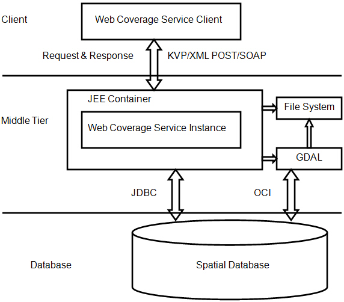

## 17  Web Coverage Service (WCS) Support

This chapter describes the Oracle Spatial and Graph implementation of the Open GIS Consortium (OGC) standard for Web Coverage Service Interface Standard (WCS), which, supports retrieval of “coverages” (according to the OGC, “electronic encoding of geospatial data, that is, digital geospatial information representing space and time-varying phenomena”).

**Note:**

You can deploy Oracle Spatial Web Services from Oracle Cloud Marketplace. This packaged application allows you to install Oracle Spatial web services (such as Web Feature Service (WFS), Web Coverage Services (WCS), and Catalog Services for the Web (CSW)) that are deployed in an Apache Tomcat web server instance on Oracle Cloud Infrastructure (OCI).

The Oracle Spatial and Graph implementation will be referred to as Web Coverage Service, or WCS.

Web Coverage Service (WCS) enables electronic retrieval of geospatial data as "coverages.” WCS provides data and descriptions, a syntax for querying the data, and the ability to return data on which you can perform various operations (visualize, interpret, extrapolate, and so on). WCS supports the storage of both GridCoverage (GeoRaster object without coordinate reference system) and RectifiedGridCoverage (GeoRaster object with coordinate reference system and georeferenced with an affine transformation) raster types

Oracle Spatial and Graph implements the following OGC standards.

- 09-110r4 WCS Core 2.0 Interface Standard - Core.

- 09-146r2 OGC GML Application Schema – Coverages.

- 09-147r3 OGC Web Coverage Service 2.0 Interface Standard – KVP Protocol Binding Extension – Corrigendum.

- 09-148r1 OGC Web Coverage Service 2.0 Interface Standard – XML/POST Protocol Binding Extension.

- 09-149r1 OGC Web Coverage Service 2.0 Interface Standard – XML/SOAP Protocol Binding Extension.

- 11-053r1 OGC Web Coverage Service Interface Standard – CRS Extension

- 12-039 OGC Web Coverage Service Interface Standard – Scaling Extension.

- 12-040 OGC Web Coverage Service Interface Standard – Range Subsetting Extension.

- 12-049 OGC Web Coverage Service Interface Standard – Interpolation Extension.

- 12-052 OGC WCS 2.0.1 Corrigendum Release Notes.

- 12-100r1 OGC GML Application Schema – Coverages – GeoTIFF Coverage Encoding Profile.

Oracle WCS also extends the OGC standards to support all GDAL-supported image or raster features as output format in a GetCoverage request.

**Note:**

Before you use WCS, be sure that you understand the concepts described in [Introduction to Spatial Web Services](introduction-spatial-web-services.md), and that you have performed any necessary configuration work as described in that chapter.

- Web Coverage Service Architecture
  In Oracle Spatial and Graph, WCS is implemented as a Java web application and can be deployed in WebLogic 12.1.3 or later.
- Database Schemas for WCS
  For Web Coverage Service purposes, this document refers to Oracle Database schemas that can be user schemas and/or WCS schemas.
- Database Objects Used for WCS
  Several tables and other database objects are used to implement WCS operations.
- PL/SQL Subprograms for Using WCS
  SDO_WCS procedures and functions enable you to perform operations that include the following actions.
- Setting Up WCS Using WebLogic Server
  For setting up WCS, WebLogic Server (WLS) 12.1.3 or later is required.
- WCS Administration Console
  The Oracle Spatial Web Services administration console is a single-page application that you can access by going to a URL in the following format.
- Oracle Implementation Extension for WCS
  The Oracle WCS extension defines optional elements inside a wcs:Extension element in a WCS request, to let you control the following aspects of request processing.
- WCS Operations: Requests and Responses with XML Examples
  WCS provides three major operations, and each operation has a request and response format.
- WCS Extensions Implemented
  This topic describes the WCS Extensions implemented and gives examples of some elements defined by each extension.
- Diagnosing WCS Issues
  WCS log files provide diagnostic information.

**Parent topic:** [Spatial Web Services](spatial-web-services.md)

### 17.1 Web Coverage Service Architecture

In Oracle Spatial and Graph, WCS is implemented as a Java web application and can be deployed in WebLogic 12.1.3 or later.

The required Java version is JDK 1.8 or later. This implementation of WCS is packaged in the Spatial Web Services `sdows.ear` file in the `$ORACLE_HOME/md/jlib` directory. For information about deploying this file, see [Deploying and Configuring Spatial Web Services](introduction-spatial-web-services.md).

WCS implements three protocol binding extensions, KVP (HTTP GET), XML/POST (HTTP/POST), and XML/SOAP. It also uses a GDAL Java API to generate image formats supported by GDAL. A GDAL instance must be configured on the same system as the application container where Spatial Web Services is deployed.

The SDO_WCS package inside Oracle Database contains procedures to initialize a WCS schema, publish GeoRaster objects as WCS coverages, and process WCS requests.

The following figure shows the WCS architecture.

Figure 17-1 Web Coverage Service Architecture

[Description of "Figure 17-1 Web Coverage Service Architecture"](img_text/wcs_architecture1.md)

**Parent topic:** Web Coverage Service (WCS) Support

### 17.2 Database Schemas for WCS

For Web Coverage Service purposes, this document refers to Oracle Database schemas that can be user schemas and/or WCS schemas.

- A user schema is any schema used to store GeoRaster objects.

  In some examples used in this document, the schema of a database user named SCOTT is a user schema.

- A WCS schema is any database schema with an SDO_WCS_COVERAGE table, which must be created using the WCS Administration Console or the [SDO_WCS.Init](SDO_WCS-reference.md) procedure. The coverage information is stored in a WCS schema.

  In some examples in this document, the schema of a specially created database user named WCS_USER is the WCS schema.

A given Oracle Database schema can be a user schema, a WCS schema, or both a user schema and a WCS schema.

Each WCS instance requires a WCS schema configured as a JDBC data source in the application container. Generally, only one WCS schema is configured for a specific database, but many WCS instances can be configured for use with the same database.

**Parent topic:** Web Coverage Service (WCS) Support

### 17.3 Database Objects Used for WCS

Several tables and other database objects are used to implement WCS operations.

In a WCS schema:

- Table SDO_WCS_COVERAGE contains metadata for all published coverages. The metadata includes coverage ID, raster ID, and raster data table. Each row corresponds to a coverage.

- Sequence SDO_WCS_COVERAGE_ID_SEQ is used to generate a unique coverage ID value.

In a user schema:

- Table WCS_TEMP_TABLE is used as a temporary storage for GeoRaster objects when reprojection or transformation is involved when processing a GetCoverage Operation (WCS) request. GeoRaster objects are kept in this table until the response is sent, after which the objects are deleted from the table.

- Table WCS_TEMP_RDT is the raster data table for GeoRaster objects in the WCS_TEMP_TABLE table.

**Parent topic:** Web Coverage Service (WCS) Support

### 17.4 PL/SQL Subprograms for Using WCS

SDO_WCS procedures and functions enable you to perform operations that include the following actions.

- Initializing a WCS schema.

- Creating temporary tables to store GeoRaster when a reprojection or transformation is needed. (CRS Extension or Scaling Extension.).

- Granting and revoking privileges to WCS schema.

- Publishing coverages

- Dropping (unpublishing) coverages

[SDO_WCS.Init](SDO_WCS-reference.md)creates the SDO_WCS_COVERAGE table, causing that database schema to become a WCS schema.

[SDO_WCS.PublishCoverage](SDO_WCS-reference.md) has two formats. One format publishes a GeoRaster object as a coverage, stores metadata in SDO_WCS_COVERAGE table, and assigns a unique coverage ID to it. The other format publishes all unpublished GeoRaster objects in a specified column.

[SDO_WCS.CreateTempTable](SDO_WCS-reference.md) should be executed once for each user schema. This procedure creates a GeoRaster table and an RDT table for temporarily storing a GeoRaster object when reprojection or transformation is involved in processing a GetCoverage Operation (WCS) request.

**Parent topic:** Web Coverage Service (WCS) Support

### 17.5 Setting Up WCS Using WebLogic Server

For setting up WCS, WebLogic Server (WLS) 12.1.3 or later is required.

This topic uses an example that assumes the following:

- A user schema SCOTT has a table named IMAGE, defined as:

      CREATE TABLE IMAGE (
         id NUMBER PRIMARY KEY,
         name VARCHAR2(32),
         raster MDSYS.SDO_GEORASTER);

- The WCS schema is named WCS_USER.

Setting up the WCS server involves deploying the `sdows.ear` file into WebLogic Server (explained in [Deploying and Configuring Spatial Web Services](introduction-spatial-web-services.md)), as well as the following actions.

- Configuring the Database Schemas
- Setting Up WCS Data Sources
- Configuring GDAL for the WCS Server

**Parent topic:** Web Coverage Service (WCS) Support

#### 17.5.1 Configuring the Database Schemas

**Note:**

If you plan to use the same Oracle Database schema both to store GeoRaster objects and to access them through WCS, skip this section and go to Setting Up WCS Data Sources.

To configure the Oracle Database schemas, follow these steps:

1.  Create metadata tables. To do so, use SQL\*Plus to connect to Oracle Database as the user that you want to be the WCS user (in this example, a user named WCS_USER), and enter the following:

        CALL SDO_WCS.init();

2.  Connect as the database user (in this example, SCOTT, which owns a GeoRaster table named IMAGE) that stores GeoRaster objects.

        connect scott/<password-for-scott>
        CALL SDO_WCS.createTempTable();
        CALL SDO_WCS.grantPrivilegesToWCS('IMAGE','WCS_USER');

3.  Connect as the WCS user (in this example, WCS_USER), and publish the GeoRaster images from a user table containing the desired GeoRaster objects (for example, from the RASTER column in the SCOTT.IMAGES table).

        connect wcs_user/<password-for-wcs_user>
        CALL SDO_WCS.publishCoverage('SCOTT','IMAGE','RASTER');

**Parent topic:** Setting Up WCS Using WebLogic Server

#### 17.5.2 Setting Up WCS Data Sources

Each database can have multiple WCS schemas, each of which corresponds to one data source in WebLogic. You can also have multiple data sources configured for WCS in WebLogic server. Each data source can be accessed through a different URL, where the last part of the URL correspond to the Data Source name configured in WebLogic Server.

The following is an example link with a WLS data source named `wcsdata1`:

    http://localhost:80/oraclespatial/wcs/wcsdata1?service=WCS& version=2.0.1&request=GetCapabilities

Follow these steps to configure a WCS data source.

1.  Log into the WebLogic Server (WLS) console.

2.  In the left pane, under Domain Structure, select Data Sources

3.  Click New , then Generic Data Source.

4.  On Create a New JDBC Data Source page, specify:

    1.  Name: Any name without spaces

    2.  JNDI Name: Any name starting with `jdbc/`

    3.  Database Type: `Oracle`

5.  For Database Driver select Oracle’s Driver (Thin) for Instance connections; Versions: Any.

6.  You can skip Supports Global Transactions.

7.  On the Connection Properties page, specify:

    1.  Database Name

    2.  Host Name

    3.  Port

    4.  Database User Name (for example, `WCS_USER`)

    5.  Password

8.  On the next page, test this connection. If the connection is successful, choose the appropriate server name for this deployment: either `AdminServer` or your managed server name.

**Parent topic:** Setting Up WCS Using WebLogic Server

#### 17.5.3 Configuring GDAL for the WCS Server

The Oracle WCS implementation can generate any GDAL supported format. You must configure a GDAL instance on the same system as WebLogic Server. The GDAL VRT driver and the GDAL Oracle GeoRaster driver are needed to communicate with the WCS server. (To get GDAL, you can download it from [http://www.gdal.org](http://www.gdal.org/), or you can get its Linux and Windows versions from your Oracle Database installation as described in [Oracle Spatial and Graph GeoRaster Developer's Guide](../geors/georaster-overview-and-concepts.md).)

1.  To know if you have the necessary GDAL drivers, execute the following GDAL command:

        <GDAL_HOME>/bin/gdalinfo --formats

2.  After the required GDAL drivers and desired GDAL output format drivers are installed, add the GDAL library directory to LD_LIBRARY_PATH to the WLS `setDomainEnv` script. For example, for Linux/UNIX:

        export GDAL_HOME=<path to gdal home directory>
        export GDAL_DATA=${GDAL_HOME}/data
        export GDAL_DRIVER_PATH=${GDAL_HOME}/lib/gdalplugins
        export PATH=${GDAL_HOME}/bin:${PATH}
        export LD_LIBRARY_PATH=${GDAL_HOME}/lib:${LD_LIBRARY_PATH}

    For Windows:

        set GDAL_HOME=<path to gdal home directory>
        set GDAL_DATA=%GDAL_HOME%\data
        set GDAL_DRIVER_PATH=%GDAL_HOME%\bin\gdalplugins
        set PATH=%GDAL_HOME%\bin;%PATH%
        set LD_LIBRARY_PATH=<path to gdal's .dll>;%LD_LIBRARY_PATH%

3.  Copy `gdal.jar` (located in the `gdal/lib` directory) to the WebLogic Server domain's `lib` directory,

4.  Restart WebLogic Server.

5.  Configure the GDAL database connection parameters using the Configuration File tab of the WCS Administration Console.

6.  Optionally, specify creation options (`CreationOption`) to GDAL in a GetCoverage Operation (WCS) request

    .

**Parent topic:** Setting Up WCS Using WebLogic Server

### 17.6 WCS Administration Console

The Oracle Spatial Web Services administration console is a single-page application that you can access by going to a URL in the following format.

    http://<system-name>:<port>/oraclespatial/

Before you can use any administration console page, select a WCS data source from the list of all available data source names. (The currently selected data source is shown in the upper-right corner, and you can change it there at any time.)

The WCS administration console provides screens to configure, test, and diagnose problems. It has the following tabs:

- Configuration File

- Publish Coverage

- Test

- Log

#### Configuration File tab

This tab lets an administrator modify the `WCSConfig.xml` file, which lets you configure WCS logging, GDAL parameters, and `GetCapabilities` responses (`ServiceIdentification` and `ServiceProvider`).

- Logging attributes can be configured: log level, log file size limit, and number of log files.

- Log rotation is supported based on the file size. By limiting the number of files, you can limit how much disk space the log files will take. Log files are generated inside the directory referenced by the `sdows java` property, and they have names in the form `wcs_``n<data source name>``.log`, where`wcs_0.log` has the most recent log messages; and when it has reached its file size limit, the oldest file is removed and all log files are renamed to let `wcs_0.log` be used for the next set of log messages.

- Log level can be `SEVERE`, `WARNING`, `INFO` (default), `CONFIG`, `FINE`, `FINER`, `FINEST`, or `ALL`.

- Log size limit is file size limit in megabytes (default 10).

- Log file count is the maximum number of log files.

The GDAL database connection is configured using the `gdalParameters` element as follows:

- `<gdalParameters user="<user>" password="!<password>" connectionString="<db_host:port:sid>" temporaryDirectory="<directory>" />`

- The specified user must have privileges to read all GeoRaster objects that are published as coverages. It is recommended that this user be the same as the WCS user.

- The password must be encrypted by the server. You must add an exclamation point (!) character at the beginning of password attribute, to make the server encrypt the password.

- The temporary directory should point to a writable directory to be used by GDAL to generate output files. Example: `/tmp`

To validate that GDAL was properly configured, go to the About tab in the Oracle Spatial Web Services administration console (`http://<host>:<port>/oraclespatial`), which shows the GDAL version if it was properly configured.

`ServiceIdentification` and `ServiceProvider` can be configured by uncommenting the appropriate element and specifying the desired information, complying with the XML schemas at <http://schemas.opengis.net/ows/2.0/owsGetCapabilities.xsd>.

When you click Save Changes, the server applies the changes, and no restart is needed.

#### Publish Coverage tab

This tab lets you publish new coverages. It requires administrator credentials.

You can publish GeoRaster objects as coverages by providing a select query that returns a single column of type SDO_GEORASTER. All GeoRaster objects returned by the select query will be published. Use the following to specify the select query. (For simplicity, you can select any entry from “Select a raster table (schema, table, column)” and click Fill query parameters to populate these fields.)

- Column Name: An SDO_GEORASTER column name from a table listed in From Clause

<!-- -->

- From Clause: A valid FROM clause that includes schema name, table name, and alias if required by the WHERE clause.

<!-- -->

- Where Clause: A valid WHERE clause that can include spatial operations. If the WHERE clause is empty, the SELECT statement will return all rows of the specified table.

This page shows an HTML table with all GeoRaster objects. You can choose to publish or unpublish individual GeoRaster objects by right-clicking the desired row..

A GeoRaster cannot be published more than once in a WCS instance.

#### Test tab

This tab lets you send post requests. The Test tab is initially empty, in which case you need to send a GetCapabilities request to populate following elements:

- Operation: An HTML select element with all operations discovered on last GetCapabilities response.

- Coverage: An HTML select element which is populated with content of last GetCapabilities response. It contains all Coverage IDs from GetCapabilities response received.

Create Request: Populates the request test area with a request to the specified operations, coverage IDs, and operation URLs.

Request: A text area whose content will be sent in a post request to the Operation URL. This element can be populated by clicking Create Request, and you can edit that request as needed.

Operation URL: The URL where the request is to be sent. This element can be populated by clicking Create Request, and you can edit that request as needed.

Send Request: Sends an HTTP post request to the Operation URL using the content of the request. The response of the HTTP post request will be shown in the Response.

Response: A text area populated with the response of a Send Request operation.

#### Log tab

This tab lets you visualize and download WCS log files. Log files are generated inside the directory referenced by the `sdows java` property. Using the Log tab requires administrator credentials.

All Oracle WCS log files have file names in the form `wcs_`n`.log`, where n is a consecutive number, and for the newest log files n is 0 (zero).

This tab shows the content of the `wcs_<data_source_name>_0.log` file, which has the most recent log messages generated by the WCS server. However, you can select other log files to see their contents. You can also refresh the display to include new log messages generated since the page was loaded or last refreshed.

Download lets you download the selected log file in zip format.

**Parent topic:** Web Coverage Service (WCS) Support

### 17.7 Oracle Implementation Extension for WCS

The Oracle WCS extension defines optional elements inside a wcs:Extension element in a WCS request, to let you control the following aspects of request processing.

- GDAL `CreationOption` in a GetCoverage request

- `CompressResponseFile` in a GetCoverage request

All formats included in your GDAL installation are supported the GetCoverage request. You can see the full list of formats and their names in the Capabilities XML document.

#### GDAL CreationOption in a GetCoverage Request

This element sends a `-co` parameter to GDAL on GetCoverage requests. Every GDAL driver defines its own creation option parameters.

Examples:

- XML Request:

      <wcs:GetCoverage xmlns:wcs="http://www.opengis.net/wcs/2.0"
        xmlns:gml="http://www.opengis.net/gml/3.2"
        xmlns:xsi="http://www.w3.org/2001/XMLSchema-instance"
        xsi:schemaLocation="http://www.opengis.net/wcs/2.0 http://schemas.opengis.net/wcs/2.0/wcsAll.xsd"
        xmlns:ora="http://www.oracle.com/spatial/wcs"
        service="WCS" version="2.0.1">
        <wcs:Extension>
          <ora:CreationOption>WORLDFILE=YES</ora:CreationOption>
        </wcs:Extension>
        <wcs:CoverageId>C0005</wcs:CoverageId>
        <wcs:format>image/jpeg</wcs:format>
      </wcs:GetCoverage>

- KVP Request:

      http://.../oraclespatial/wcs?service=WCS&version=2.0.1&request=GetCoverage&format=image/jpeg&coverageId=C0005&CO=WORLDFILE=YES

#### CompressResponseFile in a GetCoverage Request

This element compresses the generated image into a zip file.

Examples:

- XML Request:

      <wcs:GetCoverage xmlns:wcs="http://www.opengis.net/wcs/2.0"
        xmlns:gml="http://www.opengis.net/gml/3.2"
        xmlns:xsi="http://www.w3.org/2001/XMLSchema-instance"
        xsi:schemaLocation="http://www.opengis.net/wcs/2.0 http://schemas.opengis.net/wcs/2.0/wcsAll.xsd"
        xmlns:ora="http://www.oracle.com/spatial/wcs"
        service="WCS" version="2.0.1">
        <wcs:Extension>
          <ora:CompressResponseFile>true</ora:CompressResponseFile>
        </wcs:Extension>
        <wcs:CoverageId>C0005</wcs:CoverageId>
        <wcs:format>image/jpeg</wcs:format>
      </wcs:GetCoverage>

- KVP Request:

      http://.../oraclespatial/wcs?service=WCS&version=2.0.1&request=GetCoverage&format=image/jpeg&coverageId=C0005&COMPRESS=YES

**Parent topic:** Web Coverage Service (WCS) Support

### 17.8 WCS Operations: Requests and Responses with XML Examples

WCS provides three major operations, and each operation has a request and response format.

When a client performs any sequence of WCS requests, it should first issue a GetCapabilities request to the server to obtain an up-to-date listing of available data. Then, it may issue a DescribeCoverage request to find out more details about particular coverages offered. To retrieve a coverage or part of a coverage, the client issues a GetCoverage request.

- GetCapabilities Operation (WCS)
- DescribeCoverage Operation (WCS)
- GetCoverage Operation (WCS)

**Parent topic:** Web Coverage Service (WCS) Support

#### 17.8.1 GetCapabilities Operation (WCS)

A GetCapabilities operation allows a WCS client to retrieve service and coverage metadata offered by a WCS server.

All WCS servers must implement KVP protocol for GetCapabilities requests. A user begins interaction with a WCS Server by sending a GetCapabilities request using KVP protocol (HTTP GET request) to the URL. For example:

    http://host:port/oraclespatial/wcs/<data source name>?service=WCS&request=GetCapabilities

A GetCapabilities operation returns an XML document describing the service and brief descriptions of the coverages that clients can request. Clients would generally run the GetCapabilities operation and cache its result for use throughout a session, or reuse it for multiple sessions.

GetCapabilities response includes the following:

- WCS response version. If the request does not specify the desired response version, the server returns latest version supported.

- The profile list of the `ServiceIdentification` identifies an OGC Interface Standard conformance class.

- Operation elements in `OperationsMetadata` contain the URL for each WCS operation of each protocol. Each WCS operation of each WCS protocol might have a different URL.

- `formatSupported` elements in `ServiceMetadata` list all available output formats by a GetCoverage request. This list includes GDAL-supported formats when configured. For example:

      <wcs:ServiceMetadata>
        <wcs:formatSupported>image/tiff</wcs:formatSupported>
        <wcs:formatSupported>image/jp2</wcs:formatSupported>
        <wcs:formatSupported>application/x-ogc-nitf</wcs:formatSupported>
        <wcs:formatSupported>application/x-ogc-aaigrid</wcs:formatSupported>
        <wcs:formatSupported>image/png</wcs:formatSupported>
        <wcs:formatSupported>image/jpeg</wcs:formatSupported>
      </wcs:ServiceMetadata>

- Extension elements allow WCS extension standards to define their individual extra service metadata. This element includes 16.8.2 12-039 OGC Web Coverage Service Interface Standard – Scaling Extension elements like: nearest-neighbor, bilinear, biquadratic, ... It also includes 16.8.1 11-053r1 OGC Web Coverage Service Interface Standard – CRS Extension includes crsSupported elements.

- The list of coverages offered by this server includes a coverage ID, which is a unique identifier used in DescribeCoverage and GetCoverage operation requests and the coverage subtype.

**Parent topic:** WCS Operations: Requests and Responses with XML Examples

#### 17.8.2 DescribeCoverage Operation (WCS)

A DescribeCoverage operation lets clients request detailed metadata for one or more coverages offered by a WCS server, and it provides an estimate of the amount of data to be expected in the domain and range set. A DescribeCoverage request provides a list of coverage identifiers and prompts the server to return, for each identifier, a description of the corresponding coverage. The following is an XML/POST DescribeCoverage request example:

    <wcs:DescribeCoverage xmlns:xsi="http://www.w3.org/2001/XMLSchema-instance"
            xmlns:wcs="http://www.opengis.net/wcs/2.0"
            xsi:schemaLocation="http://schemas.opengis.net/wcs/2.0 ../wcsAll.xsd" service="WCS"
            version="2.0.1">
      <wcs:CoverageId>C0001</wcs:CoverageId>
      <wcs:CoverageId>C0002</wcs:CoverageId>
      ...
    </wcs:DescribeCoverage>

The DescribeCoverage response contains a list of coverage metadata, one for each coverage identifier passed in the request. Coverage metadata is an XML document of type `gml:Grid` for `GridCoverages`, and of type `gml:rectifiedGrid` for `RectifiedGridCoverages`. The xsd schemas for those documents can be found in <http://schemas.opengis.net/wcs/2.0/>.

The `gml:Grid` element implicitly defines a grid, which is a network composed of two or more sets of curves in which the members of each set intersect the members of the other sets in an algorithmic way. The region of interest within the grid is given in terms of its `gml:limits`, being the grid coordinates of diagonally opposed corners of a rectangular region. `gml:axisLabels` is provided with a list of labels of the axes of the grid (`gml:axisName` has been deprecated). `gml:dimension` specifies the dimension of the grid.

The `gml:limits` element contains a single `gml:GridEnvelope`. The `gml:low` and `gml:high` property elements of the envelope are lists of integers, which are coordinate tuples. The coordinates are measured as offsets from the origin of the grid, along each axis, of the diagonally opposing corners of a "rectangular" region of interest.

A rectified grid is a grid for which there is an affine transformation between the grid coordinates and the coordinates of an external coordinate reference system. It is defined by specifying the position (in some geometric space) of the grid "origin" and of the vectors that specify the post locations.

Note that the grid limits (post indexes) and axis name properties are inherited from `gml:GridType`, and that `gml:RectifiedGrid` adds a `gml:origin` property (contains or references a `gml:Point`) and a set of `gml:offsetVector` properties.

**Parent topic:** WCS Operations: Requests and Responses with XML Examples

#### 17.8.3 GetCoverage Operation (WCS)

A GetCoverage operation is normally run after GetCapabilities and DescribeCoverage operation responses have shown what requests are allowed and what data is available. The GetCoverage operation returns a coverage (that is, values or properties of a set of geographic locations) encoded in a well-known coverage format.

A GetCoverage request prompts a WCS service to process a particular coverage selected from the service’s offering and return a derived coverage.

The WCS Core standard defines the domain subsetting operation, which delivers all data from a coverage inside a specified request envelope (“bounding box”), relative to the coverage’s envelope – more precisely, the intersection of the request envelope with the coverage envelope.

Domain subsetting is subdivided into trimming and slicing. A trim operation identifies a dimension and a lower and upper bound (which both must lie inside the coverage’s domain) and delivers a coverage whose domain, in the dimension specified, is reduced to these new, narrower limits. The resulting coverage’s dimension is identical to that of the input coverage. The following is an example of a `DimensionTrim` element:

    <wcs:DimensionTrim>
      <wcs:Dimension>N</wcs:Dimension>
      <wcs:TrimLow>8.16270027015798</wcs:TrimLow>
      <wcs:TrimHigh>8.34362402047258</wcs:TrimHigh>
    </wcs:DimensionTrim>

A domain slice operation receives a dimension and a position (which must lie inside the coverage’s domain) and delivers a coverage that is a slice of the offered coverage obtained at the cutting position specified. The dimension of the resulting coverage is reduced by one as compared to the original coverage.

Both trimming and slicing can be combined in a request and on as many dimensions as desired. However, in any request, at most one operation can be applied per dimension. The following is an example of a `DimensionSlice` element:

    <wcs:DimensionSlice>
      <wcs:Dimension>N</wcs:Dimension>
      <wcs:SlicePoint>8.16270027015798</wcs:SlicePoint>
    </wcs:DimensionSlice>

The encoding format in which the coverage will be returned is specified by the combination of format and mediaType elelemts. The formats supported are those listed in the server’s Capabilities document, and the default is either `application/gml+xml` or `image/jpeg` if GDAL is configured. For example:

    <wcs:format>image/jpeg</wcs:format>
    <wcs:mediaType>multipart/related</wcs:mediaType>

**Parent topic:** WCS Operations: Requests and Responses with XML Examples

### 17.9 WCS Extensions Implemented

This topic describes the WCS Extensions implemented and gives examples of some elements defined by each extension.

It concludes with a GetCoverage request example that includes all the extensions.

#### 11-053r1 OGC Web Coverage Service Interface Standard – CRS Extension

This WCS CRS Extension defines how to request and obtain a coverage in CRSs different from the Native CRS, and also how to provide a subsetting bounding box with coordinates in a CRS different from the Native CRS. A WCS server supporting this WCS CRS Extension announces the CRSs supported by listing their CRS Identifiers in its Capabilities document. For example:

    <wcscrs:subsettingCrs>http://www.opengis.net/def/crs/EPSG/0/4326</wcscrs:subsettingCrs>
    <wcscrs:outputCrs>http://www.opengis.net/def/crs/EPSG/0/4326</wcscrs:outputCrs>

#### 112-039 OGC Web Coverage Service Interface Standard – Scaling Extension

This extension allows scaling of a coverage along one or more of its axes during its server-side processing in a GetCoverage request. For example:

    <scal:ScaleByFactor>
     <scal:axis>E</scal:axis>
      <scal:scaleFactor>0.5</scal:scaleFactor>
    </scal:ScaleByFactor>

#### 112-040 OGC Web Coverage Service Interface Standard – Range Subsetting Extension

This extension allows extraction of specific fields, according to the range type specification, from the range set of a coverage during server-side processing of a coverage in a GetCoverage request. For example:

    <rsub:RangeSubset>
        <rsub:RangeItem>
            <rsub:RangeComponent>band1</rsub:RangeComponent>
        </rsub:RangeItem>
        <rsub:RangeItem>
            <rsub:RangeInterval>
                <rsub:startComponent>band3</rsub:startComponent>
                <rsub:endComponent>band5</rsub:endComponent>
            </rsub:RangeInterval>
        </rsub:RangeItem>
    </rsub:RangeSubset>

#### 112-049 OGC Web Coverage Service Interface Standard – Interpolation Extension

This extension gives control over interpolation of a coverage during its server-side processing.

This allows the WCS client to control and specify the interpolation mechanism to be applied to a coverage during server processing. For example:

    <int:Interpolation>
      <int:globalInterpolation>
        http://www.opengis.net/def/interpolation/OGC/1/nearest-neighbor
      </int:globalInterpolation>
    </int:Interpolation>

#### 112-100r1 OGC GML Application Schema – Coverages – GeoTIFF Coverage Encoding Profile

This encoding profile specifies the usage of the GeoTIFF data format for the encoding of GML coverages. For example:

    <wcs:format>image/tiff</wcs:format>

#### Example Showing All Extensions

The following is an example of a GetCoverage request example with all extensions included:

    <wcs:GetCoverage xmlns:wcs="http://www.opengis.net/wcs/2.0"
      xmlns:gml="http://www.opengis.net/gml/3.2"
      xmlns:xsi="http://www.w3.org/2001/XMLSchema-instance"
      xsi:schemaLocation="http://www.opengis.net/wcs/2.0 http://schemas.opengis.net/wcs/2.0/wcsAll.xsd"
      xmlns:scal="http://www.opengis.net/wcs/scaling/1.0"
      xmlns:wcscrs="http://www.opengis.net/wcs/service-extension/crs/1.0"
      xmlns:rsub="http://www.opengis.net/wcs/rangesubsetting/1.0"
      xmlns:int="http://www.opengis.net/wcs/interpolation/1.0"
      service="WCS" version="2.0.1">
      <wcs:Extension>
        <wcscrs:subsettingCrs>http://www.opengis.net/def/crs/EPSG/0/4326</wcscrs:subsettingCrs>
        <wcscrs:outputCrs>http://www.opengis.net/def/crs/EPSG/0/4326</wcscrs:outputCrs>
        <rsub:RangeSubset>
          <rsub:RangeItem>
            <rsub:RangeComponent>L3</rsub:RangeComponent>
          </rsub:RangeItem>
        </rsub:RangeSubset>
        <int:Interpolation>
          <int:globalInterpolation>
            http://www.opengis.net/def/interpolation/OGC/1/nearest-neighbor
          </int:globalInterpolation>
        </int:Interpolation>
        <scal:ScaleByFactor>
          <scal:scaleFactor>0.5</scal:scaleFactor>
        </scal:ScaleByFactor>
      </wcs:Extension>
      <wcs:CoverageId>C0005</wcs:CoverageId>
      <wcs:DimensionSlice>
        <wcs:Dimension>N</wcs:Dimension>
        <wcs:SlicePoint>8.16270027015798</wcs:SlicePoint>
      </wcs:DimensionSlice>
      <wcs:DimensionTrim>
        <wcs:Dimension>E</wcs:Dimension>
        <wcs:TrimLow>112.990337346209</wcs:TrimLow>
        <wcs:TrimHigh>113.028655200765</wcs:TrimHigh>
      </wcs:DimensionTrim>
      <wcs:format>image/tiff</wcs:format>
      <wcs:mediaType>multipart/related</wcs:mediaType>
    </wcs:GetCoverage>

**Parent topic:** Web Coverage Service (WCS) Support

### 17.10 Diagnosing WCS Issues

WCS log files provide diagnostic information.

In the WCS Administration Console , the Configuration Files tab lets you configure logging, and the Log tab lets you visualize and download WCS log files.

This topic explains some error messages and how to deal with them.

#### “DataSource jdbc/wcs_admin_ds not found” GetCapabilities response error message

An OWS error response may be like the following (reformatted here for readability):

    <?xml version='1.0' encoding='UTF-8'?>
    <ows:ExceptionReport
      xmlns:ows="http://www.opengis.net/ows/2.0" xmlns:xsi="http://www.w3.org/2001/XMLSchema-instance"
      xsi:schemaLocation="http://www.opengis.net/ows/2.0 http://schemas.opengis.net/ows/2.0/owsExceptionReport.xsd" version="2.0.1">
      <ows:Exception exceptionCode="NoApplicableCode" locator="DataSource jdbc/wcs_admin_ds not found"/>
    </ows:ExceptionReport>

This means that a WCS data source is not configured or that WebLogic Server cannot connect to the database. Setting Up WCS Data Sources for information about configuring WCS data sources.

#### “INFO: GDAL was not found” message in WCS log file shown every time WebLogic Server starts

If no GDAL supported formats are needed, you can ignore this message. This message indicates that gdal.jar not found in the WebLogic Server libraries or that the LD_LIBRARY_PATH not properly configured.

- If `java.lang.NoClassDefFoundError: org/gdal/gdal/gdal` appears in the WCS log, then the `gdal.jar` file was not found.

- If `java.lang.UnsatisfiedLinkError: org.gdal.gdal.gdalJNI.GetDriverCount()I` appears in the WCS log, then the `libgdal.so` file was not found in LD_LIBRARY_PATH.

For more information, see Configuring GDAL for the WCS Server

#### GDALParameter error response

An error message like the following is generated when GDAL is not properly configured:

    <?xml version='1.0' encoding='UTF-8'?>
    <ows:ExceptionReport xmlns:ows="http://www.opengis.net/ows/2.0" xmlns:xsi="http://www.w3.org/2001/XMLSchema-instance" xsi:schemaLocation="http://www.opengis.net/ows/2.0 http://schemas.opengis.net/ows/2.0/owsExceptionReport.xsd" version="2.0.1">
      <ows:Exception exceptionCode="NoApplicableCode" locator="GDALParameters">
        <ows:ExceptionText>...</ows:ExceptionText>
      </ows:Exception>
    </ows:ExceptionReport>

The error indicates that the GDAL database connection parameters are not correct. See the Configuration File tab in the WCS Administration Console

#### Database connection error

The following message in the WCS log means that the database is not running:

    SEVERE: Error discovering coverages
    java.sql.SQLRecoverableException: No more data to read from socket

#### “Error reading log file” message on WCS administration console Log tab

If an authenticated user does not interact with the WCS server administration console for a given period of time, the user session in the browser might have timed out. In this case, refresh the browser display, and re-authenticate to get a new session.

#### Document received does not conform with protocol syntax

An error message like the following indicates that the request contains XML elements or character elements that are not defined in any OGC specification:

    <?xml version='1.0' encoding='UTF-8'?>
    <ows:ExceptionReport xmlns:ows="http://www.opengis.net/ows/2.0" xmlns:xsi="http://www.w3.org/2001/XMLSchema-instance" xsi:schemaLocation="http://www.opengis.net/ows/2.0 http://schemas.opengis.net/ows/2.0/owsExceptionReport.xsd" version="2.0.1">
      <ows:Exception exceptionCode="InvalidEncodingSyntax" locator="asdc">
        <ows:ExceptionText>Document received does not conform with protocol syntax.</ows:ExceptionText>
      </ows:Exception>
    </ows:ExceptionReport>

**Parent topic:** Web Coverage Service (WCS) Support
