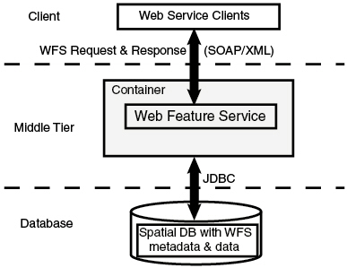

## 16  Web Feature Service (WFS) Support

Oracle Spatial and Graph includes Web Feature Service (WFS) support.

**Note:**

- You can deploy Oracle Spatial Web Services from Oracle Cloud Marketplace. This packaged application allows you to install Oracle Spatial web services (such as Web Feature Service (WFS), Web Coverage Services (WCS), and Catalog Services for the Web (CSW)) that are deployed in an Apache Tomcat web server instance on Oracle Cloud Infrastructure (OCI).
- Before you use WFS, be sure that you understand the concepts described in [Introduction to Spatial Web Services](introduction-spatial-web-services.md), and that you have performed any necessary configuration work as described in that chapter.
- If you have data from a previous release that was indexed using one or more SYS.XMLTABLEINDEX indexes, you must drop the associated indexes before the upgrade and re-create the indexes after the upgrade, as described in [Index Maintenance Before and After an Upgrade (WFS and CSW)](spatial-install-migrate-upgrade.md).

<!-- -->

- WFS Engine
  This topic describes the Web Feature Service engine, including its relationship to clients and to the database server.
- Configuring the Database for WFS
  This section describes the WFS schema configuration in Oracle Database.
- Configuring the WFS Engine
  This topic focuses on the WFS-specific configuration and deployment actions.
- Managing Feature Types
  WFS supports feature types with both spatial and nonspatial attributes.
- Capabilities Documents (WFS)
  A capabilities document is generated by the WFS server in response to a GetCapabilities request. It shows published feature types (such as roads or rivers) and the operations supported (such as insert and delete).
- WFS Operations: Requests and Responses with XML Examples
  This topic presents some feature requests to the WFS engine, and the response to each request, for each of the following operations.
- WFS Administration Console
  The WFS administration console uses your WebLogic Server credentials.
- Diagnosing WFS Issues
  The WFS log files provide diagnostic information.
- Using WFS with Oracle Workspace Manager
  You can use Oracle Workspace Manager to version-enable a WFS table with relational features.

**Parent topic:** [Spatial Web Services](spatial-web-services.md)

### 16.1 WFS Engine

This topic describes the Web Feature Service engine, including its relationship to clients and to the database server.

WFS is implemented as a Java web application and can be deployed in WebLogic 12.1.3 or later. The required Java version is JDK 1.8 or later.

WFS has a metadata layer, which stores in the database the metadata needed to reply to the WFS requests. The metadata includes spatial columns, which can be queried and processed using Oracle Spatial and Graph interfaces. The metadata also stores the association of nonspatial and spatial attributes of features, as well as the services that the Web Feature Service provides to its clients.

Figure 16-1 shows the WFS architecture.

Figure 16-1 Web Feature Service Architecture

[Description of "Figure 16-1 Web Feature Service Architecture"](img_text/wfs_architecture.md)

As shown in Figure 16-1:

- The WFS server is part of the middle tier.

- WFS clients can communicate with a WFS server through requests and responses in SOAP, KVP, or XML format.

- The WFS server performs spatial data and metadata access through JDBC calls to the database.

- The database includes Oracle Spatial and Graph with WFS metadata and spatial data, and with PL/SQL packages for administrative operations (see [SDO_WFS_PROCESS Package (WFS Processing)](SDO_WFS_PROCESS-reference.md) and [SDO_WFS_LOCK Package (WFS)](SDO_WFS_LOCK-reference.md) ).

  Each database can have one WFS schema, which corresponds to one data source in WebLogic Server.

**Parent topic:** Web Feature Service (WFS) Support

### 16.2 Configuring the Database for WFS

This section describes the WFS schema configuration in Oracle Database.

To publish a WFS feature, you need to first configure a WFS schema in your database. This WFS schema is then configured as a JDBC data source of the WFS instance in the application container.

To configure the WFS schema, you need to connect to the database as a `system` user with `DBA` privilege and run the following command:

    EXEC MDSYS.sdo_wfs_process.grantMDAccessToUser('<user_name>');

In the preceding command, `<user_name>` corresponds to the database user (WFS schema) who must be granted access to the WFS metadata tables. Note, any user can be configured as WFS schema. However, it is recommended to use the user schema where the actual spatial features are stored as the WFS schema.

In case the WFS schema is different from the user schema where the actual spatial features are stored, then the WFS schema must have `SELECT`, `INSERT`, `UPDATE`, `DELETE`, and `CREATE TRIGGER` privileges over the tables that are used to implement the WFS features.

It is important to note that in the current release, only one WFS schema can be configured for a specific database. This implies that if you have multiple tables with `SDO_GEOMETRY` columns in different schemas, they will all appear in the same WFS service after they are published.

**Parent topic:** Web Feature Service (WFS) Support

### 16.3 Configuring the WFS Engine

This topic focuses on the WFS-specific configuration and deployment actions.

Before following steps in this topic, be sure you understand the information in [Deploying and Configuring Spatial Web Services](introduction-spatial-web-services.md) and have performed any necessary operations.

- Editing the WFSConfig.xml File
- Data Source Setup for the WFS Engine

**Parent topic:** Web Feature Service (WFS) Support

#### 16.3.1 Editing the WFSConfig.xml File

In the Configuration File tab of the WFS administration console, “uncomment” and modify as needed. Consider the following:

- The logging levels can be OFF, SEVERE, WARNING, INFO (the default), CONFIG, FINE, FINER, FINEST, or ALL. The default value is INFO.

  `size_limit` specifies an approximate maximum amount to write (in MB) to any one file. If the value is zero, then there is no limit. The default value is 10

  `file_count` specifies how many output files to cycle through. The default value is 10.

- Proxy configuration allows you to control URLs generated by the Spatial Web Services server. A useful scenario is when an HTTP Proxy Server receives requests from users and passes them to WebLogic Server, to control and protect access to a server on a private network

- Optionally, uncomment the `wfs_query_timeout` element to specify the query timeout value, which is used when a server-side locking API is called. The value can be a non-negative integer, and its unit is seconds. The default value is 10 seconds.

- Optionally, uncomment the `wfs_lock_expiry` element to configure the default WFS lock expiry value, which is the expiration time in minutes for WFS locks, if lock expiry value is not explicitly specified in `GetFeatureWithLock` or `LockFeature` requests. The default value is 4 minutes.

- Optionally, uncomment `gml_consider_coordinate_axis_sequence_ordering` and set it to the value 1 if the spatial reference system (SRS) should be checked for whether ordinates need to be reversed for x,y coordinates when generating the GML.

- The `wfs_xsd_loc_url`, `wfs_ex_xsd_loc_url`, and `gml3_xsd_loc_url` elements are deprecated and not used anymore.

**Parent topic:** Configuring the WFS Engine

#### 16.3.2 Data Source Setup for the WFS Engine

To set up the data source for the WFS Engine, follow the steps.

1.  Log in to the WebLogic Server console.

2.  In the left pane, for Domain Structure, select `Data Sources`.

3.  Click New, then Generic Data Source.

4.  On the Create a New JDBC Data Source page, enter:

    1.  Name: Any name without spaces

    2.  JNDI Name: Any name starting with `jdbc/`

    3.  Database Type: `Oracle`

5.  For Database Driver, select `Oracle Driver (Thin) for Instance connections`; and for Version, select `Any`.

6.  Skip Supports Global Transactions.

7.  On the Connections Properties page, enter:

    1.  Database Name

    2.  Host Name

    3.  Port

    4.  Database User Name

    5.  Password

8.  On the next page, test the connection.

9.  If the connection is successful, choose the appropriate server name for this deployment: either `AdminServer` or your managed server name.

    Each database can have only one schema configured for WFS, which corresponds to one data source in WebLogic Server. However, you can have multiple data sources configured for WFS in WebLogic. Each data source can be accessed through a different URL, where the last part of the URL correspond to the data source name configured in WebLogic Server. The following is an example link with a WLS data source name `wfsdata1`:

    http://localhost:80/oraclespatial/wfs/wfsdata1?service=WFS& version=1.0.0&request=GetCapabilities

After the WFS Engine is deployed and data source is created, you can test the deployment with WFS Engine test queries, such as one of these GetCapabilities queries:

- For WFS 1.0.0:

      http://<machine-name:port>/oraclespatial/wfs/<data source name>?request=GetCapabilities&service=WFS&version=1.0.0

- For WFS 1.1.0:

      http://<machine-name:port>/oraclespatial/wfs/<data source name>?request=GetCapabilities&service=WFS&version=1.1.0

**Parent topic:** Configuring the WFS Engine

### 16.4 Managing Feature Types

WFS supports feature types with both spatial and nonspatial attributes.

Feature types expose the content of database tables as feature instances. Feature types are well suited for those who use Oracle Spatial and Graph to manage their geospatial data and use Oracle Database to manage other business data. The Spatial and Graph WFS implementation provides ways to access the data, especially in service-oriented architecture (SOA) systems implemented using web services.

The WFS administration console enables you to perform operations that include:

- Publishing feature types

- Dropping (unpublishing) feature types

- Viewing and configuring logging

- Editing capabilities templates

There are two ways to publish and unpublish feature types:

- Using the WFS Administration Console: Publishing and Unpublishing Feature Types

- Using the SDO_WFS_PROCESS.Publish_FeatureTypes_In_Schema Procedure, and Dropping Feature Types

#### Using the WFS Administration Console: Publishing and Unpublishing Feature Types

Follow these steps to publish a feature type using the WFS administration console.

1.  Log in to the WFS administration console with your WebLogic Server credentials

2.  Click WFS, then Publish Feature.

3.  From Available Tables, right-click a table that has not yet been published.

4.  Click Publish.

You can repeat the preceding steps to publish another feature type.

To drop an already published procedure, use the preceding steps, except that in the last one click Unpublish instead of Publish.

#### Using the SDO_WFS_PROCESS.Publish_FeatureTypes_In_Schema Procedure

You can use the [SDO_WFS_PROCESS.Publish_FeatureTypes_In_Schema](SDO_WFS_PROCESS-reference.md) procedure to publish multiple feature types, as is the following command line example.

    EXECUTE SDO_WFS_PROCESS.PUBLISH_FEATURETYPES_IN_SCHEMA('USER', 'http://www.myserver.com/user_data', 'udns', 'http://localhost:7003/oraclespatial/wfs', p_tablename_pattern=>'GEOD_STATES');

#### Dropping Feature Types

You can use the following procedures to drop one or more feature types.

- To drop a single feature type: [SDO_WFS_PROCESS.DropFeatureType](SDO_WFS_PROCESS-reference.md)

- To drop multiple feature types: [SDO_WFS_PROCESS.DropFeatureTypes](SDO_WFS_PROCESS-reference.md)

**Parent topic:** Web Feature Service (WFS) Support

### 16.5 Capabilities Documents (WFS)

A capabilities document is generated by the WFS server in response to a GetCapabilities request. It shows published feature types (such as roads or rivers) and the operations supported (such as insert and delete).

The WFS server uses a capabilities template, and adds information about the feature type and operations to this template to create the capabilities document.

A client uses the HTTP GET/KVP protocol to access this capabilities document:

    http://<hostname:port>/oraclespatial/wfs/<data source name>/?request=GetCapabilities&service=WFS

In the preceding format:

- hostname is the host name of the system where the application server is running.

- port is the port number where the application server is running.

- `oraclespatial` is the default context root where the Spatial and Graph web services application is mounted.

- `data source name` the data source configured on the application server to access spatial data. Is possible to have multiple data sources configured in a WLS instance, and WFS can expose data of each data source through a dedicated URL

**Parent topic:** Web Feature Service (WFS) Support

### 16.6 WFS Operations: Requests and Responses with XML Examples

This topic presents some feature requests to the WFS engine, and the response to each request, for each of the following operations.

- GetCapabilities

- DescribeFeatureType

- GetFeature

- GetFeatureWithLock

- LockFeature

- Transaction, with a subelement specifying the transaction type:

  - Insert

  - Update

  - Delete

Several examples in this section refer to features in the COLA_MARKETS_CS table used in [Example of Coordinate System Transformation](coordinate-systems-concepts.md), where the MKT_ID column contains the unique numeric ID of each feature, the NAME column contains each feature's name (`cola_a`, `cola_b`, `cola_c`, or `cola_d`), and the SHAPE column contains the geometry associated with each feature.

Example 16-1 GetCapabilities Request (WFS)

Example 16-1 is a request to get the capabilities of the WFS server named WFS at a specified namespace URL. This request will return a capabilities document, as explained in Capabilities Documents

    <?xml version="1.0" ?>
    <GetCapabilities
       service="WFS"
       version="1.0.0"
       xmlns="http://www.opengis.net/wfs" />

Example 16-2 GetCapabilities Response (WFS)

Example 16-2 is an excerpt of the response from the request in Example 16-1.

    <WFS_Capabilities xmlns="http://www.opengis.net/wfs" version="1.0.0" xmlns:ogc="http://www.opengis.net/ogc" xmlns:myns="http://www.example.com/myns">
      <Service>
        <Name> Oracle WFS </Name>
        <Title> Oracle Web Feature Service </Title>
        <Abstract> Web Feature Service maintained by Oracle </Abstract>
        <OnlineResource>http://localhost:8888/SpatialWS-SpatialWS-context-root/wfsservlet</OnlineResource>
      </Service>
      <Capability>
        <Request>
          <GetCapabilities>
            <DCPType>
              <HTTP>
                <Get onlineResource="http://localhost:8888/SpatialWS-SpatialWS-context-root/wfsservlet"/>
              </HTTP>
            </DCPType>
            <DCPType>
              <HTTP>
                <Post onlineResource="http://localhost:8888/SpatialWS-SpatialWS-context-root/SpatialWSSoapHttpPort"/>
              </HTTP>
            </DCPType>
          </GetCapabilities>
          <DescribeFeatureType>
            <SchemaDescriptionLanguage>
              <XMLSCHEMA/>
            </SchemaDescriptionLanguage>
            <DCPType>
              <HTTP>
                <Post onlineResource="http://localhost:8888/SpatialWS-SpatialWS-context-root/SpatialWSSoapHttpPort"/>
              </HTTP>
            </DCPType>
          </DescribeFeatureType>
          <GetFeature>
            <ResultFormat>
              <GML2/>
            </ResultFormat>
            <DCPType>
              <HTTP>
                <Post onlineResource="http://localhost:8888/SpatialWS-SpatialWS-context-root/SpatialWSSoapHttpPort"/>
              </HTTP>
            </DCPType>
          </GetFeature>
          <GetFeatureWithLock>
            <ResultFormat>
              <GML2/>
            </ResultFormat>
            <DCPType>
              <HTTP>
                <Post onlineResource="http://localhost:8888/SpatialWS-SpatialWS-context-root/SpatialWSSoapHttpPort"/>
              </HTTP>
            </DCPType>
          </GetFeatureWithLock>
          <Transaction>
            <DCPType>
              <HTTP>
                <Post onlineResource="http://localhost:8888/SpatialWS-SpatialWS-context-root/SpatialWSSoapHttpPort"/>
              </HTTP>
            </DCPType>
          </Transaction>
          <LockFeature>
            <DCPType>
              <HTTP>
                <Post onlineResource="http://localhost:8888/SpatialWS-SpatialWS-context-root/SpatialWSSoapHttpPort"/>
              </HTTP>
            </DCPType>
          </LockFeature>
        </Request>
      </Capability>
      <FeatureTypeList>
        <Operations>
          <Insert/>
          <Update/>
          <Delete/>
          <Query/>
          <Lock/>
        </Operations>
      <FeatureType xmlns:myns="http://www.example.com/myns">
      <Name> myns:COLA</Name>
      <Title> LIST OF COLA MARKETS </Title>
      <SRS> SDO:8307</SRS>
    </FeatureType><FeatureType xmlns:myns="http://www.example.com/myns">
      <Name> myns:COLAVIEW1 </Name>
      <Title> LIST OF COLA MARKET VIEW </Title>
      <SRS> SDO:8307</SRS>
    </FeatureType><FeatureType xmlns:wfs="http://www.opengis.net/wfs">
      <Name xmlns:myns="http://www.example.com/myns1">myns:SampleFeature</Name>
      <Title>SAMPLE FEATURE</Title>
      <SRS>EPSG:32615</SRS>
    </FeatureType></FeatureTypeList>
      <ogc:Filter_Capabilities xmlns:ogc="http://www.opengis.net/ogc">
        <ogc:Spatial_Capabilities>
          <ogc:Spatial_Operators>
            <ogc:BBOX/>
            <ogc:Equals/>
            <ogc:Disjoint/>
            <ogc:Intersect/>
            <ogc:Touches/>
            <ogc:Crosses/>
            <ogc:Within/>
            <ogc:Contains/>
            <ogc:Overlaps/>
            <ogc:Beyond/>
            <ogc:DWithin/>
          </ogc:Spatial_Operators>
        </ogc:Spatial_Capabilities>
        <ogc:Scalar_Capabilities>
          <ogc:Logical_Operators/>
          <ogc:Comparison_Operators>
            <ogc:Simple_Comparisons/>
            <ogc:Like/>
            <ogc:Between/>
            <ogc:NullCheck/>
          </ogc:Comparison_Operators>
          <ogc:Arithmetic_Operators>
            <ogc:Simple_Arithmetic/>
          </ogc:Arithmetic_Operators>
        </ogc:Scalar_Capabilities>
      </ogc:Filter_Capabilities>
    </WFS_Capabilities>

Example 16-3 DescribeFeatureType Request (WFS)

Example 16-3 is a request to describe the feature type named `COLA`.

    <?xml version="1.0" ?>
    <wfs:DescribeFeatureType
       service="WFS"
       version="1.0.0"
       xmlns:wfs="http://www.opengis.net/wfs"
       xmlns:myns="http://www.example.com/myns"
       xmlns:xsi="http://www.w3.org/2001/XMLSchema-instance"
       xmlns:xsd="http://www.w3.org/2001/XMLSchema"
       xsi:schemaLocation="http://www.opengis.net/wfs ../wfs/1.0.0/WFS-basic.xsd">
       <wfs:TypeName>myns:COLA</wfs:TypeName>
    </wfs:DescribeFeatureType>

Example 16-4 DescribeFeatureType Response (WFS)

Example 16-4 is the response from the request in Example 16-3. The response is an XML schema definition (XSD).

    <xsd:schema targetNamespace="http://www.example.com/myns" xmlns:wfs="http://www.opengis.net/wfs" xmlns:myns="http://www.example.com/myns" xmlns:gml="http://www.opengis.net/gml" elementFormDefault="qualified" version="1.0.0" xmlns:xsd="http://www.w3.org/2001/XMLSchema">
       <xsd:import namespace="http://www.opengis.net/gml" schemaLocation="http://localhost:8888/examples/servlets/xsds/feature.xsd"/>
       <xsd:element name="COLA" type="myns:COLAType" substitutionGroup="gml:_Feature"/>
       <xsd:complexType name="COLAType">
          <xsd:complexContent>
             <xsd:extension base="gml:AbstractFeatureType">
                <xsd:sequence>
                   <xsd:element name="MKT_ID" type="xsd:double"/>
                   <xsd:element name="NAME" nillable="true">
                      <xsd:simpleType>
                         <xsd:restriction base="xsd:string">
                            <xsd:maxLength value="32"/>
                         </xsd:restriction>
                      </xsd:simpleType>
                   </xsd:element>
                   <xsd:element name="SHAPE" type="gml:PolygonMemberType" nillable="true"/>
                </xsd:sequence>
                <xsd:attribute name="fid" type="xsd:double"/>
             </xsd:extension>
          </xsd:complexContent>
       </xsd:complexType>
    </xsd:schema>

Example 16-5 GetFeature Request (WFS)

Example 16-5 is a request to get the MKT_ID, NAME, and SHAPE properties of the feature or features of type COLA where the MKT_ID value is greater than 2 and the NAME value is equal to `cola_c`, or where the MKT_ID value is greater than 3 and the NAME value is equal to `cola_d`.

Note that for GetFeature and GetFeatureWithLock, the `<Query>` and `<PropertyName>` elements, which list the property names to be selected, can be any top-level element of the queried feature type, in which case its entire content (which may be nested) is returned in the query response. XPaths of arbitrary depth are not supported in `<PropertyName>` elements directly under the `<Query>` element; however, they are supported in `<PropertyName>` elements in a `<Filter>` element under the `<Query>` element, as shown in Example 16-5 and Example 16-7

    <?xml version="1.0" ?>
    <wfs:GetFeature
       service="WFS"
       version="1.0.0"
       xmlns:wfs="http://www.opengis.net/wfs"
       xmlns:ogc="http://www.opengis.net/ogc"
       xmlns:myns="http://www.example.com/myns"
       xmlns:xsi="http://www.w3.org/2001/XMLSchema-instance"
       xsi:schemaLocation="http://www.opengis.net/wfs ../wfs/1.0.0/WFS-basic.xsd">
       <wfs:Query typeName="myns:COLA">
          <ogc:PropertyName>myns:MKT_ID</ogc:PropertyName>
          <ogc:PropertyName>myns:NAME</ogc:PropertyName>
          <ogc:PropertyName>myns:SHAPE</ogc:PropertyName>
          <ogc:Filter>
              <ogc:And>
                <ogc:And>
                    <ogc:PropertyIsGreaterThan>
                            <ogc:PropertyName>myns:COLA/myns:MKT_ID</ogc:PropertyName>
                            <ogc:Literal> 2 </ogc:Literal>
                    </ogc:PropertyIsGreaterThan>
                    <ogc:PropertyIsEqualTo>
                            <ogc:PropertyName>myns:COLA/myns:NAME</ogc:PropertyName>
                    <ogc:Literal>cola_c</ogc:Literal>
                    </ogc:PropertyIsEqualTo>
                </ogc:And>
                <ogc:Or>
                    <ogc:PropertyIsEqualTo>
                            <ogc:PropertyName>myns:COLA/myns:MKT_ID</ogc:PropertyName>
                            <ogc:Literal>3</ogc:Literal>
                    </ogc:PropertyIsEqualTo>
                    <ogc:PropertyIsEqualTo>
                            <ogc:PropertyName>myns:COLA/myns:NAME</ogc:PropertyName>
                            <ogc:Literal>cola_d</ogc:Literal>
                    </ogc:PropertyIsEqualTo>
                </ogc:Or>
              </ogc:And>
          </ogc:Filter>
       </wfs:Query>
    </wfs:GetFeature>

Example 16-6 GetFeature Response (WFS)

Example 16-6 is the response from the request in Example 16-5.

    <?xml version = '1.0' encoding = 'UTF-8'?>
    <wfs:FeatureCollection xsi:schemaLocation="http://www.example.com/myns http://localhost:8888/wfsservlet?featureTypeId=1 http://www.opengis.net/wfs ../wfs/1.0.0/WFS-basic.xsd" xmlns:wfs="http://www.opengis.net/wfs" xmlns:xsi="http://www.w3.org/2001/XMLSchema-instance">
       <gml:boundedBy xmlns:gml="http://www.opengis.net/gml">
          <gml:Box srsName="SDO:8307">
             <gml:coordinates>3.0,3.0 6.0,5.0</gml:coordinates>
          </gml:Box>
       </gml:boundedBy>
       <gml:featureMember xmlns:gml="http://www.opengis.net/gml">
          <myns:COLA fid="3" xmlns:myns="http://www.example.com/myns">
             <myns:MKT_ID>3</myns:MKT_ID>
             <myns:NAME>cola_c</myns:NAME>
             <myns:SHAPE>
                <gml:Polygon srsName="SDO:8307" xmlns:gml="http://www.opengis.net/gml">
                   <gml:outerBoundaryIs>
                      <gml:LinearRing>
                         <gml:coordinates decimal="." cs="," ts=" ">3.0,3.0 6.0,3.0
    6.0,5.0 4.0,5.0 3.0,3.0 </gml:coordinates>
                      </gml:LinearRing>
                   </gml:outerBoundaryIs>
                </gml:Polygon>
             </myns:SHAPE>
          </myns:COLA>
       </gml:featureMember>
    </wfs:FeatureCollection>

Example 16-7 GetFeatureWithLock Request (WFS)

Example 16-7 is a request to get the MKT_ID, NAME, and SHAPE properties of the feature of type COLA where the MKT_ID value is greater than 2 and the NAME value is equal to `cola_c`, or where the MKT_ID value is equal to 3, and to lock that feature.

    <?xml version="1.0" ?>
    <wfs:GetFeatureWithLock
       service="WFS"
       version="1.0.0"
       expiry="5"
       xmlns:wfs="http://www.opengis.net/wfs"
       xmlns:ogc="http://www.opengis.net/ogc"
       xmlns:gml="http://www.opengis.net/gml"
       xmlns:myns="http://www.example.com/myns"
       xmlns:xsi="http://www.w3.org/2001/XMLSchema-instance" >
       <wfs:Query typeName="myns:COLA">
          <ogc:PropertyName>myns:MKT_ID</ogc:PropertyName>
          <ogc:PropertyName>myns:NAME</ogc:PropertyName>
          <ogc:PropertyName>myns:SHAPE</ogc:PropertyName>
          <ogc:Filter>
             <ogc:PropertyIsEqualTo>
                <ogc:PropertyName>myns:COLA/myns:MKT_ID</ogc:PropertyName>
                <ogc:Literal> 3 </ogc:Literal>
             </ogc:PropertyIsEqualTo>
          </ogc:Filter>
       </wfs:Query>
    </wfs:GetFeatureWithLock>

Example 16-8 GetFeatureWithLock Response (WFS)

Example 16-8 is the response from the request in Example 16-7.

    <wfs:FeatureCollection xmlns:wfs="http://www.opengis.net/wfs" lockId="1" xsi:schemaLocation="http://www.example.com/myns http://localhost:8888/SpatialWS-SpatialWS-context-root/wfsservlet?featureTypeId=1 " xmlns:xsi="http://www.w3.org/2001/XMLSchema-instance">
       <gml:boundedBy xmlns:gml="http://www.opengis.net/gml">
          <gml:Box srsName="SDO:8307">
             <gml:coordinates>3.0,3.0 6.0,5.0</gml:coordinates>
          </gml:Box>
       </gml:boundedBy>
       <gml:featureMember xmlns:gml="http://www.opengis.net/gml">
          <myns:COLA xmlns:myns="http://www.example.com/myns" fid="3">
             <myns:MKT_ID>3</myns:MKT_ID>
             <myns:NAME>cola_c</myns:NAME>
             <myns:SHAPE>
                <gml:Polygon srsName="SDO:8307">
                   <gml:outerBoundaryIs>
                      <gml:LinearRing>
                         <gml:coordinates decimal="." cs="," ts=" ">3.0,3.0 6.0,3.0 6.0,5.0 4.0,5.0 3.0,3.0 </gml:coordinates>
                      </gml:LinearRing>
                   </gml:outerBoundaryIs>
                </gml:Polygon>
             </myns:SHAPE>
          </myns:COLA>
       </gml:featureMember>
    </wfs:FeatureCollection>

Example 16-9 LockFeature Request (WFS)

Example 16-9 is a request to lock the feature where the MKT_ID value is equal to 2.

    <?xml version="1.0" ?>
    <wfs:LockFeature
       service="WFS"
       version="1.0.0"
       expiry="5"
       xmlns:wfs="http://www.opengis.net/wfs"
       xmlns:ogc="http://www.opengis.net/ogc"
       xmlns:gml="http://www.opengis.net/gml"
       xmlns:myns="http://www.example.com/myns"
       xmlns:xsi="http://www.w3.org/2001/XMLSchema-instance" >
       <wfs:Lock typeName="myns:COLA">
          <ogc:Filter>
               <ogc:PropertyIsEqualTo>
                  <ogc:PropertyName>myns:COLA/myns:MKT_ID</ogc:PropertyName>
                  <ogc:Literal> 2 </ogc:Literal>
               </ogc:PropertyIsEqualTo>
          </ogc:Filter>
       </wfs:Lock>
    </wfs:LockFeature>

Example 16-10 LockFeature Response (WFS)

Example 16-10 is the response from the request in Example 16-9.

    <wfs:WFS_LockFeatureResponse xmlns:wfs="http://www.opengis.net/wfs">
       <wfs:LockId>2</wfs:LockId>
    </wfs:WFS_LockFeatureResponse>

Example 16-11 Insert Request (WFS)

Example 16-11 is a request to insert a feature, with MKT_ID = 5 and NAME = `cola_e`, into the table associated with the WFS service named `WFS`.

    <?xml version="1.0"?>
    <wfs:Transaction version="1.0.0" handle="TX01" service="WFS" xmlns="http://www.e
    xample.com/myns" xmlns:myns="http://www.example.com/myns" xmlns:gml="http://ww
    w.opengis.net/gml" xmlns:ogc="http://www.opengis.net/ogc" xmlns:wfs="http://www.
    opengis.net/wfs" xmlns:xsi="http://www.w3.org/2001/XMLSchema-instance" >
    <wfs:Insert handle="INSERT01" >
    <myns:COLA fid="5" xmlns:myns="http://www.example.com/myns">
             <myns:MKT_ID>5</myns:MKT_ID>
             <myns:NAME>cola_e</myns:NAME>
             <myns:SHAPE>
                <gml:Polygon srsName="SDO:8307" xmlns:gml="http://www.opengis.net/gml">
                   <gml:outerBoundaryIs>
                      <gml:LinearRing>
                         <gml:coordinates decimal="." cs="," ts=" ">1.0,3.0 6.0,3.0 6.0,5.0 4.0,5.0 1.0,3.0 </gml:coordinates>
                      </gml:LinearRing>
                   </gml:outerBoundaryIs>
                </gml:Polygon>
             </myns:SHAPE>
          </myns:COLA>
    </wfs:Insert>
    </wfs:Transaction>

Example 16-12 Insert Response (WFS)

Example 16-12 is the response from the request in Example 16-11.

    <?xml version = '1.0' encoding = 'UTF-8'?>
    <wfs:WFS_TransactionResponse version="1.0.0" xmlns:wfs="http://www.opengis.net/wfs">
       <wfs:InsertResult handle="INSERT01">
          <ogc:FeatureId fid="5" xmlns:ogc="http://www.opengis.net/ogc"/>
       </wfs:InsertResult>
       <wfs:TransactionResult handle="TX01">
          <wfs:Status>
             <wfs:SUCCESS/>
          </wfs:Status>
       </wfs:TransactionResult>
    </wfs:WFS_TransactionResponse>

Example 16-13 Update Request (WFS)

Example 16-13 is a request to update the feature, where MKT_ID is greater than 2 and less than 4 and where NAME is not null, in the table associated with the WFS service named `WFS`. This request specifies that the NAME value of the specified feature is to be set to `cola_cl`.

    <?xml version="1.0"?>
    <wfs:Transaction version="1.0.0" handle="TX01" service="WFS" xmlns="http://www.example.com/myns"
    xmlns:myns="http://www.example.com/myns" xmlns:gml="http://www.opengis.net/gml"
    xmlns:ogc="http://www.opengis.net/ogc" xmlns:wfs="http://www.
    opengis.net/wfs" xmlns:xsi="http://www.w3.org/2001/XMLSchema-instance" >
    <wfs:Update handle="UPDATE1" typeName="myns:COLA" >
    <wfs:Property>
            <wfs:Name>myns:COLA/myns:NAME</wfs:Name>
            <wfs:Value>cola_c1</wfs:Value>
    </wfs:Property>
    <ogc:Filter>
              <ogc:And>
                <ogc:And>
                    <ogc:PropertyIsGreaterThan>
                            <ogc:PropertyName>myns:COLA/myns:MKT_ID</ogc:PropertyName>
                            <ogc:Literal> 2 </ogc:Literal>
                    </ogc:PropertyIsGreaterThan>
                    <ogc:PropertyIsLessThan>
                            <ogc:PropertyName>myns:COLA/myns:MKT_ID</ogc:PropertyName>
                            <ogc:Literal> 4 </ogc:Literal>
                    </ogc:PropertyIsLessThan>
                </ogc:And>
                <ogc:Not>
                    <ogc:PropertyIsNull>
                            <ogc:PropertyName>myns:COLA/myns:NAME</ogc:PropertyName>
                    </ogc:PropertyIsNull>
                </ogc:Not>
              </ogc:And>
    </ogc:Filter>
    </wfs:Update>
    </wfs:Transaction>

Example 16-14 Update Response (WFS)

Example 16-14 is the response from the request in Example 16-13.

    <?xml version = '1.0' encoding = 'UTF-8'?>
    <wfs:WFS_TransactionResponse version="1.0.0" xmlns:wfs="http://www.opengis.net/wfs">
       <wfs:TransactionResult handle="TX01">
          <wfs:Status>
             <wfs:SUCCESS/>
          </wfs:Status>
       </wfs:TransactionResult>
    </wfs:WFS_TransactionResponse>

Example 16-15 Delete Request (WFS)

Example 16-15 is a request to delete the feature, where MKT_ID is greater than 3 and NAME is equal to `cola_e` and is not null, in the table associated with the WFS service named `WFS`.

    <?xml version="1.0"?>
    <wfs:Transaction version="1.0.0" handle="TX01" service="WFS" xmlns="http://www.example.com/myns"
    xmlns:myns="http://www.example.com/myns" xmlns:gml="http://www.opengis.net/gml"
    xmlns:ogc="http://www.opengis.net/ogc" xmlns:wfs="http://www.
    opengis.net/wfs" xmlns:xsi="http://www.w3.org/2001/XMLSchema-instance" >
    <wfs:Delete handle="DELETE1" typeName="myns:COLA" >
    <ogc:Filter>
              <ogc:And>
                <ogc:And>
                    <ogc:PropertyIsGreaterThan>
                            <ogc:PropertyName>myns:COLA/myns:MKT_ID</ogc:PropertyName>
                            <ogc:Literal> 3 </ogc:Literal>
                    </ogc:PropertyIsGreaterThan>
                    <ogc:PropertyIsEqualTo>
                            <ogc:PropertyName>myns:COLA/myns:NAME</ogc:PropertyName>
                            <ogc:Literal> cola_e </ogc:Literal>
                    </ogc:PropertyIsEqualTo>
                </ogc:And>
                <ogc:Not>
                    <ogc:PropertyIsNull>
                            <ogc:PropertyName>myns:COLA/myns:NAME</ogc:PropertyName>
                    </ogc:PropertyIsNull>
                </ogc:Not>
              </ogc:And>
    </ogc:Filter>
    </wfs:Delete>
    </wfs:Transaction>

Example 16-16 Delete Response (WFS)

Example 16-16 is the response from the request in Example 16-15.

    <?xml version = '1.0' encoding = 'UTF-8'?>
    <wfs:WFS_TransactionResponse version="1.0.0" xmlns:wfs="http://www.opengis.net/wfs">
       <wfs:TransactionResult handle="TX01">
          <wfs:Status>
             <wfs:SUCCESS/>
          </wfs:Status>
       </wfs:TransactionResult>
    </wfs:WFS_TransactionResponse>

**Parent topic:** Web Feature Service (WFS) Support

### 16.7 WFS Administration Console

The WFS administration console uses your WebLogic Server credentials.

Before you can use any Oracle Spatial Service page, select a data source from the list of all available data source names. (The currently selected data source is shown in the upper-right corner, and you can change it there at any time.)

The WFS tab or menu lets you manage WFS feature types. It has subtabs for Configuration File (for `WFSConfig.xml`), Capabilities, Templates, Publish Feature, Test, and Log. You can:

- Publish/Unpublish feature types using the Publish Feature tab.

- Update WFSConfig.xml using the Configuration File tab.

- Update GetCapabilities template using the Capabilities Templates tab.

- Get or query features based on spatial and non-spatial constraints using the Test tab.

- Create a new feature instance (an insert operation) using the Test tab.

- Delete a feature instance using the Test tab.

- Update a feature instance using the Test tab.

- Check WFS log files using the Log tab.

  The Log tab lets you select a file to be displayed. You can click Refresh to see new log messages generated since the screen was loaded. You can also download a specific log file in zip file format.

**Parent topic:** Web Feature Service (WFS) Support

### 16.8 Diagnosing WFS Issues

The WFS log files provide diagnostic information.

These log files are located inside the `log` directory of the configuration folder. In the WFS Administration Console, you can use the Log tab for WFS to see and download the WFS log files.

This topic explains some types of log messages and how to deal with them.

#### “DataSource jdbc/wfs_admin_ds not found” — GetCapabilities response error message

The response may be similar to the following (reformatted for readability):

    <?xml version='1.0' encoding='UTF-8'?>
    <ows:ExceptionReport
      xmlns:ows="http://www.opengis.net/ows/2.0" xmlns:xsi="http://www.w3.org/2001/XMLSchema-instance"
      xsi:schemaLocation="http://www.opengis.net/ows/2.0 http://schemas.opengis.net/ows/2.0/owsExceptionReport.xsd" version="2.0.1">
      <ows:Exception exceptionCode="NoApplicableCode" locator="DataSource jdbc/wfs_admin_ds not found"/>
    </ows:ExceptionReport>

This means that a WFS data source is not configured or that WebLogic Server cannot connect to the database. See Data Source Setup for the WFS Engine for information about configuring WFS data sources.

#### Exceptions that indicate the WFS metadata is not populated properly

If you suspect that the WFS metadata may not be populated properly, then connected as a user with sufficient privileges, check that:

- The feature type is published and appears in the MDSYS.WFS_FeatureType\$ table. (This table is used by the WFS server.)

- If custom SRS name prefixes are used, the MDSYS.WFS_Srs\$ table is populated properly.

#### Newly published feature type(s) not appearing in any of the responses

If any published feature types are not appearing in any responses, ensure that you have used the [SDO_WFS_PROCESS.InsertFtMDUpdated](SDO_WFS_PROCESS-reference.md) when you published a new feature type.

You can also use the [SDO_WFS_PROCESS.Publish_FeatureTypes_In_Schema](SDO_WFS_PROCESS-reference.md) procedure to publish all the feature types in a WFS schema.

#### "ORA-00942: table or view does not exist" error message

When trying to publish a WFS feature, you may get a "`Table not publish`" error. If the log file contains the message "`ORA-00942: table or view does not exist`", then ensure that the WFS schema has the required privileges to access the WFS metadata. See Configuring the Database for WFS for more information.

**Parent topic:** Web Feature Service (WFS) Support

### 16.9 Using WFS with Oracle Workspace Manager

You can use Oracle Workspace Manager to version-enable a WFS table with relational features.

To do so, first register the WFS table using the [SDO_WFS_LOCK.RegisterFeatureTable](SDO_WFS_LOCK-reference.md) procedure; then execute the DBMS_WM.EnableVersioning procedure. (For information about Workspace Manager, including reference documentation for the DBMS_WM PL/SQL package, see [Oracle Database Workspace Manager Developer's Guide](../adwsm/DBMS_WM-reference.md).)

You can create workspaces and perform transactional WFS changes to these workspaces by using the WFS-T (Web Feature Services transaction) interfaces. However, to use interfaces other than WFS-T, you must use a SQL\*Plus session for which database transactions are enabled on the WFS tables. These database transactions include the following:

- Update and delete operations on WFS tables

- Workspace maintenance operations, such as refreshing a workspace or merging workspaces

To enable database transactions on the WFS tables, call the [SDO_WFS_LOCK.EnableDBTxns](SDO_WFS_LOCK-reference.md) procedure (documented in [SDO_WFS_LOCK Package (WFS)](SDO_WFS_LOCK-reference.md) ). After you execute this procedure, database transactions are permitted on the WFS tables and WFS-T semantics are maintained for WFS transactions, until the end of the session.

**Parent topic:** Web Feature Service (WFS) Support
