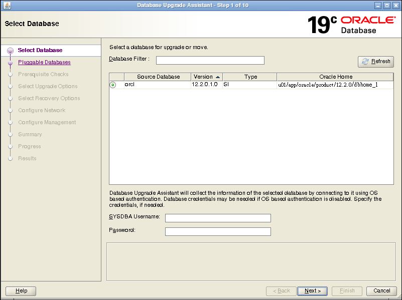
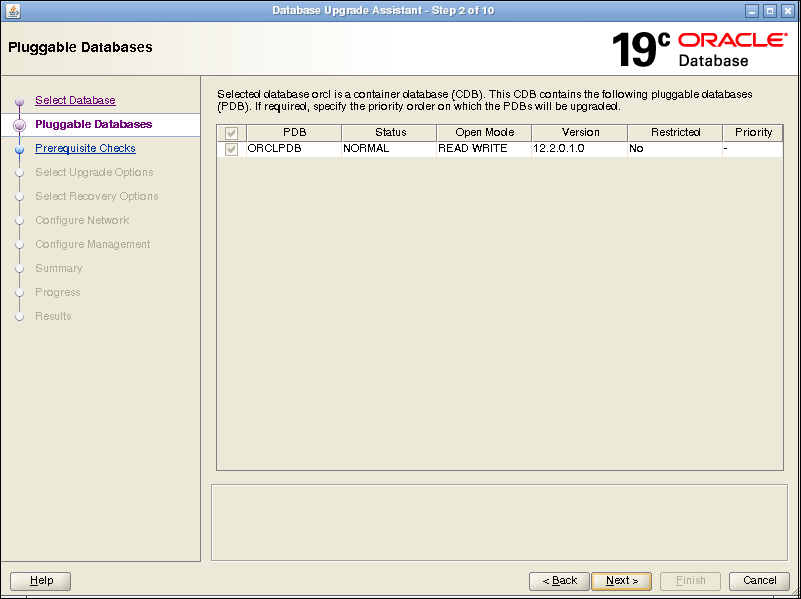
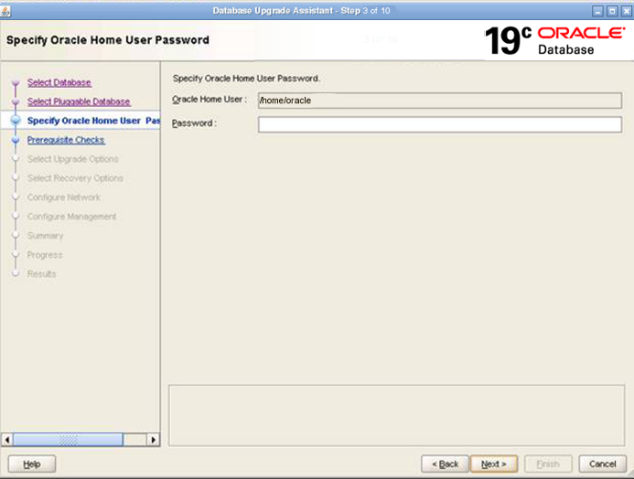
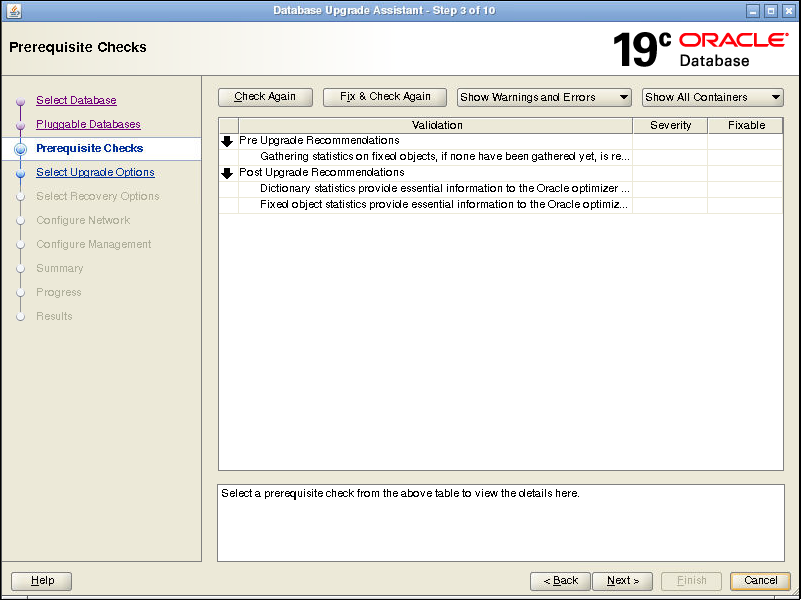
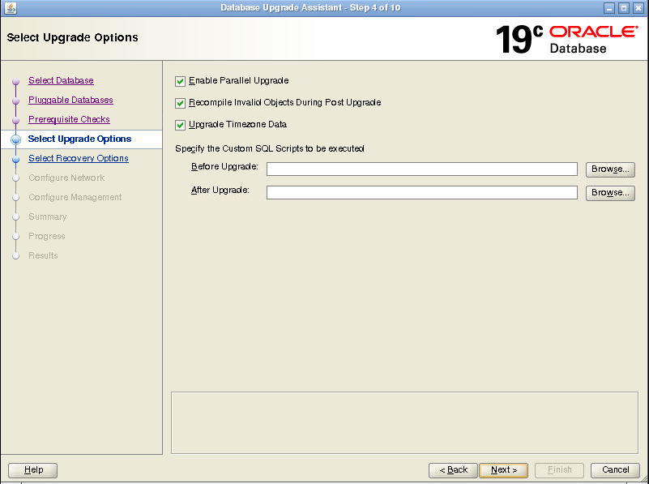
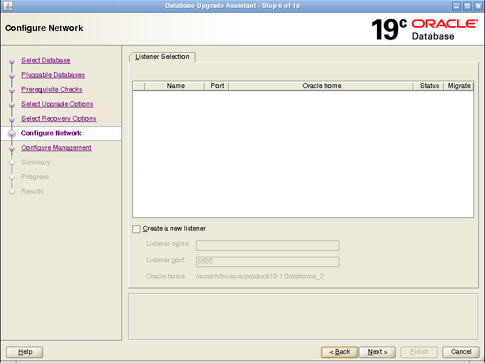
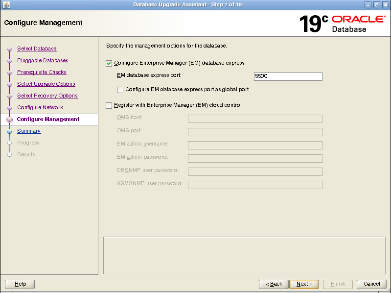
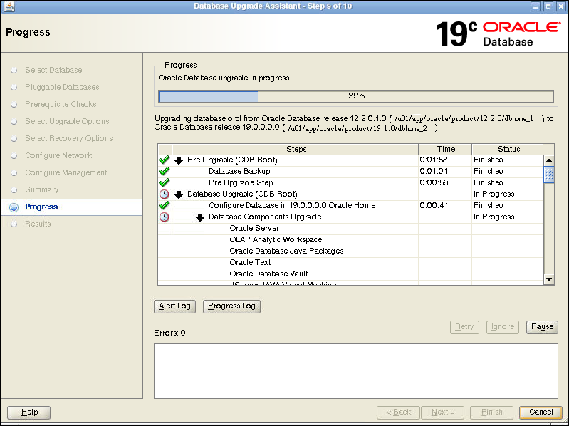
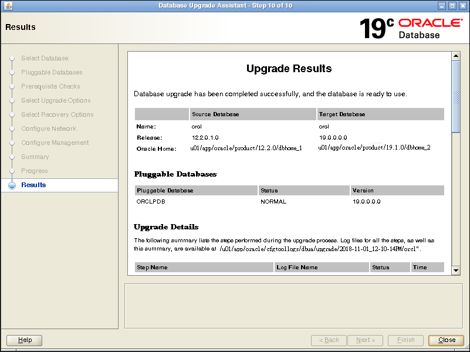

To upgrade a database using the DBUA graphical user interface, perform these steps from within the new Oracle home.

On Microsoft Windows systems (Windows), run DBUA either as an Oracle Database administrative user (a user with the operating system-assigned `ORA_DBA` role), or as the Oracle installation owner account.

1.  Start Oracle Database Upgrade Assistant (DBUA) from the Oracle home where the new database software is installed. The `dbua` executable is located in the directory path `ORACLE_HOME``/bin`.

    - On Linux or Unix platforms, log in as a user with SYSDBA privileges, and enter the following command at a system prompt in the new home for Oracle Database 19c:

          ./dbua

    - On Windows operating systems, select Start, then Programs, then Oracle HOME_NAME, then Configuration and Migration Tools, and then Database Upgrade Assistant.

2.  The Select Database window displays. If you have earlier release Oracle Database installations, then these installations are listed as available to upgrade.

    
    [Description of the illustration dbua_1.png](img_text/dbua_1.md)
    If you need help on any DBUA window, or if you want to consult more documentation about DBUA, then click Help to open the online help.

    If needed, enter the SYSDBA user name and password for the database that you select.

    If you run DBUA from a user account that does not have `SYSDBA` privileges, or if the source database does not have operating system authentication, then you must enter the user name and password credentials to enable `SYSDBA` privileges for the selected database. If the user account you use has SYSDBA privileges, or you used operating system authentication, then you do not need to enter the user name and password.

    Click Next after making your selection.

    **Note:**

    - You can select only one database at a time.

    - With single-instance upgrades, if the database does not appear in the list, then check to see if an entry with the database name exists in `/etc/oratab`. If the database is not listed there, then direct DBUA to upgrade particular databases:

      - If your single-instance database is not listed in `/etc/oratab`, and DBUA can connect to the database, then you can direct DBUA to upgrade that database explicitly by starting DBUA using the command-line arguments `-sid ``Oracle_SID`, `-oracleHome ``Oracle_home``, and ``sysDBAPassword ``password` as a command-line argument. For example:

            dbua -sid Oracle_SID –oracleHome /u01/app/oracle/18.1.0/dbhome1 -sysDBAUserName SYS -sysDBAPassword password

    - If your account does not have SYSDBA privileges, or you do not have operating system authentication set up, then you can use the following syntax to connect, where `mydb` is your Oracle Database SID, `username` is a user name with SYSDBA privileges, and `password` is that user name’s password:
          dbua -sid mydb –oracleHome /u01/app/oracle/18.1.0/dbhome1 -sysDBAUserName - username -sysDBAPassword - password

    - Oracle Real Application Clusters (Oracle RAC) upgrades: If the database does not appear on the list, then enter the following `crsctl` command to check for Oracle RAC instances:

      `crsctl status resource -t`

      You can also enter the following command to check for a particular Oracle RAC database, where `db_name` is the Oracle RAC database name:

      `crsctl status resource ora.``db_name``.db`

    - On Microsoft Windows, the following security changes affect authentication and user accounts:

      - For security reasons, Windows NTS authentication using the NTLM protocol is no longer supported. Kerberos authentication is the only supported authentication. In this release, NTS does not work either in Windows NT domains, or in domains with Windows NT controllers.

      - Oracle uses standard Microsoft Windows user accounts instead of the Windows `LocalSystem` account to run Oracle database services. Reducing the account access privileges for the Oracle installation owner provides better security on Microsoft Windows.

3.  If the selected database is a multitenant container database (CDB), then DBUA displays the Pluggable Databases window. The Pluggable Databases window lists the pluggable databases contained in the CDB. The listed PDBs are upgraded as part of the upgrade for the selected CDB.

    
    [Description of the illustration dbua_2.png](img_text/dbua_2.md)
    You can select the upgrade priority for PDBs. Click in the priority column for each PDB, and enter a numeric value for upgrade priority, where 1 is upgraded first, 2 is upgraded second, and so on.

    By default, `CDB$ROOT`, `PDB$SEED`, and all PDBs that are plugged into the CDB are upgraded. If you do not want some PDBs to be upgraded now, then unplug those PDBs.

    When you have completed selecting PDBs and upgrade priorities, click Next.

4.  Windows platforms only: If the upgrade target home is a secure home that is associated with an Oracle home user, then the Specify Oracle Home User Password window opens. For other platforms, proceed to the next step.

    
    [Description of the illustration dbua3a-win.png](img_text/dbua3a-win.md)
    Provide the Oracle home user name, and provide the password for this user account, and click Next.

5.  The Prerequisite Checks window opens. DBUA analyzes the databases, performing preupgrade checks and displaying warnings as necessary. The following is a list of examples of DBUA checks, and of actions that DBUA performs on the database:

    - Empty database recycle bin.

    - Identify invalid objects.

    - Identify deprecated and desupported initialization parameters.

    - Identify time zone data file version.

    The analysis takes several minutes to complete.

    When DBUA finishes its analysis, the Prerequisite Checks window displays again, showing the results of the checks.

    
    [Description of the illustration dbua_3.png](img_text/dbua_3.md)
    The Prerequisite Checks window shows the checks that DBUA has completed, and the severity of any errors discovered. When DBUA finds errors, it indicates which errors are fixable, and what action you can take to correct the error.

    Select Fix & Check Again if any errors that DBUA can fix appear.

    If DBUA detects errors that it cannot correct, then fix the cause of the error manually, and select Check Again.

    If DBUA finds no errors or warnings, then the DBUA automatically bypasses this window and proceeds to the next window.

    When you have fixed detected errors, click Next.

6.  The Select Upgrade Options window displays.

    
    [Description of the illustration dbua_4.png](img_text/dbua_4.md)
    This window provides the following options:

    Enable Parallel Upgrade

    Select this option if you want to enable parallelism during the upgrade process. Running upgrade processes in parallel reduces the time required to perform the upgrade, based on the number of CPUs available to handle the running of scripts and processes simultaneously.

    Recompile Invalid Objects During Post Upgrade

    This option recompiles all invalid PL/SQL modules after the upgrade is complete. If you do not have DBUA recompile invalid objects in its post-upgrade phase, then you must manually recompile invalid objects after the database is upgraded.

    Upgrade Time Zone Data

    This option updates the time zone data file for this release. If you do not select this option, then you must update the time zone configuration file manually after the upgrade.

    Specify custom SQL scripts to be executed.

    If you want to run custom SQL scripts as part of your upgrade, then select this option. As needed, click Browse for the Before Upgrade or After Upgrade input fields. Navigate to the location where your custom SQL scripts are located.

    When you have made your selections, click Next.

7.  The Select Recovery Options window appears. To recover the database if a failure occurs during upgrade, select from one of the following options:

    - Use Flashback and Guaranteed Restore Point.

      You can create a new Guaranteed Restore Point, or use an existing one. If you use an existing restore point, then click the selection field to select the restore point that you want to use.

      **Note:**

      If the database that you are upgrading has Oracle Data Guard physical standbys, then you must first create a guaranteed restore point on each standby before you create one on the primary database. If you do not create restore points on each standby first, then you must recreate all standby databases again after using the guaranteed restore point to downgrade the primary database. After the upgrade is successful, you must manually drop all guaranteed restore points on the standbys.

    - Use RMAN Backup

      You can create a new offline RMAN backup, or use an existing backup. Click Browse to specify a path for the backup.

    - Use Latest Available RMAN Backup

      You can use an existing backup. Click View/Edit Restore Script to select the backup that you want to use.

    - I have my own backup and restore strategy.

      Select this option only if you have a third-party backup solution in place for your existing database.

    When you have made your selections, click Next.

8.  For single-instance database installations, the Configure Network window opens. Select one or more listeners from the source Oracle home that you want to migrate to the new upgraded Oracle home, or create a new listener during installation.

    
    [Description of the illustration dbua_6.png](img_text/dbua_6.md)
    The Listener Selection area of the Network Configuration window shows a table with the following columns:

    - Select column. Select the listeners that you want to update.

    - Name This column shows listener names.

    - Port This column shows the ports on which listeners are configured.

    - Oracle Home This column shows the Oracle home where listeners are configured.

    - Status This column shows the listener status (up or down).

    - Migrate Select this column, and choose Yes to migrate, or No if you do not want to migrate.

    You can also select to create a new listener. If you create a new listener, then provide the listener name, the Oracle home where you want it placed, and the port that you want to configure the listener to monitor.

    After you make your choices, DBUA completes the following steps for any listeners that you migrate:

    1.  DBUA adds the selected listener to the `listener.ora` file of the target Oracle home, and starts it.

    2.  DBUA removes the entry of the upgraded database from the old (source) `listener.ora` file.

    3.  DBUA reloads the `listener.ora` file in both the source and target Oracle Database environments.

    **Note:**

    If there are other databases registered with the same listener, then their new client connection requests can be affected during listener migration.

    Click Next when you have completed your choices.

9.  The Configure Management window appears. In the Configure Management window, select the management options:

    
    [Description of the illustration dbua_7.png](img_text/dbua_7.md)
    - Configure Enterprise Manager (EM) database express

      Oracle Enterprise Manager Database Express is a web-based database management application that is built into Oracle Database. EM Express replaces the DB Control component that was available in earlier releases. If you select to configure Enterprise Manager Database Express, then Enter the EM Database Express Port number. For example: 5500. You can also select the check box to configure the express port as the global port.

    - Register with Enterprise Manager (EM) Cloud Control

      Registering with Oracle Enterprise Manager Cloud Control adds the database and its related entities, such as Listener, Oracle ASM disk groups, and Oracle Clusterware, as targets that you can manage with EM Cloud Control.

      If you select this option, then you must provide information in the following fields:

      - OMS Host

      - OMS Port

      - EM Admin Username

      - EM Admin Password

      - DBSNMP User Password

      - ASMSNMP User Password

    When you have completed entering information, click Next.

10. The Summary window opens. The Summary window shows the information that you have provided for the upgrade. Scroll down the list to review the information. The summary includes information such as the following:

    - Source Database

    - Target Database

    - Pluggable Databases

    - Pre-Upgrade Checks

    - Initialization Parameters changes

    - Timezone Upgrade

    Check your selections. Then, either select a link to the item that you want to change, or click Back to go to earlier pages, or select Finish:

    - If you see information in the Summary window that you want to correct, then click a link on an item that you want to update, or click Back to navigate backward through the DBUA configuration interview.

    - Click Finish if the information that you see in the Summary window is correct. The upgrade begins after you select Finish.

    The Progress window displays with the progress bar, as DBUA begins the upgrade. The Progress window displays a table that shows the steps DBUA is completing during the upgrade. This table shows the time duration, and the upgrade steps status as the upgrade proceeds. DBUA provides a Stop button in case you must cancel the upgrade at this point.

    
    [Description of the illustration dbua_9.png](img_text/dbua_9.md)
    When the upgrade has progressed through finishing the upgrade of the CDB root and each PDB seed, the Progress window marks the status as Finished.

11. After the upgrade is complete, the Results window opens. The Results window displays information about the original database, and about the upgraded database. The Upgrade Results report also shows changes that DBUA made to the initialization parameters. If you are upgrading a multitenant architecture database, then the Results window also shows pluggable databases, and the directory where log files are stored after the upgrade. Scroll down to see more details about preupgrade checks. If the upgrade is successful, then the Upgrade Results field reports the results, and you do not see warning messages. If the upgrade was unsuccessful, as this example image shows, then the Restore Database button is displayed on the lower right corner below the display field. You can click this button to start a database restoration.

    
    [Description of the illustration dbua_10.png](img_text/dbua_10.md)

12. Optional: Examine the log files to obtain more details about the upgrade process. If the Oracle base environment variable is set, then the DBUA log files are located in the path `/``ORACLE_BASE``/cfgtoollogs/dbua/upgradesession_``timestamp``/``SID`. If Oracle base is not set, then the DBUA log files are located in the path `/``ORACLE_HOME``/cfgtoollogs/dbua/upgradesession_``timestamp``/``SID`

    **Note:**

    An HTML version of the Upgrade Results window is also saved in the log files directory. You can click the links in this HTML window to view the log windows in your browser.

    If you are satisfied with the upgrade results, then click Close to quit DBUA.

13. After your upgrade is completed, carry out post-upgrade procedures described in this book. When you have completed post-upgrade procedures, your upgraded database is ready to use.

**Caution:**

To prevent unauthorized use of the database, Oracle recommends that you change all user passwords immediately after you upgrade your database.

If the default security settings for Oracle Database 12c and later releases are in place, then passwords must be at least eight characters. Passwords such as `welcome` and `oracle` are not allowed.

**Parent topic:** [Upgrading Oracle Database](upgrading-db.md)
