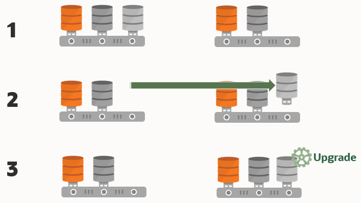

Before you upgrade Oracle Database, review new features, and carry out procedures to prepare your database for upgrade.

**Note:**

Oracle strongly recommends that you test the upgrade process and prepare a backup strategy.

- [Installing Oracle Software in a New Oracle Home](installing-oracle-software-in-a-new-oracle-home.md)
  Choose a new location for the target Oracle home, and then install the new Oracle Database release software for single-instance.
- [Prepare a Backup Strategy Before Upgrading Oracle Database](prepare-a-backup-strategy-before-upgrading-db.md)
  You must design and carry out an appropriate backup strategy to ensure a successful upgrade.
- [Database Preparation Tasks to Complete Before Starting Oracle Database Upgrades](db-preparation-tasks-before-starting-db-upgrades.md)
  Ensure that you have completed these database preparation tasks before starting an Oracle Database upgrade.
- [Enabling Oracle Database Vault After Upgrading Oracle Database](enabling-oracle-db-vault-after-upgrading-oracle-db.md)
  Depending on your target database release, you can be required to disable Oracle Database Vault to complete an Oracle Database upgrade.
- [Preparations for Running AutoUpgrade Processing Modes](preparations-running-autoupgrade-processing-modes.md)
  You must complete preparations before you can run an AutoUpgrade processing mode.
- Pre-Upgrade Information Check with AutoUpgrade
  To obtain a checklist of tasks you must complete before upgrading an Oracle Database, run the AutoUpgrade utility (`autoupgrade.jar`) in `analyze` mode.
- [Create Configuration File for AutoUpgrade](create-config-file-autoupgrade.md)
  To use AutoUpgrade to complete the upgrade, you first create a configuration file with AutoUpgrade from the new release Oracle home.
- Locally Modifiable Global Parameters for AutoUpgrade Configuration File
  Required configuration parameters for AutoUpgrade can be set either globally for all upgrades, or locally.
- [Local Parameters for the AutoUpgrade Configuration File](local-parameters-autoupgrade-config-file.md)
  To configure information for specific Oracle Databases for the AutoUpgrade utility upgrade, you provide information in the AutoUpgrade local parameters.
- [Global Parameters for the AutoUpgrade User Configuration File](global-parameters-autoupgrade-config-file.md)
  To specify a default behavior for a parameter for all Oracle Database upgrades addressed in the configuration file, you can use the optional AutoUpgrade global parameters.
- [Understanding Non-CDB to PDB Upgrades with AutoUpgrade](understanding-non-cdb-pdb-upgrades-autoupgrade.md)
  You can upgrade and convert a non-CDB to a PDB in a new CDB in a single operation, or upgrade and then convert a Non-CDB database to a PDB in a pre-existing CDB.
- [Non-CDB to PDB Upgrade Guidelines and Examples](non-cdb-pdb-upgrade-guidelines-and-examples.md)
  Before conversion, back up your datafiles and database, and follow the guidelines for your source Oracle Database release.
- Understanding Unplug-Plug Upgrades with AutoUpgrade
  AutoUpgrade can perform an unplug of a pluggable database (PDB) from an earlier release source container database (CDB), plug it into a later release target CDB, and then complete all the steps required to upgrade the PDB to the target CDB release.
- [Examples of Non-CDB to PDB Configuration Files for AutoUpgrade](example-non-cdb-pdb-configuration-file-autoupgrade.md)
  Use these examples to understand how you can modify your own Oracle Database upgrade configuration file for AutoUpgrade.

### Pre-Upgrade Information Check with AutoUpgrade

To obtain a checklist of tasks you must complete before upgrading an Oracle Database, run the AutoUpgrade utility (`autoupgrade.jar`) in `analyze` mode.

Oracle recommends that you download and run the most recent release of AutoUpgrade in `-analyze` mode before you upgrade Oracle Database. AutoUpgrade can identify issues for you to address before you start your upgrade. In certain cases, AutoUpgrade can also generate scripts that can resolve some issues.

**Tip:**

Consider reviewing Mike Dietrich's upgrade blog for tips and suggestions that can assist you with your upgrade preparations. You can also review the checklist on My Oracle Support, but ensure that you download the latest version of the AutoUpgrade tool, and use the checklist AutoUpgrade generates for your upgrade.

**Related Topics**

- [My Oracle Support AutoUpgrade Tool (Doc ID 2485457.1)](https://support.oracle.com/rs?type=doc&id=2485457.1)
- [Upgrade your Database – NOW! Mike Dietrich's Oracle Database Upgrade Blog](https://mikedietrichde.com/)
- [Database Preupgrade tool (via autoupgrade.jar) check list (Doc ID 2380601.1)](https://support.oracle.com/rs?type=doc&id=2380601.1)

**Parent topic:** Preparing to Upgrade Oracle Database

### Locally Modifiable Global Parameters for AutoUpgrade Configuration File

Required configuration parameters for AutoUpgrade can be set either globally for all upgrades, or locally.

#### Usage Notes

If you set required AutoUpgrade parameters globally, as a locally modifiable global parameter, then these parameters can be overridden by local parameters set for particular upgrades, so that you can better control AutoUpgrade job processing.

With locally modifiable global parameters, you can use the prefix `global` to set values for required parameters as global parameters for all jobs in your AutoUpgrade configuration file, but identify the same parameter with a local job prefix to reset the global value to a different value for a particular job in the same configuration file. You can also choose to set locally modifiable global parameters only as local parameters for each AutoUpgrade job.

**Note:**

These parameters are available in the latest version of AutoUpgrade that you can download from My Oracle Support.

When a locally modifiable global parameter is set both with a global prefix, and with a local job prefix, the locally modified parameter value overrides the global parameter values for the job identified by the prefix that you use with the parameter.

For example, with `global.target_home`, the syntax you use is in the form `global.target_home=``Global target Oracle home`, and `database``.target_home=``local target Oracle home``.`

#### Example

In the AutoUpgrade configuration file, the required parameter `target_home` is set globally to one Oracle home path. But in the configuration file, the same parameter is set locally to a different Oracle home path. As AutoUpgrade processes the jobs in the configuration file, it uses the locally defined path for `target_home` for the job defined by the prefix `upgrade3`, overriding the global parameter setting:

    global.target_home=/u01/app/oracle/21.0.0/dbhome01
    upgrade3.target_home=/u03/app/oracle3/12.2.0.1/dbhome3

- defer_standby_log_shipping
  Defers shipping logs from the primary database to any standby database. All log archive destionations (`log_archive_dest_``n`) are set to deferred.
- dictionary_stats_after
  (Optional) Specifies that AutoUpgrade gathers data dictionary statistics on the target database after the upgrade is complete.
- dictionary_stats_before
  (Optional) Specifies that AutoUpgrade gathers data dictionary statistics on the source database before starting the upgrade.
- drop_grp_after_upgrade
  Deletes the Guaranteed Restore Point (GRP) after database upgrade.
- enable_local_undo
  For a CDB upgrade, specifies whether or not `LOCAL` undo should be enabled before the upgrade of `CDB$ROOT`.
- fixed_stats_before
  (Optional) Specifies that AutoUpgrade gathers fixed object statistics on the source database before starting the upgrade.
- manage_network_files
  Specifies whether network files are processed during the upgrade.
- remove_underscore_parameters
  Removes underscore (hidden) parameters from `PFILE` files during upgrade, and after upgrade, for all Oracle Databases in the configuration file.
- restoration
  (Available with Enterprise Edition only) Generates a Guaranteed Restore Point (GRP) for database restoration.
- target_base
  Specifies the target `ORACLE_BASE` path for the target Oracle home.
- target_home
  (Required for upgrade and deploy modes, if the target home is not on the system. Optional for analyze and fixups mode. ) Specifies the target Oracle home (`ORACLE_HOME`) path.
- target_version
  (Required if target Oracle home is not on the system, or is release 12.2) Specifies the target release version on which you want AutoUpgrade to perform the upgrade.

**Parent topic:** Preparing to Upgrade Oracle Database

#### defer_standby_log_shipping

Defers shipping logs from the primary database to any standby database. All log archive destionations (`log_archive_dest_``n`) are set to deferred.

##### Usage Notes

By default, log shipping occurs as part of the upgrade. When Autoupgrade defers log shipping, you receive a notice that log shipping is deferred, and that after the upgrade completes successfully, you need to reenable shipping logs from the primary database to the secondary database.

**Note:**

This configuration file parameter affects not only standby databases, but all products or services that receive redo from the primary database, such as Oracle Zero Data Loss Recovery Appliance (ZDLRA) real-time log transport, and Oracle GoldenGate downstream capture.

##### Options

`[yes | no]`

The default value is `no`

The default is no (log-shipping is not deferred). If you change the default to `Yes`, then log shipping is deferred, and you must choose to re-enable it manually after upgrade.

##### Example

    defer_standby_log_shipping=yes

**Parent topic:** Locally Modifiable Global Parameters for AutoUpgrade Configuration File

#### dictionary_stats_after

(Optional) Specifies that AutoUpgrade gathers data dictionary statistics on the target database after the upgrade is complete.

##### Usage Notes

Oracle recommends that you gather dictionary statistics both before and after upgrading the database, because Data Dictionary tables are modified and created during the upgrade. When you specify yes, AutoUpgrade gathers dictionary statistics after the upgrade is completed.

##### Options

`[yes | no]`

The default value is `Yes`.

##### Example

    global.dictionary_stats_after=yes

    sales.dictionary_stats_after=yes

**Parent topic:** Locally Modifiable Global Parameters for AutoUpgrade Configuration File

#### dictionary_stats_before

(Optional) Specifies that AutoUpgrade gathers data dictionary statistics on the source database before starting the upgrade.

##### Usage Notes

Oracle recommends that you gather dictionary statistics both before and after upgrading the database, because Data Dictionary tables are modified and created during the upgrade. When you specify yes, AutoUpgrade gathers dictionary statistics before beginning the upgrade.

##### Options

`[yes | no]`

The default value is `Yes`.

##### Example

    global.dictionary_stats_before=yes

    sales.dictionary_stats_before=yes

**Parent topic:** Locally Modifiable Global Parameters for AutoUpgrade Configuration File

#### drop_grp_after_upgrade

Deletes the Guaranteed Restore Point (GRP) after database upgrade.

##### Usage Notes

If you select this option, then GRP is deleted after upgrade completes successfully.

##### Options

`[yes | no]`

The default value is `no`.

##### Example

    global.drop_grp_after_upgrade=yes

    sales.drop_grp_after_upgrade=yes

**Parent topic:** Locally Modifiable Global Parameters for AutoUpgrade Configuration File

#### enable_local_undo

For a CDB upgrade, specifies whether or not `LOCAL` undo should be enabled before the upgrade of `CDB$ROOT`.

##### Usage Notes

If you select this option, then AutoUpgrade runs the following statement before upgrade: `ALTER DATABASE LOCAL UNDO ON;`.

When local undo is first enabled, the size of the undo tablespace in `PDB$SEED` is determined as a factor of the size of the undo tablespace in `CDB$ROOT`. The default is 30 percent of the undo tablespace size. Every other PDB in the CDB inherits this property from `PDB$SEED`. Ensure that there is enough space to allocate new `UNDO` tablespaces.

##### Options

`[yes | no]`

The default value is `no`.

##### Example

    enable_local_undo=yes

**Parent topic:** Locally Modifiable Global Parameters for AutoUpgrade Configuration File

#### fixed_stats_before

(Optional) Specifies that AutoUpgrade gathers fixed object statistics on the source database before starting the upgrade.

##### Usage Notes

Before an upgrade, Oracle recommends that you regather fixed object statistics.

Fixed objects are the `X$` tables and their indexes. `V$` performance views are defined through `X$` tables. Gathering fixed object statistics is valuable for database performance, because these statistics help the optimizer generate good execution plans, which can improve database performance. Failing to obtain representative statistics can lead to suboptimal execution plans, which can cause significant performance problems.

##### Options

`[yes | no]`

The default value is `Yes`.

##### Example

    global.fixed_stats_before=yes

    sales.fixed_stats_before=yes

**Parent topic:** Locally Modifiable Global Parameters for AutoUpgrade Configuration File

#### manage_network_files

Specifies whether network files are processed during the upgrade.

##### Usage Notes

If you select this option, then AutoUpgrade processes network files, depending on the option that you specify.

The following network files are processed: `oranfstab`, `ldap.ora`, `tnsnames.ora`, `sqlnet.ora`, and `listener.ora`

##### Options

\[`FULL|SKIP|IGNORE_READ_ONLY`\]

- `FULL`: (default) Raise all exceptions encountered during the copy and merge of network files into the target Oracle home.
- `SKIP`: Do not process network files during postupgrade.
- `IGNORE_READ_ONLY`: Attempt to copy and merge network files, but do not raise an exception during the upgrade if the target file is read only

##### Example

    manage_network_files=ignore_read_only

**Parent topic:** Locally Modifiable Global Parameters for AutoUpgrade Configuration File

#### remove_underscore_parameters

Removes underscore (hidden) parameters from `PFILE` files during upgrade, and after upgrade, for all Oracle Databases in the configuration file.

##### Usage Notes

Underscore parameters should only be used by advice of Oracle Support.

##### Options

`[yes | no]`

The default value is `no`.

##### Example

    global.remove_underscore_parameters=yes

**Parent topic:** Locally Modifiable Global Parameters for AutoUpgrade Configuration File

#### restoration

(Available with Enterprise Edition only) Generates a Guaranteed Restore Point (GRP) for database restoration.

##### Usage Notes

This option determines whether database backup and database restoration must be performed manually by the DBA.

Standard Edition does not support Flashback Database, so this option is not available for Standard Edition. If your database is a Standard Edition Oracle Database, then you must ensure that you have a separate fallback mechanism is in place.

##### Options

`[yes | no]`

The default value is `yes`.

##### Example

    global.restoration=no

**Parent topic:** Locally Modifiable Global Parameters for AutoUpgrade Configuration File

#### target_base

Specifies the target `ORACLE_BASE` path for the target Oracle home.

##### Example

    global.target_base=/u01/app/oracle
    sales4.target_base=/u04/app/oracle4

**Parent topic:** Locally Modifiable Global Parameters for AutoUpgrade Configuration File

#### target_home

(Required for upgrade and deploy modes, if the target home is not on the system. Optional for analyze and fixups mode. ) Specifies the target Oracle home (`ORACLE_HOME`) path.

##### Usage Notes

AutoUpgrade uses the release version information that you provide in this parameter to ensure that the correct checks and fixups are used for the target Oracle Database release to which you are upgrading. The format for this parameter are period-delimited values of valid Oracle versions.

This option is only required if the target home is not present on the system, or if the target home is a 12.2 release. Otherwise, AutoUpgrade can derive the target release value.

##### Options

Valid values

- 12.2
- 18
- 19
- 21

##### Example

    global.target_version=19
    employees.target_version=12.2

**Parent topic:** Locally Modifiable Global Parameters for AutoUpgrade Configuration File

#### target_version

(Required if target Oracle home is not on the system, or is release 12.2) Specifies the target release version on which you want AutoUpgrade to perform the upgrade.

##### Usage Notes

AutoUpgrade uses the release version information that you provide in this parameter to ensure that the correct checks and fixups are used for the target Oracle Database release to which you are upgrading. The format for this parameter are period-delimited values of valid Oracle versions.

This option is only required if the target home is not present on the system, or if the target home is a 12.2 release. Otherwise, AutoUpgrade can derive the target release value.

##### Options

Valid values

- 12.2
- 18
- 19
- 21

##### Example

    global.target_version=19
    employees.target_version=12.2

**Parent topic:** Locally Modifiable Global Parameters for AutoUpgrade Configuration File

### Understanding Unplug-Plug Upgrades with AutoUpgrade

AutoUpgrade can perform an unplug of a pluggable database (PDB) from an earlier release source container database (CDB), plug it into a later release target CDB, and then complete all the steps required to upgrade the PDB to the target CDB release.

There are two workflows for unplug-plug PDB upgrades using AutoUpgrade, depending on how you configure the upgrade:

- You unplug one or more pluggable databases from one source CDB, and plug them into a new release target CDB
- You unplug multiple pluggable databases from different source CDBs, and plug them into a new release target CDB

After the upgrade, for each PDB, you must configure database listeners and local naming parameters (`tnsnames.ora` files).

**Caution:**

As with any other change to the database, before you run AutoUpgrade to complete the conversion and upgrade, Oracle strongly recommends that you implement a reliable backup strategy to prevent unexpected data loss. There is no option to roll back an unplug-plug PDB upgrade after AutoUpgrade starts this procedure. Flashback Database also does not work across the PDB conversion, and is not reversable. Backups are the only fallback strategy. AutoUpgrade does not support unplug-plug upgrades of PDBs that use Transparent Data Encryption (TDE), or that have an encrypted tablespace.

The following illustration shows the unplug-plug operation, in this case of a single PDB:

1.  There is one source Oracle Database, and one target release Oracle Database. At this stage, create your configuration file and run AutoUpgrade in Analyze mode (`autoupgrade.jar -mode analyze`) to check your readiness for upgrade, and to correct any issues that are reported.
2.  You run AutoUpgrade in Deploy mode (autoupgrade.jar -mode deploy). AutoUpgrade uses the information you provide in the configuration file to move the PDB to the target release, and plug in the PDB.
3.  AutoUpgrade runs prefixups, and then upgrades the PDB to the target release.

Figure 2-1 Unplug-Plug Upgrades from Source to Target

[Description of "Figure 2-1 Unplug-Plug Upgrades from Source to Target"](img_text/unplug-plug-upgrade.md)

#### Requirements for Source and Target CDBs

To perform an unplug-plug upgrade, your source and target CDBs must meet the following conditions:

- You have created the target release CDB, and opened the CDB before starting the unplug-plug upgrade.
- The endian format of the source and target CDBs are identical.
- The set of Oracle Database components configured for the target release CDB include all of the components available on the source CDB.
- The source and target CDBs have compatible character sets and national character sets
- The source CDB release must be supported for direct upgrade to the target CDB release.
- External authentication (operating system authentication) is enabled for the source and target CDBs
- The Oracle Application Express installation type on the source CDBs should match the installation type on the target CDB.
- There should be no existing guaranteed restore point (GRP) on the non-CDB Oracle Database that you want to plug in to the CDB.

**Note:**

With the most recent version of AutoUpgrade, you can now use AutoUpgrade to plug into an Oracle Data Guard configuration. AutoUpgrade creates the PDB with the `STANDBYS=NONE` clause. After the upgrade, you can re-establish standbys by recovering the data files on to standby databases.

#### Features of Unplug-Plug Upgrades

When you select an unplug-plug upgrade, depending on how you configure the AutoUpgrade configuration file, you can use AutoUpgrade to perform the following options during the upgrade:

- You can either keep the PDB name that you have in the source CDB, or you can change the PDB name.
- You can make a copy of the data files to the target CDB, while preserving all of the old files.
- You can copy the data files to the target location, and then delete the old files on the source CDB
- You can process one PDB, or you can link to an inclusion list and process many PDBs in one upgrade procedure; the only limit for the number of PDBs you can process are the server limits, and the limits for PDBS on the CDB.

Example 2-1 AutoUpgrade Configuration File for Unplug-Plug Upgrades

To use the unplug-plug PDB upgrade option, you must identify the following values in the AutoUpgrade configuration file:

- The system identifier parameters for the source CDB (parameter `sid`).
- The target CDB (parameter `target_cdb`).
- The name of the PDB in the source CDB, and, if you want to convert it, the target conversion name.

For example, where the source CDB is `CDB122`, the target CDB is `cdb21x`, the name of the PDB in the source CDB is `pdb2`, and the conversion name for the PDB that you want on the target CDB is `depsales`:

    global.autoupg log_dir=/home/oracle/autoupg
    upg1.sid=CDB122
    upg1.source_home=/u01/app/oracle/product/12.2.0/dbhome_1
    upg1.target_home=/u01/app/oracle/product/21.1.0/dbhome_1
    upg1.target_cdb=cdb21x
    upg1.pdbs=pdb_2
    upg1.target_pdb_name.pdb_2=depsales
    upg1.target_pdb_copy_option.pdb_2=file_name_convert=('pdb_2','depsales')

**Parent topic:** Preparing to Upgrade Oracle Database
