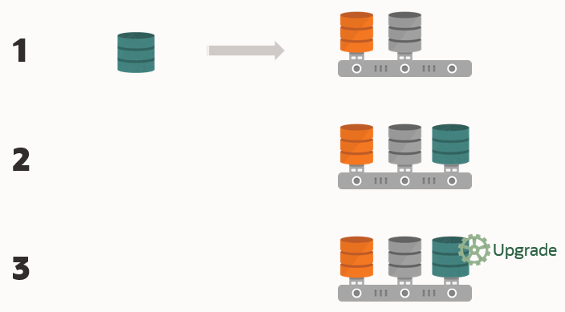

You can upgrade and convert a non-CDB to a PDB in a new CDB in a single operation, or upgrade and then convert a Non-CDB database to a PDB in a pre-existing CDB.

All upgrades to Oracle Database 21c must use the multitenant architecture. Use of the non-CDB Oracle Database architecture is desupported. When you migrate your database from the non-CDB architecture to PDBs, you obtain up to three user-configurable PDBs in a container database (CDB), without requiring a multitenant license. If you choose to configure four or more PDBs, then a multitenant license is required.

The non-CDB to PDB feature of the AutoUpgrade utility provides you flexible options to control how you upgrade your earlier release non-CDB Oracle Database when you upgrade and convert to the multitenant architecture. Starting with Oracle Database 21c, when you have an existing target release CDB, you can use AutoUpgrade to convert a non-CDB Oracle Database to a PDB on the target release CDB during the upgrade. To perform an upgrade and conversion of the non-CDB to a PDB, you provide information about your non-CDB in the AutoUpgrade configuration file. If you prefer, you can also choose to convert your non-CDB Oracle Database to a PDB in the source release, and then plug in the PDB to a target release CDB, where the upgrade is performed when you plug in the PDB.

After the upgrade you must configure the database listeners and local naming parameters (`tnsnames.ora` files) .

**Caution:**

Before you run AutoUpgrade to complete the conversion and upgrade. Oracle strongly recommends that you create a full backup of your source database, and complete thorough testing of the upgrade. There is no option to roll back to the non-CDB Oracle Database state after AutoUpgrade starts this procedure.

Figure 2-2 Converting and Upgrading a Non-CDB Using AutoUpgrade

In this illustration, a non-CDB Oracle Database called Sales is converted and upgraded to a PDB called Sales.

[Description of "Figure 2-2 Converting and Upgrading a Non-CDB Using AutoUpgrade"](img_text/noncdb-pdb.md)

### Requirements for Source Non-CDB and Target CDB

Requirements on the source non-CDB and target CDB to perform upgrades and conversions to PDBs are as follows:

- The target CDB must be created in advance of performing the upgrade with AutoUpgrade.
- The PDB created from the non-CDB must continue to use the source non-CDB name. You cannot change the name of the database.
- The same set of Oracle Database options are configured for both the source and target.
- The endian format of the source and target CDBs are identical.
- The source and target CDBs have compatible character sets and national character sets.
- The source non-CDB Oracle Database release and operating system platform must be supported for direct upgrade to the target CDB release.
- Operating system authentication is enabled for the source and target CDBs

The minimum `COMPATIBLE` parameter setting for the source database must be at least 12.2.0. If the `COMPATIBLE` setting is a lower version, then during the conversion and upgrade process, `COMPATIBLE` is set to 12.2.0. During the conversion, the original datafiles are retained. They are not copied to create the new PDB. To enable AutoUpgrade to perform the upgrade, edit the AutoUpgrade configuration file to set the AutoUpgrade parameters `target_version `to the target CDB release, and identify the CDB to which the upgraded database is placed using `target_cdb`. During the conversion and upgrade process, AutoUpgrade uses that information to complete the upgrade to the target CDB.

Example 2-5 AutoUpgrade Configuration File for Non-CDB to PDB Conversion

To use the non-CDB to PDB option, you must set the parameters `target_cdb` in the AutoUpgrade configuration file. The `target_cdb` parameter value defines the Oracle system identifier (SID) of the container database into which you are plugging the non-CDB Oracle Database. For example:

    global.autoupg_log_dir=/home/oracle/autoupg
    upg1.sid=s12201
    upg1.source_home=/u01/product/12.2.0/dbhome_1
    upg1.log_dir=/home/oracle/autoupg
    upg1.target_home=/u01/product/20.1.0/dbhome_1
    upg1.target_base=/u01
    upg1.target_version=19.1.0
    upg1.target_cdb=cdb19x

**Related Topics**

- [Permitted Features, Options, and Management Packs by Oracle Database Offering](../dblic/Licensing-Information.md)

**Parent topic:** [Preparing to Upgrade Oracle Database](preparing-to-upgrade.md)
