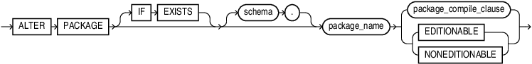

## ALTER PACKAGE

### Purpose

Packages are defined using PL/SQL. Therefore, this section provides some general information but refers to [Oracle Database PL/SQL Language Reference](../lnpls/CREATE-PACKAGE-statement.md) for details of syntax and semantics.

Use the `ALTER` `PACKAGE` statement to explicitly recompile a package specification, body, or both. Explicit recompilation eliminates the need for implicit run-time recompilation and prevents associated run-time compilation errors and performance overhead.

Because all objects in a package are stored as a unit, the `ALTER` `PACKAGE` statement recompiles all package objects together. You cannot use the `ALTER` `PROCEDURE` statement or `ALTER` `FUNCTION` statement to recompile individually a procedure or function that is part of a package.

**Note:**

This statement does not change the declaration or definition of an existing package. To redeclare or redefine a package, use the [CREATE PACKAGE](CREATE-PACKAGE.md) or the [CREATE PACKAGE BODY](CREATE-PACKAGE-BODY.md) statement with the `OR` `REPLACE` clause.

### Prerequisites

For you to modify a package, the package must be in your own schema or you must have `ALTER` `ANY` `PROCEDURE` system privilege.

### Syntax

### alter_package::=

[Description of the illustration alter_package.eps](img_text/alter_package.md)

(`package_compile_clause`: See [Oracle Database PL/SQL Language Reference](../lnpls/ALTER-PACKAGE-statement.md) for the syntax of this clause.)

### Semantics

### IF EXISTS

Specify `IF EXISTS` to alter an existing package.

### schema

Specify the schema containing the package. If you omit `schema`, then Oracle Database assumes the package is in your own schema.

### package_name

Specify the name of the package to be recompiled.

### package_compile_clause

See [Oracle Database PL/SQL Language Reference](../lnpls/ALTER-PACKAGE-statement.md) for the syntax and semantics of this clause and for complete information on creating and compiling packages.

### EDITIONABLE \| NONEDITIONABLE

Use these clauses to specify whether the package becomes an editioned or noneditioned object if editioning is later enabled for the schema object type `PACKAGE` in `schema`. The default is `EDITIONABLE`. For information about altering editioned and noneditioned objects, see [Oracle Database Development Guide](../adfns/editions.md).
