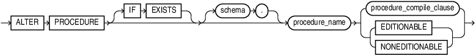

## ALTER PROCEDURE

### Purpose

Packages are defined using PL/SQL. Therefore, this section provides some general information but refers to [Oracle Database PL/SQL Language Reference](../lnpls/ALTER-PROCEDURE-statement.md) for details of syntax and semantics.

Use the `ALTER` `PROCEDURE` statement to explicitly recompile a standalone stored procedure. Explicit recompilation eliminates the need for implicit run-time recompilation and prevents associated run-time compilation errors and performance overhead.

To recompile a procedure that is part of a package, recompile the entire package using the `ALTER` `PACKAGE` statement (see [ALTER PACKAGE](ALTER-PACKAGE.md)).

**Note:**

This statement does not change the declaration or definition of an existing procedure. To redeclare or redefine a procedure, use the `CREATE` `PROCEDURE` statement with the `OR` `REPLACE` clause (see [CREATE PROCEDURE](CREATE-PROCEDURE.md)).

The `ALTER` `PROCEDURE` statement is quite similar to the `ALTER` `FUNCTION` statement. Refer to [ALTER FUNCTION](ALTER-FUNCTION.md) for more information.

### Prerequisites

The procedure must be in your own schema or you must have `ALTER` `ANY` `PROCEDURE` system privilege.

### Syntax

### alter_procedure::=

[Description of the illustration alter_procedure.eps](img_text/alter_procedure.md)

(`procedure_compile_clause`: See [Oracle Database PL/SQL Language Reference](../lnpls/ALTER-PROCEDURE-statement.md) for the syntax of this clause.)

### Semantics

### IF EXISTS

Specify `IF EXISTS` to alter an existing procedure.

### schema

Specify the schema containing the procedure. If you omit `schema`, then Oracle Database assumes the procedure is in your own schema.

### procedure_name

Specify the name of the procedure to be recompiled.

### procedure_compile_clause

See [Oracle Database PL/SQL Language Reference](../lnpls/ALTER-PROCEDURE-statement.md) for the syntax and semantics of this clause and for complete information on creating and compiling procedures.

### EDITIONABLE \| NONEDITIONABLE

Use these clauses to specify whether the procedure becomes an editioned or noneditioned object if editioning is later enabled for the schema object type `PROCEDURE` in `schema`. The default is `EDITIONABLE`. For information about altering editioned and noneditioned objects, see [Oracle Database Development Guide](../adfns/editions.md).
