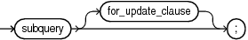
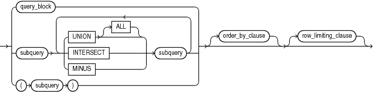
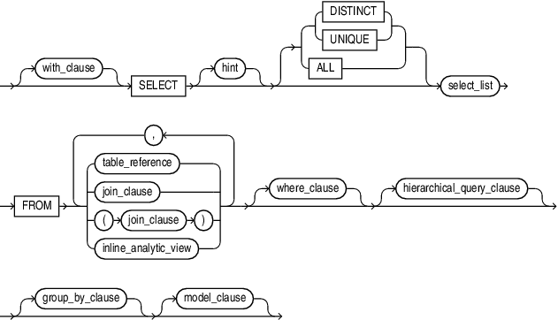

## About Queries and Subqueries

A query is an operation that retrieves data from one or more tables or views. In this reference, a top-level `SELECT` statement is called a query, and a query nested within another SQL statement is called a subquery.

This section describes some types of queries and subqueries and how to use them. The top level of the syntax is shown in this chapter. Refer to [SELECT](SELECT.md) for the full syntax of all the clauses and the semantics of this statement.

### select::=

[Description of the illustration select.eps](img_text/select.md)

### subquery::=

[Description of the illustration subquery.eps](img_text/subquery.md)

### query_block::=

[Description of the illustration query_block.eps](img_text/query_block.md)
